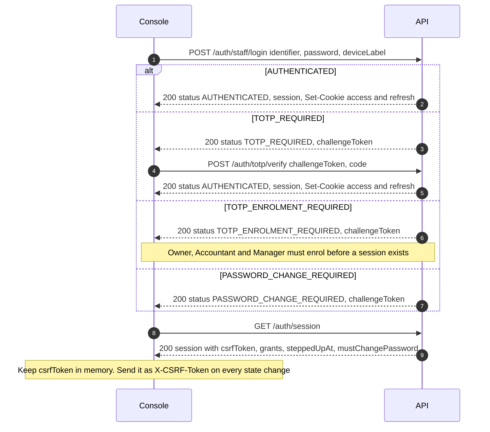

# HaKorem Farms Platform: API Conventions

How to talk to the API: for the frontend track, for integrators, and for every backend session that adds an endpoint. The contract itself is `contract/openapi.yaml` (version 1.0.0, 600 operations, 476 paths). This document explains the rules that apply to all of it, lists every error code, and then gives a short section per module with what a client must know.

The decisions behind these rules: ADR-0014 (idempotency), ADR-0016 (authentication), ADR-0017 (authorisation and maker-checker), ADR-0013 (identifiers), ADR-0027 (offline), ADR-0029 (money, decimals, envelopes). Offline behaviour is in `docs/OFFLINE_SYNC.md`.

## 1. Base URLs and versioning

| Environment | API base URL | Notes |
| --- | --- | --- |
| Production | `https://api.hakoremfarms.com/v1` | Storefront at `https://hakoremfarms.com`, console at `https://app.hakoremfarms.com` |
| Staging | `https://api.staging.hakoremfarms.com/v1` | Sandbox provider credentials; no real money or messages |
| Local development | `http://localhost:3000/v1` | `pnpm dev` |
| Mock server | `http://localhost:4010` | Prism, run from the contract (section 17) |

All paths in the contract are relative to the base URL, including `/v1`. There is no unversioned path except the platform probes served by Caddy. The health check is `GET /v1/health`.

**Versioning.** The URL carries the major version (`/v1`). The contract file carries a semantic version in `info.version`. Every change to the contract has an entry in `docs/CONTRACT_CHANGELOG.md`, newest first.

| Bump | What it is | Example |
| --- | --- | --- |
| Major (`/v2`) | A change that can break an existing client | Removing or renaming a field, path or enum value; making an optional field required; changing a type, a unit or a status code; tightening a pattern or a length limit; changing the meaning of an existing code |
| Minor (1.1.0) | Additions that cannot break a client that follows the rules below | A new operation, a new optional request field, a new response field, a new error code on an existing operation, a new enum value on a response |
| Patch (1.0.1) | No change in behaviour | Descriptions, examples, summaries |

**Rules a client must follow so that minor changes never break it:** ignore response fields it does not know; treat every response enum as open (an unknown value is displayed as unknown, never a crash); treat an unknown error `code` by its HTTP status; never depend on key order; never depend on the number of items in a page.

A breaking change is announced at least one full release before it ships: the old behaviour stays and the new behaviour is published alongside. The backend never breaks the contract silently: a pull request that changes `contract/openapi.yaml` incompatibly fails CI (`pnpm contract:generate` produces the file from code and CI fails on any difference with the committed one).

## 2. Headers at a glance

| Header | Direction | When |
| --- | --- | --- |
| `Idempotency-Key` | Request | Every state-changing request that declares it (section 8). A UUID |
| `X-CSRF-Token` | Request | Every state-changing request authenticated by a session cookie. The value is `csrfToken` from `GET /auth/session` |
| `X-Device-Credential` | Request | Point-of-sale device endpoints, with the cashier's session |
| `Authorization: Bearer hk_live_<prefix>.<secret>` | Request | Integrations using an API key |
| `Content-Type: application/json` | Request | Every body. The API accepts and returns JSON only (UTF-8). File upload is `multipart/form-data` |
| `X-Correlation-Id` | Response | Every response. A UUID. The same value is in logs, traces, the audit event, outbox messages and any error body. Quote it to support. A client may send its own `X-Correlation-Id` (a UUID); the server accepts it for tracing and generates one otherwise |
| `Retry-After` | Response | On 429 and on 503 when the server knows (seconds) |
| `Cache-Control` | Response | `no-store` on every authenticated response. Public catalogue reads set a short public lifetime |

## 3. Authentication

There are three **realms**, each with its own login endpoint and its own cookie names, so one browser can hold a staff and a customer session without either being presented as the other:

| Realm | Who | Login | Access cookie | Refresh cookie |
| --- | --- | --- | --- | --- |
| `STAFF` | Owner, accountant, manager, storekeeper, cashier, sales, farm hand, driver | `POST /auth/staff/login` | `__Host-hk_s_at` | `__Host-hk_s_rt` |
| `CUSTOMER` | Shoppers with an account | `POST /auth/customer/login` | `__Host-hk_c_at` | `__Host-hk_c_rt` |
| `INVESTOR` | Investors | `POST /auth/investor/login` | `__Host-hk_i_at` | `__Host-hk_i_rt` |

Integrations authenticate with an API key (section 3.8). A POS device adds a device credential to the cashier's session (section 3.9).

**Cookies.** All are `HttpOnly`, `Secure`, `SameSite=Strict`, `Path=/`, with no `Domain` attribute and the `__Host-` prefix, so they are bound to `api.hakoremfarms.com` and never sent to another host. The storefront (`hakoremfarms.com`), the console (`app.hakoremfarms.com`) and the API share one registrable domain, so the browser sends the cookies on calls from the console and storefront to the API. The browser code must call the API with credentials (`fetch(..., { credentials: "include" })`). The console and storefront origins are on the API's CORS allow-list (never a wildcard) and requests from any other origin are refused with `ORIGIN_NOT_ALLOWED`. JavaScript cannot read the tokens; it holds only the CSRF token.

**Storefront note.** Server-rendered catalogue pages are anonymous. Pages that show the customer's own data fetch it in the browser after load, because the cookie belongs to the API host and the storefront server never sees it.

### 3.1 Staff login, exact flow

Lifetimes below are the design defaults of ADR-0016, which B3 kept as the values (A-065, `docs/sessions/B03-platform-slice.md`); the response fields `accessExpiresAt` and `refreshExpiresAt` are always authoritative, and a client must use them and not hard-code a duration.

| Token | Design lifetime |
| --- | --- |
| Access token (signed JWT, EdDSA) | 10 minutes |
| Staff refresh token (opaque) | 12 hours idle, 7 days absolute |
| Customer refresh token | 30 days idle, 90 days absolute |
| Investor refresh token | Same as customer |
| Step-up (fresh TOTP) | 5 minutes |
| Challenge token (between login steps) | 5 minutes, single use |



1. **`POST /auth/staff/login`** with `identifier` (email, or phone in E.164 form), `password` and an optional `deviceLabel` that appears in the user's device list. No cookie, CSRF token or idempotency key is needed. The `status` in the 200 response says what happens next:
   - `AUTHENTICATED`: cookies are set and `session` is returned.
   - `TOTP_REQUIRED`: a `challengeToken` is returned. TOTP is mandatory for Owner, Accountant and Manager and optional for others who have enrolled.
   - `TOTP_ENROLMENT_REQUIRED`: a privileged user who has no second factor yet. The client calls `POST /auth/totp/enrol` with `{ "challengeToken" }` and no cookie, shows the secret, then `POST /auth/totp/confirm` with `{ "challengeToken", "code" }`. Confirming completes the login: the cookies are set on that response and the client calls `GET /auth/session` (3.4).
   - `PASSWORD_CHANGE_REQUIRED`: a temporary password (new staff account, or after a reset by a manager). The client asks for a new password and calls `POST /auth/password/change` with `{ "challengeToken", "currentPassword", "newPassword" }` and no cookie (204), then logs in again with the new password, which may lead to the TOTP steps.
   - `VERIFICATION_REQUIRED`: used by customers (3.2).
   Failures use one message and take the same time whether or not the account exists (401 `INVALID_CREDENTIALS`). Repeated failures back off exponentially per account and per address (429 `RATE_LIMITED` with `Retry-After`). A client must not reveal which part was wrong.
2. **`POST /auth/totp/verify`** with the `challengeToken` and a six-digit code (or a recovery code). On success it behaves as the `AUTHENTICATED` branch above. A code is accepted once (the next code is needed for the next login); five wrong codes spend the challenge (401 `CHALLENGE_EXPIRED`); a challenge lasts five minutes.
3. **`GET /auth/session`** returns the current session: `sessionId`, `realm`, `principal`, `csrfToken`, `accessExpiresAt`, `refreshExpiresAt`, `steppedUpAt`, `mustChangePassword`, `totpEnrolled` and `grants` (role, branch, location). Call it after login and after a page reload. The CSRF token is bound to the session, not to the page, so a reload gets the same token; it stays the same for the session's life, refresh included (ADR-0034).
4. Roles and grants are not in the token. They are read on each request from a cache that is invalidated on any grant change, so a permission change takes effect on the next request. A client uses `grants` to decide what to show; the server enforces regardless.

### 3.2 Customer and investor flows

- **Customer register:** `POST /auth/customer/register` (name, phone, optional email, password, marketing consent). The response is `VERIFICATION_REQUIRED` with a `challengeToken`; the customer receives an SMS code and the client calls `POST /auth/customer/verify-phone` with the code. The result is `AUTHENTICATED`.
- **Customer and investor login:** `POST /auth/customer/login` and `POST /auth/investor/login`, with the same response shape. TOTP is optional for both.
- **Investor accounts are created by staff** (`createInvestor`); there is no self-registration.

### 3.3 Refresh and rotation

- Call **`POST /auth/refresh`** (no body; it reads the refresh cookie; the `Origin` header must be on the allow-list) when a request returns 401 `UNAUTHENTICATED` and the session has not been logged out, and shortly before `accessExpiresAt`. The response is the new session object, with new `accessExpiresAt` and a new `csrfToken`, and new cookies. Only one refresh should be in flight at a time: the client serialises calls, and queued requests wait for it.
- **Every refresh rotates the refresh token.** The previous token stops working. If a token that was already rotated is presented again (a copied token, or two tabs racing without coordination), the whole session is revoked and an alert is raised, and every later request returns 401. The client then shows the login screen. Because of this, the console coordinates refreshes across tabs (a lock in the browser), and never retries a refresh with a stale response.
- A session also ends at the absolute lifetime, when the user or a manager revokes it (`revokeSession`), when a manager disables the account, and at logout. Revocation takes effect on the next request.
- If the refresh itself fails with 401, there is no session: send the user to login.
- **Two realms in one browser.** All three realms share the API host, so a browser that holds a staff and a customer session sends both. `refreshSession`, `getCurrentSession` and `logout` then need `?realm=STAFF` (or `CUSTOMER`, `INVESTOR`); without it they answer 400 `VALIDATION_FAILED` naming `/realm` (refresh: 401). With one session, leave it out.

### 3.4 TOTP and step-up

- **Enrol:** `POST /auth/totp/enrol` (with a session and the CSRF token, or during first login with `{ "challengeToken" }` in the body and no cookie) returns `otpauthUri` and `secretBase32`, shown once. The client renders the URI as a QR code. `POST /auth/totp/confirm` with the first code activates it and returns single-use recovery codes, shown once and stored hashed.
- **Step-up:** some operations need a TOTP code entered within the last five minutes on the same session. The operation description says "Requires step-up", for example posting a distribution run, bulk export, role and grant changes, tax scheme and posting rule changes, creating an API key. If the step-up is missing or stale the API returns **403 `STEP_UP_REQUIRED`**. The client then asks for a code, calls **`POST /auth/step-up`** with it (the response is the session with a new `steppedUpAt`), and repeats the original request with the same `Idempotency-Key`. A user who has no TOTP enrolled gets 403 `TOTP_ENROLMENT_REQUIRED`.

### 3.5 CSRF

Every state-changing request authenticated by a session cookie must send `X-CSRF-Token` with the `csrfToken` from `GET /auth/session` (or from the last `login`, `verify`, `refresh` or `step-up` response) and an `Origin` header on the CORS allow-list (browsers send it). Missing or wrong token: 403 `CSRF_TOKEN_INVALID`. Wrong origin: 403 `ORIGIN_NOT_ALLOWED`. Safe methods (`GET`) and the unauthenticated login endpoints do not need it. Guests on the storefront do not use CSRF tokens; customers with a session send the optional header (the `CsrfTokenOptional` parameter).

### 3.6 Logout and sessions

`POST /auth/logout` ends the current session (204). A user lists their devices and sessions with `GET /iam/sessions` and revokes one with `POST /iam/sessions/{id}/revoke`; a manager can revoke anyone's. `POST /auth/password/change` needs the current password. `POST /auth/password/reset-request` always answers 202 with the same message whether or not the account exists; `POST /auth/password/reset` sets the new password with the code. New passwords are checked against a breached-password list (422 `PASSWORD_BREACHED`).

### 3.7 Guests

Anonymous catalogue reads need nothing. A guest cart is identified by the host-bound cookie `__Host-hk_guest`, set by `POST /shop/carts`. Order tracking and quote links use signed tokens in the URL. An id in a URL is never the only secret.

### 3.8 API keys

Integrations authenticate with `Authorization: Bearer hk_live_<prefix>.<secret>`. A key belongs to an integration principal and carries only the permissions granted to that principal by role grants. The key is shown once at creation (`createApiCredential`, which needs step-up) and stored hashed. Keys can expire, are rotated with `rotateApiCredential` (the old key keeps working for 24 hours of overlap), revoked with `revokeApiCredential`, and are rate-limited per key (`rateLimitPerMinute` at creation). Operations that accept keys list `apiKey` in their `security`; operations on a person's own account, the console's login and the POS device endpoints do not. API-key requests send `Idempotency-Key` but not a CSRF token (there is no cookie to forge).

### 3.9 The POS device credential

A register device is enrolled by a manager (`POST /registers/{id}/devices`). The response carries `deviceCredential`, shown once. The device stores it and sends it as **`X-Device-Credential`** together with the cashier's staff session on `POST /pos/sales` and `POST /pos/sync`. A revoked device is refused with 403 `DEVICE_REVOKED`; an unknown credential with 401 `DEVICE_CREDENTIAL_INVALID`. The credential authorises nothing on its own. Offline unlock and the rules for syncing are in `docs/OFFLINE_SYNC.md`.

## 4. Money, decimals, enums, times and identifiers

These rules are fixed by ADR-0029 and apply to every operation.

- **Money is an integer in pesewas, in fields whose name ends `Pesewas`.** GHS 1.00 is `100`. JSON integers, never floats, never strings, never negative. An object that carries money also carries `currency` (`GHS` only in version 1). A direction is a separate field (`side`, `direction`, `isNegative`, `varianceDirection`). The frontend formats with its own `formatMoney(pesewas)`. The maximum value is `9007199254740991` (`Number.MAX_SAFE_INTEGER`).
- **Cost and price never share a field.** Cost fields say cost (`unitCostPesewas`, `valueAtCostPesewas`, `accumulatedCostPesewas`). Price fields say price (`listPricePesewas`, `agreedUnitPricePesewas`, `priceBand`). Customer-facing shapes carry no cost, floor, ceiling or variance.
- **Totals come from the API.** A list that a screen totals carries the total as its own field (`totalValueAtCostPesewas`, `totalOutstandingPesewas`, `totalDebitPesewas`) over everything matching the filter, not just the page. The frontend never sums rows.
- **Weights, quantities, percentages, units and coordinates are decimal strings with fixed patterns.** Weight: kilograms, three places (`"24.350"`, field names ending `Kg`). Quantity: three places (`"6.000"`). Percentages: up to four places (`"2.5000"`). Coordinates: decimal degrees as strings. A float never touches them. Every captured weight carries a `weightSource` (`SCALE`, `MANUAL`, `ESTIMATE`).
- **Enumerations are upper snake case** in requests and responses (`WEIGHTED_AVERAGE`, `PENDING_APPROVAL`). Treat response enums as open (section 1).
- **Times** are UTC in RFC 3339 (`2026-11-13T09:30:00Z`). **Business dates** (a posting date, a delivery date, a value date) are calendar dates `YYYY-MM-DD` in Africa/Accra, which is UTC+0 all year. Show times in Africa/Accra; send times in UTC. Times of day for slots are `HH:MM` in Africa/Accra.
- **Phone numbers** are E.164: Ghanaian numbers are `+233` followed by nine digits.
- **Identifiers** are UUIDv7 strings. Ids are never shown to people as references: documents show their number, animals their tag. Ids are time-ordered but not secret and not business time.
- **Currency.** `GHS`.
- **Nulls.** A field the server may not have is present and `null`, not omitted. A client omits optional request fields it does not set.
- **Unknown request fields are rejected** (400 `VALIDATION_FAILED`, `additionalProperties: false`).

## 5. Pagination

List operations use cursor pagination. Request `limit` (1 to 100, default 25) and `cursor`. The response is:

```json
{
  "data": [ ],
  "page": { "nextCursor": "eyJ...", "limit": 25, "hasMore": true }
}
```

Pass `page.nextCursor` as `cursor` to get the next page; it is `null` on the last page. A cursor is opaque, is valid for 24 hours, and is bound to the same filters and the same caller. Changing a filter means starting again without a cursor. Results are stable for a given cursor even while rows are added (the order is by a fixed key, newest first unless the operation says otherwise, and ties are broken by id). There is no offset and no total count in the page object; where a screen needs a total, the operation returns it as a named field (section 4). There is no `sort` parameter in version 1: each list has its documented order.

## 6. Filtering

Filters are query parameters named for the field, and they combine with AND. The most common:

| Parameter | Meaning | Operations |
| --- | --- | --- |
| `status` | One status value, or a comma-separated list | Orders, payments, deliveries, shifts, approvals, etc. |
| `from`, `to` | Inclusive range on the operation's primary date. Business dates `YYYY-MM-DD` for date-based lists, RFC 3339 for time-based ones | Movements, orders, payments, audit events, reports |
| `date`, `asOf` | One business date, or a point in time for a snapshot | Daily reports, stock on hand |
| `branchId`, `locationId` | Scope. A caller never sees data outside the branches and locations of their grants, whatever they pass | Most staff lists |
| `customerId`, `supplierId`, `productId`, `speciesId`, `categoryId`, `stockUnitId`, `orderId`, `shiftId`, `driverId`, `zoneId` | The linked record | Related lists |
| `kind`, `channel`, `direction` | A type field | Various |
| `q` | Free-text search on the fields the operation names (name, number, tag, phone). Matches the start of words, case-insensitive | Customers, products, suppliers, animals, documents |
| `groupBy` | The grouping for a report-style list | Reports, margins |
| `includeZero`, `includeVirtual`, `active` | Booleans, `true` or `false` | Stock, locations, masters |

An unknown parameter is ignored; an invalid value is 400 `VALIDATION_FAILED` with the field named in `details`. Encrypted fields (bank details, identity numbers) can never be filtered or sorted on.

## 7. Optimistic locking

Mutable records carry an integer `version`. To change one, send the `version` you read in the body of the `PATCH` or `PUT`:

```json
{ "version": 7, "name": "Grade A eggs, crate of 30" }
```

If the record changed since, the API returns **409 `VERSION_CONFLICT`** and changes nothing. The client reloads the record, shows the difference, and asks the user to re-apply the change. A successful update returns the record with the incremented `version`. Documents that move through states (orders, journals) are changed by action endpoints (`/confirm`, `/submit`) and use state checks rather than a version; a wrong state is 422 `INVALID_STATE_TRANSITION`.

## 8. Idempotency

Every state-changing operation that declares the `Idempotency-Key` header requires it. Generate a UUID per user action in the client and **reuse it on every retry of that action**. Do not generate a new key on retry (that is how a double charge happens) and do not reuse a key for a different action.

**Server behaviour** (ADR-0014): the key is stored with a hash of the request in the same transaction as the business change, scoped to the caller and the operation.

| Situation | Result |
| --- | --- |
| First time | The request is processed. The response is stored with the key |
| Same key, same request, completed | The stored response is returned again, with the same status and body. No second effect |
| Same key, different request body | 409 `IDEMPOTENCY_KEY_REUSED`. Nothing happens |
| Same key arrives while the first is still running | The second waits for the first transaction and then receives its result |
| Missing key on an operation that requires it | 400 `IDEMPOTENCY_KEY_REQUIRED` |

Keys are kept for at least 72 hours, longer than any offline period, and then purged. After that a repeated key is treated as new.

**Which requests do not carry the header.** Of the 337 state-changing operations, 305 declare it. The exceptions are deliberate:

- the authentication calls (login, verify, refresh, logout, password, TOTP, step-up, registration);
- calculations that change nothing (`resolvePrices`, `calculateTax`, `validateCoupon`, `quoteDelivery`, the template and notification previews, `getDistributionSchedule`);
- link and download issues (`createFileSignedUrl`, `downloadArchivedDocument`, `downloadMyDocument`, `downloadMyInvestorDocument`, `printPackLabels`), `checkPaymentStatus` and `markNotificationRead`, which are repeatable by nature;
- the two sync endpoints (`syncOfflineSales`, `syncDriverEvents`), whose items carry their own ids (section 9);
- the inbound provider webhooks, which are deduplicated by the provider's event id.

## 9. Offline record ids

Records created offline carry a client-generated UUIDv7 `id`, which is their idempotency identity (ADR-0013): the offline sale (becomes the order id), the shift, a cash movement, a proof of delivery, a failure, a weight record, a health event, a mortality report, a feed consumption record, a temperature reading, a payment recorded at the counter, and picks. The operations that accept it say "Accepted from an offline queue" in their description. Send the same value as `Idempotency-Key`. A resubmission with the same id returns the first result. The server checks that the id is a version 7 UUID whose embedded time is not in the future beyond a small tolerance and not before the shift began. Details, the counter and the provisional reference are in `docs/OFFLINE_SYNC.md`.

## 10. Errors

### 10.1 The envelope

Every non-2xx response, from every operation, has this body:

```json
{
  "error": {
    "code": "VALIDATION_FAILED",
    "message": "Some fields are not valid.",
    "correlationId": "019a7b1c-62bb-748f-99c8-51cf6862caad",
    "details": [
      { "field": "/lines/0/weightKg", "code": "PATTERN", "message": "Weight must have exactly three decimal places, for example 24.350." }
    ]
  }
}
```

| Field | Meaning |
| --- | --- |
| `code` | A stable upper snake case machine code. Branch on this, never on `message` |
| `message` | A sentence safe to show to a user. It is translated through the translation layer (English first) and never contains internal detail |
| `correlationId` | Quote it to support. It is the same value as the `X-Correlation-Id` header |
| `details` | An array, possibly empty. Each item has `field` (a JSON pointer, or `null`), `code` and `message`. Validation errors list every offending field at once |

An unexpected error is a 500 `INTERNAL` with a correlation id and nothing else; nothing was committed. A client may retry a 500 or 503 with the same idempotency key.

### 10.2 Status codes

| Status | Used for |
| --- | --- |
| 200, 201, 204 | Success, created, success with no body |
| 202 | Accepted: either an `ApprovalPending` body (section 11) or an asynchronous job (an import or a report run), whose resource carries its status |
| 400 | Malformed or invalid request: schema, patterns, unknown fields, missing idempotency key |
| 401 | No valid session, key or device credential |
| 403 | Authenticated but not permitted. Also returned when the record exists but belongs to someone else, so existence is not revealed. Also step-up and CSRF failures |
| 404 | No such record, or not visible to the caller |
| 409 | `VERSION_CONFLICT` and `IDEMPOTENCY_KEY_REUSED` only. A conflict in the state of the data is 422 |
| 413, 415 | Body too large, unsupported content type |
| 422 | A valid request that a business rule refuses. `code` says which rule |
| 429 | Rate limited. `Retry-After` in seconds |
| 500 | Unexpected failure. Nothing committed |
| 503 | A dependency is down, or the payment provider is unavailable. The counter continues offline |

### 10.3 Catalogue of error codes

The "Source" column says where the code comes from. **Contract** means the code is named in `contract/openapi.yaml` 1.0.0 (in an error example or an operation description). **Added** means this document defines it because the domain clearly needs it; the contract does not name it yet, and **the contract generated in B2 must adopt every code marked Added** (as an additional `code` value on the operations that can raise it, and listed in the `ErrorBody.code` description). Adding codes is a minor contract change.

#### Generic (responses defined once in `components.responses`)

| Code | HTTP | Meaning | Source |
| --- | --- | --- | --- |
| `VALIDATION_FAILED` | 400 | The request is malformed or fails validation. `details` lists each field | Contract (`BadRequest`) |
| `UNAUTHENTICATED` | 401 | No valid session or key. The client tries `POST /auth/refresh` once, then shows login | Contract (`Unauthenticated`) |
| `FORBIDDEN` | 403 | Authenticated, not permitted. Also returned when the record belongs to someone else | Contract (`Forbidden`) |
| `NOT_FOUND` | 404 | No such record, or not visible to the caller | Contract (`NotFound`) |
| `VERSION_CONFLICT` | 409 | The record changed since it was read. Reload and re-apply | Contract (`Conflict`) |
| `RATE_LIMITED` | 429 | Too many requests. Wait `Retry-After` seconds | Contract (`RateLimited`) |
| `INTERNAL` | 500 | Unexpected failure on our side. Quote the correlation id | Contract (`InternalError`) |
| `SERVICE_UNAVAILABLE` | 503 | A dependency is down. Retry with backoff; the counter continues offline | Contract (`ServiceUnavailable`) |

#### Business rules named in the contract

| Code | HTTP | Meaning | Raised by | Source |
| --- | --- | --- | --- | --- |
| `STOCK_UNIT_ON_HOLD` | 422 | The animal or lot is under a withdrawal hold or quarantine and cannot be sold, consumed or transferred | `createProcessingOrder`, sale and transfer operations | Contract |
| `QUOTE_REQUIRED` | 422 | A line cannot be priced by the pricing engine. Raise a quote instead. (`resolvePrices` returns this as an outcome, not an error) | `createOrder`, `resolvePrices` | Contract |
| `PRICE_OVERRIDE_NEEDS_APPROVAL` | 422 | The agreed price differs from the resolved price by more than the role's limit or outside the band. Ask a manager to approve the override | `completeCounterSale` | Contract |
| `MAKER_CANNOT_CHECK` | 422 | The person who made a request cannot approve it. The database enforces the same rule | `approveRequest` | Contract |
| `THREE_WAY_MATCH_FAILED` | 422 | A supplier invoice line does not match its purchase order line and goods receipt line. Payment is blocked | `approveSupplierInvoice` | Contract |
| `JOURNAL_UNBALANCED` | 422 | Debits do not equal credits in a journal | `submitManualJournal` | Contract |
| `TAX_MATRIX_INCOMPLETE` | 422 | A tax scheme version lacks a cell for some category and levy | `submitTaxSchemeVersion` | Contract |
| `PAYMENT_METHOD_REQUIRES_VERIFICATION` | 422 | Mobile money and card are cleared only by a verified provider callback or lookup, never by a manual entry | `recordPayment` | Contract |
| `REQUEST_TO_BUY_ONLY` | 422 | A live animal product cannot be added to a cart. Open a quote request | `addCartLine` | Contract |
| `WITHDRAWAL_CANNOT_BE_RELEASED` | 422 | A veterinary withdrawal hold cannot be released early by anyone | `releaseStockHold` | Contract |

#### Authentication, sessions and devices (Added)

| Code | HTTP | Meaning |
| --- | --- | --- |
| `INVALID_CREDENTIALS` | 401 | Wrong identifier or password. The same for unknown accounts and the same timing |
| `TOTP_INVALID` | 401 | The six-digit code or recovery code is wrong or already used |
| `CHALLENGE_EXPIRED` | 401 | The challenge token expired or was already used. Start login again |
| `PASSWORD_BREACHED` | 422 | The new password appears in a breached-password list |
| `CSRF_TOKEN_INVALID` | 403 | `X-CSRF-Token` is missing or does not match the session |
| `ORIGIN_NOT_ALLOWED` | 403 | The request's origin is not on the allow-list |
| `STEP_UP_REQUIRED` | 403 | A TOTP step-up within the last five minutes is needed. Call `POST /auth/step-up` and repeat |
| `TOTP_ENROLMENT_REQUIRED` | 403 | The action needs a second factor and the user has none enrolled |
| `PASSWORD_CHANGE_REQUIRED` | 403 | The account has a temporary password; change it first |
| `DEVICE_CREDENTIAL_INVALID` | 401 | The `X-Device-Credential` is missing or unknown |
| `DEVICE_REVOKED` | 403 | The device was revoked by a manager |
| `TOTP_ALREADY_ENROLLED` | 422 | An authenticator is already confirmed for this account (B3) |

#### Requests, idempotency and size (Added)

| Code | HTTP | Meaning |
| --- | --- | --- |
| `IDEMPOTENCY_KEY_REQUIRED` | 400 | The operation requires `Idempotency-Key` and it was not sent |
| `IDEMPOTENCY_KEY_REUSED` | 409 | The key was used before with a different request body |
| `PAYLOAD_TOO_LARGE` | 413 | The body exceeds the limit for this endpoint |
| `UNSUPPORTED_MEDIA_TYPE` | 415 | The content type is not accepted |
| `SYNC_BATCH_TOO_LARGE` | 400 | A sync batch has more than 500 sales |
| `INVALID_STATE_TRANSITION` | 422 | The document is not in a state that allows this action (for example confirming a cancelled order) |

#### Approvals and authorisation (Added)

| Code | HTTP | Meaning |
| --- | --- | --- |
| `APPROVAL_ALREADY_DECIDED` | 422 | The approval request was already approved, rejected or cancelled |
| `APPROVAL_EXPIRED` | 422 | The approval request lapsed before it was decided |
| `APPROVAL_SUBJECT_CHANGED` | 422 | The record changed after approval was requested; the approval is void. Request approval again (B3) |

#### Master data (Added in B3)

| Code | HTTP | Meaning |
| --- | --- | --- |
| `DUPLICATE_VALUE` | 422 | A unique value (SKU, barcode, storefront slug) is already used by another live record. `details` names each field |
| `REFERENCE_NOT_FOUND` | 422 | An id in the request names no record (an unknown category, species, tax category or unit). `details` names each field |
| `STOCK_POLICY_CONFLICT` | 422 | The product's fields contradict its stock-keeping policy, for example a serialised animal without a species or listed for the cart, or catch-weight stock not held in kilograms. `details` names each field and rule |

#### Stock, livestock and processing (Added)

| Code | HTTP | Meaning |
| --- | --- | --- |
| `INSUFFICIENT_STOCK` | 422 | Not enough available stock at the location for this line (on hand, less reserved, less held). Names the line and the available quantity |
| `STOCK_UNIT_NOT_AVAILABLE` | 422 | The animal or lot was already sold, is not at this location, or is not alive |
| `STOCK_UNIT_RESERVED` | 422 | The stock unit is reserved for another order |
| `RESERVATION_EXPIRED` | 422 | The checkout's stock reservation lapsed. Start checkout again |
| `STOCK_MOVEMENT_ALREADY_REVERSED` | 422 | A movement can be reversed once |
| `STOCK_TAKE_NOT_COUNTED` | 422 | The stock take has uncounted lines |

#### Pricing, orders and quotes (Added)

| Code | HTTP | Meaning |
| --- | --- | --- |
| `PRICE_OUTSIDE_BAND` | 422 | An agreed price is outside the product's floor and ceiling |
| `PRICE_ENTRY_DUPLICATE` | 422 | Two price list entries for the same product, grade, band and quantity break |
| `CREDIT_LIMIT_EXCEEDED` | 422 | The order would take the business account over its credit limit. Without an override approval the order cannot be confirmed |
| `ACCOUNT_ON_HOLD` | 422 | The business account is on hold; credit orders are refused |
| `QUOTE_EXPIRED` | 422 | The quote version's validity ended |
| `QUOTE_SUPERSEDED` | 422 | A newer version of the quote was issued |
| `QUOTE_LINK_USED` | 422 | A quote link is single use and was already used |
| `CHECKOUT_EXPIRED` | 422 | The checkout session ended |
| `DELIVERY_ZONE_UNSERVED` | 422 | The address is outside every delivery zone |
| `SLOT_FULL` | 422 | The delivery slot has no remaining capacity |
| `SLOT_CAPACITY_BELOW_BOOKED` | 422 | A slot's capacity cannot be set below what is booked |
| `RETURN_EXCEEDS_SOLD` | 422 | A return line exceeds what was sold and not yet returned |

#### Shifts and counter (Added)

| Code | HTTP | Meaning |
| --- | --- | --- |
| `SHIFT_NOT_OPEN` | 422 | The shift is closed or closing; sales and cash movements need an open shift |
| `SHIFT_ALREADY_OPEN` | 422 | The register or the cashier already has an open shift |
| `SHIFT_CLOSE_SAME_PERSON` | 422 | The supervisor signing off a close cannot be the cashier |

#### Payments, billing and purchasing (Added)

| Code | HTTP | Meaning |
| --- | --- | --- |
| `PAYMENT_PROVIDER_UNAVAILABLE` | 503 | The provider cannot take a charge now. Cash and cash on delivery still work |
| `ALLOCATION_EXCEEDS_AVAILABLE` | 422 | An allocation exceeds the payment's unallocated amount or the invoice's outstanding amount |
| `REFUND_EXCEEDS_PAYMENT` | 422 | A refund exceeds what is left unrefunded on the payment |
| `CREDIT_NOTE_EXCEEDS_ORIGINAL` | 422 | A credit note exceeds the uncredited amount of the original document |
| `DUPLICATE_SUPPLIER_INVOICE` | 422 | The supplier's invoice number was already entered for this supplier |
| `INVOICE_NOT_MATCHED` | 422 | A supplier payment cannot be allocated to an unmatched invoice |
| `MESSAGE_SUPPRESSED` | 422 | The customer opted out; an opt-out is never overridden |

#### Finance and capital (Added)

| Code | HTTP | Meaning |
| --- | --- | --- |
| `PERIOD_NOT_OPEN` | 422 | The posting date falls in a period that is not open. Interactive posting is refused; offline sales post on the first open date instead (`OFFLINE_SYNC.md`) |
| `SUBLEDGER_REQUIRED` | 422 | A journal line on an account with a subledger has no subledger party, or has one on an account without |
| `POSTING_RULE_MISSING` | 422 | No posting rule exists for the event. Nothing was committed. Contact the accountant |
| `OPENING_ALREADY_POSTED` | 422 | An opening balance was already applied for the branch: the opening balance journal for the fiscal year, or the opening stock import (`DATA_MIGRATION.md`) |
| `WITHDRAWAL_EXCEEDS_UNITS` | 422 | A capital withdrawal redeems more units than the investor holds on its value date |
| `DISTRIBUTION_EXCEEDS_PAYABLE` | 422 | A distribution payment exceeds the line's net payable |

#### Files, imports, integrations (Added)

| Code | HTTP | Meaning |
| --- | --- | --- |
| `FILE_TYPE_NOT_ALLOWED` | 415 | The sniffed content type is not allowed for this use |
| `FILE_NOT_CLEAN` | 422 | The file has not passed its malware scan, or failed it, and is not served |
| `IMPORT_NOT_VALIDATED` | 422 | An import must be validated (dry run) before it is applied, and have no blocking errors |
| `WEBHOOK_URL_NOT_ALLOWED` | 422 | The URL is not HTTPS, or resolves to a private, loopback or link-local address |

A new code is added by the `hakorem-endpoint` skill: name it here, in the contract, and in a test that asserts the status and code together.

## 11. Approvals (202 `ApprovalPending`)

An action that needs a second person returns **202** with this body, and **nothing has taken effect**:

```json
{
  "status": "PENDING_APPROVAL",
  "approvalRequestId": "019a7b3e-91d2-7e48-8a3c-5b1e0d46f2c9",
  "kind": "PRICE_OVERRIDE",
  "subject": { "id": "…", "docType": "SALES_ORDER", "number": "SO-2026-DDW-004305" },
  "summary": "Discount of GHS 40.00 on goat G-0188",
  "requestedAt": "2026-11-13T11:16:02Z"
}
```

- **Kinds:** `STOCK_WRITE_OFF`, `STOCK_REVERSAL`, `SALE_VOID`, `PRICE_OVERRIDE`, `QUOTE_BELOW_MARGIN`, `CREDIT_OVERRIDE`, `REFUND`, `RETURN`, `PRICE_LIST_ACTIVATION`, `PROMOTION_ACTIVATION`, `TAX_SCHEME_ACTIVATION`, `PURCHASE_ORDER`, `SUPPLIER_PAYMENT`, `SUPPLIER_PAYOUT_CHANGE`, `MANUAL_JOURNAL`, `POSTING_RULE_CHANGE`, `CAPITAL_WITHDRAWAL`, `INVESTOR_DISTRIBUTION`, `DATA_DELETION`, `BAD_DEBT_WRITE_OFF`, `CREDIT_NOTE`, `PAYMENT_REVERSAL`, `PERIOD_REOPEN`.
- Whether a given call returns 200 or 202 depends on the approval policy (`iam.approval_policy`): below the threshold the action completes and returns 200; at or above it, 202. A client handles both. The operation's description says "May require approval of kind ...".
- A different user decides: `GET /iam/approvals?decidableByMe=true`, then `POST /iam/approvals/{id}/approve` or `/reject`. The maker cannot approve (422 `MAKER_CANNOT_CHECK`; the database enforces it). The maker may `cancel`. Some kinds need the approver to have stepped up.
- **On approval, the subject action takes effect in the same transaction as the approval.** The maker learns of the outcome from the order or document status, from the notification, and from `GET /iam/approvals/{id}`.
- A client must not retry the original action to "push it through". It shows "waiting for approval" and tracks the request.

## 12. Rate limits

Counted per address, per account and per API key in Redis. Over the limit: 429 `RATE_LIMITED` with `Retry-After`. B3 kept the design defaults below as the values (A-088); each is a setting the owner can change without a deployment (`rate_limit.auth.per_address_15m`, `rate_limit.console.per_account_1m`, `rate_limit.public.per_address_1m`, `rate_limit.health.per_address_1m`), listed in `docs/OPERATIONS.md`. A sensitive group that fails closed answers 503 `SERVICE_UNAVAILABLE` while Redis is down. When Redis is unavailable the sensitive endpoints fail closed (the request is refused) and the rest fail open.

| Group | Limit by | Design default | If Redis is down |
| --- | --- | --- | --- |
| Login, TOTP, password reset, phone verification | Address and account | 5 attempts per account per 15 minutes with exponential backoff; 20 per address per 15 minutes | Closed |
| Public quote request form | Address and phone number | 3 per phone number per hour; 10 per address per hour | Closed |
| Checkout and payment initiation | Address, cart and customer | 10 per customer per 10 minutes; 30 per address per 10 minutes | Closed |
| Payment and messaging webhooks | Provider address range and volume | 600 per minute per provider | Open (signature still required) |
| Authenticated console | Account | 600 per minute | Open |
| Public catalogue reads | Address | 300 per minute | Open |
| Integrations | API key | The key's own `rateLimitPerMinute` | Closed |
| `GET /health` | Address | 60 per minute | Open |

Clients back off on 429 using `Retry-After`, with jitter, and never retry in a tight loop. A sync client reads `Retry-After` before it resumes (`OFFLINE_SYNC.md`, 6.4).

## 13. Webhooks received (payment provider, messaging provider)

`POST /webhooks/payments/{provider}` and `POST /webhooks/messaging/{provider}` are public endpoints that the provider calls. They are untrusted input until every step below has passed, in this order (security architecture, section 8):

1. **Record.** The request is stored in `pay.webhook_event` whatever happens next (headers scrubbed of secrets, payload scrubbed of card and personal detail, source address, outcome).
2. **Verify the signature** over the **raw body** with the provider's secret, in constant time. The header is `X-Paystack-Signature` for the Paystack adapter (a keyed hash of the raw body with the account's secret key; the adapter implements the provider's documented algorithm). Failure: **401** with no detail, outcome `REJECTED_SIGNATURE`.
3. **Check the time window.** Where the provider signs a timestamp, it must be within the window (default 5 minutes, setting `pay.webhook_window_seconds`). Where the provider sends no signed timestamp, the adapter applies the window to the event's own time field using the provider's documented retry horizon, and relies on steps 4 to 6. The adapter documents which applies, and B9a verifies it against the provider's documentation (assumption A-064). Failure: outcome `REJECTED_STALE`.
4. **Check the event id is unseen.** `UNIQUE (provider, event_id)` among validly signed events. A replay is **acknowledged with 200 and no effect**.
5. **Match the reference** to a payment this system initiated (our reference, stored before the charge request was sent). Otherwise outcome `IGNORED_UNKNOWN_REFERENCE`: the event is logged, and if the provider says money was taken it becomes an unmatched payment and a reconciliation break.
6. **Confirm the amount and status by a server-to-server lookup to the provider.** The payload's own amount is never trusted. A difference is `REJECTED_AMOUNT`.
7. **Clear the payment** in one transaction with its ledger posting. Only then does the order confirm.

Every verified or ignored event is answered **200 `{ "received": true }`** so the provider does not retry; a bad signature is 401. Nothing else accepts a "paid" status from a browser, a device or a cashier. The messaging webhook is verified the same way; a `STOP` reply records an opt-out immediately.

## 14. Webhooks sent (outbound)

Integrations subscribe to events with `POST /integrations/{id}/webhook-endpoints` (needs `api.webhook.manage`; the integration itself needs step-up to create). The event catalogue is `GET /integrations/event-types` (`type`, `version`, `description`, `subscribable`).

**Endpoint rules.** The URL must be HTTPS. It is refused (422 `WEBHOOK_URL_NOT_ALLOWED`) if it resolves to a private, loopback or link-local address, checked when it is saved and again on every send. Redirects are not followed.

**Request.** `POST` with `Content-Type: application/json`:

| Header | Value |
| --- | --- |
| `X-HaKorem-Signature` | `t=<unix seconds>,v1=<hex>` where `v1` is HMAC-SHA-256, keyed with the endpoint's signing secret, of the string `<t>.<raw request body>` |
| `X-HaKorem-Event-Id` | The event id (UUIDv7). The same event always has the same id |
| `X-HaKorem-Event-Type` | `<module>.<Name>`, for example `ord.OrderCompleted` |
| `X-HaKorem-Delivery-Id` | The delivery id (UUIDv7). Stable across retries and redelivery |
| `X-HaKorem-Attempt` | 1 for the first attempt, increasing |
| `User-Agent` | `HaKorem-Webhooks/1` |

**Body** is the event envelope (ADR-0010): `id`, `type`, `version`, `occurredAt`, `recordedAt`, `actorId`, `branchId`, `correlationId`, `causationId`, `subjectType`, `subjectId`, `payload`. The payload carries the data a receiver needs, never secrets, and personal data only where the event needs it.

**The signing secret** is shown once when the endpoint is created and is stored encrypted. To rotate it, create a second endpoint for the same URL with a new secret, switch the receiver to accept both, then pause the old endpoint.

**Verifying (receiver).** Recompute HMAC-SHA-256 of `<t>.<raw body>` with the secret, compare to `v1` in constant time, reject if `t` is more than 5 minutes from the receiver's clock, and deduplicate on `X-HaKorem-Event-Id` (or the delivery id): a delivery can arrive more than once.

**Success** is any 2xx within 10 seconds. Anything else (non-2xx, timeout, connection failure) is a failed attempt.

**Retries and dead letter.** Failed attempts are retried with exponential backoff and jitter at about these delays after the previous attempt: 1 minute, 5 minutes, 30 minutes, 2 hours, 6 hours, 12 hours, 24 hours. That is 8 attempts over about 45 hours. After the last failure the delivery is `DEAD` (the dead letter queue) and `api.WebhookDeliveryDead` is published. `GET /webhook-deliveries?status=DEAD` lists them, and `POST /webhook-deliveries/{id}/redeliver` sends the same delivery id again. An endpoint whose last 20 deliveries all died is set to `DISABLED_FAILING` automatically and the integration's owner contact is notified. `POST /webhook-endpoints/{id}/test` sends a test event. Deliveries for one subject are ordered, but a receiver must tolerate out-of-order arrival after retries and reconcile by `occurredAt`.

## 15. Extensions: `x-permission` and `x-owner-module`

- **`x-permission`** is on every staff operation (535 of 600). It names the permission code the domain layer checks, for example `pos.sale.create`. The frontend uses it with the session's `grants` to decide which actions to offer. It is a hint: the server checks regardless, and a missing permission is 403 `FORBIDDEN`. A new permission is granted to no role until someone adds it. Operations for customers, investors, guests and providers carry no `x-permission`; their access rules are ownership ("the caller's own").
- **`x-owner-module`** appears on 13 operations where the module that owns the behaviour differs from the tag the operation is filed under. Example: `POST /pos/sales` is tagged `pos` and owned by `ord`, because one code path posts a sale on every channel (ADR-0026). The tag is the module a person would look under; `x-owner-module` is the module whose tables the operation changes and whose domain rules answer. It matters for support and for tracing, not for the client.

## 16. Files

`POST /files` (multipart) stores a file under a random key outside the web root and queues a malware scan; the file is not served until its scan is `CLEAN`. The type is determined by content, not by name. Size caps depend on the use. Reference the returned `id` from the record that uses it (a product image, a proof of delivery, a supplier document). Private files are retrieved only through `POST /files/{id}/signed-url`, which returns an expiring URL and logs the issue. Public media are served from a separate origin. Product images are re-encoded into responsive variants.

## 17. The mock server

The frontend builds against a mock generated from the contract, with realistic examples on every operation (at least five rows per list, from one seeded farm in Dodowa).

```bash
npx @stoplight/prism-cli mock contract/openapi.yaml --port 4010
```

- Base URL `http://localhost:4010`. Prism serves the paths without `/v1` (the mock server entry in the contract has no prefix).
- Prism returns the documented examples. Use the `Prefer` header to select a response: `Prefer: code=422` returns the 422 example, and `Prefer: example=<name>` picks a named example where the operation has several.
- The mock does not hold state, enforce authentication, rate limits or idempotency, validate business rules, or issue cookies. A login returns the example session; the mock accepts any cookie. It validates requests against the schema, so a malformed body gets a 422 from Prism with Prism's own format, which differs from the real error envelope. Business-rule errors are reached with `Prefer`.
- From B3 the same flows run against the real API in `pnpm dev`.
- The frontend copies `contract/openapi.yaml` into its repository at the start of each session, regenerates its client, and fails loudly if the client no longer compiles.

## 18. Modules

One short section per tag, in the order of the contract's tag groups. Each lists the main operations and what a client must know. Operation counts are from contract 1.0.0. Permissions are in `x-permission` on each operation; all staff operations accept a staff session, and most accept an API key.

### Platform (`platform`, 4 operations)

`getHealth`, `uploadFile`, `getFile`, `createFileSignedUrl`. `GET /health` is public and returns every check with its status (database, WAL archive age, Redis, queue depth, outbox backlog, dead letters, audit sealing lag, projection lag, the last run of each reconciliation job); it returns 503 when any check is `DOWN`. A client uses it only for connectivity probing, at most every 30 seconds. Files: section 16.

### Authentication (`auth`, 15)

`loginStaff`, `loginCustomer`, `loginInvestor`, `verifyTotp`, `refreshSession`, `logout`, `getCurrentSession`, `changePassword`, `requestPasswordReset`, `resetPassword`, `startTotpEnrolment`, `confirmTotpEnrolment`, `stepUp`, `registerCustomer`, `verifyCustomerPhone`. Flows: section 3. None carries an idempotency key. Login responses never reveal whether an account exists.

### Identity and access (`iam`, 29)

Users (`createUser` needs step-up and sets a temporary password; `disableUser`, `enableUser`, `unlockUser`, `resetUserPassword`), roles and permissions, grants by branch and location (`createGrant`, `revokeGrant`, both need step-up and appear on the permission-change report), sessions, **approvals** (`listApprovals`, `approveRequest`, `rejectRequest`, `cancelApprovalRequest`, section 11), approval policies (thresholds, step-up to change) and API credentials (section 3.8). A client building an approvals inbox uses `decidableByMe=true` and `requestedByMe=true`.

### Audit and administration (`aud`, 18)

`listAuditEvents` and `getAuditEvent` (Owner and Accountant only; reading is itself audited), `getAuditIntegrity` (last verification, chain head, latest off-box anchor, unsealed count), settings (`updateSetting` needs step-up; settings with legal effect are effective-dated), number series (a change needs step-up and cannot create a gap), business profile, retention policies, and data subject requests (`createDataSubjectRequest`, `verifyDataSubjectIdentity`, `processDataSubjectRequest`, which returns 202 for approval, and `createMyDataRequest` for a customer's own request). Audit payloads show personal data only while the subject's key exists.

### Master data (`mdm`, 66)

Categories, units of measure, species, grades, weight bands, products (with images), customers and addresses, tiers, suppliers, branches, locations, payment methods, delivery zones, reason codes, and **imports and exports**. Updates send `version` (409 `VERSION_CONFLICT`). Archive rather than delete: there is no hard delete. `createImportJob` returns 202 with a job in `UPLOADED`; poll `getImportJob` until `VALIDATED`, read `listImportErrors`, then `applyImportJob`, which applies the valid rows in one transaction (nothing is written before). `createExportJob` is a permission, is audited with its row count, and a customer export needs step-up. Entities importable: product, customer, supplier, price list entry, location and opening stock (`docs/DATA_MIGRATION.md`).

### Pricing (`pricing`, 22)

Price lists in approved, effective-dated versions: draft with `createPriceListVersion`, fill with `replacePriceListEntries` (replaces the whole set), `submitPriceListVersion` (maker-checker, `PRICE_LIST_ACTIVATION`, may return 202). **`POST /pricing/resolve`** prices lines: customer list, then tier and channel, then channel, then base. A line that cannot be priced returns outcome `QUOTE_REQUIRED` with a reason: this is a result, not an error, and never a zero. Promotions and coupons (`submitPromotion` may return 202; `validateCoupon`). A price is always a selling price band: list, floor and ceiling.

### Tax (`tax`, 10)

Named levies (VAT, NHIL, GETFund, others), tax categories, scheme versions with a cell for every category and levy (`replaceTaxSchemeCells`; `submitTaxSchemeVersion` needs step-up, may return 202, and is refused with `TAX_MATRIX_INCOMPLETE` otherwise), and `POST /tax/calculate`. Each levy has its own rate, base (`NET` or `NET_PLUS_LEVIES`), reclaimable flag and calculation order. Percentages are decimal strings.

### Stock (`inv`, 49)

`listStockOnHand` (valued at cost; returns `totalValueAtCostPesewas`, `valuationMethod` and `asOf`), `listStockAvailability` (on hand less reserved less held), the **append-only movement ledger** (`listStockMovements`, `reverseStockMovement`: a reversal is a new movement, once only, and may need approval), stock units (animals and lots, with `traceStockUnit` for lineage), holds (`createStockHold` only for `QUARANTINE` and `INVESTIGATION`; a withdrawal hold arises only from recording a treatment, and `releaseStockHold` on it is refused with `WITHDRAWAL_CANNOT_BE_RELEASED`), reservations, **stock exceptions** (`listStockExceptions`, `resolveStockException`), goods receipts, transfers with an in-transit stage, adjustments (maker-checker above the threshold), stock takes (counted blind: counters do not see the expected quantity), reorder rules and alerts, and temperature readings (a reading outside the range quarantines the lots in that location). Corrections are never edits. Offline-capable: `recordTemperatureReading`.

### Livestock (`liv`, 32)

Animals (tag, species, sex, status, cost accumulated), timelines, moves, weight records with `weightSource`, growth, batches, health events (recording a treatment with a withdrawal period creates the hold), breeding records and births, **mortality** (`reportMortality`, then `submitMortalityRecord` which may return 202; photograph and approval above the value threshold), rations and feed consumption. Offline-capable: `recordWeights`, `recordHealthEvent`, `reportMortality`, `recordFeedConsumption`.

### Processing (`prc`, 15)

Processing orders turn animals into meat lots, offal and waste: create, start, `recordProcessingOutputs`, `addProcessingCost`, complete (yield against the standard, with a variance flag), packs and `printPackLabels`, yield standards. An input under a hold or quarantine is refused with `STOCK_UNIT_ON_HOLD`.

### Procurement (`pur`, 33)

Supplier profiles and payout details (`updateSupplierProfile` returns 202 for a payout change; details are encrypted and shown masked), documents, scores, requisitions, purchase orders (`submitPurchaseOrder` may return 202; `sendPurchaseOrder`), supplier invoices with three-way matching (`matchSupplierInvoice`, `approveSupplierInvoice`: 422 `THREE_WAY_MATCH_FAILED` while any line is a mismatch; the same number twice is refused), and supplier payments (`submitSupplierPayment` always needs a different approver; `markSupplierPaymentPaid`).

### Finance (`fin`, 36)

Chart of accounts, bank accounts (`createBankAccount` needs step-up), **periods** (`lockAccountingPeriod`, `closeAccountingPeriod` with step-up, `reopenAccountingPeriod` with step-up and approval), journal entries (read only; they come from events), **manual journals** (`createManualJournal`, `submitManualJournal`: always needs a different approver with step-up; 422 `JOURNAL_UNBALANCED`; the opening balance journal is kind `OPENING`), posting rules and account determinations (changes need step-up and approval), trial balance, profit and loss, balance sheet, cash flow, account activity, fixed assets and depreciation runs. Reports return the totals; the client never sums. A posting dated in a locked period is refused by the database.

### Documents (`doc`, 10)

The immutable archive: `listArchivedDocuments`, `downloadArchivedDocument` (a signed, expiring link), templates and their versions with `previewTemplateVersion` and `activateTemplateVersion`. A reprint returns the archived bytes with a marker, never a new number.

### Orders (`ord`, 21)

The single order record for every channel. `createOrder` (422 `QUOTE_REQUIRED`), `confirmOrder` (serializable; a business account over its limit or on hold gets 202 for a credit override), `cancelOrder`, `voidOrder` (always approval, by a supervisor who is not the cashier; every void is on the exception report), history, **substitutions and consent** (`proposeSubstitution` moves the order to `AWAITING_CUSTOMER`; nothing is substituted until consent is recorded), fulfilments (`recordPicks` re-prices catch-weight lines at the weighed quantity), `packFulfilment`, `dispatchFulfilment`, `collectFulfilment`, and returns. Order `status` values: `PLACED`, `CONFIRMED`, `PICKING`, `AWAITING_CUSTOMER`, `PACKED`, `READY_FOR_COLLECTION`, `DISPATCHED`, `DELIVERED`, `DELIVERY_FAILED`, `RETURNED`, `COMPLETED`, `CANCELLED`, `VOIDED`. `paymentStatus` is separate: `UNPAID`, `DEPOSIT_HELD`, `PART_PAID`, `PAID`, `PART_REFUNDED`, `REFUNDED`. Offline-capable: `recordPicks`.

### Point of sale (`pos`, 22)

Registers and devices (`enrolDevice`, `revokeDevice`), shifts (`openShift`, `closeShift` blind, `approveShiftClose` by a different person, `forceCloseShift`), cash movements, X and Z reports, held sales, **`getOfflinePack`**, **`completeCounterSale`** (one serializable transaction: stock, receipt with its gap-free number, tenders and ledger; prices are re-resolved on the server; 422 `PRICE_OVERRIDE_NEEDS_APPROVAL`) and **`syncOfflineSales`** (up to 500 sales per batch; per-sale outcomes `APPLIED`, `APPLIED_WITH_EXCEPTION`, `DUPLICATE`, `REJECTED_INTEGRITY`; `counterGaps`). The close is blind: the cashier declares the count before expected figures are shown. A client must read `docs/OFFLINE_SYNC.md` before building any of these screens. These endpoints take the device credential.

### Online store (`shp`, 30)

Public catalogue (`listCatalogue`, `getCatalogueProduct`, categories), carts (a guest cart is identified by the `__Host-hk_guest` cookie), delivery quotes and slots, **checkout**: `startCheckout` re-resolves every price and reserves every line (all or none) for 15 minutes, and returns the estimated total, the maximum total and the final-charge rule for catch-weight items, which the screen must show. `placeOrder` creates the order and starts payment; the order is confirmed only by the verified provider callback (cash on delivery confirms at once). `trackOrder` uses a signed token in the URL. The customer account area (`/me/...`): profile, addresses, orders (`CustomerOrder` carries no cost, floor, ceiling or variance), consent to a substitution or a higher total, reorder, documents, store credit. A product in `REQUEST_TO_BUY` mode is refused by `addCartLine` with `REQUEST_TO_BUY_ONLY`: open a quote request. Cart, checkout and quote requests are rate-limited.

### Quotations (`quo`, 21)

Public `submitQuoteRequest` (rate-limited by address and phone), `viewQuoteByLink`, `acceptQuoteByLink` and `declineQuoteByLink` (single use; an expired or superseded version cannot be accepted), staff RFQs, versioned quotes (`reviseQuote`, `issueQuoteVersion` may return 202 for a quote below the margin floor), `recordQuoteAcceptance` (phone or WhatsApp), `convertQuote` into an order, the pipeline. A price that does not resolve is a quote required, not an error.

### Wholesale (`whl`, 24)

Business accounts with credit limits and holds (`updateBusinessAccount` may return 202), credit overrides, standing orders with their runs, statements (`createStatement`, `sendStatement`), ageing, the dunning policy and notices, and bad-debt write-offs (`writeOffBadDebt`, always approval). Totals such as `totalOutstandingPesewas` come from the API.

### Delivery (`del`, 25)

Slots and capacity (not below the number booked), deliveries, assignment, routes, the **driver view** (`getMyRoute`, `getMyDelivery`, `markOnTheWay`, `recordProofOfDelivery`, `recordFailedDelivery`, `syncDriverEvents`, `getMyCashSummary`) and driver cash reconciliation (the person receiving the cash cannot be the driver). Proof needs a signature or a photograph, uploaded first through `POST /files`. Cash on delivery is recorded against the driver, and a difference goes on the driver variance report. A driver sees only deliveries assigned to them. The driver endpoints are offline-capable: see `OFFLINE_SYNC.md`, section 12.

### Billing (`bil`, 8)

Billing documents (proforma, invoice, receipt, credit note, debit note) with the full levy breakdown, `issueProforma`, `issueCreditNote` (a standalone credit note needs approval; it cannot exceed the uncredited amount), `issueDebitNote`, `reprintBillingDocument` (same bytes with a marker), `sendBillingDocument`. Issued documents are immutable. A document shows its official number; an offline sale also stores the provisional reference.

### Payments (`pay`, 30)

Payments by every method, `initiateMobileMoneyCharge` (creates a `PENDING` payment; it clears only on the signed webhook and the lookup), `checkPaymentStatus`, allocation and unallocation, `reversePayment` (approval), cheques, unmatched payments, refunds (`requestRefund`, approval above the automatic limit; `retryRefund`, `markRefundPaid`), store credit, open items, settlement reports and bank statements with matching, and **reconciliation breaks** (`listReconciliationBreaks`, `resolveReconciliationBreak`). `recordPayment` refuses mobile money and card (`PAYMENT_METHOD_REQUIRES_VERIFICATION`). A payment not allocated is a customer deposit, or in suspense if the payer is unknown. Webhooks: section 13. Payment screens must treat `PENDING` as a state, not an error.

### Capital (`cap`, 24) and Investor portal (`investor`, 6)

Staff: investors (`createInvestor`, `updateInvestor` need step-up), capital transactions (`recordCapitalTransaction`: a contribution issues units at its value date; a withdrawal needs approval by a different user), the capital register, **distribution runs** (`createDistributionRun`, `recomputeDistributionRun`, `submitDistributionRun` with step-up and approval, `postDistributionRun` with step-up, schedule, payments), financing (loans and grants), returns. Investors: `/investor/...` only. Investor endpoints return only the caller's own capital, units, distributions, statement and documents; there is no investor path to a general finance endpoint, and an authorisation failure by an investor raises an alert.

### Costing (`cst`, 8)

Cost per animal, pen, batch and processing order (`getCostObject`), margins by product, line, channel and customer, break-even, losses, and overhead allocations (`postOverheadAllocation`). Cost and margin are staff-only and never appear in customer shapes.

### Reporting (`rpt`, 11)

`getOwnerDashboard`, `getDailySales`, **the daily exception report** (`listExceptions`, `getDailyExceptionReport`: one item per thing a manager must look at, with its kind, severity, actor, amount, subject and the abuse cases it helps detect), report definitions, `runReport` (runs in the worker against the reporting schema with a statement timeout; export is a separate permission; a bulk export needs step-up and itself lands on the exception report), runs and schedules. Reports are asynchronous when large: the 202 resource carries its status.

### Notifications (`ntf`, 16)

Templates (versioned; `activateNotificationTemplate`), trigger rules, the message log (`retryNotificationMessage` is refused for a suppressed message), opt-outs, a customer's preferences and in-app notifications, and the messaging provider webhook. Every user-facing string goes through the translation layer; English ships first.

### Integrations (`api`, 15)

Integrations, event types, webhook endpoints and deliveries including the dead letter queue (section 14), and accounting exports (`createAccountingExport` needs step-up). Creating an integration needs step-up; keys are issued through `iam` (section 3.8).

## 19. Where each rule is tested

| Rule | Test | Session |
| --- | --- | --- |
| The error envelope on every status, with the correlation id | Contract and integration | B2 |
| Login flow, refresh rotation, reuse revokes the session, CSRF, step-up expiry | Integration and end to end | B3 |
| The four idempotency outcomes, including two concurrent identical requests | Integration | B3 |
| Every code in section 10.3 appears in the generated contract | Contract diff in CI | B2 onward |
| Webhook verification order and every payment edge case | Integration | B9a |
| Outbound webhook signature, retry schedule, dead letter and redelivery | Integration | B11 |
| The mock serves every example and every example validates against its schema | Redocly lint and the contract test | B1, CI |
