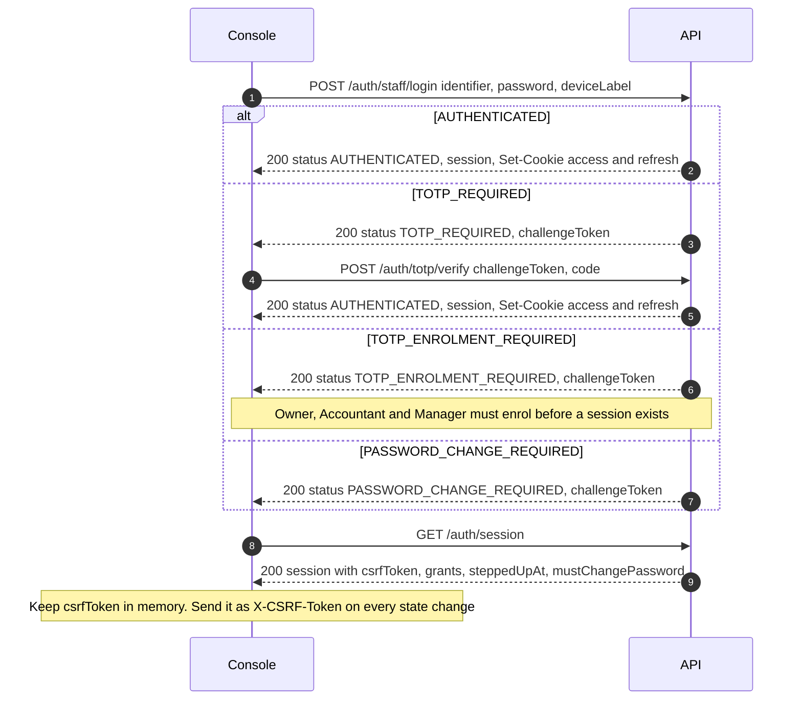

# HaKorem Farms Platform: API Conventions

How to talk to the API: for the frontend track, for integrators, and for every backend session that adds an endpoint. The contract itself is `contract/openapi.yaml` (version 1.0.0, 600 operations, 476 paths). This document explains the rules that apply to all of it, lists every error code, and then gives a short section per module with what a client must know.

The decisions behind these rules: ADR-0014 (idempotency), ADR-0016 (authentication), ADR-0017 (authorisation and maker-checker), ADR-0013 (identifiers), ADR-0027 (offline), ADR-0029 (money, decimals, envelopes). Offline behaviour is in `docs/OFFLINE_SYNC.md`.

## 1. Base URLs and versioning

| Environment | API base URL | Notes |
| --- | --- | --- |
| Production | `https://api.hakoremfarms.com/v1` | Storefront at `https://hakoremfarms.com`, console at `https://app.hakoremfarms.com` |
| Staging | `https://api.staging.hakoremfarms.com/v1` | Sandbox provider credentials; no real money or messages |
| Local development | `http://localhost:3000/v1` | `pnpm dev` |
| Mock server | `http://localhost:4010` | Prism, run from the contract (section 17) |

All paths in the contract are relative to the base URL, including `/v1`. There is no unversioned path except the platform probes served by Caddy. The health check is `GET /v1/health`.

**Versioning.** The URL carries the major version (`/v1`). The contract file carries a semantic version in `info.version`. Every change to the contract has an entry in `docs/CONTRACT_CHANGELOG.md`, newest first.

| Bump | What it is | Example |
| --- | --- | --- |
| Major (`/v2`) | A change that can break an existing client | Removing or renaming a field, path or enum value; making a field required on anything a client sends (a request body or a parameter, ADR-0038); changing a type, a unit or a status code; tightening a pattern or a length limit; changing the meaning of an existing code |
| Minor (1.1.0) | Additions that cannot break a client that follows the rules below | A new operation, a new optional request field, a new response field (required or not, ADR-0038), a new error code on an existing operation, a new enum value on a response |
| Patch (1.0.1) | No change in behaviour | Descriptions, examples, summaries |

**Rules a client must follow so that minor changes never break it:** ignore response fields it does not know; treat every response enum as open (an unknown value is displayed as unknown, never a crash); treat an unknown error `code` by its HTTP status; never depend on key order; never depend on the number of items in a page.

A breaking change is announced at least one full release before it ships: the old behaviour stays and the new behaviour is published alongside. The backend never breaks the contract silently: a pull request that changes `contract/openapi.yaml` incompatibly fails CI (`pnpm contract:generate` produces the file from code and CI fails on any difference with the committed one).

## 2. Headers at a glance

| Header | Direction | When |
| --- | --- | --- |
| `Idempotency-Key` | Request | Every state-changing request that declares it (section 8). A UUID |
| `X-CSRF-Token` | Request | Every state-changing request authenticated by a session cookie. The value is `csrfToken` from `GET /auth/session` |
| `X-Device-Credential` | Request | Point-of-sale device endpoints, with the cashier's session |
| `Authorization: Bearer hk_live_<prefix>.<secret>` | Request | Integrations using an API key |
| `Content-Type: application/json` | Request | Every body. The API accepts and returns JSON only (UTF-8). File upload is `multipart/form-data` |
| `X-Correlation-Id` | Response | Every response. A UUID. The same value is in logs, traces, the audit event, outbox messages and any error body. Quote it to support. A client may send its own `X-Correlation-Id` (a UUID); the server accepts it for tracing and generates one otherwise |
| `Retry-After` | Response | On 429 and on 503 when the server knows (seconds) |
| `Cache-Control` | Response | `no-store` on every authenticated response. Public catalogue reads set a short public lifetime |

## 3. Authentication

There are three **realms**, each with its own login endpoint and its own cookie names, so one browser can hold a staff and a customer session without either being presented as the other:

| Realm | Who | Login | Access cookie | Refresh cookie |
| --- | --- | --- | --- | --- |
| `STAFF` | Owner, accountant, manager, storekeeper, cashier, sales, farm hand, driver | `POST /auth/staff/login` | `__Host-hk_s_at` | `__Host-hk_s_rt` |
| `CUSTOMER` | Shoppers with an account | `POST /auth/customer/login` | `__Host-hk_c_at` | `__Host-hk_c_rt` |
| `INVESTOR` | Investors | `POST /auth/investor/login` | `__Host-hk_i_at` | `__Host-hk_i_rt` |

Integrations authenticate with an API key (section 3.8). A POS device adds a device credential to the cashier's session (section 3.9).

**Cookies.** All are `HttpOnly`, `Secure`, `SameSite=Strict`, `Path=/`, with no `Domain` attribute and the `__Host-` prefix, so they are bound to `api.hakoremfarms.com` and never sent to another host. The storefront (`hakoremfarms.com`), the console (`app.hakoremfarms.com`) and the API share one registrable domain, so the browser sends the cookies on calls from the console and storefront to the API. The browser code must call the API with credentials (`fetch(..., { credentials: "include" })`). The console and storefront origins are on the API's CORS allow-list (never a wildcard) and requests from any other origin are refused with `ORIGIN_NOT_ALLOWED`. JavaScript cannot read the tokens; it holds only the CSRF token.

**Storefront note.** Server-rendered catalogue pages are anonymous. Pages that show the customer's own data fetch it in the browser after load, because the cookie belongs to the API host and the storefront server never sees it.

### 3.1 Staff login, exact flow

Lifetimes below are the design defaults of ADR-0016, which B3 kept as the values (A-065, `docs/sessions/B03-platform-slice.md`); the response fields `accessExpiresAt` and `refreshExpiresAt` are always authoritative, and a client must use them and not hard-code a duration.

| Token | Design lifetime |
| --- | --- |
| Access token (signed JWT, EdDSA) | 10 minutes |
| Staff refresh token (opaque) | 12 hours idle, 7 days absolute |
| Customer refresh token | 30 days idle, 90 days absolute |
| Investor refresh token | Same as customer |
| Step-up (fresh TOTP) | 5 minutes |
| Challenge token (between login steps) | 5 minutes, single use |



1. **`POST /auth/staff/login`** with `identifier` (email, or phone in E.164 form), `password` and an optional `deviceLabel` that appears in the user's device list. No cookie, CSRF token or idempotency key is needed. The `status` in the 200 response says what happens next:
   - `AUTHENTICATED`: cookies are set and `session` is returned.
   - `TOTP_REQUIRED`: a `challengeToken` is returned. TOTP is mandatory for Owner, Accountant and Manager and optional for others who have enrolled.
   - `TOTP_ENROLMENT_REQUIRED`: a privileged user who has no second factor yet. The client calls `POST /auth/totp/enrol` with `{ "challengeToken" }` and no cookie, shows the secret, then `POST /auth/totp/confirm` with `{ "challengeToken", "code" }`. Confirming completes the login: the cookies are set on that response and the client calls `GET /auth/session` (3.4).
   - `PASSWORD_CHANGE_REQUIRED`: a temporary password (new staff account, or after a reset by a manager). The client asks for a new password and calls `POST /auth/password/change` with `{ "challengeToken", "currentPassword", "newPassword" }` and no cookie (204), then logs in again with the new password, which may lead to the TOTP steps.
   - `VERIFICATION_REQUIRED`: used by customers (3.2).
   Failures use one message and take the same time whether or not the account exists (401 `INVALID_CREDENTIALS`). Repeated failures back off exponentially per account and per address (429 `RATE_LIMITED` with `Retry-After`). A client must not reveal which part was wrong.
2. **`POST /auth/totp/verify`** with the `challengeToken` and a six-digit code (or a recovery code). On success it behaves as the `AUTHENTICATED` branch above. A code is accepted once (the next code is needed for the next login); five wrong codes spend the challenge (401 `CHALLENGE_EXPIRED`); a challenge lasts five minutes.
3. **`GET /auth/session`** returns the current session: `sessionId`, `realm`, `principal`, `csrfToken`, `accessExpiresAt`, `refreshExpiresAt`, `steppedUpAt`, `mustChangePassword`, `totpEnrolled` and `grants` (role, branch, location). Call it after login and after a page reload. The CSRF token is bound to the session, not to the page, so a reload gets the same token; it stays the same for the session's life, refresh included (ADR-0034).
4. Roles and grants are not in the token. They are read on each request from a cache that is invalidated on any grant change, so a permission change takes effect on the next request. A client uses `grants` to decide what to show; the server enforces regardless.

### 3.2 Customer and investor flows

- **Customer register:** `POST /auth/customer/register` (name, phone, optional email, password, marketing consent). The response is `VERIFICATION_REQUIRED` with a `challengeToken`; the customer receives an SMS code and the client calls `POST /auth/customer/verify-phone` with the code. The result is `AUTHENTICATED`.
- **Built in B04e continued (1.11.0, A-123).** Only a Ghana mobile number registers (+233 and nine digits). The answer is the same whether or not the phone has an account; a known phone gets an SMS notice instead of a code, and no second account is made. A code lasts ten minutes and takes five attempts: a wrong one is 422 `VERIFICATION_CODE_INVALID`, the sixth is refused even if right (401 `CHALLENGE_EXPIRED`). A customer who signs in before verifying gets `VERIFICATION_REQUIRED` and a new code. Five registrations per phone in fifteen minutes (429).
- **Customer and investor login:** `POST /auth/customer/login` and `POST /auth/investor/login`, with the same response shape. TOTP is optional for both.
- **Investor accounts are created by staff** (`createInvestor`); there is no self-registration.

### 3.3 Refresh and rotation

- Call **`POST /auth/refresh`** (no body; it reads the refresh cookie; the `Origin` header must be on the allow-list) when a request returns 401 `UNAUTHENTICATED` and the session has not been logged out, and shortly before `accessExpiresAt`. The response is the new session object, with new `accessExpiresAt` and a new `csrfToken`, and new cookies. Only one refresh should be in flight at a time: the client serialises calls, and queued requests wait for it.
- **Every refresh rotates the refresh token.** The previous token stops working. If a token that was already rotated is presented again (a copied token, or two tabs racing without coordination), the whole session is revoked and an alert is raised, and every later request returns 401. The client then shows the login screen. Because of this, the console coordinates refreshes across tabs (a lock in the browser), and never retries a refresh with a stale response.
- A session also ends at the absolute lifetime, when the user or a manager revokes it (`revokeSession`), when a manager disables the account, and at logout. Revocation takes effect on the next request.
- If the refresh itself fails with 401, there is no session: send the user to login.
- **Two realms in one browser.** All three realms share the API host, so a browser that holds a staff and a customer session sends both. `refreshSession`, `getCurrentSession` and `logout` then need `?realm=STAFF` (or `CUSTOMER`, `INVESTOR`); without it they answer 400 `VALIDATION_FAILED` naming `/realm` (refresh: 401). With one session, leave it out.

### 3.4 TOTP and step-up

- **Enrol:** `POST /auth/totp/enrol` (with a session and the CSRF token, or during first login with `{ "challengeToken" }` in the body and no cookie) returns `otpauthUri`, `secretBase32` and, from contract 1.4.0, `qrCodeDataUri` (the URI drawn as an SVG data URI, ADR-0037), shown once. The client shows `qrCodeDataUri` in an `` and keeps `secretBase32` on screen for manual entry; it needs no QR library. `POST /auth/totp/confirm` with the first code activates it and returns single-use recovery codes, shown once and stored hashed.
- **Step-up:** some operations need a TOTP code entered within the last five minutes on the same session. The operation description says "Requires step-up" and, from contract 1.3.0, the operation carries `x-requires-step-up: true` (section 15), for example posting a distribution run, bulk export, role and grant changes, tax scheme and posting rule changes, creating an API key. If the step-up is missing or stale the API returns **403 `STEP_UP_REQUIRED`**. The client then asks for a code, calls **`POST /auth/step-up`** with it (the response is the session with a new `steppedUpAt`), and repeats the original request with the same `Idempotency-Key`. A user who has no TOTP enrolled gets 403 `TOTP_ENROLMENT_REQUIRED`.

### 3.5 CSRF

Every state-changing request authenticated by a session cookie must send `X-CSRF-Token` with the `csrfToken` from `GET /auth/session` (or from the last `login`, `verify`, `refresh` or `step-up` response) and an `Origin` header on the CORS allow-list (browsers send it). Missing or wrong token: 403 `CSRF_TOKEN_INVALID`. Wrong origin: 403 `ORIGIN_NOT_ALLOWED`. Safe methods (`GET`) and the unauthenticated login endpoints do not need it. Guests on the storefront do not use CSRF tokens; customers with a session send the optional header (the `CsrfTokenOptional` parameter).

### 3.6 Logout and sessions

`POST /auth/logout` ends the current session (204). A user lists their devices and sessions with `GET /iam/sessions` and revokes one with `POST /iam/sessions/{id}/revoke`; a manager can revoke anyone's. `POST /auth/password/change` needs the current password. `POST /auth/password/reset-request` always answers 202 with the same message whether or not the account exists; `POST /auth/password/reset` sets the new password with the code. From 1.11.0 (A-123) the code goes by SMS to an active account with a phone (an email-only account waits for the email channel, B11), works once for thirty minutes, and replaces any earlier one; a wrong, used or expired code is 422 `RESET_TOKEN_INVALID`, `RESET_TOKEN_USED` or `RESET_TOKEN_EXPIRED` (CR-004 point 3). A reset revokes every session and clears the lockout. Five requests per identifier in fifteen minutes (429). New passwords are checked against a breached-password list (422 `PASSWORD_BREACHED`).

### 3.7 Guests

Anonymous catalogue reads need nothing. A guest cart is identified by the host-bound cookie `__Host-hk_guest`, set by `POST /shop/carts`. Order tracking and quote links use signed tokens in the URL. An id in a URL is never the only secret.

### 3.8 API keys

Integrations authenticate with `Authorization: Bearer hk_live_<prefix>.<secret>`. A key belongs to an integration principal and carries only the permissions granted to that principal by role grants. The key is shown once at creation (`createApiCredential`, which needs step-up) and stored hashed. Keys can expire, are rotated with `rotateApiCredential` (the old key keeps working for 24 hours of overlap), revoked with `revokeApiCredential`, and are rate-limited per key (`rateLimitPerMinute` at creation). Operations that accept keys list `apiKey` in their `security`; operations on a person's own account, the console's login and the POS device endpoints do not. API-key requests send `Idempotency-Key` but not a CSRF token (there is no cookie to forge).

### 3.9 The POS device credential

A register device is enrolled by a manager (`POST /registers/{id}/devices`). The response carries `deviceCredential`, shown once. The device stores it and sends it as **`X-Device-Credential`** together with the cashier's staff session on `POST /pos/sales` and `POST /pos/sync`. A revoked device is refused with 403 `DEVICE_REVOKED`; an unknown credential with 401 `DEVICE_CREDENTIAL_INVALID`. The credential authorises nothing on its own. Offline unlock and the rules for syncing are in `docs/OFFLINE_SYNC.md`.

## 4. Money, decimals, enums, times and identifiers

These rules are fixed by ADR-0029 and apply to every operation.

- **Money is an integer in pesewas, in fields whose name ends `Pesewas`.** GHS 1.00 is `100`. JSON integers, never floats, never strings, never negative. An object that carries money also carries `currency` (`GHS` only in version 1). A direction is a separate field (`side`, `direction`, `isNegative`, `varianceDirection`). The frontend formats with its own `formatMoney(pesewas)`. The maximum value is `9007199254740991` (`Number.MAX_SAFE_INTEGER`).
- **Cost and price never share a field.** Cost fields say cost (`unitCostPesewas`, `valueAtCostPesewas`, `accumulatedCostPesewas`). Price fields say price (`listPricePesewas`, `agreedUnitPricePesewas`, `priceBand`). Customer-facing shapes carry no cost, floor, ceiling or variance.
- **Totals come from the API.** A list that a screen totals carries the total as its own field (`totalValueAtCostPesewas`, `totalOutstandingPesewas`, `totalDebitPesewas`) over everything matching the filter, not just the page. The frontend never sums rows.
- **Weights, quantities, percentages, units and coordinates are decimal strings with fixed patterns.** Weight: kilograms, three places (`"24.350"`, field names ending `Kg`). Quantity: three places (`"6.000"`). Percentages: up to four places (`"2.5000"`). Coordinates: decimal degrees as strings. A float never touches them. Every captured weight carries a `weightSource` (`SCALE`, `MANUAL`, `ESTIMATE`).
- **Enumerations are upper snake case** in requests and responses (`WEIGHTED_AVERAGE`, `PENDING_APPROVAL`). Treat response enums as open (section 1).
- **Times** are UTC in RFC 3339 (`2026-11-13T09:30:00Z`). **Business dates** (a posting date, a delivery date, a value date) are calendar dates `YYYY-MM-DD` in Africa/Accra, which is UTC+0 all year. Show times in Africa/Accra; send times in UTC. Times of day for slots are `HH:MM` in Africa/Accra.
- **Phone numbers** are E.164: Ghanaian numbers are `+233` followed by nine digits.
- **Identifiers** are UUIDv7 strings. Ids are never shown to people as references: documents show their number, animals their tag. Ids are time-ordered but not secret and not business time.
- **Currency.** `GHS`.
- **Nulls.** A field the server may not have is present and `null`, not omitted. A client omits optional request fields it does not set.
- **Unknown request fields are rejected** (400 `VALIDATION_FAILED`, `additionalProperties: false`).

## 5. Pagination

List operations use cursor pagination. Request `limit` (1 to 100, default 25) and `cursor`. The response is:

```json
{
  "data": [ ],
  "page": { "nextCursor": "eyJ...", "limit": 25, "hasMore": true }
}
```

Pass `page.nextCursor` as `cursor` to get the next page; it is `null` on the last page. A cursor is opaque, is valid for 24 hours, and is bound to the same filters and the same caller. Changing a filter means starting again without a cursor. Results are stable for a given cursor even while rows are added (the order is by a fixed key, newest first unless the operation says otherwise, and ties are broken by id). There is no offset and no total count in the page object; where a screen needs a total, the operation returns it as a named field (section 4). There is no `sort` parameter in version 1: each list has its documented order.

## 6. Filtering

Filters are query parameters named for the field, and they combine with AND. The most common:

| Parameter | Meaning | Operations |
| --- | --- | --- |
| `status` | One status value, or a comma-separated list | Orders, payments, deliveries, shifts, approvals, etc. |
| `from`, `to` | Inclusive range on the operation's primary date. Business dates `YYYY-MM-DD` for date-based lists, RFC 3339 for time-based ones | Movements, orders, payments, audit events, reports |
| `date`, `asOf` | One business date, or a point in time for a snapshot | Daily reports, stock on hand |
| `branchId`, `locationId` | Scope. A caller never sees data outside the branches and locations of their grants, whatever they pass | Most staff lists |
| `customerId`, `supplierId`, `productId`, `speciesId`, `categoryId`, `stockUnitId`, `orderId`, `shiftId`, `driverId`, `zoneId` | The linked record | Related lists |
| `kind`, `channel`, `direction` | A type field | Various |
| `q` | Free-text search on the fields the operation names (name, number, tag, phone). Matches the start of words, case-insensitive | Customers, products, suppliers, animals, documents |
| `groupBy` | The grouping for a report-style list | Reports, margins |
| `includeZero`, `includeVirtual`, `active` | Booleans, `true` or `false` | Stock, locations, masters |

An unknown parameter is ignored; an invalid value is 400 `VALIDATION_FAILED` with the field named in `details`. Encrypted fields (bank details, identity numbers) can never be filtered or sorted on.

## 7. Optimistic locking

Mutable records carry an integer `version`. To change one, send the `version` you read in the body of the `PATCH` or `PUT`:

```json
{ "version": 7, "name": "Grade A eggs, crate of 30" }
```

If the record changed since, the API returns **409 `VERSION_CONFLICT`** and changes nothing. The client reloads the record, shows the difference, and asks the user to re-apply the change. A successful update returns the record with the incremented `version`. Documents that move through states (orders, journals) are changed by action endpoints (`/confirm`, `/submit`) and use state checks rather than a version; a wrong state is 422 `INVALID_STATE_TRANSITION`.

## 8. Idempotency

Every state-changing operation that declares the `Idempotency-Key` header requires it. Generate a UUID per user action in the client and **reuse it on every retry of that action**. Do not generate a new key on retry (that is how a double charge happens) and do not reuse a key for a different action.

**Server behaviour** (ADR-0014): the key is stored with a hash of the request in the same transaction as the business change, scoped to the caller and the operation.

| Situation | Result |
| --- | --- |
| First time | The request is processed. The response is stored with the key |
| Same key, same request, completed | The stored response is returned again, with the same status and body. No second effect |
| Same key, different request body | 409 `IDEMPOTENCY_KEY_REUSED`. Nothing happens |
| Same key arrives while the first is still running | The second waits for the first transaction and then receives its result |
| Missing key on an operation that requires it | 400 `IDEMPOTENCY_KEY_REQUIRED` |

Keys are kept for at least 72 hours, longer than any offline period, and then purged. After that a repeated key is treated as new.

**Which requests do not carry the header.** Of the 337 state-changing operations, 305 declare it. The exceptions are deliberate:

- the authentication calls (login, verify, refresh, logout, password, TOTP, step-up, registration);
- calculations that change nothing (`resolvePrices`, `calculateTax`, `validateCoupon`, `quoteDelivery`, the template and notification previews, `getDistributionSchedule`);
- link and download issues (`createFileSignedUrl`, `downloadArchivedDocument`, `downloadMyDocument`, `downloadMyInvestorDocument`, `printPackLabels`), `checkPaymentStatus` and `markNotificationRead`, which are repeatable by nature;
- the two sync endpoints (`syncOfflineSales`, `syncDriverEvents`), whose items carry their own ids (section 9);
- the inbound provider webhooks, which are deduplicated by the provider's event id.

## 9. Offline record ids

Records created offline carry a client-generated UUIDv7 `id`, which is their idempotency identity (ADR-0013): the offline sale (becomes the order id), the shift, a cash movement, a proof of delivery, a failure, a weight record, a health event, a mortality report, a feed consumption record, a temperature reading, a payment recorded at the counter, and picks. The operations that accept it say "Accepted from an offline queue" in their description. Send the same value as `Idempotency-Key`. A resubmission with the same id returns the first result. The server checks that the id is a version 7 UUID whose embedded time is not in the future beyond a small tolerance and not before the shift began. Details, the counter and the provisional reference are in `docs/OFFLINE_SYNC.md`.

## 10. Errors

### 10.1 The envelope

Every non-2xx response, from every operation, has this body:

```json
{
  "error": {
    "code": "VALIDATION_FAILED",
    "message": "Some fields are not valid.",
    "correlationId": "019a7b1c-62bb-748f-99c8-51cf6862caad",
    "details": [
      { "field": "/lines/0/weightKg", "code": "PATTERN", "message": "Weight must have exactly three decimal places, for example 24.350." }
    ]
  }
}
```

| Field | Meaning |
| --- | --- |
| `code` | A stable upper snake case machine code. Branch on this, never on `message` |
| `message` | A sentence safe to show to a user. It is translated through the translation layer (English first) and never contains internal detail |
| `correlationId` | Quote it to support. It is the same value as the `X-Correlation-Id` header |
| `details` | An array, possibly empty. Each item has `field` (a JSON pointer, or `null`), `code` and `message`. Validation errors list every offending field at once |

An unexpected error is a 500 `INTERNAL` with a correlation id and nothing else; nothing was committed. A client may retry a 500 or 503 with the same idempotency key.

### 10.2 Status codes

| Status | Used for |
| --- | --- |
| 200, 201, 204 | Success, created, success with no body |
| 202 | Accepted: either an `ApprovalPending` body (section 11) or an asynchronous job (an import or a report run), whose resource carries its status |
| 400 | Malformed or invalid request: schema, patterns, unknown fields, missing idempotency key |
| 401 | No valid session, key or device credential |
| 403 | Authenticated but not permitted. Also returned when the record exists but belongs to someone else, so existence is not revealed. Also step-up and CSRF failures |
| 404 | No such record, or not visible to the caller |
| 409 | `VERSION_CONFLICT` and `IDEMPOTENCY_KEY_REUSED` only. A conflict in the state of the data is 422 |
| 413, 415 | Body too large, unsupported content type |
| 422 | A valid request that a business rule refuses. `code` says which rule |
| 429 | Rate limited. `Retry-After` in seconds |
| 500 | Unexpected failure. Nothing committed |
| 503 | A dependency is down, or the payment provider is unavailable. The counter continues offline |

### 10.3 Catalogue of error codes

The "Source" column says where the code comes from. **Contract** means the code is named in `contract/openapi.yaml` 1.0.0 (in an error example or an operation description). **Added** means this document defines it because the domain clearly needs it; the contract does not name it yet, and **the contract generated in B2 must adopt every code marked Added** (as an additional `code` value on the operations that can raise it, and listed in the `ErrorBody.code` description). Adding codes is a minor contract change.

#### Generic (responses defined once in `components.responses`)

| Code | HTTP | Meaning | Source |
| --- | --- | --- | --- |
| `VALIDATION_FAILED` | 400 | The request is malformed or fails validation. `details` lists each field | Contract (`BadRequest`) |
| `UNAUTHENTICATED` | 401 | No valid session or key. The client tries `POST /auth/refresh` once, then shows login | Contract (`Unauthenticated`) |
| `FORBIDDEN` | 403 | Authenticated, not permitted. Also returned when the record belongs to someone else | Contract (`Forbidden`) |
| `NOT_FOUND` | 404 | No such record, or not visible to the caller | Contract (`NotFound`) |
| `VERSION_CONFLICT` | 409 | The record changed since it was read. Reload and re-apply | Contract (`Conflict`) |
| `RATE_LIMITED` | 429 | Too many requests. Wait `Retry-After` seconds | Contract (`RateLimited`) |
| `INTERNAL` | 500 | Unexpected failure on our side. Quote the correlation id | Contract (`InternalError`) |
| `SERVICE_UNAVAILABLE` | 503 | A dependency is down. Retry with backoff; the counter continues offline | Contract (`ServiceUnavailable`) |

#### Business rules named in the contract

| Code | HTTP | Meaning | Raised by | Source |
| --- | --- | --- | --- | --- |
| `STOCK_UNIT_ON_HOLD` | 422 | The animal or lot is under a withdrawal hold or quarantine and cannot be sold, consumed or transferred | `createProcessingOrder`, sale and transfer operations | Contract |
| `QUOTE_REQUIRED` | 422 | A line cannot be priced by the pricing engine. Raise a quote instead. (`resolvePrices` returns this as an outcome, not an error) | `createOrder`, `resolvePrices` | Contract |
| `PRICE_OVERRIDE_NEEDS_APPROVAL` | 422 | The agreed price differs from the resolved price by more than the role's limit or outside the band. Ask a manager to approve the override | `completeCounterSale` | Contract |
| `MAKER_CANNOT_CHECK` | 422 | The person who made a request cannot approve it. The database enforces the same rule | `approveRequest` | Contract |
| `THREE_WAY_MATCH_FAILED` | 422 | A supplier invoice line does not match its purchase order line and goods receipt line, or the invoice is not matched. Payment is blocked. Each detail names the line or allocation and its reason | `approveSupplierInvoice`, `createSupplierPayment` | Contract |
| `JOURNAL_UNBALANCED` | 422 | Debits do not equal credits in a journal | `submitManualJournal` | Contract |
| `TAX_MATRIX_INCOMPLETE` | 422 | A tax scheme version lacks a cell for some category and levy. Each `details[].code` names a missing pair, `CATEGORY/LEVY` | `replaceTaxSchemeCells`, `submitTaxSchemeVersion` | Contract |
| `TAX_CELL_INVALID` | 422 | A tax cell breaks a rule: a rate on a non-standard treatment, a base that does not fit its kind, a base levy of another category or calculated at or after it, a repeated calculation order. `details[].field` points at the cell (1.5.0) | `replaceTaxSchemeCells` | Added |
| `TAX_SCHEME_NOT_IN_FORCE` | 422 | No approved tax scheme version covers the tax date asked for (1.5.0) | `calculateTax` | Added |
| `PROMOTION_INVALID` | 422 | A promotion breaks a rule: a value that does not fit its kind, a window that ends before it starts, a target naming both or neither of a product and a category, a line promotion with no target. `details[].field` points at the field (1.6.0) | `createPromotion`, `updatePromotion` | Added |
| `COUPON_INVALID` | 422 | A coupon code is not 3 to 40 letters, digits and hyphens, or a limit is not positive, or the per-customer limit exceeds the total (1.6.0) | `createCoupon` | Added |
| `COUPON_UNAVAILABLE` | 422 | A coupon exists but cannot be used now; `details[0].code` is `EXPIRED`, `LIMIT_REACHED`, `NOT_APPLICABLE` or `ALREADY_USED` (1.6.0) | `resolvePrices`, and the order operations that redeem a coupon | Added |
| `PAYMENT_METHOD_REQUIRES_VERIFICATION` | 422 | Mobile money and card are cleared only by a verified provider callback or lookup, never by a manual entry | `recordPayment` | Contract |
| `REQUEST_TO_BUY_ONLY` | 422 | A live animal product cannot be added to a cart. Open a quote request | `addCartLine` | Contract |
| `WITHDRAWAL_CANNOT_BE_RELEASED` | 422 | A veterinary withdrawal hold cannot be released early by anyone | `releaseStockHold` | Contract |

#### Authentication, sessions and devices (Added)

| Code | HTTP | Meaning |
| --- | --- | --- |
| `INVALID_CREDENTIALS` | 401 | Wrong identifier or password. The same for unknown accounts and the same timing |
| `TOTP_INVALID` | 401 | The six-digit code or recovery code is wrong or already used |
| `CHALLENGE_EXPIRED` | 401 | The challenge token expired or was already used. Start login again |
| `PASSWORD_BREACHED` | 422 | The new password appears in a breached-password list |
| `CSRF_TOKEN_INVALID` | 403 | `X-CSRF-Token` is missing or does not match the session |
| `ORIGIN_NOT_ALLOWED` | 403 | The request's origin is not on the allow-list |
| `STEP_UP_REQUIRED` | 403 | A TOTP step-up within the last five minutes is needed. Call `POST /auth/step-up` and repeat |
| `TOTP_ENROLMENT_REQUIRED` | 403 | The action needs a second factor and the user has none enrolled |
| `PASSWORD_CHANGE_REQUIRED` | 403 | The account has a temporary password; change it first |
| `DEVICE_CREDENTIAL_INVALID` | 401 | The `X-Device-Credential` is missing or unknown |
| `DEVICE_REVOKED` | 403 | The device was revoked by a manager |
| `TOTP_ALREADY_ENROLLED` | 422 | An authenticator is already confirmed for this account (B3) |

#### Requests, idempotency and size (Added)

| Code | HTTP | Meaning |
| --- | --- | --- |
| `IDEMPOTENCY_KEY_REQUIRED` | 400 | The operation requires `Idempotency-Key` and it was not sent |
| `IDEMPOTENCY_KEY_REUSED` | 409 | The key was used before with a different request body |
| `PAYLOAD_TOO_LARGE` | 413 | The body exceeds the limit for this endpoint |
| `UNSUPPORTED_MEDIA_TYPE` | 415 | The content type is not accepted |
| `SYNC_BATCH_TOO_LARGE` | 400 | A sync batch has more than 500 sales |
| `INVALID_STATE_TRANSITION` | 422 | The document is not in a state that allows this action (for example confirming a cancelled order) |

#### Approvals and authorisation (Added)

| Code | HTTP | Meaning |
| --- | --- | --- |
| `APPROVAL_ALREADY_DECIDED` | 422 | The approval request was already approved, rejected or cancelled |
| `APPROVAL_EXPIRED` | 422 | The approval request lapsed before it was decided |
| `APPROVAL_SUBJECT_CHANGED` | 422 | The record changed after approval was requested; the approval is void. Request approval again (B3) |

#### Master data (Added in B3)

| Code | HTTP | Meaning |
| --- | --- | --- |
| `DUPLICATE_VALUE` | 422 | A unique value (SKU, barcode, storefront slug) is already used by another live record. `details` names each field |
| `REFERENCE_NOT_FOUND` | 422 | An id in the request names no record (an unknown category, species, tax category or unit). `details` names each field |
| `STOCK_POLICY_CONFLICT` | 422 | The product's fields contradict its stock-keeping policy, for example a serialised animal without a species or listed for the cart, or catch-weight stock not held in kilograms. `details` names each field and rule |
| `RECORD_IN_USE` | 422 | The record is still in use: a category with live products or live children, or a grade or weight band a pending or active price list version prices with, cannot be archived, and such a band keeps its range. `details[].code` says why (`HAS_LIVE_PRODUCTS`, `HAS_LIVE_CHILDREN`, `USED_BY_LIVE_PRICES`) (1.7.0) |
| `UOM_CONVERSION_INVALID` | 422 | A unit conversion is not exact to three places (`INEXACT_FACTOR`), too large (`TOO_LARGE`), for a product that is not countable (`NOT_COUNTABLE`), from the base unit (`BASE_UNIT`) or from a weighed or measured unit (`NOT_COUNTED`) (1.27.0) |
| `PURCHASE_ORDER_INVALID` | 422 | A purchase order breaks a rule, every one in `details[].code`: `NO_LINES`, `LINE_REPEATED`, `PRODUCT_NOT_ACTIVE`, `NOT_PURCHASABLE`, `SUPPLIER_NOT_ACTIVE`, `NOT_A_RECEIVING_LOCATION`, `EXPECTED_BEFORE_ORDER`, `NO_CONVERSION`, `INEXACT_QUANTITY`, `TAX_INCLUSIVE_NOT_AVAILABLE`, `RECEIVED_ALREADY` (cancel after a receipt), `NOTHING_RECEIVED` (close before one) (1.28.0, A-164) |
| `RECEIPT_EXCEEDS_ORDER` | 422 | A goods receipt line would take its purchase order line past the ordered quantity plus the line's tolerance (`OVER_RECEIPT`, FR-PUR-007); the whole receipt is refused (1.28.0) |
| `RECEIPT_ORDER_MISMATCH` | 422 | A goods receipt line names an order line that is not on the receipt's order (`NOT_ON_ORDER`), of another product (`PRODUCT_DIFFERS`), an order of another supplier (`OTHER_SUPPLIER`), one not open for receipt (`ORDER_NOT_OPEN`) or none (`NO_ORDER`) (1.28.0) |
| `SUPPLIER_INVOICE_INVALID` | 422 | A supplier invoice breaks a rule, every one in `details[].code`: `NO_LINES`, `ORDER_OF_ANOTHER_SUPPLIER`, `ORDER_NOT_RECEIVABLE`, `ORDER_REQUIRED`, `ORDER_LINE_NOT_ON_ORDER`, `PRODUCT_DIFFERS`, `NO_CONVERSION`, `INEXACT_QUANTITY`, `BRANCH_REQUIRED`, `BRANCH_DIFFERS`, `DUE_BEFORE_INVOICE`, `STATED_TOTAL_DIFFERS`, `LEVY_NOT_IN_SCHEME`, `LEVY_REPEATED`, `FILE_NOT_USABLE`, `CREDIT_NOTE_NOT_AVAILABLE`, `PAYMENT_ALLOCATED` (cancel with a live payment) (1.28.0) |
| `SUPPLIER_PAYMENT_INVALID` | 422 | A supplier payment breaks a rule: `NO_ALLOCATIONS`, `OTHER_SUPPLIER`, `DUPLICATE_INVOICE`, `NOT_APPROVED`, `BRANCH_DIFFERS`, `BANK_ACCOUNT_NOT_AVAILABLE` (until bank accounts exist, B8) (1.28.0); `PAYOUT_DETAILS_MISSING` and `PAYOUT_METHOD_DIFFERS`, a bank or mobile money payment to a supplier with no approved details of that method in force (1.29.0, A-166) |
| `SUPPLIER_PROFILE_INVALID` | 422 | Supplier terms or payout details break a rule: `REQUIRED`, `NOT_FOR_METHOD`, `ACCOUNT_NUMBER_INVALID` (6 to 20 digits), `MOMO_NUMBER_INVALID` (+233 and nine digits), `PAYOUT_CHANGE_PENDING` (one change waits per supplier) (1.29.0, A-166) |
| `SUPPLIER_DOCUMENT_INVALID` | 422 | A supplier document cannot be filed: `REFERENCE_NOT_FOUND`, `FILE_NOT_USABLE` (another purpose, or not `CLEAN`), `FILE_ALREADY_FILED`, `EXPIRED` (1.29.0) |
| `SETTING_INVALID` | 422 | A setting's new value is of the wrong type (`WRONG_TYPE`), out of its range (`OUT_OF_RANGE`), dated in the past (`IN_THE_PAST`), or a branch value for a farm-wide setting (`NOT_BRANCH_SCOPED`) (1.29.0, FR-AUD-007) |
| `PURCHASE_REQUISITION_INVALID` | 422 | A requisition breaks a rule: `NO_LINES`, `LINE_REPEATED`, `PRODUCT_NOT_ACTIVE`, `NOT_PURCHASABLE`, `NEEDED_BY_PAST`, `LOCATION_REQUIRED`, and on conversion `LINE_NOT_ON_REQUISITION` (1.29.0) |
| `WEIGHT_BAND_INVALID` | 422 | A weight band's range is empty (`NOT_ABOVE_MIN`) or meets another live band of the species (`OVERLAPS_BAND:<code>`); bands are half-open `[minKg, maxKg)` (1.7.0) |
| `LOCATION_INVALID` | 422 | A location breaks a location rule: a parent in another branch (`PARENT_IN_OTHER_BRANCH`), virtual (`PARENT_IS_VIRTUAL`) or below it (`PARENT_IS_SELF_OR_BELOW`), a virtual kind created (`VIRTUAL_KIND_FIXED`) or a virtual location changed (`VIRTUAL_LOCATION_FIXED`), a cold room without its range (`COLD_ROOM_NEEDS_TEMPERATURE`, `NOT_ABOVE_MIN`) (1.8.0) |
| `PRICE_LIST_ASSIGNMENT_INVALID` | 422 | The list assigned to a customer is not a `CUSTOMER` list (`NOT_A_CUSTOMER_LIST`), or the window ends before it starts (`NOT_AFTER_VALID_FROM`) (1.8.0) |
| `PAYMENT_METHOD_INVALID` | 422 | A payment method change is not allowed: verification switched off for mobile money or card (`VERIFICATION_REQUIRED`), a method other than cash, or mobile money without `pos.offline_mobile_money_allowed`, taken offline (`OFFLINE_NOT_ALLOWED`), or no channel left (`NO_CHANNELS`) (1.9.0) |
| `DELIVERY_ZONE_INVALID` | 422 | A delivery zone has no areas (`NO_AREAS`), a blank or repeated area (`AREA_BLANK`, `AREA_REPEATED`), or an area another active zone covers (`AREA_IN_ZONE:<code>`) (1.9.0) |
| `GRANT_INVALID` | 422 | A grant breaks a grant rule: a location outside the branch (`LOCATION_NOT_IN_BRANCH`), a window ending before it starts (`NOT_AFTER_VALID_FROM`), the Customer or Investor role outside its realm (`ROLE_NOT_FOR_REALM`), or the last Owner grant in force revoked (`LAST_OWNER`) (1.10.0) |
| `USER_INVALID` | 422 | An account change is not allowed: no email and no phone (`NO_IDENTIFIER`), an investor account before investor records exist (`INVESTOR_ACCOUNTS_NOT_AVAILABLE`), or the last active Owner disabled (`LAST_OWNER`) (1.10.0) |
| `ROLE_INVALID` | 422 | A role change breaks a role rule: an unknown permission code (`UNKNOWN_PERMISSION`), TOTP switched off on the Owner, Manager or Accountant role (`TOTP_REQUIRED_FOR_ROLE`), or one limit kind twice (`DUPLICATE_LIMIT_KIND`) (1.11.0) |
| `VERIFICATION_CODE_INVALID` | 422 | The six-digit phone code is wrong; the challenge counts the attempt, and the sixth is refused (401 `CHALLENGE_EXPIRED`) (1.11.0) |
| `RESET_TOKEN_INVALID` | 422 | No password reset code matches what was sent (CR-004 point 3, 1.11.0) |
| `RESET_TOKEN_USED` | 422 | The password reset code was already used; ask for a new one (CR-004 point 3, 1.11.0) |
| `RESET_TOKEN_EXPIRED` | 422 | The password reset code is past its thirty minutes; ask for a new one (CR-004 point 3, 1.11.0) |

#### Stock, livestock and processing (Added)

| Code | HTTP | Meaning |
| --- | --- | --- |
| `INSUFFICIENT_STOCK` | 422 | Not enough available stock at the location for this line (on hand, less reserved, less held). Names the line and the available quantity |
| `STOCK_UNIT_NOT_AVAILABLE` | 422 | The animal or lot was already sold, is not at this location, or is not alive |
| `STOCK_UNIT_RESERVED` | 422 | The stock unit is reserved for another order |
| `RESERVATION_EXPIRED` | 422 | The checkout's stock reservation lapsed. Start checkout again |
| `STOCK_MOVEMENT_ALREADY_REVERSED` | 422 | A movement can be reversed once |
| `GOODS_RECEIPT_INVALID` | 422 | A goods receipt breaks a receipt rule. Each `details[].code` names it: `ONE_ANIMAL_PER_HEAD`, `WHOLE_ANIMALS_ONLY`, `TAG_REPEATED`, `TAG_IN_USE`, `BATCH_REQUIRED`, `BATCH_REPEATED`, `BATCH_IN_USE`, `EXPIRY_REQUIRED`, `EXPIRED_ON_ARRIVAL`, `NOT_FOR_SERIAL_PRODUCT`, `NOT_FOR_THIS_PRODUCT`, `PRODUCT_NOT_TRACKED`, `PRODUCT_NOT_ACTIVE`, `PRODUCT_NOT_STOCKED`, `PRODUCT_NOT_PURCHASABLE`, `VALUE_REQUIRED`, `WEIGHT_NEEDS_SOURCE`, `NO_LINES`, `SUPPLIER_REQUIRED`, `SUPPLIER_NOT_ACTIVE`, `NOT_FOR_THIS_KIND`, `NOT_A_RECEIVING_LOCATION`, `IN_THE_FUTURE`, `OPENING_NOT_AVAILABLE` (1.16.0) | `createGoodsReceipt`, `updateGoodsReceipt`, `postGoodsReceipt` | Added |
| `STOCK_TRANSFER_INVALID` | 422 | A transfer breaks a transfer rule. Each `details[].code` names it: `SAME_LOCATION`, `NOT_A_STOCK_LOCATION`, `NO_LINES`, `LINE_REPEATED`, `STOCK_UNIT_REQUIRED`, `PRODUCT_NOT_TRACKED`, `PRODUCT_NOT_STOCKED`, `PRODUCT_NOT_ACTIVE`, `NOT_FOR_THIS_PRODUCT`, `STOCK_UNIT_NOT_ACTIVE`, `WHOLE_ANIMALS_ONLY`, `NOT_AT_SOURCE`, `NO_IN_TRANSIT_LOCATION` (1.17.0) |
| `TRANSFER_VARIANCE` | 422 | A receipt confirmation does not balance: `VARIANCE_REASON_REQUIRED`, `NO_VARIANCE`, `MORE_THAN_DISPATCHED`, `WHOLE_ANIMALS_ONLY`, `LINE_UNKNOWN`, `LINE_REPEATED`, `LINE_MISSING`, `REASON_NOT_ALLOWED` (1.17.0) |
| `STOCK_ADJUSTMENT_INVALID` | 422 | An adjustment breaks an adjustment rule: `REASON_NOT_ALLOWED`, `NOTE_REQUIRED`, `NOT_A_STOCK_LOCATION`, `EXCEPTION_NOT_OPEN`, `ANIMAL_NOT_ADJUSTED`, `NOT_IN_THIS_BRANCH` and the shared line rules (1.17.0) |
| `STOCK_REVERSAL_NOT_POSSIBLE` | 422 | The movement is not reversed by hand: `REVERSAL_OF_A_REVERSAL`, `TRANSFER_MOVEMENT`, `VALUE_ONLY_MOVEMENT`, `REASON_NOT_ALLOWED`, `POOL_VALUE_GONE` (1.17.0) |
| `STOCK_TAKE_NOT_COUNTED` | 422 | The stock take has lines not counted (`NOT_COUNTED`) or awaiting their recount (`RECOUNT_REQUIRED`), named by line in `details[].field` (1.18.0) |
| `STOCK_TAKE_INVALID` | 422 | A stock take breaks a stock-take rule: `NOT_A_STOCK_LOCATION`, `PRODUCTS_REQUIRED`, `NOT_FOR_FULL_SCOPE`, `PRODUCT_REPEATED`, `PRODUCT_NOT_STOCKED`, `ANIMAL_NOT_COUNTED`, `SCOPE_OVERLAP`, or of a batch of counts `NOT_COUNTING`, `NO_COUNTS`, `LINE_UNKNOWN`, `LINE_REPEATED`, `RECOUNT_IN_REVIEW_ONLY`, `COUNTING_CLOSED`, `RECOUNT_NOT_NEEDED` (1.18.0) |
| `STOCK_EXCEPTION_INVALID` | 422 | A resolution breaks a rule: `RESOLUTION_KIND_REQUIRED`, `NOT_FOR_A_HELD_VARIANCE`, `ONLY_FOR_A_HELD_VARIANCE`, `WRITE_OFF_PENDING`, `DOCUMENT_REQUIRED`, `NOT_FOR_NO_CORRECTION`, `NOT_A_SETTLING_ADJUSTMENT`, `FOUND_LOCATION_REQUIRED`, `ONLY_FOR_FOUND`, `NOT_A_STOCK_LOCATION`, `NOT_IN_THE_TRANSFER_BRANCHES` (1.19.0) |
| `REORDER_RULE_INVALID` | 422 | A reorder rule breaks a rule: `BELOW_MINIMUM`, `BELOW_REORDER_POINT`, `MAXIMUM_REQUIRED`, `OUT_OF_RANGE`, `NOT_A_STOCK_PRODUCT`, `NOT_A_STOCK_LOCATION`, `NOT_IN_THE_BRANCH`, `RULE_EXISTS` (1.20.0) |
| `BRANCH_INVALID` | 422 | Closing a branch is refused, every reason in `details[].code`: `FARM_BRANCH`, `LAST_ACTIVE_BRANCH`, `HOLDS_STOCK`, `OPEN_DOCUMENTS` (1.21.0, ADR-0051) |
| `LIVESTOCK_RECORD_INVALID` | 422 | A weight, health event, mortality or feed record breaks a livestock rule, every one in `details[].code`: `TAG_IN_USE`, `NO_RECORDS`, `TOO_MANY_RECORDS`, `RECORD_REPEATED`, `ID_REUSED`, `WEIGHT_ZERO`, `NOT_LIVESTOCK`, `ANIMAL_NOT_ALIVE`, `NOT_IN_ONE_PLACE`, `ONE_HEAD_FOR_AN_ANIMAL`, `HEAD_ABOVE_FLOCK`, `IN_THE_FUTURE`, `ANIMAL_OR_PEN_REQUIRED`, `PRODUCT_AND_QTY_TOGETHER`, `WITHDRAWAL_BELOW_PRODUCT`, `NOT_A_MEDICATION`, `PRODUCT_NOT_ACTIVE`, `NO_STORE`, `NOT_A_STORE_OF_THIS_BRANCH`, `NOT_A_PEN`, `NO_ANIMALS_HERE`, `NOT_FEED`, `QTY_ZERO`, `RATION_OF_ANOTHER_FEED`, `REASON_NOT_FOR_KIND`, `ALREADY_AWAITING_APPROVAL`, `SUBMITTER_NOT_REPORTER`, `PHOTO_NOT_USABLE` (1.24.0, A-158); and for edits, moves, growth, batches and breeding `SEX_FIXED_AS_DAM`, `TAG_NOT_EDITABLE`, `ALREADY_THERE`, `OTHER_BRANCH`, `WINDOW_BACKWARDS`, `BATCH_NO_TAKEN`, `NO_FLOCK_PRODUCT`, `HEAD_ZERO`, `BATCH_NOT_EMPTY`, `BATCH_CLOSED`, `NOT_A_BREEDING_SPECIES`, `DAM_NOT_ALIVE`, `DAM_NOT_FEMALE`, `SIRE_IS_DAM`, `SIRE_OF_ANOTHER_SPECIES`, `SIRE_NOT_MALE`, `EXPECTED_BEFORE_MATING`, `RECORD_CLOSED`, `STATUS_BACKWARDS`, `BIRTH_BEFORE_MATING`, `DAM_NOT_ALIVE_ON_BIRTH`, `DAM_NOT_IN_A_PEN`, `LIVE_ABOVE_LITTER`, `TAG_REPEATED` (1.25.0, A-159) |
| `MORTALITY_PHOTO_REQUIRED` | 422 | A death or cull valued at or above the threshold was submitted without a photograph (1.24.0, FR-LIV-012) |
| `RATION_INVALID` | 422 | A ration breaks a rule: `NOT_FEED`, `PRODUCT_NOT_ACTIVE`, `QTY_ZERO`, `NAME_TAKEN` (1.24.0) |
| `PROCESSING_ORDER_INVALID` | 422 | A processing order breaks a rule, every one in `details[].code`: `NO_INPUTS`, `TOO_MANY_INPUTS`, `INPUT_REPEATED`, `INPUT_NOT_AN_ANIMAL`, `INPUT_NOT_AVAILABLE`, `INPUT_NOT_HERE`, `WEIGHT_ZERO`, `NOT_A_PROCESSING_LOCATION`, `NOT_AN_OUTPUT_LOCATION`, `WRONG_BRANCH`, `SAME_AS_PROCESSING_LOCATION`, `TOO_MANY_OUTPUTS`, `OUTPUT_NOT_A_LOT`, `OUTPUT_NOT_BY_WEIGHT`, `PRODUCT_NOT_ACTIVE`, `NOT_FOR_WASTE`, `EXPIRY_BEFORE_PRODUCTION`, `OUTPUT_WEIGHT_ABOVE_INPUT`, `REFERENCE_PRICE_MISSING`, `WASTE_CARRIES_NO_PRICE`, `NO_SALEABLE_OUTPUT`, `LINE_NUMBER_REPEATED`, `AMOUNT_ZERO` (1.22.0, A-153); for packs, labels and the reversal `ORDER_NOT_COMPLETED`, `ORDER_REVERSED`, `OUTPUT_NOT_FOUND`, `OUTPUT_IS_WASTE`, `ALREADY_PACKED`, `LOT_NOT_WHOLE`, `NO_PACKS`, `TOO_MANY_PACKS`, `PACK_WEIGHT_NOT_POSITIVE`, `PACK_TOO_HEAVY_FOR_LABEL`, `PACK_COUNT_NOT_OUTPUT_COUNT`, `PACK_WEIGHTS_NOT_LOT_WEIGHT`, `PACK_NOT_IN_ORDER`, `PACK_NOT_IN_STOCK`, `OUTPUT_SOLD`, `OUTPUT_RESERVED`, `OUTPUT_CHANGED` (1.26.0, A-161, A-162) |
| `YIELD_STANDARD_INVALID` | 422 | A yield standard breaks a rule: `SAME_PRODUCT`, `STANDARD_EXISTS`, `EXPECTED_ZERO` (1.22.0) |
| `REPORT_PERIOD_INVALID` | 422 | A dashboard date or a series period cannot be reported: `IN_THE_FUTURE`, `FROM_AFTER_TO`, `PERIOD_TOO_LONG` (more than 92 days) (1.21.0) |
| `TEMPERATURE_READING_INVALID` | 422 | A reading cannot be recorded: `NO_TEMPERATURE_RANGE`, `NOT_A_STOCK_LOCATION`, `IN_THE_FUTURE`, `ID_IN_USE` (1.20.0) |
| `STOCK_UNIT_EXPIRED` | 422 | The lot is past its expiry date and cannot be sold; write it off instead (1.20.0) |
| `STOCK_HOLD_INVALID` | 422 | A hold breaks a hold rule: `STOCK_UNIT_NOT_ACTIVE`, `ENDS_BEFORE_IT_STARTS`, `WITHDRAWAL_NEEDS_AN_END`, or on release `REASON_NOT_ALLOWED` and `RELEASED_BY_PLACER` (1.18.0) |

#### Pricing, orders and quotes (Added)

| Code | HTTP | Meaning |
| --- | --- | --- |
| `PRICE_OUTSIDE_BAND` | 422 | An agreed price is outside the product's floor and ceiling |
| `PRICE_ENTRY_DUPLICATE` | 422 | Two price list entries for the same product, grade, band and quantity break |
| `PRICE_ENTRY_INVALID` | 422 | A price list entry breaks a price rule: floor above list, list above ceiling, a zero floor on a priced entry, or a grade or band of another species than the product's. `details` names each field (B4) |
| `CREDIT_LIMIT_EXCEEDED` | 422 | The order would take the business account over its credit limit. Without an override approval the order cannot be confirmed |
| `ACCOUNT_ON_HOLD` | 422 | The business account is on hold; credit orders are refused |
| `QUOTE_EXPIRED` | 422 | The quote version's validity ended |
| `QUOTE_SUPERSEDED` | 422 | A newer version of the quote was issued |
| `QUOTE_LINK_USED` | 422 | A quote link is single use and was already used |
| `CHECKOUT_EXPIRED` | 422 | The checkout session ended |
| `DELIVERY_ZONE_UNSERVED` | 422 | The address is outside every delivery zone |
| `SLOT_FULL` | 422 | The delivery slot has no remaining capacity |
| `SLOT_CAPACITY_BELOW_BOOKED` | 422 | A slot's capacity cannot be set below what is booked |
| `RETURN_EXCEEDS_SOLD` | 422 | A return line exceeds what was sold and not yet returned |

#### Shifts and counter (Added)

| Code | HTTP | Meaning |
| --- | --- | --- |
| `SHIFT_NOT_OPEN` | 422 | The shift is closed or closing; sales and cash movements need an open shift |
| `SHIFT_ALREADY_OPEN` | 422 | The register or the cashier already has an open shift |
| `SHIFT_CLOSE_SAME_PERSON` | 422 | The supervisor signing off a close cannot be the cashier |

#### Payments, billing and purchasing (Added)

| Code | HTTP | Meaning |
| --- | --- | --- |
| `PAYMENT_PROVIDER_UNAVAILABLE` | 503 | The provider cannot take a charge now. Cash and cash on delivery still work |
| `ALLOCATION_EXCEEDS_AVAILABLE` | 422 | An allocation exceeds the payment's unallocated amount or the invoice's outstanding amount |
| `REFUND_EXCEEDS_PAYMENT` | 422 | A refund exceeds what is left unrefunded on the payment |
| `CREDIT_NOTE_EXCEEDS_ORIGINAL` | 422 | A credit note exceeds the uncredited amount of the original document |
| `DUPLICATE_SUPPLIER_INVOICE` | 422 | The supplier's invoice number was already entered for this supplier |
| `INVOICE_NOT_MATCHED` | 422 | Not raised: a payment allocation to an unmatched invoice answers `THREE_WAY_MATCH_FAILED`, as FR-PUR-010 names it (1.28.0, A-164) |
| `MESSAGE_SUPPRESSED` | 422 | The customer opted out; an opt-out is never overridden |

#### Finance and capital (Added)

| Code | HTTP | Meaning |
| --- | --- | --- |
| `PERIOD_NOT_OPEN` | 422 | The posting date falls in a period that is not open. Interactive posting is refused; offline sales post on the first open date instead (`OFFLINE_SYNC.md`) |
| `SUBLEDGER_REQUIRED` | 422 | A journal line on an account with a subledger has no subledger party, or has one on an account without |
| `POSTING_RULE_MISSING` | 422 | No posting rule exists for the event. Nothing was committed. Contact the accountant |
| `OPENING_ALREADY_POSTED` | 422 | An opening balance was already applied for the branch: the opening balance journal for the fiscal year, or the opening stock import (`DATA_MIGRATION.md`) |
| `WITHDRAWAL_EXCEEDS_UNITS` | 422 | A capital withdrawal redeems more units than the investor holds on its value date |
| `DISTRIBUTION_EXCEEDS_PAYABLE` | 422 | A distribution payment exceeds the line's net payable |

#### Files, imports, integrations (Added)

| Code | HTTP | Meaning |
| --- | --- | --- |
| `FILE_TYPE_NOT_ALLOWED` | 415 | The sniffed content type is not allowed for this use |
| `FILE_NOT_CLEAN` | 422 | The file has not passed its malware scan, or failed it, and is not served |
| `IMPORT_NOT_VALIDATED` | 422 | An import must be validated (dry run) before it is applied, and have no blocking errors |
| `IMPORT_ENTITY_NOT_AVAILABLE` | 422 | The entity's import and export sheet is not built yet: only opening stock, which waits for B5 (1.14.0; every other sheet is built from 1.15.0) |
| `WEBHOOK_URL_NOT_ALLOWED` | 422 | The URL is not HTTPS, or resolves to a private, loopback or link-local address |

A new code is added by the `hakorem-endpoint` skill: name it here, in the contract, and in a test that asserts the status and code together.

## 11. Approvals (202 `ApprovalPending`)

An action that needs a second person returns **202** with this body, and **nothing has taken effect**:

```json
{
  "status": "PENDING_APPROVAL",
  "approvalRequestId": "019a7b3e-91d2-7e48-8a3c-5b1e0d46f2c9",
  "kind": "PRICE_OVERRIDE",
  "subject": { "id": "…", "docType": "SALES_ORDER", "number": "SO-2026-DDW-004305" },
  "summary": "Discount of GHS 40.00 on goat G-0188",
  "requestedAt": "2026-11-13T11:16:02Z"
}
```

- **Kinds:** `STOCK_WRITE_OFF`, `STOCK_REVERSAL`, `SALE_VOID`, `PRICE_OVERRIDE`, `QUOTE_BELOW_MARGIN`, `CREDIT_OVERRIDE`, `REFUND`, `RETURN`, `PRICE_LIST_ACTIVATION`, `PROMOTION_ACTIVATION`, `TAX_SCHEME_ACTIVATION`, `PURCHASE_ORDER`, `SUPPLIER_PAYMENT`, `SUPPLIER_PAYOUT_CHANGE`, `MANUAL_JOURNAL`, `POSTING_RULE_CHANGE`, `CAPITAL_WITHDRAWAL`, `INVESTOR_DISTRIBUTION`, `DATA_DELETION`, `BAD_DEBT_WRITE_OFF`, `CREDIT_NOTE`, `PAYMENT_REVERSAL`, `PERIOD_REOPEN`, `MORTALITY_WRITE_OFF` (1.24.0: a death or cull at or above 50,000 pesewas, approved by someone else holding `liv.mortality.approve`, A-158).
- Whether a given call returns 200 or 202 depends on the approval policy (`iam.approval_policy`): below the threshold the action completes and returns 200; at or above it, 202. A client handles both. The operation's description says "May require approval of kind ...".
- A different user decides: `GET /iam/approvals?decidableByMe=true`, then `POST /iam/approvals/{id}/approve` or `/reject`. The maker cannot approve (422 `MAKER_CANNOT_CHECK`; the database enforces it). The maker may `cancel`. Some kinds need the approver to have stepped up.
- **Built in B04e continued (1.11.0, A-122).** Reading needs `iam.approval.read` (Owner, Manager, Accountant) through a branch-wide grant at the request's branch; the inbox is newest first. Deciding also needs the permission the kind's policy names at that branch, and a step-up when the policy or that permission asks (403 `STEP_UP_REQUIRED`). `canDecide` is true only for someone else's pending, unlapsed request whose policy permission you hold there. A decided or withdrawn request is 422 `APPROVAL_ALREADY_DECIDED`, a lapsed one 422 `APPROVAL_EXPIRED` (and shows as `EXPIRED`), and one whose subject changed since it was asked 422 `APPROVAL_SUBJECT_CHANGED`. Only the maker withdraws (`iam.approval.cancel.own`; anyone else 403); the request becomes `CANCELLED` with the reason in `decisionReason`. `subject.number` is null until numbering (B8). `evidenceFileId` is the file the maker attached, or null (from 1.12.0).
- **On approval, the subject action takes effect in the same transaction as the approval.** The maker learns of the outcome from the order or document status, from the notification, and from `GET /iam/approvals/{id}`.
- A client must not retry the original action to "push it through". It shows "waiting for approval" and tracks the request.

## 12. Rate limits

Counted per address, per account and per API key in Redis. Over the limit: 429 `RATE_LIMITED` with `Retry-After`. B3 kept the design defaults below as the values (A-088); each is a setting the owner can change without a deployment (`rate_limit.auth.per_address_15m`, `rate_limit.console.per_account_1m`, `rate_limit.public.per_address_1m`, `rate_limit.health.per_address_1m`), listed in `docs/OPERATIONS.md`. A sensitive group that fails closed answers 503 `SERVICE_UNAVAILABLE` while Redis is down. When Redis is unavailable the sensitive endpoints fail closed (the request is refused) and the rest fail open.

| Group | Limit by | Design default | If Redis is down |
| --- | --- | --- | --- |
| Login, TOTP, password reset, phone verification | Address and account | 5 attempts per account per 15 minutes with exponential backoff; 20 per address per 15 minutes | Closed |
| Public quote request form | Address and phone number | 3 per phone number per hour; 10 per address per hour | Closed |
| Checkout and payment initiation | Address, cart and customer | 10 per customer per 10 minutes; 30 per address per 10 minutes | Closed |
| Payment and messaging webhooks | Provider address range and volume | 600 per minute per provider | Open (signature still required) |
| Authenticated console | Account | 600 per minute | Open |
| Public catalogue reads | Address | 300 per minute | Open |
| Integrations | API key | The key's own `rateLimitPerMinute` | Closed |
| `GET /health` | Address | 60 per minute | Open |

Clients back off on 429 using `Retry-After`, with jitter, and never retry in a tight loop. A sync client reads `Retry-After` before it resumes (`OFFLINE_SYNC.md`, 6.4).

## 13. Webhooks received (payment provider, messaging provider)

`POST /webhooks/payments/{provider}` and `POST /webhooks/messaging/{provider}` are public endpoints that the provider calls. They are untrusted input until every step below has passed, in this order (security architecture, section 8):

1. **Record.** The request is stored in `pay.webhook_event` whatever happens next (headers scrubbed of secrets, payload scrubbed of card and personal detail, source address, outcome).
2. **Verify the signature** over the **raw body** with the provider's secret, in constant time. The header is `X-Paystack-Signature` for the Paystack adapter (a keyed hash of the raw body with the account's secret key; the adapter implements the provider's documented algorithm). Failure: **401** with no detail, outcome `REJECTED_SIGNATURE`.
3. **Check the time window.** Where the provider signs a timestamp, it must be within the window (default 5 minutes, setting `pay.webhook_window_seconds`). Where the provider sends no signed timestamp, the adapter applies the window to the event's own time field using the provider's documented retry horizon, and relies on steps 4 to 6. The adapter documents which applies, and B9a verifies it against the provider's documentation (assumption A-064). Failure: outcome `REJECTED_STALE`.
4. **Check the event id is unseen.** `UNIQUE (provider, event_id)` among validly signed events. A replay is **acknowledged with 200 and no effect**.
5. **Match the reference** to a payment this system initiated (our reference, stored before the charge request was sent). Otherwise outcome `IGNORED_UNKNOWN_REFERENCE`: the event is logged, and if the provider says money was taken it becomes an unmatched payment and a reconciliation break.
6. **Confirm the amount and status by a server-to-server lookup to the provider.** The payload's own amount is never trusted. A difference is `REJECTED_AMOUNT`.
7. **Clear the payment** in one transaction with its ledger posting. Only then does the order confirm.

Every verified or ignored event is answered **200 `{ "received": true }`** so the provider does not retry; a bad signature is 401. Nothing else accepts a "paid" status from a browser, a device or a cashier. The messaging webhook is verified the same way; a `STOP` reply records an opt-out immediately.

## 14. Webhooks sent (outbound)

Integrations subscribe to events with `POST /integrations/{id}/webhook-endpoints` (needs `api.webhook.manage`; the integration itself needs step-up to create). The event catalogue is `GET /integrations/event-types` (`type`, `version`, `description`, `subscribable`).

**Endpoint rules.** The URL must be HTTPS. It is refused (422 `WEBHOOK_URL_NOT_ALLOWED`) if it resolves to a private, loopback or link-local address, checked when it is saved and again on every send. Redirects are not followed.

**Request.** `POST` with `Content-Type: application/json`:

| Header | Value |
| --- | --- |
| `X-HaKorem-Signature` | `t=<unix seconds>,v1=<hex>` where `v1` is HMAC-SHA-256, keyed with the endpoint's signing secret, of the string `<t>.<raw request body>` |
| `X-HaKorem-Event-Id` | The event id (UUIDv7). The same event always has the same id |
| `X-HaKorem-Event-Type` | `<module>.<Name>`, for example `ord.OrderCompleted` |
| `X-HaKorem-Delivery-Id` | The delivery id (UUIDv7). Stable across retries and redelivery |
| `X-HaKorem-Attempt` | 1 for the first attempt, increasing |
| `User-Agent` | `HaKorem-Webhooks/1` |

**Body** is the event envelope (ADR-0010): `id`, `type`, `version`, `occurredAt`, `recordedAt`, `actorId`, `branchId`, `correlationId`, `causationId`, `subjectType`, `subjectId`, `payload`. The payload carries the data a receiver needs, never secrets, and personal data only where the event needs it.

**The signing secret** is shown once when the endpoint is created and is stored encrypted. To rotate it, create a second endpoint for the same URL with a new secret, switch the receiver to accept both, then pause the old endpoint.

**Verifying (receiver).** Recompute HMAC-SHA-256 of `<t>.<raw body>` with the secret, compare to `v1` in constant time, reject if `t` is more than 5 minutes from the receiver's clock, and deduplicate on `X-HaKorem-Event-Id` (or the delivery id): a delivery can arrive more than once.

**Success** is any 2xx within 10 seconds. Anything else (non-2xx, timeout, connection failure) is a failed attempt.

**Retries and dead letter.** Failed attempts are retried with exponential backoff and jitter at about these delays after the previous attempt: 1 minute, 5 minutes, 30 minutes, 2 hours, 6 hours, 12 hours, 24 hours. That is 8 attempts over about 45 hours. After the last failure the delivery is `DEAD` (the dead letter queue) and `api.WebhookDeliveryDead` is published. `GET /webhook-deliveries?status=DEAD` lists them, and `POST /webhook-deliveries/{id}/redeliver` sends the same delivery id again. An endpoint whose last 20 deliveries all died is set to `DISABLED_FAILING` automatically and the integration's owner contact is notified. `POST /webhook-endpoints/{id}/test` sends a test event. Deliveries for one subject are ordered, but a receiver must tolerate out-of-order arrival after retries and reconcile by `occurredAt`.

## 15. Extensions: `x-permission`, `x-requires-step-up` and `x-owner-module`

- **`x-permission`** is on every staff operation (535 of 600). It names the permission code the application layer checks in the handler, for example `pos.sale.create`. The frontend uses it with the session's `grants` to decide which actions to offer. It is a hint: the server checks regardless, and a missing permission is 403 `FORBIDDEN`. A new permission is granted to no role until someone adds it. Operations for customers, investors, guests and providers carry no `x-permission`; their access rules are ownership ("the caller's own").
- **`x-requires-step-up: true`** (from 1.3.0, CR-007) sits beside `x-permission` on every operation whose permission requires step-up, so a screen can ask for the TOTP code before the write instead of after a 403 `STEP_UP_REQUIRED`. It is absent, never `false`, elsewhere. Tests keep it equal to the operation's description and to `iam.permission.requires_step_up`. Approval decisions (`approveRequest`, `rejectRequest`) carry no flag, because step-up there depends on the approval kind's policy; handle the 403 for them.
- **`x-owner-module`** appears on 13 operations where the module that owns the behaviour differs from the tag the operation is filed under. Example: `POST /pos/sales` is tagged `pos` and owned by `ord`, because one code path posts a sale on every channel (ADR-0026). The tag is the module a person would look under; `x-owner-module` is the module whose tables the operation changes and whose domain rules answer. It matters for support and for tracing, not for the client.

## 16. Files

`POST /files` (multipart) stores a file under a random key outside the web root and queues a malware scan; the file is not served until its scan is `CLEAN`. The type is determined by content, not by name. Size caps depend on the use. Reference the returned `id` from the record that uses it (a product image, a proof of delivery, a supplier document). Private files are retrieved only through `POST /files/{id}/signed-url`, which returns an expiring URL and logs the issue. Public media are served from a separate origin. Product images are re-encoded into responsive variants.

**Built in B04e continued 2** (contract 1.12.0, ADR-0044, A-124): `uploadFile`, `getFile`, `createFileSignedUrl`. What a screen needs to know:

- **Who:** the Owner, Manager, Accountant and Storekeeper upload (`platform.file.upload`) and read what they uploaded (`platform.file.read`); a file someone else uploaded also needs `platform.file.read.any` (Owner, Manager, Accountant). Everyone else gets 403.
- **Purposes and types**, found from the bytes: `PRODUCT_IMAGE`, `PROOF_OF_DELIVERY` take JPEG, PNG or WebP; `SIGNATURE` PNG or JPEG; `SUPPLIER_DOCUMENT`, `SUPPLIER_INVOICE`, `INVESTOR_DOCUMENT`, `EVIDENCE` those images or PDF; `STATEMENT`, `AGREEMENT` PDF; `IMPORT` XLSX or CSV. Anything else is 415 `FILE_TYPE_NOT_ALLOWED`. Product photographs are `PUBLIC`, everything else `CONFIDENTIAL`.
- **Caps:** images 5 MB, PDF and spreadsheets 10 MB (413 `PAYLOAD_TOO_LARGE`); a request over 10 MB is cut off before it is read. Send `purpose` before `file` in the form.
- **Scanning:** a new file is `PENDING`; poll `getFile` until `CLEAN`. An `INFECTED` or `FAILED` file is quarantined: `getFile` and `createFileSignedUrl` answer 422 `FILE_NOT_CLEAN`. A link is issued only for `CLEAN`, lives five minutes, and every issue is logged with the user, the file, the time and the address.
- **Evidence:** an approval request can carry `evidenceFileId`; the inbox shows it.

**Built in B04e continued 3** (contract 1.13.0, ADR-0045, A-126): product photographs and their public variants, `addProductImage` and `removeProductImage`. What a screen needs to know:

- **Attaching:** upload with `purpose: PRODUCT_IMAGE`, poll `getFile` until `CLEAN`, then `POST /products/{id}/images` with `fileId`, `altText` (1 to 200 characters) and, optionally, `sortOrder` (0 to 999; without it the photograph goes last). The worker re-encodes a clean photograph before it marks it clean, so an attached photograph always has its variants. Only the Owner and the Manager (`mdm.product.update`) attach and remove; attaching someone else's upload also needs `platform.file.read.any`.
- **Refusals:** 422 `FILE_NOT_CLEAN` while the photograph is `PENDING`, or when it failed (an infected file, or one that is not a decodable image); 422 `REFERENCE_NOT_FOUND` on `/fileId` for a file of another use or no file; 422 `DUPLICATE_VALUE` for a photograph already in the gallery.
- **Variants:** `Product.images[].variants` has `thumb` (320 pixels wide), `card` (640) and `full` (1280), never wider than the original, each with `url` (WebP) and `fallbackUrl` (JPEG) and their sizes in bytes; no `card` rendition is above 200,000 bytes. Use them in a `<picture>` with `srcset` and lazy loading. They are on the public media origin and need no link; the original is never there.
- **Removing:** `DELETE /products/{id}/images/{imageId}` answers 204; the image leaves the gallery, its variants stay on the origin (a cached page may still show them).

**Built in B04e continued 4** (contract 1.14.0, ADR-0046, A-128): master data imports and exports, `listImportJobs`, `createImportJob`, `getImportJob`, `listImportErrors`, `applyImportJob`, `cancelImportJob`, `createExportJob`. What a screen needs to know:

- **Who:** the Owner and Manager import (`mdm.import.create`, `mdm.import.apply`) and read the jobs (`mdm.import.read`, which the Accountant holds too); the Owner, Manager and Accountant export (`mdm.export.create`). Applying also needs the entity's own create or update permission, exporting its read permission. Everyone else gets 403.
- **Importing:** upload the XLSX or CSV with `purpose: IMPORT`, poll `getFile` until `CLEAN`, then `createImportJob` with `entity` and `fileId`. That is the dry run: it answers 202 with the job `VALIDATED` and `rowsTotal`, `rowsValid`, `rowsToCreate` and `rowsToUpdate`, and writes nothing else. `listImportErrors` gives each row error with its spreadsheet row (the header is row 1), column and message. A file that is not this entity's sheet comes back `FAILED`, its errors on row 1. At most 5,000 rows.
- **Applying:** `applyImportJob` writes every row in one transaction, or none, and only for a `VALIDATED` job with no row error (else 422 `IMPORT_NOT_VALIDATED`). The rows are checked again as they are written; if something changed since the dry run, nothing is written, the job gains the new errors and the answer is 422 `IMPORT_NOT_VALIDATED`. `cancelImportJob` sets aside an import not yet applied (else 422 `INVALID_STATE_TRANSITION`). Jobs and errors stay readable.
- **The customer sheet:** columns `customerNo`, `kind`, `name`, `phone`, `email`, `tier`, in any order, any case. A blank `customerNo` creates a customer (kind and name required); a number changes that customer, and a blank cell changes nothing. Phones are Ghanaian numbers as typed at the counter. Export the customers first to get a template whose cells are all text.
- **The product, supplier, location and price list entry sheets** (B04e continued 5, contract 1.15.0, A-130): the columns are in the `createImportJob` description, and an export of each is a ready template. A product is named by its `sku`, a supplier by its `supplierNo`, a location by `branch` and `code`, a price list entry by `priceList`, `sku`, `grade`, `weightBand` and `minQty`. A product's stock-keeping policy, species and units, and a location's kind and temperature class, never change by import. Prices are integer pesewas (`85000` is GHS 850.00), never cedis with a decimal point. Price list entries go into the list's `DRAFT` version only, so a manager drafts a version first and submits it for approval after the import; a list with no draft, or one waiting for approval, is a row error. Locations and price list entries are applied only where the user holds the permission at each branch the file writes (403 otherwise, nothing written). Only `OPENING_STOCK` is still 422 `IMPORT_ENTITY_NOT_AVAILABLE` (B5).
- **Exporting:** `createExportJob` with `entity` and `format` (`XLSX` or `CSV`) always needs a fresh step-up (403 `STEP_UP_REQUIRED`, as `x-requires-step-up` says). It answers 202 with the job `APPLIED` and the row count, and is audited with the user, the parameters and the row count; more than 100 rows is a bulk export, which the daily exception report will show. The `file` is a private `EXPORT` file: poll `getFile` until `CLEAN`, then `createFileSignedUrl` for a link that lasts five minutes. In a CSV, a cell that would start a formula (`=`, `+`, `-`, `@`) is written with a leading apostrophe, so a phone appears as `'+233...`; importing that CSV back removes it.

## 17. The mock server

The frontend builds against a mock generated from the contract, with realistic examples on every operation (at least five rows per list, from one seeded farm in Dodowa).

```bash
npx @stoplight/prism-cli mock contract/openapi.yaml --port 4010
```

- Base URL `http://localhost:4010`. Prism serves the paths without `/v1` (the mock server entry in the contract has no prefix).
- Prism returns the documented examples. Use the `Prefer` header to select a response: `Prefer: code=422` returns the 422 example, and `Prefer: example=<name>` picks a named example where the operation has several.
- The mock does not hold state, enforce authentication, rate limits or idempotency, validate business rules, or issue cookies. A login returns the example session; the mock accepts any cookie. It validates requests against the schema, so a malformed body gets a 422 from Prism with Prism's own format, which differs from the real error envelope. Business-rule errors are reached with `Prefer`.
- From B3 the same flows run against the real API in `pnpm dev`.
- The frontend copies `contract/openapi.yaml` into its repository at the start of each session, regenerates its client, and fails loudly if the client no longer compiles.

## 18. Modules

One short section per tag, in the order of the contract's tag groups. Each lists the main operations and what a client must know. Operation counts are from contract 1.0.0. Permissions are in `x-permission` on each operation; all staff operations accept a staff session, and most accept an API key.

### Platform (`platform`, 4 operations)

`getHealth`, `uploadFile`, `getFile`, `createFileSignedUrl`. `GET /health` is public and returns every check with its status (database, WAL archive age, Redis, queue depth, outbox backlog, dead letters, audit sealing lag, projection lag, the last run of each reconciliation job); it returns 503 when any check is `DOWN`. A client uses it only for connectivity probing, at most every 30 seconds. Files: section 16.

### Authentication (`auth`, 15)

`loginStaff`, `loginCustomer`, `loginInvestor`, `verifyTotp`, `refreshSession`, `logout`, `getCurrentSession`, `changePassword`, `requestPasswordReset`, `resetPassword`, `startTotpEnrolment`, `confirmTotpEnrolment`, `stepUp`, `registerCustomer`, `verifyCustomerPhone`. Flows: section 3. None carries an idempotency key. Login responses never reveal whether an account exists.

### Identity and access (`iam`, 29)

Users (`createUser` needs step-up and sets a temporary password; `disableUser`, `enableUser`, `unlockUser`, `resetUserPassword`), roles and permissions, grants by branch and location (`createGrant`, `revokeGrant`, both need step-up and appear on the permission-change report), sessions, **approvals** (`listApprovals`, `approveRequest`, `rejectRequest`, `cancelApprovalRequest`, section 11), approval policies (thresholds, step-up to change) and API credentials (section 3.8). A client building an approvals inbox uses `decidableByMe=true` and `requestedByMe=true`.

**Built in B04e (1.10.0):** `listUsers`, `createUser`, `getUser`, `updateUser`, `disableUser`, `enableUser`, `unlockUser`, `resetUserPassword`, `listRoles`, `getRole`, `listPermissions`, `listGrants`, `createGrant`, `revokeGrant`. Rules (A-120):

- **Scope.** A handler checks the permission at every branch the target user holds a grant at, and a grant change at the grant's branch and location. Reads of users and permissions are farm-wide for their holders.
- **Nobody administers their own access.** Disabling, enabling, unlocking or resetting yourself, granting yourself a role and revoking your own grant are 403 `FORBIDDEN`; the database refuses a self-grant and a self-revocation too.
- **Nothing beyond what you hold.** A role holding a permission the caller does not hold at that branch and location cannot be granted or revoked by them (403), so a Manager neither makes nor unmakes an Owner. The last active Owner cannot be disabled (`USER_INVALID`, `LAST_OWNER`) and the last Owner grant in force cannot be revoked (`GRANT_INVALID`, `LAST_OWNER`).
- **Temporary passwords** are shown once, in the response and in a retry with the same idempotency key, and are kept nowhere in the clear. The account must change it at first sign-in; a reset also revokes every session.
- **Disabling** revokes every session at once; enabling does not bring them back. **Unlocking** clears the lockout in Redis and in the account row at once.
- Every grant change is audited as `PERMISSION_CHANGE` and published as `iam.RoleGranted` or `iam.RoleRevoked`, for the permission-change report (B12).

**Built in B04e continued (1.11.0):** `createRole`, `updateRole` and the five approval operations (section 11). Role rules (A-122):

- **Only the Owner changes roles** (`iam.role.manage`, step-up). Nobody changes a role they hold, or adds or removes a permission they do not hold (403); so the Owner role changes only by migration.
- `permissions` and `limits` in `updateRole` replace the whole set; what goes is soft-deleted with the actor and reason, and the audit event carries the role before and after. The Owner, Manager and Accountant roles keep `requiresTotp` (`ROLE_INVALID`). No role is deleted; the database refuses deleting a system role.
- Every change is audited as `PERMISSION_CHANGE` and published as `iam.RoleChanged`, for the permission-change report (B12). A permission change reaches a holder on their next request.

### Audit and administration (`aud`, 18)

`listAuditEvents` and `getAuditEvent` (Owner and Accountant only; reading is itself audited), `getAuditIntegrity` (last verification, chain head, latest off-box anchor, unsealed count), settings (`updateSetting` needs step-up; settings with legal effect are effective-dated), number series (a change needs step-up and cannot create a gap), business profile, retention policies, and data subject requests (`createDataSubjectRequest`, `verifyDataSubjectIdentity`, `processDataSubjectRequest`, which returns 202 for approval, and `createMyDataRequest` for a customer's own request). Audit payloads show personal data only while the subject's key exists.

**Implemented in B07 continued** (contract 1.29.0, FR-AUD-007, A-168): `updateSetting` for the catalogue's one key so far, `pur.purchase_order.approval_limit_pesewas` (PESEWAS, default 200,000; a branch may have its own). It needs `aud.setting.manage` (the Owner) and a fresh step-up. Send `version` 0 while the default applies, or the version of the row in force; a value takes effect from `validFrom` (now when left out, never in the past), and the earlier value stays on record. 422 `SETTING_INVALID` names `WRONG_TYPE`, `OUT_OF_RANGE`, `IN_THE_PAST` or `NOT_BRANCH_SCOPED`; an unknown key is 404. Each change is audited with the value before and after. `listSettings` is not built yet.

### Master data (`mdm`, 70)

Categories, units of measure, species, grades, weight bands, products (with images), customers and addresses, tiers, suppliers, branches, locations, payment methods, delivery zones, reason codes, and **imports and exports**. Updates send `version` (409 `VERSION_CONFLICT`). Archive rather than delete: there is no hard delete. `createImportJob` returns 202 with a job in `UPLOADED`; poll `getImportJob` until `VALIDATED`, read `listImportErrors`, then `applyImportJob`, which applies the valid rows in one transaction (nothing is written before). `createExportJob` is a permission, is audited with its row count, and a customer export needs step-up. Entities importable: product, customer, supplier, price list entry, location and opening stock (`docs/DATA_MIGRATION.md`).

**Implemented in B04d continued** (contract 1.7.0): `listCategories`, `createCategory`, `getCategory`, `updateCategory`, `archiveCategory`, `listUnitsOfMeasure`, `listSpeciesList`, `createSpecies`, `updateSpecies`, `listGrades`, `createGrade`, `updateGrade`, `archiveGrade`, `listWeightBands`, `createWeightBand`, `updateWeightBand`, `archiveWeightBand`, `updateProduct`. What a screen needs to know:

- **Permissions** (A-105): Owner and Manager write (`mdm.category.*`, `mdm.species.*`, `mdm.grade.*`, `mdm.weight_band.*`, `mdm.product.update`); Accountant, Storekeeper, Cashier, Sales and Farm Hand read categories, species, grades and bands. No catalogue operation needs step-up.
- **Units** carry `displayDecimals` (0 for counted units, 3 for kilograms and litres, CR-003). Format quantities with it; the wire keeps three places. Units change only by migration. **A unit carries no conversion of its own (CR-011, A-157):** a product holds stock in `baseUom`, shows `saleUom` to a buyer, and a price entry's `basis` says what its price multiplies. A crate of 30 eggs sold as such is a product counted in `CRATE`; a meat pack is held and priced by the kilogram, `nominalPackKg` being its standard size for estimates, never a factor (the weighed kilograms are charged). A countable product's alternative units are `UomConversion`s (B06u, below).
- **Archiving** is a soft delete with a reason, refused with 422 `RECORD_IN_USE` while something live uses the record: a category with live products (`HAS_LIVE_PRODUCTS`) or live children (`HAS_LIVE_CHILDREN`), a grade or band that a pending or active price list version prices with (`USED_BY_LIVE_PRICES`). Move products to another category with `updateProduct` first. Lists show live records only, in creation order; `getCategory` also returns an archived category.
- **Weight bands** are half-open `[minKg, maxKg)` with exactly three decimals: 10.000 to 20.000 and 20.000 to 30.000 meet at 20.000 without overlapping. A band that meets another live band of the species is 422 `WEIGHT_BAND_INVALID` (`OVERLAPS_BAND:<code>`); the database refuses it too. A band a live price uses keeps its range.
- **Category names** are unique among siblings, ignoring case and outer spaces (422 `DUPLICATE_VALUE`, `/name`).
- **`updateProduct`** sends the `version` it read. The stock-keeping policy, units and species never change; the status never returns to `DRAFT`; a shelf-life change that would move a countable between held in lots and not is refused (`STOCK_POLICY_CONFLICT`, `TRACKING_FIXED`). Moving to another category keeps the product's tax category unless the change names one. Publishes `mdm.ProductChanged`.

**Implemented in B06u** (contract 1.27.0, FR-MDM-003, CR-011, A-163): `listUomConversions`, `createUomConversion`, `archiveUomConversion`. What a screen needs to know:

- **A conversion** says one `fromUom` of a product is `numerator / denominator` of its base unit (`toUom`), with `factor` the same value to three places: grower pellets held by the kilogram come in a 50 kg `BAG` (50/1, `50.000`); cabbages counted by the head go to traders in a `CRATE` of 24. Show `factor`; never compute with it on the client.
- **Exact or refused:** the server reduces the fraction (250/2000 is 1/8) and refuses one whose lowest-terms denominator does not divide 1,000, a third for example (422 `UOM_CONVERSION_INVALID`, `INEXACT_FACTOR` on `/denominator`); the database refuses it too. Send whole numbers; a decimal or a string is 400.
- **Which products:** only a countable one, from a counted unit other than its base unit (`NOT_COUNTABLE` on `/productId`, `BASE_UNIT` or `NOT_COUNTED` on `/fromUom`). Catch-weight meat never converts: the weighed kilograms are charged. A unit with a live conversion is 422 `DUPLICATE_VALUE` (`/fromUom`).
- **Never edited:** to change a factor, `archiveUomConversion` (with `version` and a reason; 404 once archived) and make a new one. `listUomConversions` lists live conversions oldest first, filtered by `productId`; `includeArchived=true` adds the archived ones, which keep the factor earlier quantities used.
- **Who:** the Owner and the Manager write (`mdm.uom_conversion.create`, `mdm.uom_conversion.archive`); every staff role with `mdm.product.read` lists. Each write publishes `mdm.ProductChanged` with `uomConversions` as the changed field.
- **Other modules** put a quantity in the base unit only through `MasterDataRefs.toBaseIn`, which refuses a result needing a fourth decimal place rather than rounding it.

**Implemented in B04d continued 2** (contract 1.8.0): `listBranches`, `createBranch`, `getBranch`, `updateBranch`, `listLocations`, `createLocation`, `getLocation`, `updateLocation`, `archiveLocation`, `listCustomers`, `createCustomer`, `getCustomer`, `updateCustomer`, `archiveCustomer`, `listCustomerTiers`, `createCustomerTier`, `listCustomerAddresses`, `createCustomerAddress`, `updateCustomerAddress`, `archiveCustomerAddress` and, in Pricing, `assignCustomerPriceList`. What a screen needs to know:

- **Permissions** (A-109): Owner and Manager hold them all; Sales reads branches and locations and reads, creates and changes customers and assigns contract lists; Accountant and Cashier read branches, locations and customers; Storekeeper and Farm Hand read branches and locations; the Driver none. Archiving a customer is Owner or Manager. Branch and location writes are scoped to the branch: a grant at another branch is 403.
- **Phones** are sent as typed (`PhoneInput`) and returned in E.164. `0244123456`, `024 412 3456` and `233244123456` are all `+233244123456`. A number that is no Ghanaian or E.164 number is 400 `VALIDATION_FAILED` with `details[].code` `INVALID_PHONE`. A customer's phone is unique among live customers (422 `DUPLICATE_VALUE`, `/phone`); `listCustomers?q=` finds a customer by phone typed any of those ways, or by part of the name.
- **Addresses** need one of Ghana's sixteen regions, and a landmark (`line1`) or a GhanaPostGPS code (`GA-123-4567`); otherwise 400 with `UNKNOWN_REGION`, `INVALID_DIGITAL_ADDRESS` or `LANDMARK_OR_DIGITAL_ADDRESS`. A new default address replaces the old one. `deliveryZone` is resolved at save from B04d continued 3.
- **A TIN** is stored encrypted; responses show `tinMasked`, the last four characters.
- **Locations:** a branch comes with eight virtual locations (supplier, customer, production, processing, consumption, loss, adjustment, opening), listed only with `includeVirtual=true` and never changed (422 `LOCATION_INVALID`, `VIRTUAL_LOCATION_FIXED`). A parent is a live physical location of the same branch (`PARENT_IN_OTHER_BRANCH`, `PARENT_IS_VIRTUAL`, `PARENT_IS_SELF_OR_BELOW`); the database refuses another branch too. A cold room needs `CHILLED` or `FROZEN` and a rising range (`COLD_ROOM_NEEDS_TEMPERATURE`, `NOT_ABOVE_MIN`). A location with live locations below it is 422 `RECORD_IN_USE` (`HAS_LIVE_CHILDREN`) on archive, and so is one holding stock (`HOLDS_STOCK`) or named by an open stock document (`OPEN_DOCUMENTS`), asked of inventory through the location usage port (B05x, ADR-0051).
- **Closing a branch** (B05x, A-150): `updateBranch` with `status: CLOSED`, refused with 422 `BRANCH_INVALID` for the farm's own branch (`FARM_BRANCH`), the last open trading branch (`LAST_ACTIVE_BRANCH`), one holding stock (`HOLDS_STOCK`) and one an open document names (`OPEN_DOCUMENTS`); `ACTIVE` reopens it. **Reads within the grants:** `listBranches` lists the branches where the reader holds a grant (at the branch or one of its locations); `listLocations` the locations a grant reaches; `getBranch` and `getLocation` are 403 outside them.
- **Product label data** (B05x, A-151): `getProductLabel` returns what a shelf label prints and a `CODE_128` barcode of the product's barcode or SKU.
- **`assignCustomerPriceList`** takes a live `CUSTOMER` list (else 422 `PRICE_LIST_ASSIGNMENT_INVALID`, `NOT_A_CUSTOMER_LIST`) for `[validFrom, validTo)`. The engine uses it first. The new window replaces what it meets: an earlier assignment ends at `validFrom`, one inside it is archived. To return a customer to the tier, assign with a `validTo`. `Customer.priceList` is the assignment in force now.
- **`hasBusinessAccount`** is false until wholesale accounts exist (B10).
- **Not yet:** product images, imports and exports (B04e continued 3, on the file store built in B04e continued 2).

**Implemented in B04d continued 3** (contract 1.9.0): `listSuppliers`, `createSupplier`, `getSupplier`, `updateSupplier`, `archiveSupplier`, `listPaymentMethods`, `updatePaymentMethod`, `listDeliveryZones`, `createDeliveryZone`, `getDeliveryZone`, `updateDeliveryZone`, `quoteDelivery`, `listReasonCodes`, `listPriceLists`, `updatePriceList`, `archivePriceList`, `listPriceListVersions`, `listPriceListEntries`, `archiveProduct`. What a screen needs to know:

- **Permissions** (A-115): Owner and Manager hold them all. The Storekeeper reads, creates and changes suppliers; archiving one is Owner or Manager. The Accountant reads suppliers, payment methods, zones and reason codes; the Cashier and Sales read payment methods, zones and reason codes; the Farm Hand reads reason codes; the Driver none yet. Zone writes are scoped to the zone's branch; price list updates and archives to the list's branch.
- **Suppliers** are identity only: phones typed any way are stored in E.164 and unique among live suppliers (422 `DUPLICATE_VALUE`, `/phone`); `q` finds by phone or name; `categoryIds` names live catalogue categories and, on update, replaces the list; the TIN is encrypted and shown as `tinMasked`. `hasProfile` is false until procurement (B7). Creating one publishes `mdm.SupplierRegistered`.
- **Payment methods** are the seven rows of migration 0024; the API changes their settings and never creates one. `GET /payment-methods` lists enabled methods unless `includeDisabled=true`. Verification never goes off for mobile money or card, and only cash (and mobile money when `pos.offline_mobile_money_allowed` is on) may be offline (422 `PAYMENT_METHOD_INVALID`); the database refuses both too.
- **Delivery zones** carry an exact fee in pesewas, which may be zero, an optional `freeOverPesewas`, a cut-off `HH:MM` in Africa/Accra and the areas covered. An area belongs to one active zone (422 `DELIVERY_ZONE_INVALID`, `AREA_IN_ZONE:<code>`). A saved customer address shows the zone it was in when saved.
- **`quoteDelivery`** is public. It matches the address's area, then its city, ignoring case, and returns the zone's exact fee, or `deliverable: false` with `feePesewas: null` for an address in no zone: show "delivery unavailable", never a free delivery. `slots` is empty until B11; a `cartId` is refused until carts exist (B7).
- **Reason codes** are a fixed list of 48 across twelve domains, changed only by migration; there is no write operation. Filter with `domain`; `requiresNote` says the screen must ask for a note.
- **Price lists:** `listPriceLists` (filter `kind`, `channel`), `listPriceListVersions` (newest first) and `listPriceListEntries` (filter `productId`, money as integer pesewas). `updatePriceList` renames; `taxInclusive` is fixed once a version has gone for approval (`RECORD_IN_USE`, `PRICED_WITH_THIS_FLAG`). `archivePriceList` is refused while a version is pending or in force now or later (`HAS_LIVE_VERSION`) or a customer is assigned the list (`ASSIGNED_TO_CUSTOMERS`).
- **`archiveProduct`** is refused while a pending or active price list version prices the product (`RECORD_IN_USE`, `USED_BY_LIVE_PRICES`); the stock check arrives in B5. It publishes `mdm.ProductArchived`; the product's history stays readable.


### Pricing (`pricing`, 23)

Price lists in approved, effective-dated versions: draft with `createPriceListVersion`, fill with `replacePriceListEntries` (replaces the whole set), `submitPriceListVersion` (maker-checker, `PRICE_LIST_ACTIVATION`, may return 202). **`POST /pricing/resolve`** prices lines: customer list, then tier and channel, then channel, then base. A line that cannot be priced returns outcome `QUOTE_REQUIRED` with a reason: this is a result, not an error, and never a zero. Promotions and coupons (`submitPromotion` may return 202; `validateCoupon`). A price is always a selling price band: list, floor and ceiling.

**Implemented in B4** (contract 1.3.0): `resolvePrices`, `createPriceList`, `getPriceList`, `createPriceListVersion`, `getPriceListVersion`, `replacePriceListEntries`, `submitPriceListVersion`. What a screen needs to know:

- **The walk** (ADR-0004, ADR-0036): the customer's assigned list, then the list for their tier on this channel, then the channel's list, then the base list. Inside each slot, the list for the request's branch comes before the list for every branch, and the walk falls through from one to the other. Inside a list the most specific entry wins (grade and band, band, grade, product alone), then the largest quantity break not above the quantity. A walk-in buyer (no `customerId`) skips the customer and tier slots.
- **Reasons for `QUOTE_REQUIRED`:** `QUOTE_ONLY` (the first matching entry says so; the walk stops even if a later list has a price), `MISSING_GRADE_OR_WEIGHT` (an entry would have priced the line given the grade or weight it lacks: ask for it and resolve again), `NO_RULE` (nothing prices it, including a weight outside every band: offer a quote).
- **`weightKg`** maps to the species' half-open band: 18.000 kg is in an 18 to 28 band, not a 8 to 18 one. It must have exactly three decimals; anything else is a 400, never rounded.
- **Resolving is read-only** and takes `X-CSRF-Token` but no idempotency key. It needs `mdm.price.resolve` only; no branch or location scope is applied, because prices are internal and every selling operation checks its own scope.
- **A version's life:** `DRAFT` (one per list at a time; entries replaced whole with the version's `version` number, 409 when stale), then `submitPriceListVersion` answers 202 `ApprovalPending` (`PRICE_LIST_ACTIVATION`) and freezes it as `PENDING_APPROVAL`, then a different user with `mdm.price_list.approve` and a fresh step-up approves it. It becomes `ACTIVE` from its `validFrom`, or from the moment of approval if that has passed; an earlier active version is ended there, a later overlapping one is `SUPERSEDED`. A rejected version is `REJECTED` and the list keeps its prices.
- **Not yet:** `stockUnitId` answers 422 `REFERENCE_NOT_FOUND` until stock units exist (B5). The approval endpoints (`approveRequest`, `rejectRequest`) are B04e; the price list listings and `assignCustomerPriceList` are B04d continued 2.

**Implemented in B04d** (contract 1.6.0): `listPromotions`, `createPromotion`, `getPromotion`, `updatePromotion`, `submitPromotion`, `endPromotion`, `listCoupons`, `createCoupon`, `validateCoupon`, and promotions in `resolvePrices` (ADR-0040). What a screen needs to know:

- **Where a discount comes from.** Each resolved line lists the line promotions that discount it, largest first, as `{ promotionId, code, name, discountPesewas }`. The discount is taken from the line extended at list price (list times quantity, or per kilogram times the weight), rounded half-up once: 5 percent of ten broilers at GHS 180.00 is exactly 9,000 pesewas. A fixed `AMOUNT_OFF` comes off the line once, never more than the line. The screen shows the discount as its own line under the price; it never computes it.
- **Stacking.** A contract price (a `CUSTOMER` list) is never discounted. At most one promotion per `stackGroup` applies, the larger; an exclusive promotion applies alone. Stacked discounts never take a line below zero.
- **Not on a line:** `BUNDLE_PRICE`, `FREE_DELIVERY` and `ORDER` promotions are stored and approved here and evaluated on the whole basket by the cart and order (B7, B9a). A per-kilogram line without a weight takes no promotion until it is weighed.
- **Coupons.** A promotion with `requiresCoupon` applies only when `resolvePrices` carries its `couponCode`. A code that exists but cannot be used is 422 `COUPON_UNAVAILABLE` with the reason (`EXPIRED`, `LIMIT_REACHED`, `NOT_APPLICABLE`, `ALREADY_USED`) as `details[0].code`; an unknown code is 422 `REFERENCE_NOT_FOUND`. `validateCoupon` is public, needs no session and never says who used a coupon: it ignores `customerId`, and the per-customer limit is checked when the order redeems the coupon. A `cartId` is refused until carts exist (B7).
- **A promotion's life:** `DRAFT` (changed with `updatePromotion` and the `version` you read), then `submitPromotion` answers 202 `ApprovalPending` (`PROMOTION_ACTIVATION`), then a different user with `mdm.promotion.approve` and a fresh step-up approves it. It is `ACTIVE` from its `validFrom`, or from the moment of approval if later. `endPromotion` ends it now, with a reason.

**Implemented in B06m** (contract 1.23.0, CR-009): `previewPriceListVersion` (`GET /price-list-versions/{id}/preview`). What a screen needs to know:

- **What it compares:** a `DRAFT` or `PENDING_APPROVAL` version against the `ACTIVE` version of the same list in force at `comparedAt` (its `validFrom`, or now when that has passed: activation never starts a version before its approval). Nothing in force: `comparedWith` is null and every line is `ADDED`. Other lists are not consulted; it is a preview of one list, not of the engine's walk.
- **Lines** pair entries by the engine's identity (product, grade, band, `minQty`): `ADDED`, `CHANGED` (basis, list, floor or ceiling price, or quote-only differs), `REMOVED`, `UNCHANGED`, with `current` and `proposed` as `PriceListEntry` (null on the side that has none). Identity order: product, grade, band (a missing grade or band first), then the break.
- **Pages** of at most 100 by cursor; `counts` covers the whole comparison on every page, so show the totals from the first page. A cursor belongs to one comparison: after the draft's entries change, or another version comes into force, it is 400 `INVALID_CURSOR`; start again without it.
- **Refusals:** 422 `INVALID_STATE_TRANSITION` for an `ACTIVE`, `SUPERSEDED` or `REJECTED` version (`details[].code` is the status); 403 without `mdm.price_list.read` at the version's branch (an all-branch list's versions belong to the farm's first branch, A-090). Read only: nothing is written or audited (A-156).

### Tax (`tax`, 10)

Named levies (VAT, NHIL, GETFund, others), tax categories, scheme versions with a cell for every category and levy (`replaceTaxSchemeCells` takes the whole matrix; `submitTaxSchemeVersion` always returns 202 and is refused with `TAX_MATRIX_INCOMPLETE` if a cell is missing), and `POST /tax/calculate`. Every write needs step-up (`mdm.tax.manage`, 1.5.0); the checker holds `mdm.tax.approve`. Dates are business dates; `validTo` is the first day a version no longer applies; a late approval starts the version on the day of approval; one version is open at a time (ADR-0039). Tax-inclusive lines split with `allocate`, so net plus levies always equals the gross; a tied leftover pesewa goes to the net, then to levies in calculation order. Each levy has its own rate, base (`NET` or `NET_PLUS_LEVIES`), reclaimable flag and calculation order. Percentages are decimal strings.

### Stock (`inv`, 50)

**Added in B05x** (1.21.0, A-151): `getStockUnitLabel` returns what a lot or animal label prints (batch or tag, weight, dates, storage class) and a `CODE_128` barcode of `<SKU>/<batch or tag>`, scoped as `getStockUnit`; no image is rendered. INV answers MDM's location usage port (ADR-0051) and publishes `inv.pub_goods_receipt` for the purchases tile.

`listStockOnHand` (valued at cost; returns `totalValueAtCostPesewas`, `valuationMethod` and `asOf`), `listStockAvailability` (on hand less reserved less held), the **append-only movement ledger** (`listStockMovements`, `reverseStockMovement`: a reversal is a new movement, once only, and may need approval), stock units (animals and lots, with `traceStockUnit` for lineage), holds (`createStockHold` only for `QUARANTINE` and `INVESTIGATION`; a withdrawal hold arises only from recording a treatment, and `releaseStockHold` on it is refused with `WITHDRAWAL_CANNOT_BE_RELEASED`), reservations, **stock exceptions** (`listStockExceptions`, `resolveStockException`), goods receipts, transfers with an in-transit stage, adjustments (maker-checker above the threshold), stock takes (counted blind: counters do not see the expected quantity), reorder rules and alerts, and temperature readings (a reading outside the range quarantines the lots in that location). Corrections are never edits. Offline-capable: `recordTemperatureReading`.

**Live from 1.16.0 (B05 continued), 9 of 49:**

- **Goods receipts** (`listGoodsReceipts`, `createGoodsReceipt`, `getGoodsReceipt`, `updateGoodsReceipt`, `postGoodsReceipt`, `cancelGoodsReceipt`; FR-INV-005, FR-INV-009). A `DRAFT` is changed at the `version` read (409 otherwise) and its lines replaced whole; posting registers a stock unit per animal (one per head, each tag listed) and per lot (a batch number, and an expiry date when the product has a shelf life), writes one receipt movement per unit or untracked line from the branch's virtual supplier (production, for a harvest) in the same transaction, and freezes the receipt; cancelling needs a reason. A serialised line's value is split across its animals by largest remainder. Refusals are 422 `GOODS_RECEIPT_INVALID` with the rule in `details[].code`, `REFERENCE_NOT_FOUND`, or `INVALID_STATE_TRANSITION` on a posted or cancelled receipt. Kind `OPENING` is refused until opening stock is built (A-136); `receiptNo` is null until numbering exists. Every write is scoped to the receiving location: a storekeeper granted at the cold room cannot receive into the pens (A-135).
- **Stock on hand** (`listStockOnHand`; FR-INV-003, CR-001, CR-003). Lines at physical locations only, narrowed to the branches and locations the reader's grants reach. Each line carries `unitCostPesewas` (the pool's value over its quantity, half-up, for display), `valueAtCostPesewas` (its exact share of its pool by largest remainder), `valuationMethod`, `uom` with `uomDisplayDecimals`, and the page carries `totalValueAtCostPesewas` over everything the filter matches, and `asOf`. `priceBand` is null for now (A-137).
- **Stock units and the trace** (`getStockUnit`, `traceStockUnit`; FR-INV-006). The trace returns ancestors and descendants with their link and source document, the supplier, the sales downstream, and `costByElement` of the origins of the trace (A-137), in one request; it needs `inv.trace.read` (the Owner, Manager and Accountant, A-133).

**Live from 1.17.0 (B05 continued 2), 24 of 49:**

- **The movement ledger** (`listMovementTypes`, `listStockMovements`, `getStockMovement`, `listStockUnitMovements`; FR-INV-001, FR-INV-002). Newest first, narrowed to movements whose branch and either location a grant reaches; `reversedByMovementId` names a movement's reversal.
- **Reversal** (`reverseStockMovement`; FR-INV-004). A new movement with source and destination swapped, at the original's value, once (`STOCK_MOVEMENT_ALREADY_REVERSED`, also while one waits for approval). The reason is from the stock adjustment list and the note is required. At or above the `STOCK_REVERSAL` threshold (50,000 pesewas in the seed) the answer is 202 `ApprovalPending` and nothing moves until a different user holding `inv.adjustment.approve` approves with a fresh step-up. A transfer's movements, value-only movements and reversals are never reversed by hand, and a movement whose pool no longer holds its value is corrected by an adjustment (`STOCK_REVERSAL_NOT_POSSIBLE`).
- **Transfers** (`listStockTransfers`, `createStockTransfer`, `getStockTransfer`, `dispatchStockTransfer`, `receiveStockTransfer`, `cancelStockTransfer`; FR-INV-010, FR-INV-011). Drafted and dispatched at the source, into the source branch's in-transit location (still valued, never sold); received at the destination, every line answered once. A shortfall needs a reason from the stock adjustment or wastage list and, from 1.19.0, is held in transit at its value with an open `TRANSFER_VARIANCE` stock exception instead of a loss (ADR-0048); refusals are `STOCK_TRANSFER_INVALID` or `TRANSFER_VARIANCE` with the rule in `details[].code`. Stock under a hold is not dispatched. A dispatched transfer is never cancelled. There is no approval at receipt (ADR-0048): writing a shortfall off is approved through `resolveStockException`.
- **Adjustments** (`listStockAdjustments`, `createStockAdjustment`, `getStockAdjustment`, `submitStockAdjustment`; FR-INV-012). A reason from the `STOCK_ADJUSTMENT` or `WASTAGE` list, values from the cost pool (a loss at what the pool gives up, a gain at its average), animals never. Submitting posts below the `STOCK_WRITE_OFF` threshold and answers 202 at or above it; the approval binds to the lines and their values. Refusals are `STOCK_ADJUSTMENT_INVALID` with the rule in `details[].code`. A posted adjustment is immutable.

**Live from 1.18.0 (B05 continued 3), 36 of 49:**

- **Stock takes and cycle counts** (`listStockTakes`, `createStockTake`, `getStockTake`, `startStockTake`, `listStockTakeLines`, `recordStockTakeCounts`, `closeStockTakeCounting`, `submitStockTake`, `cancelStockTake`; FR-INV-013, FR-INV-014). A take counts one location, everything there (`FULL`) or the listed products (`CYCLE`); animals are not counted here. A take whose scope shares a product with another open take of the location is refused (`SCOPE_OVERLAP`), and the database refuses such a start. Starting freezes every non-zero balance in scope; the expected figure and the variance are null for every reader until counting closes. Closing counting needs every line counted and flags every difference for a recount, which is recorded once in review with `isRecount: true`. Submitting values the variances from the cost pools again and posts `STOCKTAKE_LOSS` (reason `COUNT_ERROR`) and `STOCKTAKE_GAIN` (reason `FOUND_STOCK`) below the `STOCK_WRITE_OFF` threshold, or answers 202; a rejected take is cancelled. Counting is `inv.stock_take.count` (the Storekeeper), posting `inv.stock_take.post` (the Owner and Manager) (A-141).
- **Holds** (`listStockHolds`, `createStockHold`, `releaseStockHold`; FR-INV-022). A manager places a `QUARANTINE` or `INVESTIGATION` hold, its own `STOCK_HOLD` document; while it is in force the unit cannot be sold, processed or dispatched (`STOCK_UNIT_ON_HOLD`). A different person releases it once with a `HOLD_RELEASE` reason and a note; a withdrawal hold is never released (`WITHDRAWAL_CANNOT_BE_RELEASED`). LIV places withdrawal holds in process through `StockHolds.placeIn` (A-142).

**Live from 1.19.0 (B05 continued 3b), 43 of 49:**

- **Stock exceptions** (`listStockExceptions`, `getStockException`, `resolveStockException`; FR-INV-023, ADR-0048). Newest first, scoped to the exception's branch and location; `summary` names the two conflicting facts. Resolved once with a `resolutionKind` and a note, audited. A transfer shortfall held in transit (`TRANSFER_VARIANCE` with no `movementId`) takes `WRITE_OFF`, which drafts and submits a stock adjustment in transit with the receiver's reason (202 `ApprovalPending` at or above the 50,000 pesewa `STOCK_WRITE_OFF` threshold, copied onto the adjustment; the exception resolves when the loss posts), or `FOUND` with `foundLocationId` in either branch of the transfer (a `TRANSFER_RECEIPT` against the transfer, no expense). While a write-off waits nothing else is decided (`WRITE_OFF_PENDING`). Any other exception takes `ADJUSTED` with the posted adjustment that names it, or `NO_CORRECTION`; with no kind, the document decides. Refusals are `STOCK_EXCEPTION_INVALID` with the rule in `details[].code` (A-144, A-145).
- **Reservations** (`listStockReservations`, `releaseStockReservation`; FR-INV-021, FR-INV-025, ADR-0019). Reserving is in process only (`Reservations.reserveIn`, `consumeIn`, `releaseIn`), by SHP, ORD and QUO, serializable, naming `reservationLockKey` in `seriesLocks`; the database refuses a reservation above available, a second active one of an animal, one in transit or of a unit under a hold. The `reservation-expiry` job ends lapsed reservations every minute and publishes `inv.ReservationExpired`. A manager releases one by hand, once, with a reason (`inv.ReservationReleased`).
- **Availability** (`listStockAvailability`; FR-INV-021). Per product, on hand less reserved less held over the branch's physical stock locations or one of them, in-transit stock left out; `LOW_STOCK` at five or fewer (SA-19).
- **The stock unit list** (`listStockUnits`; FR-INV-005, FR-INV-016). Animals and lots by tag or batch, product, location, status, tracking, expiry and hold, scoped as holds are.
- **Reorder rules and stock alerts** (`listReorderRules`, `createReorderRule`, `updateReorderRule`, `listStockAlerts`; FR-INV-015, FR-INV-016). One rule per product and branch, or one physical stock location of it, with minimum, reorder point, maximum and expiry lead time (`REORDER_RULE_INVALID`). A `LOW_STOCK` alert is raised once when available stock (on hand less reserved less held) falls to or below the reorder point, in the transaction that moved it, and cleared once it rises above; `BELOW_MINIMUM` likewise under the minimum; `suggestedQty` reaches the maximum. The daily `stock-alerts` job judges every rule again and raises `EXPIRING` (within the rule's lead time, default 3 days) and `EXPIRED` lot alerts; an expired lot is refused to any sale (`STOCK_UNIT_EXPIRED`). Each alert is published as `inv.StockAlertRaised`. The published view `inv.pub_reorder_level` gives each rule against available stock (A-147).
- **The cold chain** (`listTemperatureReadings`, `recordTemperatureReading`; FR-INV-007, FR-INV-008). A reading at a cold room or vehicle is judged against the location's range, copied onto it; outside it, in the same transaction, every lot and animal there gets a `QUARANTINE` hold from the reading's time, every stock line a `TEMPERATURE_EXCURSION` exception, and `inv.TemperatureExcursionRecorded` is published. A different person releases each hold with `releaseStockHold`. Refusals are `TEMPERATURE_READING_INVALID`; the client's id makes an offline resubmission return the first reading (A-147).
- **Opening stock** (`createImportJob` and `applyImportJob` with `entity: OPENING_STOCK`; A-128, ADR-0050). INV's sheet: one row per untracked line, lot or animal at a physical stock location, with its cost; applied only with `inv.opening_stock.load` (the Owner), once per product and branch, as one goods receipt of kind `OPENING` per location posting `OPENING_BALANCE` movements; `createGoodsReceipt` refuses the kind (A-148).

### Livestock (`liv`, 48)

Animals (tag, species, sex, status, cost accumulated), timelines, moves, weight records with `weightSource`, growth, batches, health events (recording a treatment with a withdrawal period creates the hold), breeding records and births, **mortality** (`reportMortality`, then `submitMortalityRecord` which may return 202; photograph and approval above the value threshold), rations and feed consumption. Offline-capable: `recordWeights`, `recordHealthEvent`, `reportMortality`, `recordFeedConsumption`.

**Built in B06 continued (1.24.0, A-158):** `listAnimals`, `getAnimal`, `listWeightRecords`, `recordWeights`, `listHealthEvents`, `recordHealthEvent`, `getHealthEvent`, `listMortalityRecords`, `reportMortality`, `getMortalityRecord`, `submitMortalityRecord`, `listRations`, `createRation`, `updateRation`, `listFeedConsumption`, `recordFeedConsumption` and `getFeedConsumption` answer from code; animal edits, moves, the timeline, growth, batches and breeding are mock only until B06 continued 2.

- **The register:** there is no create. Receiving a serialised animal (a purchase or opening stock) opens it in the same transaction, at the cost the receipt carried; a second live animal with a tag already live refuses the receipt (`LIVESTOCK_RECORD_INVALID`, `TAG_IN_USE`). Its status follows its stock unit in the movement's own transaction: `SOLD` (a sale or a return to the supplier), `SLAUGHTERED`, `DEAD` (a death, or any other write-off), `CULLED`, and `ALIVE` again on a return or a reversal. Once closed, `accumulatedCostPesewas` is what the closing movement carried out and `currentLocation` is null. `priceBand` and `weightBand` are what the counter would resolve for it now, or null. `sellable` is alive, not under a hold and not reserved; `withdrawalUntil` is the end of its latest withdrawal hold.
- **Weights:** a batch of up to 200, each with its client id; the same id with the same content is a duplicate (`duplicates`), with other content `ID_REUSED`. A closed animal takes none (`ANIMAL_NOT_ALIVE`); a flock's sample is no larger than its head (`HEAD_ABOVE_FLOCK`). The latest weighing becomes the unit's last weight, which its label prints.
- **Health events:** one animal or flock (`stockUnitId`) or every live animal and flock in a pen (`locationId`), never both. Medication (an untracked product) is issued from the branch's store and valued by inventory; `costPesewas` is a veterinary service charged beside it; the event's `costPesewas` is their sum, spread by head-days with leftover pesewas to the lowest tag, capitalised onto growing stock and expensed for breeding stock. Withdrawal days default to the product's and may only be lengthened (`WITHDRAWAL_BELOW_PRODUCT`); each unit treated gets a `WITHDRAWAL` hold ending exactly that many days after `occurredAt`, which blocks sale, processing and dispatch (`STOCK_UNIT_ON_HOLD`) and which `releaseStockHold` refuses (`WITHDRAWAL_CANNOT_BE_RELEASED`).
- **Mortality:** report, then submit. Submitting values the write-off again from the cost pool: below the threshold it posts (200, the animal `DEAD` or `CULLED`); at or above it a photograph is required (422 `MORTALITY_PHOTO_REQUIRED`) and then the record waits for a different approver (202 `ApprovalPending`, kind `MORTALITY_WRITE_OFF`) with the animal still on hand. The photograph is an `EVIDENCE` upload the scanner has passed, given when reporting (`PHOTO_NOT_USABLE` otherwise). Only the reporter submits (`SUBMITTER_NOT_REPORTER`); a death needs a death reason and a cull a cull reason (`REASON_NOT_FOR_KIND`).
- **Feed:** a consumption issues the feed from the branch's store (or `fromLocationId`) at its weighted average cost and spreads that value across the pen by head-days in the same transaction; `allocations` always sum to `valuePesewas`, which the database checks at commit. Rations are planning data (`liv.feed.manage`).
- **Permissions:** Owner and Manager hold all of them, and the Manager approves mortality; the Storekeeper reads and records but neither manages rations nor approves; the Accountant reads only; the Vet or Farm hand records weights, health events, feed and mortality and reads weights only, since the other reads carry cost (DC-11). Writes are scoped to the animal's branch and where it stands, or to the pen.

**Built in B06 continued 2 (1.25.0, A-159):** `updateAnimal`, `moveAnimal`, `listAnimalTimeline`, `listGrowth`, `listBatches`, `createBatch`, `getBatch`, `updateBatch`, `closeBatch`, `listBreedingRecords`, `createBreedingRecord`, `getBreedingRecord`, `updateBreedingRecord`, `recordBirth` and `failBreedingRecord` answer from code. Every LIV operation is now built.

- **Edits:** breed, sex, purpose and grade, on a live animal, with `version` (409 on a stale one). Species, acquisition, source and cost are not fields (400). The tag is accepted only unchanged (`TAG_NOT_EDITABLE`), and a dam's sex is fixed (`SEX_FIXED_AS_DAM`). Purpose decides whether the next feed or veterinary cost is capitalised (`GROWING`) or expensed (`BREEDING`).
- **Moves:** a TRANSFER_INTERNAL movement from where the animal stands to another physical pen of its branch (`ALREADY_THERE`, `OTHER_BRANCH`, `NOT_A_PEN`); allowed under a withdrawal hold; the cost travels with the animal and its pool is unchanged. To another branch, use a stock transfer.
- **Timeline:** oldest first: `ACQUIRED` or `BORN`, `WEIGHED` (with the daily gain since the weighing before), `TREATED` or `VACCINATED` (with the cost the animal carried), `COST_ADDED` (feed), `MOVED`, `MATED`, `GAVE_BIRTH`, then `SOLD`, `SLAUGHTERED`, `DIED` or `CULLED`. `RESERVED` is not yet shown.
- **Growth:** `groupBy=PEN` (one row per pen and species) or `BATCH`, over business days `from` to `to`. Members are the animals and flocks standing there at both ends of the window. Averages are per head over members weighed on two days; daily gain is total gain over total days; feed is what was issued in the window (a batch's head-day share); feed conversion is feed over gain, to three places; mortality is deaths in the window over head at its start. A weight loss shows null gain and conversion.
- **Batches:** a flock received on a goods receipt opens its batch, numbered as its lot. `createBatch` hatches a flock at nil cost into a pen (a BIRTH movement), for a species with one lot-tracked product (`NO_FLOCK_PRODUCT`). `currentHead`, `location` and `accumulatedCostPesewas` are the lot's; `mortalityPercent` is posted deaths over the initial head. Purpose `GROWING` capitalises the flock's feed and veterinary cost, `BREEDING` and `LAYING` expense it. `closeBatch` needs a reason and no head left (`BATCH_NOT_EMPTY`); a closed batch is frozen.
- **Breeding and births:** a mating names a live female dam of a species with gestation days (goat 150, sheep 147, pig 114, rabbit 31; the mating day is day one), and a male sire of her species. `expectedBirthOn` is computed unless given. `updateBreedingRecord` confirms (never unconfirms) and changes the expected date or notes. `recordBirth` registers each live offspring at nil cost by a BIRTH movement into the dam's pen, with dam, sire and lineage linked; the rest of `litterSize` is stillborn. The dam must have been alive and female on the birth date (`DAM_NOT_ALIVE_ON_BIRTH`). `failBreedingRecord` closes a mating with its reason.
- **Permissions:** `liv.animal.update`, `liv.animal.move`, `liv.report.read`, `liv.batch.read`, `liv.batch.create`, `liv.batch.update` (purpose and close) and `liv.breeding.read`, `liv.breeding.record`. Owner and Manager hold all; the Storekeeper all but `liv.batch.update` and `liv.report.read`; the Accountant the three reads; the Vet or Farm hand all of them but `liv.batch.read`, which B06 continued 3 took back (below). The timeline needs `liv.animal.read`.

**Built in B06 continued 3 (1.26.0, A-160, ADR-0052): the Farm hand's care operations.** The owner decided on 2026-11-15 that the Vet or Farm hand reads the register, the rations, the batches and the health events with their withdrawal holds, and never a cost. Sixteen operations under `/care/` answer the same handlers in shapes with every cost and price field removed (`CareAnimal`, `CareHealthEvent`, `CareBatch`, `CareFeedConsumption`, `CareMortalityRecord`):

- **Reads** under `liv.care.read` (Owner, Manager, Farm hand): `listCareAnimals`, `getCareAnimal`, `listCareHealthEvents`, `getCareHealthEvent`, `listCareRations`, `listCareBatches`, `getCareBatch`, with the full reads' filters and scopes. `CareAnimal.withdrawalUntil` and `sellable`, and `CareHealthEvent.withdrawalDays`, `withdrawalEndsAt` and `holdsPlaced`, are what keep a treated animal from slaughter or sale.
- **Writes** under the full write's own permission: `updateCareAnimal`, `moveCareAnimal`, `recordCareHealthEvent`, `recordCareFeedConsumption`, `reportCareMortality`, `submitCareMortalityRecord`, `createCareBatch`, `updateCareBatch`, `closeCareBatch`. Same rules, effects, audit and events; their own idempotency scope.
- **`x-answer-permission`:** the nine full writes whose answer carries cost also need the permission to read that answer, at the same scope (`liv.animal.read`, `liv.batch.read`, `liv.health.read`, `liv.feed.read`, `liv.mortality.read`). Only the Farm hand holds a write without its read, so only it is refused there (403), and it uses the care twin. The rule is general: a new operation whose answer shows more than its permission declares it.

### Processing (`prc`, 15)


Processing orders turn animals into meat lots, offal and waste: create, start, `recordProcessingOutputs`, `addProcessingCost`, complete (yield against the standard, with a variance flag), packs and `printPackLabels`, yield standards. An input under a hold or quarantine is refused with `STOCK_UNIT_ON_HOLD`.

**Built in B6 (1.22.0, A-153):** the order's list, read, create, change, start, outputs, direct costs, completion and cancellation, and the yield standards answer from code.

- **Lifecycle:** `PLANNED` (inputs may change) → `IN_PROGRESS` (`startProcessingOrder` checks the inputs again and moves nothing) → `COMPLETED`, or `CANCELLED` from either earlier status with no stock or cost effect. A completed order is frozen by the database.
- **Inputs:** live animals (SERIAL stock units) standing at the processing location, any physical location of the branch that holds stock; refused as sold or consumed (`INPUT_NOT_AVAILABLE`), elsewhere (`INPUT_NOT_HERE`), a lot (`INPUT_NOT_AN_ANIMAL`), or under a hold (`STOCK_UNIT_ON_HOLD`, at create, start and completion). Until completion an input's `costPesewas` is its whole pool now.
- **Completion, in one transaction:** PROCESS_CONSUME per input carrying its whole pool; the reference price per kilogram of each saleable output from the counter's price list at the branch (`REFERENCE_PRICE_MISSING` if none); the total (input cost plus direct cost) split by `allocate` over grams times reference price, largest remainder, ties to the lowest line, waste zero; a new lot per saleable output in the output location, received by PROCESS_OUTPUT at its allocated cost, with lineage to every input; yield per output product against the input product's standards, flagged beyond the tolerance (`yieldVarianceFlag`, `prc.YieldVarianceFlagged` with abuse case 18); `prc.DirectCostIncurred` per direct cost and `prc.ProcessingOrderCompleted`. The database checks the sums again at commit (`ck_processing_order_costs`).
- **Permissions:** `prc.order.read` (Owner, Manager, Storekeeper, Accountant), `prc.order.create` and `prc.order.process` (Owner, Manager, Storekeeper), `prc.yield_standard.read` (the same four), `prc.yield_standard.manage` (Owner, Manager). Each order operation is scoped to the order's branch and processing location.

**Built in B06 continued 3 (1.26.0, A-161, A-162):** packs, labels and the reversing order. Every PRC operation is now built.

- **Packs (`createPacks`, `listPacks`):** a saleable output of a COMPLETED order is packed once, while its lot is whole in the output location; the pack weights sum exactly to the output's weight, and number its `packCount` when it has one (`PACK_WEIGHTS_NOT_LOT_WEIGHT`, `PACK_COUNT_NOT_OUTPUT_COUNT`, `ALREADY_PACKED`, `LOT_NOT_WHOLE`, `OUTPUT_IS_WASTE`, `PACK_TOO_HEAVY_FOR_LABEL`). Each pack's `barcode` is `<lot>/<grams, six digits>`; two packs of one lot that weigh the same share it. Packing moves no stock and no cost. The database checks the sum at commit and freezes a pack's weight and barcode.
- **Labels (`printPackLabels`):** the data each label prints, for the client to draw (A-151): product, lot, weight and source, production and expiry dates, storage class, the printed line and a `CODE_128` `LabelBarcode`. Only packs IN_STOCK or PICKED print (`PACK_NOT_IN_STOCK`, `PACK_NOT_IN_ORDER`); the first print time is kept and a reprint is marked, with the same payload. It takes an Idempotency-Key.
- **Reversal (`cancelProcessingOrder` on a COMPLETED order):** needs `prc.order.reverse` (Owner, Manager) as well. Every movement of the completion is reversed through inventory, outputs then inputs, at the value each carried: the animal is back in its pen, ALIVE, at its prior cost; the lots are empty; the packs `REVERSED`. Refused with `ORDER_REVERSED`, `OUTPUT_SOLD` (a lot not whole where the order put it, or a pack picked, sold or written off), `OUTPUT_RESERVED` or `OUTPUT_CHANGED`. The order stays COMPLETED and frozen and answers `reversal`; `prc.ProcessingOrderReversed` names the direct cost for B8.
- **The Farm hand holds no PRC permission** (A-160): every order answers its costs.

### Procurement (`pur`, 34)

Supplier profiles and payout details (`updateSupplierProfile` returns 202 for a payout change; details are encrypted and shown masked), documents, scores, requisitions, purchase orders (`submitPurchaseOrder` may return 202; `sendPurchaseOrder`), supplier invoices with three-way matching (`matchSupplierInvoice`, `approveSupplierInvoice`: 422 `THREE_WAY_MATCH_FAILED` while any line is a mismatch; the same number twice is refused), and supplier payments (`submitSupplierPayment` always needs a different approver; `markSupplierPaymentPaid`).

**Implemented in B7** (contract 1.28.0, FR-PUR-005 to FR-PUR-010, FR-PUR-012, A-164): the twenty-one purchase order, supplier invoice and supplier payment operations. What a screen needs to know:

- **Orders:** a line may name the unit it is bought by (`uom: BAG` for feed by the 50 kg bag); `qtyOrdered` and the price are in that unit, `qtyOrderedBase` in the product's base unit by its exact conversion, and `qtyReceived`, `qtyInvoiced` and `qtyOutstanding` are in the base unit. Totals are the server's; never add lines on screen. `submitPurchaseOrder` answers 200 `APPROVED` within the limit and 202 `ApprovalPending` above 200,000 pesewas, decided in the approval inbox by someone else; a refused order returns to `DRAFT`. Send, then receive through `postGoodsReceipt` naming the order and each `purchaseOrderLineId`; an over-receipt is 422 `RECEIPT_EXCEEDS_ORDER`. Close a short order (the outstanding stays on the line); cancel only before any receipt.
- **Invoices and the three-way match:** enter the supplier's number, date and lines against order lines (each takes the order line's unit) or as pure expenses with no product (`branchId` is then required). Levy rows come from the tax calculator with their reclaimable flag; `leviesCharged` records a supplier's different amount, which fails the match. `matchSupplierInvoice` sets each line's `matchStatus` and `matchReasons` (codes: `NO_ORDER_LINE`, `PRODUCT_DIFFERS`, `QTY_EXCEEDS_RECEIVED`, `PRICE_OUTSIDE_TOLERANCE`, `LEVY_DIFFERS`); price may be 1 percent off the order price either way (SA-08). Show the reasons in words of your own. A `MISMATCH` cannot be approved or paid (422 `THREE_WAY_MATCH_FAILED`): correct the invoice (`updateSupplierInvoice`, back to `DRAFT`) or receive the goods, then match again.
- **Payments:** allocate to `APPROVED` invoices of one supplier and one branch; the amount is the sum. Every payment waits for a different person (`submitSupplierPayment` always answers 202), then `markSupplierPaymentPaid` records the reference (unique per method). Show `outstandingPesewas` from the invoice, never a difference computed on screen.
- **Not yet (B07 continued 1b, B8):** credit notes, the approved-variance route, remittance data, scores, `bankAccountId`, the order and remittance documents, numbering.

**Implemented in B07 continued** (contract 1.29.0, FR-PUR-001 to FR-PUR-004, A-166): the supplier register and requisitions, twelve operations, one of them new (`getSupplierPayoutDetails`). What a screen needs to know:

- **Profiles:** every supplier has one from its registration. `updateSupplierProfile` with terms only answers 200; any `payoutDetails`, the first set included, answers 202 `SUPPLIER_PAYOUT_CHANGE` and nothing in that request (its terms included) applies until a different person approves it in the approvals inbox. Show `payoutDetailsMasked` only, and `pendingPayoutChangeApprovalId` as "a change is waiting". Send `version` 0 only for a supplier the profile answers 404 for. Payment terms date a new supplier invoice's due date (invoice date plus the days) unless the invoice names one.
- **Full payout details:** `getSupplierPayoutDetails` answers the details in force and the waiting change in full, for the checker to confirm by phone before approving. It needs `pur.supplier.payout_read` and a fresh step-up (403 `STEP_UP_REQUIRED`), and every read is audited; never cache it or keep it on screen longer than needed.
- **Payments:** a bank or mobile money payment pays the approved details in force when it is prepared, shown as `payeeDetailsMasked` on the payment; an approval later does not move it. With no approved details of that method the payment is 422 `SUPPLIER_PAYMENT_INVALID` `PAYOUT_DETAILS_MISSING`.
- **Documents:** upload with `uploadFile` purpose `SUPPLIER_DOCUMENT` (a file whose bytes are not its name's type is refused there), wait for the scan to pass, then `addSupplierDocument`. Downloads go through `createFileSignedUrl` (5 minutes).
- **The approval limit and payments (owner, 2026-11-15):** an order needs a second person above the limit in force when it is submitted, a setting the Owner changes with `updateSetting` (A-168). The first payment to a supplier after its payout details changed always waits for a second person, whatever the amount; its approval summary starts "First payment since the payout details changed" (A-170). Asking for a payout change needs `pur.supplier.payout_change`, which only the Owner holds: one Owner asks and a different Owner approves; the Accountant and the Manager, who prepare and approve payments, cannot (A-169).
- **Requisitions:** quantities are in the product's base unit (`uom` on each line). `locationId` may be left out by someone whose grant names one place. A Manager or Owner rejects with a reason or converts with the supplier, delivery location and prices; the conversion answers the new DRAFT purchase order, which is then submitted as any order. `purchaseOrder` on the requisition links it.


### Finance (`fin`, 36)

Chart of accounts, bank accounts (`createBankAccount` needs step-up), **periods** (`lockAccountingPeriod`, `closeAccountingPeriod` with step-up, `reopenAccountingPeriod` with step-up and approval), journal entries (read only; they come from events), **manual journals** (`createManualJournal`, `submitManualJournal`: always needs a different approver with step-up; 422 `JOURNAL_UNBALANCED`; the opening balance journal is kind `OPENING`), posting rules and account determinations (changes need step-up and approval), trial balance, profit and loss, balance sheet, cash flow, account activity, fixed assets and depreciation runs. Reports return the totals; the client never sums. A posting dated in a locked period is refused by the database.

### Documents (`doc`, 10)

The immutable archive: `listArchivedDocuments`, `downloadArchivedDocument` (a signed, expiring link), templates and their versions with `previewTemplateVersion` and `activateTemplateVersion`. A reprint returns the archived bytes with a marker, never a new number.

### Orders (`ord`, 21)

The single order record for every channel. `createOrder` (422 `QUOTE_REQUIRED`), `confirmOrder` (serializable; a business account over its limit or on hold gets 202 for a credit override), `cancelOrder`, `voidOrder` (always approval, by a supervisor who is not the cashier; every void is on the exception report), history, **substitutions and consent** (`proposeSubstitution` moves the order to `AWAITING_CUSTOMER`; nothing is substituted until consent is recorded), fulfilments (`recordPicks` re-prices catch-weight lines at the weighed quantity), `packFulfilment`, `dispatchFulfilment`, `collectFulfilment`, and returns. Order `status` values: `PLACED`, `CONFIRMED`, `PICKING`, `AWAITING_CUSTOMER`, `PACKED`, `READY_FOR_COLLECTION`, `DISPATCHED`, `DELIVERED`, `DELIVERY_FAILED`, `RETURNED`, `COMPLETED`, `CANCELLED`, `VOIDED`. `paymentStatus` is separate: `UNPAID`, `DEPOSIT_HELD`, `PART_PAID`, `PAID`, `PART_REFUNDED`, `REFUNDED`. Offline-capable: `recordPicks`.

### Point of sale (`pos`, 22)

Registers and devices (`enrolDevice`, `revokeDevice`), shifts (`openShift`, `closeShift` blind, `approveShiftClose` by a different person, `forceCloseShift`), cash movements, X and Z reports, held sales, **`getOfflinePack`**, **`completeCounterSale`** (one serializable transaction: stock, receipt with its gap-free number, tenders and ledger; prices are re-resolved on the server; 422 `PRICE_OVERRIDE_NEEDS_APPROVAL`) and **`syncOfflineSales`** (up to 500 sales per batch; per-sale outcomes `APPLIED`, `APPLIED_WITH_EXCEPTION`, `DUPLICATE`, `REJECTED_INTEGRITY`; `counterGaps`). The close is blind: the cashier declares the count before expected figures are shown. A client must read `docs/OFFLINE_SYNC.md` before building any of these screens. These endpoints take the device credential.

### Online store (`shp`, 30)

Public catalogue (`listCatalogue`, `getCatalogueProduct`, categories), carts (a guest cart is identified by the `__Host-hk_guest` cookie), delivery quotes and slots, **checkout**: `startCheckout` re-resolves every price and reserves every line (all or none) for 15 minutes, and returns the estimated total, the maximum total and the final-charge rule for catch-weight items, which the screen must show. `placeOrder` creates the order and starts payment; the order is confirmed only by the verified provider callback (cash on delivery confirms at once). `trackOrder` uses a signed token in the URL. The customer account area (`/me/...`): profile, addresses, orders (`CustomerOrder` carries no cost, floor, ceiling or variance), consent to a substitution or a higher total, reorder, documents, store credit. A product in `REQUEST_TO_BUY` mode is refused by `addCartLine` with `REQUEST_TO_BUY_ONLY`: open a quote request. Cart, checkout and quote requests are rate-limited.

### Quotations (`quo`, 21)

Public `submitQuoteRequest` (rate-limited by address and phone), `viewQuoteByLink`, `acceptQuoteByLink` and `declineQuoteByLink` (single use; an expired or superseded version cannot be accepted), staff RFQs, versioned quotes (`reviseQuote`, `issueQuoteVersion` may return 202 for a quote below the margin floor), `recordQuoteAcceptance` (phone or WhatsApp), `convertQuote` into an order, the pipeline. A price that does not resolve is a quote required, not an error.

### Wholesale (`whl`, 24)

Business accounts with credit limits and holds (`updateBusinessAccount` may return 202), credit overrides, standing orders with their runs, statements (`createStatement`, `sendStatement`), ageing, the dunning policy and notices, and bad-debt write-offs (`writeOffBadDebt`, always approval). Totals such as `totalOutstandingPesewas` come from the API.

### Delivery (`del`, 25)

Slots and capacity (not below the number booked), deliveries, assignment, routes, the **driver view** (`getMyRoute`, `getMyDelivery`, `markOnTheWay`, `recordProofOfDelivery`, `recordFailedDelivery`, `syncDriverEvents`, `getMyCashSummary`) and driver cash reconciliation (the person receiving the cash cannot be the driver). Proof needs a signature or a photograph, uploaded first through `POST /files`. Cash on delivery is recorded against the driver, and a difference goes on the driver variance report. A driver sees only deliveries assigned to them. The driver endpoints are offline-capable: see `OFFLINE_SYNC.md`, section 12.

### Billing (`bil`, 8)

Billing documents (proforma, invoice, receipt, credit note, debit note) with the full levy breakdown, `issueProforma`, `issueCreditNote` (a standalone credit note needs approval; it cannot exceed the uncredited amount), `issueDebitNote`, `reprintBillingDocument` (same bytes with a marker), `sendBillingDocument`. Issued documents are immutable. A document shows its official number; an offline sale also stores the provisional reference.

### Payments (`pay`, 30)

Payments by every method, `initiateMobileMoneyCharge` (creates a `PENDING` payment; it clears only on the signed webhook and the lookup), `checkPaymentStatus`, allocation and unallocation, `reversePayment` (approval), cheques, unmatched payments, refunds (`requestRefund`, approval above the automatic limit; `retryRefund`, `markRefundPaid`), store credit, open items, settlement reports and bank statements with matching, and **reconciliation breaks** (`listReconciliationBreaks`, `resolveReconciliationBreak`). `recordPayment` refuses mobile money and card (`PAYMENT_METHOD_REQUIRES_VERIFICATION`). A payment not allocated is a customer deposit, or in suspense if the payer is unknown. Webhooks: section 13. Payment screens must treat `PENDING` as a state, not an error.

### Capital (`cap`, 24) and Investor portal (`investor`, 6)

Staff: investors (`createInvestor`, `updateInvestor` need step-up), capital transactions (`recordCapitalTransaction`: a contribution issues units at its value date; a withdrawal needs approval by a different user), the capital register, **distribution runs** (`createDistributionRun`, `recomputeDistributionRun`, `submitDistributionRun` with step-up and approval, `postDistributionRun` with step-up, schedule, payments), financing (loans and grants), returns. Investors: `/investor/...` only. Investor endpoints return only the caller's own capital, units, distributions, statement and documents; there is no investor path to a general finance endpoint, and an authorisation failure by an investor raises an alert.

### Costing (`cst`, 8)

Cost per animal, pen, batch and processing order (`getCostObject`), margins by product, line, channel and customer, break-even, losses, and overhead allocations (`postOverheadAllocation`). Cost and margin are staff-only and never appear in customer shapes.

### Reporting (`rpt`, 19)

**Implemented in B05x** (contract 1.21.0, A-149): `getOwnerDashboard` (`rpt.dashboard.owner`, the Owner) and the live tiles `getStockValueTile`, `getAnimalsOnHandTile`, `getLowStockTile`, `getPurchasesSeries` (`rpt.tile.read`: Owner, Manager, Accountant), read from published views only and scoped to `branchId` or to every branch the caller holds the permission at for the whole branch. Each figure without a source is null and listed in `pendingFigures` (figure, source module, reason, phase); B8, B9a, B9b and B12 remove their entries with no contract change. The tiles `getSalesTodayTile`, `getCashPositionTile`, `getReceivablesTile` and `getSalesSeries` are planned and answered by the mock only. `runReport` and the report definitions stay B12's; the contract lists every report code with one example each, `SALES_SUMMARY` and `PURCHASES` included (CR-018).

`getOwnerDashboard`, `getDailySales`, **the daily exception report** (`listExceptions`, `getDailyExceptionReport`: one item per thing a manager must look at, with its kind, severity, actor, amount, subject and the abuse cases it helps detect), report definitions, `runReport` (runs in the worker against the reporting schema with a statement timeout; export is a separate permission; a bulk export needs step-up and itself lands on the exception report), runs and schedules. Reports are asynchronous when large: the 202 resource carries its status.

### Notifications (`ntf`, 16)

Templates (versioned; `activateNotificationTemplate`), trigger rules, the message log (`retryNotificationMessage` is refused for a suppressed message), opt-outs, a customer's preferences and in-app notifications, and the messaging provider webhook. Every user-facing string goes through the translation layer; English ships first.

### Integrations (`api`, 15)

Integrations, event types, webhook endpoints and deliveries including the dead letter queue (section 14), and accounting exports (`createAccountingExport` needs step-up). Creating an integration needs step-up; keys are issued through `iam` (section 3.8).

## 19. Where each rule is tested

| Rule | Test | Session |
| --- | --- | --- |
| The error envelope on every status, with the correlation id | Contract and integration | B2 |
| Login flow, refresh rotation, reuse revokes the session, CSRF, step-up expiry | Integration and end to end | B3 |
| The four idempotency outcomes, including two concurrent identical requests | Integration | B3 |
| Every code in section 10.3 appears in the generated contract | Contract diff in CI | B2 onward |
| Webhook verification order and every payment edge case | Integration | B9a |
| Outbound webhook signature, retry schedule, dead letter and redelivery | Integration | B11 |
| The mock serves every example and every example validates against its schema | Redocly lint and the contract test | B1, CI |
