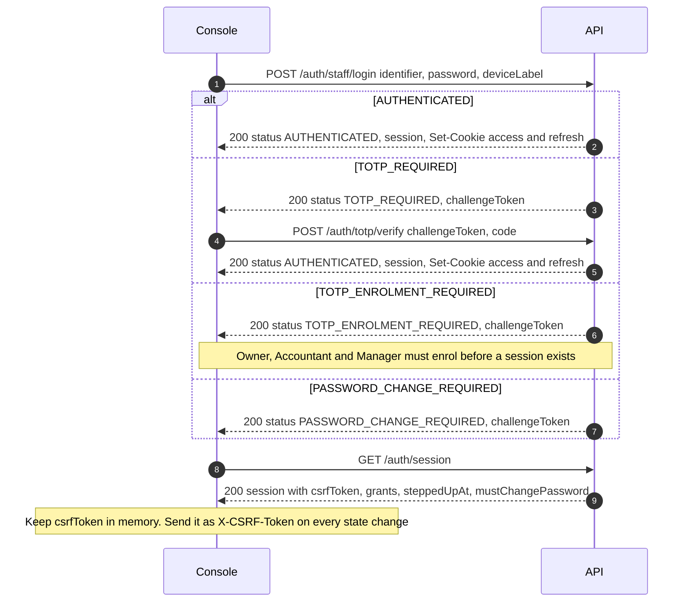

# HaKorem Farms Platform: API Conventions

How to talk to the API: for the frontend track, for integrators, and for every backend session that adds an endpoint. The contract itself is `contract/openapi.yaml` (version 1.0.0, 600 operations, 476 paths). This document explains the rules that apply to all of it, lists every error code, and then gives a short section per module with what a client must know.

The decisions behind these rules: ADR-0014 (idempotency), ADR-0016 (authentication), ADR-0017 (authorisation and maker-checker), ADR-0013 (identifiers), ADR-0027 (offline), ADR-0029 (money, decimals, envelopes). Offline behaviour is in `docs/OFFLINE_SYNC.md`.

## 1. Base URLs and versioning

| Environment | API base URL | Notes |
| --- | --- | --- |
| Production | `https://api.hakoremfarms.com/v1` | Storefront at `https://hakoremfarms.com`, console at `https://app.hakoremfarms.com` |
| Staging | `https://api.staging.hakoremfarms.com/v1` | Sandbox provider credentials; no real money or messages |
| Local development | `http://localhost:3000/v1` | `pnpm dev` |
| Mock server | `http://localhost:4010` | Prism, run from the contract (section 17) |

All paths in the contract are relative to the base URL, including `/v1`. There is no unversioned path except the platform probes served by Caddy. The health check is `GET /v1/health`.

**Versioning.** The URL carries the major version (`/v1`). The contract file carries a semantic version in `info.version`. Every change to the contract has an entry in `docs/CONTRACT_CHANGELOG.md`, newest first.

| Bump | What it is | Example |
| --- | --- | --- |
| Major (`/v2`) | A change that can break an existing client | Removing or renaming a field, path or enum value; making a field required on anything a client sends (a request body or a parameter, ADR-0038); changing a type, a unit or a status code; tightening a pattern or a length limit; changing the meaning of an existing code |
| Minor (1.1.0) | Additions that cannot break a client that follows the rules below | A new operation, a new optional request field, a new response field (required or not, ADR-0038), a new error code on an existing operation, a new enum value on a response |
| Patch (1.0.1) | No change in behaviour | Descriptions, examples, summaries |

**Rules a client must follow so that minor changes never break it:** ignore response fields it does not know; treat every response enum as open (an unknown value is displayed as unknown, never a crash); treat an unknown error `code` by its HTTP status; never depend on key order; never depend on the number of items in a page.

A breaking change is announced at least one full release before it ships: the old behaviour stays and the new behaviour is published alongside. **Contract 2.0.0** (B09q, 2026-11-17) was approved by the owner before anything was deployed, with no running client to keep the old behaviour for, so it keeps the `/v1` URL and shipped without a release of notice (A-255); from the first deployment on, a major version takes the next `/vN` with the old one alongside. The backend never breaks the contract silently: a pull request that changes `contract/openapi.yaml` incompatibly fails CI (`pnpm contract:generate` produces the file from code and CI fails on any difference with the committed one).

## 2. Headers at a glance

| Header | Direction | When |
| --- | --- | --- |
| `Idempotency-Key` | Request | Every state-changing request that declares it (section 8). A UUID |
| `X-CSRF-Token` | Request | Every state-changing request authenticated by a session cookie. The value is `csrfToken` from `GET /auth/session` |
| `X-Device-Credential` | Request | Point-of-sale device endpoints, with the cashier's session |
| `Authorization: Bearer hk_live_<prefix>.<secret>` | Request | Integrations using an API key |
| `Content-Type: application/json` | Request | Every body. The API accepts and returns JSON only (UTF-8). File upload is `multipart/form-data` |
| `X-Correlation-Id` | Response | Every response. A UUID. The same value is in logs, traces, the audit event, outbox messages and any error body. Quote it to support. A client may send its own `X-Correlation-Id` (a UUID); the server accepts it for tracing and generates one otherwise |
| `Retry-After` | Response | On 429 and on 503 when the server knows (seconds) |
| `Cache-Control` | Response | `no-store` on every authenticated response and on every error. Public catalogue reads set a short public lifetime: `getShopProfile` answers `public, max-age=300` (1.54.0, A-243) |

## 3. Authentication

There are three **realms**, each with its own login endpoint and its own cookie names, so one browser can hold a staff and a customer session without either being presented as the other:

| Realm | Who | Login | Access cookie | Refresh cookie |
| --- | --- | --- | --- | --- |
| `STAFF` | Owner, accountant, manager, storekeeper, cashier, sales, farm hand, driver | `POST /auth/staff/login` | `__Host-hk_s_at` | `__Host-hk_s_rt` |
| `CUSTOMER` | Shoppers with an account | `POST /auth/customer/login` | `__Host-hk_c_at` | `__Host-hk_c_rt` |
| `INVESTOR` | Investors | `POST /auth/investor/login` | `__Host-hk_i_at` | `__Host-hk_i_rt` |

Integrations authenticate with an API key (section 3.8). A POS device adds a device credential to the cashier's session (section 3.9).

**Cookies.** All are `HttpOnly`, `Secure`, `SameSite=Strict`, `Path=/`, with no `Domain` attribute and the `__Host-` prefix, so they are bound to `api.hakoremfarms.com` and never sent to another host. The storefront (`hakoremfarms.com`), the console (`app.hakoremfarms.com`) and the API share one registrable domain, so the browser sends the cookies on calls from the console and storefront to the API. The browser code must call the API with credentials (`fetch(..., { credentials: "include" })`). The console and storefront origins are on the API's CORS allow-list (never a wildcard) and requests from any other origin are refused with `ORIGIN_NOT_ALLOWED`. JavaScript cannot read the tokens; it holds only the CSRF token.

**Storefront note.** Server-rendered catalogue pages are anonymous. Pages that show the customer's own data fetch it in the browser after load, because the cookie belongs to the API host and the storefront server never sees it.

### 3.1 Staff login, exact flow

Lifetimes below are the design defaults of ADR-0016, which B3 kept as the values (A-065, `docs/sessions/B03-platform-slice.md`); the response fields `accessExpiresAt` and `refreshExpiresAt` are always authoritative, and a client must use them and not hard-code a duration.

| Token | Design lifetime |
| --- | --- |
| Access token (signed JWT, EdDSA) | 10 minutes |
| Staff refresh token (opaque) | 12 hours idle, 7 days absolute |
| Customer refresh token | 30 days idle, 90 days absolute |
| Investor refresh token | Same as customer |
| Step-up (fresh TOTP) | 5 minutes |
| Challenge token (between login steps) | 5 minutes, single use |



1. **`POST /auth/staff/login`** with `identifier` (email, or phone in E.164 form), `password` and an optional `deviceLabel` that appears in the user's device list. No cookie, CSRF token or idempotency key is needed. The `status` in the 200 response says what happens next:
   - `AUTHENTICATED`: cookies are set and `session` is returned.
   - `TOTP_REQUIRED`: a `challengeToken` is returned. TOTP is mandatory for Owner, Accountant and Manager and optional for others who have enrolled.
   - `TOTP_ENROLMENT_REQUIRED`: a privileged user who has no second factor yet. The client calls `POST /auth/totp/enrol` with `{ "challengeToken" }` and no cookie, shows the secret, then `POST /auth/totp/confirm` with `{ "challengeToken", "code" }`. Confirming completes the login: the cookies are set on that response and the client calls `GET /auth/session` (3.4).
   - `PASSWORD_CHANGE_REQUIRED`: a temporary password (new staff account, or after a reset by a manager). The client asks for a new password and calls `POST /auth/password/change` with `{ "challengeToken", "currentPassword", "newPassword" }` and no cookie (204), then logs in again with the new password, which may lead to the TOTP steps.
   - `VERIFICATION_REQUIRED`: used by customers (3.2).
   Failures use one message and take the same time whether or not the account exists (401 `INVALID_CREDENTIALS`). Repeated failures back off exponentially per account and per address (429 `RATE_LIMITED` with `Retry-After`). A client must not reveal which part was wrong.
2. **`POST /auth/totp/verify`** with the `challengeToken` and a six-digit code (or a recovery code). On success it behaves as the `AUTHENTICATED` branch above. A code is accepted once (the next code is needed for the next login); five wrong codes spend the challenge (401 `CHALLENGE_EXPIRED`); a challenge lasts five minutes.
3. **`GET /auth/session`** returns the current session: `sessionId`, `realm`, `principal`, `csrfToken`, `accessExpiresAt`, `refreshExpiresAt`, `steppedUpAt`, `mustChangePassword`, `totpEnrolled` and `grants` (role, branch, location). Call it after login and after a page reload. The CSRF token is bound to the session, not to the page, so a reload gets the same token; it stays the same for the session's life, refresh included (ADR-0034).
4. Roles and grants are not in the token. They are read on each request from a cache that is invalidated on any grant change, so a permission change takes effect on the next request. A client uses `grants` to decide what to show; the server enforces regardless.

### 3.2 Customer and investor flows

- **Customer register:** `POST /auth/customer/register` (name, phone, optional email, password, marketing consent). The response is `VERIFICATION_REQUIRED` with a `challengeToken`; the customer receives an SMS code and the client calls `POST /auth/customer/verify-phone` with the code. The result is `AUTHENTICATED`.
- **Built in B04e continued (1.11.0, A-123).** Only a Ghana mobile number registers (+233 and nine digits). The answer is the same whether or not the phone has an account; a known phone gets an SMS notice instead of a code, and no second account is made. A code lasts ten minutes and takes five attempts: a wrong one is 422 `VERIFICATION_CODE_INVALID`, the sixth is refused even if right (401 `CHALLENGE_EXPIRED`). A customer who signs in before verifying gets `VERIFICATION_REQUIRED` and a new code. Five registrations per phone in fifteen minutes (429).
- **Customer and investor login:** `POST /auth/customer/login` and `POST /auth/investor/login`, with the same response shape. TOTP is optional for both.
- **Investor accounts are created by staff** (`createInvestor`); there is no self-registration.

### 3.3 Refresh and rotation

- Call **`POST /auth/refresh`** (no body; it reads the refresh cookie; the `Origin` header must be on the allow-list) when a request returns 401 `UNAUTHENTICATED` and the session has not been logged out, and shortly before `accessExpiresAt`. The response is the new session object, with new `accessExpiresAt` and a new `csrfToken`, and new cookies. Only one refresh should be in flight at a time: the client serialises calls, and queued requests wait for it.
- **Every refresh rotates the refresh token.** The previous token stops working. If a token that was already rotated is presented again (a copied token, or two tabs racing without coordination), the whole session is revoked and an alert is raised, and every later request returns 401. The client then shows the login screen. Because of this, the console coordinates refreshes across tabs (a lock in the browser), and never retries a refresh with a stale response.
- A session also ends at the absolute lifetime, when the user or a manager revokes it (`revokeSession`), when a manager disables the account, and at logout. Revocation takes effect on the next request.
- If the refresh itself fails with 401, there is no session: send the user to login.
- **Two realms in one browser.** All three realms share the API host, so a browser that holds a staff and a customer session sends both. `refreshSession`, `getCurrentSession` and `logout` then need `?realm=STAFF` (or `CUSTOMER`, `INVESTOR`); without it they answer 400 `VALIDATION_FAILED` naming `/realm` (refresh: 401). With one session, leave it out.

### 3.4 TOTP and step-up

- **Enrol:** `POST /auth/totp/enrol` (with a session and the CSRF token, or during first login with `{ "challengeToken" }` in the body and no cookie) returns `otpauthUri`, `secretBase32` and, from contract 1.4.0, `qrCodeDataUri` (the URI drawn as an SVG data URI, ADR-0037), shown once. The client shows `qrCodeDataUri` in an `` and keeps `secretBase32` on screen for manual entry; it needs no QR library. `POST /auth/totp/confirm` with the first code activates it and returns single-use recovery codes, shown once and stored hashed.
- **Step-up:** some operations need a TOTP code entered within the last five minutes on the same session. The operation description says "Requires step-up" and, from contract 1.3.0, the operation carries `x-requires-step-up: true` (section 15), for example posting a distribution run, bulk export, role and grant changes, tax scheme and posting rule changes, creating an API key. If the step-up is missing or stale the API returns **403 `STEP_UP_REQUIRED`**. The client then asks for a code, calls **`POST /auth/step-up`** with it (the response is the session with a new `steppedUpAt`), and repeats the original request with the same `Idempotency-Key`. A user who has no TOTP enrolled gets 403 `TOTP_ENROLMENT_REQUIRED`.

### 3.5 CSRF

Every state-changing request authenticated by a session cookie must send `X-CSRF-Token` with the `csrfToken` from `GET /auth/session` (or from the last `login`, `verify`, `refresh` or `step-up` response) and an `Origin` header on the CORS allow-list (browsers send it). Missing or wrong token: 403 `CSRF_TOKEN_INVALID`. Wrong origin: 403 `ORIGIN_NOT_ALLOWED`. Safe methods (`GET`) and the unauthenticated login endpoints do not need it. Guests on the storefront do not use CSRF tokens; customers with a session send the optional header (the `CsrfTokenOptional` parameter).

### 3.6 Logout and sessions

`POST /auth/logout` ends the current session (204). A user lists their devices and sessions with `GET /iam/sessions` and revokes one with `POST /iam/sessions/{id}/revoke`; a manager can revoke anyone's. `POST /auth/password/change` needs the current password. `POST /auth/password/reset-request` always answers 202 with the same message whether or not the account exists; `POST /auth/password/reset` sets the new password with the code. From 1.11.0 (A-123) the code goes by SMS to an active account with a phone (an email-only account waits for the email channel, B11), works once for thirty minutes, and replaces any earlier one; a wrong, used or expired code is 422 `RESET_TOKEN_INVALID`, `RESET_TOKEN_USED` or `RESET_TOKEN_EXPIRED` (CR-004 point 3). A reset revokes every session and clears the lockout. Five requests per identifier in fifteen minutes (429). New passwords are checked against a breached-password list (422 `PASSWORD_BREACHED`).

### 3.7 Guests

Anonymous catalogue reads need nothing. A guest cart is identified by the host-bound cookie `__Host-hk_guest`, set by `POST /shop/carts`. Order tracking and quote links use signed tokens in the URL. An id in a URL is never the only secret.

### 3.8 API keys

Integrations authenticate with `Authorization: Bearer hk_live_<prefix>.<secret>`. A key belongs to an integration principal and carries only the permissions granted to that principal by role grants. The key is shown once at creation (`createApiCredential`, which needs step-up) and stored hashed. Keys can expire, are rotated with `rotateApiCredential` (the old key keeps working for 24 hours of overlap), revoked with `revokeApiCredential`, and are rate-limited per key (`rateLimitPerMinute` at creation). Operations that accept keys list `apiKey` in their `security`; operations on a person's own account, the console's login and the POS device endpoints do not. API-key requests send `Idempotency-Key` but not a CSRF token (there is no cookie to forge).

### 3.9 The POS device credential

A register device is enrolled by a manager (`POST /registers/{id}/devices`). The response carries `deviceCredential`, shown once. The device stores it and sends it as **`X-Device-Credential`** together with the cashier's staff session on `POST /pos/sales` and `POST /pos/sync`. A revoked device is refused with 403 `DEVICE_REVOKED`; an unknown credential with 401 `DEVICE_CREDENTIAL_INVALID`. The credential authorises nothing on its own. Offline unlock and the rules for syncing are in `docs/OFFLINE_SYNC.md`.

## 4. Money, decimals, enums, times and identifiers

These rules are fixed by ADR-0029 and apply to every operation.

- **Money is an integer in pesewas, in fields whose name ends `Pesewas`.** GHS 1.00 is `100`. JSON integers, never floats, never strings, never negative. An object that carries money also carries `currency` (`GHS` only in version 1). A direction is a separate field (`side`, `direction`, `isNegative`, `varianceDirection`). The frontend formats with its own `formatMoney(pesewas)`. The maximum value is `9007199254740991` (`Number.MAX_SAFE_INTEGER`).
- **Cost and price never share a field.** Cost fields say cost (`unitCostPesewas`, `valueAtCostPesewas`, `accumulatedCostPesewas`). Price fields say price (`listPricePesewas`, `agreedUnitPricePesewas`, `priceBand`). Customer-facing shapes carry no cost, floor, ceiling or variance.
- **Totals come from the API.** A list that a screen totals carries the total as its own field (`totalValueAtCostPesewas`, `totalOutstandingPesewas`, `totalDebitPesewas`) over everything matching the filter, not just the page. The frontend never sums rows.
- **Weights, quantities, percentages, units and coordinates are decimal strings with fixed patterns.** Weight: kilograms, three places (`"24.350"`, field names ending `Kg`). Quantity: three places (`"6.000"`). Percentages: up to four places (`"2.5000"`). Coordinates: decimal degrees as strings. A float never touches them. Every captured weight carries a `weightSource` (`SCALE`, `MANUAL`, `ESTIMATE`).
- **Enumerations are upper snake case** in requests and responses (`WEIGHTED_AVERAGE`, `PENDING_APPROVAL`). Treat response enums as open (section 1).
- **Times** are UTC in RFC 3339 (`2026-11-13T09:30:00Z`). **Business dates** (a posting date, a delivery date, a value date) are calendar dates `YYYY-MM-DD` in Africa/Accra, which is UTC+0 all year. Show times in Africa/Accra; send times in UTC. Times of day for slots are `HH:MM` in Africa/Accra.
- **Phone numbers** are E.164: Ghanaian numbers are `+233` followed by nine digits.
- **Identifiers** are UUIDv7 strings. Ids are never shown to people as references: documents show their number, animals their tag, products their SKU, and customers and suppliers their **public ID** (2.0.0, ADR-0073): `cus_` or `sup_` and sixteen Crockford base32 characters (`cus_8F3K2M9Q7X4T1V6B`), drawn by the server from a secure source, unique, never reused, never changed and never sent by a client. Ids are time-ordered but not secret and not business time; knowing an id, a public ID or a SKU reads nothing without authorisation.
- **No identifier is a key** (owner, 2026-11-17, ADR-0074). Knowing an id, a public ID, a SKU or a document number gives a caller nothing: every operation that takes one authorises first and answers an anonymous caller 401, a customer or a role without the permission the same refusal for a real and a made-up identifier, a customer's own read 404 for another's record, and a staff member outside the record's branch 403 (master data excepted, A-257). **Every link sent to a customer** (order tracking, B9b's receipt, a document link) carries its own token: a short prefix and 256 random bits, stored only as its hash with an expiry, never an id or anything derived from one.
- **Currency.** `GHS`.
- **Nulls.** A field the server may not have is present and `null`, not omitted. A client omits optional request fields it does not set.
- **Unknown request fields are rejected** (400 `VALIDATION_FAILED`, `additionalProperties: false`).

## 5. Pagination

List operations use cursor pagination. Request `limit` (1 to 100, default 25) and `cursor`. The response is:

```json
{
  "data": [ ],
  "page": { "nextCursor": "eyJ...", "limit": 25, "hasMore": true }
}
```

Pass `page.nextCursor` as `cursor` to get the next page; it is `null` on the last page. A cursor is opaque, is valid for 24 hours, and is bound to the same filters and the same caller. Changing a filter means starting again without a cursor. Results are stable for a given cursor even while rows are added (the order is by a fixed key, newest first unless the operation says otherwise, and ties are broken by id). There is no offset and no total count in the page object; where a screen needs a total, the operation returns it as a named field (section 4). Each list has its documented order; only the lists named below take a `sort` parameter.

**Named examples (CR-005, 1.53.0, A-237).** Every list operation's 200 answer carries an `examples` map: the populated rows under `default` (or under the names it already had) and `empty`, with no rows, `nextCursor: null`, the operation's default `limit`, `hasMore: false` and every figure beside the rows at zero. The mock answers the empty one for `Prefer: example=empty`. `scripts/contract/empty-examples.ts` wrote them in one pass; `test/contract/api/examples-and-extensions.contract.spec.ts` fails when a list lacks one, so a new list operation carries its own.

**Sorted lists (CR-019, ADR-0054, 1.32.0).** A list that offers a sort names its allowed fields in its operation; the server applies the sort before paging and breaks ties by the row id in the same direction, with nulls last in both directions, so following `nextCursor` never skips or repeats a row, whatever ties or rows arrive between pages. Any other field or direction is 400 `VALIDATION_FAILED` with detail code `SORT_NOT_ALLOWED`; the sort is part of the cursor's binding, so a cursor from another sort is 400 `INVALID_CURSOR`. B07 continued 2 sorts `listCatalogue` (`RELEVANCE`, `PRICE_ASC`, `PRICE_DESC`, `NAME`) and orders the delivery slot lists by start.

**The console lists (B07 continued 3, 1.33.0, A-180, A-181).** Four lists take `sort` (a field from the table) and `direction` (`asc`, the default once a field is named, or `desc`). Without `sort` each answers in its documented default order, as it always has, and its example shows that order; a `direction` without `sort` is refused. Each field is backed by an index in the owning module's migration (0120 for MDM, 0121 for INV).

| Operation | `sort` fields | Tie-breaker | Default order (no `sort`) |
| --- | --- | --- | --- |
| `listProducts` | `name`, `sku`, `category` (the category's name), `status`, `updatedAt` | product id | Newest first (id descending) |
| `listStockOnHand` | `onHandQty` | location, product and unit ids | Location id, product id, unit id |
| `listStockUnits` | `identifier`, `expiresOn` (no expiry last) | stock unit id | Id ascending |
| `listStockMovements` | `occurredAt`, `valuePesewas` | movement id | Newest first (id descending) |

`name`, `category` and `identifier` ignore case. Not sortable, and 400 `SORT_NOT_ALLOWED` like any other field: a product's or location's name on the stock lists (master data's columns, which inventory cannot index or join) and `valueAtCostPesewas` (computed from the cost pools when read). Sorting by a cost (`valuePesewas`) needs only the list's own read permission, which already shows the cost on every row; a role without it is refused with 403 before the sort is read (ADR-0052).

## 6. Filtering

Filters are query parameters named for the field, and they combine with AND. The most common:

| Parameter | Meaning | Operations |
| --- | --- | --- |
| `status` | One status value, or a comma-separated list | Orders, payments, deliveries, shifts, approvals, etc. |
| `from`, `to` | Inclusive range on the operation's primary date. Business dates `YYYY-MM-DD` for date-based lists, RFC 3339 for time-based ones | Movements, orders, payments, audit events, reports |
| `date`, `asOf` | One business date, or a point in time for a snapshot | Daily reports, stock on hand |
| `branchId`, `locationId` | Scope. A caller never sees data outside the branches and locations of their grants, whatever they pass | Most staff lists |
| `customerId`, `supplierId`, `productId`, `speciesId`, `categoryId`, `stockUnitId`, `orderId`, `shiftId`, `driverId`, `zoneId` | The linked record | Related lists |
| `kind`, `channel`, `direction` | A type field | Various |
| `q` | Free-text search on the fields the operation names (name, number, tag, phone). Matches the start of words, case-insensitive | Customers, products, suppliers, animals, documents |
| `groupBy` | The grouping for a report-style list | Reports, margins |
| `includeZero`, `includeVirtual`, `active` | Booleans, `true` or `false` | Stock, locations, masters |

An unknown parameter is ignored; an invalid value is 400 `VALIDATION_FAILED` with the field named in `details`. Encrypted fields (bank details, identity numbers) can never be filtered or sorted on.

## 7. Optimistic locking

Mutable records carry an integer `version`. To change one, send the `version` you read in the body of the `PATCH` or `PUT`:

```json
{ "version": 7, "name": "Grade A eggs, crate of 30" }
```

If the record changed since, the API returns **409 `VERSION_CONFLICT`** and changes nothing. The client reloads the record, shows the difference, and asks the user to re-apply the change. A successful update returns the record with the incremented `version`. Documents that move through states (orders, journals) are changed by action endpoints (`/confirm`, `/submit`) and use state checks rather than a version; a wrong state is 422 `INVALID_STATE_TRANSITION`.

## 8. Idempotency

Every state-changing operation that declares the `Idempotency-Key` header requires it. Generate a UUID per user action in the client and **reuse it on every retry of that action**. Do not generate a new key on retry (that is how a double charge happens) and do not reuse a key for a different action.

**Server behaviour** (ADR-0014): the key is stored with a hash of the request in the same transaction as the business change, scoped to the caller and the operation.

| Situation | Result |
| --- | --- |
| First time | The request is processed. The response is stored with the key |
| Same key, same request, completed | The stored response is returned again, with the same status and body. No second effect |
| Same key, different request body | 409 `IDEMPOTENCY_KEY_REUSED`. Nothing happens |
| Same key arrives while the first is still running | The second waits for the first transaction and then receives its result |
| Missing key on an operation that requires it | 400 `IDEMPOTENCY_KEY_REQUIRED` |

Keys are kept for at least 72 hours, longer than any offline period, and then purged. After that a repeated key is treated as new.

**Which requests do not carry the header.** Of the 337 state-changing operations, 305 declare it. The exceptions are deliberate:

- the authentication calls (login, verify, refresh, logout, password, TOTP, step-up, registration);
- calculations that change nothing (`resolvePrices`, `calculateTax`, `validateCoupon`, `quoteDelivery`, the template and notification previews, `getDistributionSchedule`);
- link and download issues (`createFileSignedUrl`, `downloadArchivedDocument`, `downloadMyDocument`, `downloadMyInvestorDocument`, `printPackLabels`), `checkPaymentStatus` and `markNotificationRead`, which are repeatable by nature;
- the two sync endpoints (`syncOfflineSales`, `syncDriverEvents`), whose items carry their own ids (section 9);
- the inbound provider webhooks, which are deduplicated by the provider's event id.

## 9. Offline record ids

Records created offline carry a client-generated UUIDv7 `id`, which is their idempotency identity (ADR-0013): the offline sale (becomes the order id), the shift, a cash movement, a proof of delivery, a failure, a weight record, a health event, a mortality report, a feed consumption record, a temperature reading, a payment recorded at the counter, and picks. The operations that accept it say "Accepted from an offline queue" in their description. Send the same value as `Idempotency-Key`. A resubmission with the same id returns the first result. The server checks that the id is a version 7 UUID whose embedded time is not in the future beyond a small tolerance and not before the shift began. Details, the counter and the provisional reference are in `docs/OFFLINE_SYNC.md`.

## 10. Errors

### 10.1 The envelope

Every non-2xx response, from every operation, has this body:

```json
{
  "error": {
    "code": "VALIDATION_FAILED",
    "message": "Some fields are not valid.",
    "correlationId": "019a7b1c-62bb-748f-99c8-51cf6862caad",
    "details": [
      { "field": "/lines/0/weightKg", "code": "PATTERN", "message": "Weight must have exactly three decimal places, for example 24.350." }
    ]
  }
}
```

| Field | Meaning |
| --- | --- |
| `code` | A stable upper snake case machine code. Branch on this, never on `message` |
| `message` | A sentence safe to show to a user. It is translated through the translation layer (English first) and never contains internal detail |
| `correlationId` | Quote it to support. It is the same value as the `X-Correlation-Id` header |
| `details` | An array, possibly empty. Each item has `field` (a JSON pointer, or `null`), `code` and `message`. Validation errors list every offending field at once |

An unexpected error is a 500 `INTERNAL` with a correlation id and nothing else; nothing was committed. A client may retry a 500 or 503 with the same idempotency key.

### 10.2 Status codes

| Status | Used for |
| --- | --- |
| 200, 201, 204 | Success, created, success with no body |
| 202 | Accepted: either an `ApprovalPending` body (section 11) or an asynchronous job (an import or a report run), whose resource carries its status |
| 400 | Malformed or invalid request: schema, patterns, unknown fields, missing idempotency key |
| 401 | No valid session, key or device credential |
| 403 | Authenticated but not permitted. Also returned when the record exists but belongs to someone else, so existence is not revealed. Also step-up and CSRF failures |
| 404 | No such record, or not visible to the caller |
| 409 | `VERSION_CONFLICT` and `IDEMPOTENCY_KEY_REUSED` only. A conflict in the state of the data is 422 |
| 413, 415 | Body too large, unsupported content type |
| 422 | A valid request that a business rule refuses. `code` says which rule |
| 429 | Rate limited. `Retry-After` in seconds |
| 500 | Unexpected failure. Nothing committed |
| 503 | A dependency is down, or the payment provider is unavailable. The counter continues offline |

### 10.3 Catalogue of error codes

The "Source" column says where the code comes from. **Contract** means the code is named in `contract/openapi.yaml` 1.0.0 (in an error example or an operation description). **Added** means this document defines it because the domain clearly needs it; the contract does not name it yet, and **the contract generated in B2 must adopt every code marked Added** (as an additional `code` value on the operations that can raise it, and listed in the `ErrorBody.code` description). Adding codes is a minor contract change.

#### Generic (responses defined once in `components.responses`)

| Code | HTTP | Meaning | Source |
| --- | --- | --- | --- |
| `VALIDATION_FAILED` | 400 | The request is malformed or fails validation. `details` lists each field | Contract (`BadRequest`) |
| `UNAUTHENTICATED` | 401 | No valid session or key. The client tries `POST /auth/refresh` once, then shows login | Contract (`Unauthenticated`) |
| `FORBIDDEN` | 403 | Authenticated, not permitted. Also returned when the record belongs to someone else | Contract (`Forbidden`) |
| `NOT_FOUND` | 404 | No such record, or not visible to the caller | Contract (`NotFound`) |
| `VERSION_CONFLICT` | 409 | The record changed since it was read. Reload and re-apply | Contract (`Conflict`) |
| `RATE_LIMITED` | 429 | Too many requests. Wait `Retry-After` seconds | Contract (`RateLimited`) |
| `INTERNAL` | 500 | Unexpected failure on our side. Quote the correlation id | Contract (`InternalError`) |
| `SERVICE_UNAVAILABLE` | 503 | A dependency is down. Retry with backoff; the counter continues offline | Contract (`ServiceUnavailable`) |

#### Business rules named in the contract

| Code | HTTP | Meaning | Raised by | Source |
| --- | --- | --- | --- | --- |
| `STOCK_UNIT_ON_HOLD` | 422 | The animal or lot is under a withdrawal hold or quarantine and cannot be sold, consumed or transferred | `createProcessingOrder`, sale and transfer operations | Contract |
| `QUOTE_REQUIRED` | 422 | A line cannot be priced by the pricing engine. Raise a quote instead. (`resolvePrices` returns this as an outcome, not an error) | `createOrder`, `resolvePrices` | Contract |
| `PRICE_OVERRIDE_NEEDS_APPROVAL` | 422 | The agreed price differs from the resolved price by more than the role's limit or outside the band, and no approval by a different user covers it (`details[].code`: `OUTSIDE_BAND`, `BEYOND_ROLE_LIMIT`, `APPROVAL_PENDING`, `APPROVAL_REJECTED`, `APPROVAL_DIFFERS`). Ask a manager to approve the override | `completeCounterSale`, `confirmOrder`, `issueProforma` | Contract |
| `MAKER_CANNOT_CHECK` | 422 | The person who made a request cannot approve it. The database enforces the same rule | `approveRequest` | Contract |
| `THREE_WAY_MATCH_FAILED` | 422 | A supplier invoice line does not match its purchase order line and goods receipt line, or the invoice is not matched. Payment is blocked. Each detail names the line or allocation and its reason | `approveSupplierInvoice`, `createSupplierPayment` | Contract |
| `JOURNAL_UNBALANCED` | 422 | Debits do not equal credits in a journal | `submitManualJournal` | Contract |
| `TAX_MATRIX_INCOMPLETE` | 422 | A tax scheme version lacks a cell for some category and levy. Each `details[].code` names a missing pair, `CATEGORY/LEVY` | `replaceTaxSchemeCells`, `submitTaxSchemeVersion` | Contract |
| `TAX_CELL_INVALID` | 422 | A tax cell breaks a rule: a rate on a non-standard treatment, a base that does not fit its kind, a base levy of another category or calculated at or after it, a repeated calculation order. `details[].field` points at the cell (1.5.0) | `replaceTaxSchemeCells` | Added |
| `TAX_SCHEME_NOT_IN_FORCE` | 422 | No approved tax scheme version covers the tax date asked for (1.5.0) | `calculateTax` | Added |
| `PROMOTION_INVALID` | 422 | A promotion breaks a rule: a value that does not fit its kind, a window that ends before it starts, a target naming both or neither of a product and a category, a line promotion with no target. `details[].field` points at the field (1.6.0) | `createPromotion`, `updatePromotion` | Added |
| `COUPON_INVALID` | 422 | A coupon code is not 3 to 40 letters, digits and hyphens, or a limit is not positive, or the per-customer limit exceeds the total (1.6.0) | `createCoupon` | Added |
| `COUPON_UNAVAILABLE` | 422 | A coupon exists but cannot be used now; `details[0].code` is `EXPIRED`, `LIMIT_REACHED`, `NOT_APPLICABLE` or `ALREADY_USED` (1.6.0) | `resolvePrices`, and the order operations that redeem a coupon | Added |
| `PAYMENT_METHOD_REQUIRES_VERIFICATION` | 422 | Mobile money and card are cleared only by a verified provider callback or lookup, never by a manual entry | `recordPayment` | Contract |
| `REQUEST_TO_BUY_ONLY` | 422 | A live animal product cannot be added to a cart. Open a quote request | `addCartLine` | Contract |
| `WITHDRAWAL_CANNOT_BE_RELEASED` | 422 | A veterinary withdrawal hold cannot be released early by anyone | `releaseStockHold` | Contract |

#### Authentication, sessions and devices (Added)

| Code | HTTP | Meaning |
| --- | --- | --- |
| `INVALID_CREDENTIALS` | 401 | Wrong identifier or password. The same for unknown accounts and the same timing |
| `TOTP_INVALID` | 401 | The six-digit code or recovery code is wrong or already used |
| `CHALLENGE_EXPIRED` | 401 | The challenge token expired or was already used. Start login again |
| `PASSWORD_BREACHED` | 422 | The new password appears in a breached-password list |
| `CSRF_TOKEN_INVALID` | 403 | `X-CSRF-Token` is missing or does not match the session |
| `ORIGIN_NOT_ALLOWED` | 403 | The request's origin is not on the allow-list |
| `STEP_UP_REQUIRED` | 403 | A TOTP step-up within the last five minutes is needed. Call `POST /auth/step-up` and repeat |
| `TOTP_ENROLMENT_REQUIRED` | 403 | The action needs a second factor and the user has none enrolled |
| `PASSWORD_CHANGE_REQUIRED` | 403 | The account has a temporary password; change it first |
| `DEVICE_CREDENTIAL_INVALID` | 401 | The `X-Device-Credential` is missing or unknown |
| `DEVICE_REVOKED` | 403 | The device was revoked by a manager |
| `DEVICE_CREDENTIAL_SHOWN_ONCE` | 409 | `enrolDevice` replayed: the credential was shown once and is kept nowhere in the clear; revoke the device and enrol it again (2.6.0) |
| `DEVICE_INVALID` | 422 | A device cannot be enrolled or revoked like this: `REGISTER_RETIRED`, `DEVICE_ALREADY_REVOKED` (2.6.0) |
| `COUNTER_SALE_INVALID` | 422 | A counter sale breaks a till rule, every one in `details[].code`: `ID_NOT_UUID_V7`, `ID_DIFFERS_FROM_KEY`, `METHOD_UNKNOWN`, `CHANGE_ONLY_FROM_CASH`, `TENDERED_BELOW_AMOUNT`, `PROVIDER_PAYMENT_NOT_AVAILABLE`, `OFFLINE_TENDER_ONLY` (2.6.0) |
| `TOTP_ALREADY_ENROLLED` | 422 | An authenticator is already confirmed for this account (B3) |

#### Requests, idempotency and size (Added)

| Code | HTTP | Meaning |
| --- | --- | --- |
| `IDEMPOTENCY_KEY_REQUIRED` | 400 | The operation requires `Idempotency-Key` and it was not sent |
| `IDEMPOTENCY_KEY_REUSED` | 409 | The key was used before with a different request body |
| `PAYLOAD_TOO_LARGE` | 413 | The body exceeds the limit for this endpoint |
| `UNSUPPORTED_MEDIA_TYPE` | 415 | The content type is not accepted |
| `SYNC_BATCH_TOO_LARGE` | 400 | A sync batch has more than 500 sales |
| `INVALID_STATE_TRANSITION` | 422 | The document is not in a state that allows this action (for example confirming a cancelled order) |

#### Approvals and authorisation (Added)

| Code | HTTP | Meaning |
| --- | --- | --- |
| `APPROVAL_ALREADY_DECIDED` | 422 | The approval request was already approved, rejected or cancelled |
| `APPROVAL_EXPIRED` | 422 | The approval request lapsed before it was decided |
| `APPROVAL_SUBJECT_CHANGED` | 422 | The record changed after approval was requested; the approval is void. Request approval again (B3) |

#### Master data (Added in B3)

| Code | HTTP | Meaning |
| --- | --- | --- |
| `DUPLICATE_VALUE` | 422 | A unique value (a storefront slug, a phone, a code) is already used by another live record. `details` names each field. A SKU is never typed, so never duplicated (2.0.0) |
| `FIELD_SERVER_ASSIGNED` | 422 | The request carries a field the server assigns and never takes as input: a product's `sku` on create, update or in an import (2.0.0, ADR-0072). Refused, never ignored; `details[].field` names it, `details[].code` is `SERVER_ASSIGNED` |
| `REFERENCE_NOT_FOUND` | 422 | An id in the request names no record (an unknown category, species, tax category or unit). `details` names each field |
| `STOCK_POLICY_CONFLICT` | 422 | The product's fields contradict its stock-keeping policy, for example a serialised animal without a species or listed for the cart, or catch-weight stock not held in kilograms. `details` names each field and rule |
| `RECORD_IN_USE` | 422 | The record is still in use: a category with live products or live children, or a grade or weight band a pending or active price list version prices with, cannot be archived, and such a band keeps its range. `details[].code` says why (`HAS_LIVE_PRODUCTS`, `HAS_LIVE_CHILDREN`, `USED_BY_LIVE_PRICES`) (1.7.0) |
| `UOM_CONVERSION_INVALID` | 422 | A unit conversion is not exact to three places (`INEXACT_FACTOR`), too large (`TOO_LARGE`), for a product that is not countable (`NOT_COUNTABLE`), from the base unit (`BASE_UNIT`) or from a weighed or measured unit (`NOT_COUNTED`) (1.27.0) |
| `PURCHASE_ORDER_INVALID` | 422 | A purchase order breaks a rule, every one in `details[].code`: `NO_LINES`, `LINE_REPEATED`, `PRODUCT_NOT_ACTIVE`, `NOT_PURCHASABLE`, `SUPPLIER_NOT_ACTIVE`, `NOT_A_RECEIVING_LOCATION`, `EXPECTED_BEFORE_ORDER`, `NO_CONVERSION`, `INEXACT_QUANTITY`, `TAX_INCLUSIVE_NOT_AVAILABLE`, `RECEIVED_ALREADY` (cancel after a receipt), `NOTHING_RECEIVED` (close before one) (1.28.0, A-164) |
| `RECEIPT_EXCEEDS_ORDER` | 422 | A goods receipt line would take its purchase order line past the ordered quantity plus the line's tolerance (`OVER_RECEIPT`, FR-PUR-007); the whole receipt is refused (1.28.0) |
| `RECEIPT_ORDER_MISMATCH` | 422 | A goods receipt line names an order line that is not on the receipt's order (`NOT_ON_ORDER`), of another product (`PRODUCT_DIFFERS`), an order of another supplier (`OTHER_SUPPLIER`), one not open for receipt (`ORDER_NOT_OPEN`) or none (`NO_ORDER`) (1.28.0) |
| `SUPPLIER_INVOICE_INVALID` | 422 | A supplier invoice breaks a rule, every one in `details[].code`: `NO_LINES`, `ORDER_OF_ANOTHER_SUPPLIER`, `ORDER_NOT_RECEIVABLE`, `ORDER_REQUIRED`, `ORDER_LINE_NOT_ON_ORDER`, `PRODUCT_DIFFERS`, `NO_CONVERSION`, `INEXACT_QUANTITY`, `BRANCH_REQUIRED`, `BRANCH_DIFFERS`, `DUE_BEFORE_INVOICE`, `STATED_TOTAL_DIFFERS`, `LEVY_NOT_IN_SCHEME`, `LEVY_REPEATED`, `FILE_NOT_USABLE`, `CREDIT_NOTE_NOT_AVAILABLE`, `PAYMENT_ALLOCATED` (cancel with a live payment) (1.28.0) |
| `SUPPLIER_CLAIM_INVALID` | 422 | A claim from a goods receipt cannot be raised or settled like this, every one in `details[].code`: `RECEIPT_NOT_POSTED`, `NOT_A_PURCHASE`, `NO_ORDER`, `NOTHING_REJECTED`, `NO_ORDER_LINE`, `NOTHING_TO_CLAIM`, `CLAIM_EXISTS`, `CREDIT_NOTE_EXISTS`, `CLAIM_NOT_INVOICED`, `CLAIM_INVOICED`, `INVOICE_NOT_APPROVED`, `ORDER_DIFFERS`, `ORDER_LINE_NOT_INVOICED`, and a credit target's refusals (`ORIGINAL_NOT_APPROVED`, `ORIGINAL_SETTLED`, `BRANCH_DIFFERS`, `ORIGINAL_NOT_AN_INVOICE`, `ORIGINAL_OF_ANOTHER_SUPPLIER`) (2.4.0, ADR-0076) |
| `SUPPLIER_PAYMENT_INVALID` | 422 | A supplier payment breaks a rule: `NO_ALLOCATIONS`, `OTHER_SUPPLIER`, `DUPLICATE_INVOICE`, `NOT_APPROVED`, `BRANCH_DIFFERS`, `BANK_ACCOUNT_NOT_AVAILABLE` (until bank accounts exist, B8) (1.28.0); `PAYOUT_DETAILS_MISSING` and `PAYOUT_METHOD_DIFFERS`, a bank or mobile money payment to a supplier with no approved details of that method in force (1.29.0, A-166) |
| `SUPPLIER_PROFILE_INVALID` | 422 | Supplier terms or payout details break a rule: `REQUIRED`, `NOT_FOR_METHOD`, `ACCOUNT_NUMBER_INVALID` (6 to 20 digits), `MOMO_NUMBER_INVALID` (+233 and nine digits), `PAYOUT_CHANGE_PENDING` (one change waits per supplier) (1.29.0, A-166) |
| `SUPPLIER_DOCUMENT_INVALID` | 422 | A supplier document cannot be filed: `REFERENCE_NOT_FOUND`, `FILE_NOT_USABLE` (another purpose, or not `CLEAN`), `FILE_ALREADY_FILED`, `EXPIRED` (1.29.0) |
| `PAYOUT_MAKER_CANNOT_APPROVE` | 422 | The person who made a supplier's payout change approving the first payment to that supplier after it; they may still prepare it (`approveRequest`, 1.29.0, A-171) |
| `CREDIT_NOTE_EXCEEDS_INVOICE` | 422 | A supplier credit note larger than what its invoice has left after other live credits and payments; the database refuses it too (`createSupplierInvoice`, `updateSupplierInvoice`, `submitSupplierCreditNote`, 1.30.0, A-172) |
| `VARIANCE_NOT_ALLOWED` | 422 | A variance asked for, or approved, on a line whose mismatch is not a price or a levy (`QTY_EXCEEDS_RECEIVED`, `NO_ORDER_LINE`, `PRODUCT_DIFFERS`): receive the goods or correct the invoice (`requestSupplierInvoiceVariance`, `approveRequest`, 1.30.0) |
| `INVOICE_MAKER_CANNOT_APPROVE` | 422 | The person who entered a supplier invoice or credit note approving its variance or the credit (`approveRequest`, 1.30.0, A-172), or approving the invoice for payment (`approveSupplierInvoice`, detail on `/id`, 2.9.0, CR-043) |
| `APPROVAL_PENDING` | 422 | A supplier credit note or invoice whose approval is still waiting: it cannot change until the request is decided or withdrawn (1.30.0) |
| `SETTING_INVALID` | 422 | A setting's new value is of the wrong type (`WRONG_TYPE`), out of its range (`OUT_OF_RANGE`), dated in the past (`IN_THE_PAST`), or a branch value for a farm-wide setting (`NOT_BRANCH_SCOPED`) (1.29.0, FR-AUD-007). For the business profile: an opening interval that does not close after it opens (`CLOSES_BEFORE_OPENS`), two intervals of one day that overlap (`HOURS_OVERLAP`), or a logo that is not a clean public image (`LOGO_NOT_USABLE`) (1.54.0, FR-AUD-008) |
| `PURCHASE_REQUISITION_INVALID` | 422 | A requisition breaks a rule: `NO_LINES`, `LINE_REPEATED`, `PRODUCT_NOT_ACTIVE`, `NOT_PURCHASABLE`, `NEEDED_BY_PAST`, `LOCATION_REQUIRED`, and on conversion `LINE_NOT_ON_REQUISITION` (1.29.0) |
| `WEIGHT_BAND_INVALID` | 422 | A weight band's range is empty (`NOT_ABOVE_MIN`) or meets another live band of the species (`OVERLAPS_BAND:<code>`); bands are half-open `[minKg, maxKg)` (1.7.0) |
| `LOCATION_INVALID` | 422 | A location breaks a location rule: a parent in another branch (`PARENT_IN_OTHER_BRANCH`), virtual (`PARENT_IS_VIRTUAL`) or below it (`PARENT_IS_SELF_OR_BELOW`), a virtual kind created (`VIRTUAL_KIND_FIXED`) or a virtual location changed (`VIRTUAL_LOCATION_FIXED`), a cold room without its range (`COLD_ROOM_NEEDS_TEMPERATURE`, `NOT_ABOVE_MIN`) (1.8.0) |
| `PRICE_LIST_ASSIGNMENT_INVALID` | 422 | The list assigned to a customer is not a `CUSTOMER` list (`NOT_A_CUSTOMER_LIST`), or the window ends before it starts (`NOT_AFTER_VALID_FROM`) (1.8.0) |
| `PAYMENT_METHOD_INVALID` | 422 | A payment method change is not allowed: verification switched off for mobile money or card (`VERIFICATION_REQUIRED`), a method other than cash, or mobile money without `pos.offline_mobile_money_allowed`, taken offline (`OFFLINE_NOT_ALLOWED`), or no channel left (`NO_CHANNELS`) (1.9.0) |
| `DELIVERY_ZONE_INVALID` | 422 | A delivery zone has no areas (`NO_AREAS`), a blank or repeated area (`AREA_BLANK`, `AREA_REPEATED`), or an area another active zone covers (`AREA_IN_ZONE:<code>`) (1.9.0) |
| `GRANT_INVALID` | 422 | A grant breaks a grant rule: a location outside the branch (`LOCATION_NOT_IN_BRANCH`), a window ending before it starts (`NOT_AFTER_VALID_FROM`), the Customer or Investor role outside its realm (`ROLE_NOT_FOR_REALM`), or the last Owner grant in force revoked (`LAST_OWNER`) (1.10.0) |
| `USER_INVALID` | 422 | An account change is not allowed: no email and no phone (`NO_IDENTIFIER`), an investor account before investor records exist (`INVESTOR_ACCOUNTS_NOT_AVAILABLE`), or the last active Owner disabled (`LAST_OWNER`) (1.10.0) |
| `ROLE_INVALID` | 422 | A role change breaks a role rule: an unknown permission code (`UNKNOWN_PERMISSION`), TOTP switched off on the Owner, Manager or Accountant role (`TOTP_REQUIRED_FOR_ROLE`), or one limit kind twice (`DUPLICATE_LIMIT_KIND`) (1.11.0) |
| `VERIFICATION_CODE_INVALID` | 422 | The six-digit phone code is wrong; the challenge counts the attempt, and the sixth is refused (401 `CHALLENGE_EXPIRED`) (1.11.0) |
| `RESET_TOKEN_INVALID` | 422 | No password reset code matches what was sent (CR-004 point 3, 1.11.0) |
| `RESET_TOKEN_USED` | 422 | The password reset code was already used; ask for a new one (CR-004 point 3, 1.11.0) |
| `RESET_TOKEN_EXPIRED` | 422 | The password reset code is past its thirty minutes; ask for a new one (CR-004 point 3, 1.11.0) |

#### Stock, livestock and processing (Added)

| Code | HTTP | Meaning |
| --- | --- | --- |
| `INSUFFICIENT_STOCK` | 422 | Not enough available stock at the location for this line (on hand, less reserved, less held). Names the line and the available quantity |
| `STOCK_UNIT_NOT_AVAILABLE` | 422 | The animal or lot was already sold, is not at this location, or is not alive |
| `STOCK_UNIT_RESERVED` | 422 | The stock unit is reserved for another order |
| `RESERVATION_EXPIRED` | 422 | The checkout's stock reservation lapsed. Start checkout again |
| `STOCK_MOVEMENT_ALREADY_REVERSED` | 422 | A movement can be reversed once |
| `GOODS_RECEIPT_INVALID` | 422 | A goods receipt breaks a receipt rule. Each `details[].code` names it: `ONE_ANIMAL_PER_HEAD`, `WHOLE_ANIMALS_ONLY`, `TAG_REPEATED`, `TAG_IN_USE`, `BATCH_REQUIRED`, `BATCH_REPEATED`, `BATCH_IN_USE`, `EXPIRY_REQUIRED`, `EXPIRED_ON_ARRIVAL`, `NOT_FOR_SERIAL_PRODUCT`, `NOT_FOR_THIS_PRODUCT`, `PRODUCT_NOT_TRACKED`, `PRODUCT_NOT_ACTIVE`, `PRODUCT_NOT_STOCKED`, `PRODUCT_NOT_PURCHASABLE`, `VALUE_REQUIRED`, `WEIGHT_NEEDS_SOURCE`, `NO_LINES`, `SUPPLIER_REQUIRED`, `SUPPLIER_NOT_ACTIVE`, `NOT_FOR_THIS_KIND`, `NOT_A_RECEIVING_LOCATION`, `IN_THE_FUTURE`, `OPENING_NOT_AVAILABLE` (1.16.0); a line left to the server to value (CR-040, 2.9.0) `ORDER_LINE_UNKNOWN`, `ORDER_LINE_OTHER_PRODUCT` | `createGoodsReceipt`, `updateGoodsReceipt`, `postGoodsReceipt` | Added |
| `STOCK_TRANSFER_INVALID` | 422 | A transfer breaks a transfer rule. Each `details[].code` names it: `SAME_LOCATION`, `NOT_A_STOCK_LOCATION`, `NO_LINES`, `LINE_REPEATED`, `STOCK_UNIT_REQUIRED`, `PRODUCT_NOT_TRACKED`, `PRODUCT_NOT_STOCKED`, `PRODUCT_NOT_ACTIVE`, `NOT_FOR_THIS_PRODUCT`, `STOCK_UNIT_NOT_ACTIVE`, `WHOLE_ANIMALS_ONLY`, `NOT_AT_SOURCE`, `NO_IN_TRANSIT_LOCATION` (1.17.0) |
| `TRANSFER_VARIANCE` | 422 | A receipt confirmation does not balance: `VARIANCE_REASON_REQUIRED`, `NO_VARIANCE`, `MORE_THAN_DISPATCHED`, `WHOLE_ANIMALS_ONLY`, `LINE_UNKNOWN`, `LINE_REPEATED`, `LINE_MISSING`, `REASON_NOT_ALLOWED` (1.17.0) |
| `STOCK_ADJUSTMENT_INVALID` | 422 | An adjustment breaks an adjustment rule: `REASON_NOT_ALLOWED`, `NOTE_REQUIRED`, `NOT_A_STOCK_LOCATION`, `EXCEPTION_NOT_OPEN`, `ANIMAL_NOT_ADJUSTED`, `NOT_IN_THIS_BRANCH` and the shared line rules (1.17.0) |
| `STOCK_REVERSAL_NOT_POSSIBLE` | 422 | The movement is not reversed by hand: `REVERSAL_OF_A_REVERSAL`, `TRANSFER_MOVEMENT`, `VALUE_ONLY_MOVEMENT`, `REASON_NOT_ALLOWED`, `POOL_VALUE_GONE` (1.17.0) |
| `STOCK_TAKE_NOT_COUNTED` | 422 | The stock take has lines not counted (`NOT_COUNTED`) or awaiting their recount (`RECOUNT_REQUIRED`), named by line in `details[].field` (1.18.0) |
| `STOCK_TAKE_INVALID` | 422 | A stock take breaks a stock-take rule: `NOT_A_STOCK_LOCATION`, `PRODUCTS_REQUIRED`, `NOT_FOR_FULL_SCOPE`, `PRODUCT_REPEATED`, `PRODUCT_NOT_STOCKED`, `ANIMAL_NOT_COUNTED`, `SCOPE_OVERLAP`, or of a batch of counts `NOT_COUNTING`, `NO_COUNTS`, `LINE_UNKNOWN`, `LINE_REPEATED`, `RECOUNT_IN_REVIEW_ONLY`, `COUNTING_CLOSED`, `RECOUNT_NOT_NEEDED` (1.18.0) |
| `STOCK_EXCEPTION_INVALID` | 422 | A resolution breaks a rule: `RESOLUTION_KIND_REQUIRED`, `NOT_FOR_A_HELD_VARIANCE`, `ONLY_FOR_A_HELD_VARIANCE`, `WRITE_OFF_PENDING`, `DOCUMENT_REQUIRED`, `NOT_FOR_NO_CORRECTION`, `NOT_A_SETTLING_ADJUSTMENT`, `FOUND_LOCATION_REQUIRED`, `ONLY_FOR_FOUND`, `NOT_A_STOCK_LOCATION`, `NOT_IN_THE_TRANSFER_BRANCHES` (1.19.0) |
| `REORDER_RULE_INVALID` | 422 | A reorder rule breaks a rule: `BELOW_MINIMUM`, `BELOW_REORDER_POINT`, `MAXIMUM_REQUIRED`, `OUT_OF_RANGE`, `NOT_A_STOCK_PRODUCT`, `NOT_A_STOCK_LOCATION`, `NOT_IN_THE_BRANCH`, `RULE_EXISTS` (1.20.0) |
| `BRANCH_INVALID` | 422 | Closing a branch is refused, every reason in `details[].code`: `FARM_BRANCH`, `LAST_ACTIVE_BRANCH`, `HOLDS_STOCK`, `OPEN_DOCUMENTS` (1.21.0, ADR-0051) |
| `LIVESTOCK_RECORD_INVALID` | 422 | A weight, health event, mortality or feed record breaks a livestock rule, every one in `details[].code`: `TAG_IN_USE`, `NO_RECORDS`, `TOO_MANY_RECORDS`, `RECORD_REPEATED`, `ID_REUSED`, `WEIGHT_ZERO`, `NOT_LIVESTOCK`, `ANIMAL_NOT_ALIVE`, `NOT_IN_ONE_PLACE`, `ONE_HEAD_FOR_AN_ANIMAL`, `HEAD_ABOVE_FLOCK`, `IN_THE_FUTURE`, `ANIMAL_OR_PEN_REQUIRED`, `PRODUCT_AND_QTY_TOGETHER`, `WITHDRAWAL_BELOW_PRODUCT`, `NOT_A_MEDICATION`, `PRODUCT_NOT_ACTIVE`, `NO_STORE`, `NOT_A_STORE_OF_THIS_BRANCH`, `NOT_A_PEN`, `NO_ANIMALS_HERE`, `NOT_FEED`, `QTY_ZERO`, `RATION_OF_ANOTHER_FEED`, `REASON_NOT_FOR_KIND`, `ALREADY_AWAITING_APPROVAL`, `SUBMITTER_NOT_REPORTER`, `PHOTO_NOT_USABLE` (1.24.0, A-158); and for edits, moves, growth, batches and breeding `SEX_FIXED_AS_DAM`, `TAG_NOT_EDITABLE`, `ALREADY_THERE`, `OTHER_BRANCH`, `WINDOW_BACKWARDS`, `BATCH_NO_TAKEN`, `NO_FLOCK_PRODUCT`, `HEAD_ZERO`, `BATCH_NOT_EMPTY`, `BATCH_CLOSED`, `NOT_A_BREEDING_SPECIES`, `DAM_NOT_ALIVE`, `DAM_NOT_FEMALE`, `SIRE_IS_DAM`, `SIRE_OF_ANOTHER_SPECIES`, `SIRE_NOT_MALE`, `EXPECTED_BEFORE_MATING`, `RECORD_CLOSED`, `STATUS_BACKWARDS`, `BIRTH_BEFORE_MATING`, `DAM_NOT_ALIVE_ON_BIRTH`, `DAM_NOT_IN_A_PEN`, `LIVE_ABOVE_LITTER`, `TAG_REPEATED` (1.25.0, A-159) |
| `MORTALITY_PHOTO_REQUIRED` | 422 | A death or cull valued at or above the threshold was submitted without a photograph (1.24.0, FR-LIV-012); and from 1.53.0 any report or submission without one by a reporter who cannot see its value (the Farm hand, A-238), whose refusal names no amount |
| `EVIDENCE_NOT_SCANNED` | 422 | A death or cull's photograph has not passed its malware scan yet, so it is not approved or posted (`approveRequest`, `submitMortalityRecord`, `submitCareMortalityRecord`; 1.31.0, B06r) |
| `RATION_INVALID` | 422 | A ration breaks a rule: `NOT_FEED`, `PRODUCT_NOT_ACTIVE`, `QTY_ZERO`, `NAME_TAKEN` (1.24.0) |
| `PROCESSING_ORDER_INVALID` | 422 | A processing order breaks a rule, every one in `details[].code`: `NO_INPUTS`, `TOO_MANY_INPUTS`, `INPUT_REPEATED`, `INPUT_NOT_AN_ANIMAL`, `INPUT_NOT_AVAILABLE`, `INPUT_NOT_HERE`, `WEIGHT_ZERO`, `NOT_A_PROCESSING_LOCATION`, `NOT_AN_OUTPUT_LOCATION`, `WRONG_BRANCH`, `SAME_AS_PROCESSING_LOCATION`, `TOO_MANY_OUTPUTS`, `OUTPUT_NOT_A_LOT`, `OUTPUT_NOT_BY_WEIGHT`, `PRODUCT_NOT_ACTIVE`, `NOT_FOR_WASTE`, `EXPIRY_BEFORE_PRODUCTION`, `OUTPUT_WEIGHT_ABOVE_INPUT`, `REFERENCE_PRICE_MISSING`, `WASTE_CARRIES_NO_PRICE`, `NO_SALEABLE_OUTPUT`, `LINE_NUMBER_REPEATED`, `AMOUNT_ZERO` (1.22.0, A-153); for packs, labels and the reversal `ORDER_NOT_COMPLETED`, `ORDER_REVERSED`, `OUTPUT_NOT_FOUND`, `OUTPUT_IS_WASTE`, `ALREADY_PACKED`, `LOT_NOT_WHOLE`, `NO_PACKS`, `TOO_MANY_PACKS`, `PACK_WEIGHT_NOT_POSITIVE`, `PACK_TOO_HEAVY_FOR_LABEL`, `PACK_COUNT_NOT_OUTPUT_COUNT`, `PACK_WEIGHTS_NOT_LOT_WEIGHT`, `PACK_NOT_IN_ORDER`, `PACK_NOT_IN_STOCK`, `OUTPUT_SOLD`, `OUTPUT_RESERVED`, `OUTPUT_CHANGED` (1.26.0, A-161, A-162) |
| `YIELD_STANDARD_INVALID` | 422 | A yield standard breaks a rule: `SAME_PRODUCT`, `STANDARD_EXISTS`, `EXPECTED_ZERO` (1.22.0) |
| `REPORT_PERIOD_INVALID` | 422 | A dashboard date or a series period cannot be reported: `IN_THE_FUTURE`, `FROM_AFTER_TO`, `PERIOD_TOO_LONG` (more than 92 days) (1.21.0) |
| `TEMPERATURE_READING_INVALID` | 422 | A reading cannot be recorded: `NO_TEMPERATURE_RANGE`, `NOT_A_STOCK_LOCATION`, `IN_THE_FUTURE`, `ID_IN_USE` (1.20.0) |
| `STOCK_UNIT_EXPIRED` | 422 | The lot is past its expiry date and cannot be sold; write it off instead (1.20.0) |
| `STOCK_HOLD_INVALID` | 422 | A hold breaks a hold rule: `STOCK_UNIT_NOT_ACTIVE`, `ENDS_BEFORE_IT_STARTS`, `WITHDRAWAL_NEEDS_AN_END`, or on release `REASON_NOT_ALLOWED` and `RELEASED_BY_PLACER` (1.18.0) |

#### Pricing, orders and quotes (Added)

| Code | HTTP | Meaning |
| --- | --- | --- |
| `PRICE_OUTSIDE_BAND` | 422 | An agreed price is outside the product's floor and ceiling |
| `PRICE_ENTRY_DUPLICATE` | 422 | Two price list entries for the same product, grade, band and quantity break |
| `PRICE_ENTRY_INVALID` | 422 | A price list entry breaks a price rule: floor above list, list above ceiling, a zero floor on a priced entry, or a grade or band of another species than the product's. `details` names each field (B4) |
| `CREDIT_LIMIT_EXCEEDED` | 422 | The order would take the business account over its credit limit. Without an override approval the order cannot be confirmed |
| `ACCOUNT_ON_HOLD` | 422 | The business account is on hold; credit orders are refused |
| `QUOTE_EXPIRED` | 422 | The quote version's validity ended |
| `QUOTE_SUPERSEDED` | 422 | A newer version of the quote was issued |
| `QUOTE_LINK_USED` | 422 | A quote link is single use and was already used |
| `CHECKOUT_EXPIRED` | 422 | The checkout session ended |
| `DELIVERY_ZONE_UNSERVED` | 422 | The address is outside every delivery zone |
| `SLOT_FULL` | 422 | The delivery slot has no remaining capacity |
| `SLOT_CAPACITY_BELOW_BOOKED` | 422 | A slot's capacity cannot be set below what is booked |
| `RETURN_EXCEEDS_SOLD` | 422 | A return line exceeds what was sold and not yet returned |

#### Shifts and counter (Added)

| Code | HTTP | Meaning |
| --- | --- | --- |
| `SHIFT_NOT_OPEN` | 422 | The shift is closed or closing; sales and cash movements need an open shift |
| `SHIFT_ALREADY_OPEN` | 422 | The register or the cashier already has an open shift |
| `SHIFT_CLOSE_SAME_PERSON` | 422 | The supervisor signing off a close cannot be the cashier |
| `SHIFT_INVALID` | 422 | A shift cannot be opened or closed like this, every one in `details[].code`: `ID_NOT_UUID_V7`, `REGISTER_RETIRED`, `OPENED_AT_OUT_OF_WINDOW`, `CASH_NOT_DECLARED`, `METHOD_DECLARED_TWICE`, `METHOD_UNKNOWN`, `DEVICE_SALES_NOT_SYNCED`, `SHIFT_NOT_CLOSING` (2.5.0) |
| `CASH_MOVEMENT_INVALID` | 422 | A cash movement breaks a till rule, every one in `details[].code`: `AMOUNT_NOT_POSITIVE`, `REASON_REQUIRED`, `REASON_NOT_FOR_KIND`, `NOTE_REQUIRED`, `WITNESS_REQUIRED`, `WITNESS_IS_MAKER`, `WITNESS_NOT_SUPERVISOR`, `WITNESS_PIN_REQUIRED`, `WITNESS_PIN_UNKNOWN`, `WITNESS_PIN_SUPERSEDED`, `WITNESS_PIN_LOCKED` (2.17.0), `WITNESS_ONLY_ON_DROP`, `TILL_OVERDRAWN`, `ID_NOT_UUID_V7`, `OCCURRED_AT_OUT_OF_WINDOW` (2.5.0) |
| `TILL_PIN_INVALID` | 422 | A till PIN verifier weaker than the owner's rules, every one in `details[].code`: `PIN_ALGORITHM_NOT_ALLOWED`, `PIN_ITERATIONS_TOO_FEW`, `PIN_ITERATIONS_TOO_MANY`, `PIN_SALT_TOO_SHORT`, `PIN_SALT_TOO_LONG`, `PIN_SALT_NOT_RANDOM`, `PIN_SALT_REUSED`, `PIN_HASH_NOT_32_BYTES` (2.17.0, ADR-0080) |
| `REGISTER_INVALID` | 422 | A till cannot be set up or changed like this: `LOCATION_NOT_IN_BRANCH`, `LOCATION_NOT_SELLABLE`, `REGISTER_CODE_TAKEN`, `SHIFT_OPEN` (2.5.0) |
| `INVESTOR_INVALID` | 422 | An investor cannot be recorded like this, every one in `details[].code`: `INVESTOR_HAS_UNITS`, `FIELD_NOT_YET_SUPPORTED` (2.45.0) |
| `CAPITAL_TRANSACTION_INVALID` | 422 | A capital transaction cannot be recorded like this, every one in `details[].code`: `INVESTOR_UNKNOWN`, `INVESTOR_EXITED`, `BANK_ACCOUNT_UNKNOWN`, `BANK_ACCOUNT_INACTIVE`, `UNITS_NOT_EXACT`, `VALUE_DATE_IN_FUTURE`, `PERIOD_NOT_OPEN`, `MORE_THAN_HELD` (2.45.0) |
| `DISTRIBUTION_RUN_INVALID` | 422 | A distribution run cannot be made or moved like this, every one in `details[].code`: `PERIOD_REVERSED`, `PERIOD_NOT_ENDED`, `PERIOD_NOT_IN_LEDGER`, `PERIOD_NOT_LOCKED`, `PERIOD_ALREADY_DISTRIBUTED`, `NO_UNIT_DAYS`, `DUPLICATE_INVESTOR`, `NOTHING_TO_DISTRIBUTE`, `RUN_NOT_EDITABLE`, `RUN_NOT_DRAFT`, `RUN_NOT_APPROVED` (2.45.0) |
| `DISTRIBUTION_PAYMENT_INVALID` | 422 | A payment to an investor cannot be recorded like this, every one in `details[].code`: `RUN_NOT_POSTED`, `LINE_PAID`, `MORE_THAN_PAYABLE`, `NOT_POSITIVE`, `BANK_ACCOUNT_UNKNOWN`, `BANK_ACCOUNT_INACTIVE` (2.45.0) |
| `STATEMENT_INVALID` | 422 | A customer statement cannot be produced like this, every one in `details[].code`: `BRANCH_REQUIRED`, `CUSTOMER_UNKNOWN`, `PERIOD_REVERSED`, `PERIOD_NOT_ENDED`, `PERIOD_TOO_LONG` (2.7.0) |
| `QUOTE_INVALID` | 422 | A quote cannot be written, issued or converted like this, every rule in `details[].code` (2.12.0) |
| `RFQ_INVALID` | 422 | A request for quote cannot be taken like this: `PRODUCT_NOT_ACTIVE`, `UOM_NOT_SOLD`, `INEXACT_QUANTITY`, `STOCK_UNIT_OTHER_PRODUCT`, `CUSTOMER_NOT_ACTIVE`, `ASSIGNEE_UNKNOWN`, `BRANCH_REQUIRED` (2.12.0) |
| `QUOTE_LINK_CLOSED` | 422 | A real quote link that no longer opens the quote: `EXPIRED`, `REPLACED`, `WITHDRAWN` (2.12.0, ADR-0087) |
| `QUOTE_AUTHOR_CANNOT_APPROVE` | 422 | The author of a quote version cannot approve its margin (2.12.0) |
| `QUOTE_ALREADY_DECIDED` | 409 | The quote version was accepted, or the quote declined, already (2.12.0) |
| `QUOTE_ALREADY_CONVERTED` | 409 | The quote has its order already (2.12.0) |
| `CREDIT_LIMIT_EXCEEDED` | 422 | A credit order would take the customer over its credit limit; `details[]` names each reason (`OVER_LIMIT`, `PAST_TERMS`, `ON_HOLD`) with the amounts in words, and `OVERRIDE_REASON_REQUIRED` or `APPROVAL_PENDING` (2.14.0, CR-046) |
| `CREDIT_TERMS_EXCEEDED` | 422 | A credit order of a customer with something a day or more past its due date, the details as above (2.14.0, CR-046) |
| `ACCOUNT_ON_HOLD` | 422 | A credit order of a business account on hold, the details as above (2.14.0, CR-046) |
| `ACCOUNT_INVALID` | 422 | A business account cannot be opened or changed like this: `CUSTOMER_UNKNOWN`, `BRANCH_REQUIRED`, `MANAGER_UNKNOWN`, `ACCOUNT_ON_HOLD`, `ACCOUNT_CLOSED`, `NOT_ON_HOLD`, `ALREADY_ON_HOLD`, `APPROVAL_PENDING`, `PRICE_LIST_THROUGH_MDM` (2.14.0) |
| `ACCOUNT_EXISTS` | 409 | The customer has a business account already (2.14.0, FR-WHL-001) |
| `DUNNING_POLICY_INVALID` | 422 | Reminder levels that cannot be used: `LEVELS_NOT_CONSECUTIVE`, `DAYS_NOT_INCREASING`, `CHANNEL_REPEATED` (2.16.0, FR-WHL-011) |
| `STANDING_ORDER_INVALID` | 422 | A standing order that cannot be kept: the schedule's, customer's, lines' or state's rule in `details[].code` (2.18.0, FR-WHL-004) |
| `BAD_DEBT_WRITE_OFF_INVALID` | 422 | An amount that cannot be written off: `NOT_AN_OPEN_ITEM`, `NO_CUSTOMER`, `NOTHING_OUTSTANDING`, `NOT_POSITIVE`, `MORE_THAN_OUTSTANDING`, `APPROVAL_PENDING` (2.18.0, FR-WHL-012) |

#### Payments, billing and purchasing (Added)

| Code | HTTP | Meaning |
| --- | --- | --- |
| `PAYMENT_PROVIDER_UNAVAILABLE` | 503 | The provider cannot take a charge now. Cash and cash on delivery still work |
| `ALLOCATION_EXCEEDS_AVAILABLE` | 422 | An allocation exceeds the payment's unallocated amount or the invoice's outstanding amount |
| `REFUND_EXCEEDS_PAYMENT` | 422 | A refund exceeds what is left unrefunded on the payment |
| `REFUND_EXCEEDS_CREDIT_NOTE` | 422 | A refund exceeds what is left to refund on its credit note, or what the credited document owes back (1.45.0) |
| `REFUND_INVALID` | 422 | A refund breaks a rule, every one in `details[].code`: `AMOUNT_NOT_POSITIVE`, `PAYMENT_NOT_CLEARED`, `DESTINATION_NOT_AVAILABLE` (store credit for a payment with no customer, cash for a non-cash payment, a cheque to its original method), `REASON_UNKNOWN`, `NOTE_REQUIRED`, `CREDIT_NOTE_NOT_AVAILABLE` (until B09a continued 1c), `NOT_RETRYABLE`, `NOT_PAYABLE`, `REFERENCE_REQUIRED`, `PAID_AT_OUT_OF_RANGE` (1.42.0, 1.43.0); for a cash refund paid out of a till (2.6.0, ADR-0077) `SHIFT_REQUIRED`, `SHIFT_NOT_FOR_PAYOUT`, `SHIFT_UNKNOWN`, `SHIFT_NOT_OPEN`, `SHIFT_NOT_OWN`, `SHIFT_OTHER_REGISTER`, `SHIFT_OTHER_BRANCH` |
| `STORE_CREDIT_INSUFFICIENT` | 422 | A store credit tender beyond the customer's balance; the database refuses it too (1.43.0) |
| `RECONCILIATION_INVALID` | 422 | A reconciliation import, match or break resolution that breaks a rule, each in `details[].code` (a file's rows at `/file/rows/<n>`); 1.44.0 |
| `PAYMENT_REVERSAL_INVALID` | 422 | A reversal or a cheque's clearing breaks a rule, every one in `details[].code`: `NOT_REVERSIBLE`, `PAYMENT_HAS_REFUNDS`, `REASON_UNKNOWN`, `REASON_NOT_FOR_METHOD`, `NOTE_REQUIRED`, `REVERSAL_PENDING`, `NOT_A_CHEQUE`, `CHEQUE_NOT_PENDING`, `CLEARED_ON_OUT_OF_RANGE` (1.43.0); `VOID_PENDING`, a void of the payment's sale waits (2.9.0, BL-077) |
| `CREDIT_NOTE_EXCEEDS_ORIGINAL` | 422 | A credit note exceeds the uncredited amount of the original document (`issueCreditNote`, 1.39.0; the database refuses it too) |
| `BILLING_DOCUMENT_INVALID` | 422 | A billing document or a credit or debit note breaks a rule, every one in `details[].code` (1.39.0, A-200) |
| `PAYMENT_INVALID` | 422 | A tender breaks a rule, every one in `details[].code`: `METHOD_UNKNOWN`, `METHOD_DISABLED`, `METHOD_NOT_FOR_CHANNEL`, `TENDER_NOT_AVAILABLE` (a method whose clearing a later session builds), `REGISTER_REQUIRED`, `AMOUNT_NOT_POSITIVE`, `ALLOCATION_NOT_POSITIVE`, `ALLOCATIONS_EXCEED_AMOUNT` (B9a, A-208; reached through an operation from B09a continued); for cash through a till (2.6.0, ADR-0077) `SHIFT_REQUIRED`, `SHIFT_UNKNOWN`, `SHIFT_NOT_OPEN`, `SHIFT_NOT_OWN`, `SHIFT_OTHER_REGISTER`, `SHIFT_OTHER_BRANCH` |
| `SALE_INVALID` | 422 | A sale breaks a rule, every one in `details[].code`: `CHANNEL_NOT_AVAILABLE`, `FULFILMENT_NOT_AVAILABLE`, `NO_LINES`, `NO_TENDERS`, `CUSTOMER_NOT_ACTIVE`, `PRODUCT_NOT_ACTIVE`, `PRODUCT_NOT_STOCKED`, `LOCATION_NOT_IN_BRANCH`, `STOCK_UNIT_REQUIRED`, `STOCK_UNIT_OTHER_PRODUCT`, `ONE_ANIMAL_PER_LINE`, `WEIGHT_REQUIRED`, `WEIGHT_SOURCE_REQUIRED`, `NO_CONVERSION`, `INEXACT_QUANTITY`, `RESERVATION_NOT_ACTIVE`, `RESERVATION_DIFFERS`, `VARIANCE_REASON_REQUIRED`, `VARIANCE_REASON_INVALID`, `VARIANCE_NOTE_REQUIRED`, `TENDER_SHORT`, `TENDER_OVER` (B9a, A-208; reached through `completeCounterSale`, B9b, and the order endpoints, B09a continued 2) |
| `ORDER_INVALID` | 422 | An order entered by staff, or its confirmation, breaks a rule, every one in `details[].code`: `BRANCH_REQUIRED`, `CUSTOMER_NOT_ACTIVE`, `FULFILMENT_NOT_AVAILABLE`, `NOT_FOR_COLLECTION`, `COUPON_NOT_AVAILABLE`, `NO_LINES`, `PRODUCT_NOT_ACTIVE`, `PRODUCT_NOT_STOCKED`, `PRODUCT_REPEATED`, `STOCK_UNIT_REQUIRED`, `STOCK_UNIT_OTHER_PRODUCT`, `STOCK_UNIT_NOT_AVAILABLE`, `ONE_ANIMAL_PER_LINE`, `CATCH_WEIGHT_NOT_AVAILABLE`, `VARIANCE_REASON_REQUIRED`, `VARIANCE_REASON_INVALID`, `VARIANCE_NOTE_REQUIRED`; at confirmation `PREPAYMENT_SHORT`, `CREDIT_CHECK_UNAVAILABLE`, `CREDIT_REFUSED`, `TERMS_NOT_CONFIRMED` (1.47.0, A-224); at a void's approval `REVERSAL_PENDING`, a reversal of one of its payments waits (2.9.0, BL-077). A confirmation short of stock is `STOCK_UNAVAILABLE` with `NOT_ENOUGH_STOCK` per line |
| `FULFILMENT_INVALID` | 422 | A pick list, a pick, a pack or a question to the customer breaks a rule, every one in `details[].code`: `NOT_A_PICK_LOCATION`, `NOTHING_TO_PICK`, `LINE_NOT_ON_ORDER`, `LINE_NOT_OPEN`, `LINE_REPEATED`, `QUANTITY_ABOVE_REMAINING`, `CATCH_WEIGHT_LINE_WHOLE`, `LINE_NOT_ON_PICK_LIST`, `PICK_OVER`, `PICK_ID_REUSED`, `PICK_NOT_FOUND`, `WEIGHT_REQUIRED`, `WEIGHT_SOURCE_REQUIRED`, `STOCK_UNIT_REQUIRED`, `STOCK_UNIT_OTHER_ANIMAL`, `STOCK_UNIT_OTHER_PRODUCT`, `STOCK_UNIT_NOT_TRACKED`, `ONE_ANIMAL_PER_LINE`, `INEXACT_QUANTITY`, `STOCK_SHORT`; at pack `NOTHING_PICKED`, `SHORT_PICK_NOT_AGREED`, `TOLERANCE_EXCEEDED`, `CONSENT_PENDING`; for a question `CONSENT_PENDING`, `SAME_PRODUCT`, `PRODUCT_NOT_ACTIVE`, `PRODUCT_NOT_STOCKED`, `UNIT_NOT_SOLD`, `NO_PRICE`, `CATCH_WEIGHT_NOT_AVAILABLE`, `CATCH_WEIGHT_GOES_BY_WEIGHT`, `SHORT_NOT_LESS`; for an answer `NO_CONSENT_PENDING`, `CONSENT_KIND_MISMATCH`, `CONSENT_ASKER_CANNOT_ANSWER` (2.25.0, B11, A-332 to A-334) |
| `DELIVERY_INVALID` | 422 | A delivery, its assignment or its proof breaks a rule, every one in `details[].code`: at dispatch `NOT_A_DRIVER`, `NOT_A_VEHICLE`, `DRIVER_AND_VEHICLE`, `DELIVERY_EXISTS`; for a proof `EVIDENCE_REQUIRED`, `FILE_UNKNOWN`, `FILE_NOT_PROOF`, `FILE_NOT_YOURS`, `FILE_NOT_CLEAN`, `ABOVE_DUE`, `REASON_REQUIRED`, `REASON_UNKNOWN`, `REASON_NOT_ALLOWED`, `NOTE_REQUIRED`, `REASON_NOT_NEEDED`, `POSITION_INCOMPLETE`, `CAPTURED_BEFORE_DISPATCH`, `ID_IN_USE` (2.27.0, B11 continued, A-337 to A-340) |
| `DRIVER_CASH_INVALID` | 422 | A driver's hand-in at a till breaks a rule, every one in `details[].code`: `NOTHING_HELD` (the driver holds no cash on delivery at the branch, or it was all handed in), `RECEIVER_IS_DRIVER` (2.31.0, B11 continued 2, A-345) |
| `ROUTE_INVALID` | 422 | A driver's run cannot be planned, ordered, started or closed like this, every rule in `details[].code`: `NO_STOPS`, `STOP_REPEATED`, `DELIVERY_UNKNOWN`, `OTHER_BRANCH`, `NOT_ASSIGNED`, `NOT_THE_DRIVERS`, `NOT_ON_THE_VEHICLE`, `ON_ANOTHER_ROUTE`, `DISPATCHED_AFTER_ROUTE_DATE`, `ROUTE_DATE_PAST`, `DRIVER_HAS_A_ROUTE`, `NOT_A_VEHICLE` (planning); `NOT_THE_SAME_STOPS` (ordering); `NOT_ITS_DAY` (starting); `GOODS_ON_VAN` (one per stop still aboard, `field` `/stops/{deliveryId}`) and `CASH_NOT_HANDED_IN` (closing). 2.32.0, B11 continued 3. |
| `TEMPLATE_BODY_INVALID` | 422 | A template body uses something the sandbox refuses: `SCRIPT_NOT_ALLOWED`, `REMOTE_INCLUDE_NOT_ALLOWED`, `TAG_NOT_ALLOWED`, `ATTRIBUTE_NOT_ALLOWED`, `TAG_NOT_CLOSED`, `TAG_NOT_OPENED`, `EXPRESSION_NOT_ALLOWED`, `BLOCK_NOT_CLOSED`, `BLOCK_NOT_OPENED`, `TEMPLATE_TOO_LARGE` in `details[].code` (1.40.0) |
| `DOCUMENT_NOT_ARCHIVED` | 422 | The document is not yet served from the archive: `RENDERING`, `NOT_SCANNED`, or `NO_THERMAL_RENDITION` in `details[].code` (1.40.0) |
| `PREVIEW_DATA_REQUIRED` | 422 | `previewTemplateVersion` was given no `data` and the version has no sample data saved (1.41.0) |
| `ARCHIVE_HASH_MISMATCH` | 422 | The stored bytes no longer hash to the archived SHA-256; the copy is never served and an error is logged (1.40.0) |
| `DUPLICATE_SUPPLIER_INVOICE` | 422 | The supplier's invoice number was already entered for this supplier |
| `INVOICE_NOT_MATCHED` | 422 | Not raised: a payment allocation to an unmatched invoice answers `THREE_WAY_MATCH_FAILED`, as FR-PUR-010 names it (1.28.0, A-164) |
| `MESSAGE_SUPPRESSED` | 422 | The customer opted out; an opt-out is never overridden |

#### Finance and capital (Added)

| Code | HTTP | Meaning |
| --- | --- | --- |
| `PERIOD_NOT_OPEN` | 422 | The posting date falls in a period that is not open. Interactive posting is refused; offline sales post on the first open date instead (`OFFLINE_SYNC.md`) |
| `SUBLEDGER_REQUIRED` | 422 | A journal line on an account with a subledger has no subledger party, or has one on an account without |
| `POSTING_RULE_MISSING` | 422 | No posting rule exists for the event. Nothing was committed. Contact the accountant |
| `OPENING_ALREADY_POSTED` | 422 | An opening balance was already applied for the branch: the opening balance journal for the fiscal year, or the opening stock import (`DATA_MIGRATION.md`) |
| `WITHDRAWAL_EXCEEDS_UNITS` | 422 | A capital withdrawal redeems more units than the investor holds on its value date |
| `DISTRIBUTION_EXCEEDS_PAYABLE` | 422 | A distribution payment exceeds the line's net payable |
| `MANUAL_JOURNAL_INVALID` | 422 | A manual journal breaks a rule, each in `details[].code`: `TOO_FEW_LINES`, `TOO_MANY_LINES`, `FUTURE_DATE`, `UNKNOWN_ACCOUNT`, `ACCOUNT_NOT_POSTABLE`, `SUBLEDGER_REQUIRED`, `SUBLEDGER_NOT_ALLOWED`, `SUBLEDGER_KIND_DIFFERS`, `UNKNOWN_SUBLEDGER`, `AMOUNT_NOT_POSITIVE`, `OPENING_WITHOUT_3900` (1.35.0, A-190) |
| `FIXED_ASSET_INVALID` | 422 | A fixed asset, a change to it or its disposal breaks a rule, each in `details[].code`: `RESIDUAL_ABOVE_COST`, `LIFE_OUT_OF_RANGE` (1 to 600 months), `FUTURE_DATE`, `LIFE_TOO_SHORT`, `RESIDUAL_ABOVE_NET_BOOK_VALUE`, `ASSET_DISPOSED`, `BEFORE_ACQUISITION`, `BEFORE_LAST_DEPRECIATION`, `DEPRECIATION_RUN_PENDING` (a draft run of an open period carries the asset), `BANK_ACCOUNT_NOT_AVAILABLE` (1.38.0, A-199) |
| `DEPRECIATION_RUN_EXISTS` | 422 | The period already has its depreciation run; one per period, ever (1.38.0) |
| `DEPRECIATION_RUN_INVALID` | 422 | `PERIOD_NOT_ENDED`, `NOTHING_TO_DEPRECIATE`, or `RUN_STALE` (an asset changed since the run was calculated) in `details[].code` (1.38.0) |
| `BANK_ACCOUNT_INVALID` | 422 | A bank account breaks a rule, each in `details[].code`, never echoing the number: `ACCOUNT_NUMBER_INVALID` (a bank number is 6 to 20 digits), `MOMO_NUMBER_INVALID` (+233 and nine digits, or 0 and nine digits), `NAME_TAKEN` (1.36.0, A-194) |
| `POSTING_RULE_INVALID` | 422 | A posting rule or determination change breaks a rule, each in `details[].code`: `UNKNOWN_EVENT`, `UNKNOWN_AMOUNT`, `POSTS_AS_ENTERED`, `TARGET_INVALID`, `VALID_FROM_PAST`, `LATER_RULE_EXISTS`, `NOTHING_TO_REPLACE`, `UNKNOWN_ACCOUNT`, `ACCOUNT_NOT_POSTABLE`, `NO_DETERMINATION`, `SUBLEDGER_DIFFERS`, `UNCHANGED`, `CHANGE_PENDING` (1.35.0, A-191) |
| `ACCOUNT_INVALID` | 422 | An account breaks a chart rule, each in `details[].code`: `CLASS_MISMATCH` (the code's first digit is not its type's class), `SUBLEDGER_ON_HEADER`, `PARENT_TYPE_MISMATCH`, and on closing `BALANCE_NOT_ZERO` or `IN_USE_BY_RULE` (1.34.0, A-188) |

From B8 (ADR-0056, A-187) any operation that publishes a ◆ event can answer `PERIOD_NOT_OPEN`, `POSTING_RULE_MISSING` or `SUBLEDGER_REQUIRED` when FIN refuses its posting; the whole operation rolls back. An event dated in a period that is not open posts on the day it is recorded when that day's period is open (A-183), so only the recording day's period refuses. From 1.34.0 (B08 continued) the three codes are listed in the `x-error-codes` of the seventeen operations that post: `postGoodsReceipt`, `submitStockAdjustment`, `submitStockTake`, `reverseStockMovement`, `resolveStockException`, `applyImportJob` (opening stock), `recordHealthEvent`, `recordCareHealthEvent`, `recordFeedConsumption`, `recordCareFeedConsumption`, `submitMortalityRecord`, `submitCareMortalityRecord`, `completeProcessingOrder`, `cancelProcessingOrder`, `approveSupplierInvoice`, `markSupplierPaymentPaid` and `approveRequest` (an approval that posts what it approves), found by recording every posting the integration suites make and the operation that made it.

#### Files, imports, integrations (Added)

| Code | HTTP | Meaning |
| --- | --- | --- |
| `FILE_TYPE_NOT_ALLOWED` | 415 | The sniffed content type is not allowed for this use |
| `FILE_NOT_CLEAN` | 422 | The file has not passed its malware scan, or failed it, and is not served |
| `IMPORT_NOT_VALIDATED` | 422 | An import must be validated (dry run) before it is applied, and have no blocking errors |
| `IMPORT_ENTITY_NOT_AVAILABLE` | 422 | The entity's import and export sheet is not built yet: only opening stock, which waits for B5 (1.14.0; every other sheet is built from 1.15.0) |
| `WEBHOOK_URL_NOT_ALLOWED` | 422 | The URL is not HTTPS, or resolves to a private, loopback or link-local address |

A new code is added by the `hakorem-endpoint` skill: name it here, in the contract, and in a test that asserts the status and code together.

## 11. Approvals (202 `ApprovalPending`)

An action that needs a second person returns **202** with this body, and **nothing has taken effect**:

```json
{
  "status": "PENDING_APPROVAL",
  "approvalRequestId": "019a7b3e-91d2-7e48-8a3c-5b1e0d46f2c9",
  "kind": "PRICE_OVERRIDE",
  "subject": { "id": "…", "docType": "SALES_ORDER", "number": "SO-2026-DDW-004305" },
  "summary": "Discount of GHS 40.00 on goat G-0188",
  "requestedAt": "2026-11-13T11:16:02Z"
}
```

- **Kinds:** `STOCK_WRITE_OFF`, `STOCK_REVERSAL`, `SALE_VOID`, `PRICE_OVERRIDE`, `QUOTE_BELOW_MARGIN`, `CREDIT_OVERRIDE`, `REFUND`, `RETURN`, `PRICE_LIST_ACTIVATION`, `PROMOTION_ACTIVATION`, `TAX_SCHEME_ACTIVATION`, `PURCHASE_ORDER`, `SUPPLIER_PAYMENT`, `SUPPLIER_PAYOUT_CHANGE`, `MANUAL_JOURNAL`, `POSTING_RULE_CHANGE`, `CAPITAL_WITHDRAWAL`, `INVESTOR_DISTRIBUTION`, `DATA_DELETION`, `BAD_DEBT_WRITE_OFF`, `CREDIT_NOTE`, `PAYMENT_REVERSAL`, `PERIOD_REOPEN`, `MORTALITY_WRITE_OFF` (1.24.0: a death or cull at or above 50,000 pesewas, approved by someone else holding `liv.mortality.approve`, A-158).
- Whether a given call returns 200 or 202 depends on the approval policy (`iam.approval_policy`): below the threshold the action completes and returns 200; at or above it, 202. A client handles both. The operation's description says "May require approval of kind ...".
- A different user decides: `GET /iam/approvals?decidableByMe=true`, then `POST /iam/approvals/{id}/approve` or `/reject`. The maker cannot approve (422 `MAKER_CANNOT_CHECK`; the database enforces it). The maker may `cancel`. Some kinds need the approver to have stepped up.
- **Built in B04e continued (1.11.0, A-122).** Reading needs `iam.approval.read` (Owner, Manager, Accountant) through a branch-wide grant at the request's branch; the inbox is newest first. Deciding also needs the permission the kind's policy names at that branch, and a step-up when the policy or that permission asks (403 `STEP_UP_REQUIRED`). `canDecide` is true only for someone else's pending, unlapsed request whose policy permission you hold there. A decided or withdrawn request is 422 `APPROVAL_ALREADY_DECIDED`, a lapsed one 422 `APPROVAL_EXPIRED` (and shows as `EXPIRED`), and one whose subject changed since it was asked 422 `APPROVAL_SUBJECT_CHANGED`. Only the maker withdraws (`iam.approval.cancel.own`; anyone else 403); the request becomes `CANCELLED` with the reason in `decisionReason`. `subject.number` is null until numbering (B8). `evidenceFileId` is the file the maker attached, or null (from 1.12.0).
- **On approval, the subject action takes effect in the same transaction as the approval.** The maker learns of the outcome from the order or document status, from the notification, and from `GET /iam/approvals/{id}`.
- A client must not retry the original action to "push it through". It shows "waiting for approval" and tracks the request.

## 12. Rate limits

Counted per address, per account and per API key in Redis. Over the limit: 429 `RATE_LIMITED` with `Retry-After`. B3 kept the design defaults below as the values (A-088); each is a setting the owner can change without a deployment (`rate_limit.auth.per_address_15m`, `rate_limit.console.per_account_1m`, `rate_limit.public.per_address_1m`, `rate_limit.health.per_address_1m`), listed in `docs/OPERATIONS.md`. A sensitive group that fails closed answers 503 `SERVICE_UNAVAILABLE` while Redis is down. When Redis is unavailable the sensitive endpoints fail closed (the request is refused) and the rest fail open.

| Group | Limit by | Design default | If Redis is down |
| --- | --- | --- | --- |
| Login, TOTP, password reset, phone verification | Address and account | 5 attempts per account per 15 minutes with exponential backoff; 20 per address per 15 minutes | Closed |
| Public quote request form | Address and phone number | 3 per phone number per hour; 10 per address per hour | Closed |
| Checkout and payment initiation | Address, cart and customer | 10 per customer per 10 minutes; 30 per address per 10 minutes (`rate_limit.checkout.per_address_10m`, the `checkout` group, built in B07 continued 2 for `startCheckout` and `updateCheckout`) | Closed |
| Payment and messaging webhooks | Provider address range and volume | 600 per minute per provider | Open (signature still required) |
| Authenticated console | Account | 600 per minute | Open |
| Public catalogue reads | Address | 300 per minute | Open |
| Integrations | API key | The key's own `rateLimitPerMinute` | Closed |
| `GET /health` | Address | 60 per minute | Open |

Clients back off on 429 using `Retry-After`, with jitter, and never retry in a tight loop. A sync client reads `Retry-After` before it resumes (`OFFLINE_SYNC.md`, 6.4).

## 13. Webhooks received (payment provider, messaging provider)

`POST /webhooks/payments/{provider}` and `POST /webhooks/messaging/{provider}` are public endpoints that the provider calls. They are untrusted input until every step below has passed, in this order (security architecture, section 8):

1. **Record.** The request is stored in `pay.webhook_event` whatever happens next (headers scrubbed of secrets, payload scrubbed of card and personal detail, source address, outcome).
2. **Verify the signature** over the **raw body** with the provider's secret, in constant time. The header is `X-Paystack-Signature` for the Paystack adapter (a keyed hash of the raw body with the account's secret key; the adapter implements the provider's documented algorithm). Failure: **401** with no detail, outcome `REJECTED_SIGNATURE`.
3. **Check the time window.** Where the provider signs a timestamp, it must be within the window (default 5 minutes, setting `pay.webhook_window_seconds`). Where the provider sends no signed timestamp, the adapter applies the window to the event's own time field using the provider's documented retry horizon, and relies on steps 4 to 6. The adapter documents which applies, and B9a verifies it against the provider's documentation (assumption A-064). Failure: outcome `REJECTED_STALE`.
4. **Check the event id is unseen.** `UNIQUE (provider, event_id)` among validly signed events. A replay is **acknowledged with 200 and no effect**.
5. **Match the reference** to a payment this system initiated (our reference, stored before the charge request was sent). Otherwise outcome `IGNORED_UNKNOWN_REFERENCE`: the event is logged, and if the provider says money was taken it becomes an unmatched payment and a reconciliation break.
6. **Confirm the amount and status by a server-to-server lookup to the provider.** The payload's own amount is never trusted. A difference is `REJECTED_AMOUNT`.
7. **Clear the payment** in one transaction with its ledger posting. Only then does the order confirm.

**Card (B09c, 2.30.0, A-287).** A card payment's `charge.success` follows the same steps; Paystack's body carries the card's bin, last four, expiry and authorisation code, and none of it is kept, logged or published (the stored payload holds only the fields PAY reads). The signature is checked over the raw bytes before the body is parsed, and a refused body is stored as `{}` (step 1 records the attempt, not what it claims). A card paid after its payment had failed is raised as `PROVIDER_PAID_AFTER_FAILURE` and never cleared. `charge.dispute.create` (a chargeback) passes steps 2 to 5 on its dispute id (`charge.dispute.create:<id>`) and the payment's reference, then the dispute is looked up (`GET /dispute/:id`): the same payment and amount raise `PROVIDER_DISPUTE_OPENED`, URGENT, nothing posted; a difference is `REJECTED_AMOUNT`.

Every verified or ignored event is answered **200 `{ "received": true }`** so the provider does not retry; a bad signature is 401. Nothing else accepts a "paid" status from a browser, a device or a cashier. The messaging webhook is verified the same way; a `STOP` reply records an opt-out immediately.

## 14. Webhooks sent (outbound)

Integrations subscribe to events with `POST /integrations/{id}/webhook-endpoints` (needs `api.webhook.manage`; the integration itself needs step-up to create). The event catalogue is `GET /integrations/event-types` (`type`, `version`, `description`, `subscribable`).

**Endpoint rules.** The URL must be HTTPS. It is refused (422 `WEBHOOK_URL_NOT_ALLOWED`) if it resolves to a private, loopback or link-local address, checked when it is saved and again on every send. Redirects are not followed.

**Request.** `POST` with `Content-Type: application/json`:

| Header | Value |
| --- | --- |
| `X-HaKorem-Signature` | `t=<unix seconds>,v1=<hex>` where `v1` is HMAC-SHA-256, keyed with the endpoint's signing secret, of the string `<t>.<raw request body>` |
| `X-HaKorem-Event-Id` | The event id (UUIDv7). The same event always has the same id |
| `X-HaKorem-Event-Type` | `<module>.<Name>`, for example `ord.OrderCompleted` |
| `X-HaKorem-Delivery-Id` | The delivery id (UUIDv7). Stable across retries and redelivery |
| `X-HaKorem-Attempt` | 1 for the first attempt, increasing |
| `User-Agent` | `HaKorem-Webhooks/1` |

**Body** is the event envelope (ADR-0010): `id`, `type`, `version`, `occurredAt`, `recordedAt`, `actorId`, `branchId`, `correlationId`, `causationId`, `subjectType`, `subjectId`, `payload`. The payload carries the data a receiver needs, never secrets, and personal data only where the event needs it.

**The signing secret** is shown once when the endpoint is created and is stored encrypted. To rotate it, create a second endpoint for the same URL with a new secret, switch the receiver to accept both, then pause the old endpoint.

**Verifying (receiver).** Recompute HMAC-SHA-256 of `<t>.<raw body>` with the secret, compare to `v1` in constant time, reject if `t` is more than 5 minutes from the receiver's clock, and deduplicate on `X-HaKorem-Event-Id` (or the delivery id): a delivery can arrive more than once.

**Success** is any 2xx within 10 seconds. Anything else (non-2xx, timeout, connection failure) is a failed attempt.

**Retries and dead letter.** Failed attempts are retried with exponential backoff and jitter at about these delays after the previous attempt: 1 minute, 5 minutes, 30 minutes, 2 hours, 6 hours, 12 hours, 24 hours. That is 8 attempts over about 45 hours. After the last failure the delivery is `DEAD` (the dead letter queue) and `api.WebhookDeliveryDead` is published. `GET /webhook-deliveries?status=DEAD` lists them, and `POST /webhook-deliveries/{id}/redeliver` sends the same delivery id again. An endpoint whose last 20 deliveries all died is set to `DISABLED_FAILING` automatically and the integration's owner contact is notified. `POST /webhook-endpoints/{id}/test` sends a test event. Deliveries for one subject are ordered, but a receiver must tolerate out-of-order arrival after retries and reconcile by `occurredAt`.

## 15. Extensions: `x-permission`, `x-requires-step-up` and `x-owner-module`

- **`x-permission`** is on every staff operation (535 of 600). It names the permission code the application layer checks in the handler, for example `pos.sale.create`. The frontend uses it with the session's `grants` to decide which actions to offer. It is a hint: the server checks regardless, and a missing permission is 403 `FORBIDDEN`. A new permission is granted to no role until someone adds it. Operations for customers, investors, guests and providers carry no `x-permission`; their access rules are ownership ("the caller's own").
- **`x-requires-step-up: true`** (from 1.3.0, CR-007) sits beside `x-permission` on every operation whose permission requires step-up, so a screen can ask for the TOTP code before the write instead of after a 403 `STEP_UP_REQUIRED`. It is absent, never `false`, elsewhere. Tests keep it equal to the operation's description and to `iam.permission.requires_step_up`. Approval decisions (`approveRequest`, `rejectRequest`) carry no flag, because step-up there depends on the approval kind's policy; handle the 403 for them.
- **`x-seeded-roles`** (1.53.0, CR-023, ADR-0071) sits on `components`: every role the migrations seed, with its `id`, `code`, `name`, `isSystem`, `requiresTotp`, full sorted `permissions` and `limits`. `pnpm contract:generate` applies the migrations to a throwaway PostgreSQL 17 and reads them back, so it is never hand-written, and CI fails when a grant migration is not regenerated. It describes the seed only: a role created or edited at runtime is answered by `listRoles`.
- **`x-owner-module`** appears on 13 operations where the module that owns the behaviour differs from the tag the operation is filed under. Example: `POST /pos/sales` is tagged `pos` and owned by `ord`, because one code path posts a sale on every channel (ADR-0026). The tag is the module a person would look under; `x-owner-module` is the module whose tables the operation changes and whose domain rules answer. It matters for support and for tracing, not for the client.

## 16. Files

`POST /files` (multipart) stores a file under a random key outside the web root and queues a malware scan; the file is not served until its scan is `CLEAN`. The type is determined by content, not by name. Size caps depend on the use. Reference the returned `id` from the record that uses it (a product image, a proof of delivery, a supplier document). Private files are retrieved only through `POST /files/{id}/signed-url`, which returns an expiring URL and logs the issue. Public media are served from a separate origin. Product images are re-encoded into responsive variants.

**Built in B04e continued 2** (contract 1.12.0, ADR-0044, A-124): `uploadFile`, `getFile`, `createFileSignedUrl`. What a screen needs to know:

- **Who:** the Owner, Manager, Accountant and Storekeeper upload (`platform.file.upload`) and read what they uploaded (`platform.file.read`); a file someone else uploaded also needs `platform.file.read.any` (Owner, Manager, Accountant). Everyone else gets 403.
- **EVIDENCE only (1.31.0, B06r, ADR-0053):** the Farm hand holds `platform.file.upload.evidence`, which uploads an `EVIDENCE` file and nothing else (403 for any other purpose). Open the camera directly for death evidence; the server cannot tell a camera photograph from a gallery one, and matches a reused photograph by exact bytes only.
- **Purposes and types**, found from the bytes: `PRODUCT_IMAGE`, `PROOF_OF_DELIVERY` take JPEG, PNG or WebP; `SIGNATURE` PNG or JPEG; `SUPPLIER_DOCUMENT`, `SUPPLIER_INVOICE`, `INVESTOR_DOCUMENT`, `EVIDENCE` those images or PDF; `STATEMENT`, `AGREEMENT` PDF; `IMPORT` XLSX or CSV. Anything else is 415 `FILE_TYPE_NOT_ALLOWED`. Product photographs are `PUBLIC`, everything else `CONFIDENTIAL`.
- **Caps:** images 5 MB, PDF and spreadsheets 10 MB (413 `PAYLOAD_TOO_LARGE`); a request over 10 MB is cut off before it is read. Send `purpose` before `file` in the form.
- **Scanning:** a new file is `PENDING`; poll `getFile` until `CLEAN`. An `INFECTED` or `FAILED` file is quarantined: `getFile` and `createFileSignedUrl` answer 422 `FILE_NOT_CLEAN`. A link is issued only for `CLEAN`, lives five minutes, and every issue is logged with the user, the file, the time and the address.
- **Evidence:** an approval request can carry `evidenceFileId`; the inbox shows it.

**Built in B04e continued 3** (contract 1.13.0, ADR-0045, A-126): product photographs and their public variants, `addProductImage` and `removeProductImage`. What a screen needs to know:

- **Attaching:** upload with `purpose: PRODUCT_IMAGE`, poll `getFile` until `CLEAN`, then `POST /products/{id}/images` with `fileId`, `altText` (1 to 200 characters) and, optionally, `sortOrder` (0 to 999; without it the photograph goes last). The worker re-encodes a clean photograph before it marks it clean, so an attached photograph always has its variants. Only the Owner and the Manager (`mdm.product.update`) attach and remove; attaching someone else's upload also needs `platform.file.read.any`.
- **Refusals:** 422 `FILE_NOT_CLEAN` while the photograph is `PENDING`, or when it failed (an infected file, or one that is not a decodable image); 422 `REFERENCE_NOT_FOUND` on `/fileId` for a file of another use or no file; 422 `DUPLICATE_VALUE` for a photograph already in the gallery.
- **Variants:** `Product.images[].variants` has `thumb` (320 pixels wide), `card` (640) and `full` (1280), never wider than the original, each with `url` (WebP) and `fallbackUrl` (JPEG) and their sizes in bytes; no `card` rendition is above 200,000 bytes. Use them in a `<picture>` with `srcset` and lazy loading. They are on the public media origin and need no link; the original is never there.
- **Removing:** `DELETE /products/{id}/images/{imageId}` answers 204; the image leaves the gallery, its variants stay on the origin (a cached page may still show them).

**Built in B04e continued 4** (contract 1.14.0, ADR-0046, A-128): master data imports and exports, `listImportJobs`, `createImportJob`, `getImportJob`, `listImportErrors`, `applyImportJob`, `cancelImportJob`, `createExportJob`. What a screen needs to know:

- **Who:** the Owner and Manager import (`mdm.import.create`, `mdm.import.apply`) and read the jobs (`mdm.import.read`, which the Accountant holds too); the Owner, Manager and Accountant export (`mdm.export.create`). Applying also needs the entity's own create or update permission, exporting its read permission. Everyone else gets 403.
- **Importing:** upload the XLSX or CSV with `purpose: IMPORT`, poll `getFile` until `CLEAN`, then `createImportJob` with `entity` and `fileId`. That is the dry run: it answers 202 with the job `VALIDATED` and `rowsTotal`, `rowsValid`, `rowsToCreate` and `rowsToUpdate`, and writes nothing else. `listImportErrors` gives each row error with its spreadsheet row (the header is row 1), column and message. A file that is not this entity's sheet comes back `FAILED`, its errors on row 1. At most 5,000 rows.
- **Applying:** `applyImportJob` writes every row in one transaction, or none, and only for a `VALIDATED` job with no row error (else 422 `IMPORT_NOT_VALIDATED`). The rows are checked again as they are written; if something changed since the dry run, nothing is written, the job gains the new errors and the answer is 422 `IMPORT_NOT_VALIDATED`. `cancelImportJob` sets aside an import not yet applied (else 422 `INVALID_STATE_TRANSITION`). Jobs and errors stay readable.
- **The customer sheet:** columns `customerNo`, `kind`, `name`, `phone`, `email`, `tier`, in any order, any case. A blank `customerNo` creates a customer (kind and name required); a number changes that customer, and a blank cell changes nothing. Phones are Ghanaian numbers as typed at the counter. Export the customers first to get a template whose cells are all text.
- **The product, supplier, location and price list entry sheets** (B04e continued 5, contract 1.15.0, A-130): the columns are in the `createImportJob` description, and an export of each is a ready template. A product is named by its `sku`, a supplier by its `supplierNo`, a location by `branch` and `code`, a price list entry by `priceList`, `sku`, `grade`, `weightBand` and `minQty`. A product's stock-keeping policy, species and units, and a location's kind and temperature class, never change by import. Prices are integer pesewas (`85000` is GHS 850.00), never cedis with a decimal point. Price list entries go into the list's `DRAFT` version only, so a manager drafts a version first and submits it for approval after the import; a list with no draft, or one waiting for approval, is a row error. Locations and price list entries are applied only where the user holds the permission at each branch the file writes (403 otherwise, nothing written). Only `OPENING_STOCK` is still 422 `IMPORT_ENTITY_NOT_AVAILABLE` (B5).
- **Exporting:** `createExportJob` with `entity` and `format` (`XLSX` or `CSV`) always needs a fresh step-up (403 `STEP_UP_REQUIRED`, as `x-requires-step-up` says). It answers 202 with the job `APPLIED` and the row count, and is audited with the user, the parameters and the row count; more than 100 rows is a bulk export, which the daily exception report will show. The `file` is a private `EXPORT` file: poll `getFile` until `CLEAN`, then `createFileSignedUrl` for a link that lasts five minutes. In a CSV, a cell that would start a formula (`=`, `+`, `-`, `@`) is written with a leading apostrophe, so a phone appears as `'+233...`; importing that CSV back removes it.

## 17. The mock server

The frontend builds against a mock generated from the contract, with realistic examples on every operation (at least five rows per list, from one seeded farm in Dodowa).

```bash
npx @stoplight/prism-cli mock contract/openapi.yaml --port 4010
```

- Base URL `http://localhost:4010`. Prism serves the paths without `/v1` (the mock server entry in the contract has no prefix).
- Prism returns the documented examples. Use the `Prefer` header to select a response: `Prefer: code=422` returns the 422 example, and `Prefer: example=<name>` picks a named example where the operation has several. Every list has `Prefer: example=empty` (section 5).
- The mock does not hold state, enforce authentication, rate limits or idempotency, validate business rules, or issue cookies. A login returns the example session; the mock accepts any cookie. It validates requests against the schema, so a malformed body gets a 422 from Prism with Prism's own format, which differs from the real error envelope. Business-rule errors are reached with `Prefer`.
- From B3 the same flows run against the real API in `pnpm dev`.
- The frontend copies `contract/openapi.yaml` into its repository at the start of each session, regenerates its client, and fails loudly if the client no longer compiles.

## 18. Modules

One short section per tag, in the order of the contract's tag groups. Each lists the main operations and what a client must know. Operation counts are from contract 1.0.0. Permissions are in `x-permission` on each operation; all staff operations accept a staff session, and most accept an API key.

### Platform (`platform`, 4 operations)

`getHealth`, `uploadFile`, `getFile`, `createFileSignedUrl`. `GET /health` is public and returns every check with its status (database, WAL archive age, Redis, queue depth, outbox backlog, dead letters, audit sealing lag, projection lag, the last run of each reconciliation job); it returns 503 when any check is `DOWN`. A client uses it only for connectivity probing, at most every 30 seconds. Files: section 16.

### Authentication (`auth`, 15)

`loginStaff`, `loginCustomer`, `loginInvestor`, `verifyTotp`, `refreshSession`, `logout`, `getCurrentSession`, `changePassword`, `requestPasswordReset`, `resetPassword`, `startTotpEnrolment`, `confirmTotpEnrolment`, `stepUp`, `registerCustomer`, `verifyCustomerPhone`. Flows: section 3. None carries an idempotency key. Login responses never reveal whether an account exists.

### Identity and access (`iam`, 29)

Users (`createUser` needs step-up and sets a temporary password; `disableUser`, `enableUser`, `unlockUser`, `resetUserPassword`), roles and permissions, grants by branch and location (`createGrant`, `revokeGrant`, both need step-up and appear on the permission-change report), sessions, **approvals** (`listApprovals`, `approveRequest`, `rejectRequest`, `cancelApprovalRequest`, section 11), approval policies (thresholds, step-up to change) and API credentials (section 3.8). A client building an approvals inbox uses `decidableByMe=true` and `requestedByMe=true`.

**Built in B04e (1.10.0):** `listUsers`, `createUser`, `getUser`, `updateUser`, `disableUser`, `enableUser`, `unlockUser`, `resetUserPassword`, `listRoles`, `getRole`, `listPermissions`, `listGrants`, `createGrant`, `revokeGrant`. Rules (A-120):

- **Scope.** A handler checks the permission at every branch the target user holds a grant at, and a grant change at the grant's branch and location. Reads of users and permissions are farm-wide for their holders.
- **Nobody administers their own access.** Disabling, enabling, unlocking or resetting yourself, granting yourself a role and revoking your own grant are 403 `FORBIDDEN`; the database refuses a self-grant and a self-revocation too.
- **Nothing beyond what you hold.** A role holding a permission the caller does not hold at that branch and location cannot be granted or revoked by them (403), so a Manager neither makes nor unmakes an Owner. The last active Owner cannot be disabled (`USER_INVALID`, `LAST_OWNER`) and the last Owner grant in force cannot be revoked (`GRANT_INVALID`, `LAST_OWNER`).
- **Temporary passwords** are shown once, in the response and in a retry with the same idempotency key, and are kept nowhere in the clear. The account must change it at first sign-in; a reset also revokes every session.
- **Disabling** revokes every session at once; enabling does not bring them back. **Unlocking** clears the lockout in Redis and in the account row at once.
- Every grant change is audited as `PERMISSION_CHANGE` and published as `iam.RoleGranted` or `iam.RoleRevoked`, for the permission-change report (B12).

**Built in B04e continued (1.11.0):** `createRole`, `updateRole` and the five approval operations (section 11). Role rules (A-122):

- **Only the Owner changes roles** (`iam.role.manage`, step-up). Nobody changes a role they hold, or adds or removes a permission they do not hold (403); so the Owner role changes only by migration.
- `permissions` and `limits` in `updateRole` replace the whole set; what goes is soft-deleted with the actor and reason, and the audit event carries the role before and after. The Owner, Manager and Accountant roles keep `requiresTotp` (`ROLE_INVALID`). No role is deleted; the database refuses deleting a system role.
- Every change is audited as `PERMISSION_CHANGE` and published as `iam.RoleChanged`, for the permission-change report (B12). A permission change reaches a holder on their next request.

### Audit and administration (`aud`, 18)

`listAuditEvents` and `getAuditEvent` (Owner and Accountant only; reading is itself audited), `getAuditIntegrity` (last verification, chain head, latest off-box anchor, unsealed count), settings (`updateSetting` needs step-up; settings with legal effect are effective-dated), number series (a change needs step-up and cannot create a gap), business profile, retention policies, and data subject requests (`createDataSubjectRequest`, `verifyDataSubjectIdentity`, `processDataSubjectRequest`, which returns 202 for approval, and `createMyDataRequest` for a customer's own request). Audit payloads show personal data only while the subject's key exists.

**Implemented in B07 continued** (contract 1.29.0, FR-AUD-007, A-168): `updateSetting` for the catalogue's one key so far, `pur.purchase_order.approval_limit_pesewas` (PESEWAS, default 200,000; a branch may have its own). It needs `aud.setting.manage` (the Owner) and a fresh step-up. Send `version` 0 while the default applies, or the version of the row in force; a value takes effect from `validFrom` (now when left out, never in the past), and the earlier value stays on record. 422 `SETTING_INVALID` names `WRONG_TYPE`, `OUT_OF_RANGE`, `IN_THE_PAST` or `NOT_BRANCH_SCOPED`; an unknown key is 404. Each change is audited with the value before and after. `listSettings` is not built yet.

**Implemented in B09x continued** (contract 1.54.0, FR-AUD-008, A-242 to A-246): `getBusinessProfile` (`aud.setting.read`: the Owner and the Manager) and `updateBusinessProfile` (`aud.setting.manage`: the Owner, with a fresh step-up). What a screen needs to know:

- **One profile, replaced whole.** Send every field; an optional one left out is cleared (`tin`, `vatNumber`, `whatsapp`, `logoFileId`, `directions` null, `openingHours` empty). Send `version` 0 while none is set (`getBusinessProfile` answers 404 then), or the `version` read; anything else, or a change that crossed another, is 409 `VERSION_CONFLICT`. A change takes effect at once and the version before stays on record. `updatedAt` is when the version in force took effect.
- **Numbers in E.164** (`phone`, `whatsapp`): a number in local form is 400, not normalised, because it is printed and dialled as stored.
- **Opening hours** are `{ day, opens, closes }` in Africa/Accra time (`HH:MM`); a day without one is closed; a day may have several (a midday break). 422 `SETTING_INVALID` with `CLOSES_BEFORE_OPENS` or `HOURS_OVERLAP` names the interval as sent; the answer lists them in week order.
- **The logo** is a file uploaded as `PRODUCT_IMAGE` and scanned clean (`LOGO_NOT_USABLE` otherwise).
- **What is public:** the trading name, the two numbers, the address, the directions and the hours appear on the shop through `getShopProfile` (SHP), to anyone. Say so beside those fields.
- Every change is audited with the profile before and after. `updateSetting` cannot change the profile (404).

### Master data (`mdm`, 70)

Categories, units of measure, species, grades, weight bands, products (with images), customers and addresses, tiers, suppliers, branches, locations, payment methods, delivery zones, reason codes, and **imports and exports**. Updates send `version` (409 `VERSION_CONFLICT`). Archive rather than delete: there is no hard delete. `createImportJob` returns 202 with a job in `UPLOADED`; poll `getImportJob` until `VALIDATED`, read `listImportErrors`, then `applyImportJob`, which applies the valid rows in one transaction (nothing is written before). `createExportJob` is a permission, is audited with its row count, and a customer export needs step-up. Entities importable: product, customer, supplier, price list entry, location and opening stock (`docs/DATA_MIGRATION.md`).

**Implemented in B04d continued** (contract 1.7.0): `listCategories`, `createCategory`, `getCategory`, `updateCategory`, `archiveCategory`, `listUnitsOfMeasure`, `listSpeciesList`, `createSpecies`, `updateSpecies`, `listGrades`, `createGrade`, `updateGrade`, `archiveGrade`, `listWeightBands`, `createWeightBand`, `updateWeightBand`, `archiveWeightBand`, `updateProduct`. What a screen needs to know:

- **Permissions** (A-105): Owner and Manager write (`mdm.category.*`, `mdm.species.*`, `mdm.grade.*`, `mdm.weight_band.*`, `mdm.product.update`); Accountant, Storekeeper, Cashier, Sales and Farm Hand read categories, species, grades and bands. No catalogue operation needs step-up.
- **Units** carry `displayDecimals` (0 for counted units, 3 for kilograms and litres, CR-003). Format quantities with it; the wire keeps three places. Units change only by migration. **A unit carries no conversion of its own (CR-011, A-157):** a product holds stock in `baseUom`, shows `saleUom` to a buyer, and a price entry's `basis` says what its price multiplies. A crate of 30 eggs sold as such is a product counted in `CRATE`; a meat pack is held and priced by the kilogram, `nominalPackKg` being its standard size for estimates, never a factor (the weighed kilograms are charged). A countable product's alternative units are `UomConversion`s (B06u, below).
- **Archiving** is a soft delete with a reason, refused with 422 `RECORD_IN_USE` while something live uses the record: a category with live products (`HAS_LIVE_PRODUCTS`) or live children (`HAS_LIVE_CHILDREN`), a grade or band that a pending or active price list version prices with (`USED_BY_LIVE_PRICES`). Move products to another category with `updateProduct` first. Lists show live records only, in creation order; `getCategory` also returns an archived category.
- **Weight bands** are half-open `[minKg, maxKg)` with exactly three decimals: 10.000 to 20.000 and 20.000 to 30.000 meet at 20.000 without overlapping. A band that meets another live band of the species is 422 `WEIGHT_BAND_INVALID` (`OVERLAPS_BAND:<code>`); the database refuses it too. A band a live price uses keeps its range.
- **Category names** are unique among siblings, ignoring case and outer spaces (422 `DUPLICATE_VALUE`, `/name`).
- **`updateProduct`** sends the `version` it read. The stock-keeping policy, units and species never change; the status never returns to `DRAFT`; a shelf-life change that would move a countable between held in lots and not is refused (`STOCK_POLICY_CONFLICT`, `TRACKING_FIXED`). Moving to another category keeps the product's tax category unless the change names one. Publishes `mdm.ProductChanged`.

**Implemented in B06u** (contract 1.27.0, FR-MDM-003, CR-011, A-163): `listUomConversions`, `createUomConversion`, `archiveUomConversion`. What a screen needs to know:

- **A conversion** says one `fromUom` of a product is `numerator / denominator` of its base unit (`toUom`), with `factor` the same value to three places: grower pellets held by the kilogram come in a 50 kg `BAG` (50/1, `50.000`); cabbages counted by the head go to traders in a `CRATE` of 24. Show `factor`; never compute with it on the client.
- **Exact or refused:** the server reduces the fraction (250/2000 is 1/8) and refuses one whose lowest-terms denominator does not divide 1,000, a third for example (422 `UOM_CONVERSION_INVALID`, `INEXACT_FACTOR` on `/denominator`); the database refuses it too. Send whole numbers; a decimal or a string is 400.
- **Which products:** only a countable one, from a counted unit other than its base unit (`NOT_COUNTABLE` on `/productId`, `BASE_UNIT` or `NOT_COUNTED` on `/fromUom`). Catch-weight meat never converts: the weighed kilograms are charged. A unit with a live conversion is 422 `DUPLICATE_VALUE` (`/fromUom`).
- **Never edited:** to change a factor, `archiveUomConversion` (with `version` and a reason; 404 once archived) and make a new one. `listUomConversions` lists live conversions oldest first, filtered by `productId`; `includeArchived=true` adds the archived ones, which keep the factor earlier quantities used.
- **Who:** the Owner and the Manager write (`mdm.uom_conversion.create`, `mdm.uom_conversion.archive`); every staff role with `mdm.product.read` lists. Each write publishes `mdm.ProductChanged` with `uomConversions` as the changed field.
- **Other modules** put a quantity in the base unit only through `MasterDataRefs.toBaseIn`, which refuses a result needing a fourth decimal place rather than rounding it.

**Implemented in B04d continued 2** (contract 1.8.0): `listBranches`, `createBranch`, `getBranch`, `updateBranch`, `listLocations`, `createLocation`, `getLocation`, `updateLocation`, `archiveLocation`, `listCustomers`, `createCustomer`, `getCustomer`, `updateCustomer`, `archiveCustomer`, `listCustomerTiers`, `createCustomerTier`, `listCustomerAddresses`, `createCustomerAddress`, `updateCustomerAddress`, `archiveCustomerAddress` and, in Pricing, `assignCustomerPriceList`. What a screen needs to know:

- **Permissions** (A-109): Owner and Manager hold them all; Sales reads branches and locations and reads, creates and changes customers and assigns contract lists; Accountant and Cashier read branches, locations and customers; Storekeeper and Farm Hand read branches and locations; the Driver none. Archiving a customer is Owner or Manager. Branch and location writes are scoped to the branch: a grant at another branch is 403.
- **Phones** are sent as typed (`PhoneInput`) and returned in E.164. `0244123456`, `024 412 3456` and `233244123456` are all `+233244123456`. A number that is no Ghanaian or E.164 number is 400 `VALIDATION_FAILED` with `details[].code` `INVALID_PHONE`. A customer's phone is unique among live customers (422 `DUPLICATE_VALUE`, `/phone`); `listCustomers?q=` finds a customer by phone typed any of those ways, or by part of the name.
- **Addresses** need one of Ghana's sixteen regions, and a landmark (`line1`) or a GhanaPostGPS code (`GA-123-4567`); otherwise 400 with `UNKNOWN_REGION`, `INVALID_DIGITAL_ADDRESS` or `LANDMARK_OR_DIGITAL_ADDRESS`. A new default address replaces the old one. `deliveryZone` is resolved at save from B04d continued 3.
- **A TIN** is stored encrypted; responses show `tinMasked`, the last four characters.
- **Locations:** a branch comes with eight virtual locations (supplier, customer, production, processing, consumption, loss, adjustment, opening), listed only with `includeVirtual=true` and never changed (422 `LOCATION_INVALID`, `VIRTUAL_LOCATION_FIXED`). A parent is a live physical location of the same branch (`PARENT_IN_OTHER_BRANCH`, `PARENT_IS_VIRTUAL`, `PARENT_IS_SELF_OR_BELOW`); the database refuses another branch too. A cold room needs `CHILLED` or `FROZEN` and a rising range (`COLD_ROOM_NEEDS_TEMPERATURE`, `NOT_ABOVE_MIN`). A location with live locations below it is 422 `RECORD_IN_USE` (`HAS_LIVE_CHILDREN`) on archive, and so is one holding stock (`HOLDS_STOCK`) or named by an open stock document (`OPEN_DOCUMENTS`), asked of inventory through the location usage port (B05x, ADR-0051).
- **Closing a branch** (B05x, A-150): `updateBranch` with `status: CLOSED`, refused with 422 `BRANCH_INVALID` for the farm's own branch (`FARM_BRANCH`), the last open trading branch (`LAST_ACTIVE_BRANCH`), one holding stock (`HOLDS_STOCK`) and one an open document names (`OPEN_DOCUMENTS`); `ACTIVE` reopens it. **Reads within the grants:** `listBranches` lists the branches where the reader holds a grant (at the branch or one of its locations); `listLocations` the locations a grant reaches; `getBranch` and `getLocation` are 403 outside them.
- **Product label data** (B05x, A-151): `getProductLabel` returns what a shelf label prints, as text: SKU, name, sale unit, nominal pack weight, shelf life, storage class. No barcode from 2.0.0 (B09q, ADR-0072).
- **`assignCustomerPriceList`** takes a live `CUSTOMER` list (else 422 `PRICE_LIST_ASSIGNMENT_INVALID`, `NOT_A_CUSTOMER_LIST`) for `[validFrom, validTo)`. The engine uses it first. The new window replaces what it meets: an earlier assignment ends at `validFrom`, one inside it is archived. To return a customer to the tier, assign with a `validTo`. `Customer.priceList` is the assignment in force now.
- **`hasBusinessAccount`** is false until wholesale accounts exist (B10).
- **Not yet:** product images, imports and exports (B04e continued 3, on the file store built in B04e continued 2).

**Implemented in B04d continued 3** (contract 1.9.0): `listSuppliers`, `createSupplier`, `getSupplier`, `updateSupplier`, `archiveSupplier`, `listPaymentMethods`, `updatePaymentMethod`, `listDeliveryZones`, `createDeliveryZone`, `getDeliveryZone`, `updateDeliveryZone`, `quoteDelivery`, `listReasonCodes`, `listPriceLists`, `updatePriceList`, `archivePriceList`, `listPriceListVersions`, `listPriceListEntries`, `archiveProduct`. What a screen needs to know:

- **Permissions** (A-115): Owner and Manager hold them all. The Storekeeper reads, creates and changes suppliers; archiving one is Owner or Manager. The Accountant reads suppliers, payment methods, zones and reason codes; the Cashier and Sales read payment methods, zones and reason codes; the Farm Hand reads reason codes; the Driver none yet. Zone writes are scoped to the zone's branch; price list updates and archives to the list's branch.
- **Suppliers** are identity only: phones typed any way are stored in E.164 and unique among live suppliers (422 `DUPLICATE_VALUE`, `/phone`); `q` finds by phone or name; `categoryIds` names live catalogue categories and, on update, replaces the list; the TIN is encrypted and shown as `tinMasked`. `hasProfile` is false until procurement (B7). Creating one publishes `mdm.SupplierRegistered`.
- **Payment methods** are the seven rows of migration 0024; the API changes their settings and never creates one. `GET /payment-methods` lists enabled methods unless `includeDisabled=true`. Verification never goes off for mobile money or card, and only cash (and mobile money when `pos.offline_mobile_money_allowed` is on) may be offline (422 `PAYMENT_METHOD_INVALID`); the database refuses both too.
- **Delivery zones** carry an exact fee in pesewas, which may be zero, an optional `freeOverPesewas`, a cut-off `HH:MM` in Africa/Accra and the areas covered. An area belongs to one active zone (422 `DELIVERY_ZONE_INVALID`, `AREA_IN_ZONE:<code>`). A saved customer address shows the zone it was in when saved.
- **`quoteDelivery`** is public. It matches the address's area, then its city, ignoring case, and returns the zone's exact fee, or `deliverable: false` with `feePesewas: null` for an address in no zone: show "delivery unavailable", never a free delivery. `slots` is empty until B11; a `cartId` is refused until carts exist (B7).
- **Reason codes** are a fixed list of 48 across twelve domains, changed only by migration; there is no write operation. Filter with `domain`; `requiresNote` says the screen must ask for a note.
- **Price lists:** `listPriceLists` (filter `kind`, `channel`), `listPriceListVersions` (newest first) and `listPriceListEntries` (filter `productId`, money as integer pesewas). `updatePriceList` renames; `taxInclusive` is fixed once a version has gone for approval (`RECORD_IN_USE`, `PRICED_WITH_THIS_FLAG`). `archivePriceList` is refused while a version is pending or in force now or later (`HAS_LIVE_VERSION`) or a customer is assigned the list (`ASSIGNED_TO_CUSTOMERS`).
- **`archiveProduct`** is refused while a pending or active price list version prices the product (`RECORD_IN_USE`, `USED_BY_LIVE_PRICES`); the stock check arrives in B5. It publishes `mdm.ProductArchived`; the product's history stays readable.


**Changed in B09q** (contract 2.0.0, ADR-0072, A-248 to A-252). What a screen needs to know:

- **The SKU is the server's.** `createProduct` answers the SKU it generated: the category's `skuPrefix` and the next number of that prefix, at least four digits (`EGG-0001`), from a counter that is never reset. A SKU is unique over every product ever made, live or archived, is never given twice and never changes, even when the product moves to another category. Do not send `sku` on `createProduct` or `updateProduct`: any value is 422 `FIELD_SERVER_ASSIGNED` (`/sku`), never ignored. Search finds a product by the start of its SKU (`q=egg-00`).
- **Categories** answer `skuPrefix` (two to five capital letters) and take it, optionally, on `createCategory` and `updateCategory`; without one it is the first three letters of the code. A changed prefix applies to products created afterwards.
- **No product barcode.** `barcode` is gone from `Product`, `ProductCreate`, `ProductUpdate`, `ProductLabel` and the planned `OfflineProduct`; sending it in a body is 400 (`UNKNOWN_FIELD`), and `listProducts?barcode=` is 400 rather than the whole catalogue. Labels print text. The meat pack labels keep their barcode.
- **Imports:** the product sheet's `sku` column names a product to change; leave it blank to create one. A SKU the catalogue does not hold is a row error; a sheet with a `barcode` column fails as having an unknown column.
- **Public IDs** (ADR-0073, A-253): `Customer`, `CustomerRef`, `CustomerProfile`, `Supplier` and `SupplierRef` answer `publicId` where they answered `customerNo` and `supplierNo`, which are gone from every answer. Show the public ID wherever a customer or a supplier is named to a person; never show the UUID. `listCustomers?q=` and `listSuppliers?q=` find one by its public ID typed any way (case, spaces and hyphens do not matter, O reads as 0, I and L as 1); a sequential number finds nothing. A create or update that sends `publicId` is 400. The customer and supplier sheets name the record to change by `publicId` (blank creates one) and export it.

### Pricing (`pricing`, 23)

Price lists in approved, effective-dated versions: draft with `createPriceListVersion`, fill with `replacePriceListEntries` (replaces the whole set), `submitPriceListVersion` (maker-checker, `PRICE_LIST_ACTIVATION`, may return 202). **`POST /pricing/resolve`** prices lines: customer list, then tier and channel, then channel, then base. A line that cannot be priced returns outcome `QUOTE_REQUIRED` with a reason: this is a result, not an error, and never a zero. Promotions and coupons (`submitPromotion` may return 202; `validateCoupon`). A price is always a selling price band: list, floor and ceiling.

**Implemented in B4** (contract 1.3.0): `resolvePrices`, `createPriceList`, `getPriceList`, `createPriceListVersion`, `getPriceListVersion`, `replacePriceListEntries`, `submitPriceListVersion`. What a screen needs to know:

- **The walk** (ADR-0004, ADR-0036): the customer's assigned list, then the list for their tier on this channel, then the channel's list, then the base list. Inside each slot, the list for the request's branch comes before the list for every branch, and the walk falls through from one to the other. Inside a list the most specific entry wins (grade and band, band, grade, product alone), then the largest quantity break not above the quantity. A walk-in buyer (no `customerId`) skips the customer and tier slots.
- **Reasons for `QUOTE_REQUIRED`:** `QUOTE_ONLY` (the first matching entry says so; the walk stops even if a later list has a price), `MISSING_GRADE_OR_WEIGHT` (an entry would have priced the line given the grade or weight it lacks: ask for it and resolve again), `NO_RULE` (nothing prices it, including a weight outside every band: offer a quote).
- **`weightKg`** maps to the species' half-open band: 18.000 kg is in an 18 to 28 band, not a 8 to 18 one. It must have exactly three decimals; anything else is a 400, never rounded.
- **Resolving is read-only** and takes `X-CSRF-Token` but no idempotency key. It needs `mdm.price.resolve` only; no branch or location scope is applied, because prices are internal and every selling operation checks its own scope.
- **A version's life:** `DRAFT` (one per list at a time; entries replaced whole with the version's `version` number, 409 when stale), then `submitPriceListVersion` answers 202 `ApprovalPending` (`PRICE_LIST_ACTIVATION`) and freezes it as `PENDING_APPROVAL`, then a different user with `mdm.price_list.approve` and a fresh step-up approves it. It becomes `ACTIVE` from its `validFrom`, or from the moment of approval if that has passed; an earlier active version is ended there, a later overlapping one is `SUPERSEDED`. A rejected version is `REJECTED` and the list keeps its prices.
- **Not yet:** `stockUnitId` answers 422 `REFERENCE_NOT_FOUND` until stock units exist (B5). The approval endpoints (`approveRequest`, `rejectRequest`) are B04e; the price list listings and `assignCustomerPriceList` are B04d continued 2.

**Implemented in B04d** (contract 1.6.0): `listPromotions`, `createPromotion`, `getPromotion`, `updatePromotion`, `submitPromotion`, `endPromotion`, `listCoupons`, `createCoupon`, `validateCoupon`, and promotions in `resolvePrices` (ADR-0040). What a screen needs to know:

- **Where a discount comes from.** Each resolved line lists the line promotions that discount it, largest first, as `{ promotionId, code, name, discountPesewas }`. The discount is taken from the line extended at list price (list times quantity, or per kilogram times the weight), rounded half-up once: 5 percent of ten broilers at GHS 180.00 is exactly 9,000 pesewas. A fixed `AMOUNT_OFF` comes off the line once, never more than the line. The screen shows the discount as its own line under the price; it never computes it.
- **Stacking.** A contract price (a `CUSTOMER` list) is never discounted. At most one promotion per `stackGroup` applies, the larger; an exclusive promotion applies alone. Stacked discounts never take a line below zero.
- **Not on a line:** `BUNDLE_PRICE`, `FREE_DELIVERY` and `ORDER` promotions are stored and approved here and evaluated on the whole basket by the cart and order (B7, B9a). A per-kilogram line without a weight takes no promotion until it is weighed.
- **Coupons.** A promotion with `requiresCoupon` applies only when `resolvePrices` carries its `couponCode`. A code that exists but cannot be used is 422 `COUPON_UNAVAILABLE` with the reason (`EXPIRED`, `LIMIT_REACHED`, `NOT_APPLICABLE`, `ALREADY_USED`) as `details[0].code`; an unknown code is 422 `REFERENCE_NOT_FOUND`. `validateCoupon` is public, needs no session and never says who used a coupon: it ignores `customerId`, and the per-customer limit is checked when the order redeems the coupon. A `cartId` is refused until carts exist (B7).
- **A promotion's life:** `DRAFT` (changed with `updatePromotion` and the `version` you read), then `submitPromotion` answers 202 `ApprovalPending` (`PROMOTION_ACTIVATION`), then a different user with `mdm.promotion.approve` and a fresh step-up approves it. It is `ACTIVE` from its `validFrom`, or from the moment of approval if later. `endPromotion` ends it now, with a reason.

**Implemented in B06m** (contract 1.23.0, CR-009): `previewPriceListVersion` (`GET /price-list-versions/{id}/preview`). What a screen needs to know:

- **What it compares:** a `DRAFT` or `PENDING_APPROVAL` version against the `ACTIVE` version of the same list in force at `comparedAt` (its `validFrom`, or now when that has passed: activation never starts a version before its approval). Nothing in force: `comparedWith` is null and every line is `ADDED`. Other lists are not consulted; it is a preview of one list, not of the engine's walk.
- **Lines** pair entries by the engine's identity (product, grade, band, `minQty`): `ADDED`, `CHANGED` (basis, list, floor or ceiling price, or quote-only differs), `REMOVED`, `UNCHANGED`, with `current` and `proposed` as `PriceListEntry` (null on the side that has none). Identity order: product, grade, band (a missing grade or band first), then the break.
- **Pages** of at most 100 by cursor; `counts` covers the whole comparison on every page, so show the totals from the first page. A cursor belongs to one comparison: after the draft's entries change, or another version comes into force, it is 400 `INVALID_CURSOR`; start again without it.
- **Refusals:** 422 `INVALID_STATE_TRANSITION` for an `ACTIVE`, `SUPERSEDED` or `REJECTED` version (`details[].code` is the status); 403 without `mdm.price_list.read` at the version's branch (an all-branch list's versions belong to the farm's first branch, A-090). Read only: nothing is written or audited (A-156).

**Built in B09e** (contract 2.1.0, the owner's decisions 1 and 6): prices per selling unit. What a screen needs to know:

- **A crate and a single egg each have a price of their own.** An entry names its selling unit (`uom`): the product's base unit when left out, or a unit the product converts from (`listUomConversions`). A crate's price is entered as a crate's price and is never thirty times an egg's. A per-kilogram entry has no unit (`NOT_PER_KG`); a unit the product is not sold by is `NO_CONVERSION`.
- **Breaks count in the selling unit.** A crate entry's `minQty` is entered and answered in crates (10.000), and `minQtyBase` answers the same break in eggs (300.000), which the engine compares. So 10 crates take the break, and 300 single eggs do not.
- **Resolve in the unit sold.** `resolvePrices` takes a line's `uom` and quantity in it, prices it only by an entry for that unit, and answers `resolved.uom`. A line in a unit the product is not sold by is 422 `REFERENCE_NOT_FOUND` (`/lines/{i}/uom`). A line that sends no `uom`, or an entry that names none, is in the base unit, as before.
- **Selling.** A counter or online sale's line keeps the unit it was sold in (1 `CRATE` at 6,000), and its stock issue moves the base quantity (30 eggs). The cost is the database's: a bought lot is valued by its place in the delivery (ADR-0075), so a crate bought at 3,500 costs exactly 3,500.

### Tax (`tax`, 10)

Named levies (VAT, NHIL, GETFund, others), tax categories, scheme versions with a cell for every category and levy (`replaceTaxSchemeCells` takes the whole matrix; `submitTaxSchemeVersion` always returns 202 and is refused with `TAX_MATRIX_INCOMPLETE` if a cell is missing), and `POST /tax/calculate`. Every write needs step-up (`mdm.tax.manage`, 1.5.0); the checker holds `mdm.tax.approve`. Dates are business dates; `validTo` is the first day a version no longer applies; a late approval starts the version on the day of approval; one version is open at a time (ADR-0039). Tax-inclusive lines split with `allocate`, so net plus levies always equals the gross; a tied leftover pesewa goes to the net, then to levies in calculation order. Each levy has its own rate, base (`NET` or `NET_PLUS_LEVIES`), reclaimable flag and calculation order. Percentages are decimal strings.

**Changed in B09u (2.9.0, A-303):** every unit answers `singularName` and `pluralName` (`egg`/`eggs`, `crate`/`crates`, `head`/`head`) for a sentence ("540 eggs", "from 10 crates"), and a new unit `EGG` is the seeded eggs' base unit; every stored figure is unchanged. An import that creates customers or suppliers now queues with single creates on their create lock (A-308).

### Stock (`inv`, 50)

**Added in B05x** (1.21.0, A-151): `getStockUnitLabel` returns what a lot or animal label prints (batch or tag, weight, dates, storage class) and a `CODE_128` barcode of `<SKU>/<batch or tag>`, scoped as `getStockUnit`; no image is rendered. INV answers MDM's location usage port (ADR-0051) and publishes `inv.pub_goods_receipt` for the purchases tile.

**Changed in B09e continued** (2.2.0, additive, A-263 to A-268): a goods receipt line, a transfer line and a reorder rule may name the unit they are entered in (`uom`, a crate), converted by the server's exact conversion and checked again by the database, never by a factor of their own; each answers its entered quantities in `uom` and its base quantities beside them (`baseUom`, `...Base`), as a purchase order line does. A transfer's arrival may be counted in either unit. Stock units answer `receivedAt`, their goods receipt's; wherever the server picks a lot (an order's confirmation, a checkout, a sale naming no lot) it takes the one that expires first, then the one received first. A stock alert of a rule in a selling unit answers `inRuleUnit`: whole units and what is left over, and the suggested reorder in whole units rounded up to reach the maximum.

**Changed in B09e continued 2** (2.3.0, additive, A-269, A-270): a goods receipt line that rejects a quantity names why in `rejectionReasonCode`, a `GOODS_RECEIPT_REJECTION` reason (`CRACKED`, `BROKEN`, `DIRTY`, `SHORT`, `WRONG_ITEM_DELIVERED`, `QUALITY_REJECTED`), with `rejectionNote` where the reason asks for one; a rejection without a reason, a reason on nothing rejected and a missing note are 422 `GOODS_RECEIPT_INVALID` (`REJECTION_REASON_REQUIRED`, `REASON_NOT_ALLOWED`, `NOTE_REQUIRED`). Broken stock in store is written off with the adjustment reason `BREAKAGE`. A purchase order line that leaves out `unitPricePesewas` takes the last price paid to the supplier for that product in that unit (an invoice approved for payment), or is `PRICE_REQUIRED`.

**Changed in B09q** (2.0.0, ADR-0072, A-251): `getStockUnitLabel` answers its text only (product and SKU, batch or tag, weight, quantity, dates, storage class), with no `barcode`. The meat pack labels below keep theirs.

`listStockOnHand` (valued at cost; returns `totalValueAtCostPesewas`, `valuationMethod` and `asOf`), `listStockAvailability` (on hand less reserved less held), the **append-only movement ledger** (`listStockMovements`, `reverseStockMovement`: a reversal is a new movement, once only, and may need approval), stock units (animals and lots, with `traceStockUnit` for lineage), holds (`createStockHold` only for `QUARANTINE` and `INVESTIGATION`; a withdrawal hold arises only from recording a treatment, and `releaseStockHold` on it is refused with `WITHDRAWAL_CANNOT_BE_RELEASED`), reservations, **stock exceptions** (`listStockExceptions`, `resolveStockException`), goods receipts, transfers with an in-transit stage, adjustments (maker-checker above the threshold), stock takes (counted blind: counters do not see the expected quantity), reorder rules and alerts, and temperature readings (a reading outside the range quarantines the lots in that location). Corrections are never edits. Offline-capable: `recordTemperatureReading`.

**Live from 1.16.0 (B05 continued), 9 of 49:**

- **Goods receipts** (`listGoodsReceipts`, `createGoodsReceipt`, `getGoodsReceipt`, `updateGoodsReceipt`, `postGoodsReceipt`, `cancelGoodsReceipt`; FR-INV-005, FR-INV-009). A `DRAFT` is changed at the `version` read (409 otherwise) and its lines replaced whole; posting registers a stock unit per animal (one per head, each tag listed) and per lot (a batch number, and an expiry date when the product has a shelf life), writes one receipt movement per unit or untracked line from the branch's virtual supplier (production, for a harvest) in the same transaction, and freezes the receipt; cancelling needs a reason. A serialised line's value is split across its animals by largest remainder. Refusals are 422 `GOODS_RECEIPT_INVALID` with the rule in `details[].code`, `REFERENCE_NOT_FOUND`, or `INVALID_STATE_TRANSITION` on a posted or cancelled receipt. Kind `OPENING` is refused until opening stock is built (A-136); `receiptNo` is null until numbering exists. Every write is scoped to the receiving location: a storekeeper granted at the cold room cannot receive into the pens (A-135).
- **Stock on hand** (`listStockOnHand`; FR-INV-003, CR-001, CR-003). Lines at physical locations only, narrowed to the branches and locations the reader's grants reach. Each line carries `unitCostPesewas` (the pool's value over its quantity, half-up, for display), `valueAtCostPesewas` (its exact share of its pool by largest remainder), `valuationMethod`, `uom` with `uomDisplayDecimals`, and the page carries `totalValueAtCostPesewas` over everything the filter matches, and `asOf`. `priceBand` is null for now (A-137).
- **Stock units and the trace** (`getStockUnit`, `traceStockUnit`; FR-INV-006). The trace returns ancestors and descendants with their link and source document, the supplier, the sales downstream, and `costByElement` of the origins of the trace (A-137), in one request; it needs `inv.trace.read` (the Owner, Manager and Accountant, A-133).

**Live from 1.17.0 (B05 continued 2), 24 of 49:**

- **The movement ledger** (`listMovementTypes`, `listStockMovements`, `getStockMovement`, `listStockUnitMovements`; FR-INV-001, FR-INV-002). Newest first, narrowed to movements whose branch and either location a grant reaches; `reversedByMovementId` names a movement's reversal.
- **Reversal** (`reverseStockMovement`; FR-INV-004). A new movement with source and destination swapped, at the original's value, once (`STOCK_MOVEMENT_ALREADY_REVERSED`, also while one waits for approval). The reason is from the stock adjustment list and the note is required. At or above the `STOCK_REVERSAL` threshold (50,000 pesewas in the seed) the answer is 202 `ApprovalPending` and nothing moves until a different user holding `inv.adjustment.approve` approves with a fresh step-up. A transfer's movements, value-only movements and reversals are never reversed by hand, and a movement whose pool no longer holds its value is corrected by an adjustment (`STOCK_REVERSAL_NOT_POSSIBLE`).
- **Transfers** (`listStockTransfers`, `createStockTransfer`, `getStockTransfer`, `dispatchStockTransfer`, `receiveStockTransfer`, `cancelStockTransfer`; FR-INV-010, FR-INV-011). Drafted and dispatched at the source, into the source branch's in-transit location (still valued, never sold); received at the destination, every line answered once. A shortfall needs a reason from the stock adjustment or wastage list and, from 1.19.0, is held in transit at its value with an open `TRANSFER_VARIANCE` stock exception instead of a loss (ADR-0048); refusals are `STOCK_TRANSFER_INVALID` or `TRANSFER_VARIANCE` with the rule in `details[].code`. Stock under a hold is not dispatched. A dispatched transfer is never cancelled. There is no approval at receipt (ADR-0048): writing a shortfall off is approved through `resolveStockException`.
- **Adjustments** (`listStockAdjustments`, `createStockAdjustment`, `getStockAdjustment`, `submitStockAdjustment`; FR-INV-012). A reason from the `STOCK_ADJUSTMENT` or `WASTAGE` list, values from the cost pool (a loss at what the pool gives up, a gain at its average), animals never. Submitting posts below the `STOCK_WRITE_OFF` threshold and answers 202 at or above it; the approval binds to the lines and their values. Refusals are `STOCK_ADJUSTMENT_INVALID` with the rule in `details[].code`. A posted adjustment is immutable.

**Live from 1.18.0 (B05 continued 3), 36 of 49:**

- **Stock takes and cycle counts** (`listStockTakes`, `createStockTake`, `getStockTake`, `startStockTake`, `listStockTakeLines`, `recordStockTakeCounts`, `closeStockTakeCounting`, `submitStockTake`, `cancelStockTake`; FR-INV-013, FR-INV-014). A take counts one location, everything there (`FULL`) or the listed products (`CYCLE`); animals are not counted here. A take whose scope shares a product with another open take of the location is refused (`SCOPE_OVERLAP`), and the database refuses such a start. Starting freezes every non-zero balance in scope; the expected figure and the variance are null for every reader until counting closes. Closing counting needs every line counted and flags every difference for a recount, which is recorded once in review with `isRecount: true`. Submitting values the variances from the cost pools again and posts `STOCKTAKE_LOSS` (reason `COUNT_ERROR`) and `STOCKTAKE_GAIN` (reason `FOUND_STOCK`) below the `STOCK_WRITE_OFF` threshold, or answers 202; a rejected take is cancelled. Counting is `inv.stock_take.count` (the Storekeeper), posting `inv.stock_take.post` (the Owner and Manager) (A-141).
- **Holds** (`listStockHolds`, `createStockHold`, `releaseStockHold`; FR-INV-022). A manager places a `QUARANTINE` or `INVESTIGATION` hold, its own `STOCK_HOLD` document; while it is in force the unit cannot be sold, processed or dispatched (`STOCK_UNIT_ON_HOLD`). A different person releases it once with a `HOLD_RELEASE` reason and a note; a withdrawal hold is never released (`WITHDRAWAL_CANNOT_BE_RELEASED`). LIV places withdrawal holds in process through `StockHolds.placeIn` (A-142).

**Live from 1.19.0 (B05 continued 3b), 43 of 49:**

- **Stock exceptions** (`listStockExceptions`, `getStockException`, `resolveStockException`; FR-INV-023, ADR-0048). Newest first, scoped to the exception's branch and location; `summary` names the two conflicting facts. Resolved once with a `resolutionKind` and a note, audited. A transfer shortfall held in transit (`TRANSFER_VARIANCE` with no `movementId`) takes `WRITE_OFF`, which drafts and submits a stock adjustment in transit with the receiver's reason (202 `ApprovalPending` at or above the 50,000 pesewa `STOCK_WRITE_OFF` threshold, copied onto the adjustment; the exception resolves when the loss posts), or `FOUND` with `foundLocationId` in either branch of the transfer (a `TRANSFER_RECEIPT` against the transfer, no expense). While a write-off waits nothing else is decided (`WRITE_OFF_PENDING`). Any other exception takes `ADJUSTED` with the posted adjustment that names it, or `NO_CORRECTION`; with no kind, the document decides. Refusals are `STOCK_EXCEPTION_INVALID` with the rule in `details[].code` (A-144, A-145).
- **Reservations** (`listStockReservations`, `releaseStockReservation`; FR-INV-021, FR-INV-025, ADR-0019). Reserving is in process only (`Reservations.reserveIn`, `consumeIn`, `releaseIn`), by SHP, ORD and QUO, serializable, naming `reservationLockKey` in `seriesLocks`; the database refuses a reservation above available, a second active one of an animal, one in transit or of a unit under a hold. The `reservation-expiry` job ends lapsed reservations every minute and publishes `inv.ReservationExpired`. A manager releases one by hand, once, with a reason (`inv.ReservationReleased`).
- **Availability** (`listStockAvailability`; FR-INV-021). Per product, on hand less reserved less held over the branch's physical stock locations or one of them, in-transit stock left out; `LOW_STOCK` at five or fewer (SA-19).
- **The stock unit list** (`listStockUnits`; FR-INV-005, FR-INV-016). Animals and lots by tag or batch, product, location, status, tracking, expiry and hold, scoped as holds are.
- **Reorder rules and stock alerts** (`listReorderRules`, `createReorderRule`, `updateReorderRule`, `listStockAlerts`; FR-INV-015, FR-INV-016). One rule per product and branch, or one physical stock location of it, with minimum, reorder point, maximum and expiry lead time (`REORDER_RULE_INVALID`). A `LOW_STOCK` alert is raised once when available stock (on hand less reserved less held) falls to or below the reorder point, in the transaction that moved it, and cleared once it rises above; `BELOW_MINIMUM` likewise under the minimum; `suggestedQty` reaches the maximum. The daily `stock-alerts` job judges every rule again and raises `EXPIRING` (within the rule's lead time, default 3 days) and `EXPIRED` lot alerts; an expired lot is refused to any sale (`STOCK_UNIT_EXPIRED`). Each alert is published as `inv.StockAlertRaised`. The published view `inv.pub_reorder_level` gives each rule against available stock (A-147).
- **The cold chain** (`listTemperatureReadings`, `recordTemperatureReading`; FR-INV-007, FR-INV-008). A reading at a cold room or vehicle is judged against the location's range, copied onto it; outside it, in the same transaction, every lot and animal there gets a `QUARANTINE` hold from the reading's time, every stock line a `TEMPERATURE_EXCURSION` exception, and `inv.TemperatureExcursionRecorded` is published. A different person releases each hold with `releaseStockHold`. Refusals are `TEMPERATURE_READING_INVALID`; the client's id makes an offline resubmission return the first reading (A-147).
- **Opening stock** (`createImportJob` and `applyImportJob` with `entity: OPENING_STOCK`; A-128, ADR-0050). INV's sheet: one row per untracked line, lot or animal at a physical stock location, with its cost; applied only with `inv.opening_stock.load` (the Owner), once per product and branch, as one goods receipt of kind `OPENING` per location posting `OPENING_BALANCE` movements; `createGoodsReceipt` refuses the kind (A-148).

### Livestock (`liv`, 48)

Animals (tag, species, sex, status, cost accumulated), timelines, moves, weight records with `weightSource`, growth, batches, health events (recording a treatment with a withdrawal period creates the hold), breeding records and births, **mortality** (`reportMortality`, then `submitMortalityRecord` which may return 202; photograph and approval above the value threshold), rations and feed consumption. Offline-capable: `recordWeights`, `recordHealthEvent`, `reportMortality`, `recordFeedConsumption`.

**Built in B06 continued (1.24.0, A-158):** `listAnimals`, `getAnimal`, `listWeightRecords`, `recordWeights`, `listHealthEvents`, `recordHealthEvent`, `getHealthEvent`, `listMortalityRecords`, `reportMortality`, `getMortalityRecord`, `submitMortalityRecord`, `listRations`, `createRation`, `updateRation`, `listFeedConsumption`, `recordFeedConsumption` and `getFeedConsumption` answer from code; animal edits, moves, the timeline, growth, batches and breeding are mock only until B06 continued 2.

- **The register:** there is no create. Receiving a serialised animal (a purchase or opening stock) opens it in the same transaction, at the cost the receipt carried; a second live animal with a tag already live refuses the receipt (`LIVESTOCK_RECORD_INVALID`, `TAG_IN_USE`). Its status follows its stock unit in the movement's own transaction: `SOLD` (a sale or a return to the supplier), `SLAUGHTERED`, `DEAD` (a death, or any other write-off), `CULLED`, and `ALIVE` again on a return or a reversal. Once closed, `accumulatedCostPesewas` is what the closing movement carried out and `currentLocation` is null. `priceBand` and `weightBand` are what the counter would resolve for it now, or null. `sellable` is alive, not under a hold and not reserved; `withdrawalUntil` is the end of its latest withdrawal hold.
- **Weights:** a batch of up to 200, each with its client id; the same id with the same content is a duplicate (`duplicates`), with other content `ID_REUSED`. A closed animal takes none (`ANIMAL_NOT_ALIVE`); a flock's sample is no larger than its head (`HEAD_ABOVE_FLOCK`). The latest weighing becomes the unit's last weight, which its label prints.
- **Health events:** one animal or flock (`stockUnitId`) or every live animal and flock in a pen (`locationId`), never both. Medication (an untracked product) is issued from the branch's store and valued by inventory; `costPesewas` is a veterinary service charged beside it; the event's `costPesewas` is their sum, spread by head-days with leftover pesewas to the lowest tag, capitalised onto growing stock and expensed for breeding stock. Withdrawal days default to the product's and may only be lengthened (`WITHDRAWAL_BELOW_PRODUCT`); each unit treated gets a `WITHDRAWAL` hold ending exactly that many days after `occurredAt`, which blocks sale, processing and dispatch (`STOCK_UNIT_ON_HOLD`) and which `releaseStockHold` refuses (`WITHDRAWAL_CANNOT_BE_RELEASED`).
- **Mortality:** report, then submit. Submitting values the write-off again from the cost pool: below the threshold it posts (200, the animal `DEAD` or `CULLED`); at or above it a photograph is required (422 `MORTALITY_PHOTO_REQUIRED`) and then the record waits for a different approver (202 `ApprovalPending`, kind `MORTALITY_WRITE_OFF`) with the animal still on hand. The photograph is an `EVIDENCE` upload the scanner has passed, given when reporting (`PHOTO_NOT_USABLE` otherwise). Only the reporter submits (`SUBMITTER_NOT_REPORTER`); a death needs a death reason and a cull a cull reason (`REASON_NOT_FOR_KIND`).
- **Who confirms and the photograph (1.31.0, B06r, ADR-0053):** a reporter without `liv.mortality.post` (the Farm hand) never writes off alone: below the threshold the submission answers 202 `MORTALITY_CONFIRMATION`, confirmed by the Owner or a Manager (`liv.mortality.confirm`, no step-up); at or above it `MORTALITY_WRITE_OFF` as for everyone. The photograph may still be `PENDING` its scan when reported and submitted; approval, and a direct write-off carrying a photograph, wait for `CLEAN` (422 `EVIDENCE_NOT_SCANNED`); a photograph the scanner rejects returns the waiting record to its maker as `RETURNED` with `returnedReason` within a minute. A photograph whose exact bytes are already on another record is flagged for the exception report; open the camera directly for death evidence. The Farm hand finds an animal by its exact tag with `getCareAnimalByTag` (`GET /care/animal-tags/{tagNo}`, CR-021).
- **Feed:** a consumption issues the feed from the branch's store (or `fromLocationId`) at its weighted average cost and spreads that value across the pen by head-days in the same transaction; `allocations` always sum to `valuePesewas`, which the database checks at commit. Rations are planning data (`liv.feed.manage`).
- **Permissions:** Owner and Manager hold all of them, and the Manager approves mortality; the Storekeeper reads and records but neither manages rations nor approves; the Accountant reads only; the Vet or Farm hand records weights, health events, feed and mortality and reads weights only, since the other reads carry cost (DC-11). Writes are scoped to the animal's branch and where it stands, or to the pen.

**Built in B06 continued 2 (1.25.0, A-159):** `updateAnimal`, `moveAnimal`, `listAnimalTimeline`, `listGrowth`, `listBatches`, `createBatch`, `getBatch`, `updateBatch`, `closeBatch`, `listBreedingRecords`, `createBreedingRecord`, `getBreedingRecord`, `updateBreedingRecord`, `recordBirth` and `failBreedingRecord` answer from code. Every LIV operation is now built.

- **Edits:** breed, sex, purpose and grade, on a live animal, with `version` (409 on a stale one). Species, acquisition, source and cost are not fields (400). The tag is accepted only unchanged (`TAG_NOT_EDITABLE`), and a dam's sex is fixed (`SEX_FIXED_AS_DAM`). Purpose decides whether the next feed or veterinary cost is capitalised (`GROWING`) or expensed (`BREEDING`).
- **Moves:** a TRANSFER_INTERNAL movement from where the animal stands to another physical pen of its branch (`ALREADY_THERE`, `OTHER_BRANCH`, `NOT_A_PEN`); allowed under a withdrawal hold; the cost travels with the animal and its pool is unchanged. To another branch, use a stock transfer.
- **Timeline:** oldest first: `ACQUIRED` or `BORN`, `WEIGHED` (with the daily gain since the weighing before), `TREATED` or `VACCINATED` (with the cost the animal carried), `COST_ADDED` (feed), `MOVED`, `MATED`, `GAVE_BIRTH`, then `SOLD`, `SLAUGHTERED`, `DIED` or `CULLED`. `RESERVED` is not yet shown.
- **Growth:** `groupBy=PEN` (one row per pen and species) or `BATCH`, over business days `from` to `to`. Members are the animals and flocks standing there at both ends of the window. Averages are per head over members weighed on two days; daily gain is total gain over total days; feed is what was issued in the window (a batch's head-day share); feed conversion is feed over gain, to three places; mortality is deaths in the window over head at its start. A weight loss shows null gain and conversion.
- **Batches:** a flock received on a goods receipt opens its batch, numbered as its lot. `createBatch` hatches a flock at nil cost into a pen (a BIRTH movement), for a species with one lot-tracked product (`NO_FLOCK_PRODUCT`). `currentHead`, `location` and `accumulatedCostPesewas` are the lot's; `mortalityPercent` is posted deaths over the initial head. Purpose `GROWING` capitalises the flock's feed and veterinary cost, `BREEDING` and `LAYING` expense it. `closeBatch` needs a reason and no head left (`BATCH_NOT_EMPTY`); a closed batch is frozen.
- **Breeding and births:** a mating names a live female dam of a species with gestation days (goat 150, sheep 147, pig 114, rabbit 31; the mating day is day one), and a male sire of her species. `expectedBirthOn` is computed unless given. `updateBreedingRecord` confirms (never unconfirms) and changes the expected date or notes. `recordBirth` registers each live offspring at nil cost by a BIRTH movement into the dam's pen, with dam, sire and lineage linked; the rest of `litterSize` is stillborn. The dam must have been alive and female on the birth date (`DAM_NOT_ALIVE_ON_BIRTH`). `failBreedingRecord` closes a mating with its reason.
- **Permissions:** `liv.animal.update`, `liv.animal.move`, `liv.report.read`, `liv.batch.read`, `liv.batch.create`, `liv.batch.update` (purpose and close) and `liv.breeding.read`, `liv.breeding.record`. Owner and Manager hold all; the Storekeeper all but `liv.batch.update` and `liv.report.read`; the Accountant the three reads; the Vet or Farm hand all of them but `liv.batch.read`, which B06 continued 3 took back (below). The timeline needs `liv.animal.read`.

**Built in B06 continued 3 (1.26.0, A-160, ADR-0052): the Farm hand's care operations.** The owner decided on 2026-11-15 that the Vet or Farm hand reads the register, the rations, the batches and the health events with their withdrawal holds, and never a cost. Sixteen operations under `/care/` answer the same handlers in shapes with every cost and price field removed (`CareAnimal`, `CareHealthEvent`, `CareBatch`, `CareFeedConsumption`, `CareMortalityRecord`):

- **Reads** under `liv.care.read` (Owner, Manager, Farm hand): `listCareAnimals`, `getCareAnimal`, `listCareHealthEvents`, `getCareHealthEvent`, `listCareRations`, `listCareBatches`, `getCareBatch`, with the full reads' filters and scopes. `CareAnimal.withdrawalUntil` and `sellable`, and `CareHealthEvent.withdrawalDays`, `withdrawalEndsAt` and `holdsPlaced`, are what keep a treated animal from slaughter or sale.
- **Writes** under the full write's own permission: `updateCareAnimal`, `moveCareAnimal`, `recordCareHealthEvent`, `recordCareFeedConsumption`, `reportCareMortality`, `submitCareMortalityRecord`, `createCareBatch`, `updateCareBatch`, `closeCareBatch`. Same rules, effects, audit and events; their own idempotency scope.
- **`x-answer-permission`:** the nine full writes whose answer carries cost also need the permission to read that answer, at the same scope (`liv.animal.read`, `liv.batch.read`, `liv.health.read`, `liv.feed.read`, `liv.mortality.read`). Only the Farm hand holds a write without its read, so only it is refused there (403), and it uses the care twin. The rule is general: a new operation whose answer shows more than its permission declares it.

### Processing (`prc`, 15)


**B09x (1.53.0, CR-027, A-239):** `listProcessingOrders` takes `reversalId`, the `subject.id` of a `PROCESSING_REVERSAL` approval request, and answers that reversal's order, so the approvals inbox links the request to its order; the request's `subject` stays the reversal.

Processing orders turn animals into meat lots, offal and waste: create, start, `recordProcessingOutputs`, `addProcessingCost`, complete (yield against the standard, with a variance flag), packs and `printPackLabels`, yield standards. An input under a hold or quarantine is refused with `STOCK_UNIT_ON_HOLD`.

**Built in B6 (1.22.0, A-153):** the order's list, read, create, change, start, outputs, direct costs, completion and cancellation, and the yield standards answer from code.

- **Lifecycle:** `PLANNED` (inputs may change) → `IN_PROGRESS` (`startProcessingOrder` checks the inputs again and moves nothing) → `COMPLETED`, or `CANCELLED` from either earlier status with no stock or cost effect. A completed order is frozen by the database.
- **Inputs:** live animals (SERIAL stock units) standing at the processing location, any physical location of the branch that holds stock; refused as sold or consumed (`INPUT_NOT_AVAILABLE`), elsewhere (`INPUT_NOT_HERE`), a lot (`INPUT_NOT_AN_ANIMAL`), or under a hold (`STOCK_UNIT_ON_HOLD`, at create, start and completion). Until completion an input's `costPesewas` is its whole pool now.
- **Completion, in one transaction:** PROCESS_CONSUME per input carrying its whole pool; the reference price per kilogram of each saleable output from the counter's price list at the branch (`REFERENCE_PRICE_MISSING` if none); the total (input cost plus direct cost) split by `allocate` over grams times reference price, largest remainder, ties to the lowest line, waste zero; a new lot per saleable output in the output location, received by PROCESS_OUTPUT at its allocated cost, with lineage to every input; yield per output product against the input product's standards, flagged beyond the tolerance (`yieldVarianceFlag`, `prc.YieldVarianceFlagged` with abuse case 18); `prc.DirectCostIncurred` per direct cost and `prc.ProcessingOrderCompleted`. The database checks the sums again at commit (`ck_processing_order_costs`).
- **Permissions:** `prc.order.read` (Owner, Manager, Storekeeper, Accountant), `prc.order.create` and `prc.order.process` (Owner, Manager, Storekeeper), `prc.yield_standard.read` (the same four), `prc.yield_standard.manage` (Owner, Manager). Each order operation is scoped to the order's branch and processing location.

**Built in B06 continued 3 (1.26.0, A-161, A-162):** packs, labels and the reversing order. Every PRC operation is now built.

- **Packs (`createPacks`, `listPacks`):** a saleable output of a COMPLETED order is packed once, while its lot is whole in the output location; the pack weights sum exactly to the output's weight, and number its `packCount` when it has one (`PACK_WEIGHTS_NOT_LOT_WEIGHT`, `PACK_COUNT_NOT_OUTPUT_COUNT`, `ALREADY_PACKED`, `LOT_NOT_WHOLE`, `OUTPUT_IS_WASTE`, `PACK_TOO_HEAVY_FOR_LABEL`). Each pack's `barcode` is `<lot>/<grams, six digits>`; two packs of one lot that weigh the same share it. Packing moves no stock and no cost. The database checks the sum at commit and freezes a pack's weight and barcode.
- **Labels (`printPackLabels`):** the data each label prints, for the client to draw (A-151): product, lot, weight and source, production and expiry dates, storage class, the printed line and a `CODE_128` `LabelBarcode`. Only packs IN_STOCK or PICKED print (`PACK_NOT_IN_STOCK`, `PACK_NOT_IN_ORDER`); the first print time is kept and a reprint is marked, with the same payload. It takes an Idempotency-Key.
- **Reversal (`cancelProcessingOrder` on a COMPLETED order):** needs `prc.order.reverse` (Owner, Manager) as well. Every movement of the completion is reversed through inventory, outputs then inputs, at the value each carried: the animal is back in its pen, ALIVE, at its prior cost; the lots are empty; the packs `REVERSED`. Refused with `ORDER_REVERSED`, `OUTPUT_SOLD` (a lot not whole where the order put it, or a pack picked, sold or written off), `OUTPUT_RESERVED` or `OUTPUT_CHANGED`. The order stays COMPLETED and frozen and answers `reversal`; `prc.ProcessingOrderReversed` names the direct cost for B8.
- **Reversal under approval (1.31.0, B06r, A-176, ADR-0048's write-off rule):** valued at the order's `totalCostPesewas` and judged against the stock adjustment threshold (`STOCK_WRITE_OFF`, 50,000 on the seeded farm), copied onto the reversal. At or above it `cancelProcessingOrder` answers 202 `ApprovalPending` of kind `PROCESSING_REVERSAL`; the order shows `pendingReversal`, refuses another reversal and packing (`REVERSAL_PENDING`), and nothing moves until a different holder of `prc.order.reverse` approves with step-up (`MAKER_CANNOT_CHECK` to the maker; `APPROVAL_SUBJECT_CHANGED` if a lot or pack moved). Below it the reason posts it at once. A posted `reversal` names `approvedBy`, `approvalRequestId`, `valuePesewas` and `thresholdPesewas`. Once any pack is picked, sold or written off, or a lot has left the cold room, the reversal is refused outright (`OUTPUT_SOLD`), by the database too.
- **The Farm hand holds no PRC permission** (A-160): every order answers its costs.

### Procurement (`pur`, 37)

Supplier profiles and payout details (`updateSupplierProfile` returns 202 for a payout change; details are encrypted and shown masked), documents, scores, requisitions, purchase orders (`submitPurchaseOrder` may return 202; `sendPurchaseOrder`), supplier invoices with three-way matching (`matchSupplierInvoice`, `approveSupplierInvoice`: 422 `THREE_WAY_MATCH_FAILED` while any line is a mismatch; the same number twice is refused), and supplier payments (`submitSupplierPayment` always needs a different approver; `markSupplierPaymentPaid`).

**Implemented in B7** (contract 1.28.0, FR-PUR-005 to FR-PUR-010, FR-PUR-012, A-164): the twenty-one purchase order, supplier invoice and supplier payment operations. What a screen needs to know:

- **Orders:** a line may name the unit it is bought by (`uom: BAG` for feed by the 50 kg bag); `qtyOrdered` and the price are in that unit, `qtyOrderedBase` in the product's base unit by its exact conversion, and `qtyReceived`, `qtyInvoiced` and `qtyOutstanding` are in the base unit. Totals are the server's; never add lines on screen. `submitPurchaseOrder` answers 200 `APPROVED` within the limit and 202 `ApprovalPending` above 200,000 pesewas, decided in the approval inbox by someone else; a refused order returns to `DRAFT`. Send, then receive through `postGoodsReceipt` naming the order and each `purchaseOrderLineId`; an over-receipt is 422 `RECEIPT_EXCEEDS_ORDER`. Close a short order (the outstanding stays on the line); cancel only before any receipt.
- **Invoices and the three-way match:** enter the supplier's number, date and lines against order lines (each takes the order line's unit) or as pure expenses with no product (`branchId` is then required). Levy rows come from the tax calculator with their reclaimable flag; `leviesCharged` records a supplier's different amount, which fails the match. `matchSupplierInvoice` sets each line's `matchStatus` and `matchReasons` (codes: `NO_ORDER_LINE`, `PRODUCT_DIFFERS`, `QTY_EXCEEDS_RECEIVED`, `PRICE_OUTSIDE_TOLERANCE`, `LEVY_DIFFERS`); price may be 1 percent off the order price either way (SA-08). Show the reasons in words of your own. A `MISMATCH` cannot be approved or paid (422 `THREE_WAY_MATCH_FAILED`): correct the invoice (`updateSupplierInvoice`, back to `DRAFT`) or receive the goods, then match again.
- **Payments:** allocate to `APPROVED` invoices of one supplier and one branch; the amount is the sum. Every payment waits for a different person (`submitSupplierPayment` always answers 202), then `markSupplierPaymentPaid` records the reference (unique per method). Show `outstandingPesewas` from the invoice, never a difference computed on screen.
- **Not yet (B8):** `bankAccountId`, the order and remittance documents, numbering. Credit notes, the approved variance, remittance data and scores were built in B07 continued 1b (below).

**Implemented in B07 continued** (contract 1.29.0, FR-PUR-001 to FR-PUR-004, A-166): the supplier register and requisitions, twelve operations, one of them new (`getSupplierPayoutDetails`). What a screen needs to know:

- **Profiles:** every supplier has one from its registration. `updateSupplierProfile` with terms only answers 200; any `payoutDetails`, the first set included, answers 202 `SUPPLIER_PAYOUT_CHANGE` and nothing in that request (its terms included) applies until a different person approves it in the approvals inbox. Show `payoutDetailsMasked` only, and `pendingPayoutChangeApprovalId` as "a change is waiting". Send `version` 0 only for a supplier the profile answers 404 for. Payment terms date a new supplier invoice's due date (invoice date plus the days) unless the invoice names one.
- **Full payout details:** `getSupplierPayoutDetails` answers the details in force and the waiting change in full, for the checker to confirm by phone before approving. It needs `pur.supplier.payout_read` and a fresh step-up (403 `STEP_UP_REQUIRED`), and every read is audited; never cache it or keep it on screen longer than needed.
- **Payments:** a bank or mobile money payment pays the approved details in force when it is prepared, shown as `payeeDetailsMasked` on the payment; an approval later does not move it. With no approved details of that method the payment is 422 `SUPPLIER_PAYMENT_INVALID` `PAYOUT_DETAILS_MISSING`.
- **Documents:** upload with `uploadFile` purpose `SUPPLIER_DOCUMENT` (a file whose bytes are not its name's type is refused there), wait for the scan to pass, then `addSupplierDocument`. Downloads go through `createFileSignedUrl` (5 minutes).
- **The approval limit and payments (owner, 2026-11-15):** an order needs a second person above the limit in force when it is submitted, a setting the Owner changes with `updateSetting` (A-168). The first payment to a supplier after its payout details changed always waits for a second person, whatever the amount; its approval summary starts "First payment since the payout details changed" (A-170). Payout changes are cross-approved (A-171): the Owner, a Manager or an Accountant asks (`pur.supplier.payout_change`) and a different one of them approves (`pur.supplier.payout_approve`); the person who made a change never approves the first payment after it (422 `PAYOUT_MAKER_CANNOT_APPROVE`), though they may prepare it. The Manager may also prepare supplier payments.
- **Requisitions:** quantities are in the product's base unit (`uom` on each line). `locationId` may be left out by someone whose grant names one place. A Manager or Owner rejects with a reason or converts with the supplier, delivery location and prices; the conversion answers the new DRAFT purchase order, which is then submitted as any order. `purchaseOrder` on the requisition links it.


**Implemented in B07 continued 1b** (contract 1.30.0, FR-PUR-010, FR-PUR-011, FR-PUR-013, FR-PUR-014, A-172 to A-174): credit notes, the approved variance, remittance data and supplier scores; three new operations and `listSupplierScores` from code. What a screen needs to know:

- **Credit notes:** `createSupplierInvoice` with `kind: CREDIT_NOTE` and `originalInvoiceId`, an APPROVED invoice of the same supplier. The credit can never exceed what the invoice has left after its other live credit notes and its live payments (422 `CREDIT_NOTE_EXCEEDS_INVOICE`, also held by the database): 11,000 against 110,000 leaves 99,000, and a second 100,000 is refused. It is a DRAFT that changes nothing until `submitSupplierCreditNote` answers 202 `SUPPLIER_CREDIT_NOTE` and a holder of `pur.supplier_invoice.approve` other than its submitter and its maker approves it with step-up; then the invoice's `creditedPesewas` rises, `outstandingPesewas` falls, and any line with `returnFromLocationId` (and `returnStockUnitId` for a lot or animal, with a `RETURN` `returnReasonCode`) sends its goods back as a `SUPPLIER_RETURN` movement. A paid invoice cannot be credited (`ORIGINAL_SETTLED`, BL-059). A credit note is never matched or approved directly (`CREDIT_NOTE_NEEDS_APPROVAL`), is cancelled only while DRAFT, and its invoice cannot be cancelled while it lives (`CREDIT_NOTE_ENTERED`).
- **The approved variance:** on a `MISMATCH` invoice whose lines fail only on price or a levy, `requestSupplierInvoiceVariance` with a `reason` answers 202 `SUPPLIER_INVOICE_VARIANCE`. A holder of `pur.supplier_invoice.variance_approve` (the Owner, the Manager), never the asker (`MAKER_CANNOT_CHECK`) and never whoever entered the invoice (`INVOICE_MAKER_CANNOT_APPROVE`), approves it with step-up; the invoice is then `APPROVED` with `matchStatus: VARIANCE_APPROVED` and can be paid as invoiced. Goods not received, a line with no order line or another product are never covered (422 `VARIANCE_NOT_ALLOWED`): receive the goods or correct the invoice. While a credit or a variance waits, the document refuses every change with 422 `APPROVAL_PENDING`; a refused or withdrawn one clears `approvalRequestId`.
- **Remittance data:** once a payment is `PAID`, `getSupplierPaymentRemittance` answers the invoices it paid with gross, credits, amount and what was left, the reference and the masked payee, fixed once (404 before). The PDF and the message to the supplier follow in B8 and B11.
- **Scores:** `listSupplierScores?periodStart=YYYY-MM-01` answers each supplier with facts that month, newest supplier first, with `components` (price, lead time, quality, rejection), the `weights` in force and the `score`, all strings with two places. Show the components beside the score; a null means no facts for that part, and the score is then null too. The weights are settings the Owner changes with `updateSetting`.


**As built in B08 continued 2c (1.41.0, ADR-0062, A-204, A-205).** Marking a payment paid also asks DOC, in the same transaction, to render the remittance advice; the worker archives it once and `remittanceDocumentId` on the payment and on its remittance names the archived PDF seconds later (null until then, including in `markSupplierPaymentPaid`'s own answer). **B09x (1.53.0, A-205):** a payment is numbered from its `SPY` series when it is marked paid (`paymentNo`, through `platform.allocate_number` in the same transaction, gap-free, held by `ck_supplier_payment_number`), and the advice prints that number in place of the payment's id. Sending the advice to the supplier is B11's.

**Implemented in B09e continued 3** (contract 2.4.0, CR-036, ADR-0076 proposed, A-272): claims raised from a goods receipt's rejected lines, six new operations. What a screen needs to know:

- **Raising:** `raiseSupplierClaim` (`POST /goods-receipts/{id}/claims`, Owner or Accountant) on a POSTED purchase receipt against an order with rejected lines. The body is an optional `note`; the claim's value is the server's, from the order price and the receipt's base quantities, and a body naming an amount is 400. A claim moves no stock and posts nothing. One per receipt (`CLAIM_EXISTS`).
- **Reading:** the receipt answers its claims through `listGoodsReceiptClaims`; `listSupplierClaims?status=OPEN&supplierId=` is what a supplier still owes the farm a credit or an invoice for; `getSupplierClaim` shows the lines (accepted and claimed values beside the line value, which they sum to), the receipt, the order, the credit note drafted from it and what settled it.
- **Settling:** when the supplier's invoice left the rejected goods out, `settleSupplierClaim` with that approved invoice (refused `CLAIM_INVOICED` if it charged them). When it charged them, the invoice still matches because the claim is open; `draftSupplierClaimCreditNote` with that approved invoice, the supplier's credit note number and date drafts the credit note (refused `CLAIM_NOT_INVOICED` if the supplier did not charge them), which is submitted and approved as any credit note, by someone who did not raise the claim or receive the goods; its approval settles the claim. A claim's credit note is never edited: cancel it and draft it again.

**Built in B09u (2.9.0, A-301 to A-308, ADR-0086):**
- **`getSupplierBalance`** (`GET /suppliers/{id}/balance`, `pur.supplier_invoice.read`, CR-042): `owedPesewas` (approved invoices' gross less credits and payments paid), `awaitingApprovalPesewas` (invoices entered and not yet approved), `claimedPesewas` (open claims), `inPaymentPesewas` (payments waiting for or past approval, not yet paid) and `paidPesewas`, within the caller's whole branches. Show them as they are: never add them up in the browser, and note that owed and in payment overlap until the payment is paid.
- **`approveSupplierInvoice` refuses the invoice's maker** (CR-043, LOUD): 422 `INVOICE_MAKER_CANNOT_APPROVE`; someone else holding `pur.supplier_invoice.approve` (the Owner, the Manager, another Accountant) approves it. The Manager also approves supplier credit notes now (F10g): a credit note the Owner's claim raised and the Accountant drafted waits for a Manager.
- **The match's variances** (CR-044): `qtyVariance` is in the product's base unit, positive when the invoice charges more than is left to invoice; `priceVariancePesewas` is per unit of the line's `uom`; `priceVarianceLinePesewas` is the line's whole difference (500 head at 1,290 against 1,250: 40 and 20,000).
- **A goods receipt line against an order line** may leave out `valuePesewas` (CR-040): the server values it at the order price for the accepted base quantity, rounded half-up once, and the answer shows it; a typed value wins.

### Finance (`fin`, 36)

**Built in B08 continued (1.34.0, A-188):** `listAccounts`, `createAccount`, `updateAccount` (FR-FIN-001, FR-FIN-002; `fin.account.read`, `fin.account.manage`): the chart in code order, filtered by `type` and `postableOnly`; a new account takes its type's normal side, its code's first digit must be its type's class, and it is closed only at a nil balance once no rule or determination in force names it (422 `ACCOUNT_INVALID`; `DUPLICATE_VALUE` for a code in use). `listAccountingPeriods`, `lockAccountingPeriod`, `closeAccountingPeriod`, `reopenAccountingPeriod` (FR-FIN-009, FR-FIN-010; `fin.period.read`, `.lock`, `.close` with step-up, `.reopen` with step-up): newest first; only an `OPEN` period locks, the current one included; only a `LOCKED` period that has ended closes, once every earlier one is closed; a reopen is the Owner's request with a reason, always 202 `PERIOD_REOPEN`, approved by a different holder of `fin.period.reopen_approve` (the Accountant or a second Owner), and a closed period is never reopened. A refusal is 422 `INVALID_STATE_TRANSITION` with `details[].code` the period's status, `PERIOD_NOT_ENDED`, `EARLIER_PERIOD_NOT_CLOSED` or `REOPEN_PENDING`. The database holds the transitions and the close order (0126). Only the Owner and the Accountant hold these permissions. Journals, manual journals and posting rules follow in B08 continued 1b; bank accounts in B08 continued 1b2; statements, fixed assets and depreciation in B08 continued 1c.

**Built in B08 continued 1b (1.35.0, A-190, A-191):** `listJournalEntries`, `getJournalEntry`, `listAccountActivity` (FR-FIN-004; `fin.journal.read`): entries newest first with their lines, never edited; an account's activity oldest first with a running balance and the range's opening and closing balance over the whole filter, each an amount and a side (a nil balance takes the account's normal side); a line's `subledger.id` is the party's ledger id. `listManualJournals`, `getManualJournal`, `createManualJournal`, `updateManualJournal`, `submitManualJournal` (FR-FIN-008; `fin.journal.read`, `fin.journal.create`): only the maker changes or submits a draft (403); a submission is always 202 `MANUAL_JOURNAL`, approved by a different holder of `fin.journal.approve` with step-up (the maker is 422 `MAKER_CANNOT_CHECK`), and only then does the ledger post one entry of kind `MANUAL` or `OPENING`, line for line as entered, through FIN's own event `fin.ManualJournalApproved`, on the journal's own date (422 `PERIOD_NOT_OPEN` if its period is not open; never moved). 422 `MANUAL_JOURNAL_INVALID`, `JOURNAL_UNBALANCED`, `OPENING_ALREADY_POSTED` (one opening balance journal ever, with a line on 3900). `listPostingEventTypes`, `listPostingRules`, `listAccountDeterminations`, `createPostingRule`, `createAccountDetermination` (FR-FIN-005; `fin.posting_rule.read`, `fin.posting_rule.manage` with step-up): a change is always 202 `POSTING_RULE_CHANGE`, approved by a different holder of `fin.posting_rule.approve` with step-up, and takes effect from the later of its `validFrom` and the approval day, end-dating what it replaces; nothing posted is re-posted. 422 `POSTING_RULE_INVALID`. Only the Owner and the Accountant hold these permissions, each as maker and checker.

**Built in B08 continued 1b2 (1.36.0, ADR-0057, A-193, A-194):** `listBankAccounts`, `createBankAccount`, `updateBankAccount` (`fin.bank_account.read`, `fin.bank_account.manage` with step-up on both writes): the farm's own bank accounts and wallets by name. `accountNo` is sealed with a data key of its own and never returned; responses, the audit trail, logs and the idempotency record carry only `accountNoLast4` (the idempotency hash takes a keyed digest of the number). The GL account follows the kind (1100 bank, 1110 wallet) and each account has its own `BANK_ACCOUNT` subledger party from the moment it is added. Kind, number and GL account never change; an account is deactivated, never removed. Refusals: 422 `BANK_ACCOUNT_INVALID`, `REFERENCE_NOT_FOUND` for an unknown branch. `createSupplierPayment` takes the optional `bankAccountId` (an active account of the method's kind, else `SUPPLIER_PAYMENT_INVALID` `BANK_ACCOUNT_NOT_AVAILABLE`), answered as `bankAccount`; `pur.SupplierPaymentMade` carries it and the ledger credits that account's party, while a payment naming none posts to "Bank account not yet named" (A-185). Only the Owner and the Accountant hold these permissions.

**Built in B08 continued 1c (1.37.0, ADR-0058, A-195 to A-197):** `getTrialBalance`, `getProfitAndLoss`, `getBalanceSheet`, `getCashFlow` (FR-FIN-011 to FR-FIN-013; `fin.report.read`, the Owner and the Accountant): exact sums of journal lines in integer pesewas for any range and one branch or all, a LOCKED or CLOSED period read from `fin.period_balance` (computed by the database when it locks or closes, checked against its lines each night). The trial balance pages accounts by code with its totals over the whole filter; the profit and loss leaves out year close entries; the balance sheet carries the earnings not yet closed as one equity row with no account and checks that assets equal liabilities plus equity; the cash flow is the direct method over accounts 1000 to 1130, each counterpart in its cash flow category, from `OPENING_CASH` to `CLOSING_CASH`. Amounts are never negative: `isNegative` carries the sign. `closeAccountingPeriod` on period 12 also closes the year: one `CLOSING` entry per branch dated 31 December through FIN's own ◆ event `fin.YearClosed`, closing every income, cost and expense account to 3200, then 3200 to 3100 by the exact profit or loss, and 3300 to 3100; the closed year refuses every posting afterwards. Fixed assets and depreciation follow in B08 continued 1c2.

**Built in B08 continued 1c2 (1.38.0, ADR-0059, A-199):** `listFixedAssets`, `createFixedAsset`, `getFixedAsset`, `updateFixedAsset`, `disposeFixedAsset`, `listDepreciationRuns`, `createDepreciationRun`, `getDepreciationRun`, `postDepreciationRun` (FR-FIN-014, FR-FIN-015; `fin.fixed_asset.read` and `fin.fixed_asset.manage`, the Owner and the Accountant, an asset's writes at its branch). The register records cost, residual, life and the depreciation charged, and posts nothing on registration; the nightly reconciliation compares it with 1510 to 1540 and 1590. A run is calculated for one period that has ended (the maker) and posted by someone else (the checker, 403 for the maker), once per period (the database's unique key; 422 `DEPRECIATION_RUN_EXISTS`): each asset's months not yet charged up to the period, what is left split with `allocate` over the months left, the leftover pesewas in the earliest, so the schedule sums exactly to cost less residual. Posting recomputes each line (`RUN_STALE` if anything changed) and publishes FIN's own ◆ `fin.DepreciationRun` per branch, Dr 6500 and Cr 1590 per asset, dated the period's last day; a locked period refuses it. A disposal publishes ◆ `fin.FixedAssetDisposed`: Dr 1590, Dr proceeds (the named bank account or wallet, else the safe), Cr 15xx at cost, and the exact gain or loss on 4920, on its date.

Chart of accounts, bank accounts (`createBankAccount` needs step-up), **periods** (`lockAccountingPeriod`, `closeAccountingPeriod` with step-up, `reopenAccountingPeriod` with step-up and approval), journal entries (read only; they come from events), **manual journals** (`createManualJournal`, `submitManualJournal`: always needs a different approver with step-up; 422 `JOURNAL_UNBALANCED`; the opening balance journal is kind `OPENING`), posting rules and account determinations (changes need step-up and approval), trial balance, profit and loss, balance sheet, cash flow, account activity, fixed assets and depreciation runs. Reports return the totals; the client never sums. A posting dated in a locked period is refused by the database.

### Documents (`doc`, 10)

The immutable archive: `listArchivedDocuments`, `downloadArchivedDocument` (a signed, expiring link), templates and their versions with `previewTemplateVersion` and `activateTemplateVersion`. A reprint returns the archived bytes with a marker, never a new number.

**As built in B08 continued 2b (1.40.0, ADR-0061, A-202).** `listDocumentTemplates`, `getDocumentTemplate`, `listTemplateVersions`, `getTemplateVersion` (`doc.template.read`: the Owner, the Manager, the Accountant), `createTemplateVersion` and `activateTemplateVersion` (`doc.template.manage`: the Owner and the Manager, audited). A template is one per document type and output (`PDF_A4`, `THERMAL_80MM`, `THERMAL_58MM`); version 1 of each billing document's template is seeded active, and the counter receipt also has an 80 mm thermal one. A body is logic-less (`{{path}}`, `{{#each}}`, `{{#if}}`) over layout tags with no attributes; a script, any other tag, an attribute, a URL or a data URI is 422 `TEMPLATE_BODY_INVALID` at save, every rule named. Activating retires the version before; the next document uses it and no issued one changes. `listArchivedDocuments`, `getArchivedDocument` and `downloadArchivedDocument` (`doc.document.read`: the Owner, the Manager, the Accountant, at the document's branch): every issued document is rendered by the worker after its transaction commits and archived once with the SHA-256 of its stored bytes, insert-only in the database; the link lives five minutes, is logged, and is issued only once the malware scan has passed the file (422 `FILE_NOT_CLEAN` until then). `previewTemplateVersion`, statements and the remittance advice are B08 continued 2c's (A-203).

**As built in B08 continued 2c (1.41.0, ADR-0062, A-204).** `previewTemplateVersion` (`doc.template.read`) renders any version, a draft included, with `data` or the version's saved sample data and answers `TemplatePreviewResult`: the specimen inline as `pdfBase64` (A4) or `escPosBase64` (thermal), `url` and `expiresAt` null, marked `SPECIMEN PREVIEW - NOT A VALID DOCUMENT` first and last. It stores, numbers and audits nothing and takes no idempotency key; with no data at all it is 422 `PREVIEW_DATA_REQUIRED`. The archive now also holds each paid supplier payment's remittance advice (`docType` `REMITTANCE_ADVICE`, no number of its own), rendered once by the worker; the built-in advice template is seeded with sample data.

### Orders (`ord`, 21)

**Built in B9a (no operation yet, A-208, A-209):** `SalePosting.postIn`, the one path every channel's sale posts through: stock, the receipt, the tenders and the journals in one serializable transaction, the order's client id its idempotency key. Its refusals are `SALE_INVALID`, `QUOTE_REQUIRED`, `PRICE_OVERRIDE_NEEDS_APPROVAL`, `INSUFFICIENT_STOCK` and the stock unit refusals, `PAYMENT_INVALID`, `PAYMENT_METHOD_REQUIRES_VERIFICATION` and `IDEMPOTENCY_KEY_REUSED`. The operations below stay planned until B09a continued 2 and B9b.

**As built in B09a continued 2b (1.47.0, A-224).** `getOrder`, `listOrders`, `listOrderHistory` (`ord.order.read`: the Owner, the Manager, the Accountant, Sales and the Cashier), `createOrder` and `confirmOrder` (`ord.order.create`, `ord.order.confirm`: the Owner, the Manager and Sales), each authorised in `Orders` at the order's branch; another branch's order is 403 and never listed. `listOrders` covers every channel at the branches the caller reads whole, newest first, filtered by `channel`, `status`, `customerId`, `shiftId`, `salespersonId`, `from` and `to` on `placedAt`, and `q` (the start of an order number, or part of a guest's name); a sale posted by the sale posting appears there as a `COMPLETED` order with its receipt. `createOrder` enters a `PLACED` order at the one branch where the caller enters orders for the whole branch (`BRANCH_REQUIRED` otherwise), numbered from its `SALES_ORDER` series, the caller its salesperson, tax-inclusive, each line priced by the engine now with the full pricing record (resolved, floor, ceiling, the price list entry, agreed, variance with direction and reason); nothing is reserved or charged. One line per product, or per named animal or lot (`PRODUCT_REPEATED`); a serialised product names its animal, quantity one. Until their sessions build them, `DELIVERY`, a line priced per kilogram and a coupon are refused (`FULFILMENT_NOT_AVAILABLE`, `CATCH_WEIGHT_NOT_AVAILABLE`, `COUPON_NOT_AVAILABLE`), so the estimate is the maximum. A price below list or outside the band is 422 `PRICE_OVERRIDE_NEEDS_APPROVAL` until the approval is built (B09a continued 2c); above list within the ceiling it needs a `PRICE_OVERRIDE` reason that needs no note. `confirmOrder` runs the payment or credit check first (cash on delivery: none; prepaid: the estimate received in cleared payments, else `PREPAYMENT_SHORT`; credit: a registered `OrderConfirmationPolicy` must pass it, and with none until WHL in B10 it is `CREDIT_CHECK_UNAVAILABLE`), then reserves every open line for the order from the stock a remote buyer may be promised, oldest first; if any line cannot be covered nothing is reserved, the order stays `PLACED` and the answer is 422 `STOCK_UNAVAILABLE` with one `NOT_ENOUGH_STOCK` detail per short line (`/lines/<lineNo>`, the message saying how much is short). Only a `PLACED` order is confirmed (`INVALID_STATE_TRANSITION`, `details[].code` the status). Before the billing document, `paidPesewas` is the order's cleared payments and `outstandingPesewas` the estimate less what was received. Both writes are audited and publish `ord.OrderPlaced` and `ord.OrderConfirmed` through the outbox. Cancellation, voids, returns, price override approvals, the proforma and online placement are B09a continued 2c (A-225).

**As built in B10 continued 6 (2.29.0, the owner 2026-11-23, A-335, A-344).** `getOrderFulfilmentView` (`GET /orders/{id}/fulfilment-view`, `ord.order.read.fulfilment`: the Storekeeper, the Manager and the Owner) answers `OrderFulfilmentView`: the order's lines, quantities and delivery details for the store, and never a payment, credit position, price, total or the credit check. It is its own narrower read, authorised in `Orders` at the order's branch, never `getOrder` with fields dropped; an order at a branch the caller does not hold it for whole answers 404, as an unknown id does. The Storekeeper still cannot call `getOrder`, `listOrders` or `getOrderCreditCheck`.

**As built in B09a continued 2c (1.48.0, A-226).** `cancelOrder` (`ord.order.cancel`: the Owner, the Manager and Sales) cancels a `PLACED` or `CONFIRMED` order with a `CANCELLATION` reason, in one serializable transaction: every reservation it holds released, every pending provider charge released (money that arrives later clears as an unmatched deposit with a break), and a refund of exactly what each cleared payment still holds asked for to its original method (`ORDER_CANCELLED`, waiting under `REFUND` for a different approver). Every open line becomes `CANCELLED`; the answer is the order. Any other status is 422 `INVALID_STATE_TRANSITION` (`details[].code` the status). `voidOrder` (`ord.order.void`: the Owner, the Manager, Sales and the Cashier) always answers 202 `ApprovalPending` (`SALE_VOID`, threshold 0); a holder of `ord.void.approve` (the Owner, the Manager) approves with a fresh step-up, never the asker and never the sale's poster or salesperson (422 `MAKER_CANNOT_CHECK`). Only a `COMPLETED` counter or collection sale, on its business day (judged again at approval), paid in cash or store credit, cleared and never refunded, with no void waiting, and with a `VOID` reason; else 422 `ORDER_INVALID` with each of `VOID_DAY_CLOSED`, `NOT_A_COUNTER_SALE`, `VOID_PENDING`, `TENDER_NOT_VOIDABLE`, `REASON_NOT_ALLOWED`, `NOTE_REQUIRED`. On approval each payment is reversed (the mirror of its journal), the receipt credited in full by a credit note, each stock issue reversed with the credit note as its source, and the order becomes `VOIDED`. `ord.OrderCancelled`, `ord.SaleVoidRequested` and `ord.OrderVoided` go through the outbox; the last two carry abuse case 1. Returns, price override approvals, the proforma and online placement are B09a continued 2d (A-227).

**As built in B09a continued 2d (1.49.0, A-228, ADR-0068).** `createReturn` (`ord.return.create`: the Owner, the Manager, Sales and the Cashier) takes a `RETURN` against a `COMPLETED` sale, `REQUESTED` and numbered `RET-…`, each line carrying the refund its credit would carry (`refundPesewas`, from BIL's credit rules). Never more of a sold line than was sold less what returns not `REJECTED` hold (422 `ORDER_INVALID` `RETURN_EXCEEDS_SOLD`; the database refuses it too, under the sold line's lock); a named animal whole (`SERIAL_RETURNS_WHOLE`); a line sold by weight (`WEIGHED_LINE_NOT_RETURNABLE`) and an `EXCHANGE` (`EXCHANGE_NOT_AVAILABLE`) wait for B11 and B9b; `LINE_NOT_ON_ORDER`, `LINE_REPEATED`, `NO_RETURNS_HOLD`, `REASON_NOT_ALLOWED` (a `RETURN` reason), `NOTE_REQUIRED`, every one named at once. Another status is 422 `INVALID_STATE_TRANSITION`. `getReturn` (`ord.return.read`, adding the Accountant). `submitReturn`, by the maker only (`NOT_RETURN_MAKER`), always answers 202 under `RETURN` (threshold 0); a holder of `ord.return.approve` (the Owner, the Manager) approves with a fresh step-up, never the maker (422 `MAKER_CANNOT_CHECK`). Approved, in one transaction: the credit note (the maker's, under the approval), each line not `WRITE_OFF` back in stock at its share of the issue's cost (`RESTOCK` where it was sold from, `RETURNS_HOLD` to the holding area), and the refund of what the sale then owes back, against the credit note, asked as the maker (`ORDER_RETURNED`), which neither the maker nor the credit note's maker may approve. A rejection gives the quantities back. `ord.ReturnSubmitted` and `ord.ReturnCompleted` carry abuse case 12. Price override approvals, the proforma and online placement are B09a continued 2e (A-229).

**Part of a crate as single eggs (B11 continued 9, 2.38.0, A-372).** A return line may name `uom`, the product's base unit, on a line sold in a unit of several: five eggs of a crate. It is refunded at the price actually paid on that line per egg, by ADR-0075's running total (round(paid x eggs returned so far / eggs sold) less round(paid x eggs returned before / eggs sold), half-up once), credited by amount on the original's line, so the pieces add up to what was paid and never more: five eggs of a GH₵55.00 crate refund 917, all 30 one at a time 5,500. Whole eggs only (`INEXACT_QUANTITY`), the egg or the line's own unit only (`UNIT_NOT_SOLD`), into `RETURNS_HOLD` or `WRITE_OFF` (`PART_RETURN_TO_HOLD`); a crate and its eggs count against each other; a return in eggs is never open beside another return of its line (`RETURN_OPEN_ON_LINE`, held by the database too). `ReturnLine.uom` says which unit `qty` counts.

**As built in B09a continued 2e (1.50.0, A-230, ADR-0069).** `createOrder` takes a price below list within the band with its `PRICE_OVERRIDE` reason alone while the line's whole variance is at or under the seller's per-line limit (`PRICE_OVERRIDE_PER_LINE`, the largest of the roles they hold at the branch; none is seeded, so every price below list waits); a price outside the band, or below list beyond the limit, enters the order `PLACED` with those lines naming one `PRICE_OVERRIDE` approval and answers **202** `ApprovalPending` (its subject the order, with its number). Such an order is refused by `confirmOrder` and `issueProforma` with 422 `PRICE_OVERRIDE_NEEDS_APPROVAL` (`APPROVAL_PENDING` or `APPROVAL_REJECTED` per line, `field` `/lines/<lineNo>/agreedUnitPricePesewas`) until a holder of `ord.price_override.approve` (the Owner, the Manager), with a fresh step-up, approves who neither asked, sold nor wrote the order (422 `MAKER_CANNOT_CHECK`; the database refuses it too); `cancelOrder` withdraws a waiting override. The sale posting (no operation yet; B9b's till) asks first through `SalePosting.requestOverrideIn` and, once approved, posts the same sale naming the approval (`APPROVAL_PENDING`, `APPROVAL_DIFFERS` otherwise). `issueProforma` (`bil.proforma.create`: the Owner, the Manager, Sales) issues a `PLACED` or `CONFIRMED` order's proforma once (`PRO-…`; `PROFORMA_ISSUED` for a second, which is a reprint), at the lines' agreed prices, posting nothing. `ord.PriceOverrideRequested` and `ord.PriceOverrideApproved` carry abuse case 3. Online placement and the dashboard's sales figures are B09a continued 2f (A-231).

**As built in B09a continued 2f (1.51.0, A-232, ADR-0070).** `trackOrder` (`GET /shop/orders/track/{token}`, anonymous, the `public` rate limit) answers an order's number, status, steps (placed, confirmed, packed, then dispatched and delivered, or ready and collected; a cancelled order its steps reached and its end), totals and line names, never a name, phone, address or price record; any token not signed by this server is 404. **From 2.0.1 (B09q continued, ADR-0074, A-256):** the token is `trk_` and 256 random bits made at placement, stored only as its hash in `ord.order_tracking_token` and read for thirty days; a guessed, altered, expired, old-form or another order's token and the order id are 404; a replay of `placeOrder` answers a fresh token and the first stays valid. `listMyOrders` and `getMyOrder` (the customer realm, no permission code, ownership through the customer linked to the sign-in) list and read the caller's own orders only, at every branch, newest first; another customer's order is 404 and a staff session is 401 on these routes. `CustomerOrder` carries the agreed unit price and the line total (final, else estimated), never cost, floor, ceiling, variance or rule; `documents` lists a completed sale's receipt; `delivery` and `pendingConsent` are null until B11. An online order placed through `placeOrder` (SHP) is ONLINE, PLACED, guest (no customer), from its checkout, every line priced by the engine at the checkout's figures (else 422 `ORDER_INVALID` `PRICE_CHANGED`); it is confirmed only in the transaction that clears a payment naming it with its own money covering the estimate (never money held as unmatched), the checkout's hold passing to it whole, and is cancelled as `PAYMENT_NOT_RECEIVED` when its checkout's hold ends first or its charge fails.

**As built in B11 (2.25.0, A-332 to A-336, ADR-0091).** A pick list (`createFulfilment`, `ord.fulfilment.pick`: the Storekeeper, the Manager, the Owner) is made of a `CONFIRMED` or `PICKING` order at one physical pick location of its branch, numbered `PCK-…`, of every open line's remainder or of `lines`; a catch-weight line goes whole on one. The first moves the order to `PICKING`. `listFulfilments` (`ord.fulfilment.read`) filters by `orderId` (CR-053), status, location and day; `SalesOrder.fulfilments` names an order's pick lists and `SalesOrder.pendingConsent` what it waits for. `recordPicks` takes each pick by its client id (a resend is stored once), never more than the pick list asks, a catch-weight pick with its weight and source, and `withdraw` to take picks back (a pack swapped). **A pick moves no stock** (ADR-0091): it is checked against what the pick location holds that nobody else is promised, the order's own reservations its own, so it never takes a location below zero; stock moves at dispatch. A line is re-priced at its weighed kilograms, `half_up(price x kg)` once over the line (FR-ORD-009); above the estimate plus its tolerance (or above the most the customer was shown) the order asks the customer (`HIGHER_TOTAL`, `AWAITING_CUSTOMER`); below it the pick list line says `BELOW`, the prompt to add a pack, and may still pack at the lower total. `proposeSubstitution` (another product, in a unit it is sold by, priced by the engine) and `proposeShortPick` (a smaller quantity of the line, CR-054) ask the customer too; one question waits at a time. `recordCustomerConsent` (`ord.order.update`: the Manager, the Owner) records the answer, never by the person who asked unless through a signed link; `answerMyOrderConsent` is the customer's own answer in their account. A substitute accepted replaces the line (the original `SUBSTITUTED`), reserved and put on the open pick list; a refusal cancels the line, and the last line the order (`OUT_OF_STOCK`, the refund asked for). `packFulfilment` seals a pick list whose lines are picked in full, short only at what the customer agreed, catch-weight lines within tolerance or consented; the order is `PACKED` once nothing is still being picked. `cancelFulfilment` cancels a pick list not packed, its picks withdrawn; `cancelOrder` now also cancels a `PICKING` or `AWAITING_CUSTOMER` order, ending its pick lists. Dispatch, collection and delivery are B11 continued.

**As built in B11 continued (2.27.0, A-337 to A-340, ADR-0092).** `dispatchFulfilment` (`ord.fulfilment.dispatch`: the Manager and the Owner) sends a `PACKED` delivery order whole onto a vehicle with its driver, in one serializable transaction: the billing document on the weighed quantity (an `INVOICE` for a customer account, a `RECEIPT` for a guest; a catch-weight line in kilograms; the delivery fee its own line, once), the deposits allocated oldest first, what they hold beyond it asked back (`WEIGHED_BELOW_PAID`, waiting for its approval), the rest fixed as the cash due on delivery; the order's reservations ended and each pick moved from its pick location onto the vehicle (never below zero online: 422 `INSUFFICIENT_STOCK`, nothing written); a delivery made (`DLN-…`); the order `DISPATCHED`; `ord.OrderDispatched` in the outbox for the customer's message. Its refusals are 422 `FULFILMENT_INVALID` (`NOT_A_DELIVERY`, `CREDIT_DISPATCH_NOT_AVAILABLE`, `DELIVERY_ADDRESS_REQUIRED`, `DRIVER_REQUIRED`, `VEHICLE_REQUIRED`) and 422 `DELIVERY_INVALID` (`NOT_A_DRIVER`, `NOT_A_VEHICLE`). `SalesOrder.delivery` names the order's delivery. A collection order's hand-over (`collectFulfilment`), an order on account, a partial dispatch with its backorder and the cracked eggs written off on the pick (CR-054 point 1) are B11 continued 2's.

The single order record for every channel. `createOrder` (422 `QUOTE_REQUIRED`), `confirmOrder` (serializable; a business account over its limit or on hold gets 202 for a credit override), `cancelOrder`, `voidOrder` (always approval, by a supervisor who is not the cashier; every void is on the exception report), history, **substitutions and consent** (`proposeSubstitution` moves the order to `AWAITING_CUSTOMER`; nothing is substituted until consent is recorded), fulfilments (`recordPicks` re-prices catch-weight lines at the weighed quantity), `packFulfilment`, `dispatchFulfilment`, `collectFulfilment`, and returns. Order `status` values: `PLACED`, `CONFIRMED`, `PICKING`, `AWAITING_CUSTOMER`, `PACKED`, `READY_FOR_COLLECTION`, `DISPATCHED`, `DELIVERED`, `DELIVERY_FAILED`, `RETURNED`, `COMPLETED`, `CANCELLED`, `VOIDED`. `paymentStatus` is separate: `UNPAID`, `DEPOSIT_HELD`, `PART_PAID`, `PAID`, `PART_REFUNDED`, `REFUNDED`. Offline-capable: `recordPicks`.

### Point of sale (`pos`, 22)

Registers and devices (`enrolDevice`, `revokeDevice`), shifts (`openShift`, `closeShift` blind, `approveShiftClose` by a different person, `forceCloseShift`), cash movements, X and Z reports, held sales, **`getOfflinePack`**, **`completeCounterSale`** (one serializable transaction: stock, receipt with its gap-free number, tenders and ledger; prices are re-resolved on the server; 422 `PRICE_OVERRIDE_NEEDS_APPROVAL`) and **`syncOfflineSales`** (up to 500 sales per batch; per-sale outcomes `APPLIED`, `APPLIED_WITH_EXCEPTION`, `DUPLICATE`, `REJECTED_INTEGRITY`; `counterGaps`). The close is blind: the cashier declares the count before expected figures are shown. A client must read `docs/OFFLINE_SYNC.md` before building any of these screens. These endpoints take the device credential.


**As built in B9b (2.5.0; A-273, A-212 (a)).** Twelve operations are in code: `listRegisters`, `createRegister`, `updateRegister`, `listShifts`, `openShift`, `getShift`, `listShiftCashMovements`, `recordCashMovement`, `getShiftXReport`, `getShiftZReport`, `closeShift` and `approveShiftClose`.
- **A shift** opens on an ACTIVE till for the signed-in cashier, one not CLOSED per till and per cashier (`SHIFT_ALREADY_OPEN`), with the float moved from the safe (◆ `pos.ShiftOpened`). Its time is the server's; the till's `openedAt` must be within 300 seconds of it.
- **Cash moves** only on the cashier's own OPEN shift (`SHIFT_NOT_OPEN`), each kind with its reason from `CASH_MOVEMENT`; a drop has a supervisor as witness who is neither the cashier nor the recorder; nothing goes out beyond what the till should hold (`CASH_MOVEMENT_INVALID`).
- **The close is blind:** expected cash and over or short are null for every reader until the cashier declares the count (`closeShift`, CLOSING); a supervisor who is not the cashier signs it off with a step-up (`approveShiftClose`, `SHIFT_CLOSE_SAME_PERSON`), which posts ◆ `pos.ShiftClosed` (Cr 1000 expected, Dr 1010 declared, 6900 the difference) and stores the Z report.
- **Ownership:** a cashier reads and acts on their own shifts only; a holder of `pos.shift.close.approve` reads every shift at their branches.
- **Cash into a till names its shift:** a sale's cash tender into a till with no shift is refused (`PAYMENT_INVALID` with `SHIFT_REQUIRED`), and a POS sale names its shift (`SALE_INVALID` with `SHIFT_REQUIRED`). The rest stays planned until B09b's continued parts.

**As built in B09b continued (2.6.0; A-274, ADR-0016, ADR-0077).** Four more operations are in code: `listRegisterDevices`, `enrolDevice`, `revokeDevice` and `completeCounterSale`.
- **Devices:** a manager with a fresh step-up enrols a device on an ACTIVE till (`DEVICE_INVALID` `REGISTER_RETIRED`); the answer's `deviceCredential` is shown once and kept only as its SHA-256 hash, so a replay is 409 `DEVICE_CREDENTIAL_SHOWN_ONCE`. Revoking is for good (`DEVICE_ALREADY_REVOKED`). `Register.deviceCount` counts the live ones.
- **The counter sale** is the cashier's own OPEN shift (403 for another cashier's, `SHIFT_NOT_OPEN`), from a device of that till (`DEVICE_CREDENTIAL_INVALID`, `DEVICE_REVOKED`, 403 another till's), posted through ORD's one sale path at the till's location in one transaction. Change comes from cash only (`COUNTER_SALE_INVALID` `CHANGE_ONLY_FROM_CASH`, `TENDERED_BELOW_AMOUNT`); mobile money or card is refused (`PAYMENT_METHOD_REQUIRES_VERIFICATION`; a cleared payment's `paymentId` is `PROVIDER_PAYMENT_NOT_AVAILABLE` until B09b continued 1b). The per-shift override limit is held (`PRICE_OVERRIDE_NEEDS_APPROVAL` `BEYOND_SHIFT_LIMIT`). The `Idempotency-Key` is the sale's id (`ID_DIFFERS_FROM_KEY`). A till clock outside 300 seconds is recorded at the server's time, never refused, and reaches the exception source.
- **Cash through a till, on every path (ADR-0077, LOUD in the changelog):** PAY asks POS before any cash moves into or out of a till: a sale's tender, a mobile money charge that names a shift, a cash refund paid by hand (`markRefundPaid` needs `shiftId`: an open shift of the till that took the payment), an approved reversal and a void (the payment's own shift still open). Refusals: `PAYMENT_INVALID` or `REFUND_INVALID` with `SHIFT_NOT_OPEN`, `SHIFT_NOT_OWN`, `SHIFT_OTHER_REGISTER`, `SHIFT_OTHER_BRANCH`, `SHIFT_UNKNOWN`, `SHIFT_REQUIRED`, `SHIFT_NOT_FOR_PAYOUT`.
- **A drop's witness** is required while a supervisor is signed in at the branch; with none, the drop is `unwitnessed`, shown on the drop and on the X and Z reports (`unwitnessedDropsCount`, `unwitnessedDropsPesewas`).

**As built in B09b continued 1b (2.8.0; A-275, ADR-0078, ADR-0006 Amendments).** `forceCloseShift` moves into code and `countForceClosedShift` (`POST /shifts/{id}/late-count`) is new.
- **The force close:** a manager who is not the cashier, with a fresh step-up and a reason, closes an OPEN shift (`SHIFT_NOT_OPEN` for a CLOSING or CLOSED one; `SHIFT_CLOSE_SAME_PERSON` with `FORCE_CLOSER_IS_CASHIER`). It is CLOSED and `forceClosed`, with `forceCloseReason`, at the cash its records hold; nothing is declared and nothing posts, and `expectedCashPesewas` stays null for every reader until the drawer is counted. No cash moves through it after that on any path.
- **The later count:** a supervisor who is neither the cashier nor the manager who force-closed it (`SHIFT_CLOSE_SAME_PERSON` with `COUNTER_IS_CASHIER` or `COUNTER_IS_FORCE_CLOSER`), with a fresh step-up, counts the drawer once (`SHIFT_INVALID` with `SHIFT_NOT_FORCE_CLOSED` or `SHIFT_ALREADY_COUNTED`): ◆ `pos.ShiftClosed` posts the over or short as a sign-off does, the Z report is stored, and `Shift.countedBy` and `countedAt` are set. `ShiftReport.forceClosed` flags it on every report.
- **The anchor at each sign-off:** `approveShiftClose` and `countForceClosedShift` ask the worker to anchor the audit chain once their audit events are sealed (reason `SHIFT_CLOSE`).

**As built in B09b continued 1c (2.10.0; A-276, ADR-0079).** `listHeldSales`, `holdSale` and `recallHeldSale` move into code; `completeCounterSale` takes a cleared provider payment as a tender.
- **Held sales:** `holdSale` parks the lines (no price, no tender) on the till's OPEN shift, by that shift's own cashier from a device of the till (403 for anyone else, a manager included; `SHIFT_NOT_OPEN` with no open shift); a line with no price to sell at is `HELD_SALE_INVALID` (`QUOTE_REQUIRED`, `WEIGHT_REQUIRED`), as are `ID_NOT_UUID_V7`, `ID_IN_USE` and `WEIGHT_SOURCE_REQUIRED`. A held sale reserves nothing. `recallHeldSale` (`DELETE /held-sales/{id}`) answers it once, `status` RECALLED, with `pricing` re-resolved now (the new price after a change between hold and recall) beside `heldTotalPesewas` from the hold; a second recall, a lapsed or expired hold and an unknown id are all 404. Holds lapse when the shift is declared or force-closed (held by the database: a shift cannot leave OPEN with a sale still held) and twelve hours after they were held. `listHeldSales` answers the live holds, `pricing` null.
- **A mobile money or card tender** names `paymentId`: a payment the provider cleared at this shift (`initiateMobileMoneyCharge` with `shiftId`), for this sale's customer or for nobody on a walk-in sale, never yet taken by a sale, for an order, allocated or refunded, taken whole (`amountPesewas` is its amount; no change from it). Refusals: `PAYMENT_INVALID` on `/tenders/{i}/paymentId` with `PAYMENT_UNKNOWN` (also another branch's), `NOT_A_PROVIDER_PAYMENT`, `PAYMENT_NOT_CLEARED`, `METHOD_DIFFERS`, `PAYMENT_ALREADY_USED`, `OTHER_CUSTOMER`, `OTHER_SHIFT`, `AMOUNT_DIFFERS`; `COUNTER_SALE_INVALID` with `PAYMENT_ID_NOT_FOR_METHOD` and `PAYMENT_NAMED_TWICE`. The payment is linked to the sale (`pay.payment_order_link`) and allocated to its receipt, so `getOrder`, `getPayment` (`order`), a return and a void see it; a void of such a sale is refused `TENDER_NOT_VOIDABLE`.
**As built in B09b continued 2 (2.11.0; A-277, CR-031, CR-032 point 6, CR-038).** `getOfflinePack` moves into code; a counter line names its unit.
- **The offline pack:** `GET /registers/{id}/offline-pack` with the cashier's session and the till's device credential (`pos.sale.create` at the till's branch and location; 401 `DEVICE_CREDENTIAL_INVALID`, 403 `DEVICE_REVOKED`, 403 for another till's device, 404 for a till that names nothing). It carries the POS prices for a buyer with no account of every product a counter may sell, each unit the product is sold by at its own entry's price (`sellingUnits`, the sale unit first when it is priced in it, never one unit's price derived from another's), `taxInclusive` from the list, the price list and tax scheme versions and cells in force, the animals and lots standing at the till with `sellable` (never a cost), the methods, the `PRICE_OVERRIDE` reasons and the `CASH_MOVEMENT` reasons a movement takes, and the policy from `pos.offline.max_hours`, `pos.offline.max_queued_sales` and `pos.offline.allow_unverified_mobile_money` with the caller's override limits. `validUntil` is `generatedAt` plus `maxOfflineHours`. An animal, priced by grade and weight, has no single band (`priceBand` null). Each issue is audited (`ISSUE_OFFLINE_PACK`).
- **A line in its own unit (CR-038):** `CounterSaleLine.uom` names one of the product's selling units; `quantity` and `agreedUnitPricePesewas` are in it, stock is issued in the base unit, and the line is priced by that unit's entry. Absent, the first unit it is sold by (eggs by the crate: LOUD in 2.11.0, the code sold one egg before). A unit it is not sold by is 400 `VALIDATION_FAILED` `UNIT_NOT_SOLD` on `/lines/{i}/uom`. A return comes back in the unit sold, at the price paid on the line.

**As built in B09b continued 2b (2.13.0; A-278, ADR-0027, ADR-0077).** `syncOfflineSales` moves into code; a synced receipt says so.
- **Who sends a batch:** the shift's cashier with `pos.sale.create` at the till's branch and location, or a manager recovering the till (`pos.shift.force_close` at the branch, fresh step-up), from an enrolled, unrevoked device of the shift's till whose id the body names (401 `DEVICE_CREDENTIAL_INVALID`, 403 `DEVICE_REVOKED`, 403 otherwise; 404 for a shift that names nothing; 400 `SYNC_BATCH_TOO_LARGE` above 500 sales). No `Idempotency-Key`: each sale's client UUIDv7 is its identity, kept for ever in `pos.sale_sync`.
- **Each sale**, in ascending `deviceCounter`, in its own serializable transaction: `DUPLICATE` with the first result if already applied with the same hash; `REJECTED_INTEGRITY` for an id that is not a UUIDv7, a payload that does not match `payloadHash` (SHA-256 of the RFC 8785 canonical sale less its hash), an id applied with other content, a counter another applied sale holds, or a sale the catalogue cannot read. Otherwise it is recorded: the order (`isOffline`, placed and completed at `occurredAt`, attributed to the shift's cashier), the receipt (official number allocated here, issued at `occurredAt`, `syncedFromOffline`, `provisionalRef`), the stock as `SALE_ISSUE_OFFLINE`, the cash on the shift, and the ledger; and every finding is named in `exceptions` and published for the daily exception report (A-278 (p)).
- **Never refused:** a stock conflict (an exception stands in the line's movement), a price beyond the limits or the band or no longer priced (recorded at the agreed price, A-278 (h)), a unit not sold, a non-cash tender (not recorded: `UNMATCHED_PAYMENT`), a closed or force-closed shift (no cash recorded: `OFFLINE_CASH_NOT_TAKEN`, ADR-0077), a locked period (posts on the first open date), a till clock 301 seconds out, a sale older than 8 hours, a revoked grant.
- **`counterGaps`:** every counter of the shift missing below the highest received, on every sync until it arrives.

**As built in B09b continued 2c (2.15.0; A-279, ADR-0027, ADR-0077, OFFLINE_SYNC 5.3, 9.9 and 10).** The queue's other records.
- **A shift opened offline:** `openShift` sent with the register's device credential keeps the till's hours-old `openedAt` and posts the float then; applied once by its id (the `Idempotency-Key` is the id); a till time more than `sync.clock_tolerance_seconds` ahead of the server or before the register's previous shift closed opens at the server's time and is flagged (`TILL_CLOCK_OUT_OF_TOLERANCE`), never refused; older than `sync.max_sale_age_hours` is flagged `OFFLINE_SHIFT_TOO_OLD`. `shiftSeq` is the till's provisional sequence (from the pack's `nextShiftSeq`): the server's stands and a different one is flagged `SHIFT_SEQ_DIFFERS`. A second shift opened offline on one till is 422 `SHIFT_ALREADY_OPEN` `REGISTER_HAS_OPEN_SHIFT` and raised `OFFLINE_SHIFT_REFUSED` (URGENT). Without a device credential, the online rule of B9b stands. Findings are `pos.OfflineShiftFlagged`.
- **A batch's cash movements** (`cashMovementResults`): after the batch's sales, in the till's order, each in its own transaction, decided once by its client id (`pos.cash_movement_sync`): `APPLIED` on the batch's own open shift at the till's time, attributed to the shift's cashier, by `recordCashMovement`'s rules (a drop with no witness is unwitnessed and marked); `DUPLICATE` when applied before (by a sync or online) with the same content; `REJECTED` with its reason (`SHIFT_NOT_OPEN` for a closing, closed or force-closed shift, `ID_REUSED_WITH_OTHER_CONTENT`, `ID_NOT_UUID_V7`, or the till rule), recorded nowhere, raised `CASH_MOVEMENT_REJECTED` (URGENT) once and answered the same on every later sync. Findings are `pos.OfflineCashMovementFlagged`.
- **The unverified mobile money tender:** while `pos.offline.allow_unverified_mobile_money` is on for the branch, a mobile money tender with `unverifiedMobileMoney` on a sale of an open shift is recorded by PAY's `UnverifiedTenders` as a PENDING `UNVERIFIED` payment, allocated to the receipt after the cash, posted Dr 1110 against the farm's mobile money wallet, Cr 1200, with an `UNVERIFIED_PAYMENT` break (REVIEW; URGENT when the pack did not offer the method or the named approver is no supervisor) carrying `urgentFrom` (`pay.unverified_window_days`). The sale's result names no exception for it. Otherwise it is not recorded and is raised `UNMATCHED_PAYMENT` (URGENT).

**As built in B09b continued 3 (2.17.0; A-280, ADR-0080, CR-032, CR-050, CR-051).** The till PIN.
- **The PIN never reaches the server.** `setTillPin` takes one's own PIN as the verifier the till derived: PBKDF2 with HMAC-SHA256 over the PIN's UTF-8 bytes, 600,000 to 10,000,000 iterations, a 16 to 64-byte salt from the device's secure generator never used before, a 32-byte key (`TILL_PIN_INVALID` otherwise). Each set is the next version and replaces the last. No operation takes a PIN; the staff session and the device credential stay the server's controls.
- **The till's verifiers:** `listTillPinVerifiers` from an enrolled device of the till answers the caller's and every supervisor's at the branch (holders of `pos.shift.close.approve`), each with its version, wrong tries, lock and the person's own price override limit per line; a locked PIN carries no salt or hash and stays locked until its owner sets a new one.
- **Every try counted once:** `reportTillPinEvents` takes the till's PIN tries (at once online, and at sync before the shift's sales and movements) and the locked cashiers it signed out, each once by its client UUIDv7 (`APPLIED`, `DUPLICATE`, `REJECTED` with its reason). Five wrong tries against a person's version lock it on every till. A sign-out needs the cashier locked and a different supervisor's PIN in force. The lock, every sign-out and every refusal reach the exception source (`pos.TillPinFlagged`, abuse case 35).
- **A drop's witness confirms with their PIN:** `recordCashMovement` and a sync batch's drop name `witnessPinVersion` with `witnessId`; a supervisor of the branch who is neither the cashier nor the caller, with that version in force and not locked. `listShiftWitnesses` answers who is signed in to ask: the same source the drop rule reads; nobody means a drop may go unwitnessed.
- **Approvals made with a PIN are checked at sync:** an unverified mobile money tender's `approvedByPinVersion` (verified: the break is REVIEW with `approvalVerified: true`; otherwise recorded, URGENT), and an offline price override's `overrideApproval`.
- **Every offline price difference is raised:** the price charged posts; the server's price is worked out only to compare; `PRICE_OVERRIDE` is REVIEW within the cashier's own limit (not told to the till) and URGENT beyond it, its basis a supervisor's PIN within that supervisor's own line limit or outside the rules.
- **The pack names its units** (`uoms`, CR-051) and its PIN policy (`policy.pinMaxWrongTries`).

**As built in B09b continued 4 (2.24.0; A-284, ADR-0083, CR-033 points 1 and 2).** The receipt link.
- **Made by the till, kept as its hash:** `OfflineSale.receiptToken` (22 to 86 base64url characters) is stored only as its SHA-256, one link per applied sale, for twelve months from the sale; `OfflinePack.receiptLinkTemplate` is the link to fill (null while `RECEIPT_LINK_BASE_URL` is unset).
- **Read by the token alone:** `getPublicReceipt` (`GET /shop/receipts/{token}`, public, the public rate limit) answers the order number, the official receipt number, the lines, the total, the till's tenders and change and the shop's name, phone and address, with no id. Everything else is one 404.
- **A reused or id-shaped token** refuses only that sale's link: the sale is recorded, its result names `RECEIPT_TOKEN_REFUSED`, raised once, URGENT, abuse case 37; the sale waits for B11's server-made link.

**As built in B09b continued 4b (2.26.0; A-285, ADR-0077, ADR-0083).**
- **The link revoked:** `revokeReceiptLink` (`POST /pos/sales/{id}/revoke-receipt-link`, `pos.shift.close.approve` at the sale's branch, with step-up and a reason): once, audited; the link then answers 404 exactly as a guessed token. 422 `RECEIPT_LINK_INVALID` `RECEIPT_LINK_ALREADY_REVOKED`; 404 for a sale with no link. The database holds who may (`ck_receipt_link_revocation_supervisor`).
- **A business buyer on the receipt:** `CounterSale.buyer` and `OfflineSale.buyer` (`name`, `tin`) print on the receipt as its customer name and TIN (a GRA TIN or a Ghana Card PIN), never with `customerId`, creating no customer. Online a bad one is 422 `COUNTER_SALE_INVALID` (`BUYER_NAME_INVALID`, `BUYER_TIN_INVALID`, `BUYER_WITH_CUSTOMER`); offline the sale is recorded without it and names `BUYER_DETAILS_REFUSED` (REVIEW). The TIN is Restricted (DC-25): audited masked.
- **An invoice paid at the till:** `payInvoiceAtTill` (`POST /shifts/{id}/invoice-payments`, `pos.sale.create`, with the device credential): cash for an issued invoice of the branch onto the cashier's own open shift, in part or whole, with change; allocated to the invoice and counted at the close. A closing or closed shift is 422 `SHIFT_NOT_OPEN`, another cashier's 403; 422 `TILL_INVOICE_PAYMENT_INVALID` otherwise. `recordPayment` still refuses cash.
- **A driver's cash handed in at the till (2.31.0, B11 continued 2, CR-057, A-345):** `handInDriverCash` (`POST /shifts/{id}/driver-cash-hand-ins`, `pos.sale.create`, with the till's device credential) counts a driver's cash on delivery into the cashier's own open shift, through the same shift check as `payInvoiceAtTill`: every collection the driver holds at the branch is handed in once, what was counted is a cleared cash payment onto the shift (method `COD`, settling nothing) counted at its close, and a short count is the driver's variance on the driver variance report, never loose cash. 422 `SHIFT_NOT_OPEN`, 403 for another cashier's shift, 422 `DRIVER_CASH_INVALID`. It answers DEL's `DriverCashReconciliation`.

**As built in B09b continued 4c (2.28.0; A-286, CR-052).**
- **An animal's own price in the pack:** `OfflineStockUnit.priceBand`, `priceListEntryId` and `unpricedReason`, each sellable animal priced by the engine from its own grade and latest weight (`lastWeightKg`, with `lastWeighedAt` and `lastWeightSource`); priceless with the engine's reason, or `NOT_SELLABLE`. A lot sells at its product's band.
- **At sync:** an animal is priced from the weight its line carries (re-weighed on the till's scale) or its latest the server holds; the price charged stands and the difference is `PRICE_OVERRIDE` (REVIEW within the cashier's limit, URGENT beyond it or outside the band), its facts naming `pricedFrom`. A difference the till gave no reason for is recorded under `OFFLINE_PACK_PRICE`, where 2.26.0 refused the sale.

### Online store (`shp`, 30)

Public catalogue (`listCatalogue`, `getCatalogueProduct`, categories), carts (a guest cart is identified by the `__Host-hk_guest` cookie), delivery quotes and slots, **checkout**: `startCheckout` re-resolves every price and reserves every line (all or none) for 15 minutes, and returns the estimated total, the maximum total and the final-charge rule for catch-weight items, which the screen must show. `placeOrder` creates the order and starts payment; the order is confirmed only by the verified provider callback (cash on delivery confirms at once). `trackOrder` uses a signed token in the URL. The customer account area (`/me/...`): profile, addresses, orders (`CustomerOrder` carries no cost, floor, ceiling or variance), consent to a substitution or a higher total, reorder, documents, store credit. A product in `REQUEST_TO_BUY` mode is refused by `addCartLine` with `REQUEST_TO_BUY_ONLY`: open a quote request. Cart, checkout and quote requests are rate-limited.

**Since B09c (2.30.0, A-287; A-232 (b) superseded):** `placeOrder` takes `paymentMethod: CARD` on PREPAID terms and answers Paystack's hosted page in `payment.redirectUrl`; `CARD_NOT_AVAILABLE` is no longer answered. A page that cannot be opened answers 503 with the order placed; a replay with the same Idempotency-Key opens it, or answers the stored page.

**As built in B07 continued 2 (1.32.0; A-177, A-178, ADR-0054, ADR-0055).** The catalogue (`listCatalogue`, `getCatalogueProduct`, `listShopCategories`) reads `shp.product_listing`, rebuilt every minute from MDM's online products, the engine's ONLINE prices (a banded animal by its band list prices) and INV's promisable stock as a level; no cost, floor, ceiling or quantity is ever in it. Carts are guest carts: `createCart` sets the host-only `__Host-hk_guest` cookie whose token proves the cart (another cart, or none, is 404); writes need an allowed `Origin` and an Idempotency-Key; prices re-resolve on every read; quantities are whole sale units; a `REQUEST_TO_BUY` product is 422 `REQUEST_TO_BUY_ONLY`; one coupon, judged by the engine. `startCheckout` re-prices, prices the zone fee (waived only above the zone's threshold), stores a chosen slot of the address's zone, and reserves every line through INV at serializable isolation or none (`STOCK_UNAVAILABLE`); a catch-weight line reserves packs times the nominal pack weight. The checkout shows the estimate, the maximum (each catch-weight line's estimate plus its tolerance), the tax in it and the final-charge rule, and holds its stock 15 minutes (`shp.checkout_reservation_minutes`); the expiry job's release ends it `EXPIRED` and the cart is active again. Customer sessions, saved addresses, order placement and payment are B09a's. **1.46.0 (B09a continued 2, CR-029):** `Cart.checkoutId` names the cart's open checkout while `status` is `CHECKOUT`, so a second tab or device with the same cookie opens it with `getCheckout`; it is null in every other status (after an expiry, a completion or an abandoned cart) and never names another cart's checkout.

**As built in B09a continued 2f (1.51.0, A-232, ADR-0070).** `placeOrder` (`POST /shop/checkouts/{id}/place`, the guest cookie, `Idempotency-Key`, the `checkout` rate limit) places the guest's open checkout as an ONLINE order through ORD and moves the checkout to `AWAITING_PAYMENT` in one transaction. `MOBILE_MONEY` (PREPAID terms; `payerPhone` and `network` required) writes a charge PENDING for the estimate and sends it after the commit; the answer carries `payment` (PENDING, the words the customer sees) and the signed `trackingToken`. `COD` (COD terms) is confirmed at once, `payment` null, and the checkout `COMPLETED`. Refusals: 409 `CHECKOUT_NOT_OPEN` (not open, or the hold lapsed); 422 `CHECKOUT_INVALID` with `PAYMENT_METHOD_MISMATCH`, `CARD_NOT_AVAILABLE`, `PAYER_PHONE_REQUIRED`, `INVALID_PHONE`, `NETWORK_REQUIRED`, `PROMOTION_NOT_AVAILABLE` (a coupon or promotion: order adjustments are not built); 422 `ORDER_INVALID` `PRICE_CHANGED`; 503 while the provider cannot take a charge (nothing placed); 404 for another guest's checkout. A replay answers the same order and sends no second charge. The checkout completes and the cart converts (`checkoutId` null, CR-029) when the order is confirmed; if the hold lapses or the charge fails first, the order is cancelled, the checkout ends and the cart is ACTIVE again. A customer session is not taken yet (registered checkout).

**As built in B09x continued (1.54.0, CR-028, A-243).** `getShopProfile` (`GET /shop/profile`, anonymous, the `public` rate limit) answers the shop's contact details from AUD's business profile: `tradingName`, `phone`, `whatsapp` (null when the farm has none), `address`, `directions` and `openingHours`, exactly these keys and nothing else (no legal name, tax numbers, email, logo or staff detail; a contract test and an integration test list the keys). `Cache-Control: public, max-age=300`. 404 while no profile is set: show no number rather than an invented one. A WhatsApp link is `https://wa.me/` and the number without its `+`.

### Quotations (`quo`, 21)

Public `submitQuoteRequest` (rate-limited by address and phone), `viewQuoteByLink`, `acceptQuoteByLink` and `declineQuoteByLink` (single use; an expired or superseded version cannot be accepted), staff RFQs, versioned quotes (`reviseQuote`, `issueQuoteVersion` may return 202 for a quote below the margin floor), `recordQuoteAcceptance` (phone or WhatsApp), `convertQuote` into an order, the pipeline. A price that does not resolve is a quote required, not an error.

**As built in B10 (2.12.0; A-309, A-310, ADR-0087).** Nineteen operations are in code; `getQuotePipeline`, `listMyQuotes` and the quote's rendered document are B10 continued's (built in B10 continued 4 and 5).
- **Requests:** the storefront form needs no session, five an hour by address and by phone (429 after); a quantity comes with its unit, one the product is sold by (`RFQ_INVALID`, `UOM_NOT_SOLD`); the text is stored as given and shown escaped. Staff requests link to the live customer holding the number.
- **Versions:** a quote keeps one number; a draft is edited at its `version`; issued, a version never changes, and a change is `reviseQuote`, which the next issue supersedes. Each version answers its author and time.
- **Lines and figures:** each line is in its own unit (a crate or a single egg, never priced from another unit's entry), extended once half-up; the engine's price for that unit is kept beside the quoted one. Markup is (net less cost) over cost, signed, two places (`markupPercent`; it was called margin until 2.29.0); cost is the average of the product's live cost pools at the branch.
- **Margin and markup (the owner, 2026-11-23, 2.29.0, A-342):** margin is (price less cost) over price, `marginOverPricePercent` on the version's net with the delivery fee before tax (UAT scenario 2: 30.75 percent); anything over cost is markup, `markupPercent`; `marginPercent` is that markup under its old name, deprecated. Never shown to the buyer.
- **Margin floor:** below 10 percent margin over the selling price (since 2.29.0; over cost before, LOUD), compared exactly on the product lines' net without the delivery fee, below the engine's floor, or with a cost unknown, `issueQuoteVersion` answers 202 `QUOTE_BELOW_MARGIN`; a holder of `quo.quote_margin.approve` (step-up) who neither drafted nor asked approves it, and the version is issued then. The database refuses it otherwise.
- **Issue:** reserves every product line for the validity in the base unit (`STOCK_SHORT` when it cannot; since 2.23.0 only what is on hand, the rest subject to stock), supersedes the live version, queues `quo.QuoteIssued` once, and answers `acceptanceLinkToken` once.
- **The link:** `quo_` and 256 random bits, kept as its hash; it opens the live version, accepts once (then 409 `QUOTE_ALREADY_DECIDED`), and when closed answers 422 `QUOTE_LINK_CLOSED` (`EXPIRED`, `REPLACED`, `WITHDRAWN`) with nothing of the quote; anything else is 404.
- **Conversion:** an accepted quote converts once (then 409 `QUOTE_ALREADY_CONVERTED`) to an order on channel `QUOTE` whose `source` is the quote and whose lines name their quote line at the quoted price; animals not named on the quote are given as `stockUnitIds`; the quote's hold passes to the order.

- **As built in B10 continued 4 (2.21.0; A-324 to A-326):** each `issueQuoteVersion` call on an issued version makes one more live link and answers its token and `acceptanceLinkId` once; `QuoteVersion.links` lists them with their state, never a token. `revokeQuoteLink` (`quo.quote.issue`) closes one link for good (it then opens nothing, 404) while the others keep working. Each acceptance and decline through a link records the address, user agent and whose live staff session the browser also held; one with a staff session is raised as `quo.QuoteLinkDecidedInStaffBrowser` (abuse case 40) and never refused. `listMyQuotes` (customer realm) lists the customer's own issued quotes in the `PublicQuote` shape, which gains `acceptedName` and `decidedAt` (CR-047 point 2). The quote's document and `getQuotePipeline` are B10 continued 5's.
- **As built in B10 continued 5 (2.23.0; A-328 to A-330):** `getQuotePipeline` (`GET /quotes/pipeline`, declared before `/quotes/{id}`; `quo.report.read`: Sales, the Manager, the Owner) answers, per salesperson or product line, the quotes of the caller's branches created in the period (Accra dates, both included) that were ever issued: open, accepted (converted included), declined, expired, converted, the win rate (half-up to two places, `0.00` with nothing closed) and the gross issued and won; it reconciles to `listQuotes` over the same instants, status by status; drafts, waiting or approved versions and withdrawn quotes are left out. **Subject to stock (LOUD on 2.12.0):** `issueQuoteVersion` holds what is on hand, never more, and issues the rest subject to stock (`subjectToStock`, `availableQuantity`, `heldQuantity`; the buyer sees the flags only) where it refused `STOCK_SHORT`. **The document:** each issued version is rendered and archived once as its own revision of the quote's document (`documentId`); `PublicQuote.documentUrl` is a signed, expiring URL for the link's holder and in `listMyQuotes`, logged, null until rendered.
- **As built in B11u (2.43.0; the owner's decisions of 2026-11-23, A-350 to A-354, ADR-0098):** a line of animals that names none holds its count at issue (of its band; never more than is free), released when the quote expires, is replaced or is withdrawn, and passed to the order at conversion; `convertQuote` needs no animals (each head an order line the picker names in `recordPicks`); a converted line carries the list its quote line recorded at issue as `resolvedUnitPricePesewas` and the difference as a `QUOTED_PRICE` variance, booked to 4210 when invoiced, the customer paying the quoted price; a banded line is priced at its band; the estimate taxes its delivery fee as the invoice does (`DELIVERY_SERVICE`, the version's pricing mode); `PublicQuoteLine.availableNowQuantity` shows the buyer how much of their own quantity is available now, never the stock; `PipelineRow.withdrawn` and `withdrawnValuePesewas` count withdrawn quotes apart from the win rate, and `Quote.cancelReason` says why.
### Wholesale (`whl`, 24)

Business accounts with credit limits and holds (`updateBusinessAccount` may return 202), credit overrides, standing orders with their runs, statements (`createStatement`, `sendStatement`), ageing, the dunning policy and notices, and bad-debt write-offs (`writeOffBadDebt`, always approval). Totals such as `totalOutstandingPesewas` come from the API.

**As built in B10 continued 2 (2.16.0; A-317, A-318, ADR-0089, CR-048).** Four operations move into code: `getAgeingReport` (`whl.ageing.read`: the Owner, the Manager, Sales and the Accountant), `listDunningLevels` and `listDunningNotices` (`whl.dunning.read`, the same four) and `replaceDunningLevels` (`whl.dunning.manage`: the Owner and the Manager).
- **Ageing as at a date:** `asOf` (today when left out) ages each invoice, receipt and debit note issued by then, less its credit notes and the payments applied by then, whole into Current, 1 to 30, 31 to 60, 61 to 90 or over 90 days past its due date (its issue date when it has none). Each row carries the customer's 1200 as at the date (`ledgerPesewas` or `ledgerCreditPesewas`) and what 1200 holds beyond the open items (`notAgedPesewas`, `notAgedCreditPesewas`, never in a bucket): `totalPesewas` plus not aged less not aged credit is the ledger exactly. `totals` covers every customer the filter matches, the till's walk-in customer included as `otherPartiesPesewas` (no row). Rows are by customer name.
- **The statement's summary:** `CustomerStatement.ageing` (new, `StatementAgeing`) is the ageing at the statement's branch as at its period end, frozen with it and tied by the database to its closing; null on a statement issued before 2.16.0. Template version 2 prints it. Deposits (2200) are not on the statement (A-317 (d)).
- **Dunning:** the levels are replaced whole (422 `DUNNING_POLICY_INVALID`: `LEVELS_NOT_CONSECUTIVE`, `DAYS_NOT_INCREASING`, `CHANNEL_REPEATED`); the worker's `dunning` job (daily, 08:00 Accra) queues to each invoice or debit note of a business account still owed the highest level it has reached, once per level, never below one already sent (`DunningNotice` gains `daysPastDue` and `templateCode`; `sentAt` is when it was queued). NTF sends it in B11, skipping an opted-out channel.

**As built in B10 continued 3 (2.18.0; A-320, A-321, ADR-0090).** Nine operations move into code: `listStandingOrders`, `getStandingOrder`, `listStandingOrderRuns` (`whl.standing_order.read`: the Owner, the Manager, Sales and the Accountant), `createStandingOrder`, `updateStandingOrder`, `pauseStandingOrder`, `resumeStandingOrder`, `endStandingOrder` (`whl.standing_order.manage`: the Owner, the Manager and Sales) and `writeOffBadDebt` (`whl.bad_debt.write_off`: the Accountant and the Owner; approved with `whl.bad_debt.approve`, the Owner only).
- **Standing orders:** `WEEKLY` or `FORTNIGHTLY` on named `weekdays`, `MONTHLY` on `dayOfMonth`, `EVERY_N_DAYS` on `intervalDays` (planned shapes widened: `weekdays`, `intervalDays`, `EVERY_N_DAYS`; `weekday` deprecated, the first of `weekdays`). The hourly `standing-orders` job makes one credit order per standing order and date, PLACED and confirmed by staff like any other; each `StandingOrderRun` names the order or the `reason` none was (`HELD_FOR_CREDIT` and `MISSED` added). A delivery address is refused until B11.
- **The write-off:** always 202 `BAD_DEBT_WRITE_OFF` (the planned 200 is gone); on another Owner's approval the open item's outstanding drops by the amount in BIL (no payment or credit note can reach it afterwards), FIN posts Dr 6940 Cr 1200 against the customer, the ageing shows it closed from that day. A document the caller cannot write off is 404.

**As built in B10 continued (2.14.0; A-313, A-314, ADR-0088, CR-046, CR-048).** Nine operations are in code: `listBusinessAccounts`, `getBusinessAccount` (`whl.account.read`: the Owner, the Manager, Sales and the Accountant), `createBusinessAccount`, `updateBusinessAccount` (`whl.account.manage`: the Owner and the Manager), `holdBusinessAccount` (`whl.account.hold`: the Owner, the Manager and the Accountant), `releaseBusinessAccount` (`whl.account.release`: the Owner and the Manager), `listCreditOverrides` (`whl.account.read`), and on the order's path `getOrderCreditCheck` (`ord.order.read`) and `requestCreditOverride` (`ord.order.confirm`), each authorised in the handler at the account's or the order's branch.
- **A second person on every limit and release:** an account opens with a nil limit; any limit asked, at opening or later, up or down, answers 202 `CREDIT_LIMIT_CHANGE`, and a release answers 202 `ACCOUNT_RELEASE`, each decided with step-up by another Owner or Manager (`MAKER_CANNOT_CHECK` for the asker), held by the database (migration 0259). `pendingCreditLimitPesewas` and `pendingRelease` show what waits.
- **The figures are live:** exposure is the customer's outstanding invoices at every branch plus its confirmed credit orders not invoiced, read as at the moment of reading (ADR-0088); a bounced cheque has reopened what it paid (A-212 (d)). `overduePesewas` and `oldestOverdueDays` count anything a day or more past its due date.
- **The credit check:** `confirmOrder` refuses a credit order over the limit (exactly at it passes), past its terms or on hold with `CREDIT_LIMIT_EXCEEDED`, `CREDIT_TERMS_EXCEEDED` or `ACCOUNT_ON_HOLD`; with `creditOverrideReason`, or through `requestCreditOverride`, the `CREDIT_OVERRIDE` approval is asked in place of the refusal (202 `CreditOverridePending`, carrying `creditCheck`); approved by a holder of `whl.credit.override` who did not ask, `confirmOrder` confirms the same order at the same amount with `creditCheck` `OVERRIDDEN`. `getOrderCreditCheck` answers the figures confirmOrder would judge now.
- **The overdue hold:** the worker's `account-hold` job (daily, 00:05 Accra) holds an active account with anything more than its `overdueHoldDays` past due, naming the invoice. **Since 2.16.1 (the owner, 2026-11-18, decision 4 on A-314):** a hold the job placed is released by itself once nothing the customer owes is past due (on the payment's own event, and by the job's daily pass), audited `RELEASE_PAID` by the system and published as `whl.AccountReleased` with `automatic: true`; a hold a person placed stays until an Owner or Manager who did not ask releases it (`releaseBusinessAccount`).

**As built in B08 continued 2d (2.7.0; A-300, ADR-0085).** Three operations are in code: `listStatements`, `createStatement` and `getStatement` (`whl.statement.read`, `whl.statement.create`).
- **The figures are the ledger's:** a statement is the customer's trade receivables (1200 against the customer) at one branch for a period, read from the ledger in the producing transaction, so it ties to the books to the pesewa whatever posted to the account: invoices and receipts, debit and credit notes, payments (a till's included), refunds, reversed payments and journals such as an opening balance. Opening less opening credit, plus `invoicedPesewas` and `otherChargesPesewas`, less `creditedPesewas`, `paidPesewas` and `otherCreditsPesewas`, is closing less closing credit, exactly; the client never adds anything up.
- **In credit:** a balance in the customer's favour is `openingCreditPesewas` or `closingCreditPesewas` beside a balance of zero; each line's running balance carries `balanceSide` (`D` owed by the customer, `C` in their favour).
- **Lines** start with the brought-forward line and follow the ledger; each is named by its source document's number, or `Payment` or `Journal` and its journal's number. A `listStatements` row has no lines; `getStatement` has them all.
- **Issue once:** `issue: true` numbers it from its branch's `STATEMENT` series (`STM-2026-DDW-000031`), then DOC renders and archives it after commit; `documentId` is null until then. One issued statement exists per customer, branch and period: asking again answers it as it stands. `issue: false` stores a draft with no number and no rendering.
- **Branch:** `branchId` is optional when the caller produces statements at one branch only (`STATEMENT_INVALID`, `BRANCH_REQUIRED`). The period ends today at the latest and spans at most 366 days.
- **Not yet:** `sendStatement` (B11, ADR-0062). The ageing summary arrived in 2.16.0 (above).

### Delivery (`del`, 27)

Slots and capacity (not below the number booked), deliveries, assignment, routes, the **driver view** (`getMyRoute`, `getMyDelivery`, `markOnTheWay`, `recordProofOfDelivery`, `recordFailedDelivery`, `syncDriverEvents`, `getMyCashSummary`) and driver cash reconciliation (the person receiving the cash cannot be the driver). Proof needs a signature or a photograph, uploaded first through `POST /files`. Cash on delivery is recorded against the driver, and a difference goes on the driver variance report. A driver sees only deliveries assigned to them. The driver endpoints are offline-capable: see `OFFLINE_SYNC.md`, section 12.

**As built in B07 continued 2 (1.32.0, SA-13).** `del.delivery_slot` with `generateDeliverySlots` (weekdays and time windows over at most 92 days from today; a repeated start is skipped and counted), `listDeliverySlots` (in start order) and `updateDeliverySlot` (never below what is booked, in the handler and the database), Owner and Manager only, at the zone's branch; the public `listDeliverySlotOptions` lists a zone's slots that have not started. Bookings stay 0 until B11 books deliveries.

**As built in B11 continued (2.27.0, A-337 to A-340, ADR-0092).** A delivery is made by dispatch from what ORD gives it (DEL does not know orders), assigned to a driver who drives for the branch and a vehicle of it, with the cash due fixed from the document on the weighed quantity, which nobody changes after (the database holds it). `listDeliveries` and `getDelivery` (`del.delivery.read`: the Manager and the Owner) at the branches the caller reads whole, by date, status, driver, zone or `orderId`; `contents[].orderLineId` names each line (CR-055 point 1). `getMyDelivery` (`del.delivery.read.assigned`: the Driver) answers only a delivery assigned to the caller, another driver's 403 whatever else the caller holds. `recordProofOfDelivery` (`del.proof.create`, the same ownership rule) completes a delivery that is `ASSIGNED` or `OUT_FOR_DELIVERY`: the recipient and a `SIGNATURE` or `PROOF_OF_DELIVERY` file the driver uploaded (`platform.file.upload.proof`, the Driver's only upload) and the scan has not held, the position when known, and the cash collected, never above the amount due and less only with a `COD_VARIANCE` reason and note. The cash is a payment held by the driver (1020, `del.CodCollected`), allocated to the delivery's document, handed in later at a till shift (B11 continued 2); the order's goods are issued from the vehicle and the order becomes `DELIVERED`, or `COMPLETED` when nothing is left to pay. The proof's id is the device's: sent again it answers the delivery and records nothing. Refusals: 422 `DELIVERY_INVALID` (see 10.3). Routes, assignment, on the way, failures, returns to stock, rescheduling, the driver's sync and cash reconciliation are B11 continued 2's.

**As built in B11 continued 2 (2.31.0, A-345, CR-057).** A driver's cash on delivery is handed in at a till shift (POS's `handInDriverCash`, above), never counted outside a till: the planned `createDriverCashReconciliation` and `postDriverCashReconciliation` are deprecated and never built. `getMyCashSummary` (`del.delivery.read.assigned`) answers the caller's own cash still held, collected up to the end of `date`, at every branch, and `reconciled` when nothing is. The driver variance report, `listDriverCashReconciliations` and `getDriverCashReconciliation` (`del.cash_reconciliation.read`: the Manager and the Owner), lists each hand-in at the branches the caller reads whole, by driver, date or `varianceOnly`, with what was expected, what was counted, the variance and its direction, the till shift (`shiftId`) and its payment (`tillPaymentId`); another branch's 403. Routes, on the way and the failed attempt are B11 continued 3's (below); assignment, returns to stock, rescheduling and the driver's sync are B11 continued 4's.

**As built in B11 continued 3 (2.32.0, A-347, CR-056 items 3 and 4, CR-057 point 2; the owner's close rule, 2026-11-23).** A driver's run for a day: `createRoute` (`del.route.manage`, the Manager and the Owner) takes deliveries dispatch loaded onto one vehicle for one driver at its branch (`ASSIGNED`, on no other run, dispatched by its date), in the order given, one run per driver per day, never for a past day; `reorderRouteStops` sets the same stops in a new order while it is `PLANNED`, at the `version` read; `startRoute` starts it on or after its day and moves nothing (dispatch loaded the van, ADR-0092); until then a stop on it is not taken on the way, delivered or failed (`DELIVERY_INVALID` `ROUTE_NOT_STARTED`). **`completeRoute` closes it only when nothing is left on the van** (every stop `DELIVERED` or `RETURNED`; otherwise `ROUTE_INVALID` `GOODS_ON_VAN`, one detail per stop) **and nothing is still held** (every collection on it handed in at a till shift; otherwise `CASH_NOT_HANDED_IN`); the database holds the same at commit. `Route` answers `stopsOnVan`, the cash due, collected and still held, and `handIns` (the till hand-ins that took its cash, recorded against the run by the database). `getRoute` and `listRoutes` (`del.route.read`) at the branches the caller reads whole; `getMyRoute` (`del.delivery.read.assigned`) the caller's own run that day, **404 when there is none**. `listDrivers` (`del.route.manage`): who may be given a delivery or a run at a branch, by name, without `iam.user.read`. `markOnTheWay` (`del.delivery.update.assigned`, the driver's own delivery): once, its time recorded, the customer's message queued (`del.DeliveryOnTheWay`); again answers unchanged. `recordFailedDelivery`: a `DELIVERY_FAILURE` reason, the next action asked and the device's attempt id (a resend answers the first), the delivery `FAILED` and the order `DELIVERY_FAILED`, the goods still on the van.

**As built in B11 continued 4 (2.33.0, A-360; the owner's van rule, 2026-11-23).** A `FAILED` delivery's goods leave the van one of two other ways, each the Manager's or the Owner's, in one serializable transaction, ORD's under the deliveries' paths: `returnDeliveryToStock` (`del.delivery.return`) moves each dispatched pick from the vehicle into the named returns hold of the branch (`NOT_A_RETURNS_HOLD` otherwise), not sellable until inspected; `writeOffDelivery` (`del.delivery.write_off`) writes them off through INV's adjustment at the vehicle with `UNACCOUNTED_ON_VAN` or a `WASTAGE` reason, at once below the stock write-off threshold (200, the delivery `WRITTEN_OFF`) or after a different person's `STOCK_WRITE_OFF` approval (202; the goods aboard until then, `WRITE_OFF_PENDING` to a second way out; refused, still aboard). Either way the order is `RETURNED`, the whole document's credit note waits for `CREDIT_NOTE` approval by someone else, and once it is issued what was paid is asked back through `REFUND` approval, the caller its maker, to the original method or (a customer account only) store credit. Never below zero on the van (`INSUFFICIENT_STOCK`). `completeRoute` takes `WRITTEN_OFF` as off the van. `listDriverGoodsVariances` (`del.cash_reconciliation.read`) is the driver variance report's goods line: the unaccounted only, at cost, by driver and day.

**As built in B11 continued 5 (2.34.0, A-362).** After dispatch a delivery changes hands or slots only by the Manager or the Owner (`del.delivery.assign`), in one serializable transaction at the delivery's branch, audited: `assignDelivery` gives a delivery waiting on the van or back from a failed attempt, on no live run (`ON_A_RUN`) and with no write-off waiting (`WRITE_OFF_PENDING`), another driver who drives for the branch or another live vehicle (`UNCHANGED`, `NOT_A_DRIVER`, `NOT_A_VEHICLE` otherwise); its goods follow it van to van as a stock movement (`INSUFFICIENT_STOCK` below zero) and the old driver can no longer open it. `rescheduleDelivery` books a live slot of the delivery's zone under the slot's row lock: never above capacity (`SLOT_FULL`), never one started (`SLOT_STARTED`), today's only up to the zone's cut-off in Africa/Accra (`PAST_CUT_OFF`), a stop of a run only on its run's day (`NOT_ON_RUN_DAY`); the old slot is freed in the same statement, the database keeping the counts. For a `FAILED` delivery it is the reattempt: back to `ASSIGNED`, the order `DISPATCHED` again. A delivery's `slot`, the order's `delivery.slot*` and a run's stops' slot times are now filled once booked.

**As built in B11 continued 6 (2.35.0, A-364, ADR-0093).** `cancelDelivery` (`del.delivery.assign`, ORD's): a delivery still waiting on the van on no planned or started run (`ON_A_RUN`) is `CANCELLED` with a `CANCELLATION` reason; its goods move into a returns hold the Manager names (`NOT_A_RETURNS_HOLD`), the order goes `DISPATCHED` to `DELIVERY_FAILED` to `RETURNED` (FR-ORD-014: no cancel after dispatch but the delivery return), and the document is credited and the refund asked as `returnDeliveryToStock`'s; a failed delivery goes back through `returnDeliveryToStock`. `recordProofOfDelivery` takes a **part delivery** (CR-055): `lines` (what was kept of each line, in its unit), `returnedReasonCode` (a `DELIVERY_FAILURE` reason) and `returnedNote`; what was kept is issued, the rest goes into the returns hold, and the driver collects at most the cash due less the credit BIL prices for what came back (`proof.returnedCreditPesewas`), the cash due itself unchanged; the credit note goes through its approval, the driver its maker. `syncDriverEvents` (`del.proof.create`) applies a phone's queued proofs and failures, each once by its UUIDv7 client id and by the online rules, a resend answering `DUPLICATE` with `firstOutcome` (CR-057 point 3). The till's `listShiftDriverCashHolders` (POS, CR-063) lists the drivers holding cash at the shift's branch.

**As built in B11 continued 7 (2.36.0, A-366, ADR-0094).** `packFulfilment` takes `backorderLineIds`: a short line's rest back-ordered; at `dispatchFulfilment` or `collectFulfilment` it becomes a backorder (`SalesOrder.parentOrderId`) with no delivery fee, and the order's deposits beyond each document stay held for it. `addExtraDeliveryFee` (`ord.delivery_fee.add`, the Manager and the Owner) charges an extra delivery the customer asked for as its own line on a backorder's document, at the zone's fee, once. `collectFulfilment` (`ord.fulfilment.dispatch`) hands a packed collection order over; what is left is paid at the till (`payInvoiceAtTill`, a guest's receipt included); a delivered or collected order completes when a later payment or credit note settles its document. An order on account is refused `CREDIT_DISPATCH_NOT_AVAILABLE` until B11 continued 8.

**As built in B11 continued 8 (2.37.0, A-368, ADR-0095).** `createOrder` takes `DELIVERY` with `deliveryAddressId`, one of the customer's own saved addresses: the order snapshots it with its zone and adds the zone's fee (refusals `DELIVERY_ADDRESS_REQUIRED`, `ADDRESS_NOT_OF_CUSTOMER`, `NO_DELIVERY_ZONE`, `SLOT_NOT_AVAILABLE`). An order on account is credit-checked at `dispatchFulfilment` and `collectFulfilment` through WHL's credit control (ORD's `OrderConfirmationPolicy` port, `creditAtDispatchFor`) on the gross of what is sent, its own estimate and document never counted twice; refused with the figures as at confirmation, or with `creditOverrideReason` the override is asked for that gross (202 `CreditOverridePending`); its invoice is due on the customer's terms and nothing is due to the driver or at the till. A backorder of an order on account is judged again at its own dispatch. `CREDIT_DISPATCH_NOT_AVAILABLE` is no longer answered. A checkout's chosen slot is booked onto the delivery at dispatch while it has room (A-369). `recordPicks` takes `damaged` on a pick (CR-054 point 1): the units found broken are written off from the pick location through a stock adjustment and its `STOCK_WRITE_OFF` approval, named on the fulfilment line. `Payment.driver` names the driver holding a cash-on-delivery payment (BL-096).

### Billing (`bil`, 8)

Billing documents (proforma, invoice, receipt, credit note, debit note) with the full levy breakdown, `issueProforma`, `issueCreditNote` (a standalone credit note needs approval; it cannot exceed the uncredited amount), `issueDebitNote`, `reprintBillingDocument` (same bytes with a marker), `sendBillingDocument`. Issued documents are immutable. A document shows its official number; an offline sale also stores the provisional reference.

**As built in B08 continued 2 (1.39.0, ADR-0060, A-200).** `listBillingDocuments`, `getBillingDocument`, `issueCreditNote` and `issueDebitNote`. A selling module issues an invoice, receipt or proforma through `Billing.issueIn` in its own transaction (B9a); there is no HTTP operation that issues an invoice. Numbers are `INV`, `RCP`, `PRO`, `CRN` and `DBN`-`<YEAR>-<BRANCH>-<SEQUENCE>`, gap-free, allocated in the issuing transaction. Every line carries a row per levy, zero-rated and exempt ones included; totals are the sums of the lines; the database refuses any change to an issued document. A credit note is raised by the Owner or the Accountant, always waits for `CREDIT_NOTE` approval by the Owner or the Manager (not its maker, with step-up), takes a `REFUND` or `RETURN` reason and credits by quantity or amount in the original's terms; a debit note is issued at once with a `BILLING_ADJUSTMENT` reason. The ledger posts each issued invoice, receipt, credit note and debit note in the same transaction (ADR-0003). `settlement.allocatedPesewas` stays 0 until payments (B9a); the archive, reprints and templates are B08 continued 2b's.

**As built in B08 continued 2b (1.40.0, ADR-0061, A-202).** An issued document is rendered after its transaction commits: until it is archived, `archivedDocumentId` and `contentHash` are null (show "rendering"); then they name the archive row and the hex SHA-256 of its PDF, set once. `reprintBillingDocument` (`bil.document.reprint`: the Owner, the Manager, the Cashier, at the document's branch) returns the archived bytes, checked against their SHA-256, with "REPRINT n": `PDF` in `pdfBase64` (the marker appended as an update, the archived bytes an unchanged prefix), `THERMAL` in `escPosBase64` (the marker, then the archived ESC/POS; a receipt only). Copy numbers run 1, 2, 3 in `bil.reprint_log`, listed by `listBillingDocumentReprints`; no new document and no new number. 422 `DOCUMENT_NOT_ARCHIVED` (`RENDERING`, `NOT_SCANNED`, `NO_THERMAL_RENDITION`) and 422 `ARCHIVE_HASH_MISMATCH` (never served, logged as an error). The nightly `billing-numbering-audit` reports gaps, orphan allocations, documents unarchived after an hour and hashes that disagree with the archive. `sendBillingDocument` is B08 continued 2c's.

### Payments (`pay`, 30)

**Built in B9a (no operation yet, A-208):** `Payments.recordIn`, a cash tender cleared at once and allocated in the selling transaction; every operation below stays planned until B09a continued.

**Built in B09a continued (1.42.0, A-210, ADR-0063):** `listPayments`, `getPayment`, `listUnmatchedPayments` (`pay.payment.read`), `initiateMobileMoneyCharge` (`pay.payment.initiate`, rate group `checkout`, which fails closed), `checkPaymentStatus` (`pay.payment.read`), `allocatePayment` and `unallocatePayment` (`pay.payment.allocate`), `receivePaymentWebhook` (public; the signature is its credential), `listRefunds`, `getRefund` (`pay.refund.read`), `requestRefund` and `retryRefund` (`pay.refund.create`), `markRefundPaid` (`pay.refund.pay`, step-up). A provider payment is created PENDING with our reference `HK-<payment id>` and clears only on the provider's own answer (the webhook's lookup, `checkPaymentStatus`, or the `provider-sweep` job every minute), as a customer deposit (Dr 1120 Cr 2200); money that arrives after its order stopped waiting clears with an `UNMATCHED_PAYMENT` break. With the provider down, `initiateMobileMoneyCharge` is 503 `PAYMENT_PROVIDER_UNAVAILABLE`. Allocation applies a cleared payment's deposit to issued invoices, receipts or debit notes of the same customer at its branch (Dr 2200 Cr 1200), never beyond either side (`ALLOCATION_EXCEEDS_AVAILABLE`); unallocation takes one off with a reason. Every refund a person asks for is `202` and waits for a different holder of `pay.refund.approve` with step-up (`REFUND`), draws only on the payment's unallocated money (`REFUND_EXCEEDS_PAYMENT`), goes back through the provider (`refund-dispatch`, retried after 5 and 10 minutes, then a `REFUND_FAILED` break) or is recorded paid by hand with its reference by someone other than its maker (403 `MAKER_CANNOT_CHECK`); paid, it posts Dr 2200 Cr the original tender. Other refusals: `PAYMENT_INVALID` (`PAYMENT_NOT_CLEARED`, `DOCUMENT_UNKNOWN`, `DOCUMENT_NOT_PAYABLE`, `BRANCH_DIFFERS`, `CUSTOMER_DIFFERS`, `DUPLICATE_DOCUMENT`, `NO_ALLOCATIONS`, `ALLOCATION_UNKNOWN`, `ALREADY_UNALLOCATED`, `METHOD_DISABLED`, `SHIFT_NOT_AVAILABLE`, `CUSTOMER_UNKNOWN`, `ID_IN_USE`, `ORDER_UNKNOWN`, `BRANCH_REQUIRED`) and `REFUND_INVALID`. `recordPayment`, cheques, reversals, store credit, open items, settlement and bank statements and the break endpoints stay planned until B09a continued 1b (A-211).

**Built in B09a continued 1b (1.43.0, A-212, ADR-0064):** `recordPayment` (`pay.payment.create`): a cheque `PENDING` in 1130 with its allocations (it needs `bankAccountId` and its number in `externalReference`), a bank transfer `PENDING` with nothing posted or allocated until a statement line matches it, store credit cleared at once off the customer's balance (`STORE_CREDIT_INSUFFICIENT` beyond it); mobile money and card are `PAYMENT_METHOD_REQUIRES_VERIFICATION`, cash `TENDER_NOT_AVAILABLE` (a sale takes it into an open shift's till). `clearCheque` (`pay.payment.clear_cheque`) posts Dr 1100 against the bank account, Cr 1130, on `clearedOn`. `reversePayment` (`pay.payment.reverse`) is always `202` `PAYMENT_REVERSAL` with the payment as subject; a different holder of `pay.reversal.approve` approves with step-up; approved, every allocation reopens, the original is `REVERSED` (a dishonoured cheque `FAILED`), a reversing payment names it in `reversesPaymentId`, and each entry the payment posted is mirrored (`pay.PaymentReversed`). `requestRefund` takes `STORE_CREDIT` (paid at once by the approver, Dr 2200 Cr 2210). `getCustomerStoreCredit` (`pay.store_credit.read`) and `getMyStoreCredit` (the signed-in customer's own) answer the balance and the latest 100 entries; `listOpenItems` (`pay.receivable.read`) the open documents with `totalOutstandingPesewas` over the filter. Settlement reports, bank statements and the break endpoints stay planned until B09a continued 1c (A-213).

**Built in B09a continued 1c (1.44.0, A-214, ADR-0065):** `importSettlementReport`, `matchSettlementReport`, `listSettlementReports`, `getSettlementReport`, `importBankStatement`, `matchBankStatement`, `matchBankStatementLine`, `listBankStatements`, `getBankStatement` (`pay.reconciliation.read` and `.manage`) and `listReconciliationBreaks`, `getReconciliationBreak`, `resolveReconciliationBreak`. Files are uploaded first (`IMPORT`, scanned clean), in the formats of A-214; an import is 202 and posts nothing; a file, a settlement reference, a provider reference or a statement period imported twice is `RECONCILIATION_INVALID` (`ALREADY_IMPORTED`, `REFERENCE_ALREADY_SETTLED`). A settlement matches once, each line to the cleared payment of its reference for exactly its amount; the matched lines post `pay.ProviderSettled` (Dr 1100 net against the bank account named by `bankAccountId`, required by the rule, Dr 6910 fee, Cr 1120 gross); the rest are `SETTLEMENT_AMOUNT_DIFFERS` or `SETTLEMENT_NOT_FOUND` breaks. A statement line matches automatically only by reference and exact amount (a pending bank transfer clears from it, Dr 1100, Cr 2200; a settlement's payout links to its entry), never on amount alone and never on a tie (`BANK_LINE_UNMATCHED`); by hand `matchBankStatementLine` takes `paymentId` (new, additive) or `journalEntryId`. `resolveReconciliationBreak` is always 202 `RECONCILIATION_BREAK` (subject a `BREAK_RESOLUTION`; a different holder of `pay.reconciliation.approve`, step-up); `posting: UNIDENTIFIED_RECEIPT` holds the line's money in 2290 on approval. A break no branch is known for shows the head office's `branchId`.

**Built in B09c (2.30.0, A-287, ADR-0063):** card is an online payment on Paystack's hosted page, taken by the shop's `placeOrder` only: `ProviderPayments.cardChargeIn` writes the payment PENDING with the order, and `ProviderPayments.openCardPage` opens the page after the transaction commits (channels card only, the server's amount in GHS, `PAYSTACK_CARD_CALLBACK_URL` as the return address) and keeps its address once; it is handed out only on `https://checkout.paystack.com/`. A card charge answered abandoned or failed waits for 30 minutes after its order's window (the customer may still pay or retry on the page), then fails. It clears through the one clearing path as every provider payment does (Dr 1120 Cr 2200), refunds go back to the card through Paystack (Cr 1120). No new operation or permission; no card field on any request. Card at the counter is not built (BL-109).

**Built in B09a continued 1d (1.45.0, A-216, ADR-0066):** `requestRefund` with `creditNoteId` draws on an issued credit note of the payment's customer and branch: never more than its amount less the refunds asked for against it and not rejected, nor more than its document owes back (422 `REFUND_EXCEEDS_CREDIT_NOTE`, held by the database under the credit note's lock), and only through a payment that paid the credited document (`REFUND_EXCEEDS_PAYMENT`); approved, with step-up, by someone other than its maker and other than the credit note's maker (422 `MAKER_CANNOT_CHECK`); paid, it posts Dr 1200 against the customer, Cr the tender. `Refund.creditNote` names it. A credit note on a paid invoice or receipt is issued (`issueCreditNote`): `BillingDocument.settlement` gains `refundedPesewas` and `refundablePesewas` (what the original owes back; on a credit note, what is left to refund). A cheque refunded to its original method is a bank payout from the bank account it was paid into, recorded with `markRefundPaid` (Cr 1100 against the account).

Payments by every method, `initiateMobileMoneyCharge` (creates a `PENDING` payment; it clears only on the signed webhook and the lookup), `checkPaymentStatus`, allocation and unallocation, `reversePayment` (approval), cheques, unmatched payments, refunds (`requestRefund`, approval above the automatic limit; `retryRefund`, `markRefundPaid`), store credit, open items, settlement reports and bank statements with matching, and **reconciliation breaks** (`listReconciliationBreaks`, `resolveReconciliationBreak`). `recordPayment` refuses mobile money and card (`PAYMENT_METHOD_REQUIRES_VERIFICATION`). A payment not allocated is a customer deposit, or in suspense if the payer is unknown. Webhooks: section 13. Payment screens must treat `PENDING` as a state, not an error.

### Capital (`cap`, 26) and Investor portal (`investor`, 6)

Staff: investors (`createInvestor`, `updateInvestor` need step-up), capital transactions (`recordCapitalTransaction`: a contribution issues units at its value date; a withdrawal needs approval by a different user), the capital register, **distribution runs** (`createDistributionRun`, `recomputeDistributionRun`, `submitDistributionRun` with step-up and approval, `postDistributionRun` with step-up, schedule, payments), financing (loans and grants), returns. Investors: `/investor/...` only. Investor endpoints return only the caller's own capital, units, distributions, statement and documents; there is no investor path to a general finance endpoint, and an authorisation failure by an investor raises an alert.

**Built in B12 (2.45.0, ADR-0028, ADR-0100, A-380 to A-382): sixteen of the twenty-four.** The investor books are kept at the head office branch: every CAP permission is checked there, deny by default; the Owner and the Accountant hold them, no other staff role reads investor data.
- **The register** (`listInvestors`, `getInvestor`: `cap.investor.read`; `createInvestor`, `updateInvestor`: `cap.investor.manage`, step-up): numbered INV-001 on, never deleted (an investor holding units cannot exit); payout details, the identity number, the agreement and the portal login are B12 continued's and refused until then (`INVESTOR_INVALID` `FIELD_NOT_YET_SUPPORTED`).
- **Capital** (`recordCapitalTransaction`: `cap.capital.record`, step-up; `listCapitalTransactions`, `getCapitalTransaction`, `getCapitalRegister`: `cap.capital.read`): into or out of one of the farm's own bank or mobile money accounts, never cash. A contribution issues units (the amount over the unit price, GHS 100.00 unless given, exactly) from its value date and posts Dr 1100 or 1110, Cr 3000 against the investor (201); a withdrawal waits for `CAPITAL_WITHDRAWAL`, approved by another holder of `cap.capital.approve` with step-up (202), then redeems its units from its value date and posts Dr 3000, Cr the account; never more than held on that date or after. The register reads any date.
- **Distribution runs** (`createDistributionRun`, `recomputeDistributionRun`, `submitDistributionRun`: `cap.distribution.create`; `postDistributionRun`: `cap.distribution.post`, step-up; `recordDistributionPayment`: `cap.distribution.pay`, step-up; `listDistributionRuns`, `getDistributionRun`, `getDistributionSchedule`: `cap.distribution.read`): over ended, locked or closed periods; ADR-0028's unit-days and largest remainder; a draft recomputed at will; submitted (202) for `INVESTOR_DISTRIBUTION`, approved by another holder of `cap.distribution.approve` with step-up, never edited once submitted; posted once (Dr 3300, Cr 2300 per investor); paid line by line, never above net payable. The schedule is archived at submission.
- **Built in B12 continued (2.46.0, ADR-0101, A-384, A-385): the other eight, two added, and the six portal reads.**
  - **Payout details and the identity number** (`createInvestor`, `updateInvestor`; `getInvestorPayoutDetails`: `cap.investor.payout.read`, step-up): sealed with the investor's own key, shown only masked; every setting of payout details waits for `INVESTOR_PAYOUT_CHANGE`, approved by another holder of `cap.investor.payout.approve` with step-up (`pendingPayoutApprovalRequestId`); a reveal in full is audited `DECRYPT`. `createPortalLogin` opens the investor's portal login (password set through the reset). `FIELD_NOT_YET_SUPPORTED` is retired.
  - **Documents** (`listInvestorDocuments`: `cap.investor.read`; `addInvestorDocument`: `cap.investor.manage`, step-up): a clean `INVESTOR_DOCUMENT` or `AGREEMENT` upload kept for one investor.
  - **Statement and returns** (`getInvestorStatement`, `getInvestorReturns`: `cap.investor.read`; `getOverallReturns`: `cap.capital.read`): computed on request, the statement tying to the investor's 3000 and 2300 subledgers; ROI, payback and IRR in integers, never a float.
  - **Loans and grants** (`listFinancing`, `getFinancing`: `cap.financing.read`; `createFinancing`, `recordRepayment`: `cap.financing.manage`, step-up): a DRAFT until another holder of `cap.financing.approve` approves (`FINANCING`), then drawn on its start date (Dr 1100 or 1110, Cr 2400 against the lender; a grant Cr 2450); interest accrued each finished month (Dr 6930, Cr 2410), a grant recognised in equal parts (Dr 2450, Cr 4910); a repayment interest first (Dr 2400, Dr 2410, Cr the bank). Errors `FINANCING_INVALID` and `REPAYMENT_INVALID` (422).
  - **The investor portal** (`getMyInvestorSummary`, `listMyCapitalTransactions`, `listMyDistributions`, `getMyInvestorStatement`, `listMyInvestorDocuments`, `downloadMyInvestorDocument`: the INVESTOR realm, no permission): the investor found by the session, never by an id; anyone else is refused.

### Costing (`cst`, 8)

Cost per animal, pen, batch and processing order (`getCostObject`), margins by product, line, channel and customer, break-even, losses, and overhead allocations (`postOverheadAllocation`). Cost and margin are staff-only and never appear in customer shapes.

**Built in B12 continued 2 (2.47.0, ADR-0102, A-387, A-388): all eight.** Every read authorises in the handler for the branch asked for, or reads every branch the caller holds the permission at in full; a cost object or run of another branch answers as one that does not exist (404). The Owner, the Manager and the Accountant read (`cst.cost.read`, `cst.margin.read`, `cst.allocation.read`).
- **Cost objects** (`getCostObject`): accumulated cost by element (PURCHASE, FEED, VETERINARY, LABOUR, OVERHEAD, PROCESSING), the elements summing to the total; a pen is the animals in it now, a batch its flock, a processing order its inputs by their own elements plus its direct cost under PROCESSING; `refreshedAt` is the projection's.
- **Margins** (`listMargins`): by product, product line, channel, customer, salesperson or branch over business dates; revenue net of levies, cost of sales of what those sales moved; margin over the selling price; price variances (4210) shown; totals over the whole filter, the groups adding up to them; each figure a size with its `...IsNegative` beside it. 422 `REPORT_PERIOD_INVALID`.
- **Break-even** (`getBreakEven`): by product line, contribution and its share, units sold, average net price and variable cost per unit, break-even units rounded up and their revenue, against the line's share of the period's operating expenses.
- **Losses** (`listLosses`): mortality, shrinkage and wastage by cause, location, handler or product, apart from cost of sales.
- **Allocation** (`createOverheadAllocation`: `cst.allocation.manage`, the Accountant and the Owner; `postOverheadAllocation`: `cst.allocation.post`, step-up, the Owner and the Manager; `listOverheadAllocations`, `getOverheadAllocation`): a DRAFT spread by head-days or equally, posted once by someone other than its maker as value-only movements (Dr inventory, Cr 5220). 422 `ALLOCATION_INVALID` (`BRANCH_REQUIRED`, `PERIOD_INVALID`, `SCOPE_NOT_A_PEN`, `BASIS_NOT_SUPPORTED`, `NO_ANIMALS_IN_SCOPE`, `ALREADY_POSTED`, `PERIOD_ALREADY_POSTED`, `UNIT_NOT_ON_HAND`), 422 `MAKER_CANNOT_CHECK`.

### Reporting (`rpt`, 19)

**Implemented in B05x** (contract 1.21.0, A-149): `getOwnerDashboard` (`rpt.dashboard.owner`, the Owner) and the live tiles `getStockValueTile`, `getAnimalsOnHandTile`, `getLowStockTile`, `getPurchasesSeries` (`rpt.tile.read`: Owner, Manager, Accountant), read from published views only and scoped to `branchId` or to every branch the caller holds the permission at for the whole branch. Each figure without a source is null and listed in `pendingFigures` (figure, source module, reason, phase); B8, B9a, B9b and B12 remove their entries with no contract change. The tiles `getSalesTodayTile`, `getReceivablesTile` and `getSalesSeries` are planned and answered by the mock only (receivables from B08 continued 2, the sales tiles from B09a continued 2g, below). **B08 continued 1c (1.37.0, A-196):** `getCashPositionTile` answers from the ledger's published `fin.pub_cash_balance` (tills 1000, safe 1010, drivers 1020, mobile money 1110, bank for 1100, 1120 and 1130), and `getOwnerDashboard`'s `cash` with it, no longer pending; a figure below zero is shown as its size and named in `negativeFigures`. `runReport` and the report definitions stay B12's; the contract lists every report code with one example each, `SALES_SUMMARY` and `PURCHASES` included (CR-018). **B09a continued 2g (1.52.0, A-234):** `getSalesTodayTile` and `getSalesSeries` (`rpt.tile.read`) answer from ORD's published `ord.pub_completed_sale`, and `getOwnerDashboard`'s `salesTodayPesewas`, `salesYesterdayPesewas`, `salesMonthToDatePesewas`, `salesByChannel`, `topMovers` and `salesSeries` with them, no longer pending (`pendingFigures` keeps `alerts` and `exceptionsToday`, B12). A sale is a `COMPLETED` order's gross total on the Africa/Accra business date it completed on; a VOIDED order is not a sale and a completed return does not change the figures; top movers are the five products with the highest gross that day. `getSalesTodayTile` refuses a date after today with 422 `REPORT_PERIOD_INVALID`.

`getOwnerDashboard`, `getDailySales`, **the daily exception report** (`listExceptions`, `getDailyExceptionReport`: one item per thing a manager must look at, with its kind, severity, actor, amount, subject and the abuse cases it helps detect), report definitions, `runReport` (runs in the worker against the reporting schema with a statement timeout; export is a separate permission; a bulk export needs step-up and itself lands on the exception report), runs and schedules. Reports are asynchronous when large: the 202 resource carries its status.

### Notifications (`ntf`, 16)

Templates (versioned; `activateNotificationTemplate`), trigger rules, the message log (`retryNotificationMessage` is refused for a suppressed message), opt-outs, a customer's preferences and in-app notifications, and the messaging provider webhook. Every user-facing string goes through the translation layer; English ships first.

**Built in B11 continued 10 (2.39.0, ADR-0096, A-374): nine of the sixteen.**
- **Templates** (`listNotificationTemplates`, `getNotificationTemplate`, `previewNotificationTemplate`: `ntf.template.read`, the Owner, the Manager, the Accountant and Sales; `createNotificationTemplate`, `activateNotificationTemplate`: `ntf.template.manage`, the Owner and the Manager). Farm-wide master data. A version names only its code's merge fields and carries no link typed into it (422 `TEMPLATE_INVALID` with `UNKNOWN_TEMPLATE_CODE`, `CATEGORY_MISMATCH`, `UNKNOWN_MERGE_FIELD`, `LINK_NOT_ALLOWED`, `SUBJECT_EMAIL_ONLY`, `SUBJECT_REQUIRED`, `EMPTY_BODY`, `TOO_LONG`); it is drafted by one person and activated by another (422 `TEMPLATE_NOT_ACTIVATABLE` `OWN_DRAFT`; `NOT_DRAFT`), which retires the version it replaces; its text never changes. The codes NTF sends now: `ORDER_DISPATCHED`, `ORDER_COLLECTED`, `DELIVERY_ON_THE_WAY`, `DELIVERY_RESCHEDULED`, `DELIVERY_CANCELLED`, `DELIVERY_COMPLETED`, `DELIVERY_PART_COMPLETED`, each seeded active in English for SMS, and from B11 continued 12 `ORDER_TRACKING`, `SALE_RECEIPT` and `CART_REMINDER` (MARKETING), whose `{{link}}` the sender fills at each attempt with a link the record's own module makes (ADR-0084): the tracking link, the receipt's own `rcp_` link, the shop's cart page. A message whose record gives no link is `SUPPRESSED` `NO_LINK`; a marketing message to a customer without consent `NO_CONSENT`.
- **The message log** (`listNotificationMessages`, `getNotificationMessage`: `ntf.message.read`; `retryNotificationMessage`: `ntf.message.retry`; the Owner and the Manager), read at each message's branch, newest first, the number masked (`+23324*****56`): each message on its channel with its status and attempts, so a failed one shows as `FAILED`. A retry queues a `FAILED` message again (422 `MESSAGE_NOT_RETRYABLE` `NOT_FAILED`; `SUPPRESSED` for a suppressed one, never sent).
- **The customer's messages**, from the outbox: one SMS per `ord.OrderDispatched`, `ord.OrderCollected`, `del.DeliveryOnTheWay`, `del.DeliveryRescheduled`, `del.DeliveryCancelled` and `del.DeliveryCompleted` (a part delivery's own text), always to the order's own contact (the number the order was placed with, else its delivery's recipient), never a number an event carries; at most ten an hour to one number (`SUPPRESSED` `RATE_LIMITED`); an order with no number gives `SUPPRESSED` `NO_ADDRESS`. Sent by the worker's `message-send` job; three attempts with backoff, then `FAILED`.
- **`receiveMessagingWebhook`** (public, `GENERIC_HTTP` only; the others 404): `X-Provider-Signature` is the hex HMAC-SHA256 of the raw body under `SMS_WEBHOOK_SECRET`, else 401. A delivery report is applied once by its `id` and moves only a `SENT` message to `DELIVERED` or `FAILED`.

**Built in B11 continued 11 (2.40.0, ADR-0097, A-376): the other seven.**
- **Triggers** (`listNotificationTriggers`: `ntf.template.read`; `updateNotificationTrigger`: `ntf.template.manage`, the Owner and the Manager): one per message NTF sends, farm-wide, by event type then template code. A change is the channels in order or on and off, at the `version` read (409 `VERSION_CONFLICT`); 422 `TRIGGER_INVALID` with `NO_CHANNEL`, `DUPLICATE_CHANNEL`, `CHANNEL_NOT_FOR_RECIPIENT` (`IN_APP` for staff, phone and email for customers) or `TEMPLATE_FIXED`. Turned off, it queues nothing new; nothing made changes.
- **Opt-outs** (`listOptOuts`: `ntf.message.read`, the Owner and the Manager, every branch: a number is no branch's): every instruction a number sent, newest first, masked, with its source (`REPLY_STOP`, `REPLY_START`). A signed STOP reply to `receiveMessagingWebhook` (`{"type": "inbound", "id", "from", "text"}`) is an opt-out of SMS at once; START undoes it; once by the reply's id.
- **One's own preferences** (`getMyNotificationPreferences`, `replaceMyNotificationPreferences`; every realm, no permission, no identifier): per category, the channels in order, each on or off, with the recipient's own quiet hours on reminders and marketing; a customer's are on the customer record the sign-in belongs to (404 when none). 422 `PREFERENCES_INVALID` with `DUPLICATE_PREFERENCE`, `QUIET_HOURS_INCOMPLETE`, `QUIET_HOURS_EMPTY` or `QUIET_HOURS_NOT_DELAYED`. Empty means every channel accepted, quiet hours 21:00 to 07:00.
- **What they do:** a reminder or marketing message is suppressed on an opted-out (`OPTED_OUT`) or turned-off (`PREFERENCE_OFF`) channel, and waits out quiet hours (`DEFERRED_QUIET_HOURS`, `sendAfter` at their end, Africa/Accra); both are checked again when it is sent. A transactional or operational message is never suppressed or delayed.
- **The payment reminders** (`PAYMENT_REMINDER_1` to `3`, seeded active for SMS): one per `whl.DunningNoticeDue`, to the customer's own number, by the level's channels the trigger allows, written from the notice as WHL holds it.
- **In-app notifications** (`listMyNotifications` with `unreadCount`, `markNotificationRead`; every realm, one's own only, another's 404; read once, no idempotency key): each a message on `IN_APP` the sender writes, with a title and a console path. The first: a death report the scan sent back reaches its reporter (`MORTALITY_RETURNED`).
- **B11 continued 12:** the document sends, the remittance advice, the receipt and tracking SMS, abandoned carts, a dunning level picking a listed template and each reminder's delivery on its notice.

**Built in B11 continued 13 (2.42.0, ADR-0099, A-288 to A-290): the document sends, the remittance advice and each reminder's delivery.**
- **`sendBillingDocument`** (BIL, `bil.document.send`: the Owner, the Manager, the Cashier) and **`sendStatement`** (WHL, `whl.statement.create`): 202 `QUEUED` through the outbox, a billing document's copy logged with its channel; the message (`DOCUMENT_SENT`) goes to the document's own customer's address read through MDM at send, never `recipient`, which may only be the customer's own (422 `RECIPIENT_NOT_DOCUMENT_PARTY`, or `DOCUMENT_HAS_NO_PARTY`). The remittance advice (`REMITTANCE_ADVICE`) goes once per payment to the payment's own supplier from `pur.SupplierRemittanceReady`, and waits while its archive is made.
- **`getSharedDocument`** (DOC, public, `public` rate limit): the `doc_` token alone, made by the sending worker at each attempt and stored only as its hash for thirty days, answers `SharedDocument` with a five-minute signed link to exactly the archived rendering; anything else is the same 404. The storefront routes `/d/<token>` to it.
- **Email** carries the archived PDF and the link through the adapter shape; with no email adapter (until B13) it fails visibly. **`DunningNotice.deliveries`**: each reminder's latest outcome per channel (`SENT`, `DELIVERED`, `FAILED`). A dunning level's `templateCode` is one of `PAYMENT_REMINDER_1` to `3`.
- **CR-039 (SHP):** `CatalogueItem.sellingUnits`, `ProductDetail.sellingUnits` and `CartLineAdd.uom`: a crate and a single egg, each at its own price, as two cart lines (422 `PRODUCT_UNAVAILABLE` `UOM_NOT_SOLD` for a unit not sold online).

### Integrations (`api`, 15)

Integrations, event types, webhook endpoints and deliveries including the dead letter queue (section 14), and accounting exports (`createAccountingExport` needs step-up). Creating an integration needs step-up; keys are issued through `iam` (section 3.8).

## 19. Where each rule is tested

| Rule | Test | Session |
| --- | --- | --- |
| The error envelope on every status, with the correlation id | Contract and integration | B2 |
| Login flow, refresh rotation, reuse revokes the session, CSRF, step-up expiry | Integration and end to end | B3 |
| The four idempotency outcomes, including two concurrent identical requests | Integration | B3 |
| Every code in section 10.3 appears in the generated contract | Contract diff in CI | B2 onward |
| Webhook verification order and every payment edge case | Integration | B9a |
| Outbound webhook signature, retry schedule, dead letter and redelivery | Integration | B11 |
| The mock serves every example and every example validates against its schema | Redocly lint and the contract test | B1, CI |
