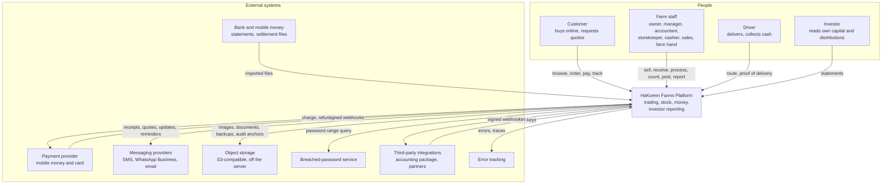
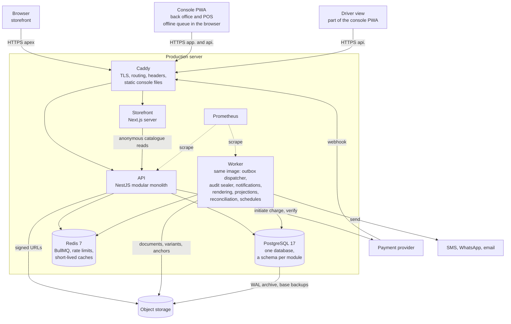
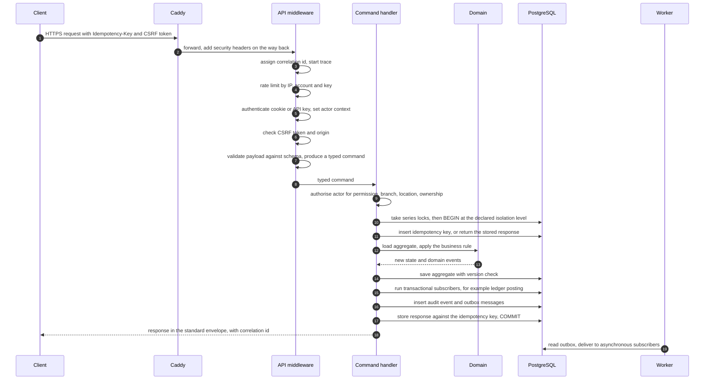
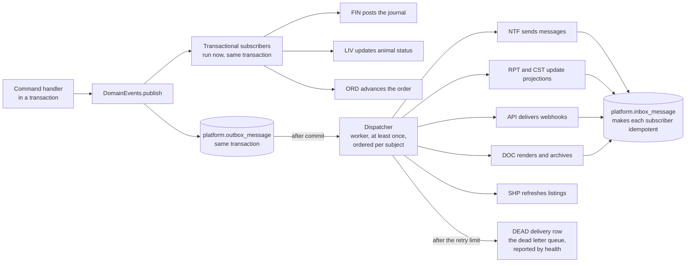
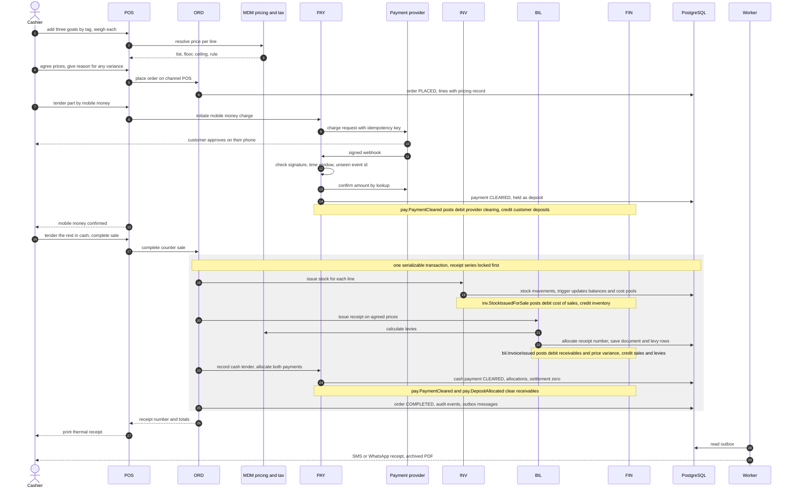
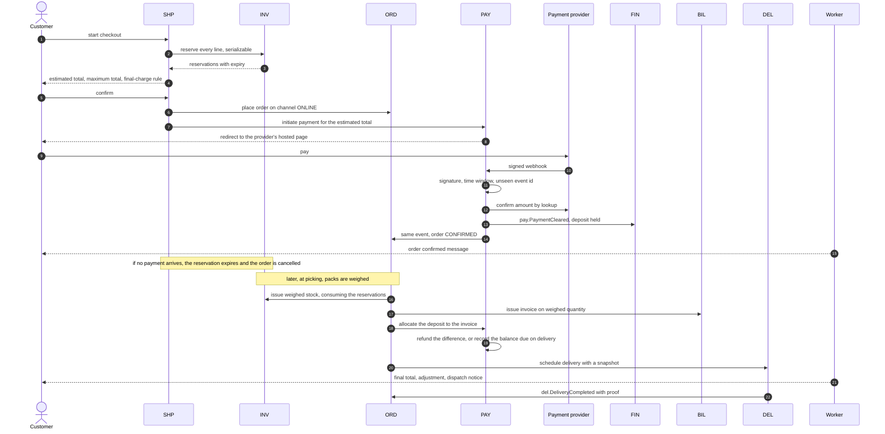
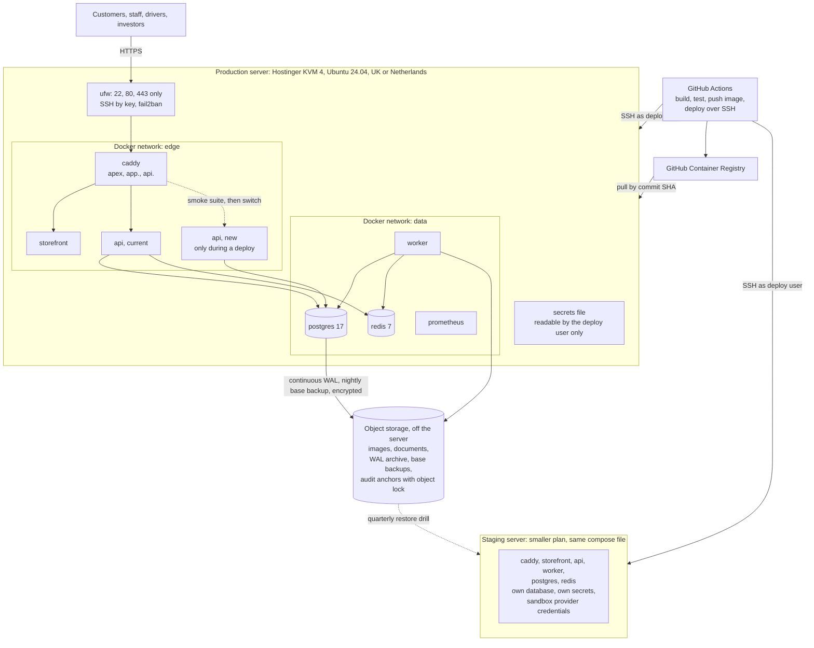

# HaKorem Farms Platform: Architecture

System and container views, the module map, dependency rules, request flow, event flow, the sale posting sequence and the deployment topology. This is the first document a new developer reads after `docs/SHARED_BRIEF.md`.

Companion documents: `docs/DOMAIN_MODEL.md` (what the business objects are), `docs/DATA_MODEL.md` (the tables), `docs/MODULE_BOUNDARIES.md` (who may call whom), `docs/security/` (trust boundaries and threats), `docs/adr/` (why).

## 1. What the system is

One deployable API (a modular monolith in NestJS on PostgreSQL), one worker process from the same image, and two frontends in a separate repository: a public storefront and a console that is both back office and point of sale. The two repositories meet only at `contract/openapi.yaml`, which this repository owns.

The design is shaped by four facts from the shared brief:

1. **The realistic threat is an insider.** Controls are built around maker-checker approval, immutable ledgers, a tamper-evident audit log and a daily exception report, before the perimeter.
2. **Stock and money must be provably correct.** Both are append-only ledgers with the rules enforced in the database, and every business operation is one transaction.
3. **The counter cannot stop when the network does.** Point of sale works offline for a shift and syncs exactly once.
4. **One small team, one server, a fixed budget.** No broker, no service mesh, no managed services; boundaries are enforced in code so that extraction later is a refactor.

## 2. System context

Who uses the system and what it talks to.



## 3. Containers

What runs, and how the pieces connect. Frontend containers are built from the frontend repository and shown for completeness.



| Container | Technology | Responsibility |
| --- | --- | --- |
| API | NestJS 11, TypeScript, Node 22, Drizzle | Every synchronous request. Stateless. Owns transactions |
| Worker | Same image, different entry point | Everything that happens after commit or on a schedule. No inbound HTTP |
| PostgreSQL | 17 | The system of record. Constraints, triggers and privileges enforce the rules |
| Redis | 7 with append-only file | Job signalling for BullMQ, rate limit counters, permission and session revocation caches. Never a system of record: if it is lost, the outbox table rebuilds the queues |
| Caddy | 2 | TLS, HTTP security headers, routing by host, static files for the console |
| Storefront | Next.js 15 | Server rendering for the public shop. Calls the API as an anonymous client |
| Console | React 19 PWA | Back office, POS and driver view. Holds the offline queue |

## 4. Inside the API: the module map

Twenty-two modules above a platform layer and a kernel. Imports go downward only, through each module's `index.ts`; anything a module needs to know from above or beside arrives as an event. The full table, the public interface of every module and the lint rule are in `docs/MODULE_BOUNDARIES.md`.

```mermaid
flowchart TB
  subgraph L11["Layer 11: capital and insight"]
    CAP["CAP"]
    CST["CST"]
    RPT["RPT"]
    NTF["NTF"]
    APIM["API"]
  end
  subgraph L10["Layer 10: selling channels"]
    POS["POS"]
    SHP["SHP"]
    QUO["QUO"]
    WHL["WHL"]
  end
  subgraph L9["Layer 9"]
    ORD["ORD<br/>the order record, sale posting"]
  end
  subgraph L8["Layer 8"]
    DEL["DEL"]
  end
  subgraph L7["Layer 7"]
    PAY["PAY"]
    PUR["PUR"]
  end
  subgraph L6["Layer 6"]
    LIV["LIV"]
    PRC["PRC"]
    BIL["BIL"]
  end
  subgraph L5["Layer 5"]
    INVM["INV<br/>stock ledger, valuation"]
  end
  subgraph L4["Layer 4"]
    FIN["FIN<br/>general ledger"]
  end
  subgraph L3["Layer 3"]
    AUD["AUD"]
    MDM["MDM<br/>catalogue, pricing, tax"]
    DOC["DOC"]
  end
  subgraph L2["Layer 2"]
    IAM["IAM<br/>identity, policy, approvals"]
  end
  subgraph L1["Layer 1"]
    PLAT["platform<br/>unit of work, events and outbox, audit trail,<br/>numbering, idempotency, files, ports"]
  end
  subgraph L0["Layer 0"]
    KERN["kernel<br/>Money, Weight, Quantity, allocate, ids, Clock"]
  end

  L11 --> L10
  L10 --> L9
  L9 --> L8
  L8 --> L7
  L7 --> L6
  L6 --> L5
  L5 --> L4
  L4 --> L3
  L3 --> L2
  L2 --> L1
  L1 --> L0
```



An arrow means "may import from any layer below", not only the next one.

### Dependency rules in brief

| Rule | Enforced by |
| --- | --- |
| A module imports another only through its `index.ts`, and only from a lower layer | `eslint-plugin-boundaries`, failing the build |
| Any module may import any module's event contracts, as types | The same rule |
| `domain/` code imports nothing but the kernel | The same rule |
| A module's SQL names only its own schema | CI scan |
| Cross-schema foreign keys only to published keys | CI query over `pg_constraint` |
| No import leaves `backend/` | The lint rule |

### Layers inside a module

```text
interface/        HTTP controllers, request schemas, event subscribers
application/      commands and queries: authorise, open the unit of work, call the domain, publish events
domain/           aggregates, value objects, domain services. Pure. No framework
infrastructure/   Drizzle tables and repositories, adapters for ports
```

No business rule lives in a controller. If a test has to call an HTTP endpoint to exercise a calculation, the calculation is in the wrong layer.

## 5. Request flow

Every state-changing request takes the same path. Reads skip the idempotency and transaction steps but not authorisation.



Points fixed by this flow:

- **Validation at the boundary.** The payload is parsed once into a typed command. Unvalidated data never reaches a handler.
- **Authorisation in the handler.** A use case reached any other way (a job, another module, an offline sync) makes the same check (ADR-0017).
- **One transaction.** Everything between `BEGIN` and `COMMIT` lands whole or not at all. On a serialization failure the handler is re-run from the start, up to five times (ADR-0005).
- **No external call inside the transaction.** Anything that leaves the process is requested through the outbox (ADR-0010).
- **Errors.** A business refusal is a typed result mapped to a 4xx response. An unexpected error is logged with context and returned as a 500 with the correlation id and no internal detail. There are no empty catch blocks.
- **Correlation id.** It appears in the response, every log line, every trace span, the audit event and every outbox message caused by the request.

## 6. Event flow



- A transactional subscriber that fails rolls back the publisher. Only ledger posting, a module keeping its own aggregate in step with a lower module's fact, and exact projections may be transactional.
- An asynchronous subscriber that fails is retried with exponential backoff and jitter, then dead-lettered. The business change stands.
- Events are named `<module>.<Name>` and are listed per module in `docs/DOMAIN_MODEL.md`. Those the ledger posts from are in ADR-0003.

## 7. Sale posting

The central transaction of the system. One code path, in the order module, posts a sale on every channel (ADR-0026).

### 7.1 Counter sale, split tender, with a mobile money callback



If any step inside the shaded transaction fails (the animal is under a withdrawal hold, the period is closed, a journal does not balance), nothing is written and the cashier sees the reason with a correlation id. The mobile money payment, already cleared, remains a customer deposit and is refunded or reused; it is never lost and never counted as a sale.

### 7.2 Online prepaid order, from checkout to invoice



The payment edge cases the brief lists are handled by this shape:

| Case | Outcome |
| --- | --- |
| Provider times out after the customer was charged | The payment stays `PENDING`. A scheduled status lookup or the webhook clears it. The order confirms then |
| Webhook arrives before the API response | The webhook handler finds the payment by our reference, which was stored before the charge request was sent |
| Webhook arrives twice | The second collides on the unique event id and is acknowledged without effect |
| Webhook for an order that no longer exists | The payment is cleared as an unallocated deposit, a reconciliation break is raised, and a refund is requested |
| Refund fails after the stock was released | The refund stays `FAILED` and visible in the break queue until retried or settled another way. Stock is not re-reserved |

## 8. Cross-cutting design

| Concern | Design | Decision |
| --- | --- | --- |
| Money | Integer pesewas, one rounding per line, exact-sum allocation | ADR-0001 |
| Stock | Append-only movements, trigger-maintained balances, valuation by cost pool | ADR-0002, ADR-0018 |
| Ledger | Double entry from events, balance enforced at commit | ADR-0003 |
| Pricing | Fixed resolution order, typed "quote required" result | ADR-0004 |
| Transactions | One per operation; serializable where stock or ledger is written; hot rows designed out | ADR-0005 |
| Audit | Insert-only events, sealed hash chain, off-box anchor | ADR-0006 |
| Locations | Branch for trading and control, location for stock | ADR-0007 |
| Side effects | Transactional outbox | ADR-0010 |
| Identifiers | UUIDv7, client-generated offline | ADR-0013 |
| Idempotency | Key table and unique references | ADR-0014 |
| Numbering | Row-locked series, gap-free, provisional references offline | ADR-0015 |
| Authentication | Short access token, rotating refresh token, TOTP, host-bound cookies | ADR-0016 |
| Authorisation | Policy engine in the domain layer, one maker-checker mechanism | ADR-0017 |
| Tax | Named levies per category in effective-dated versions | ADR-0020 |
| Catch-weight | Estimate, tolerance, invoice on weighed quantity | ADR-0021 |
| Encryption | Application-side envelope encryption, per-subject keys | ADR-0022 |
| Reporting | Separate schema fed by events, restricted role | ADR-0023 |
| Offline | Server authoritative, money always lands, conflicts become exceptions | ADR-0027 |
| Time | `TIMESTAMPTZ` in UTC; business dates in Africa/Accra from the kernel `Clock`; `occurred_at` and `recorded_at` kept apart | DATA_MODEL |
| Configuration | Typed, validated at boot, failing with the name of the missing key; business settings in `platform.setting` | B2 |
| Text | Every user-facing string from the API (error messages, notification templates, document labels) goes through a translation layer; English ships first | B2 |
| API style | Versioned REST under `/v1`, OpenAPI 3.1 generated from code, one error envelope, cursor pagination, money as integer `...Pesewas` fields with `currency` on the object (ADR-0029) | B1 `docs/API.md` |

### External calls

Every call that leaves the process has a timeout, a bounded retry with jitter, a circuit breaker and a defined behaviour when it stays down.

| Dependency | Called from | When it stays down |
| --- | --- | --- |
| Payment provider: initiate charge | API, outside any transaction | The customer is told payment is unavailable; cash and cash on delivery still work |
| Payment provider: status lookup, refund | Worker | Retried; pending payments stay pending; refunds queue and appear in the break queue |
| SMS, WhatsApp, email | Worker | Messages queue; a later channel in the preference order is tried; receipts can still be printed |
| Object storage | API for signed URLs, worker for writes | Uploads fail with a clear error; rendering queues; sales are unaffected because documents are rendered after commit |
| Breached-password service | API | Falls back to the bundled list of common passwords |
| Redis | API and worker | Rate limiting fails closed on authentication endpoints and open elsewhere; the dispatcher polls the outbox table directly |
| PostgreSQL | Everything | The API returns 503; the counter continues offline |

### Health endpoint

`GET /health` reports, for the deploy pipeline and the uptime monitor: database connectivity, the age of the last archived WAL segment, Redis, queue depth, outbox backlog and age of the oldest undelivered message, dead-lettered deliveries, audit sealing lag, projection lag, and the time and outcome of the last run of each reconciliation job. Any module can add an item.

### Nightly reconciliation

| Job | Checks | On a difference |
| --- | --- | --- |
| Stock balance recompute | Every `inv.stock_balance` and `inv.cost_pool` row against the movement ledger | Alert with the rows; `inv.stock_exception` of kind `BALANCE_DRIFT` |
| Trial balance | Debits equal credits overall and per entry; each control account equals its subledger | Alert; `fin.TrialBalanceDriftDetected` |
| Subledger to module | Inventory accounts against cost pools; receivables against open items; provider clearing against unsettled payments | Alert with both figures |
| Settlement | Provider settlement lines against recorded payments | `pay.reconciliation_break` rows |
| Numbering | Each series dense, each number with a document | Alert |
| Audit chain | Recompute hashes; compare the head with the latest anchor; find unsealed events | Alert; `aud.AuditChainBroken` |
| Projections | Key totals in `rpt` against the modules of record | Alert; `rpt.ProjectionDriftDetected` |

No job corrects anything. Drift is a finding for a person.

## 9. Deployment topology



The deploy sequence, the backup scheme and the reasons for a single server are in ADR-0025. Operating detail (environments, configuration reference, alert thresholds, the cost estimate) is written in B1 in `docs/OPERATIONS.md` and `docs/DEPLOYMENT.md`.

## 10. How the design meets the non-functional targets

| Target from the shared brief | What in the design delivers it |
| --- | --- |
| API reads p95 under 300 ms, writes under 600 ms at 50 users | Point reads on projections for on-hand and settlement; no synchronous external calls in a transaction; hot rows designed out so retries stay rare |
| POS item added in under 100 ms, no round trip | The console holds catalogue and price data locally; the server re-resolves at completion |
| Offline for 8 hours, 500 queued transactions | Client-generated ids, idempotent sync, provisional references, conflict-to-exception rules |
| Recovery point 15 minutes, recovery time 4 hours | Continuous WAL archiving off the server; restore to a new server is a drilled runbook |
| 99.5 percent availability | Zero-downtime deploys gated by smoke; offline counter covers an outage |
| 10,000 products, 150,000 orders, 2 million movements, 5 years of ledger | Indexed ledgers, month-end snapshots, a reporting schema; no partitioning needed at this size |
| Heavy reports cannot slow the counter | Reports read `rpt` under a restricted role with a statement timeout, in the worker |
| 100 percent branch coverage on pricing, ledger, valuation, distribution | Those rules are pure domain functions with no framework or database in the way |
| One-command local setup | The same compose topology locally, with MinIO for object storage |
| Infrastructure under 150 US dollars a month | One production server, one small staging server, object storage, no managed services |
| No module imports another's internals | Lint rule and two data checks, all failing the build |
| Every failure mode has a runbook | The failure modes are named in section 8 and in the threat model; runbooks are written in B1 and B13 |

## 11. Build schedule

The backend is built in fifteen sessions. The schedule in the shared brief was amended on 2026-11-13: B9 is two sessions, with the order core ahead of point of sale.

| Session | Scope |
| --- | --- |
| B9a | Order core (the order record, its state machine, sale posting) and payments |
| B9b | Point of sale, shifts and offline sync |

The full amended schedule, with the gate for every session and three further assignments the owner confirmed on 2026-11-13, is in ADR-0026 and is reflected in `docs/BUILD_PROMPT.md`.

## 12. Decision index

| ADR | Decision |
| --- | --- |
| [0001](adr/0001-money-representation-and-rounding.md) | Money is integer pesewas, rounded half-up once per line |
| [0002](adr/0002-stock-movement-ledger-and-on-hand.md) | Stock is an append-only movement ledger with a trigger-maintained balance |
| [0003](adr/0003-chart-of-accounts-and-posting-matrix.md) | Chart of accounts, and which business event posts which entries |
| [0004](adr/0004-pricing-resolution-order.md) | Pricing resolution order, and what happens when nothing resolves |
| [0005](adr/0005-aggregate-boundaries-and-isolation.md) | Aggregate boundaries, and which operations run at serializable isolation |
| [0006](adr/0006-audit-log-tamper-evidence.md) | The audit log is insert-only, sealed into a hash chain, and anchored off the server |
| [0007](adr/0007-multi-location-from-day-one.md) | Multi-location from day one |
| [0008](adr/0008-module-structure-and-boundary-enforcement.md) | Module structure, a schema per module, and the boundary lint rule |
| [0009](adr/0009-platform-mechanisms-and-the-22-modules.md) | Platform mechanisms versus the twenty-two modules |
| [0010](adr/0010-commands-down-events-up-and-the-outbox.md) | Commands flow down, events flow up, side effects go through the outbox |
| [0011](adr/0011-cross-module-foreign-keys-and-document-registry.md) | Cross-module foreign keys reference published root ids only; source documents use a registry |
| [0012](adr/0012-table-classes.md) | Every table has a class that fixes how it may change |
| [0013](adr/0013-uuidv7-identifiers.md) | UUIDv7 identifiers, generated by the application or the client |
| [0014](adr/0014-idempotency-and-external-references.md) | Idempotency keys and external references are unique keys in the database |
| [0015](adr/0015-gap-free-numbering-and-offline-provisional-references.md) | Gap-free document numbers, and provisional references for offline receipts |
| [0016](adr/0016-authentication.md) | Authentication design |
| [0017](adr/0017-authorisation-and-maker-checker.md) | Authorisation in the domain layer, and one maker-checker mechanism |
| [0018](adr/0018-valuation-and-cost-accumulation.md) | Stock valuation and cost accumulation live in the inventory module |
| [0019](adr/0019-reservations-and-holds.md) | Stock reservations and holds |
| [0020](adr/0020-tax-engine-named-levies.md) | Tax is a matrix of named levies per category, each with its own base and reclaimable flag |
| [0021](adr/0021-catch-weight-repricing.md) | Catch-weight orders are invoiced on weighed quantity, with a tolerance and a payment adjustment |
| [0022](adr/0022-encryption-keys-and-erasure.md) | Column encryption, key management, and erasing personal data from immutable records |
| [0023](adr/0023-reporting-read-model.md) | Reporting reads a separate schema fed by events, plus published views |
| [0024](adr/0024-database-roles-and-privileges.md) | Database roles and privileges |
| [0025](adr/0025-deployment-topology.md) | Deployment topology on a single VPS |
| [0026](adr/0026-session-schedule-amendment.md) | Session schedule amendment: order core before POS, and B9 split in two |
| [0027](adr/0027-offline-sync-principles.md) | Offline sync principles |
| [0028](adr/0028-investor-distribution-allocation.md) | Investor distributions are allocated by unit-days with largest-remainder rounding |
| [0029](adr/0029-api-contract-conventions.md) | API contract conventions: money fields, decimal strings, one error envelope, approvals as 202 |
| [0030](adr/0030-foundation-tooling.md) | Foundation tooling: the migration runner, the contract generated from code plus the planned contract, and exact kernel rates |
