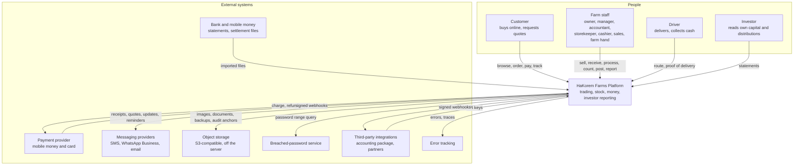
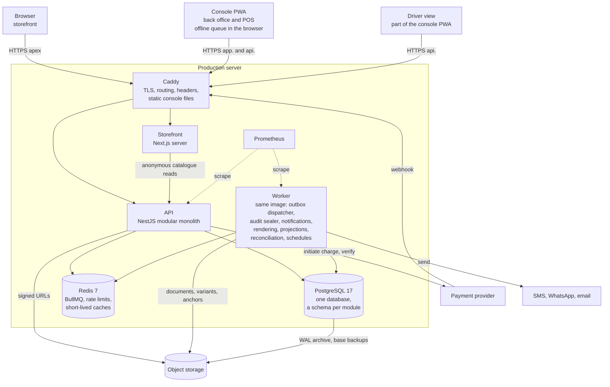
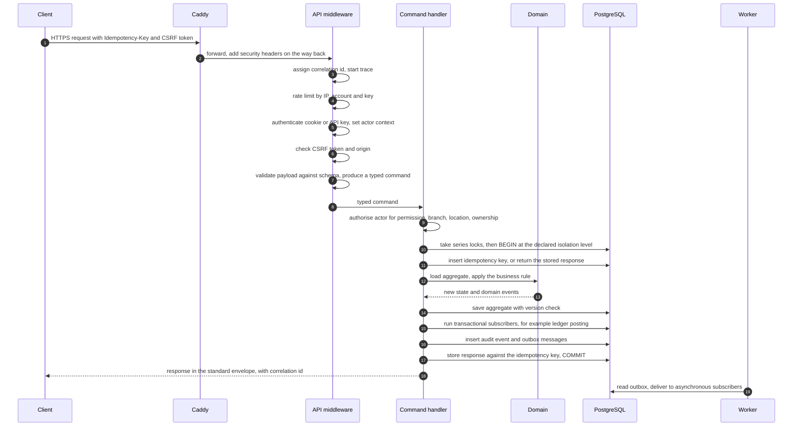
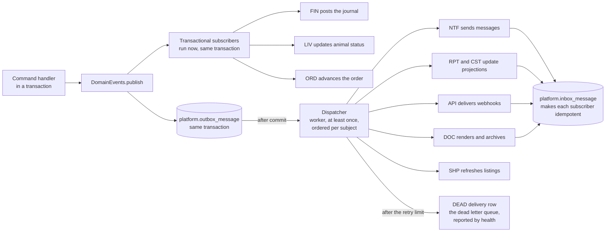
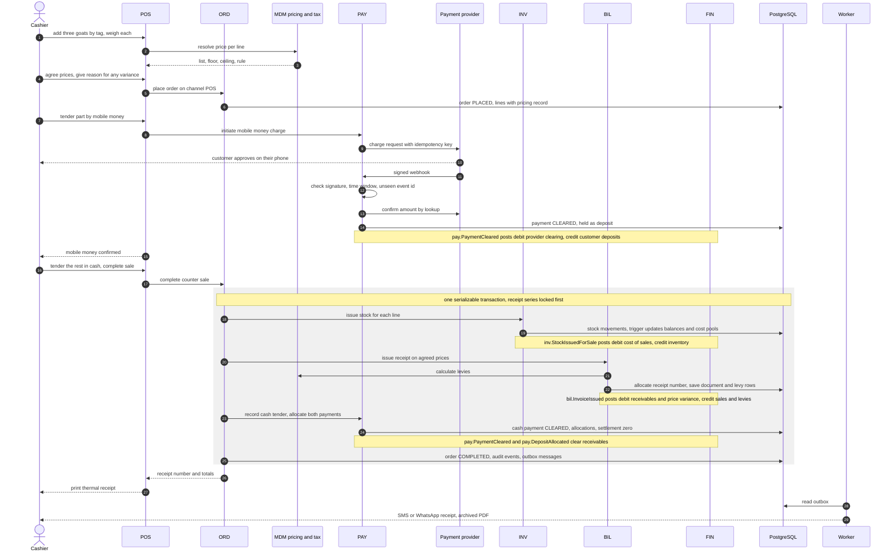
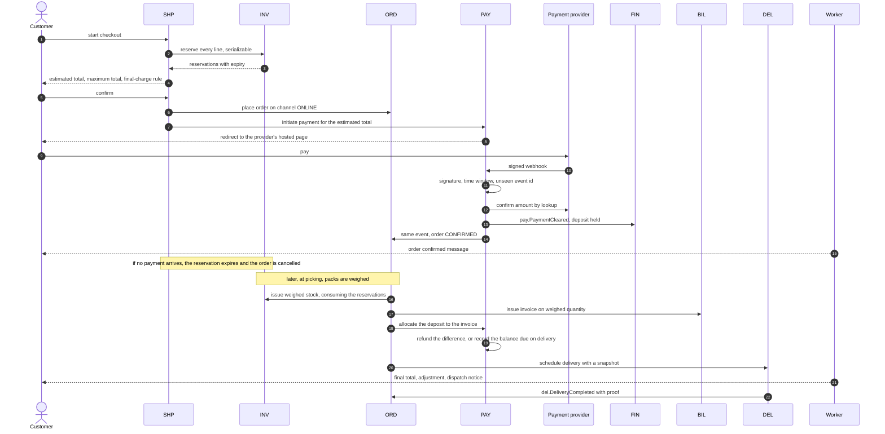
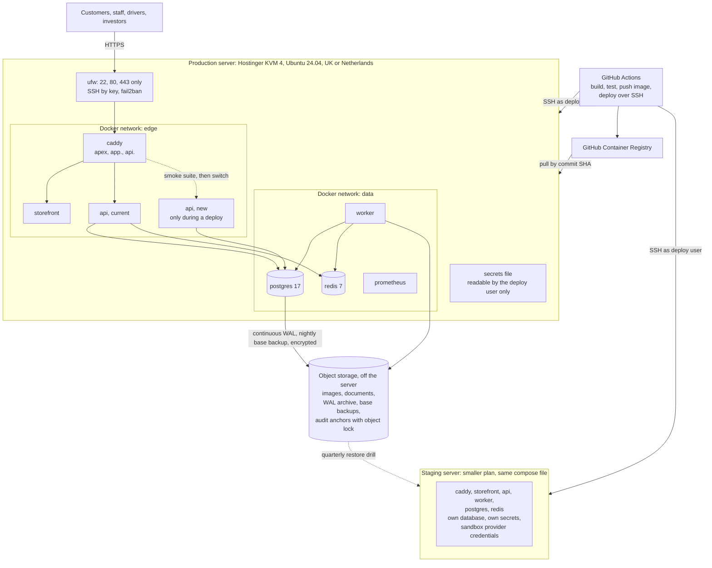

# HaKorem Farms Platform: Architecture

System and container views, the module map, dependency rules, request flow, event flow, the sale posting sequence and the deployment topology. This is the first document a new developer reads after `docs/SHARED_BRIEF.md`.

Companion documents: `docs/DOMAIN_MODEL.md` (what the business objects are), `docs/DATA_MODEL.md` (the tables), `docs/MODULE_BOUNDARIES.md` (who may call whom), `docs/security/` (trust boundaries and threats), `docs/adr/` (why).

## 1. What the system is

One deployable API (a modular monolith in NestJS on PostgreSQL), one worker process from the same image, and two frontends in a separate repository: a public storefront and a console that is both back office and point of sale. The two repositories meet only at `contract/openapi.yaml`, which this repository owns.

The design is shaped by four facts from the shared brief:

1. **The realistic threat is an insider.** Controls are built around maker-checker approval, immutable ledgers, a tamper-evident audit log and a daily exception report, before the perimeter.
2. **Stock and money must be provably correct.** Both are append-only ledgers with the rules enforced in the database, and every business operation is one transaction.
3. **The counter cannot stop when the network does.** Point of sale works offline for a shift and syncs exactly once.
4. **One small team, one server, a fixed budget.** No broker, no service mesh, no managed services; boundaries are enforced in code so that extraction later is a refactor.

## 2. System context

Who uses the system and what it talks to.



## 3. Containers

What runs, and how the pieces connect. Frontend containers are built from the frontend repository and shown for completeness.



| Container | Technology | Responsibility |
| --- | --- | --- |
| API | NestJS 11, TypeScript, Node 22, Drizzle | Every synchronous request. Stateless. Owns transactions |
| Worker | Same image, different entry point | Everything that happens after commit or on a schedule. No inbound HTTP |
| PostgreSQL | 17 | The system of record. Constraints, triggers and privileges enforce the rules |
| Redis | 7 with append-only file | Job signalling for BullMQ, rate limit counters, permission and session revocation caches. Never a system of record: if it is lost, the outbox table rebuilds the queues |
| Caddy | 2 | TLS, HTTP security headers, routing by host, static files for the console |
| Storefront | Next.js 15 | Server rendering for the public shop. Calls the API as an anonymous client |
| Console | React 19 PWA | Back office, POS and driver view. Holds the offline queue |

## 4. Inside the API: the module map

Twenty-two modules above a platform layer and a kernel. Imports go downward only, through each module's `index.ts`; anything a module needs to know from above or beside arrives as an event. The full table, the public interface of every module and the lint rule are in `docs/MODULE_BOUNDARIES.md`.

```mermaid
flowchart TB
  subgraph L11["Layer 11: capital and insight"]
    CAP["CAP"]
    CST["CST"]
    RPT["RPT"]
    NTF["NTF"]
    APIM["API"]
  end
  subgraph L10["Layer 10: selling channels"]
    POS["POS"]
    SHP["SHP"]
    QUO["QUO"]
    WHL["WHL"]
  end
  subgraph L9["Layer 9"]
    ORD["ORD<br/>the order record, sale posting"]
  end
  subgraph L8["Layer 8"]
    DEL["DEL"]
  end
  subgraph L7["Layer 7"]
    PAY["PAY"]
    PUR["PUR"]
  end
  subgraph L6["Layer 6"]
    LIV["LIV"]
    PRC["PRC"]
    BIL["BIL"]
  end
  subgraph L5["Layer 5"]
    INVM["INV<br/>stock ledger, valuation"]
  end
  subgraph L4["Layer 4"]
    FIN["FIN<br/>general ledger"]
  end
  subgraph L3["Layer 3"]
    AUD["AUD"]
    MDM["MDM<br/>catalogue, pricing, tax"]
    DOC["DOC"]
  end
  subgraph L2["Layer 2"]
    IAM["IAM<br/>identity, policy, approvals"]
  end
  subgraph L1["Layer 1"]
    PLAT["platform<br/>unit of work, events and outbox, audit trail,<br/>numbering, idempotency, files, ports"]
  end
  subgraph L0["Layer 0"]
    KERN["kernel<br/>Money, Weight, Quantity, allocate, ids, Clock"]
  end

  L11 --> L10
  L10 --> L9
  L9 --> L8
  L8 --> L7
  L7 --> L6
  L6 --> L5
  L5 --> L4
  L4 --> L3
  L3 --> L2
  L2 --> L1
  L1 --> L0
```



An arrow means "may import from any layer below", not only the next one.

### Dependency rules in brief

| Rule | Enforced by |
| --- | --- |
| A module imports another only through its `index.ts`, and only from a lower layer | `eslint-plugin-boundaries`, failing the build |
| Any module may import any module's event contracts, as types | The same rule |
| `domain/` code imports nothing but the kernel | The same rule |
| A module's SQL names only its own schema | CI scan |
| Cross-schema foreign keys only to published keys | CI query over `pg_constraint` |
| No import leaves `backend/` | The lint rule |

### Layers inside a module

```text
interface/        HTTP controllers, request schemas, event subscribers
application/      commands and queries: authorise, open the unit of work, call the domain, publish events
domain/           aggregates, value objects, domain services. Pure. No framework
infrastructure/   Drizzle tables and repositories, adapters for ports
```

No business rule lives in a controller. If a test has to call an HTTP endpoint to exercise a calculation, the calculation is in the wrong layer.

## 5. Request flow

Every state-changing request takes the same path. Reads skip the idempotency and transaction steps but not authorisation.



Points fixed by this flow:

- **Validation at the boundary.** The payload is parsed once into a typed command. Unvalidated data never reaches a handler.
- **Authorisation in the handler.** A use case reached any other way (a job, another module, an offline sync) makes the same check (ADR-0017).
- **One transaction.** Everything between `BEGIN` and `COMMIT` lands whole or not at all. On a serialization failure the handler is re-run from the start, up to five times (ADR-0005).
- **No external call inside the transaction.** Anything that leaves the process is requested through the outbox (ADR-0010).
- **Errors.** A business refusal is a typed result mapped to a 4xx response. An unexpected error is logged with context and returned as a 500 with the correlation id and no internal detail. There are no empty catch blocks.
- **Correlation id.** It appears in the response, every log line, every trace span, the audit event and every outbox message caused by the request.

## 6. Event flow



- A transactional subscriber that fails rolls back the publisher. Only ledger posting, a module keeping its own aggregate in step with a lower module's fact, and exact projections may be transactional.
- An asynchronous subscriber that fails is retried with exponential backoff and jitter, then dead-lettered. The business change stands.
- Events are named `<module>.<Name>` and are listed per module in `docs/DOMAIN_MODEL.md`. Those the ledger posts from are in ADR-0003.

## 7. Sale posting

The central transaction of the system. One code path, in the order module, posts a sale on every channel (ADR-0026).

### 7.1 Counter sale, split tender, with a mobile money callback



If any step inside the shaded transaction fails (the animal is under a withdrawal hold, the period is closed, a journal does not balance), nothing is written and the cashier sees the reason with a correlation id. The mobile money payment, already cleared, remains a customer deposit and is refunded or reused; it is never lost and never counted as a sale.

### 7.2 Online prepaid order, from checkout to invoice



The payment edge cases the brief lists are handled by this shape:

| Case | Outcome |
| --- | --- |
| Provider times out after the customer was charged | The payment stays `PENDING`. A scheduled status lookup or the webhook clears it. The order confirms then |
| Webhook arrives before the API response | The webhook handler finds the payment by our reference, which was stored before the charge request was sent |
| Webhook arrives twice | The second collides on the unique event id and is acknowledged without effect |
| Webhook for an order that no longer exists | The payment is cleared as an unallocated deposit, a reconciliation break is raised, and a refund is requested |
| Refund fails after the stock was released | The refund stays `FAILED` and visible in the break queue until retried or settled another way. Stock is not re-reserved |

## 8. Cross-cutting design

| Concern | Design | Decision |
| --- | --- | --- |
| Money | Integer pesewas, one rounding per line, exact-sum allocation | ADR-0001 |
| Stock | Append-only movements, trigger-maintained balances, valuation by cost pool | ADR-0002, ADR-0018 |
| Ledger | Double entry from events, balance enforced at commit | ADR-0003 |
| Pricing | Fixed resolution order, typed "quote required" result | ADR-0004 |
| Transactions | One per operation; serializable where stock or ledger is written; hot rows designed out | ADR-0005 |
| Audit | Insert-only events, sealed hash chain, off-box anchor | ADR-0006 |
| Locations | Branch for trading and control, location for stock | ADR-0007 |
| Side effects | Transactional outbox | ADR-0010 |
| Identifiers | UUIDv7, client-generated offline | ADR-0013 |
| Idempotency | Key table and unique references | ADR-0014 |
| Numbering | Row-locked series, gap-free, provisional references offline | ADR-0015 |
| Authentication | Short access token, rotating refresh token, TOTP, host-bound cookies | ADR-0016 |
| Authorisation | Policy engine called by every application-layer handler, one maker-checker mechanism | ADR-0017, ADR-0035 |
| Tax | Named levies per category in effective-dated versions | ADR-0020 |
| Catch-weight | Estimate, tolerance, invoice on weighed quantity | ADR-0021 |
| Encryption | Application-side envelope encryption, per-subject keys | ADR-0022 |
| Reporting | Separate schema fed by events, restricted role | ADR-0023 |
| Offline | Server authoritative, money always lands, conflicts become exceptions | ADR-0027 |
| Time | `TIMESTAMPTZ` in UTC; business dates in Africa/Accra from the kernel `Clock`; `occurred_at` and `recorded_at` kept apart | DATA_MODEL |
| Configuration | Typed, validated at boot, failing with the name of the missing key; business settings in `platform.setting` | B2 |
| Text | Every user-facing string from the API (error messages, notification templates, document labels) goes through a translation layer; English ships first | B2 |
| API style | Versioned REST under `/v1`, OpenAPI 3.1 generated from code, one error envelope, cursor pagination, money as integer `...Pesewas` fields with `currency` on the object (ADR-0029) | B1 `docs/API.md` |

### External calls

Every call that leaves the process has a timeout, a bounded retry with jitter, a circuit breaker and a defined behaviour when it stays down.

| Dependency | Called from | When it stays down |
| --- | --- | --- |
| Payment provider: initiate charge | API, outside any transaction | The customer is told payment is unavailable; cash and cash on delivery still work |
| Payment provider: status lookup, refund | Worker | Retried; pending payments stay pending; refunds queue and appear in the break queue |
| SMS, WhatsApp, email | Worker | Messages queue; a later channel in the preference order is tried; receipts can still be printed |
| Object storage | API for signed URLs, worker for writes | Uploads fail with a clear error; rendering queues; sales are unaffected because documents are rendered after commit |
| Breached-password service | API | Falls back to the bundled list of common passwords |
| Redis | API and worker | Rate limiting fails closed on authentication endpoints and open elsewhere; the dispatcher polls the outbox table directly |
| PostgreSQL | Everything | The API returns 503; the counter continues offline |

### Health endpoint

`GET /health` reports, for the deploy pipeline and the uptime monitor: database connectivity, the age of the last archived WAL segment, Redis, queue depth, outbox backlog and age of the oldest undelivered message, dead-lettered deliveries, audit sealing lag, projection lag, and the time and outcome of the last run of each reconciliation job. Any module can add an item.

### Nightly reconciliation

| Job | Checks | On a difference |
| --- | --- | --- |
| Stock balance recompute | Every `inv.stock_balance` and `inv.cost_pool` row against the movement ledger | Alert with the rows; `inv.stock_exception` of kind `BALANCE_DRIFT` |
| Trial balance | Debits equal credits overall and per entry; each control account equals its subledger | Alert; `fin.TrialBalanceDriftDetected` |
| Subledger to module | Inventory accounts against cost pools; receivables against open items; provider clearing against unsettled payments | Alert with both figures |
| Settlement | Provider settlement lines against recorded payments | `pay.reconciliation_break` rows |
| Numbering | Each series dense, each number with a document | Alert |
| Audit chain | Recompute hashes; compare the head with the latest anchor; find unsealed events | Alert; `aud.AuditChainBroken` |
| Projections | Key totals in `rpt` against the modules of record | Alert; `rpt.ProjectionDriftDetected` |

No job corrects anything. Drift is a finding for a person.

## 9. Deployment topology



The deploy sequence, the backup scheme and the reasons for a single server are in ADR-0025. Operating detail (environments, configuration reference, alert thresholds, the cost estimate) is written in B1 in `docs/OPERATIONS.md` and `docs/DEPLOYMENT.md`.

## 10. How the design meets the non-functional targets

| Target from the shared brief | What in the design delivers it |
| --- | --- |
| API reads p95 under 300 ms, writes under 600 ms at 50 users | Point reads on projections for on-hand and settlement; no synchronous external calls in a transaction; hot rows designed out so retries stay rare |
| POS item added in under 100 ms, no round trip | The console holds catalogue and price data locally; the server re-resolves at completion |
| Offline for 8 hours, 500 queued transactions | Client-generated ids, idempotent sync, provisional references, conflict-to-exception rules |
| Recovery point 15 minutes, recovery time 4 hours | Continuous WAL archiving off the server; restore to a new server is a drilled runbook |
| 99.5 percent availability | Zero-downtime deploys gated by smoke; offline counter covers an outage |
| 10,000 products, 150,000 orders, 2 million movements, 5 years of ledger | Indexed ledgers, month-end snapshots, a reporting schema; no partitioning needed at this size |
| Heavy reports cannot slow the counter | Reports read `rpt` under a restricted role with a statement timeout, in the worker |
| 100 percent branch coverage on pricing, ledger, valuation, distribution | Those rules are pure domain functions with no framework or database in the way |
| One-command local setup | The same compose topology locally, with Versity Gateway for object storage (ADR-0032) |
| Infrastructure under 150 US dollars a month | One production server, one small staging server, object storage, no managed services |
| No module imports another's internals | Lint rule and two data checks, all failing the build |
| Every failure mode has a runbook | The failure modes are named in section 8 and in the threat model; runbooks are written in B1 and B13 |

## 11. Build schedule

The backend is built in fifteen sessions. The schedule in the shared brief was amended on 2026-11-13: B9 is two sessions, with the order core ahead of point of sale.

| Session | Scope |
| --- | --- |
| B9a | Order core (the order record, its state machine, sale posting) and payments |
| B9b | Point of sale, shifts and offline sync |

The full amended schedule, with the gate for every session and three further assignments the owner confirmed on 2026-11-13, is in ADR-0026 and is reflected in `docs/BUILD_PROMPT.md`.

## 12. Decision index

| ADR | Decision |
| --- | --- |
| [0001](adr/0001-money-representation-and-rounding.md) | Money is integer pesewas, rounded half-up once per line |
| [0002](adr/0002-stock-movement-ledger-and-on-hand.md) | Stock is an append-only movement ledger with a trigger-maintained balance |
| [0003](adr/0003-chart-of-accounts-and-posting-matrix.md) | Chart of accounts, and which business event posts which entries |
| [0004](adr/0004-pricing-resolution-order.md) | Pricing resolution order, and what happens when nothing resolves |
| [0005](adr/0005-aggregate-boundaries-and-isolation.md) | Aggregate boundaries, and which operations run at serializable isolation |
| [0006](adr/0006-audit-log-tamper-evidence.md) | The audit log is insert-only, sealed into a hash chain, and anchored off the server |
| [0007](adr/0007-multi-location-from-day-one.md) | Multi-location from day one |
| [0008](adr/0008-module-structure-and-boundary-enforcement.md) | Module structure, a schema per module, and the boundary lint rule |
| [0009](adr/0009-platform-mechanisms-and-the-22-modules.md) | Platform mechanisms versus the twenty-two modules |
| [0010](adr/0010-commands-down-events-up-and-the-outbox.md) | Commands flow down, events flow up, side effects go through the outbox |
| [0011](adr/0011-cross-module-foreign-keys-and-document-registry.md) | Cross-module foreign keys reference published root ids only; source documents use a registry |
| [0012](adr/0012-table-classes.md) | Every table has a class that fixes how it may change |
| [0013](adr/0013-uuidv7-identifiers.md) | UUIDv7 identifiers, generated by the application or the client |
| [0014](adr/0014-idempotency-and-external-references.md) | Idempotency keys and external references are unique keys in the database |
| [0015](adr/0015-gap-free-numbering-and-offline-provisional-references.md) | Gap-free document numbers, and provisional references for offline receipts |
| [0016](adr/0016-authentication.md) | Authentication design |
| [0017](adr/0017-authorisation-and-maker-checker.md) | Authorisation in the application layer, and one maker-checker mechanism |
| [0018](adr/0018-valuation-and-cost-accumulation.md) | Stock valuation and cost accumulation live in the inventory module |
| [0019](adr/0019-reservations-and-holds.md) | Stock reservations and holds |
| [0020](adr/0020-tax-engine-named-levies.md) | Tax is a matrix of named levies per category, each with its own base and reclaimable flag |
| [0021](adr/0021-catch-weight-repricing.md) | Catch-weight orders are invoiced on weighed quantity, with a tolerance and a payment adjustment |
| [0022](adr/0022-encryption-keys-and-erasure.md) | Column encryption, key management, and erasing personal data from immutable records |
| [0023](adr/0023-reporting-read-model.md) | Reporting reads a separate schema fed by events, plus published views |
| [0024](adr/0024-database-roles-and-privileges.md) | Database roles and privileges |
| [0025](adr/0025-deployment-topology.md) | Deployment topology on a single VPS |
| [0026](adr/0026-session-schedule-amendment.md) | Session schedule amendment: order core before POS, and B9 split in two |
| [0027](adr/0027-offline-sync-principles.md) | Offline sync principles |
| [0028](adr/0028-investor-distribution-allocation.md) | Investor distributions are allocated by unit-days with largest-remainder rounding |
| [0029](adr/0029-api-contract-conventions.md) | API contract conventions: money fields, decimal strings, one error envelope, approvals as 202 |
| [0030](adr/0030-foundation-tooling.md) | Foundation tooling: the migration runner, the contract generated from code plus the planned contract, and exact kernel rates |
| [0031](adr/0031-operation-fragments-beside-controllers.md) | An implemented operation's contract text lives beside its controller and is checked against the route |
| [0032](adr/0032-versity-gateway-for-development-object-storage.md) | Versity Gateway is the S3-compatible object store of development and CI |
| [0033](adr/0033-scope-names-port.md) | IAM asks MDM for branch and location codes through a ScopeNames port |
| [0034](adr/0034-authentication-and-authorisation-as-built.md) | How B3 built authentication and authorisation where ADR-0016 and ADR-0017 left a choice |
| [0035](adr/0035-authorisation-in-the-application-layer.md) | Authorisation is checked in the application layer, never only in the controller (a correction to the brief's wording) |
| [0036](adr/0036-pricing-engine-as-built.md) | How B4 built the pricing engine where ADR-0004 left a choice: branch lists in a slot, the missing-attribute reason, activation no earlier than approval, supersession, draft entry removal, resolution scope |
| [0037](adr/0037-totp-qr-code-drawn-on-the-server.md) | The TOTP enrolment QR code is drawn on the server with `uqr` 0.1.3, pinned exactly, and proved by an independent decoder |
| [0038](adr/0038-required-property-breaks-only-what-clients-send.md) | A newly required property is a breaking change only on a schema a client sends; a new required response field is minor |
| [0039](adr/0039-tax-engine-as-built.md) | How B04 continued built the tax engine where ADR-0020 left a choice: business-date windows, activation no earlier than approval, one open version, the matrix checked three times, step-up on every tax write, registration on the tax date |
| [0040](adr/0040-promotions-and-coupons-as-built.md) | How B04d built promotions and coupons where ADR-0004 left a choice: the discount on the line extended at list, stacking with a cap, basket promotions left to the order, activation no earlier than approval, the coupon limit held by a trigger under row locks with a caller lock to queue, a public coupon check that reveals no customer |
| [0041](adr/0041-seed-through-services.md) | The seeded farm is written through the modules' services in the application context, as the seeded staff, with the step-up a seed cannot give accepted for the seed's own calls only; SQL seed units remain until their services exist |
| [0042](adr/0042-first-branch-bootstrap.md) | The farm's first branch is created by MDM's bootstrap as the SYSTEM principal, only while no branch exists, because a role grant names a branch; every later branch is created by a granted person |
| [0043](adr/0043-first-owner-bootstrap.md) | The farm's first Owner is created by IAM's bootstrap as the SYSTEM principal, only while no staff account exists, because every account and grant needs a granter; every later account is created by a granted person |
| [0044](adr/0044-file-store-as-built.md) | The file store is a platform mechanism (object, metadata, signed links, access log, the worker's ClamAV scan) and its operations are DOC's, which hold the uses, allow-lists, caps and authorisation; only `hk_worker` records a scan verdict |
| [0045](adr/0045-product-image-variants.md) | Product photographs become public variants (320, 640, 1280 pixels, WebP with a JPEG fallback, byte budgets) in the worker's scan, with `sharp` 0.35.5 behind the `ImageRenderer` port; the original never leaves the private bucket; MDM reads variants through `FileStore` and asks `platform.require_clean_file` (proposed: the dependency awaits the owner) |
| [0046](adr/0046-spreadsheet-imports-and-exports.md) | Master data imports and exports read and write XLSX and CSV through a bounded codec in platform on Node's own zlib, with no new dependency; MDM's `EntitySheet` per entity applies rows through the entity's own service, all or none; exports are private `EXPORT` files linked once scanned (proposed) |
| [0047](adr/0047-published-database-functions.md) | A lower layer may publish read-only database functions, listed in `tooling/architecture.json`, that a higher layer's trigger calls by primary key; MDM publishes `location_stock_facts` and `product_tracking` for the stock movement trigger (proposed) |
| [0048](adr/0048-transfer-variance-held-then-written-off.md) | A transfer shortfall is received freely, held (from B8 in a holding account), and written off only with approval under the adjustment threshold and step-up, through `resolveStockException`; the threshold is copied onto the document so a later policy change cannot rewrite an approval | Accepted |
| [0049](adr/0049-scheduled-jobs-contributed-by-modules.md) | A module contributes its scheduled jobs to the worker through the composition root (`ScheduledJob`, `src/worker-app.ts`); the worker runs each as the Scheduler and records it in `platform.job_run`; first INV's `reservation-expiry` | Accepted |
| [0050](adr/0050-import-sheets-contributed-by-higher-modules.md) | A higher module contributes an import sheet to MDM's imports through a port (`EntitySheet`, `MdmImports.registerSheet`); first INV's `OPENING_STOCK` sheet, which posts opening balances as goods receipts of kind `OPENING` | Accepted |
| [0051](adr/0051-location-usage-check-port.md) | MDM asks whether a branch or location holds stock or open documents through a port (`LocationUsageCheck`, `LocationUsageRegistry.register`) that INV implements from its own schema; closing a branch and archiving a location are refused while it is in use | Proposed |
| [0052](adr/0052-cost-free-care-operations.md) | The Farm hand works through cost-free care operations under `/care/` (`liv.care.read` for reads, the write's own permission for writes), in shapes with every cost and price field removed; a full write whose answer carries cost also needs that answer's read permission (`x-answer-permission`) | Accepted |
| [0053](adr/0053-farm-hand-death-reports-under-a-second-person.md) | The Farm hand reports deaths with an EVIDENCE photograph (`platform.file.upload.evidence`, EVIDENCE only) and never writes stock off alone: below the threshold a Manager or the Owner confirms (`MORTALITY_CONFIRMATION`, `liv.mortality.confirm`), at or above it the approver with step-up; approval waits for a CLEAN photograph, a rejected scan returns the report, a reused photograph is flagged by its exact bytes | Proposed |
| [0054](adr/0054-server-side-sort-through-a-shared-keyset.md) | Server-side sort through one mechanism (CR-019): an allow-list of sort fields per list, each an expression in code backed by an index; the asked field then the row id in the same direction, nulls last; the cursor carries every key, so a page never skips or repeats a row through ties or concurrent inserts; any other field is 400 `SORT_NOT_ALLOWED` | Proposed |
| [0055](adr/0055-guest-storefront-writes-act-as-a-storefront-principal.md) | A guest's storefront writes act as the SYSTEM Storefront principal that the route declares and the guard binds (no grants); a guest cart is proved by a host-only cookie token stored as a keyed hash, 404 otherwise; cart writes need an allowed Origin, checkout writes the fail-closed checkout rate limit | Proposed |
| [0056](adr/0056-ledger-posting-as-built.md) | FIN posts every declared ◆ event in the publisher's transaction from rules as data, reading payloads by their documented fields; a correction reverses the original's lines by `event_subject_id`; higher modules register subledger sources for the nightly reconciliation; journal numbers `JNL-<YEAR>-<BRANCH>-<SEQ>` from the branch's series, retried on contention | Proposed |
| [0057](adr/0057-business-account-numbers-sealed-with-their-own-data-key.md) | The farm's own bank and wallet numbers (`fin.bank_account`), which belong to no data subject, are sealed with a data key of their own per value, wrapped by the key-encryption key on the row (DC-40); only the last four digits leave FIN, and the idempotency hash carries a keyed digest of the number | Proposed |
| [0058](adr/0058-statements-period-balances-and-year-close-as-built.md) | The statements read a LOCKED or CLOSED period from `fin.period_balance`, which the database computes when a period locks or closes, and every other line from the journal; the year close is FIN's own ◆ event `fin.YearClosed`, posted per branch as one CLOSING entry on 31 December in the transaction that closes period 12, admitted into the locked period by the database, once, and only with the close | Proposed |
| [0059](adr/0059-fixed-assets-depreciation-and-disposal-as-built.md) | The fixed asset register records and never posts its cost, reconciled nightly with 1510 to 1540 and 1590; depreciation runs spread each asset with `allocate`, one per period held by the database, posted by someone other than their maker as FIN's own ◆ `fin.DepreciationRun` per branch on the period's last day; disposal is FIN's own ◆ `fin.FixedAssetDisposed`, its gain or loss on the new account 4920 | Proposed |
| [0060](adr/0060-billing-documents-as-built.md) | A selling module issues an invoice, receipt or proforma through `Billing.issueIn` in its own serializable transaction (numbered there, posted there, a rollback returns the number); the database holds the issued document's freeze, its totals, its number and the credit cap; three posting rows for `bil.InvoiceIssued`, `bil.CreditNoteIssued` and `bil.DebitNoteIssued`, every levy through one determination | Accepted |
| [0061](adr/0061-document-rendering-and-archive-as-built.md) | Documents are rendered after commit through the outbox by DOC's worker consumer, with deterministic PDF and ESC/POS writers in the repository, from logic-less templates sandboxed at save; one archive row per document holds the bytes' SHA-256 (insert-only); a reprint is the archived bytes with an appended marker and the next copy number; BIL links the archive and its hash once (B08 continued 2b) | Proposed |
| [0062](adr/0062-template-preview-remittance-advice-and-sends.md) | A template preview is rendered and returned inline as a marked specimen, storing nothing, so no unscanned file is served; the supplier remittance advice is requested by PUR through `Documents.requestRenderIn` in the transaction that marks the payment paid and archived once by DOC, linked from the payment; document sends wait for NTF in B11 | Proposed |
| [0063](adr/0063-payment-provider-webhooks-and-refunds-as-built.md) | A webhook is checked signature, window, once by its provider reference, then re-verified by lookup; one clearing path fed by the webhook, the status lookup and a minute-by-minute sweep of the provider's transaction list; `pay.DepositAllocated` gains its mirror; every refund waits for a different approver with step-up | Accepted |
| [0064](adr/0064-manual-receipts-cheques-reversals-store-credit-as-built.md) | A cheque posts into 1130 at receipt and clears into its bank account; every reversal (a bounce included) waits for a different approver with step-up and posts the mirror of each entry through `pay.PaymentReversed`, a mirror event with no rules; store credit is a ledger whose balance a trigger never lets go below zero | Accepted (owner, 2026-11-16) |
| [0065](adr/0065-settlement-and-bank-reconciliation-as-built.md) | Settlement and statement lines match by reference and exact amount only, ties and differences are breaks; imports are idempotent by file and line in the database; a bank transfer clears only from its line; every break resolves through a second person, its one posting an unknown payer's money held in 2290 by `pay.UnidentifiedReceiptHeld` | Proposed |
| [0066](adr/0066-refund-against-a-credit-note-and-bank-payout-as-built.md) | A credit beyond what is outstanding leaves money owed back on the original; a refund against a credit note draws on it through BIL's `bil.credit_note_refund` under the credit note's lock, is approved by neither its maker nor the credit note's maker, and posts Dr 1200 Cr the tender; a cheque goes back by a bank payout (Cr 1100) | Proposed |
| [0067](adr/0067-business-rules-take-now-from-the-application-clock.md) | A rule in the database whose "now" decides something takes the application clock's instant: as an argument where the application calls it, else through `platform.app_now()`, the transaction-local `hk.app_now` the unit of work writes from its clock at BEGIN; audit columns keep `now()` | Proposed |
| [0068](adr/0068-returns-against-the-sale-as-built.md) | Every return waits for `RETURN`; approved, the credit note is the return maker's under that approval, the stock comes back at its share of the issue's value set by the database (`returns_movement_id`, `ck_stock_sale_return`), and the refund against the credit note is asked as the maker, so ADR-0066 refuses the maker as its approver; sold less returned is held by `ck_order_return_line_cap` under the sold line's lock | Proposed |
| [0069](adr/0069-price-override-approval-as-built.md) | A price outside the band, or below list beyond the seller's per-line role limit (none seeded: every price below list waits), waits for `PRICE_OVERRIDE` by someone who neither asked, sold nor wrote the order (`ck_sales_order_settled_lines`, `ck_sales_order_line_priced`); `createOrder` answers 202 and the order cannot be confirmed until approved; the sale posting is pre-approved for the exact sale (`requestOverrideIn`) and then posted by the same seller; `issueProforma` once per order | Proposed |
| [0070](adr/0070-online-order-placement-as-built.md) | An online order is placed from the guest's checkout (one per checkout), priced by the engine at the checkout's figures; the checkout keeps its hold until the order is confirmed, then hands it over whole (`Reservations.transferHeldByIn`); a prepaid order is confirmed in the clearing's transaction only by its own money, and cancelled when its hold ends first or its charge fails; the tracking token is an HMAC-signed id, never stored (superseded by ADR-0074) | Proposed; tracking token superseded by ADR-0074 |
| [0071](adr/0071-contract-publishes-the-seeded-role-matrix-from-the-migrations.md) | `pnpm contract:generate` applies every migration to a throwaway PostgreSQL 17 and publishes the seeded roles with their full permissions as `components.x-seeded-roles` (CR-023); `--check` fails CI when a grant migration is not regenerated | Proposed |
| [0072](adr/0072-sku-is-generated-and-no-barcode-or-qr-but-totp.md) | A product's SKU is generated by the server from its category's prefix and a per-prefix counter that never goes back (`mdm.allocate_sku`), unique over every product ever made, never edited and never taken as input (422 `FIELD_SERVER_ASSIGNED`); no product barcode, barcode lookup or till scanning, and no barcode on product or lot labels, while the meat pack labels stay as built; the TOTP enrolment QR is the only QR code (a lint rule) | Accepted (owner, 2026-11-17) |
| [0073](adr/0073-customers-and-suppliers-carry-an-unguessable-public-id.md) | Customers and suppliers carry a public ID (`cus_`/`sup_` and 16 Crockford base32 characters from a secure source), unique, never reused or edited, generated with a retry on collision, shown and searched in place of the sequential numbers from 2.0.0; UUIDs stay keys and are never shown | Accepted (owner, 2026-11-17) |
| [0074](adr/0074-no-identifier-is-a-key-and-customer-links-carry-random-tokens.md) | No identifier is a key: every operation that takes one is walked from the contract and refuses an anonymous caller, another customer, a role without the permission and a staff member outside the record's branch, the same for a real and a made-up identifier. Every link sent to a customer carries its own 256-bit random token stored only as its hash with an expiry (`platform/crypto/link-tokens.ts`); the tracking link's is in `ord.order_tracking_token` (0213). Supersedes ADR-0070's tracking token | Accepted (owner, 2026-11-17) |
| [0075](adr/0075-a-bought-lot-is-valued-by-its-place-in-the-delivery.md) | A bought lot keeps its delivery (Q0, V0) on its cost pool, and each issue is valued by its place in the delivery, `half_up(V0 x (p+q)/Q0) - half_up(V0 x p/Q0)`: a whole crate always posts its price and the delivery sums exactly; off its schedule (a value-only addition, a gain, a return) the pool is anchored again at what it holds. Supersedes ADR-0018's issue rule for bought lots only | Accepted (owner, 2026-11-17) |
| [0076](adr/0076-a-receipt-claim-is-settled-once-by-the-invoice-or-a-credit-note.md) | A claim raised from a receipt's rejected lines is the delivery at the order price split exactly with `allocate`, never keyed, and is settled once: by the approved invoice that left the rejected goods out, or by a credit note drafted from it against the invoice that charged them, which the three-way match then allows; no posting rule or account changes | Accepted (owner, 2026-11-17) |
| [0077](adr/0077-pay-asks-pos-before-any-till-cash-moves.md) | Before any cash moves into or out of a till through PAY (a tender, `writeIn`, a mobile money charge at the till, a cash refund paid by hand, a reversal or a void), PAY asks POS through the `TillShiftCheck` port, deny by default: the shift is locked and must be OPEN, of that till and branch, and the actor's own unless they hold `pos.shift.force_close`; a cash refund names the open shift it is paid out of (`ck_refund_till_shift`) and counts against it | Accepted (owner, 2026-11-18) |
| [0078](adr/0078-a-force-closed-shift-posts-when-a-third-person-counts-its-drawer.md) | A manager who is not the cashier force-closes an OPEN shift at its expected cash, posting nothing; its drawer is counted later, once, by a supervisor who is neither the cashier nor the force-closer, and that count posts the over or short as a sign-off does | Proposed (2026-11-17) |
| [0079](adr/0079-a-counter-sale-takes-a-cleared-provider-payment-by-a-link.md) | A counter sale takes a mobile money or card payment the provider cleared at the cashier's own shift as a tender by an insert-only link in PAY (`pay.payment_order_link`), taken whole and allocated to the receipt; the cleared payment is never changed, and PAY's read of an order's payments includes linked ones | Proposed (2026-11-17) |
| [0080](adr/0080-the-till-derives-the-pin-verifier-and-the-server-counts-every-try.md) | The till derives the PIN verifier (PBKDF2-SHA256, at least 600,000 iterations, a 16-byte salt) and sends only it; the server stores it by version in POS, issues it to an enrolled till of the branch, counts every try once by its client id (five lock), signs a locked cashier out only by a different supervisor's PIN, and checks every PIN approval against its version; no operation takes a PIN | Proposed (2026-11-18) |
| [0085](adr/0085-a-customer-statement-is-read-from-the-ledger.md) | A customer statement is the customer's 1200 at one branch for a period, read through FIN's door (`Journals.customerReceivablesIn`) and each line named by its source document, so it ties to the ledger whatever posted to it (an opening journal, a till payment, a refund); a balance in the customer's favour shows as a credit beside zero; numbered once from its own series, one issued statement per customer, branch and period, rendered after commit and archived once; WHL imports FIN | Proposed |
| [0086](adr/0086-inv-asks-pur-what-a-receipt-line-is-worth.md) | A goods receipt line that names its order line and types no value is valued by PUR through INV's new `OrderLineValuation` port, at the order line's price for the accepted base quantity, rounded half-up once; a typed value always wins (CR-040) | Proposed |
| [0087](adr/0087-a-quote-link-opens-only-its-live-version.md) | A quote link opens only its live version; every send gets a fresh token stored as its hash; a replaced, expired or withdrawn link answers its state only (422 `QUOTE_LINK_CLOSED`), anything else 404; accepted once (CR-047) | Accepted (owner, 2026-11-18) |
| [0088](adr/0088-credit-control-reads-exposure-live-and-a-second-person-sets-every-limit.md) | Credit control reads exposure live (BIL's open items plus ORD's confirmed credit orders) under the account's row lock; the policy port answers a judgement with every reason and asks the `CREDIT_OVERRIDE` with a written reason; every credit limit and every release is a `whl.account_change` decided by someone other than its asker, held by the database | Proposed |
| [0089](adr/0089-ageing-is-read-as-at-a-date-from-documents-and-dated-allocations-and-tied-to-1200.md) | Ageing is read as at a date from BIL's documents (with credit notes by then) and PAY's allocations dated by the application clock's business day (`allocated_on`), in bands of days past due; 1200 as at the date is beside the buckets and what it holds beyond them is shown as not aged, never in a bucket; the statement stores its summary, tied by the database to its closing | Proposed |
