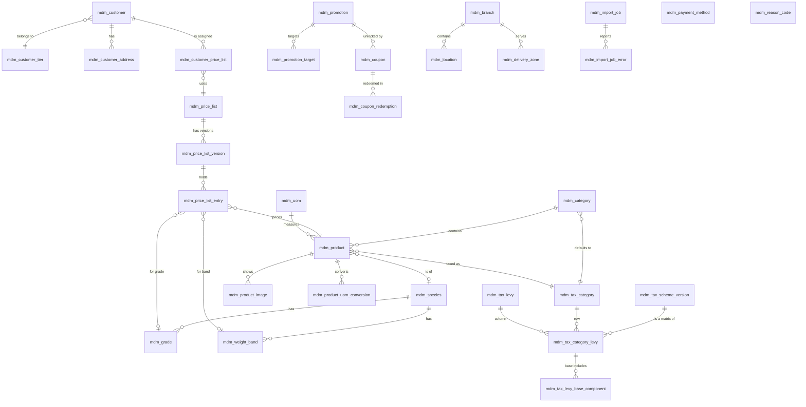
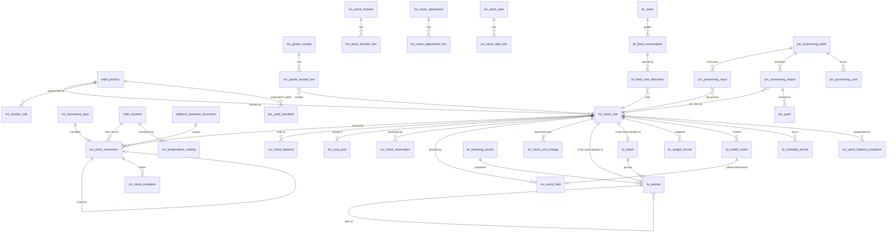
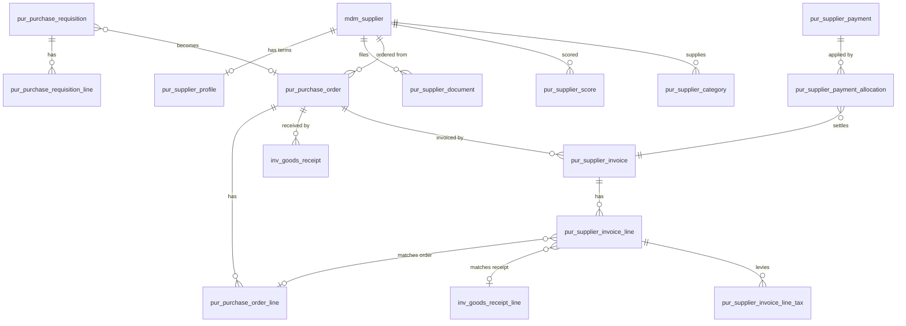
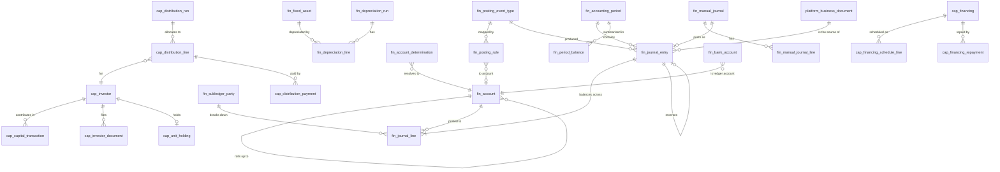

# HaKorem Farms Platform: Data Model

Conventions, the schema index, entity relationship diagrams and the catalogue of rules the database enforces. The table dictionary, with every column, its type, its constraints and the reason it exists, is split into one file per schema under `docs/data-model/`, so that a module session reads only its own.

This document describes the target schema for version one. No migration exists yet; migrations are written per module from B2 onward, and each must match its dictionary file. If a migration and a dictionary disagree, the migration is wrong.

## 1. Conventions

### Schemas and ownership

- One PostgreSQL 17 schema per module, named by the lower-case module code, plus `platform` (ADR-0008).
- A module's code reads and writes only its own schema. Cross-schema foreign keys are limited to the published keys in `docs/MODULE_BOUNDARIES.md` section 5, plus three universal keys: `iam.principal`, `mdm.branch`, `mdm.location` (ADR-0011).
- A reference to "the document that caused this" is `source_document_id`, a foreign key to `platform.business_document`.
- Ids of other modules held without a foreign key are named `*_ref`. They appear only in projections (`rpt`, `cst`) and where a lower layer must point at a higher one's line.

### Names

- Tables and columns are `snake_case`, singular.
- Primary key is `id` unless the dictionary states a natural or composite key.
- Foreign key columns are `<referenced table>_id`.
- Suffixes: `_pesewas` money, `_kg` weight, `_qty` or `qty` quantity, `_percent` rate, `_at` instant, `_on` or `_date` calendar date, `_enc` encrypted bytes, `_hash` hash bytes, `_no` human-readable number, `_code` lookup code.
- Indexes are named `ix_<table>_<columns>`, unique constraints `uq_…`, checks `ck_…`, foreign keys `fk_…`, exclusion constraints `ex_…`.

### Types

| Shorthand in the dictionary | PostgreSQL type | Rule |
| --- | --- | --- |
| `uuid` | `UUID` | UUIDv7 generated by the application or the client (ADR-0013) |
| `pesewas` | `platform.pesewas` | `BIGINT`, 0 to 9,007,199,254,740,991. Money is never a float and never negative (ADR-0001) |
| `qty` | `platform.qty` | `NUMERIC(14,3)`, not negative |
| `kg` | `platform.kg` | `NUMERIC(10,3)` kilograms, not negative. Weight always travels with a `weight_source` of `SCALE`, `MANUAL` or `ESTIMATE` |
| `percent` | `platform.percent` | `NUMERIC(7,4)`, 0 to 100 |
| `timestamptz` | `TIMESTAMPTZ` | Stored in UTC, rendered in Africa/Accra. No `TIMESTAMP WITHOUT TIME ZONE` anywhere |
| `date` | `DATE` | A business date in Africa/Accra |
| `text` | `TEXT` | No `VARCHAR(n)`; length rules are `CHECK` constraints where they matter |
| `jsonb` | `JSONB` | Snapshots and payloads only. Never for a value that is filtered, summed or constrained |
| `bytea` | `BYTEA` | Hashes and ciphertext |

A few projection columns are signed (`numeric(14,3)` rather than `qty`) because a balance can legitimately be negative at a virtual location. The dictionary marks each.

Enumerations are `TEXT` columns with a `CHECK` listing the values, not PostgreSQL enum types, because adding and retiring values must be an expand-then-contract migration. Lists that carry behaviour (movement types, permissions, reason codes) are lookup tables.

Money columns hold integer pesewas. `currency CHAR(3) NOT NULL DEFAULT 'GHS' CHECK (currency = 'GHS')` appears on every document and journal header.

### Table classes and standard columns

Every table has one of six classes (ADR-0012). The class is shown beside the table name in the dictionary and is stored as a comment on the table, which a schema test compares with the privileges granted (ADR-0024).

| Class | May change how | Standard columns, present in addition to those listed in the dictionary |
| --- | --- | --- |
| `LEDGER` | Insert only | `recorded_at timestamptz NOT NULL DEFAULT now()`, `actor_id uuid NOT NULL` FK `iam.principal` |
| `DOCUMENT` | Freely in draft; frozen once posted, except listed columns | `status text NOT NULL`, `branch_id uuid NOT NULL` FK `mdm.branch`, `version integer NOT NULL DEFAULT 1`, `created_at`, `created_by`, `updated_at`, `updated_by`, and `posted_at`, `posted_by` where there is a posting step |
| `MASTER` | Updated with optimistic locking; soft-deleted | `version integer NOT NULL DEFAULT 1`, `created_at`, `created_by`, `updated_at`, `updated_by`, `deleted_at`, `deleted_by`, `delete_reason` |
| `PROJECTION` | Written only by a trigger or a worker | None; the dictionary lists every column |
| `LOOKUP` | Changed only by migration | None |
| `WORK` | Ordinary operational state; may be purged | None |

Notes:

- `created_by`, `updated_by`, `deleted_by`, `posted_by` are `uuid` foreign keys to `iam.principal`. The `_at` columns are `timestamptz`.
- `MASTER` soft delete: `CHECK` that `deleted_at`, `deleted_by` and `delete_reason` are all null or all set. Uniqueness "among live rows" in the dictionary means a partial unique index `WHERE deleted_at IS NULL`.
- Line tables of a document (for example `ord.sales_order_line`) are class `DOCUMENT` and are frozen with their header; they carry only the columns listed, not the standard header columns.
- Where a dictionary entry lists a column that is also a standard column (for example `branch_id` on a ledger), the listed definition applies.
- A `LEDGER` table that records something that happened earlier than it was stored also has `occurred_at`. Offline sales, weights captured on a device and proof of delivery all need both (ADR-0027).

### Corrections and deletion

- Nothing financial or stock-related is updated in place or hard-deleted. A stock movement or journal entry is corrected by a reversing row; a posted document by another document.
- `DELETE` is granted to the application role only on `WORK` tables and on the few link tables the dictionary names.
- A customer deletion request anonymises master records and destroys the subject's encryption key (ADR-0022).

### Migrations

- Plain SQL, reviewed like code. One schema per file. Expand then contract, backward compatible for one release.
- Triggers, constraints and grants are part of the migration that creates the table.
- A column that references a table built in a later session is added, with its foreign key, by an expand migration in that later session. The dictionary shows the final shape. Examples: `pur.supplier_payment.bank_account_id` and `remittance_document_id` (B7 table, B8 targets); `ord.sales_order.delivery_id` (B9a table, B11 target).

### Partitioning

No table is partitioned in version one. At the capacity targets in the shared brief (two million stock movements and 150,000 orders in year one, five years of ledger online), the largest tables reach the low tens of millions of rows, which PostgreSQL handles with the indexes listed. Partitioning would force the partition key into every unique key and weaken the idempotency constraints (ADR-0003). The threshold for revisiting is recorded in `docs/BACKLOG.md`.

## 2. Schema index

231 tables in 23 schemas: 77 `DOCUMENT`, 67 `MASTER`, 45 `LEDGER`, 22 `PROJECTION`, 13 `WORK`, 7 `LOOKUP`. Plus the published views named in the dictionaries.

| Schema | Module | Tables | Dictionary |
| --- | --- | --- | --- |
| `platform` | Platform mechanisms | 17 | [`data-model/platform.md`](data-model/platform.md) |
| `iam` | Identity, access and roles | 15 | [`data-model/iam.md`](data-model/iam.md) |
| `aud` | Audit administration and compliance | 3 | [`data-model/aud.md`](data-model/aud.md) |
| `mdm` | Master data, pricing and tax | 32 | [`data-model/mdm.md`](data-model/mdm.md) |
| `doc` | Documents and archive | 4 | [`data-model/doc.md`](data-model/doc.md) |
| `fin` | General ledger | 15 | [`data-model/fin.md`](data-model/fin.md) |
| `inv` | Inventory | 20 | [`data-model/inv.md`](data-model/inv.md) |
| `liv` | Livestock | 9 | [`data-model/liv.md`](data-model/liv.md) |
| `prc` | Processing | 6 | [`data-model/prc.md`](data-model/prc.md) |
| `bil` | Billing | 4 | [`data-model/bil.md`](data-model/bil.md) |
| `pay` | Payments | 13 | [`data-model/pay.md`](data-model/pay.md) |
| `pur` | Procurement | 13 | [`data-model/pur.md`](data-model/pur.md) |
| `del` | Delivery | 7 | [`data-model/del.md`](data-model/del.md) |
| `ord` | Orders | 8 | [`data-model/ord.md`](data-model/ord.md) |
| `pos` | Point of sale | 8 | [`data-model/pos.md`](data-model/pos.md) |
| `shp` | Online store | 5 | [`data-model/shp.md`](data-model/shp.md) |
| `quo` | Quotations | 5 | [`data-model/quo.md`](data-model/quo.md) |
| `whl` | Wholesale | 9 | [`data-model/whl.md`](data-model/whl.md) |
| `cap` | Capital and investors | 10 | [`data-model/cap.md`](data-model/cap.md) |
| `cst` | Costing | 5 | [`data-model/cst.md`](data-model/cst.md) |
| `rpt` | Reporting | 12 | [`data-model/rpt.md`](data-model/rpt.md) |
| `ntf` | Notifications | 7 | [`data-model/ntf.md`](data-model/ntf.md) |
| `api` | Integrations | 4 | [`data-model/api.md`](data-model/api.md) |

### `platform`: Platform mechanisms

| Table | Class | Purpose |
| --- | --- | --- |
| `platform.document_type` | `LOOKUP` | The kinds of business document that exist, and which module owns each |
| `platform.business_document` | `LEDGER` | Registry with one row per business document of any kind, so that any table can reference "the document that caused this" with a real foreign key (ADR-0011) |
| `platform.number_series` | `PROJECTION` | The row-locked counter for one series of document numbers |
| `platform.number_allocation` | `LEDGER` | Evidence that every issued number belongs to exactly one document |
| `platform.idempotency_key` | `WORK` | One row per state-changing request, so a retry returns the first result (ADR-0014) |
| `platform.outbox_message` | `LEDGER` | Every domain event, written in the transaction that caused it (ADR-0010) |
| `platform.outbox_delivery` | `WORK` | Delivery state per message and consumer |
| `platform.inbox_message` | `LEDGER` | Makes asynchronous consumers idempotent |
| `platform.setting` | `MASTER` | Typed settings, feature flags, the business profile and thresholds, editable without a deployment |
| `platform.stored_file` | `MASTER` | Metadata for every object in object storage |
| `platform.stored_file_variant` | `PROJECTION` | Resized and compressed renditions of an image, produced by a worker |
| `platform.file_access_log` | `LEDGER` | Every signed URL issued for a private file |
| `platform.audit_event` | `LEDGER` | The audit log (ADR-0006) |
| `platform.audit_chain` | `LEDGER` | The hash chain, one row per audit event, written only by the sealer |
| `platform.audit_anchor` | `LEDGER` | Signed copies of the chain head, also stored off the server |
| `platform.subject_key` | `MASTER` | One wrapped encryption key per data subject (ADR-0022) |
| `platform.job_run` | `LEDGER` | Outcome of every scheduled job, read by the health endpoint for "last successful reconciliation" |

### `iam`: Identity, access and roles

| Table | Class | Purpose |
| --- | --- | --- |
| `iam.principal` | `MASTER` | The single identity every actor has |
| `iam.user_account` | `MASTER` | Login details for a person |
| `iam.totp_credential` | `MASTER` | A user’s TOTP secret |
| `iam.recovery_code` | `WORK` | Single-use codes for a user who has lost their TOTP device |
| `iam.session` | `DOCUMENT` | One row per login: the device list |
| `iam.refresh_token` | `WORK` | Rotating refresh tokens |
| `iam.verification_token` | `WORK` | One-time tokens for password reset, phone and email verification and login codes |
| `iam.api_credential` | `MASTER` | Keys for integrations |
| `iam.permission` | `LOOKUP` | The fixed list of permission codes |
| `iam.role` | `MASTER` | A named set of permissions |
| `iam.role_permission` | `MASTER` | Which permissions a role contains |
| `iam.role_limit` | `MASTER` | Amount limits attached to a role, read by the owning module |
| `iam.role_grant` | `MASTER` | A role given to a principal at a branch, optionally one location |
| `iam.approval_policy` | `MASTER` | When an approval is needed and who may give it |
| `iam.approval_request` | `DOCUMENT` | One maker-checker request |

### `aud`: Audit administration and compliance

| Table | Class | Purpose |
| --- | --- | --- |
| `aud.retention_policy` | `MASTER` | How long each category of data is kept and what happens afterwards |
| `aud.retention_run` | `LEDGER` | Record of each run of a retention policy |
| `aud.data_subject_request` | `DOCUMENT` | A customer's request to export or delete their data |

### `mdm`: Master data, pricing and tax

| Table | Class | Purpose |
| --- | --- | --- |
| `mdm.category` | `MASTER` | Product categories, in a tree |
| `mdm.uom` | `LOOKUP` | Units of measure |
| `mdm.species` | `MASTER` | Species of livestock |
| `mdm.grade` | `MASTER` | Quality grades within a species, used by pricing and quoting |
| `mdm.weight_band` | `MASTER` | Live-weight ranges within a species, used by pricing and quoting |
| `mdm.product` | `MASTER` | The catalogue |
| `mdm.product_uom_conversion` | `MASTER` | Exact conversion between two units for a product |
| `mdm.product_image` | `MASTER` | Photographs of a product |
| `mdm.customer_tier` | `MASTER` | Customer tiers, an input to pricing |
| `mdm.customer` | `MASTER` | Customer identity |
| `mdm.customer_address` | `MASTER` | Saved delivery addresses |
| `mdm.supplier` | `MASTER` | Identity only |
| `mdm.branch` | `MASTER` | Universally referenceable (ADR-0011) |
| `mdm.location` | `MASTER` | The stock tree |
| `mdm.price_list` | `MASTER` | A price list occupying one slot in the resolution order |
| `mdm.price_list_version` | `DOCUMENT` | Posted statuses: `ACTIVE`, `SUPERSEDED`, `REJECTED` |
| `mdm.price_list_entry` | `MASTER` | Mutable while its version is a draft; frozen by trigger afterwards |
| `mdm.customer_price_list` | `MASTER` | The price list assigned to a customer |
| `mdm.promotion` | `DOCUMENT` | Posted statuses: `ACTIVE`, `ENDED`, `REJECTED` |
| `mdm.promotion_target` | `MASTER` | The products or categories a promotion applies to |
| `mdm.coupon` | `MASTER` | A code that unlocks a promotion |
| `mdm.coupon_redemption` | `LEDGER` | Each use, or release, of a coupon |
| `mdm.tax_levy` | `MASTER` | A named levy (ADR-0020) |
| `mdm.tax_category` | `MASTER` | Published key |
| `mdm.tax_scheme_version` | `DOCUMENT` | An effective-dated version of the whole levy matrix |
| `mdm.tax_category_levy` | `MASTER` | One cell of the matrix |
| `mdm.tax_levy_base_component` | `MASTER` | For a `NET_PLUS_LEVIES` cell: which other levies are added to its base |
| `mdm.payment_method` | `MASTER` | Published key |
| `mdm.delivery_zone` | `MASTER` | Published key |
| `mdm.reason_code` | `LOOKUP` | The fixed list of reasons |
| `mdm.import_job` | `DOCUMENT` | A spreadsheet import or export of master data |
| `mdm.import_job_error` | `WORK` | Row-level validation errors of an import |

### `doc`: Documents and archive

| Table | Class | Purpose |
| --- | --- | --- |
| `doc.template` | `MASTER` | A branded template per document type, editable by an administrator without a deployment |
| `doc.template_version` | `DOCUMENT` | Immutable once activated |
| `doc.archived_document` | `LEDGER` | The immutable archive: every quote, invoice, receipt, credit note, delivery note, statement and distribution schedule as rendered |
| `doc.render_job` | `WORK` | Rendering runs in the worker, outside the business transaction (ADR-0010) |

### `fin`: General ledger

| Table | Class | Purpose |
| --- | --- | --- |
| `fin.account` | `MASTER` | The chart of accounts |
| `fin.bank_account` | `MASTER` | The business's own bank accounts and mobile money wallets |
| `fin.subledger_party` | `MASTER` | Registry of parties that appear on control accounts, so that a journal line's subledger reference is a real foreign key without FIN referencing higher modules |
| `fin.accounting_period` | `DOCUMENT` | Published key |
| `fin.posting_event_type` | `LOOKUP` | Catalogue of events the ledger posts from |
| `fin.posting_rule` | `MASTER` | How one named amount of one event becomes a journal line |
| `fin.account_determination` | `MASTER` | Maps a determinant value to an account |
| `fin.journal_entry` | `LEDGER` | Header of a posted journal |
| `fin.journal_line` | `LEDGER` | A debit or credit line of a journal |
| `fin.manual_journal` | `DOCUMENT` | A journal entered by a person |
| `fin.manual_journal_line` | `DOCUMENT` | Lines of a manual journal while it is drafted and approved |
| `fin.period_balance` | `PROJECTION` | Totals per period, account, branch and subledger party |
| `fin.fixed_asset` | `MASTER` | The fixed asset register |
| `fin.depreciation_run` | `DOCUMENT` | Posted status: `POSTED` |
| `fin.depreciation_line` | `LEDGER` | Depreciation charged to one asset in one run |

### `inv`: Inventory

| Table | Class | Purpose |
| --- | --- | --- |
| `inv.movement_type` | `LOOKUP` | Behaviour of each kind of movement |
| `inv.stock_unit` | `MASTER` | One individually tracked thing: an animal (`SERIAL`) or a lot (`LOT`) |
| `inv.stock_unit_lineage` | `LEDGER` | Genealogy: which unit came from which |
| `inv.stock_movement` | `LEDGER` | The stock ledger |
| `inv.stock_balance` | `PROJECTION` | On-hand per product, stock unit and location |
| `inv.cost_pool` | `PROJECTION` | Value of stock: per stock unit, or per untracked product and branch |
| `inv.stock_reservation` | `DOCUMENT` | Stock promised to a document (ADR-0019) |
| `inv.stock_hold` | `DOCUMENT` | A block on moving a stock unit out |
| `inv.stock_exception` | `DOCUMENT` | A stock fact that needs a person: negative stock, an offline conflict, a temperature excursion, balance drift |
| `inv.goods_receipt` | `DOCUMENT` | Stock received from a supplier, or from harvest or lay |
| `inv.goods_receipt_line` | `DOCUMENT` | Frozen with its header |
| `inv.stock_transfer` | `DOCUMENT` | Movement between locations with an in-transit stage |
| `inv.stock_transfer_line` | `DOCUMENT` | What a transfer carries, dispatched and received |
| `inv.stock_adjustment` | `DOCUMENT` | A manual gain or loss |
| `inv.stock_adjustment_line` | `DOCUMENT` | One gain or loss within an adjustment |
| `inv.stock_take` | `DOCUMENT` | A cycle count or full stock take |
| `inv.stock_take_line` | `DOCUMENT` | Expected and counted quantity for one item in a stock take |
| `inv.reorder_rule` | `MASTER` | Minimum, reorder point and maximum levels, and expiry alert lead time |
| `inv.temperature_reading` | `LEDGER` | Cold chain log |
| `inv.stock_balance_snapshot` | `LEDGER` | Month-end balances, for as-of reporting and five-year history |

### `liv`: Livestock

| Table | Class | Purpose |
| --- | --- | --- |
| `liv.animal` | `MASTER` | One individual animal |
| `liv.batch` | `MASTER` | A group managed together: a flock of broilers, a litter |
| `liv.weight_record` | `LEDGER` | Weights captured over time, for growth tracking |
| `liv.health_event` | `LEDGER` | Vaccinations, treatments and checks |
| `liv.breeding_record` | `DOCUMENT` | Posted statuses: `BORN`, `FAILED` |
| `liv.mortality_record` | `DOCUMENT` | A death or cull |
| `liv.ration` | `MASTER` | A feeding standard: how much of which feed per head per day |
| `liv.feed_consumption` | `DOCUMENT` | Feed issued to a pen on a date |
| `liv.feed_cost_allocation` | `LEDGER` | How one feed consumption was spread across the stock units in the pen |

### `prc`: Processing

| Table | Class | Purpose |
| --- | --- | --- |
| `prc.yield_standard` | `MASTER` | Expected yield, for the variance check |
| `prc.processing_order` | `DOCUMENT` | Posted statuses: `COMPLETED`, `CANCELLED` |
| `prc.processing_input` | `DOCUMENT` | Frozen with its order |
| `prc.processing_output` | `DOCUMENT` | Frozen with its order |
| `prc.processing_cost` | `DOCUMENT` | Direct costs of a processing run |
| `prc.pack` | `MASTER` | A labelled, weighed pack within a meat lot |

### `bil`: Billing

| Table | Class | Purpose |
| --- | --- | --- |
| `bil.billing_document` | `DOCUMENT` | Posted statuses: `ISSUED` |
| `bil.billing_document_line` | `DOCUMENT` | Frozen with its header |
| `bil.billing_document_line_tax` | `DOCUMENT` | One row per line and levy, including levies at zero (ADR-0020) |
| `bil.reprint_log` | `LEDGER` | Every reprint or resend |
| `bil.pub_document` | view | Published for costing and reporting: document id, kind, number, branch, customer, issue date, net, tax, gross, credited, order reference |

### `pay`: Payments

| Table | Class | Purpose |
| --- | --- | --- |
| `pay.payment` | `DOCUMENT` | One tender received, or reversed |
| `pay.payment_allocation` | `LEDGER` | A payment applied to a billing document |
| `pay.provider_transaction` | `DOCUMENT` | One attempt to collect through the provider port |
| `pay.webhook_event` | `LEDGER` | Every webhook received, accepted or not |
| `pay.refund` | `DOCUMENT` | Posted statuses: `PAID`, `FAILED`, `REJECTED` |
| `pay.store_credit_entry` | `LEDGER` | Store credit issued, redeemed and expired |
| `pay.store_credit_balance` | `PROJECTION` | Current store credit per customer |
| `pay.invoice_settlement` | `PROJECTION` | What is outstanding on each billing document |
| `pay.settlement_report` | `DOCUMENT` | A provider settlement file imported for reconciliation |
| `pay.settlement_line` | `DOCUMENT` | One transaction within a provider settlement |
| `pay.bank_statement` | `DOCUMENT` | An imported bank or mobile money statement |
| `pay.bank_statement_line` | `DOCUMENT` | One line of a statement, and what it matched |
| `pay.reconciliation_break` | `DOCUMENT` | The exception queue |

### `pur`: Procurement

| Table | Class | Purpose |
| --- | --- | --- |
| `pur.supplier_profile` | `MASTER` | Commercial terms for a supplier whose identity is `mdm.supplier` |
| `pur.supplier_category` | `MASTER` | The categories a supplier supplies |
| `pur.supplier_document` | `MASTER` | Documents held for a supplier |
| `pur.purchase_requisition` | `DOCUMENT` | Posted statuses: `CONVERTED`, `REJECTED`, `CANCELLED` |
| `pur.purchase_requisition_line` | `DOCUMENT` | Lines of a requisition |
| `pur.purchase_order` | `DOCUMENT` | Posted statuses: `APPROVED`, `PARTIALLY_RECEIVED`, `RECEIVED`, `CLOSED`, `CANCELLED` |
| `pur.purchase_order_line` | `DOCUMENT` | Lines of a purchase order, with received and invoiced progress |
| `pur.supplier_invoice` | `DOCUMENT` | A supplier's invoice or credit note |
| `pur.supplier_invoice_line` | `DOCUMENT` | Lines of a supplier invoice, with the three-way match result |
| `pur.supplier_invoice_line_tax` | `DOCUMENT` | Levy rows for a supplier invoice line (ADR-0020) |
| `pur.supplier_payment` | `DOCUMENT` | An outgoing payment to a supplier |
| `pur.supplier_payment_allocation` | `LEDGER` | A supplier payment applied to an invoice |
| `pur.supplier_score` | `PROJECTION` | Supplier performance per period |

### `del`: Delivery

| Table | Class | Purpose |
| --- | --- | --- |
| `del.delivery_slot` | `MASTER` | Published key |
| `del.delivery` | `DOCUMENT` | Posted statuses: `DELIVERED`, `RETURNED`, `CANCELLED` |
| `del.delivery_attempt` | `LEDGER` | Each attempt to deliver, successful or not |
| `del.proof_of_delivery` | `LEDGER` | Evidence that a delivery was received: name, signature or photograph, position, cash collected |
| `del.route` | `DOCUMENT` | A driver's list for a day |
| `del.route_stop` | `DOCUMENT` | The deliveries on a route, in order |
| `del.driver_cash_reconciliation` | `DOCUMENT` | End-of-day reconciliation of a driver's cash |

### `ord`: Orders

| Table | Class | Purpose |
| --- | --- | --- |
| `ord.sales_order` | `DOCUMENT` | Posted statuses: `COMPLETED`, `CANCELLED`, `VOIDED` |
| `ord.sales_order_line` | `DOCUMENT` | Carries the full pricing record the brief requires on every sale line |
| `ord.sales_order_adjustment` | `DOCUMENT` | Promotions and coupons applied, recorded separately from the price |
| `ord.order_status_history` | `LEDGER` | Every status change of an order |
| `ord.fulfilment` | `DOCUMENT` | A pick, pack and dispatch of all or part of an order |
| `ord.fulfilment_line` | `DOCUMENT` | What was picked for an order line, with weight |
| `ord.order_return` | `DOCUMENT` | A return or exchange against an original order |
| `ord.order_return_line` | `DOCUMENT` | The lines and quantities being returned |

### `pos`: Point of sale

| Table | Class | Purpose |
| --- | --- | --- |
| `pos.register` | `MASTER` | A till |
| `pos.device_enrolment` | `MASTER` | A device allowed to run a register offline |
| `pos.shift` | `DOCUMENT` | One cashier's session on one register |
| `pos.cash_movement` | `LEDGER` | Cash into and out of the till other than sales |
| `pos.shift_tender_count` | `DOCUMENT` | Declared and expected totals per payment method at close |
| `pos.shift_report` | `LEDGER` | X and Z reports as generated |
| `pos.held_sale` | `WORK` | A parked sale, recalled later |
| `pos.sale_sync` | `LEDGER` | Every offline sale submission, including duplicates |

### `shp`: Online store

| Table | Class | Purpose |
| --- | --- | --- |
| `shp.cart` | `WORK` | A shopper's basket |
| `shp.cart_line` | `WORK` | Products in a cart |
| `shp.checkout_session` | `DOCUMENT` | One attempt to check out a cart |
| `shp.product_listing` | `PROJECTION` | The public catalogue as the storefront reads it: one row per listed product and branch, so a catalogue page needs one query and no joins |
| `shp.abandoned_cart_notice` | `LEDGER` | Abandoned-cart reminders requested |

### `quo`: Quotations

| Table | Class | Purpose |
| --- | --- | --- |
| `quo.rfq` | `DOCUMENT` | A request for quote |
| `quo.quote` | `DOCUMENT` | The quote as a whole |
| `quo.quote_version` | `DOCUMENT` | One revision |
| `quo.quote_line` | `DOCUMENT` | Frozen with its version |
| `quo.quote_acceptance` | `LEDGER` | The customer’s acceptance of a quote version |

### `whl`: Wholesale

| Table | Class | Purpose |
| --- | --- | --- |
| `whl.business_account` | `MASTER` | Credit terms for a customer whose identity is `mdm.customer` |
| `whl.credit_override` | `LEDGER` | An approved exception to the credit limit or an account hold |
| `whl.standing_order` | `DOCUMENT` | A recurring order |
| `whl.standing_order_line` | `DOCUMENT` | Products on a standing order |
| `whl.standing_order_run` | `LEDGER` | Each scheduled run of a standing order |
| `whl.statement` | `DOCUMENT` | A customer statement for a period |
| `whl.dunning_policy` | `MASTER` | The reminder levels and when each fires |
| `whl.dunning_notice` | `LEDGER` | Reminders sent, per invoice and level |
| `whl.ageing_snapshot` | `PROJECTION` | Receivables by age bucket per customer, as at a date |

### `cap`: Capital and investors

| Table | Class | Purpose |
| --- | --- | --- |
| `cap.investor` | `MASTER` | The investor register |
| `cap.investor_document` | `MASTER` | Documents held for an investor |
| `cap.capital_transaction` | `LEDGER` | Contributions and withdrawals, each issuing or redeeming units |
| `cap.unit_holding` | `PROJECTION` | Current units per investor |
| `cap.distribution_run` | `DOCUMENT` | A profit distribution for a period |
| `cap.distribution_line` | `DOCUMENT` | One investor's share of a run |
| `cap.distribution_payment` | `LEDGER` | Money actually paid to an investor against a distribution line |
| `cap.financing` | `DOCUMENT` | A loan or grant: capital that is debt, or a gift, rather than equity |
| `cap.financing_schedule_line` | `DOCUMENT` | Repayment schedule of a loan |
| `cap.financing_repayment` | `LEDGER` | A repayment of principal and interest |

### `cst`: Costing

| Table | Class | Purpose |
| --- | --- | --- |
| `cst.overhead_allocation_run` | `DOCUMENT` | Spreads a period's labour or overhead across stock units |
| `cst.overhead_allocation_line` | `DOCUMENT` | One stock unit’s share of an allocation run |
| `cst.cost_object_summary` | `PROJECTION` | Accumulated cost per cost object by element |
| `cst.margin_fact` | `PROJECTION` | One row per billed line, for margin by product, line, channel, customer, salesperson and branch |
| `cst.loss_fact` | `PROJECTION` | Shrinkage, mortality and wastage as their own figure, not buried in cost of sales |

### `rpt`: Reporting

| Table | Class | Purpose |
| --- | --- | --- |
| `rpt.report_definition` | `LOOKUP` | The reports that exist and who may run and export them |
| `rpt.report_schedule` | `MASTER` | Reports delivered on a schedule |
| `rpt.report_run` | `LEDGER` | Every run and export |
| `rpt.projection_checkpoint` | `WORK` | Where each projector has read up to |
| `rpt.sales_fact` | `PROJECTION` | One row per billed line, with the payment and channel context the daily sales reports need |
| `rpt.payment_fact` | `PROJECTION` | One row per payment, for sales by payment method |
| `rpt.stock_position_fact` | `PROJECTION` | Daily stock position for the dashboard, ageing stock and expiring lots |
| `rpt.receivable_fact` | `PROJECTION` | One row per open or settled invoice |
| `rpt.livestock_fact` | `PROJECTION` | Per pen and day: head count, mortality and feed, for mortality rate and feed conversion |
| `rpt.delivery_fact` | `PROJECTION` | One row per delivery, for delivery performance |
| `rpt.quote_fact` | `PROJECTION` | One row per quote, for the pipeline and win rate |
| `rpt.exception_item` | `PROJECTION` | The daily exception report: one row per thing a manager must look at |

### `ntf`: Notifications

| Table | Class | Purpose |
| --- | --- | --- |
| `ntf.template` | `MASTER` | Message templates per channel and locale |
| `ntf.trigger_rule` | `MASTER` | Which event sends which template to whom |
| `ntf.preference` | `MASTER` | Channel preferences and quiet hours per recipient |
| `ntf.opt_out` | `LEDGER` | An opt-out received from a recipient, for example an SMS reply of STOP |
| `ntf.message` | `DOCUMENT` | Every message: what was sent to whom and when |
| `ntf.message_attempt` | `LEDGER` | Each attempt to send a message |
| `ntf.in_app_notification` | `WORK` | Notifications shown inside the console |

### `api`: Integrations

| Table | Class | Purpose |
| --- | --- | --- |
| `api.integration` | `MASTER` | A third-party system allowed to call the API or receive webhooks |
| `api.webhook_endpoint` | `MASTER` | A URL an integration receives events at |
| `api.webhook_delivery` | `WORK` | One delivery of one event to one endpoint |
| `api.accounting_export` | `LEDGER` | An export of journals to an external accounting package, through the accounting export port |

## 3. Entity relationship diagrams

The diagrams show every table and its principal relationships. Columns are in the dictionaries. Entity names are `schema_table`. Standard actor and branch references are omitted, since almost every table has them.

### 3.1 Catalogue, pricing and tax

### 3.2 Stock, livestock and processing

### 3.3 Procure to pay

### 3.4 Order to cash

```mermaid
erDiagram
  mdm_customer ||--o{ ord_sales_order : places
  quo_rfq ||--o{ quo_quote : "answered by"
  quo_quote ||--o{ quo_quote_version : "revised as"
  quo_quote_version ||--o{ quo_quote_line : has
  quo_quote_version ||--o| quo_quote_acceptance : "accepted by"
  quo_quote ||--o| ord_sales_order : "converts to"
  shp_cart ||--o{ shp_cart_line : has
  shp_cart ||--o{ shp_checkout_session : "checked out in"
  shp_checkout_session ||--o| ord_sales_order : "becomes"
  whl_business_account ||--o{ whl_credit_override : "excepted by"
  whl_standing_order ||--o{ whl_standing_order_run : "runs as"
  whl_standing_order_run }o--o| ord_sales_order : creates
  pos_register ||--o{ pos_shift : "is worked in"
  pos_shift ||--o{ pos_cash_movement : records
  pos_shift ||--o{ pos_sale_sync : "syncs"
  pos_shift ||--o{ ord_sales_order : "sells in"
  ord_sales_order ||--o{ ord_sales_order_line : has
  ord_sales_order ||--o{ ord_sales_order_adjustment : "discounted by"
  ord_sales_order ||--o{ ord_order_status_history : "moves through"
  ord_sales_order ||--o{ ord_fulfilment : "fulfilled by"
  ord_fulfilment ||--o{ ord_fulfilment_line : picks
  ord_sales_order ||--o{ ord_order_return : "returned in"
  ord_sales_order_line }o--o| inv_stock_reservation : reserves
  ord_sales_order_line }o--o| inv_stock_movement : "issued by"
  ord_sales_order_line }o--o| inv_stock_exception : "or flagged by"
  ord_sales_order ||--o| bil_billing_document : "billed by"
  bil_billing_document ||--o{ bil_billing_document_line : has
  bil_billing_document_line ||--o{ bil_billing_document_line_tax : "levies"
  bil_billing_document ||--o{ bil_billing_document : "credited by"
  bil_billing_document ||--o{ bil_reprint_log : reprinted
  bil_billing_document ||--o| pay_invoice_settlement : "settled as"
  pay_payment ||--o{ pay_payment_allocation : "applied by"
  pay_payment_allocation }o--|| bil_billing_document : settles
  pay_payment ||--o{ pay_provider_transaction : "collected by"
  pay_payment ||--o{ pay_refund : "refunded by"
  pay_settlement_report ||--o{ pay_settlement_line : has
  pay_settlement_line }o--o| pay_payment : matches
  ord_sales_order ||--o| del_delivery : "delivered by"
  del_delivery_slot ||--o{ del_delivery : schedules
  del_delivery ||--o{ del_delivery_attempt : attempted
  del_delivery ||--o| del_proof_of_delivery : "proved by"
  del_route ||--o{ del_route_stop : visits
  del_proof_of_delivery }o--o| pay_payment : "cash on delivery"
  mdm_customer ||--o| whl_business_account : "has credit terms"
  whl_standing_order ||--o{ whl_standing_order_line : has
  mdm_customer ||--o{ whl_statement : receives
  whl_dunning_policy ||--o{ whl_dunning_notice : "at level"
  bil_billing_document ||--o{ whl_dunning_notice : "chased by"
  mdm_customer ||--o{ whl_ageing_snapshot : "aged in"
  pos_register ||--o{ pos_device_enrolment : "runs on"
  pos_register ||--o{ pos_held_sale : parks
  pos_shift ||--o{ pos_shift_tender_count : "counted in"
  pos_shift ||--o{ pos_shift_report : "reported by"
  ord_order_return ||--o{ ord_order_return_line : has
  pay_provider_transaction ||--o{ pay_webhook_event : "confirmed by"
  mdm_customer ||--o{ pay_store_credit_entry : "earns and spends"
  mdm_customer ||--o| pay_store_credit_balance : "has balance"
  pay_bank_statement ||--o{ pay_bank_statement_line : has
  pay_payment ||--o{ pay_reconciliation_break : "flagged in"
  del_route ||--o| del_driver_cash_reconciliation : "closed by"
  shp_cart ||--o{ shp_abandoned_cart_notice : "reminded by"
  mdm_product ||--o{ shp_product_listing : "listed as"
```

### 3.5 Ledger and capital

### 3.6 Platform, identity and audit

```mermaid
erDiagram
  iam_principal ||--o| iam_user_account : "logs in as"
  iam_principal ||--o| iam_totp_credential : "second factor"
  iam_principal ||--o{ iam_session : opens
  iam_session ||--o{ iam_refresh_token : rotates
  iam_principal ||--o{ iam_api_credential : "holds key"
  iam_principal ||--o{ iam_role_grant : "is granted"
  iam_role ||--o{ iam_role_grant : "granted as"
  iam_role ||--o{ iam_role_permission : contains
  iam_permission ||--o{ iam_role_permission : "included in"
  iam_role ||--o{ iam_role_limit : "limited by"
  mdm_branch ||--o{ iam_role_grant : scopes
  iam_approval_policy ||--o{ iam_approval_request : governs
  platform_business_document ||--o{ iam_approval_request : "is the subject of"
  platform_document_type ||--o{ platform_business_document : types
  platform_number_series ||--o{ platform_number_allocation : issues
  platform_business_document ||--o{ platform_number_allocation : numbered
  platform_outbox_message ||--o{ platform_outbox_delivery : "delivered as"
  platform_stored_file ||--o{ platform_stored_file_variant : "rendered as"
  platform_stored_file ||--o{ platform_file_access_log : "accessed in"
  platform_audit_event ||--o| platform_audit_chain : "sealed by"
  platform_audit_chain ||--o{ platform_audit_anchor : "anchored at"
  platform_subject_key ||--o{ platform_audit_event : encrypts
  iam_principal ||--o{ platform_audit_event : "acts in"
  iam_principal ||--o{ iam_recovery_code : "recovers with"
  iam_principal ||--o{ iam_verification_token : "verifies with"
  iam_principal ||--o{ platform_idempotency_key : sends
  platform_outbox_message ||--o{ platform_inbox_message : "consumed as"
  platform_setting
  platform_job_run
```

### 3.7 Supporting modules: documents, notifications, integrations, compliance, costing and reporting

Projection tables in `cst` and `rpt` hold references without foreign keys; the lines to them show what each is projected from.

```mermaid
erDiagram
  doc_template ||--o{ doc_template_version : "has versions"
  doc_template_version ||--o{ doc_archived_document : renders
  platform_business_document ||--o{ doc_archived_document : "archived as"
  platform_business_document ||--o{ doc_render_job : "queued in"
  platform_stored_file ||--o{ doc_archived_document : stores
  ntf_trigger_rule }o--|| ntf_template : selects
  ntf_template ||--o{ ntf_message : renders
  ntf_message ||--o{ ntf_message_attempt : "tried in"
  ntf_message ||--o| ntf_in_app_notification : "shown as"
  mdm_customer ||--o{ ntf_preference : sets
  ntf_opt_out
  api_integration ||--o{ api_webhook_endpoint : "receives at"
  api_webhook_endpoint ||--o{ api_webhook_delivery : "delivered to"
  platform_outbox_message ||--o{ api_webhook_delivery : carries
  fin_accounting_period ||--o{ api_accounting_export : "exported in"
  aud_retention_policy ||--o{ aud_retention_run : "applied in"
  platform_subject_key ||--o{ aud_data_subject_request : "destroyed by"
  cst_overhead_allocation_run ||--o{ cst_overhead_allocation_line : allocates
  inv_stock_unit ||--o{ cst_overhead_allocation_line : receives
  inv_stock_unit ||--o| cst_cost_object_summary : "summarised in"
  bil_billing_document_line ||--o| cst_margin_fact : "analysed as"
  inv_stock_movement ||--o| cst_loss_fact : "analysed as"
  rpt_report_definition ||--o{ rpt_report_schedule : "scheduled as"
  rpt_report_definition ||--o{ rpt_report_run : "run as"
  bil_billing_document_line ||--o| rpt_sales_fact : "projected to"
  pay_payment ||--o| rpt_payment_fact : "projected to"
  inv_stock_balance ||--o{ rpt_stock_position_fact : "projected to"
  bil_billing_document ||--o| rpt_receivable_fact : "projected to"
  del_delivery ||--o| rpt_delivery_fact : "projected to"
  quo_quote ||--o| rpt_quote_fact : "projected to"
  mdm_location ||--o{ rpt_livestock_fact : "projected to"
  platform_outbox_message ||--o{ rpt_exception_item : raises
  rpt_projection_checkpoint
```

## 4. Rules the database enforces

The shared brief requires that the rules are put in the database, because application code gets bypassed by a script, a migration or a future developer. This is the catalogue. Each is proved by an integration test against real PostgreSQL in the session that builds the table.

### The invariants the brief names

| Invariant | Mechanism | Where |
| --- | --- | --- |
| A journal entry cannot be saved unless debits equal credits | Deferred constraint trigger `fin.assert_balanced()` | `fin.journal_line` |
| Document numbers are generated inside the transaction, gap-free per type and year | `platform.allocate_number()` with a row lock; insert-only `platform.number_allocation` with primary key (`series_id`, `value`) | `platform` |
| Stock cannot go negative except through movement types explicitly allowed, and those raise an exception record | Trigger `inv.apply_movement()`; `inv.movement_type.allows_negative`; `mdm.location.allows_negative`; `inv.stock_exception` | `inv` |
| A serialised animal cannot be sold twice | Trigger requires a serial unit's movement to start from its `current_location_id`; after sale it is at `CUSTOMER` | `inv.stock_unit`, `inv.stock_movement` |
| A serialised animal cannot be sold while under a veterinary withdrawal period | Trigger rejects `blocked_by_hold` movement types while an unreleased `inv.stock_hold` covers the time | `inv.stock_hold` |
| A serialised animal cannot be in two locations at once | One `current_location_id` per serial unit, written only by the trigger under a row lock | `inv.stock_unit` |
| Idempotency keys, external payment references and webhook event ids are unique | Unique constraints | `platform.idempotency_key`, `pay.payment.provider_reference`, `pay.refund.provider_reference`, `pay.webhook_event`, `fin.journal_entry.event_id`, `ntf.message.idempotency_key` |
| Amounts, weights and quantities carry check constraints for sign and precision | Domains `pesewas`, `qty`, `kg`, `percent` | Every such column |
| Foreign keys are declared everywhere, with no orphan rows | Foreign keys within schemas; published and universal keys across them; `platform.business_document` for upward references | Every schema |

### Further rules in the database

| Rule | Mechanism |
| --- | --- |
| Ledger tables are never updated, deleted or truncated | Privileges, plus `platform.reject_change()` triggers |
| The audit log is append-only and hash-chained | Privileges and triggers on `platform.audit_event`; `platform.audit_chain` written only by `hk_sealer` |
| A posted document is immutable outside its listed columns | `platform.freeze_posted()` triggers |
| Maker and checker differ | `CHECK (decided_by <> requested_by)` on `iam.approval_request`; documents require the approval id to reach their posted status |
| No posting into a period that is not open | Trigger `fin.assert_period_open()` |
| A subledger account always names its party | Trigger `fin.assert_line_valid()` |
| One goat cannot be promised twice | Partial unique index on `inv.stock_reservation` |
| Reserved never exceeds on-hand; unreserved issues cannot eat reserved stock | Triggers `inv.apply_reservation()` and `inv.apply_movement()` |
| A cost pool with no quantity has no value | `CHECK` on `inv.cost_pool` |
| Processing output costs sum exactly to input plus direct cost | Deferred trigger on `prc.processing_order` |
| Feed, overhead and distribution allocations sum exactly to the amount allocated | Deferred triggers on `liv.feed_cost_allocation`, `cst.overhead_allocation_run`, `cap.distribution_run` |
| Document totals equal line sums; net plus levies equals gross | `CHECK` on lines; deferred trigger on `bil.billing_document` |
| Payment allocations never exceed the payment or the invoice; refunds never exceed the payment | Triggers on `pay.payment_allocation`, `pay.refund` |
| Three-way match blocks supplier payment | Trigger on `pur.supplier_payment_allocation` |
| Two active price list versions, tax scheme versions or weight bands cannot overlap | Exclusion constraints |
| Two price list entries cannot match the same request | Unique index with nulls not distinct |
| A tax scheme version covers every category and levy | Deferred trigger on activation |
| One open shift per register and per cashier | Partial unique indexes on `pos.shift` |
| An offline sale is applied exactly once | Partial unique index on `pos.sale_sync` |
| A quote converts to one order; a version is accepted once | Unique constraints on `quo.quote`, `quo.quote_acceptance` |
| A delivery cannot be completed without proof | Deferred trigger on `del.delivery` |
| A slot cannot be overbooked | `CHECK (booked <= capacity)` under row lock |
| A period's profit is distributed once | Exclusion constraint on `cap.distribution_run` |
| A destroyed subject key stays destroyed | Trigger on `platform.subject_key` |

### Rules that are deliberately not in the database

| Rule | Why it is in the domain layer |
| --- | --- |
| Who may do what, at which branch | Depends on the actor and the request, not on the row. Enforced by the policy engine (ADR-0017) and tested per module. Row-level security is not used in version one (ADR-0024) |
| Price resolution | A pure function over price list data, with 100 percent branch coverage (ADR-0004) |
| Order state transitions | Enforced by the aggregate; the database constrains only the set of valid statuses |
| Approval thresholds | Read from `iam.approval_policy` by the posting function; the database enforces that an approval exists when the document says one is required |
