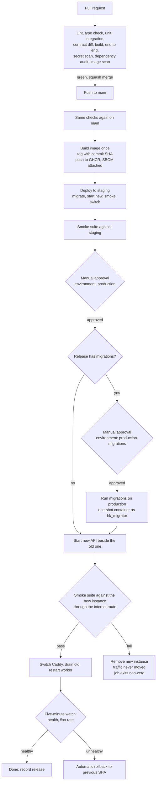

# HaKorem Farms Platform: Deployment

How code gets from a merged pull request to the production server without a maintenance window, how a bad release is stopped or undone, and how a new server is built. Companion documents: `docs/OPERATIONS.md` (configuration, secrets, monitoring, backups), `docs/runbooks/` (failures), ADR-0025 (topology), and `docs/BUILD_PROMPT.md` (the pipeline in the build plan).

The scripts and the compose file live in `backend/infra/` and are written in B2 (local topology) and B13 (provisioning and the production pipeline). This document is their specification. Both repositories deploy through the same script.

## 1. Environments and what deploys where

| Environment | Server | Compose project | Deployed by | Approval |
| --- | --- | --- | --- | --- |
| Local | Developer machine | `hk-local` | `pnpm dev` | None |
| CI | GitHub runner | none | The workflow | None |
| Staging | Hostinger KVM 2, UK or Netherlands | `hk-staging` | Every merge to `main`, automatically | None |
| Production | Hostinger KVM 4, UK or Netherlands | `hk-prod` | The same workflow, after staging smoke passes | Manual approval in the `production` GitHub environment; a second approval in `production-migrations` when the release contains migrations |

Both servers run the same compose file with different environment files. Staging and production share nothing (OPERATIONS section 1).

## 2. The pipeline



### 2.1 Stages in detail

1. **Pull request.** Lint (including the module boundary rule), type check, unit, integration (Testcontainers PostgreSQL and Redis), contract (`pnpm test:contract` and the diff between `pnpm contract:generate` and the committed `contract/openapi.yaml`), build, end to end (Docker Compose), then the security scans: secret scanning, dependency audit, static analysis and container image scanning. A high-severity finding blocks the merge. The full pipeline target is under 12 minutes.
2. **Merge to `main`.** Squash merge only. The same checks run again on `main`.
3. **Build once.** One image, built in CI from a pinned base, run as a non-root user, tagged with the commit SHA and pushed to the GitHub Container Registry. A software bill of materials is generated and kept with the release. The same image runs as `api` and as `worker` (different entry point, `APP_ROLE`). Nothing is built on any server.
4. **Staging.** The deploy job connects over SSH as the deploy user (section 6.2), pulls the image, migrates, starts the new API beside the old one, runs the smoke suite and switches, exactly as production will. If any step fails the job fails and nothing is promoted.
5. **Approval.** The `production` environment requires a manual approval by the owner or a named administrator who did not author the release. The reviewer reads the release summary (section 8), not the code.
6. **Production deploy.** Section 5.
7. **Watch.** For five minutes after the switch the deploy job polls the health endpoint and the 5xx rate. If either fails it rolls back automatically (section 7).

The frontend repository has its own workflow with its own checks. It builds the storefront image and the console's static files, pushes both, and calls the same deploy script with the same stages. The two repositories are deployed independently and joined only by the contract (section 9).

## 3. Image and release naming

| Thing | Name | Rule |
| --- | --- | --- |
| Backend image | `ghcr.io/<owner>/hakorem-backend:<40-character commit SHA>` | Immutable. Also tagged `sha-<7 characters>` for humans. There is no `latest` tag in any compose file |
| Storefront image | `ghcr.io/<owner>/hakorem-storefront:<SHA>` | Built by the frontend pipeline |
| Console | `ghcr.io/<owner>/hakorem-console:<SHA>`, an image containing only the static build | Unpacked on the box into `/opt/hakorem/console/releases/<SHA>`; `current` is a symlink to it |
| Release | Git tag `v<contract major>.<n>.<patch>` on `main`, plus the date, for example `release-2026-11-20.1` | Created by the pipeline when production deploy succeeds; the release record lists image SHAs, contract version and migration files |
| Contract | `info.version` in `contract/openapi.yaml` | Bumped by the change that needs it (API.md section 1) |

The deploy script records the running SHA of each component in `/opt/hakorem/state/<env>.current` and the previous one in `/opt/hakorem/state/<env>.previous`. Rollback uses these.

## 4. Migrations

### 4.1 The rule: expand, then contract

Every release must run against the schema of the previous release, and the previous release must run against the schema of this one. This is what makes the zero-downtime switch and a rollback safe without touching the database.

| Phase | Allowed in this release | Not allowed |
| --- | --- | --- |
| **Expand** (release N) | Add a table, a nullable column, a column with a default that does not rewrite the table, an index (`CREATE INDEX CONCURRENTLY`), a constraint added `NOT VALID` then validated, a new trigger or function. Write the new and the old shape | Dropping or renaming anything, changing a type, adding `NOT NULL` without a default on a populated table, changing the meaning of a column |
| **Backfill** (release N, as a worker job) | Fill new columns in batches of a bounded size, outside the migration, resumable | A backfill inside the migration transaction |
| **Contract** (release N+1 or later) | Drop the old column or table, add `NOT NULL`, remove the old write path, only after release N has run in production and no instance of the old image remains | Doing this in the same release as the code that stops using the old shape |

Further rules:

- Migrations are plain SQL files (Drizzle migrations, no generated DDL on money paths). `hakorem-migration` is the skill that checks them.
- Every migration sets `lock_timeout` (5 seconds) and `statement_timeout`; a migration that cannot get its lock fails and is retried at the next window, rather than blocking the counter.
- Every migration has a **tested rollback or a documented forward fix** in the same file's header. `pnpm db:rollback` runs the rollback. A rollback that would destroy data written by the new release is not offered; the documented forward fix is used instead.
- A new table declares its class (`LEDGER`, `DOCUMENT`, `MASTER`, `WORK`, `PROJECTION`, `LOOKUP`) and the grants follow from it. The schema test compares grants with classes.
- Ledger and audit tables are never altered in a way that updates or deletes rows. A data fix is a reversing entry through the application, or a one-off script run by the administrator and recorded in the incident log.
- No migration reaches production before it has run on staging against a database of realistic size.
- Role creation and the initial grants run once at server provisioning (section 11.9). Migrations never create login roles or set passwords.

### 4.2 How a migration runs in the pipeline

1. The deploy job starts a **one-shot container** from the new image with `DATABASE_URL_MIGRATOR` (the `hk_migrator` role, a member of `hk_owner` for the duration) and runs `pnpm db:migrate`. The migrator's credential exists only in the deployment secrets; the API and the worker never have it.
2. **Staging:** automatic.
3. **Production:** the job stops at the `production-migrations` environment, shows the list of migration files in the release and each file's header (rollback or forward fix, estimated lock behaviour), and waits for approval. The approver is the administrator on call and the owner is informed.
4. Before the production migration the job confirms that the last base backup is less than 26 hours old and the WAL archive age is below 5 minutes. A failed check stops the job. A migration is never run against a database that cannot be restored.
5. On success the job continues to the API switch. On failure it stops, the old version keeps serving, and the failure is handled by the migration's documented forward fix.

### 4.3 Production deploy window

Releases with migrations run between 20:00 and 06:00 Accra time (outside the maintenance restriction in the brief). Releases without migrations may run at any time outside the trading peak, normally the same window. An emergency fix may run at any time with the owner's approval recorded in the pipeline.

## 5. The zero-downtime switch

Two API services exist in the compose file, `api-blue` and `api-green`. Exactly one is **active**: Caddy's upstream points to it. The other is idle (not running, or running the previous version). The active colour is stored in `/opt/hakorem/state/<env>.active`.

1. **Pull** the new image on the server (`docker pull` by SHA). Verify its digest equals the digest CI recorded.
2. **Migrate** (section 4.2). Backward compatible, so the old API keeps serving against the new schema.
3. **Start the idle colour** with the new image and the environment files. Wait until its container health check passes (`GET /v1/health` returns 200 on the container's own address).
4. **Smoke gate.** Run `pnpm test:smoke -- --base-url=http://api-<idle colour>:3000/v1` in a one-shot container on the `edge` network. This is the "internal route": the new instance is reachable only inside the Docker network, not through Caddy, so no customer reaches it. The suite is under 60 seconds and trades only on the test branch with its own number series: health endpoint, login, catalogue read, create and void a sale in the smoke location, a payment webhook with a bad signature rejected, one document generated, and the trial balance endpoint answering. Any failure exits non-zero.
5. **If smoke fails:** stop and remove the idle colour. The active colour has served throughout. The job exits non-zero, posts the smoke output, and the release is not promoted. No database rollback is needed.
6. **If smoke passes: switch.** Write the new upstream into `/opt/hakorem/caddy/upstream.caddy` and run `caddy reload`. A Caddy reload is graceful: new connections go to the new colour, in-flight requests on the old finish. Record the active colour.
7. **Drain the old colour.** Send it SIGTERM. The API stops accepting connections, finishes in-flight requests (up to 30 seconds) and exits. Remove the container but keep the image on disk.
8. **Restart the worker** on the new image. The worker finishes its in-flight jobs (up to 60 seconds), then the new worker starts and takes the scheduler and the sealer. Redis and the outbox mean nothing is lost in the gap; the audit sealer resumes from its last sealed event.
9. **Static console and storefront.** For the console, unpack the new static build and flip the `current` symlink atomically. For the storefront, start the new container, wait for health, switch the Caddy upstream, drain the old one, as for the API.
10. **Watch for five minutes** (section 7.1). Then record the release.

If two deploys are triggered at once, the second waits: the deploy script takes an exclusive lock (`flock` on `/opt/hakorem/state/<env>.lock`).

### 5.1 Caddy

Caddy runs as a container with ports 80 and 443 published (TCP, and UDP 443 for HTTP/3). Certificates are obtained and renewed automatically; the issuer is fixed to Let's Encrypt so that the CAA record in section 10 is accurate. Routing by host:

```caddyfile
{
	email {$ACME_EMAIL}
	servers {
		trusted_proxies static private_ranges
	}
}

(security_headers) {
	header {
		Strict-Transport-Security "max-age=31536000; includeSubDomains; preload"
		X-Content-Type-Options "nosniff"
		Referrer-Policy "strict-origin-when-cross-origin"
		Permissions-Policy "camera=(self), microphone=(), geolocation=(self), payment=()"
		-Server
	}
}

{$DOMAIN_API} {
	import security_headers
	import /etc/caddy/upstream.caddy        # contains: reverse_proxy api-green:3000
	request_body {
		max_size 5MB
	}
	log {
		output file /var/log/caddy/api.log
		format json
	}
}

{$DOMAIN_APP} {
	import security_headers
	header Content-Security-Policy "default-src 'self'; script-src 'self'; style-src 'self'; img-src 'self' data: {$PUBLIC_MEDIA_BASE_URL}; connect-src 'self' {$PUBLIC_API_URL}; frame-ancestors 'none'; base-uri 'none'; form-action 'self'"
	root * /srv/console/current
	try_files {path} /index.html
	file_server
}

{$DOMAIN_APEX} {
	import security_headers
	reverse_proxy storefront:3000
}

www.{$DOMAIN_APEX} {
	redir https://{$DOMAIN_APEX}{uri} permanent
}
```

The Content-Security-Policy for the console is owned by the frontend track and set here; the string above is the baseline (no `unsafe-inline`, no `unsafe-eval`, explicit sources, `frame-ancestors 'none'`). The webhook endpoints `/v1/webhooks/*` are on the API host and need no special routing. The `/metrics` port (9464) is never routed. The API host does not serve the console or the storefront.

## 6. Secrets and access on the box

### 6.1 Secrets

- `/etc/hakorem/<env>/secrets.env`, mode `0600`, owner `deploy`; `/etc/hakorem/<env>/config.env`, mode `0644`. The compose file reads both with `env_file`. The full list of variables is in `docs/OPERATIONS.md` section 3.
- The migrator's database credential is in `/etc/hakorem/<env>/migrator.env` (mode `0600`) and is mounted only into the one-shot migration container.
- Nothing secret is in an image, a compose file, a workflow file or a repository. GitHub holds only the CI deploy SSH key; the registry login uses the workflow's built-in token.
- Staging and production values are different for every secret.

### 6.2 Who can reach the server

- **Administrators** log in with their own named accounts by SSH key, with `sudo`. There are no shared personal accounts.
- **The `deploy` user** owns `/opt/hakorem` and `/etc/hakorem`, runs Docker, and is the only user the pipeline connects as.
- **The CI key** is a separate SSH key that can run the deploy script and nothing else. Its `authorized_keys` entry forces a single command and removes every other capability:

```text
command="/opt/hakorem/bin/ci-entry",restrict,no-pty ssh-ed25519 <public key> ci-deploy
```

`ci-entry` reads `SSH_ORIGINAL_COMMAND` and accepts only `deploy <env> <component> <sha>`, `rollback <env>` and `status <env>`, with `<env>` in `staging` or `production` and `<sha>` of 40 hexadecimal characters. Anything else exits non-zero. The key is rotated whenever anyone leaves the project.
- The database superuser is used only by an administrator over SSH, for recovery. Each use is an entry in the incident log.

## 7. Rollback

### 7.1 Automatic rollback

During the five-minute watch after the switch, the deploy job fails the release and rolls back if the health endpoint reports `DOWN`, or the 5xx rate exceeds 5 percent of at least 20 requests, or the container exits. The rollback is the same procedure as a manual rollback below, run by the script, with the failure reason recorded.

### 7.2 Manual rollback

Use it when a problem is found after the watch window.

1. Decide: roll back, or fix forward. Roll back when the previous version is known good and the schema is compatible (always true for a release that followed the expand rule). Fix forward when a migration has already been contracted, or when the rollback would lose data.
2. Run `deploy production rollback` (through the pipeline's rollback workflow, or on the server as the deploy user). The script reads `/opt/hakorem/state/production.previous`, starts that image on the idle colour, runs the smoke suite against it, switches Caddy back, drains the faulty colour and restarts the worker on the previous image. This takes under a minute. The console and storefront roll back the same way (symlink, upstream).
3. **The database is not rolled back.** The expand rule guarantees that the previous image works on the new schema. If the faulty release wrote data in a shape the previous release cannot read, stop and treat it as an incident (`docs/runbooks/incident-response.md`); do not run `pnpm db:rollback` on production without the documented procedure and the owner's approval.
4. Open a defect that names the release, the symptom and the correlation ids. Record the rollback in the release record and in the incident log if one was opened.
5. The failed release is not redeployed until the defect is fixed and has passed staging.

### 7.3 Rolling back a migration

A migration is rolled back only when all of these hold: its header documents a tested rollback; no data written since depends on the new shape; the previous image cannot run on the new schema (which should not happen); and the owner and the administrator agree. Otherwise the documented forward fix ships as a new release through the whole pipeline.

## 8. Release checklist

Copy this into the release pull request. Every box is ticked by a person, not a script.

**Before merge**
- [ ] CI is green, including contract diff, security scans and image scan; no high-severity finding is waived
- [ ] The session report or pull request description lists what changed, in words the owner can read
- [ ] If `contract/openapi.yaml` changed: the version is bumped, `docs/CONTRACT_CHANGELOG.md` has the entry, the change is additive or a major bump is announced to the frontend track
- [ ] Every migration file follows expand-then-contract, has a rollback or forward fix in its header, and sets `lock_timeout`
- [ ] No new secret is needed, or the new variable is in `docs/OPERATIONS.md`, `.env.example` and both servers' files before the deploy
- [ ] New alerts, jobs or metrics are in `docs/OPERATIONS.md`; any new failure mode has a runbook
- [ ] Tests for money, stock, ledger, permissions and offline paths changed or added with the code

**Before staging promotion**
- [ ] Staging deploy succeeded and the staging smoke suite passed
- [ ] The release's migrations ran on staging against a realistic-size database and finished within the lock timeout
- [ ] The scripted UAT scenarios affected by this release passed on staging (`docs/UAT.md`)
- [ ] The staging health endpoint is `OK` or `DEGRADED` for a known reason

**Before production approval**
- [ ] The last base backup is less than 26 hours old and the WAL archive age is under 5 minutes
- [ ] No critical alert is open; today's reconciliation jobs succeeded; no unexplained open stock exception or reconciliation break older than 7 days
- [ ] The daily exception report has been read today
- [ ] The time is inside the deploy window (section 4.3), or an emergency is recorded
- [ ] If the frontend depends on a new backend field, the backend release is going first and is additive
- [ ] Someone other than the author approves, and knows the rollback command
- [ ] The owner is told when a release goes out that changes what staff see at the counter, and the shop supervisor knows before trading opens

**After production**
- [ ] The five-minute watch passed; the health endpoint is `OK`
- [ ] The production smoke suite passed (it ran as the gate)
- [ ] Sentry shows no new issue for the new release; error rate and latency match the hour before
- [ ] The outbox backlog and the audit sealing lag are back to normal after the worker restart
- [ ] The release record is written (image SHAs, contract version, migration files, approver, time)
- [ ] The old image of the previous release is kept on the server for rollback; images older than the last three releases are pruned
- [ ] For a release with a contract change: the frontend track is told, with the changelog entry

## 9. Contract and frontend coordination

- The backend deploys first for an additive change. The frontend consumes the new field after it exists in production.
- A removal or change that breaks a client is a major version and is published under a new path prefix beside the old one for one release (`docs/API.md` section 1).
- The frontend's pipeline copies `contract/openapi.yaml`, regenerates its client and fails loudly if the client no longer compiles. The backend does not wait for it, and neither deploy waits for the other.
- The console is a PWA. A new console version replaces the old on the next load; the service worker's update rule is the frontend's. A backend release never requires a console reload to keep an open offline shift working, which is why the offline pack and sync payload shapes follow the same additive rule.

## 10. DNS for `hakoremfarms.com`

Records at the registrar or the DNS host of the domain. Production addresses are the server's public IPv4 (and IPv6 if the plan provides it). Use a low TTL for the cutover, then raise it.

| Name | Type | Value | TTL | Purpose |
| --- | --- | --- | --- | --- |
| `hakoremfarms.com` (`@`) | A | production IPv4 | 300 at cutover, then 3600 | Storefront |
| `hakoremfarms.com` (`@`) | AAAA | production IPv6, only if the plan has one | same | Storefront |
| `www` | CNAME | `hakoremfarms.com` | 3600 | Redirected to the apex by Caddy |
| `app` | A (and AAAA) | production IPv4 | 3600 | Console |
| `api` | A (and AAAA) | production IPv4 | 3600 | API and webhook endpoints |
| `media` | A (and AAAA) | production IPv4 | 3600 | Public media origin (separate from the console and the API) |
| `staging` | A | staging IPv4 | 300 | Staging storefront |
| `app.staging` | A | staging IPv4 | 300 | Staging console |
| `api.staging` | A | staging IPv4 | 300 | Staging API |
| `media.staging` | A | staging IPv4 | 300 | Staging media |
| `hakoremfarms.com` | CAA | `0 issue "letsencrypt.org"` | 3600 | Only Let's Encrypt may issue |
| `hakoremfarms.com` | CAA | `0 iodef "mailto:ops@hakoremfarms.com"` | 3600 | Misissuance reports |
| `hakoremfarms.com` | TXT | `v=spf1 include:<the email provider's SPF include> -all` | 3600 | SPF. The include value is given by the transactional email provider |
| `<selector>._domainkey` | TXT or CNAME | The DKIM key the email provider gives | 3600 | DKIM |
| `_dmarc` | TXT | `v=DMARC1; p=quarantine; rua=mailto:dmarc@hakoremfarms.com` | 3600 | DMARC. Move to `p=reject` after a month of clean reports |
| `hakoremfarms.com` | MX | The mail host's MX records, if staff mailboxes are hosted | 3600 | Mail for `@hakoremfarms.com` |

Notes:

- The API, the console and the storefront share one registrable domain, so `SameSite=Strict` cookies set by the API host are sent on calls from the console and storefront (ADR-0016). Keep all three under `hakoremfarms.com`; moving the console to another registrable domain would break authentication.
- Cookies use the `__Host-` prefix, so they are bound to `api.hakoremfarms.com` and `api.staging.hakoremfarms.com` separately. A staging session never works on production.
- Certificates are issued by Caddy by the HTTP challenge on port 80, so the DNS records must resolve to the server before Caddy starts for that host. Test the sequence on staging first.
- HSTS is sent with `includeSubDomains` and `preload`. Submit the domain to the browser preload list only after every host, including staging and media, has served HTTPS correctly for a month; removal from the list is slow.
- Lower the TTL to 300 at least 48 hours before moving a record, and raise it after a week of stability.

## 11. First-time provisioning of a VPS

Done once per server, by an administrator, for staging first and then production. The same steps apply to both; differences are noted. This is the sequence that the B13 session runs and corrects; every command is run as `root` or with `sudo` unless it says otherwise.

### 11.1 Order the server

1. In the Hostinger panel choose the plan (KVM 4 for production, KVM 2 for staging), the **United Kingdom or Netherlands** data centre, and the **Ubuntu 24.04 LTS** template (plain OS, no control panel or application template).
2. Add the administrators' SSH public keys during creation. Do not set a root password you will use.
3. Enable the weekly backup/snapshot feature. It is a floor, not a backup (OPERATIONS section 9).
4. In the panel's firewall, allow inbound 22, 80 and 443 and nothing else. This is a second layer beneath `ufw`.
5. Note the server's IPv4 address and add the DNS records (section 10).

### 11.2 Base system

```bash
apt update && apt -y full-upgrade
timedatectl set-timezone UTC
apt -y install ufw fail2ban unattended-upgrades chrony curl ca-certificates gnupg needrestart
systemctl enable --now chrony
reboot
```

Chrony keeps the clock correct; audit times, token lifetimes and webhook windows depend on it (OPERATIONS section 7: clock offset alert).

### 11.3 Users and SSH

```bash
adduser --disabled-password --gecos "" deploy
for admin in <administrator login names>; do
  adduser --disabled-password --gecos "" "$admin"
  usermod -aG sudo "$admin"
  install -d -m 700 -o "$admin" -g "$admin" /home/"$admin"/.ssh
  # place the administrator's public key in /home/$admin/.ssh/authorized_keys, mode 600
done
install -d -m 700 -o deploy -g deploy /home/deploy/.ssh
# place the deploy user's key (administrators) and the CI key (forced command, section 6.2)
# in /home/deploy/.ssh/authorized_keys, mode 600, owner deploy
```

Administrators use `sudo` with their own password set once with `passwd`; `sudo` requires it. Harden SSH with a drop-in file `/etc/ssh/sshd_config.d/10-hakorem.conf`:

```text
PasswordAuthentication no
KbdInteractiveAuthentication no
PermitRootLogin no
PubkeyAuthentication yes
AuthenticationMethods publickey
AllowUsers deploy <administrator login names>
MaxAuthTries 3
LoginGraceTime 20
X11Forwarding no
AllowTcpForwarding no
ClientAliveInterval 300
ClientAliveCountMax 2
```

Check with `sshd -t`, then `systemctl reload ssh`. **Before closing your current session, open a second session and confirm you can log in with your key.** Only then close the first.

### 11.4 Firewall

```bash
ufw default deny incoming
ufw default allow outgoing
ufw allow 22/tcp
ufw allow 80/tcp
ufw allow 443        # TCP and UDP (HTTP/3)
ufw --force enable
ufw status verbose
```

Docker inserts its own firewall rules, and a container port published with `ports:` is reachable even when `ufw` would deny it. The rule that keeps PostgreSQL, Redis and the metrics port private is therefore in the compose file: **only `caddy` publishes ports** (80, 443). Every other service is on the `edge` or `data` network with no `ports:` entry. The post-provision check in 11.10 confirms that only 22, 80 and 443 listen on a public address.

### 11.5 fail2ban

`/etc/fail2ban/jail.d/hakorem.local`:

```text
[DEFAULT]
bantime  = 1h
findtime = 10m
maxretry = 4
bantime.increment = true
bantime.maxtime   = 1w

[sshd]
enabled = true
```

`systemctl enable --now fail2ban`. The application has its own rate limits; fail2ban protects SSH only. Make sure administrators' fixed addresses are not banned by mistake (`ignoreip` is not used, so a ban is recoverable from the provider's console).

### 11.6 Unattended upgrades

```bash
dpkg-reconfigure -plow unattended-upgrades
```

Edit `/etc/apt/apt.conf.d/50unattended-upgrades` so that only the security pocket is enabled, `Unattended-Upgrade::Automatic-Reboot "false"` (a reboot is a deliberate act outside 06:00 to 20:00, in the weekly routine) and `Unattended-Upgrade::Mail` is the alert list. `needrestart` is set to list, not to restart services automatically.

### 11.7 Docker

Install Docker Engine and the Compose plugin from Docker's official apt repository for Ubuntu 24.04 (add the repository key and source, then `apt install docker-ce docker-ce-cli containerd.io docker-buildx-plugin docker-compose-plugin`). Then:

```bash
usermod -aG docker deploy
cat > /etc/docker/daemon.json <<'JSON'
{
  "log-driver": "json-file",
  "log-opts": { "max-size": "50m", "max-file": "5" },
  "live-restore": true,
  "no-new-privileges": true
}
JSON
systemctl restart docker
```

Nothing else is installed on the host by hand: no PostgreSQL, no Redis, no Node, no web server. Everything that runs, runs in a container.

### 11.8 Directories and files

```bash
install -d -o deploy -g deploy -m 755 /opt/hakorem /opt/hakorem/bin /opt/hakorem/compose \
  /opt/hakorem/caddy /opt/hakorem/console/releases /opt/hakorem/state
install -d -o deploy -g deploy -m 750 /etc/hakorem /etc/hakorem/<env>
install -d -o deploy -g deploy -m 750 /var/log/caddy
```

As the `deploy` user, copy `backend/infra/` (compose file, Caddyfile, scripts `deploy`, `rollback`, `ci-entry`, `log-archive`) to `/opt/hakorem`. Create `/etc/hakorem/<env>/secrets.env` (mode 0600), `config.env` (0644) and `migrator.env` (0600) from the variable list in `docs/OPERATIONS.md`, generating every secret with a password manager or `openssl rand` and storing the sealed copies of the KEK and the backup key as described there. Log in to the registry once with a read-only token: `docker login ghcr.io`.

### 11.9 First start

1. `docker compose -p hk-<env> up -d postgres redis`. On first start with an empty data directory the PostgreSQL container's init script creates the database and the seven roles (`hk_owner`, `hk_migrator`, `hk_app`, `hk_worker`, `hk_sealer`, `hk_report`, `hk_backup`) with the passwords from the environment file (ADR-0024). Nothing is created again on later starts.
2. Configure WAL archiving and the pgBackRest stanza (`pgbackrest --stanza=hakorem stanza-create`, then `check`). **Do not go on until `check` passes and one base backup has completed and been listed.** A server that is not backing up is not in service.
3. Run the first migration through the one-shot container (section 4.2).
4. Start the rest: `up -d caddy api-blue worker storefront clamav prometheus alertmanager node-exporter postgres-exporter redis-exporter`. Caddy requests certificates on first request to each host; the DNS records must already resolve (section 10).
5. Production only: run the opening data process in `docs/DATA_MIGRATION.md` after the smoke suite passes, never before.
6. Create the first Owner account with the bootstrap command from the B3 session report (a one-time command run by the administrator, which prints a temporary password once and requires a password change and TOTP enrolment at first login).

### 11.10 Post-provision checks

| Check | Command or action | Expected |
| --- | --- | --- |
| Public ports | `ss -tlnp` and an external scan from another machine | Only 22, 80 and 443 listen on a public address |
| Firewall | `ufw status verbose` | Default deny, three allow rules |
| SSH | Try a password login from a test machine | Refused |
| Fail2ban | `fail2ban-client status sshd` | Jail active |
| Upgrades | `unattended-upgrade --dry-run` | Security pocket only |
| Time | `chronyc tracking` | Offset under 100 ms |
| Certificates | `curl -sI https://api.<domain>/v1/health` | 200 or 503 with a valid certificate and the security headers |
| Health | `curl -s https://api.<domain>/v1/health` | `OK`, or `DEGRADED` with a known reason on an empty database |
| Backups | `pgbackrest --stanza=hakorem info` | A base backup and an increasing WAL archive |
| Restore | Perform the first drill (OPERATIONS section 9.5) before go-live | Within the 4-hour objective; entry written |
| Deploy path | Trigger a deploy of the current SHA through the pipeline, then a deliberately failing smoke test | The first succeeds; the second leaves the old version serving and exits non-zero |
| Rollback | Run `deploy <env> rollback` | Previous SHA serving within a minute |
| Alerts | Stop the worker for 10 minutes on staging | The outbox and heartbeat alerts arrive |
| Disk encryption | Record whether the plan encrypts the disk (A-069) | Recorded in OPERATIONS; if not, column encryption and encrypted backups are the accepted controls |

### 11.11 Decommissioning a server

Revoke its CI key and GitHub environment; remove its DNS records; rotate every secret it held; ask the provider to wipe the disk (or destroy the VPS), and keep the final backups for their retention period.
