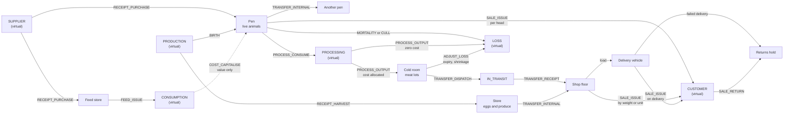
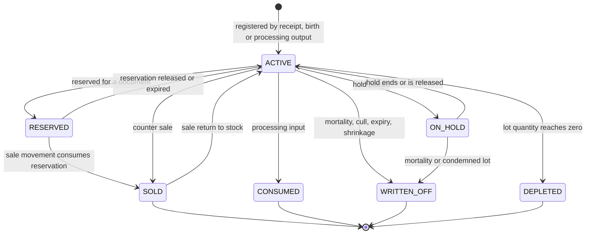
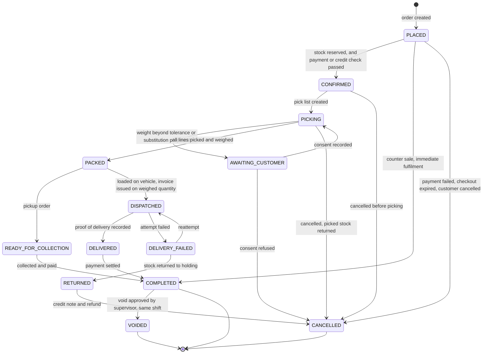

# HaKorem Farms Platform: Domain Model

Aggregates, entities, value objects, domain events, invariants and the language used to name them. This document describes the business in the terms the code must use. Tables are in `docs/DATA_MODEL.md`; who may call whom is in `docs/MODULE_BOUNDARIES.md`.

Decisions referenced here are recorded in `docs/adr/`.

## 1. How to read this document

- An **aggregate** is a cluster of objects changed together and saved whole. Its **root** is the only object other code may hold a reference to. A transaction changes one aggregate per module (ADR-0005).
- A **ledger** is an insert-only record of things that happened. It is not an aggregate: nothing in it changes (ADR-0012).
- A **value object** has no identity; two with the same values are the same.
- A **domain event** is a fact, named in the past tense as `<module>.<Name>`. Events marked with ◆ are posted to the general ledger (ADR-0003).
- Each **invariant** states where it is enforced: `DB` (constraint or trigger), `Domain` (aggregate code) or both. An invariant the brief lists under "invariants enforced by the database" is always `DB`.

## 2. Ubiquitous language

The terms below are used with exactly these meanings in code, documents and screens. The full glossary, including livestock and accounting terms, is written in B1.

| Term | Meaning |
| --- | --- |
| Product | Something the farm stocks or sells. Carries a stock-keeping policy |
| Stock-keeping policy | How a product's stock behaves: `SERIALISED`, `CATCH_WEIGHT` or `COUNTABLE` |
| Stock unit | One individually tracked thing: an animal (serial) or a lot (a meat lot, a flock, a dated batch of crates) |
| Lot | A stock unit that is a quantity produced or received together, with a batch number and dates. The unit of traceability |
| Pack | A labelled, weighed piece of a meat lot. The unit a picker handles |
| Tag | The number on an animal. What people call the animal |
| Grade | A quality class within a species, used for pricing |
| Weight band | A range of live weight within a species, used for pricing |
| Branch | A place the business trades from. The unit of authorisation, numbering and reporting |
| Location | A place stock can be: pen, cold room, shop floor, vehicle. Belongs to a branch |
| Virtual location | The outside world as seen by stock: supplier, customer, loss, production |
| Movement | An immutable record that stock, or cost, moved from one location to another |
| On-hand | Quantity physically in a location, derived from movements |
| Reserved | Quantity promised to an order, checkout or quote |
| Available | On-hand minus reserved minus quantity under hold |
| Hold | A block on moving a stock unit out: withdrawal period, quarantine, investigation |
| Withdrawal period | Days after a veterinary treatment during which the animal may not be sold or slaughtered |
| Cost pool | The total value and quantity of a stock unit, or of an untracked product at a branch |
| Processing order | A run that consumes animals or carcasses and produces meat lots, offal and waste |
| Yield | Output weight as a share of input weight |
| Price list | A set of prices for a channel, tier or customer, in approved versions |
| Resolved price | What the pricing engine returns: list price, floor and ceiling |
| Agreed price | What the customer actually pays per unit. May differ from the resolved price |
| Variance | The difference between resolved and agreed price, with a reason |
| Channel | How a sale arrives: `POS`, `ONLINE`, `WHOLESALE`, `QUOTE` |
| Order | The single record of a sale on any channel |
| Fulfilment | Picking, weighing, packing and dispatching an order |
| Billing document | An invoice, receipt, proforma, credit note or debit note |
| Tender | One payment method used to pay part of a sale |
| Shift | One cashier's session on one register, from opening float to close |
| Blind close | Closing a shift by declaring counted cash without seeing the expected amount |
| Journal | A balanced set of debit and credit lines in the general ledger |
| Subledger | The breakdown of a control account by party: customer, supplier, investor, levy |
| Levy | A named tax component: VAT, NHIL, GETFund |
| Unit (investor) | A share in the business. Holdings are counted in units with effective dates |
| Unit-days | Units held multiplied by days held in a period. The weight for a distribution |
| Maker and checker | The user who requests a sensitive action and the different user who approves it |
| Exception | A recorded fact that needs a person: a stock conflict, an unmatched payment, a counter gap |

## 3. The eight domain points and how the model meets them

| # | Requirement from the shared brief | Where it is met |
| --- | --- | --- |
| 1 | Three stock archetypes under one catalogue | `Product.stockPolicy`; `StockUnit` with `tracking` `SERIAL` or `LOT`; untracked countables have no stock unit (section 5.4) |
| 2 | Processing converts one archetype into another | `ProcessingOrder` consumes stock units and creates new lots, with lineage and exact cost allocation (5.6, ADR-0018) |
| 3 | Price bands, not prices | Pricing engine returns list, floor and ceiling; the order line records resolved, agreed, rule, variance and approval (5.3, 5.10, ADR-0004) |
| 4 | The final price is only known at the scale | Order lines hold estimate and tolerance; fulfilment lines hold weighed quantity; the invoice is issued on weighed quantity (5.10, ADR-0021) |
| 5 | Stock moves when nobody sold anything | Movement types for birth, mortality, cull, feed, medication, transfer, shrinkage; value-only movements for cost (5.4, 5.5) |
| 6 | Stock is an append-only ledger | `inv.stock_movement` is insert-only; balances are a projection (ADR-0002) |
| 7 | Capital and investor shares are accounting | Double-entry ledger; investor capital as a subledger; units with effective dates; distribution from the ledger by unit-days (5.14, 5.15, ADR-0028) |
| 8 | Locations are first class | Every movement has a source and a destination location; in-transit is a location the farm owns (ADR-0002, ADR-0007) |

## 4. Shared value objects

Defined in `packages/kernel` and used by every module.

| Value object | Definition | Rule |
| --- | --- | --- |
| `Money` | Non-negative integer pesewas with a currency | Exact arithmetic only; `allocate` for splits (ADR-0001) |
| `Weight` | Kilograms to three decimal places, with a `WeightSource` | Never negative; source is `SCALE`, `MANUAL` or `ESTIMATE` |
| `Quantity` | A number to three decimal places with a unit of measure | Never negative |
| `Percentage` | An exact decimal between 0 and 100 with four decimal places | Parsed from text, never from a float |
| `DateRange` | Start and end, half-open | Start before end |
| `BusinessDate` | A calendar date in Africa/Accra | Derived from a UTC instant by the kernel `Clock` |
| `DocumentNumber` | A formatted number from a series | Issued only by the numbering mechanism (ADR-0015) |
| `PhoneNumber` | E.164, validated for Ghana (`+233`) | Stored normalised |
| `PriceBand` | List, floor and ceiling prices with a basis | Floor at most list, list at most ceiling |
| `Result<T, E>` | Success or a typed business failure | Business outcomes are returned, not thrown |
| `Id` | UUIDv7 | Generated by kernel or client (ADR-0013) |

## 5. The model, module by module

### 5.1 IAM: identity, access and roles

**Aggregates**

- **User** (root: principal). Account in one realm (`STAFF`, `CUSTOMER`, `INVESTOR`), credentials, TOTP credential, recovery codes, sessions, refresh tokens.
- **Role**. Name and its permissions.
- **RoleGrant**. A role given to a principal at a branch, optionally a location, for a period.
- **ApprovalRequest**. A request by a maker for a checker's decision on one subject.
- **ApiCredential**. A key for an integration principal.

**Invariants**

| Invariant | Enforced |
| --- | --- |
| A principal acts only with a current grant covering the permission, branch and location, and satisfying the resource's ownership rule | Domain (policy engine) |
| The checker of an approval is not its maker | DB (check constraint) and Domain |
| An approval applies only to the exact payload approved | Domain (payload hash) |
| Owner, Accountant and Manager cannot complete login without TOTP | Domain |
| A rotated refresh token presented again revokes its session | Domain |
| Login failures give no indication whether the account exists | Domain |
| Email and phone are unique within a realm among live accounts | DB (partial unique index) |

**Events:** `iam.UserCreated`, `iam.PasswordChanged`, `iam.AccountLocked`, `iam.SessionRevoked`, `iam.RefreshTokenReuseDetected`, `iam.RoleGranted`, `iam.RoleRevoked`, `iam.RoleChanged`, `iam.ApprovalRequested`, `iam.ApprovalDecided`.

### 5.2 AUD: audit, compliance and administration

The audit trail itself (audit events, the chain, anchors and per-subject keys) is a platform mechanism, so that identity can write to it without a cycle (ADR-0009). Its invariants are listed here because this is the module whose requirements they satisfy. The AUD module owns viewing the log and audited administration.

**Ledgers (platform):** audit events, the audit chain, anchors.

**Aggregates**

- **DataSubjectRequest**. An export or deletion request with its approval and outcome.
- **RetentionPolicy**. How long a category of data is kept and what happens after.
- **SubjectKey** (platform). The encryption key for one data subject (ADR-0022).

**Invariants**

| Invariant | Enforced |
| --- | --- |
| An audited change and its audit event commit together | DB (same transaction) |
| Audit events and chain rows are never updated, deleted or truncated | DB (privileges and triggers) |
| Each chain row hashes its predecessor; `seq` has no gaps | DB (unique, sealer) and nightly verifier |
| Secrets never appear in an audit payload; personal data appears only encrypted under the subject's key | Domain (audit writer) |
| A destroyed subject key is never restored | DB (one-way update trigger) |

**Events:** `aud.AuditChainBroken`, `aud.AuditAnchorWritten`, `aud.SettingChanged`, `aud.DataSubjectRequestCompleted`.

### 5.3 MDM: master data, pricing and tax

**Aggregates**

- **Product**. Category, stock-keeping policy, units and conversions, images, online mode, tax category, GL group.
- **Species** with its **Grades** and **WeightBands**.
- **Customer** with addresses and tier. **Supplier**.
- **Branch**. **Location**.
- **PriceList** with **PriceListVersions**, each holding **PriceListEntries**.
- **Promotion** with targets, bundle items and coupons.
- **TaxSchemeVersion** holding the levy matrix (ADR-0020).
- **PaymentMethod**, **DeliveryZone**, **ReasonCode** (reference data).
- **ImportJob**. A spreadsheet import with dry-run results.

**Domain services:** `PricingEngine` (ADR-0004), `TaxCalculator` (ADR-0020). Both are pure functions over data loaded for the request.

**Invariants**

| Invariant | Enforced |
| --- | --- |
| A product's stock-keeping policy cannot change once it has movements | Domain, through a usage-check port that MDM defines and inventory implements |
| Weight bands of one species do not overlap | DB (exclusion constraint) |
| Two active versions of one price list do not overlap in time | DB (exclusion constraint) |
| Within a version, product with grade and band is unique | DB (unique index) |
| Floor at most list at most ceiling | DB (check) |
| An active price list or tax scheme version is immutable | DB (trigger) |
| A price list, promotion or tax scheme version is activated by a different user from its author | DB (approval constraint) |
| A tax scheme version has a row for every category and levy before activation | DB (deferred trigger) and Domain |
| A levy's base components are calculated before it | DB (check on `calc_order`) |
| A location belongs to exactly one branch; its parent is in the same branch | DB (foreign key and trigger) |
| A coupon cannot be redeemed beyond its limits | DB (redemption count check under row lock) |

**Events:** `mdm.ProductCreated`, `mdm.ProductChanged`, `mdm.PriceListVersionActivated`, `mdm.PromotionActivated`, `mdm.TaxSchemeVersionActivated`, `mdm.CustomerRegistered`, `mdm.CustomerChanged`, `mdm.SupplierRegistered`, `mdm.LocationChanged`, `mdm.ImportCompleted`.

### 5.4 INV: inventory and stock control

**Ledgers:** stock movements, stock unit lineage, temperature readings, balance snapshots.

**Aggregates**

- **StockUnit**. A serial unit or a lot: product, tracking, tag or batch number, dates, status, and for a serial unit its one current location.
- **Reservation**. A promise of stock to a document, with expiry.
- **StockHold**. A block on a stock unit.
- **GoodsReceipt**, **StockTransfer**, **StockAdjustment**, **StockTake**: documents that produce movements when posted.
- **ReorderRule**.

**Projections:** stock balance, cost pool.

**Invariants**

| Invariant | Enforced |
| --- | --- |
| Movements are never updated or deleted; a correction is a reversing movement | DB |
| Every movement names two different locations | DB (check) |
| Quantity is positive, or zero only for a value-only movement type | DB (check with type) |
| Weight, when present, has a source | DB (check) |
| Stock at a physical location does not go negative, except through a movement type and location that both allow it, which raises an exception | DB (trigger) |
| A serial unit is in exactly one location; a movement must start from it | DB (trigger) |
| A serial unit cannot be sold twice | DB (trigger: it is no longer at the source) |
| A stock unit under an unreleased hold cannot be sold, processed or sent to another branch | DB (trigger) |
| At most one active reservation per serial unit | DB (partial unique index) |
| Reserved does not exceed on-hand | DB (trigger) |
| An outbound movement does not consume stock reserved for another document | DB (trigger) |
| A cost pool with zero quantity has zero value | DB (trigger) |
| An adjustment or write-off above the threshold is approved by a different user before posting | DB (approval constraint) and Domain |
| A reason code from the fixed list is present where the movement type requires one | DB (foreign key and check) |
| A transfer's received quantity plus recorded variance equals the dispatched quantity | Domain |

**Events:** `inv.StockUnitRegistered`, `inv.StockMovementPosted`, ◆`inv.GoodsReceived`, ◆`inv.ProductionReceived`, ◆`inv.OpeningStockLoaded`, ◆`inv.StockIssuedForSale`, ◆`inv.SaleReturnReceived`, ◆`inv.StockWrittenOff`, ◆`inv.StockGainRecorded`, ◆`inv.CostCapitalised`, ◆`inv.UpkeepExpensed`, ◆`inv.StockConsumedInProcessing`, ◆`inv.ProcessingOutputReceived`, ◆`inv.StockTransferredBetweenBranches`, ◆`inv.SupplierReturnIssued`, `inv.StockTransferDispatched`, `inv.StockTransferReceived`, `inv.ReservationCreated`, `inv.ReservationReleased`, `inv.ReservationExpired`, `inv.StockHoldPlaced`, `inv.StockHoldReleased`, `inv.StockExceptionRaised`, `inv.StockTakePosted`, `inv.LowStockDetected`, `inv.LotExpiring`, `inv.TemperatureExcursionDetected`, `inv.BalanceDriftDetected`.

### 5.5 LIV: livestock management

**Ledgers:** weight records, health events, feed cost allocations.

**Aggregates**

- **Animal**. Shares its identity with a serial stock unit. Tag, species, breed, sex, birth or acquisition, source, dam and sire, purpose (`GROWING` or `BREEDING`), status.
- **Batch**. Shares its identity with a lot stock unit: a flock or litter managed as a group.
- **BreedingRecord**. Mating, expected and actual birth, litter size, offspring.
- **MortalityRecord**. A death or cull, with reason, photograph, value and approval.
- **FeedConsumption**. Feed issued to a pen on a date, and its allocation to the animals there.
- **Ration**.

**Invariants**

| Invariant | Enforced |
| --- | --- |
| An animal's tag is unique among live animals | DB (partial unique index) |
| A treatment with withdrawal days places a hold on the animal in the same transaction | Domain, calling inventory; the block itself is DB (5.4) |
| A mortality or cull above the value threshold needs a photograph and a second approver before stock is written off | DB (check and approval constraint) and Domain |
| A dead, sold or slaughtered animal accepts no further weight or health records | Domain |
| An offspring's dam was alive and female at the birth date | Domain |
| Feed cost allocated across a pen sums exactly to the value of feed issued | DB (deferred trigger) and Domain (`allocate`) |
| An animal's status follows its stock unit: when inventory records it sold, consumed or written off, livestock updates status in the same transaction | Domain (transactional subscriber) |

**Events:** `liv.AnimalRegistered`, `liv.AnimalWeighed`, `liv.HealthEventRecorded`, `liv.WithdrawalStarted`, `liv.MatingRecorded`, `liv.BirthRecorded`, `liv.MortalityReported`, `liv.MortalityApproved`, `liv.FeedConsumed`.

### 5.6 PRC: processing and production

**Aggregates**

- **ProcessingOrder**. Inputs (stock units consumed, with weight and cost), outputs (new lots with kind, weight, reference price and allocated cost), direct costs, expected and actual yield, packs.
- **YieldStandard**. Expected yield per species and output.

**Invariants**

| Invariant | Enforced |
| --- | --- |
| Allocated output costs sum exactly to input cost plus direct cost | DB (deferred trigger) and Domain (`allocate`) |
| Waste carries no cost | Domain |
| Every output lot is linked to every input unit in the lineage | Domain, written through inventory |
| An input under hold cannot be consumed | DB (5.4) |
| A completed order is frozen; a mistake is corrected by a reversing order | DB (document freeze) |
| Actual yield outside the tolerance of expected yield sets the investigation flag | Domain |
| Total output weight does not exceed total input weight | Domain |

**Events:** `prc.ProcessingOrderStarted`, ◆`prc.DirectCostIncurred`, `prc.ProcessingOrderCompleted`, `prc.YieldVarianceFlagged`, `prc.PacksLabelled`.

### 5.7 PUR: procurement and suppliers

**Aggregates**

- **SupplierProfile**. Terms, payout details (encrypted), categories, documents.
- **PurchaseRequisition**. **PurchaseOrder** with lines and approval.
- **SupplierInvoice** (invoice or credit note) with lines, levy rows and match results.
- **SupplierPayment** with allocations to invoices.

**Invariants**

| Invariant | Enforced |
| --- | --- |
| A purchase order above the requester's limit is approved by a different user | DB (approval constraint) and Domain |
| Quantity received against an order line does not exceed quantity ordered plus tolerance | Domain |
| A supplier invoice line is payable only when it matches the order line and receipt within tolerance (three-way match) | Domain; `match_status` checked by DB before payment allocation |
| A supplier payment is approved by a different user from the one who prepared it | DB (approval constraint) |
| Allocations of a payment do not exceed its amount, and allocations to an invoice do not exceed its outstanding amount | DB (trigger) |
| A supplier's invoice number is unique per supplier | DB (unique) |

**Events:** `pur.RequisitionSubmitted`, `pur.PurchaseOrderApproved`, `pur.PurchaseOrderSent`, ◆`pur.SupplierInvoiceMatched`, `pur.SupplierInvoiceMismatched`, ◆`pur.ExpenseInvoiceApproved`, ◆`pur.SupplierCreditNoteRecorded`, ◆`pur.SupplierPaymentMade`.

### 5.8 BIL: invoicing, receipts and credit notes

**Aggregate**

- **BillingDocument**. Kind (`PROFORMA`, `INVOICE`, `RECEIPT`, `CREDIT_NOTE`, `DEBIT_NOTE`), number, customer, lines with levy rows, totals, the order it bills, the document it corrects, content hash.

**Invariants**

| Invariant | Enforced |
| --- | --- |
| A document's number is allocated in the transaction that issues it; series have no gaps | DB (ADR-0015) |
| An issued document is immutable | DB (document freeze) |
| A reprint is the same archived bytes with a reprint marker and a log entry; it is never a new document | Domain; archive is insert-only |
| Document totals equal the sums of line amounts; line net plus levies equals line gross | DB (deferred trigger) |
| A credit note references an issued invoice and does not exceed its uncredited amount | DB (trigger) |
| A catch-weight line is billed on weighed quantity | Domain (order module supplies fulfilment quantities) |
| Levy rows are snapshots of the tax scheme version in force on the tax date | Domain |

**Events:** ◆`bil.InvoiceIssued`, ◆`bil.CreditNoteIssued`, ◆`bil.DebitNoteIssued`, `bil.ProformaIssued`, `bil.DocumentReprinted`.

A `RECEIPT` is the billing document for a sale paid at once; it posts as `bil.InvoiceIssued`.

### 5.9 PAY: payments and reconciliation

**Ledgers:** payment allocations, webhook events, store credit entries.

**Aggregates**

- **Payment**. Direction, method, amount, status, provider reference, the shift or driver that took it.
- **Refund**. Against an original payment, with approval.
- **SettlementReport** and **BankStatement** with lines and matches.
- **ReconciliationBreak**. An item that did not match.

**Invariants**

| Invariant | Enforced |
| --- | --- |
| A mobile money or card payment is recorded as cleared only from a verified provider callback or a provider status lookup | Domain; no endpoint accepts a cleared status from a client |
| A webhook is accepted only with a valid signature, within the timestamp window, with an unseen event id, and with the amount confirmed against the provider | Domain; event id uniqueness is DB |
| Provider references and idempotency keys are unique | DB |
| Allocations of a payment do not exceed its amount; allocations to a document do not exceed its outstanding amount | DB (trigger) |
| A refund references its original payment, does not exceed the unrefunded amount, and is approved by a different user above the automatic limit | DB (trigger and approval constraint) |
| A cleared payment is never edited; it is reversed | DB (document freeze) |
| An unallocated receipt sits in customer deposits or suspense until allocated | Domain (posting event) |
| Reconciliation never corrects; it raises a break | Domain |

**Events:** `pay.PaymentInitiated`, ◆`pay.PaymentCleared`, `pay.PaymentFailed`, ◆`pay.PaymentReversed`, ◆`pay.DepositAllocated`, `pay.RefundRequested`, ◆`pay.RefundPaid`, `pay.RefundFailed`, ◆`pay.ProviderSettled`, ◆`pay.ChequeCleared`, `pay.WebhookRejected`, `pay.ReconciliationBreakRaised`.

### 5.10 ORD: order management and fulfilment

**Aggregates**

- **SalesOrder**. Channel, customer, lines, adjustments, status, the quote it came from. Each line holds the pricing record: resolved list price, floor, ceiling, rule reference, agreed price, variance, reason and approval.
- **Fulfilment**. Pick, weigh, pack and dispatch of an order or part of one.
- **OrderReturn**. A return or exchange against an original order.

**Domain service:** `SalePosting`. In one serializable transaction it issues stock through inventory, issues the billing document through billing, and records tenders through payments (ADR-0010). The ledger posts from the events those publish.

**Invariants**

| Invariant | Enforced |
| --- | --- |
| Status changes follow the state machine in section 7 | Domain; DB check on allowed status values |
| An order line has a price from the engine, from an accepted quote, or an approved manual price; never none | DB (check) and Domain |
| An agreed price outside floor and ceiling, or beyond the user's limit, has an approval by a different user | DB (check: approval required when flagged) and Domain |
| A line for a serialised product names one stock unit and has quantity one | DB (check) |
| A completed order's lines each have a stock movement or a stock exception | DB (check at completion) |
| Fulfilled quantity does not exceed ordered quantity plus tolerance without recorded customer consent | Domain |
| Cancelling releases reservations and requests a refund of anything paid | Domain, one transaction |
| A return references the original order and does not exceed what was sold | DB (trigger) |
| A void of a completed sale is approved by a supervisor who is not the cashier | DB (approval constraint) |

**Events:** `ord.OrderPlaced`, `ord.OrderConfirmed`, `ord.OrderLinePriceOverridden`, `ord.PickListCreated`, `ord.OrderPicked`, `ord.OrderPacked`, `ord.OrderDispatched`, `ord.OrderDelivered`, `ord.OrderCompleted`, `ord.OrderCancelled`, `ord.OrderVoided`, `ord.OrderReturned`, `ord.SubstitutionProposed`, `ord.SubstitutionAccepted`.

### 5.11 POS: retail point of sale

**Ledgers:** cash movements, sale sync log.

**Aggregates**

- **Register**. A till at a branch and location, with enrolled devices.
- **Shift**. Cashier, register, opening float, tender counts, declared and expected cash, over or short.
- **HeldSale**. A parked sale on a register.

A counter sale is not a POS aggregate. It is a sales order on channel `POS`, placed and completed in one step by the order module.

**Invariants**

| Invariant | Enforced |
| --- | --- |
| A register has at most one open shift; a cashier has at most one open shift | DB (partial unique indexes) |
| A counter sale belongs to an open shift of the cashier making it | Domain |
| Expected cash is not shown to the cashier before the declared count is submitted | Domain (blind close) |
| Over or short equals declared minus expected, and is posted | Domain; ledger event |
| A cash drop or pay-out has a reason and reduces expected cash | Domain |
| An offline sale syncs exactly once, identified by its client id | DB (unique) |
| Device counters within a shift have no gaps; a gap raises an exception | Domain at sync |
| Offline tenders are cash only unless the setting allows otherwise | Domain (ADR-0027) |

**Events:** ◆`pos.ShiftOpened`, ◆`pos.CashDropped`, ◆`pos.CashPaidOut`, ◆`pos.ShiftClosed`, `pos.OfflineSaleSynced`, `pos.DeviceCounterGapDetected`, `pos.DeviceEnrolled`.

### 5.12 WHL, QUO, SHP: selling channels

**WHL aggregates:** **BusinessAccount** (credit limit, terms, account manager, hold status), **StandingOrder**, **Statement**, **DunningPolicy**.

**QUO aggregates:** **RequestForQuote**, **Quote** with immutable **QuoteVersions**, lines and acceptance.

**SHP aggregates:** **Cart** with lines, **CheckoutSession** with reservations.

**Invariants**

| Invariant | Enforced |
| --- | --- |
| An order that would take a business account over its credit limit is not confirmed without an approved override | Domain (WHL implements the order module's confirmation policy); DB approval constraint |
| An account past the overdue threshold is placed on hold and cannot place credit orders | Domain (scheduled) |
| Ageing buckets are computed from invoice due dates and allocations, as at a date | Domain |
| An issued quote version is immutable; a change is a new version | DB (document freeze) |
| A quote below the margin floor is approved by a different user before issue | DB (approval constraint) |
| A quote is accepted through a signed, expiring link, once | DB (unique acceptance per version) and Domain |
| An accepted quote converts to exactly one order; the order, and later the invoice, keep the link | DB (unique) |
| An expired quote cannot be accepted | Domain |
| A checkout holds reservations for every line or does not start | Domain, serializable |
| A product in `REQUEST_TO_BUY` mode cannot be added to a cart | Domain |
| A cart line's price is re-resolved at checkout; a changed price is shown before payment | Domain |

**Events:** `whl.BusinessAccountOpened`, `whl.CreditLimitExceeded`, `whl.CreditOverrideApproved`, `whl.AccountPlacedOnHold`, `whl.AccountReleased`, `whl.StatementIssued`, `whl.DunningNoticeDue`, ◆`whl.BadDebtWrittenOff`, `quo.RfqReceived`, `quo.QuoteIssued`, `quo.QuoteRevised`, `quo.QuoteAccepted`, `quo.QuoteDeclined`, `quo.QuoteExpired`, `quo.QuoteConverted`, `shp.CheckoutStarted`, `shp.CheckoutExpired`, `shp.CartAbandoned`.

### 5.13 DEL: delivery and logistics

**Ledgers:** delivery attempts, proof of delivery.

**Aggregates:** **DeliverySlot**, **Delivery**, **Route** with stops, **DriverCashReconciliation**.

**Invariants**

| Invariant | Enforced |
| --- | --- |
| Bookings in a slot do not exceed its capacity | DB (check under row lock) |
| A driver acts only on deliveries assigned to them | Domain (ownership rule) |
| A delivery is completed only with proof: recipient name, and signature or photograph, with time and position when available | DB (check) and Domain |
| Cash collected is recorded on the proof of delivery against the driver | Domain; ledger event |
| A driver's day is reconciled: declared cash against the sum of collections, with the variance posted | Domain; approval by a different user |
| A failed delivery is reattempted or returned to stock; stock in the vehicle remains the farm's | Domain; stock via inventory |

**Events:** `del.DeliveryScheduled`, `del.DeliveryAssigned`, `del.DeliveryDispatched`, `del.DeliveryOnTheWay`, `del.DeliveryCompleted`, `del.DeliveryFailed`, `del.DeliveryReturned`, ◆`del.CodCollected`, ◆`del.DriverCashRemitted`.

### 5.14 FIN: general ledger and accounting

**Ledgers:** journal entries and lines.

**Aggregates:** **Account**, **AccountingPeriod**, **PostingRule**, **ManualJournal**, **FixedAsset**, **DepreciationRun**.

**Invariants**

| Invariant | Enforced |
| --- | --- |
| A journal entry's debits equal its credits | DB (deferred constraint trigger) |
| No entry posts into a period that is not open | DB (trigger) |
| Entries and lines are never updated or deleted; a correction is a reversing entry | DB |
| A line on an account with a subledger names a subledger party; a line on any other account does not | DB (trigger) |
| Only postable accounts receive lines | DB (trigger) |
| A manual journal is approved by a different user before posting | DB (approval constraint) |
| A posting rule change is approved by a different user | DB (approval constraint) |
| Every event flagged as posting to the ledger has a handler and a complete rule set | Domain (boot assertion, CI test) |
| Periods of a fiscal year are contiguous and do not overlap | DB (exclusion constraint) |
| A closed period is never reopened; a locked period is reopened only by the Owner with a reason | Domain |

**Events:** `fin.JournalPosted`, `fin.PeriodLocked`, `fin.PeriodClosed`, ◆`fin.YearClosed`, ◆`fin.DepreciationRun`, ◆`fin.ManualJournalApproved`, `fin.TrialBalanceDriftDetected`.

### 5.15 CAP: capital, investors and profit sharing

**Ledgers:** capital transactions (with unit issues and redemptions), distribution payments.

**Aggregates:** **Investor**, **DistributionRun** with lines, **Financing** (loan or grant) with schedule and repayments.

**Invariants**

| Invariant | Enforced |
| --- | --- |
| An investor sees only their own capital, units, distributions and documents | Domain (ownership rule) |
| A contribution issues units at its value date; a withdrawal redeems units and cannot exceed the holding | DB (trigger) |
| A distribution run covers only locked or closed periods | Domain; DB check via the ledger's interface |
| Distributable profit equals net profit from the ledger minus retention | Domain |
| Allocations use unit-days and sum exactly to the distributable amount | DB (deferred trigger) and Domain (ADR-0028) |
| A run is approved by a different user with step-up authentication before it posts | DB (approval constraint) and Domain |
| Amounts paid against a distribution line do not exceed net payable | DB (trigger) |
| A capital withdrawal is approved by a different user | DB (approval constraint) |

**Events:** `cap.InvestorRegistered`, ◆`cap.CapitalContributed`, ◆`cap.CapitalWithdrawn`, `cap.DistributionRunApproved`, ◆`cap.DistributionDeclared`, ◆`cap.DistributionPaid`, ◆`cap.LoanDrawn`, ◆`cap.LoanRepaid`, ◆`cap.InterestAccrued`, ◆`cap.GrantReceived`.

### 5.16 CST, RPT: costing and reporting

Neither holds a business fact of record. Both build projections from events and published views (ADR-0018, ADR-0023).

**CST aggregate:** **OverheadAllocationRun**, which spreads a period's labour and overhead across cost objects and posts value-only movements through inventory.

**RPT aggregates:** **ReportSchedule**, and **ReportRun** as a ledger of every run and export.

**Invariants**

| Invariant | Enforced |
| --- | --- |
| An overhead allocation sums exactly to the amount allocated | DB (deferred trigger) and Domain |
| Every export is recorded with the user, parameters and row count | Domain; audit event |
| A bulk export needs step-up authentication | Domain |
| A projection can be rebuilt from events and matches the module of record | Nightly comparison |

**Events:** `cst.OverheadAllocated`, `rpt.ReportExported`, `rpt.ProjectionDriftDetected`.

### 5.17 NTF, DOC, API: supporting modules

**NTF aggregates:** **Template**, **Preference**, **Message** with attempts.

**DOC aggregates:** **DocumentTemplate** with versions; the document archive is a ledger.

**API aggregates:** **Integration**, **WebhookEndpoint**; webhook deliveries are work state; **AccountingExport**.

**Invariants**

| Invariant | Enforced |
| --- | --- |
| A notification is sent at most once per source event and recipient | DB (unique idempotency key) |
| An opted-out recipient receives no marketing or reminder message; transactional receipts respect channel preference; quiet hours delay, never drop | Domain |
| An archived document's bytes never change; its hash is stored | DB (insert-only) |
| Every private file is served by a signed, expiring URL, and each issue is logged | Domain (file store) |
| A template change creates a new version; issued documents keep the version they used | DB |
| An outbound webhook is signed, retried with backoff, and dead-lettered after the limit | Domain |

**Events:** `ntf.MessageSent`, `ntf.MessageFailed`, `doc.DocumentArchived`, `api.WebhookDeliveryDead`.

## 6. Stock and processing lifecycle

How stock enters, changes form and leaves. Each arrow is one or more stock movements between the locations named; value moves with them.

Status of a stock unit:

`ON_HOLD` and `RESERVED` are derived from hold and reservation rows, not stored on the stock unit. The stored status is `ACTIVE`, `SOLD`, `CONSUMED`, `WRITTEN_OFF` or `DEPLETED`.

## 7. Order state machine

One machine for every channel. A counter sale passes from `PLACED` to `COMPLETED` in a single transaction. Payment status is tracked beside it and is derived from payments and allocations: `UNPAID`, `DEPOSIT_HELD`, `PART_PAID`, `PAID`, `PART_REFUNDED`, `REFUNDED`.

Rules that apply to the machine:

- Partial fulfilment is tracked on lines. An order with some lines fulfilled and the rest backordered moves forward with the fulfilled lines; the remainder is a linked backorder with its own passage through the machine.
- A return after completion does not change the order's status. It is an `OrderReturn` with its own credit note.
- Every transition is recorded in the order's status history with actor, time and reason.
- `CANCELLED` and `VOIDED` are reached only through transactions that also reverse stock, billing and payment as far as each had gone.

## 8. Cross-module consistency rules

| Rule | Mechanism |
| --- | --- |
| A sale's stock, billing document, payment and journals commit together | One serializable transaction orchestrated by the order module (ADR-0010) |
| The ledger agrees with stock, receivables and cash | Postings in the same transaction; nightly reconciliation of subledgers to control accounts |
| A notification, webhook or report row never exists for a change that rolled back | Transactional outbox |
| No reference to a document in another module can dangle | `platform.business_document` registry (ADR-0011) |
| The same request, webhook or message has one effect | Idempotency keys, unique references, inbox (ADR-0014) |
| A sensitive action has a maker and a different checker | `iam.approval_request` with a database check (ADR-0017) |
