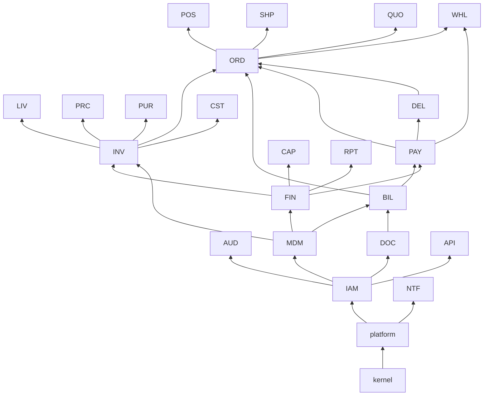

# HaKorem Farms Platform: Module Boundaries

What each of the twenty-two modules owns, its public interface, what it may import, and the rule that enforces it. If code and this document disagree, the code is wrong.

Decisions behind this document: ADR-0008 (structure and lint), ADR-0009 (platform versus modules), ADR-0010 (commands down, events up), ADR-0011 (cross-module keys).

## 1. The rules

1. **One owner.** Every table, aggregate and business rule belongs to exactly one module. A module's code reads and writes only its own PostgreSQL schema.
2. **One door.** Other modules import a module only through its `index.ts`. Everything else in the module folder is private.
3. **Downward only.** A module may import the `index.ts` of modules in a lower layer of the table in section 2. Never the same layer, never a higher one.
4. **Events are public language.** Any module may import any module's `events.ts`, as types only, to subscribe to its events.
5. **Commands down, events up.** A module calls down to get something done as part of its own operation. It learns what happened below or beside it by subscribing (ADR-0010).
6. **Ports invert the few upward needs.** Where a lower module needs an answer only a higher module has, the lower module defines a port in its `index.ts` and the higher module registers an implementation. Section 6 lists every port.
7. **No cross-schema SQL.** Application queries never join across schemas. Cross-schema foreign keys exist only to the published keys in section 5.
8. **Inside a module**, `domain/` depends on nothing but the kernel; `application/` on `domain/`; `infrastructure/` and `interface/` on both.

## 2. Layers

| Layer | Members | Built in |
| --- | --- | --- |
| 0 | `kernel` | B2 |
| 1 | `platform` | B2, B3 |
| 2 | IAM | B3 |
| 3 | AUD, MDM, DOC | B3 (AUD administration), B4 (MDM), B8 (DOC), B13 (AUD retention and data requests) |
| 4 | FIN | B8 |
| 5 | INV | B5 |
| 6 | LIV, PRC, BIL | B6, B6, B8 |
| 7 | PAY, PUR | B9a, B7 |
| 8 | DEL | B11 |
| 9 | ORD | B9a (core), B11 (fulfilment) |
| 10 | POS, SHP, QUO, WHL | B9b, B7 and B9a, B10, B10 |
| 11 | CAP, CST, RPT, NTF, API | B12, B12, B12, B11, B12 |

A layer is permission to import, not build order. FIN is in layer 4 so that higher modules can read the ledger, but it is built in B8 and receives postings by subscribing to events, so modules built earlier never import it (ADR-0003).

The arrows show the principal runtime imports, pointing from the imported module to the importer. Every module also imports `kernel`, `platform` and IAM; those arrows are omitted above layer 3 for legibility. Event subscriptions are not shown; they are listed per module in section 3.

## 3. The modules

Each card gives: what the module owns, its public interface (the services exported from `index.ts`), what it may import, the events it subscribes to (**T** in the caller's transaction, **A** asynchronously through the outbox), and where its events are listed. Events published by each module are listed in `docs/DOMAIN_MODEL.md` section 5.

### kernel (layer 0)

- **Owns:** `Money`, `Weight`, `Quantity`, `Percentage`, `allocate`, `Id` (UUIDv7), `Clock`, `BusinessDate`, `Result`, `DateRange`, `PhoneNumber`.
- **Imports:** nothing.

### platform (layer 1)

- **Owns:** schema `platform`. Unit of work, actor context, audit trail, domain event bus and outbox, idempotency store, numbering, business document registry, settings store, file store, ports and adapters (payment provider, notification channel, PDF renderer, queue), observability and health. The file store is the mechanism only: the object under a random key, `platform.stored_file`, signed links and their log, and the worker's scan through the `MalwareScanner` port (ClamAV, ADR-0044); who may upload or read is DOC's. From B04e continued 3 the scan also publishes a clean public photograph's variants through the `ImageRenderer` port (`sharp`, ADR-0045) to the public media bucket, `platform.stored_file_variant`; `FileStore.publicVariants` reads them with their public URLs, and `platform.require_clean_file` is the one file store rule another schema's trigger may call. From B04e continued 4 `FileStore.content` reads a CLEAN file for a module that imports it, and `src/platform/spreadsheet/` reads and writes XLSX and CSV on Node's own zlib, with no business rule (ADR-0046).
- **Public interface:** `UnitOfWork`, `ActorContext`, `AuditTrail`, `DomainEvents`, `Idempotency`, `Numbering`, `DocumentRegistry`, `Settings`, `FileStore`, `PaymentProviderPort`, `NotificationChannelPort`, `PdfRendererPort`, `Jobs`, `Health`.
- **Imports:** kernel only. Never a module.

### IAM: identity, access and roles (layer 2)

- **Owns:** schema `iam`. Principals, user accounts, credentials, TOTP, sessions, refresh tokens, API credentials, roles, permissions, grants, approval policies and requests.
- **Public interface:** `Authoriser` (the policy check every handler calls), `Approvals` (request, decide, register a handler for a kind), `Identity` (principal lookup, display names; B4 built the display names as `PrincipalNames`, token `PRINCIPAL_NAMES`), `Authentication` (guards that set the actor context), `ApiCredentials`. B04e publishes `AccessAdmin` (user and grant administration, with the first-Owner bootstrap, ADR-0043) and `AuthenticationService` for the seed alone, on ADR-0041's terms; no module calls them. The `ScopeNames` port gains `refs` (branch and location codes, names and kinds), which MDM implements. B04e continued adds `RoleAdmin`, `ApprovalInbox` and `SelfService` behind their controllers (no module calls them), `Approvals.cancel`, and `PhoneCodes`, which sends one-time codes to platform's SMS channel port after commit (ADR-0009: never through the outbox). Events: `iam.ApprovalDecided`, `iam.RoleGranted`, `iam.RoleRevoked`, `iam.RoleChanged`, `iam.UserCreated` (self-registered customers), `iam.PhoneVerified`.
- **Built in B09a continued 2e (A-230):** `Authoriser.limitIn` (the largest live role limit of a kind among the roles a principal holds at a branch, 0 when none; read by the owning module, ADR-0017) and `Approvals.ofSubjectIn` (the requests of a kind on a subject, read only, for the owning module).
- **Built in B09b continued 3 (A-280):** `Authoriser.holdersIn` (who holds a permission at a branch now, signed in or not, read only; the supervisors whose till PIN verifiers a till is issued).
- **Built in B10 continued 6 (lane B, with the parent session's leave for exactly this one additive read; A-343, abuse case 40):** `StaffSessionsSeen.fromAddressIn` (token `STAFF_SESSIONS_SEEN`): the staff sessions created from one address and last seen inside a window, each with its principal, session id, user agent and times, revoked or not; never a token or a hash. QUO reads it to flag a possible staff acceptance; no IAM table, column or behaviour changed.
- **Imports:** platform.
- **Subscribes:** nothing.

### AUD: audit, compliance and administration (layer 3)

- **Owns:** schema `aud`. Retention policies, data-subject requests. Audited administration of settings, feature flags, number series and the business profile.
- **Public interface:** `AuditLog` (authorised query of the platform audit trail), `Administration`, `DataSubjectRequests`, `Retention`. B07 continued builds `SettingsAdmin` (`updateSetting`, FR-AUD-007, A-168) over platform `Settings`, with its own catalogue of keys, types and ranges; the module reading a key keeps its default. B09x continued builds `BusinessProfiles` (FR-AUD-008, A-244): `get` and `update` behind AUD's own controller (and `update` for the seed), and `shopProfile`, the only door another module uses, which hands out the shop's contact fields and nothing else (CR-028); SHP reads it.
- **Imports:** platform, IAM.
- **Subscribes:** nothing.
- **Built in B09b continued 2 (A-277 (b)):** five settings join the catalogue, each bounded at its documented default so the owner can only make a till stricter: `pos.offline.max_hours`, `pos.offline.max_queued_sales`, `pos.offline.allow_unverified_mobile_money` (the first boolean setting), `sync.clock_tolerance_seconds` and `pay.unverified_window_days`, seeded through `SettingsAdmin`.

### MDM: master data, pricing and tax (layer 3)

- **Owns:** schema `mdm`. Products, categories, units, species, grades, weight bands, customers, suppliers, branches, locations, price lists, promotions and coupons, tax levies and scheme versions, payment methods, delivery zones, reason codes, import jobs.
- **Public interface:** `Catalogue`, `Parties`, `Locations`, `PricingEngine` (built in B4: `PricingService.resolveIn` in the caller's transaction, `judgeAgreedPrice`, `extendPrice`), `Promotions` (built in B04d: `resolveIn` returns each line's discounts; `Promotions.redeemIn` and `releaseIn` in the caller's transaction, holding `couponLockKey(code)`, ADR-0040), `TaxCalculator`, `ReferenceData`, `Imports`. Port: `ProductUsageCheck`. B05 continued adds `MasterDataRefs`: products (with tracking, base unit and its display decimals), locations, suppliers and grades by id, and a branch's virtual location of a kind, in the caller's transaction (B05 continued 2 adds branches, reasons from the fixed list and a branch's physical location of a kind), for inventory's documents and views; it authorises nothing and writes nothing. B04d continued publishes the administration services (`CatalogueAdmin`, `ProductCatalogue`, `PriceListAdmin`, `TaxAdmin`) for the seed alone (ADR-0041), B04d continued 2 adds `LocationsAdmin` (with the first-branch bootstrap, ADR-0042) and `PartiesAdmin`, and B04d continued 3 `ReferenceDataAdmin` (suppliers, payment methods, delivery zones, `quoteDelivery`, reason codes), on the same terms; no module calls them. B04e continued 3 adds the product gallery (`ProductGallery`: `addProductImage`, `removeProductImage`) behind its controller; `mdm.product_image` refers to `platform.stored_file` and its variants are read through `FileStore.publicVariants`, never by a join (ADR-0045). B04e continued 4 adds `MdmImports` (the seven import and export operations) behind its controller, with one `EntitySheet` per entity that applies rows through the entity's own service in the import's transaction (customers through `PartiesAdmin.createCustomerIn` and `updateCustomerIn`; B04e continued 5 adds products through `ProductCatalogue.createIn` and `updateIn`, suppliers through `ReferenceDataAdmin.createSupplierIn` and `updateSupplierIn`, locations through `LocationsAdmin.createLocationIn` and `updateLocationIn`, and price list entries through `PriceListAdmin.replaceEntriesIn` into a draft version, with codes resolved by `SheetLookups` in MDM's own tables, A-130); `mdm.import_job` refers to `platform.stored_file` and reads the file through `FileStore`, never through DOC (ADR-0046). B05 continued 4 makes `EntitySheet` a port: a higher module registers a sheet with `MdmImports.registerSheet` (ADR-0050), and `MasterDataRefs` gains a location's cold chain class and range and branches, locations and products by code, read only. B05x adds the `LocationUsageCheck` port (`LocationUsageRegistry`, ADR-0051), which closing a branch and archiving a location ask, branch and location reads scoped to the reader's grants, `ProductCatalogue.getLabel` (label data), and the published view `mdm.pub_product` (SKU, name, tracking, policy and species, for RPT). B06u adds a countable product's exact alternative units (`UomConversions`: `listUomConversions`, `createUomConversion`, `archiveUomConversion`, A-163) behind its controller, and `MasterDataRefs.toBaseIn`, the only way another module puts a quantity in a product's base unit (it refuses rather than rounds). B7 adds a product's tax category to `MasterDataRefs` product facts and `taxCategoriesIn` (the contract's `TaxCategoryRef`), for purchasing's levy rows. Events from the catalogue: `mdm.ProductCreated`, `mdm.ProductChanged` (with `images` among the changed fields for a gallery change, `uomConversions` for a conversion change), `mdm.ProductArchived`; from the supplier register, `mdm.SupplierRegistered`. B07 continued 3 adds `productIdsInCategoryIn` (every product filed under a category), read by INV's sorted stock on hand (CR-019).
- **Imports:** platform, IAM.
- **Subscribes:** nothing.
- **Built in B09q (ADR-0072, A-248 to A-252):** a product's SKU is the server's: `ProductCatalogue.createIn` allocates it through `ProductStore.allocateSku` (`mdm.allocate_sku`, the category's `sku_prefix` and its own counter in `mdm.sku_counter`), and every create, update and import refuses an input carrying one (`serverAssignedFieldsIn`, 422 `FIELD_SERVER_ASSIGNED`); `createProduct` queues on the advisory lock `SKU_SERIES_LOCK`. No product barcode: the product views, `ProductCatalogue.getLabel` (built by the domain's `productLabel`) and the product sheet carry none, and `mdm.product.barcode` is unused until it is dropped (BL-075). Categories carry `skuPrefix`. Customers and suppliers carry a public ID (ADR-0073, A-253): `PublicIds` (a provider) draws it and `insertWithFresh` retries a collision; `MasterDataRefs` gives `publicId` in `CustomerFacts` and `SupplierFacts` in place of the sequential numbers, which every higher module's `CustomerRef` and `SupplierRef` now show; search and the customer and supplier sheets take it.
- **Built in B09e continued (A-264):** the published database function `mdm.uom_to_base(product, uom, qty)` (migration 0216, ADR-0047's list), the database's form of `MasterDataRefs.toBaseIn`, which INV's guards call.
- **Built in B09e (A-261):** `PricingService.resolveIn` prices a line in the unit it is sold in (`ResolveLine.uom`; an entry names its selling unit, `mdm.price_list_entry.uom`, migration 0215), with quantity breaks entered in that unit and compared in the base unit; a selling module passes the line's unit and its quantity in it (ORD's sale posting, online placement and returns, SHP's lines and catalogue). No new port.
- **Built in B09u (A-303, A-308):** every unit carries a singular and a plural name and a new unit `EGG` (migration 0249); `EntitySheet.createLocks`, the create locks `applyImportJob` takes before its transaction (the customer and supplier sheets). No interface removed.
- **Built in B09b continued 2 (A-277, CR-038):** `PricingService.sellingUnitsIn` (the units each product is sold by on a channel's walk for a buyer with no account, each priced by its own entry, never derived; the price list versions in force), `TaxService.schemeInForceIn` (the scheme version in force on a date and its cells), `MasterDataRefs.reasonCodesOfDomainsIn` and `livePaymentMethodsOfChannelIn`, each read only in the caller's transaction, authorising nothing. POS reads them for the offline pack and for a counter line's unit.
- **Built in B11 continued 11 by lane B (additive, A-376):** `MasterDataRefs.customerContactsIn`, a customer's own name and number by id for NTF's reminders, read when queued and when sent, never kept. No existing function changed.
- **Added in B11 continued 13 (additive, ADR-0099):** `MasterDataRefs.partyAddressesIn` (a customer's or a supplier's phone and email by id) and `isPartyAddress` (whether a typed address is the party's own), for the document sends.

### DOC: documents and media (layer 3)

- **Owns:** schema `doc`. Document templates and versions, the immutable archive of rendered documents, render jobs.
- **Public interface:** `Documents` (render, archive, fetch, reprint), `Templates`.
- **Built in B08 continued 2b (ADR-0061, A-202):** `Documents.requestRenderIn` (in the issuing transaction: the render job with the template versions active then, and `doc.RenderRequested` to the outbox), the worker consumer `doc.render` (renders through the platform's PDF and ESC/POS writers, stores `ARCHIVE` files through `FileStore`, archives once, publishes `doc.DocumentArchived`), `archivedIn`, `content` (the archived bytes, hash-checked, once scanned) and the archive reads; `Templates` (versions sandboxed at save, activation audited).
- **Built in B08 continued 2c (ADR-0062, A-204):** `Templates.preview` (`previewTemplateVersion`: a marked specimen returned inline, nothing stored); `RenderRequest.causationId`, so a render names the event that asked for it; the remittance advice's template (`REMITTANCE_ADVICE`), rendered like any other document when PUR requests it.
- **Imports:** platform, IAM.
- **Subscribes (A):** `doc.RenderRequested`, its own (B08 continued 2b). From B04e continued 2 DOC also serves the file store's operations (`uploadFile`, `getFile`, `createFileSignedUrl`) over the platform `FileStore`, holding the uses, their allow-lists and caps and the authorisation (ADR-0044). A module that references a file (product photographs, supplier and investor files, import files) reads it through the platform `FileStore` directly, not through DOC.
- **Added in B11 continued 13 (additive, ADR-0099, migration 0342):** `Documents.issueLinkIn` (a `doc_` link of its own for a document sent by message, made at each attempt, `doc.document_link` keeps its hash; `LINK_NOT_READY` while the document is rendering or unscanned), `Documents.attachmentOf` (the archived PDF, hash-checked, for an email) and the public `getSharedDocument` (by the token alone, a signed link to exactly that rendering). Only NTF calls the first two.

### FIN: general ledger and accounting (layer 4)

- **Owns:** schema `fin`. Chart of accounts, bank accounts, subledger parties, periods, journal entries and lines, posting event types, posting rules, account determination, manual journals, fixed assets, depreciation, period balances.
- **Public interface:** `Ledger` (balances, profit for a period, account activity), `Periods` (status, lock, close), `FinancialStatements` (trial balance, profit and loss, balance sheet, cash flow), `ManualJournals`, `FixedAssets`.
- **Built in B09b continued 2b (A-278 (d)):** `Ledger.postingDateIn`, read only in the caller's transaction: the date an entry for a time posts on, as `postIn` would choose it (its own date while its period is open, else the recorded date). POS dates a synced offline sale's receipt with it.
- **Built in B09b continued 2c (A-279 (h)):** `BankAccounts.mobileMoneyWalletIn`, read only: the branch's active mobile money wallet, else a farm-wide one (PAY holds an unverified offline mobile money tender in it). `pay.PaymentCleared` marked `unverified` posts its tender Dr 1110 against that wallet by the new determinant `UNVERIFIED_MOBILE_MONEY` (migration 0263); no existing rule changes.
- **Imports:** platform, IAM, MDM.
- **Subscribes (T):** every event marked ◆ in `docs/DOMAIN_MODEL.md`, from INV, PRC, PUR, BIL, PAY, POS, DEL, WHL and CAP. No module calls FIN to post.
- **Built in B8 (ADR-0056):** the posting handlers for INV's, PRC's and PUR's ◆ events with the boot assertion; `SubledgerSources`, where a higher module registers the subledger it keeps for a control account (INV registers `inv.stock-value`); `LedgerReconciliation`, the nightly `ledger-reconcile` job; `FinancialStatements.trialBalanceIn`. Publishers declare their ◆ events with `DomainEvents.declareLedgerEvents`. The interface operations follow in B08 continued (A-187).
- **Built in B08 continued (A-188, A-189):** `ChartOfAccounts` (list, add, rename, close) and `Periods` (list, lock, close, and the reopen under `PERIOD_REOPEN`, whose approval handler FIN registers with IAM's `Approvals`); FIN now imports IAM for the policy engine, approvals and principal names. Journals, manual journals, posting rule changes and bank accounts follow in B08 continued 1b, the statements, fixed assets and depreciation in B08 continued 1c.
- **Built in B08 continued 1b (A-190 to A-192):** `Journals` (entries and account activity, read only), `ManualJournals` (the `MANUAL_JOURNAL` approval handler, which publishes FIN's own ◆ event `fin.ManualJournalApproved`; FIN subscribes to it like any other, so a manual journal posts through `Ledger.postIn`) and `PostingRules` (the event catalogue, rules and determinations, and the `POSTING_RULE_CHANGE` approval handler). FIN declares `fin.ManualJournalApproved` with `DomainEvents.declareLedgerEvents`.
- **Built in B08 continued 1b2 (ADR-0057, A-193, A-194):** `BankAccounts` (list, add with step-up, rename or deactivate; each number sealed with a data key of its own from platform's `KeyRing` and `value-keys`, only its last four digits ever read back; each account's own `BANK_ACCOUNT` subledger party). Its `payoutAccountsIn` and the pure rule `judgePayoutAccount` are what PUR reads to accept a supplier payment's `bankAccountId`; `LedgerPostings` reads the account's party for `pur.SupplierPaymentMade`.
- **Built in B08 continued 1c (ADR-0058, A-195 to A-197):** `FinancialStatements` answers the trial balance, profit and loss, balance sheet and cash flow (`fin.report.read`), reading a locked or closed period from `fin.period_balance`; `YearClose`, run by `Periods.close` for period 12, publishes FIN's own ◆ event `fin.YearClosed` (declared with `DomainEvents.declareLedgerEvents`), which the ledger posts as each branch's CLOSING entry. FIN publishes the view `fin.pub_cash_balance` and the pure `cashPosition` for RPT's cash tile. Fixed assets and depreciation follow in B08 continued 1c2.
- **Built in B08 continued 2 (ADR-0060):** the posting handlers for BIL's ◆ events (`bil.InvoiceIssued`, `bil.CreditNoteIssued`, `bil.DebitNoteIssued`), reading the customer's name through MDM's `MasterDataRefs.customersIn` (a walk-in receipt is held against one walk-in party); the published view `fin.pub_receivable_balance` (1200 per branch) for RPT's receivables.
- **Built in B08 continued 1c2 (ADR-0059, A-199):** `FixedAssets` (the register, disposal and depreciation runs; `fin.fixed_asset.read`, `fin.fixed_asset.manage`). A run's post publishes FIN's own ◆ `fin.DepreciationRun` per branch, a disposal ◆ `fin.FixedAssetDisposed`, both declared with `DomainEvents.declareLedgerEvents` and posted through `Ledger.postIn` on a date that is never moved. FIN registers two subledger sources of its own with `SubledgerSources`, `fin.fixed-asset-cost` and `fin.fixed-asset-depreciation`, so the nightly job compares the register with 1510 to 1540 and 1590. No other module reads the register.
- **Built in B09a continued 1c (ADR-0065):** the posting handlers for PAY's ◆ `pay.ProviderSettled` (1100, 6910, 1120) and `pay.UnidentifiedReceiptHeld` (1100, 6910, 2290), and the bank transfer's tender on `pay.PaymentCleared` against the bank account's party; `BankAccounts.bankLegIn` and `entryOfIn`, the read-only facts PAY's bank reconciliation matches against.
- **Built in B09a continued 1d (ADR-0066):** `pay.RefundPaid`'s `creditRefund` (Dr 1200 against the customer, a refund against a credit note) and a bank payout's tender (`BANK_TRANSFER`, 1100 against the bank account the event names).
- **Built in B08 continued 2d (ADR-0085):** `Journals.customerReceivablesIn`, read only in the caller's transaction, authorising nothing: a customer's 1200 lines at a branch for a range with the balance before it, each with its event, entry kind and source document's number, for WHL's statements.

### INV: inventory and stock control (layer 5)

- **Owns:** schema `inv`. Movement types, stock units, lineage, movements, balances, cost pools, reservations, holds, exceptions, goods receipts, transfers, adjustments, stock takes, reorder rules, temperature readings, balance snapshots.
- **Public interface:** `Stock` (post movements for a document), `StockUnits`, `Reservations`, `Holds`, `Availability`, `Valuation` (capitalise cost, read pool value), `Lineage`, `GoodsReceipts`, `Transfers`, `Adjustments`, `StockTakes`. Implements MDM's `ProductUsageCheck`. Published views: `inv.pub_stock_on_hand`, `inv.pub_stock_value`, `inv.pub_movement`, `inv.pub_reorder_level` (B05 continued 4), `inv.pub_goods_receipt` (B05x). Built in B5: `Stock.postIn` (a movement in the caller's serializable transaction; the value is the database's), `Lineage.linkIn` and `Lineage.trace`, `BalanceReconciliation`, and the three views; every stock invariant is in the triggers of migration 0044, which call MDM's published functions `location_stock_facts` and `product_tracking` (ADR-0047). B05 continued adds `GoodsReceipts` (create, change, post and cancel, with `createIn` and `postIn` in the caller's transaction; posting registers the stock units and writes the receipt movements through `Stock.postIn`, and publishes `inv.StockUnitRegistered`) and `StockQueries` (stock on hand at cost, a stock unit, the trace), reading MDM through `MasterDataRefs` and narrowing lists through `Authoriser.scopes`. B05 continued 2 adds `StockMovements` (movement reads, and a reversal kept as an `inv.stock_reversal` document), `StockTransfers` (through the source branch's in-transit location, a shortfall with a `TRANSFER_VARIANCE` exception, held in transit from B05 continued 3b) and `StockAdjustments` (`createIn`, `submitIn`), and implements IAM's approval handlers for `STOCK_WRITE_OFF` and `STOCK_REVERSAL`; it reads a kind's threshold through IAM's `Approvals.judgeIn` and branches, reasons and a branch's physical location of a kind through MDM's `MasterDataRefs`. B05 continued 3 adds `StockTakes` (stock takes and cycle counts, with the `STOCK_WRITE_OFF` approval shared with adjustments through `StockWriteOffs`, which routes by the subject's document type) and `StockHolds`, whose `placeIn` is the `Holds` interface LIV calls in a treatment's transaction. B05 continued 3b adds `Reservations` (`reserveIn`, `consumeIn`, `releaseIn`, with `reservationLockKey`, and the HTTP list and release), `ReservationExpiry` (the scheduled job, wired through `ScheduledJob`, ADR-0049), `StockExceptions` (the queue; a held transfer variance written off through `StockAdjustments` or found, ADR-0048) and, in `StockQueries`, availability and the stock unit list. B05 continued 4 adds `StockAlerts` (reorder rules; level alerts judged in the transaction of every `Stock.postIn`, reservation and hold through the `AvailabilityWatch` `Stock` takes, raised once per crossing and published as `inv.StockAlertRaised`; expiry alerts), `StockAlertSweep` (the daily `stock-alerts` job) and the published view `inv.pub_reorder_level` (each rule against available stock, for RPT's low stock tile), `ColdChain` (temperature readings against the location range MDM's `MasterDataRefs` gives, copied onto the reading; an excursion places a `QUARANTINE` hold through `StockHolds.placeIn` on every lot there, raises its `TEMPERATURE_EXCURSION` exceptions and publishes `inv.TemperatureExcursionRecorded`), the refusal to sell an expired lot (`inv.protect_expired`), the nightly recompute's scheduling, and the `OPENING_STOCK` import sheet it registers with MDM's `MdmImports` (ADR-0050). B05x adds `InventoryLocationUsage`, INV's answer to MDM's `LocationUsageCheck` (ADR-0051), the stock unit label in `StockQueries`, and the published view `inv.pub_goods_receipt` (each receipt's kind, status, branch, dates and value at cost, for RPT's purchases tile). B6 adds `StockUnits` (`factsIn`: a unit's status, location, cost pool and the holds that cover a time; `activeIdentifiersIn`; `registerLotIn`: a new lot a higher module's document creates, which its own movement then brings in). B06 continued adds to `StockUnits` the pool quantity, grade, last weighing and reservation in `factsIn`, `onHandAtIn` (the units standing at locations, for a pen's head-days), `onHandOfIn` (where each unit stands) and `recordWeightIn` (the latest weighing onto the unit, for its label), and to `Stock` `expenseIn`, which publishes `inv.UpkeepExpensed` for feed or veterinary cost on breeding stock with no movement. B06 continued 2 adds to `StockUnits` `registerSerialIn` (an animal born on the farm, which publishes no `inv.StockUnitRegistered`: LIV opens the record itself), `onHandAsOfIn` (where units stood at an instant, from the movements) and `setGradeIn`, and the unit's source document to `factsIn`. B06 continued 3 adds `StockMovements.reverseForDocumentIn`: a higher module's document reverses one of its own movements, in its transaction, with no reason code and no approval (PRC's reversing order, A-162). B7 adds the event `inv.GoodsReceiptPosted`, published once when a goods receipt is posted, with each line's order line and accepted quantity, which PUR follows in the same transaction (A-164). B07 continued 3 sorts `listStockOnHand`, `listStockUnits` and `listStockMovements` on request through the shared keyset (ADR-0054, A-180), over INV's own columns only (A-181).
- **Imports:** platform, IAM, MDM, FIN (B8: only to register its stock value with FIN's `SubledgerSources`, ADR-0056; it never posts).
- **Subscribes:** nothing. Implements MDM's `EntitySheet` for `OPENING_STOCK` (ADR-0050) and FIN's `SubledgerSource` as `inv.stock-value` (B8).
- **Built in B09a continued 2c (A-226):** `Reservations.releaseHeldByIn`, every active reservation a document holds released in the caller's transaction (ORD's cancellation); it authorises nothing.
- **Built in B09a continued 2d (A-228, ADR-0068):** `StockMovements.returnSaleIn`, a customer return of part or all of a sale issue in the caller's transaction (`SALE_RETURN` naming `returns_movement_id`), valued by the database at its share of the issue (migration 0199).
- **Built in B09a continued 2f (A-232, ADR-0070):** `Reservations.transferHeldByIn`, every active reservation of one document handed to another in the caller's serializable transaction (an online order taking over its checkout's hold): each ended RELEASED and published with `transferredToDocumentId`, the same stock reserved again for the new holder with no expiry; it authorises nothing. `inv.ReservationReleased` and `inv.ReservationExpired` carry `transferredToDocumentId` (null except for a hand-over).
- **Built in B09q (ADR-0072, A-251):** the stock unit label (`StockQueries.getStockUnitLabel`, the domain's `stockUnitLabel`) prints its text only, with no barcode.
- **Built in B09e (ADR-0075, A-259):** a bought lot is valued by its place in the delivery, by the triggers of migration 0214 (`inv.cost_pool.anchor_qty`, `anchor_value_pesewas`); no interface changed, and the value is still the database's.
- **Built in B09e continued (A-263 to A-267):** `GoodsReceipts` and `StockTransfers` take a line in another unit (a crate), converted through MDM's `MasterDataRefs.toBaseIn`, and `StockAlerts` a reorder rule's levels; their guards check the conversion through MDM's new published function `mdm.uom_to_base` (ADR-0047, migrations 0216, 0217, 0219). A goods receipt keeps its `received_at` on each stock unit it registers (0218), and `StockQueries.promisableIn` orders oldest first (the domain's `oldestFirst`: expiry, then received date). New `StockQueries.lotsAtIn`: the lots at one location a sale naming no lot may take, oldest first; it authorises nothing.
- **Built in B09e continued 2 (A-269):** `GoodsReceipts` keeps a reason on every rejected quantity (`rejection_reason_code`, `rejection_note`, migration 0221), a `GOODS_RECEIPT_REJECTION` reason read through MDM's `MasterDataRefs.reasonCodesIn` (the domain's `checkRejection`); the database holds that the reason is present exactly when something was rejected. `inv.GoodsReceiptPosted` carries each line's `rejectionReasonCode` (additive). No interface changed.
- **Built in B09e continued 3 (A-272):** `GoodsReceipts.factsIn`, a receipt's header, poster and lines in the base unit with their order lines and rejections, in the caller's transaction; it authorises nothing (PUR's claim). No table changed.
- **Built in B09u (ADR-0086, A-302, CR-040):** the `OrderLineValuation` port (`OrderLineValuationRegistry`): `GoodsReceipts` asks it for a line that names its order line and types no value; PUR answers. No table changed.
- **Built in B09b continued 2:** `StockQueries.unitsStandingAtIn`, read only in the caller's transaction: every animal and lot with stock on hand at a location and whether a sale may take it now, never a cost. POS reads it for the offline pack.
- **Built in B09b continued 2b (ADR-0027 points 3 and 4, A-278 (f), (g)):** `Stock.postOfflineIssueIn`, an offline sale's `SALE_ISSUE_OFFLINE` inside a savepoint: a movement the trigger refuses is rolled back and a stock exception (`SERIAL_CONFLICT`, `HOLD_CONFLICT`, `RESERVATION_CONFLICT`, `NEGATIVE_STOCK`) is raised in its place with the till's claim and the server's fact; one it accepts returns the exceptions the trigger raised beside it. `Stock.raiseConflictIn` raises one where no movement can be attempted. No table changed.
- **Built in B09b continued 3c by lane A, with the parent session's leave (ADR-0081, A-283, contract 2.22.0):** `SALE_ISSUE_OFFLINE` may go below zero at any location (`negative_anywhere`, the one change to `inv.apply_movement`). `Stock.postOfflineIssueIn` publishes ◆ `inv.NegativeStockCosted` for what the pool lacked (`inv.negative_stock_cost`, written by trigger) and names the count task (`inv.count_task`). `Stock.postIn` wraps an arrival into a pool owing stock with the nil lift and the pool-valued issue (`NEGATIVE_TRUE_UP_IN`, `NEGATIVE_TRUE_UP`), settles through `inv.settle_negative_stock` and publishes ◆ `inv.NegativeStockTrueUp`; an arrival into a pool owing nothing is unchanged. `Stock` reads MDM's `MasterDataRefs.virtualLocationIn` for the branch's ADJUSTMENT location.

### LIV: livestock management (layer 6)

- **Owns:** schema `liv`. Animals, batches, weight records, health events, breeding records, mortality records, rations, feed consumption and its allocation.
- **Public interface:** `Animals`, `Batches`, `Health`, `Breeding`, `Mortality`, `Feeding`. B06 continued builds `Animals` (the register), `Weighing`, `HealthRecords` (the `Health` interface), `MortalityRecords` (`Mortality`, and IAM's approval handler for `MORTALITY_WRITE_OFF`) and `Feeding` (rations and feed consumption), each with its `...In` methods; every stock, hold and cost effect goes through INV's `Stock.postIn` and `Stock.expenseIn`, `StockHolds.placeIn` and `StockUnits`, in the caller's serializable transaction. B06 continued 2 builds `AnimalCare` (edits, moves by a TRANSFER_INTERNAL movement through `Stock.postIn`, the timeline), `Batches` (a received flock's batch is opened by the register's `inv.StockUnitRegistered` subscriber; a hatch registers its lot through `StockUnits.registerLotIn` and brings its head in by a BIRTH movement), `Breeding` (matings and births: each offspring through `StockUnits.registerSerialIn`, a BIRTH movement and `Lineage.linkIn`) and `Growth` (read through `StockUnits.onHandAsOfIn`), and reads MDM's `MasterDataRefs.productsOfSpeciesIn` (A-159). B06 continued 3 adds the Farm hand's cost-free care operations (`CareController`, `/care/`) over the same handlers, each read and write taking a door (`ReadDoor`, `WriteDoor`) that names its permission or its answer's read permission (A-160, ADR-0052). B06r adds `MortalityEvidenceReturns` (the `mortality-evidence-returns` job, ADR-0049), the handler for `MORTALITY_CONFIRMATION` on `MortalityRecords`, and the events `liv.MortalityPhotoReused` and `liv.MortalityReturned` (ADR-0053).
- **Imports:** platform, IAM, MDM, INV.
- **B09b continued 4c (A-286):** `Weighing.latestIn`, each unit's latest weighing (weight, source, time), read only, for POS's offline pack and sync.
- **Subscribes (T):** `inv.StockUnitRegistered`, to open an animal for each serialised unit received; and `inv.StockIssuedForSale`, `inv.StockConsumedInProcessing`, `inv.StockWrittenOff`, `inv.SaleReturnReceived` and `inv.SupplierReturnIssued`, to keep an animal's status in step with its stock unit (B06 continued).
- **Built in B11 continued 11 by lane B (additive, A-376):** `MortalityRecords.returnFactsIn`, a record's reporter, branch, animal, status and return reason in the caller's transaction, for NTF's returned death report. No existing function changed.

### PRC: processing and production (layer 6)

- **Owns:** schema `prc`. Processing orders with inputs, outputs and direct costs, packs and labels, yield standards.
- **Public interface:** `Processing`, `Packs`. B6 builds `Processing` (processing orders: plan, change, start, outputs, direct costs, completion and cancellation, with `createIn`) and `YieldStandards`; completion consumes the inputs and receives the output lots through INV's `Stock.postIn`, registers the lots through `StockUnits.registerLotIn` and links them through `Lineage.linkIn`, all in one serializable transaction, and reads the reference prices through MDM's `PricingService.resolveIn`. B06 continued 3 builds `Packs` (packing a completed order's output into weighed packs and their label data, moving no stock) and the reversing order: `cancelProcessingOrder` on a COMPLETED order reverses each of its movements through INV's `StockMovements.reverseForDocumentIn` in the same serializable transaction, under its own `prc.processing_reversal` document (A-161, A-162). B06r makes `Processing` IAM's approval handler for `PROCESSING_REVERSAL` (A-176).
- **Imports:** platform, IAM, MDM, INV. Not LIV: it consumes stock units through inventory.
- **Subscribes:** nothing.
- **B09q (ADR-0072, A-251):** `Packs`, the meat pack labels and their barcode are left exactly as built (meat is future work); `test/contract/b9/ids-barcodes.contract.spec.ts` holds `createPacks`, `listPacks` and `printPackLabels` and every component they reach to contract 1.54.0, and the pack label integration test to its full output.

### BIL: invoicing, receipts and credit notes (layer 6)

- **Owns:** schema `bil`. Billing documents, lines, levy rows, reprint log, and a read-only settlement summary per document.
- **Public interface:** `Billing` (issue, credit, debit, fetch, reprint). Published view: `bil.pub_document`.
- **Built in B08 continued 2 (ADR-0060, A-200):** `Billing.issueIn` (an invoice, receipt or proforma in the caller's serializable transaction, numbered there through `platform.allocate_number`, its levy rows from MDM's `TaxService.calculateIn`; it authorises nothing) with `seriesLocksFor`, the reads, and the credit and debit notes; IAM's approval handler for `CREDIT_NOTE`. BIL publishes and declares its ◆ events (`DomainEvents.declareLedgerEvents`) and FIN posts them; BIL reads customers, products, tax categories and reasons through MDM's `MasterDataRefs` (B08 continued 2 adds `customersIn`) and stores the stock unit's identifier as the seller names it, so it never reads INV. `bil.document_settlement` is kept by BIL's trigger until PAY's subscribers write allocations (B9a). B08 continued 2b: every issued document asks DOC to render it (`Documents.requestRenderIn`) in its issuing transaction; `bil.archive-link` subscribes to `doc.DocumentArchived` and sets `archived_document_id` and `content_hash` once; `Billing.reprint` serves the archived bytes through `Documents.content` with a marker and `bil.reprint_log`; `BillingNumberingAudit` is the nightly `billing-numbering-audit` job.
- **Built in B09b continued 2b (A-278 (d)):** `Billing.issueIn` takes `syncedOffline` for a receipt of a sale an offline till synced later: issued at its `occurredAt` on the date given, its levies by the scheme in force then, `bil.billing_document.synced_from_offline` true (migration 0257). Every existing caller is unchanged.
- **Built in B09b continued 4b (A-285 (c)):** `Billing.issueIn` takes an optional `buyerName` with `customerTin` (a named counter buyer, never with a customer), and BIL publishes the pure `buyerVerdict`, `isGhanaTin` and `maskTin` (`domain/buyer.ts`); the ISSUE audit masks the TIN; migration 0298. Every existing caller is unchanged.
- **Built in B9a (A-200, A-208):** `Billing.settleIn`, the port PAY moves a document's settlement summary through (`bil.apply_settlement`, the only writer of `allocated_pesewas`, refusing more than is outstanding). BIL's planned subscribers to PAY's events are not needed: PAY calls down instead.
- **Built in B09a continued 1b (A-212):** `Billing.openItemsIn`, the open invoices, receipts and debit notes at the branches given with the total outstanding over the filter, read by PAY's `listOpenItems` in its own transaction; it authorises nothing.
- **Built in B11 continued (A-338, A-339, additive):** `Payments.allocateIn` (a deposit applied in the caller's transaction, exactly as `allocatePayment`) and `DriverCash.collectIn` (the cash a driver collects on delivery, a cleared cash payment held by the driver and allocated to the delivery's document, publishing nothing: DEL's `del.CodCollected` posts it). Neither authorises; the till-cash rules are unchanged.
- **Built in B09a continued 1d (A-216, ADR-0066):** a credit note on a paid document leaves the credited money owed back on its original (`refundablePesewas`); `Billing.settleableIn` names a document's original, maker and what is left to refund; the published database functions `bil.credit_note_refund` and `bil.credit_note_facts` (ADR-0047) for PAY's refund triggers.
- **Built in B09a continued 2c (A-226):** `Billing.creditIn`, a credit note issued at once in the caller's serializable transaction under the caller's own approval (ORD's void of a sale), by `issueCreditNote`'s rules with a `VOID` reason admitted; it authorises nothing.
- **Built in B09a continued 2d (A-228):** read-only `Billing.creditPreviewIn` (what a credit of these lines would take back, nothing written) and `Billing.linesByOrderLineIn` (an issued document's lines by order line), for ORD's returns.
- **Built in B11 continued 6 (A-364, additive):** `Billing.requestCreditIn` (a credit note of named lines by quantity, asked in a higher module's transaction through the `CREDIT_NOTE` approval exactly as `requestWholeCreditIn`), for ORD's part delivery. No existing function changed.
- **Imports:** platform, IAM, MDM, DOC.
- **Subscribes (A):** `doc.DocumentArchived` (B08 continued 2b), to link each issued document to its archive and hash; `pay.PaymentCleared`, `pay.DepositAllocated`, `pay.PaymentReversed`, `pay.RefundPaid`, to keep the settlement summary on its documents (`bil.document_settlement`). The figure of record stays in PAY.
- **Added in B11 continued 13 (additive, ADR-0062, ADR-0099):** `sendBillingDocument` (`bil.document.send`): a copy in `bil.reprint_log` with its channel, ◇ `bil.DocumentSendRequested` (ids and channels only) for NTF; `Billing.messageFactsIn` (an issued document's customer, branch, kind, number and gross) for NTF's message.

### PAY: payments and reconciliation (layer 7)

- **Owns:** schema `pay`. Payments, allocations, provider transactions, webhook events, refunds, store credit, settlement reports, bank statements, reconciliation breaks, invoice settlement projection.
- **Public interface:** `Payments` (initiate, record, allocate, reverse), `Refunds`, `StoreCredit`, `Settlement` (what is outstanding on a document), `Reconciliation`. Published view: `pay.pub_open_item`.
- **Imports:** platform, IAM, MDM, FIN (read only, for reconciliation against the ledger), BIL.
- **Subscribes (T):** `bil.CreditNoteIssued`, `bil.DebitNoteIssued`, to keep settlement exact.
- **Built in B9a (A-208):** `Payments.recordIn`, a tender recorded and allocated in the caller's serializable transaction (cash only, cleared at once into the till the caller names; mobile money and card never cleared by hand), its allocations PAY's ledger rows with BIL's settlement moved through `Billing.settleIn` (no `pay.invoice_settlement`); ◆ `pay.PaymentCleared`, declared with `DomainEvents.declareLedgerEvents` and posted by FIN; reads payment methods through MDM's `MasterDataRefs.paymentMethodsByCodeIn` and `paymentMethodsIn`. Imports platform, MDM and BIL; IAM and FIN arrive with its endpoints and reconciliation (B09a continued, A-209).
- **Built in B09a continued (A-210, ADR-0063):** the endpoints for payments, allocations, mobile money, the unmatched queue, refunds and the provider's webhook; `ProviderPayments` (the provider port from platform behind a timeout, bounded retry with jitter and a circuit breaker; `settleIn`, the one clearing path; `releaseChargeIn`, which ORD calls when an order stops waiting for its money; the `provider-sweep` job); `PaymentWebhooks`; `Refunds` with IAM's `REFUND` approval handler and the `refund-dispatch` job; the break queue's raising. ◆ `pay.DepositAllocated` and `pay.RefundPaid` declared and posted by FIN. PAY now imports IAM (the policy engine, approvals and principal names) and reads BIL's documents through `Billing.settleableIn`; it still imports nothing of FIN.
- **Built in B09a continued 1b (A-212, ADR-0064):** `Receipts` (`recordPayment` for a cheque, a bank transfer or store credit through `Payments.writeIn`, the one write path a sale's tender also takes; `clearCheque`; `reversePayment` with IAM's `PAYMENT_REVERSAL` approval handler), `StoreCredit` (issue and redemption in the caller's transaction, the customer's and a signed-in customer's reads), `Receivables` (`listOpenItems` over `Billing.openItemsIn`). ◆ `pay.ChequeCleared` and ◆ `pay.PaymentReversed` declared and posted by FIN. PAY now imports FIN's `BankAccounts` (read only: a cheque's or a transfer's bank account and its last four digits) and MDM's `customerOfPrincipalIn`. Published view: `pay.pub_reconciliation_break` (RPT, B12). Settlement, bank statements and the break endpoints follow in B09a continued 1c (A-213).
- **Built in B09a continued 1c (A-214, ADR-0065):** `Reconciliation` (settlement reports and bank statements imported from an uploaded file, read through platform's `FileStore`, and matched by reference and exact amount; a bank transfer cleared from its line) and `BreakQueue` (list, get, and the resolution under IAM's `RECONCILIATION_BREAK` approval handler). ◆ `pay.ProviderSettled` and ◆ `pay.UnidentifiedReceiptHeld` declared and posted by FIN. PAY reads FIN's `BankAccounts.bankLegIn` and `entryOfIn` (read only: a journal entry's leg on a bank account, the entry an event posted) and calls MDM's published database function `mdm.customer_has_phone` from its store credit trigger (ADR-0047). The refund against a credit note follows in B09a continued 1d (A-215).
- **Built in B09a continued 1d (A-216, ADR-0066):** `Refunds` takes `creditNoteId`: the credit note's facts read through BIL's `Billing.settleableIn` (now with the original, the maker and what is left to refund), the cap held by BIL's published `bil.credit_note_refund` from PAY's refund trigger, the approver refused when it is the credit note's maker; a cheque's bank payout. `pay.RefundPaid` carries `creditNoteId` and `bankAccountId`.
- **Built in B09a continued 2c (A-226):** `Refunds.requestIn` (a refund asked for in the caller's transaction, the same rules and approval as `requestRefund`; ORD's cancellation) and `Receipts.reverseApprovedIn` (a payment reversed in the caller's transaction under the caller's own approval, reason `SALE_VOIDED`; ORD's void). Neither authorises; the caller's command has.
- **Built in B09a continued 2d (A-228):** read-only `Refunds.summariesIn` (id, status, amount), for ORD's return view.
- **Built in B09a continued 2f (A-232):** `ProviderPayments.chargeIn` (a mobile money charge for an order written PENDING in the caller's serializable transaction, exactly as `initiateMobileMoneyCharge` writes one; it authorises nothing) and `sendCharge` (the charge sent after that transaction commits).
- **Built in B09b continued (ADR-0077):** the `TillShiftCheck` port and `TillShiftRegistry` (deny by default), asked through `Payments.tillCashIn` or `tillCashAnswerIn` before any cash moves into or out of a till: in `Payments.writeIn`, a mobile money charge naming a shift, `Refunds.markPaid` (a till cash refund names the open shift it is paid out of, `pay.refund.paid_from_shift_id`) and `Receipts.reverseIn`. A shift's refunds count against the shift they were paid out of.
- **Built in B09u (A-307, BL-077):** `Receipts.pendingReversalsIn` (the payments whose reversal waits, in the caller's transaction; authorises nothing); `reversePayment` refuses a payment whose sale has a `SALE_VOID` request waiting (read through IAM's `Approvals.ofSubjectIn`), and `reverseApprovedIn` a second open reversal. The till-cash checks are unchanged.
- **Built in B11 continued 2 (A-345, ADR-0092):** `DriverCash.handInIn`, a driver's cash counted into a till shift by its own cashier: a cleared cash payment through `Payments.writeIn` (so `TillShiftCheck` and `trg_payment_a_till_shift` judge the shift again), naming the driver (`received_from_driver_id`), settling nothing, never allocated, linked, refunded or reversed (migration 0313). It publishes nothing; DEL's ◆ `del.DriverCashRemitted` posts it.
- **Built in B09b continued 1c (ADR-0079, A-276):** `Payments.takeClearedIn`, the port ORD's sale posting calls for a counter tender that names a payment the provider cleared at the till: judged under the payment's lock (`judgeClearedTender`), the till shift asked through `TillShiftCheck`, linked once in `pay.payment_order_link` and allocated whole to the sale's receipt (◆ `pay.DepositAllocated`). `Payments.ofOrderIn` and the payment views now include a payment linked to the order. It authorises nothing; the caller's command has.
- **Built in B09b continued 2c (A-279 (g) to (j)):** `UnverifiedTenders` (`recordIn`, `walletIn`): an offline mobile money tender recorded PENDING `UNVERIFIED` in the caller's serializable transaction through `Payments.writeIn`, after `TillShiftCheck` answers for its shift (ADR-0077), held in the wallet FIN names, allocated to the receipt, posted at receipt and raised as an `UNVERIFIED_PAYMENT` break; `pay.ReconciliationBreakRaised` gains optional `severity`, `abuseCases` and `details`. It authorises nothing; POS's sync has.
- **Built in B09b continued 3c by lane A (A-282, contract 2.22.0):** an unverified tender debits 1115 (FIN's determinant). `BreakQueue` resolves an `UNVERIFIED_PAYMENT` break `VERIFIED`, writing `pay.unverified_verification` and publishing ◆ `pay.UnverifiedPaymentVerified` once, and refuses a bare close while the tender waits. `Receipts` bounces a waiting tender as `MOBILE_MONEY_NOT_RECEIVED`. `UnverifiedOverdue` (the `unverified-tender-overdue` job) raises one still waiting past its window once (`pay.unverified_overdue`, `pay.UnverifiedPaymentOverdue`).

### PUR: procurement and suppliers (layer 7)

- **Owns:** schema `pur`. Supplier profiles, requisitions, purchase orders, supplier invoices and credit notes with levy rows, match results, supplier payments and allocations, supplier scores.
- **Public interface:** `Suppliers`, `Purchasing`, `SupplierInvoices`, `SupplierPayments`. B7 builds `PurchaseOrders` (the `Purchasing` interface: orders with the `PURCHASE_ORDER` approval limit through IAM's `Approvals.judgeIn` and its approval handler), `SupplierInvoices` (levy rows from MDM's `TaxService.calculateIn`, the three-way match) and `SupplierPayments` (allocations, and the `SUPPLIER_PAYMENT` approval handler); a line in another unit converts through `MasterDataRefs.toBaseIn`. Every ◆ event waits in the outbox for B8. B07 continued builds `Suppliers` (profiles, payout details changed only through its `SUPPLIER_PAYOUT_CHANGE` approval handler, documents through platform's `FileStore`, the supplier's subject key from platform's `SubjectKeys`) and `Requisitions` (converted through `PurchaseOrders.createIn`); a farm-wide record is held at MDM's `MasterDataRefs.headOfficeBranchIn`. `PurchaseOrders` reads the approval limit from platform `Settings` and publishes `splitSuspectsIn`, the order splitting rule B12's exception report reads (A-168). B07 continued 1b adds credit notes and the approved variance to `SupplierInvoices` (its `SUPPLIER_CREDIT_NOTE` and `SUPPLIER_INVOICE_VARIANCE` approval handlers; goods a credit sends back move through INV's `Stock.postIn` as `SUPPLIER_RETURN`, at the branch's virtual SUPPLIER location from MDM's `MasterDataRefs.virtualLocationIn`), the remittance data to `SupplierPayments` (published as `pur.SupplierRemittanceReady` for DOC and NTF), and `SupplierScores`, which reads its weights from platform `Settings` (A-172 to A-174).
- **Built in B09e continued 2 (A-270):** `PurchaseOrders` prices a line that names no unit price at the last price paid to the order's supplier for that product and unit, read from PUR's own approved invoice lines; no interface changed.
- **Built in B09e continued 3 (ADR-0076, A-272):** `SupplierClaims` (claims raised from a posted goods receipt's rejected lines, read through INV's new `GoodsReceipts.factsIn`; settled by an invoice or by the credit note `SupplierInvoices.draftClaimCreditIn` drafts, whose `SUPPLIER_CREDIT_NOTE` approval settles the claim). The three-way match allows an open claim's rejected quantity. Publishes `pur.SupplierClaimRaised` for B12's exception report. No new port or import.
- **Built in B09u (A-301 to A-305):** `SupplierInvoices.balance` (`getSupplierBalance`, CR-042), the invoice maker refused as its approver (CR-043, `ck_supplier_invoice_approver`), the whole-line price variance (CR-044), and `PurchaseOrderLineValues`, PUR's answer to INV's `OrderLineValuation` port (ADR-0086, CR-040). No new import.
- **Imports:** platform, IAM, MDM, DOC (B08 continued 2c: `Documents.requestRenderIn`, the remittance advice, ADR-0062), FIN (B08 continued 1b2: `BankAccounts.payoutAccountsIn` and `judgePayoutAccount`, for a payment's own account, A-194), INV.
- **Subscribes (T):** `inv.GoodsReceiptPosted` (B7, A-164), to keep each purchase order line's received quantity in the receipt's transaction and refuse an over-receipt, and (B07 continued 1b) to record each receipt line's facts for supplier scores; `mdm.SupplierRegistered` (B07 continued, A-166), to open the supplier's profile in its registration's transaction.
- **Subscribes (A):** `doc.DocumentArchived` (B08 continued 2c, `pur.remittance-link`), to name each paid payment's archived remittance advice once. Supplier scores read the receipt facts PUR records in its transactional `inv.GoodsReceiptPosted` subscriber (B07 continued 1b, A-173), not `inv.GoodsReceived` as first planned.
- **Added in B11 continued 13 (additive, ADR-0099):** `SupplierPayments.remittanceFactsIn` (a paid payment's remittance advice: its supplier, branch, amount and time) for NTF's remittance message, read from the fixed remittance row.

### DEL: delivery and logistics (layer 8)

- **Owns:** schema `del`. Delivery slots, deliveries, attempts, proof of delivery, routes, driver cash reconciliations.
- **Public interface:** `Slots`, `Deliveries` (schedule from a snapshot the caller supplies, assign, dispatch, complete, fail), `DriverCash`.
- **As built (B07 continued 2, SA-13):** `Slots` only (generate, list, change capacity, `listOptions` for the shop, `slotIn` for a checkout); it imports IAM and MDM (`Storefront` for zones). The rest is B11's.
- **Built in B11 continued (A-337 to A-340, ADR-0092):** `Deliveries`: `scheduleIn` (the port ORD's dispatch calls in its transaction, from the snapshot ORD gives), `assertAssignableIn`, `ofOrderIn` and `summariesOfOrdersIn` (read-only, for ORD's views), and behind HTTP `listDeliveries`, `getDelivery`, `getMyDelivery` and `recordProofOfDelivery` (the driver's own only, FR-DEL-004). DEL now imports PAY (`DriverCash.collectIn`, the cash collected held by the driver) and platform's `FileStore` (a proof's files). Publishes ◆ `del.CodCollected` (FIN posts it, migration 0305) and `del.DeliveryCompleted` (ORD subscribes in the transaction).
- **Built in B11 continued 2 (A-345, CR-057, ADR-0092):** `DriverCashReconciliations`: `receiveIn` (the port POS's hand-in calls in its serializable transaction once it has judged the cashier's own open shift: every collection the driver holds at the branch handed in once, the count onto the shift through PAY's `DriverCash.handInIn`, the variance recorded), and behind HTTP `getMyCashSummary` (the driver's own) and the driver variance report (`listDriverCashReconciliations`, `getDriverCashReconciliation`). Publishes ◆ `del.DriverCashRemitted` (FIN posts it, migration 0315; B12's `DRIVER_VARIANCE` reads it).
- **Built in B11 continued 3 (A-347):** `Routes` (a driver's run: plan, order, start and close, `getMyRoute`, `listDrivers`), over DEL's own tables and `Deliveries.assertAssignableIn`; `Deliveries` gains `markOnTheWay` and `recordFailure`. Publishes `del.DeliveryOnTheWay` (for NTF), `del.DeliveryFailed` (ORD moves the order to DELIVERY_FAILED in the transaction) and `del.RouteCompleted` (for the reports). A handed-in collection names its run by the database, never through a port.
- **Built in B11 continued 5 (A-362):** `Scheduling` (`assignDelivery`, `rescheduleDelivery`), over DEL's own tables, `Deliveries.assertAssignableIn` and MDM's `Storefront.deliveryZonesIn` (the zone's cut-off); slot counts kept by the database (migration 0326). Publishes `del.DeliveryReassigned` and `del.DeliveryRescheduled` (ORD moves the goods van to van and sends a reattempted order out again; NTF tells the customer).
- **Built in B11 continued 6 (A-364, ADR-0093):** `Deliveries.cancelledIn` (ORD's `cancelDelivery` marks a delivery still on the van `CANCELLED` with its reason, migration 0327), the part delivery in `recordProofOfDelivery` (CR-055: what was kept by line, `del.proof_line`; the credit for the rest priced at the door through BIL's read-only `Billing.linesByOrderLineIn`, `viewsIn` and `creditPreviewIn`, so DEL now imports BIL; migration 0328), `sync` behind `syncDriverEvents` (CR-057 point 3) and `DriverCashReconciliations.holdersIn` (POS's `listShiftDriverCashHolders`, CR-063). Publishes `del.DeliveryCancelled`; `del.DeliveryCompleted` gains the returned lines, reason and credit.
- **Imports:** platform, IAM, MDM, BIL (B11 continued 6: the credit preview of a part delivery, read only), PAY.
- **Subscribes:** nothing. It does not know orders; the caller passes the address, contents summary and amount due.

### ORD: order management and fulfilment (layer 9)

- **Owns:** schema `ord`. Sales orders, lines, adjustments, status history, fulfilments, returns.
- **Public interface:** `Orders` (place, confirm, complete a counter sale, create from a quote, cancel, void), `Fulfilments`, `Returns`. Port: `OrderConfirmationPolicy`.
- **Imports:** platform, IAM, MDM, INV, BIL, PAY, DEL.
- **Subscribes (T):** `pay.PaymentCleared` and `pay.PaymentFailed` (confirm or cancel an online order), `del.DeliveryCompleted`, `del.DeliveryFailed`, `del.DeliveryReturned`, `del.DeliveryReassigned`, `del.DeliveryRescheduled` (advance the order and move stock).
- **Subscribes (A):** `inv.ReservationExpired`.
- **Built in B9a (A-208):** `SalePosting` (the `Orders` interface's "complete a sale"): `postIn` posts a sale on any channel B9a admits in the caller's serializable transaction, its order id the idempotency key, pricing each line through MDM's `PricingService.resolveIn` and `judgeAgreedPrice`, issuing stock through INV's `Stock.postIn` or `Reservations.consumeIn` (after `Reservations.heldIn`), the receipt through BIL's `Billing.issueIn` and the tenders through PAY's `Payments.recordIn`, and publishing `ord.OrderCompleted`; `locksFor` names its series locks (A-186). The endpoints, the port `OrderConfirmationPolicy` and DEL follow in B09a continued 2 (A-209).
- **Built in B09a continued 2b (A-224):** `Orders` (getOrder, listOrders, listOrderHistory, createOrder, confirmOrder), authorised through IAM's `Authoriser` and naming principals through `PrincipalNames`; confirmation reserves through INV's `StockQueries.promisableIn` and `Reservations.reserveIn` (new: `StockExceptions.refsIn` for a line's exception), reads the order's payments through PAY's `Payments.ofOrderIn` and its document through BIL's new `Billing.viewsIn`, and asks the port `OrderConfirmationPolicy` (`ORDER_CONFIRMATION_POLICIES`, none registered until WHL in B10). Publishes `ord.OrderPlaced` and `ord.OrderConfirmed`. ORD now imports IAM. Cancellation, voids, returns and online placement follow in B09a continued 2c (A-225).
- **Built in B09a continued 2c (A-226):** `OrderReversals` (cancelOrder; voidOrder with IAM's `SALE_VOID` approval handler), calling down in its own transaction: INV's new `Reservations.releaseHeldByIn` and `StockMovements.reverseForDocumentIn`, PAY's `ProviderPayments.releaseChargeIn`, new `Refunds.requestIn` and new `Receipts.reverseApprovedIn`, BIL's new `Billing.creditIn`. Publishes `ord.OrderCancelled`, `ord.SaleVoidRequested` and `ord.OrderVoided` (abuse case 1). Returns, override approvals, the proforma and online placement follow in B09a continued 2d (A-227).
- **Built in B09a continued 2d (A-228, ADR-0068):** `Returns` (createReturn, getReturn, submitReturn with IAM's `RETURN` approval handler), calling down in the approval's transaction: BIL's `Billing.creditIn` with new read-only `Billing.creditPreviewIn` and `Billing.linesByOrderLineIn`, INV's new `StockMovements.returnSaleIn`, PAY's `Refunds.requestIn` and new read-only `Refunds.summariesIn`. Publishes `ord.ReturnSubmitted` and `ord.ReturnCompleted` (abuse case 12).
- **Built in B09a continued 2e (A-230, ADR-0069):** `PriceOverrides` (the per-line limit read through IAM's new `Authoriser.limitIn`; the `PRICE_OVERRIDE` approval asked, decided by IAM's approval handler, and read back through IAM's new read-only `Approvals.ofSubjectIn`), used by `Orders.create` (202 while an override waits), `Orders.confirm` and `Orders.issueProforma`, and by the sale posting's new `SalePosting.requestOverrideIn` (the pre-approval `postIn` then names). `issueProforma` issues through BIL's `Billing.issueIn`. `OrderReversals.cancel` withdraws a waiting override (`Approvals.withdrawIn`). Publishes `ord.PriceOverrideRequested` and `ord.PriceOverrideApproved` (abuse case 3).
- **Built in B09a continued 2f (A-232, ADR-0070):** `OnlineOrders`: `placeIn` (an online order from SHP's checkout, priced by MDM's engine at the checkout's figures, in SHP's transaction), `confirmFromCheckoutIn` (INV's new `Reservations.transferHeldByIn` hands the checkout's hold to the order), and the reads `trackOrder` (a signed token), `listMyOrders` and `getMyOrder` (the customer realm, ownership through MDM's `customerOfPrincipalIn`). Subscribes in the transaction (T) to `pay.PaymentCleared` (confirm on the order's own money only), `pay.PaymentFailed`, `inv.ReservationExpired` and `inv.ReservationReleased` (cancel an online order still waiting when its charge fails or its checkout's hold ends first, through `OrderReversals.stopWaitingIn`).
- **Published in B09a continued 2g (A-234):** the views `ord.pub_completed_sale` and `ord.pub_completed_sale_line` (completed orders and their lines, by the Africa/Accra business date they completed on), RPT's only door to ORD's sales.
- **Built in B09e continued (A-266):** `SalePosting` takes, for a lot-tracked line that names no lot and no reservation, the oldest lot at its location that covers the line, through INV's new `StockQueries.lotsAtIn` (ORD already imported INV); none covering it is still `STOCK_UNIT_REQUIRED`.
- **Built in B09q continued (A-256, ADR-0074):** `ord.order_tracking_token` (tracking links' token hashes); `OnlineOrders.placeIn` issues the link's random token through platform's `link-tokens`, `OnlineOrders.reissueTrackingIn` answers SHP's replay of a placement with a fresh one, and `track` reads by the token's hash. No new import or event.
- **Built in B09u (A-307, BL-077):** a void's approval is refused (`REVERSAL_PENDING`) while a reversal of one of the sale's payments waits, asked of PAY's `Receipts.pendingReversalsIn`.
- **Built in B09b continued 2b by lane A, with the parent session's leave (A-278):** `SalePosting.postOfflineIn`, a sale an offline till made, posted by the sale path with its stock through INV's `Stock.postOfflineIssueIn` (a line may carry `stock_exception_id`: `NewOrderLine.stockExceptionId`, written by `insertLines`), never refused for its stock, its price or its tenders, its findings answered to POS; the order `is_offline`, placed and completed at `occurred_at`. Every existing caller of `SalePosting` is unchanged.
- **Built in B09b continued 4b by lane A, with the parent session's leave (A-285 (c)):** `SaleRequest.buyer` (optional), passed to BIL's `Billing.issueIn` as the printed buyer's name and TIN. No ORD table, event or existing field changed.
- **Built in B10 (A-310):** `Orders.createFromQuoteIn` (an accepted quote's one order, channel `QUOTE`, lines priced `QUOTE` naming their quote line), `locksFor` and `holdLineIn`; `confirmOrder` counts the stock the order already holds (a quote's hold handed over, read through INV's new `Reservations.activeOfHolderIn`) before reserving the rest.
- **Built in B11 continued (A-337 to A-340, ADR-0092):** `Dispatches` (`dispatchFulfilment`): the document through BIL's `Billing.issueIn`, the deposits through PAY's new `Payments.allocateIn` and `Refunds.requestIn`, the reservations ended through INV's `Reservations.releaseHeldByIn` and the picks moved onto the vehicle through `Stock.postIn`, the delivery through DEL's `Deliveries.scheduleIn` (ORD now imports DEL, as the card allows), MDM's `Storefront.deliveryTaxCategoryIdIn` for the fee. Subscribes (T) to `del.DeliveryCompleted`: each pick issued from the vehicle, the order DELIVERED or COMPLETED. `Orders` shows the order's delivery through `Deliveries.summariesOfOrdersIn`. Publishes `ord.OrderDispatched` and `ord.OrderDelivered` (NTF's customer messages, B11 continued 2).
- **Built in B11 continued 3 (A-347):** `Dispatches.failedIn` on `del.DeliveryFailed`: the order DISPATCHED to DELIVERY_FAILED; nothing moves (the goods stay on the van).
- **Built in B11 continued 4 (A-360):** `VanReturns` (`returnDeliveryToStock`, `writeOffDelivery`), calling down: INV's `Stock.postIn` (the vehicle to the returns hold) or `StockAdjustments.createIn` and `submitIn` (the loss at the vehicle, its `STOCK_WRITE_OFF` approval) and the new `viewIn`; DEL's new `Deliveries.vanDeliveryIn`, `returnedIn` and `writtenOffIn`; BIL's new `Billing.requestWholeCreditIn` (`CREDIT_NOTE` approval); PAY's `Refunds.requestIn`. Subscribes (T) to `iam.ApprovalDecided` for its own pending write-offs (`STOCK_WRITE_OFF`) and credit notes (`CREDIT_NOTE`). Table `ord.delivery_return` (migration 0323).
- **Built in B11 continued 5 (A-362):** `VanReturns.reassignedIn` on `del.DeliveryReassigned` (each dispatched pick moved van to van, `TRANSFER_INTERNAL`, when the vehicle changed) and `VanReturns.rescheduledIn` on `del.DeliveryRescheduled` (a reattempt: the order DELIVERY_FAILED to DISPATCHED); both refuse while a write-off of the goods waits for approval.
- **Built in B11 continued 6 (A-364, ADR-0093):** `VanReturns.cancel` behind `cancelDelivery` (the delivery return through the machine's own edges: DEL's `Deliveries.cancelledIn`, the picks into the returns hold through INV's `Stock.postIn`, the whole credit and refund as `returnDeliveryToStock`'s) and `VanReturns.partReturnedIn` (a part delivery's credit note through BIL's new `Billing.requestCreditIn`, `CREDIT_NOTE` approval, the refund on its issue); `Dispatches.deliveredIn` issues only what was kept and moves the rest into the returns hold (MDM's `physicalLocationOfKindIn`). No new import.
- **Built in B11 continued 7 (A-366, ADR-0094):** backorders at dispatch and collection (`Orders.backorderIn`), `Dispatches.addExtraFee` behind `addExtraDeliveryFee`, `Dispatches.collect` behind `collectFulfilment` (INV's `Stock.postIn` from the pick location to the customer) and `Dispatches.settledIn` (BL-097), subscribed in ORD's transaction to `pay.PaymentCleared`, `pay.DepositAllocated` and `bil.CreditNoteIssued` (lower modules' facts). Publishes `ord.OrderCollected`; `ord.OrderDispatched` names its backorder. No new import.
- **Built in B10 continued 6 (the owner, 2026-11-23, A-335, A-344, additive):** `Orders.getForFulfilment` behind `getOrderFulfilmentView` (`ord.order.read.fulfilment`, the Storekeeper, the Manager and the Owner): the order as the store reads it, its lines, quantities and delivery details by allow-list (`fulfilmentViewOf`), never a payment, credit, price or total; only at a branch the caller holds it for whole, another branch's order 404.
- **Built in B11 (A-332 to A-336, ADR-0091):** `Fulfilments` (pick lists, picks with their weights and the catch-weight re-pricing, packing, the customer's answers: a higher total, a substitute, a smaller quantity), authorised through IAM's `Authoriser`; a pick is checked against INV's `StockQueries.promisableIn` and the order's own `Reservations.activeOfHolderIn` and moves no stock; a substitute is priced by MDM's `PricingService.resolveIn` and reserved through `Reservations.reserveIn`, and a line that will not be sent releases its stock through `Reservations.releaseIn`. `OrderReversals.cancel` now cancels a picking order too, ending its pick lists. Publishes `ord.CustomerConsentRequested`, `ord.CustomerConsentAnswered` and `ord.FulfilmentPacked`. No new import.
- **Built in B11u (the owner's decisions of 2026-11-23, A-350, A-351, ADR-0098):** `Orders.createFromQuoteIn` takes each line's recorded list price (`QuoteOrderLine.listUnitPricePesewas`, `engineFloorUnitPricePesewas`) and records the difference from the quoted price as its variance under MDM's `QUOTED_PRICE` (domain `ord/quoted-line.ts`), and takes a line of animals with none named; `Fulfilments.recordPicks` takes the animal the picker names for such a line; `Dispatches` writes it onto the line at dispatch and collection (`FulfilmentStore.nameLineAnimal`). Migration 0349. No new import or event.
- **Built in B11u continued (the owner's decisions of 2026-11-24, A-356, A-357, A-359, A-295):** `Orders.createFromQuoteIn` takes a delivery with the customer's address and zone (as `createOrder`), counts the version's tax in the estimate, and writes each line's band (migration 0350); confirmation and picking keep to the band (`MasterDataRefs.weightBandsIn`, INV's `StockUnits.factsIn`); a dispatch or collection hands the backorder what its first order held through INV's `Reservations.endIn` and `reserveIn` in its own transaction, publishing `backorderHeldQty` (abuse case 67). No INV, MDM or WHL change.

### POS: retail point of sale (layer 10)

- **Owns:** schema `pos`. Registers, device enrolments, shifts, cash movements, tender counts, held sales, the sale sync log, shift reports.
- **Public interface:** none used by other modules. HTTP and sync endpoints only.
- **Built in B11 continued 6 by lane B, with the parent session's leave (CR-063, A-364 (d), additive):** `TillDriverCash.holders` behind `listShiftDriverCashHolders` (the hand-in's own shift check, DEL's `DriverCashReconciliations.holdersIn`). No existing POS function changed.
- **Changed in B11 continued 7 by lane B, with the parent session's leave of 2026-11-24 (A-366 (d)):** `judgeTillInvoicePayment` also takes an `ISSUED` `RECEIPT` of a sales order with something outstanding; every other rule unchanged. BIL's `SettleableDocument` names its `orderDocumentId` (additive).
- **Imports:** platform, IAM, AUD (B09b continued 4: the shop profile on the public receipt), MDM, FIN (B09b continued 2b: `Ledger.postingDateIn`, read only), INV (availability), LIV (B09b continued 4c: `Weighing.latestIn`, read only), BIL, PAY, DEL (B11 continued 2: `DriverCashReconciliations.receiveIn`, a driver's cash handed in at the till, CR-057), ORD.
- **Built in B11 continued 2 (the parent session's leave, CR-057):** one operation, `handInDriverCash`, through `OwnOpenShift`, the shift check `payInvoiceAtTill` now shares (the shift locked, the caller authorised at its till, the caller's own shift only, an enrolled device, then `tillTakesCash`): one shift check for money taken at the till online, not two.
- **Subscribes (T):** `pay.PaymentCleared`, to add a tender to the shift's expected totals.
- **Built in B11 continued 12 by lane B, with the parent session's leave of 2026-11-24 (CR-033 point 3, ADR-0084, A-349):** `ReceiptLinks.issueMessageLinkIn`, exported through `index.ts`: NTF's sending worker asks it for a receipt link of a synced sale's own, just before the provider call (`pos.receipt_message_link`, the hash bound to the sale's till link). `liveLink` looks there only for a hash no till link holds. NTF is POS's one importer; no other POS function, constraint or answer changed.
- **Built in B9b (A-273):** `Registers` and `Shifts` (HTTP only): registers, shifts with the float, cash drops, pay-outs and pay-ins, the X and Z reports, and the blind close signed off by a supervisor. The shift's expected figures are read when needed rather than kept by a subscription: PAY's new read-only `Payments.shiftTotalsIn` (a shift's cleared payments by method, and what was refunded of them) and ORD's new read-only `Orders.shiftSalesIn` (its completed sales, voids and price given below list). Publishes the ◆ events `pos.ShiftOpened`, `pos.CashDropped`, `pos.CashPaidIn`, `pos.CashPaidOut` and `pos.ShiftClosed` (FIN posts them, migration 0228). No module imports POS; `index.ts` exports `Registers` and `Shifts` for the seed. ORD's `SalePosting` takes the sale's `shiftDocumentId` (channel POS needs one), and PAY refuses cash into a till with no shift (A-212 (a)).
- **Built in B09b continued (A-274, ADR-0077):** `Devices` (enrolment, the list, revocation, and `deviceOfIn`, the device credential's check) and `CounterSales` (`completeCounterSale` through ORD's `SalePosting.postIn`, with the shift's per-shift override room) behind HTTP; `TillCash`, POS's implementation of PAY's `TillShiftCheck` port, registered at start. POS now imports BIL (the receipt's view, `Billing.viewsIn`). Publishes `pos.TillClockOutOfTolerance` (the exception source).
- **Built in B09b continued 1b (A-275, ADR-0078):** `Shifts.forceClose` and `Shifts.countLate` behind HTTP; publishes `pos.ShiftForceClosed` (the exception source) and, at the later count, ◆ `pos.ShiftClosed` marked `forceClosed`. Asks the platform's `AuditAnchorRequests` for an anchor at each sign-off and each later count (ADR-0006 Amendments).
- **Built in B09b continued 1c (A-276, ADR-0079):** `HeldSales` (hold, list, recall, and `lapseIn`, called by `Shifts.close` and `Shifts.forceClose`) behind HTTP, pricing through MDM's `PricingService.resolveIn`; `CounterSales` passes a mobile money or card tender's `paymentId` to ORD's `SalePosting.postIn` (`SaleTenderRequest.paymentId`), which takes it through PAY's new `Payments.takeClearedIn`. No new import.
- **Built in B09b continued 2b (A-278, contract 2.13.0):** `OfflineSync` (`syncOfflineSales`, `pos.sale_sync`) behind HTTP: each queued sale posted through ORD's new `SalePosting.postOfflineIn` (the parent session's leave in `sale-posting.ts`), dated through FIN's new read-only `Ledger.postingDateIn` (POS now imports FIN, a lower layer), its tenders taken only onto its own open shift (`tillTakesCash`, ADR-0077 offline). Publishes `pos.OfflineSaleFlagged`, `pos.OfflineSaleRejected` and `pos.DeviceCounterGap` (the exception sources, B12). No new port.
- **Built in B09b continued 2 (A-277, contract 2.11.0):** `OfflinePacks` (`getOfflinePack`) behind HTTP, reading MDM's `sellingUnitsIn`, `schemeInForceIn` and reference reads, INV's `unitsStandingAtIn` and `StockUnits.factsIn` (POS now imports INV, as the card allows), IAM's role limits and the platform's settings; each issue audited. `CounterSales` takes a line's unit (CR-038), refusing one the product is not sold by and defaulting to the first it is sold by; `HeldSales` prices a held line the same way. `openShift`, `recordCashMovement` and `completeCounterSale` read `sync.clock_tolerance_seconds`. No new table, event or port.
- **Built in B09b continued 2c (A-279, contract 2.15.0):** `Shifts.open` takes a shift a till opened offline when sent with its device credential (BL-078 for `openShift`); `OfflineSync` applies a batch's cash movements (`pos.cash_movement_sync`, migration 0262) and records the unverified mobile money tender through PAY's new `UnverifiedTenders` (POS's existing PAY import). Publishes `pos.OfflineShiftFlagged` and `pos.OfflineCashMovementFlagged` (the exception sources, B12). No new port.
- **Built in B09b continued 3 (A-280, ADR-0080, contract 2.17.0):** `TillPins` behind HTTP (`setTillPin`, `listTillPinVerifiers`, `reportTillPinEvents`) with `pos.till_pin`, `pos.till_pin_event` and `pos.till_sign_out` (migration 0270), and `approvalIn`, which `Shifts` (a drop's witness, `listShiftWitnesses`) and `OfflineSync` (a queued drop's witness, an unverified tender's approver, an offline override) call. Reads IAM's new `Authoriser.holdersIn` and MDM's new `MasterDataRefs.unitsIn` (CR-051); passes PAY's `UnverifiedTenderRequest.approvalVerified` (optional, additive). Publishes `pos.TillPinFlagged` (the exception source, abuse case 35). No new port.
- **Built in B09b continued 3b (A-281, ADR-0077 Amendments, contract 2.20.0):** `OfflineSync` records a queued sale's cash and a queued movement whose shift has stopped taking entries as a late entry on that shift (`tillTakesCash` answers `ON_SHIFT` or `LATE_ENTRY`), through PAY's `Payments.recordIn` with the additive `lateEntry` (asked of POS's `TillCash` through `TillCashRequest.lateEntry`, judged by `judgeLateTillCash`), into `pos.shift_late_entry`, and publishes ◆ `pos.ShiftLateEntryPosted` (FIN posts the adjustment); PAY's `shiftTotals` and POS's `cashMovementTotals` leave late entries out of a close. No new import.
- **Built in B09b continued 4 (A-284, ADR-0083, contract 2.24.0):** `ReceiptLinks` (`pos.receipt_link`, `pos.receipt_link_revocation`, `pos.receipt_token_refusal`, migration 0292): `OfflineSync` judges a queued sale's `receiptToken` in the sale's transaction and binds its hash after the sale's log row, or refuses only the link (`RECEIPT_TOKEN_REFUSED`, ◆ `pos.OfflineSaleFlagged`, abuse case 37); `getPublicReceipt` (`ReceiptsController`, public) reads ORD's `Orders.viewOf`, BIL's `Billing.viewsIn`, MDM's payment methods and AUD's `BusinessProfiles.shopProfile`. `OfflinePacks` gives the till `receiptLinkTemplate` from `RECEIPT_LINK_BASE_URL`.
- **Built in B09b continued 4b (A-285, contract 2.26.0):** `ReceiptLinks.revoke` (`revokeReceiptLink`, migration 0297); `TillInvoicePayments` (`payInvoiceAtTill`), cash for an issued invoice onto the cashier's own open shift through PAY's `Payments.recordIn` after `tillTakesCash`, reading BIL's `Billing.settleableIn`; `CounterSales` and `OfflineSync` pass a business buyer's name and TIN, judged by BIL's new `buyerVerdict`, to ORD's `SaleRequest.buyer`. No new import, port or table.
- **Built in B09b continued 4c (A-286, contract 2.28.0):** `OfflinePacks` gives each sellable animal its own band, resolved through MDM's `PricingService.resolveIn` from the animal's own grade and latest weight (`domain/animal-price.ts`), with the weight's date (INV) and source (LIV's new read-only `Weighing.latestIn`; POS now imports LIV, a lower layer). `OfflineSync` records a price difference the till gave no reason for under `OFFLINE_PACK_PRICE` (migration 0306) and names in the flag what it priced an animal from (INV's `StockUnits.factsIn`, LIV's `Weighing.latestIn`). No new port, table or event.

### SHP: online store (layer 10)

- **Owns:** schema `shp`. Carts, cart lines, checkout sessions, product listing read model, abandoned-cart notices.
- **Public interface:** none used by other modules.
- **Imports:** platform, IAM, AUD (the shop profile), MDM, INV, PAY, DEL (slots), ORD.
- **Subscribes (A):** `mdm.ProductChanged`, `mdm.PriceListVersionActivated`, `inv.StockMovementPosted` (listing read model); `inv.ReservationExpired` (expire a checkout).
- **As built (B07 continued 2, A-178):** the listing is rebuilt every minute by the `catalogue-refresh` job instead of by subscription (INV publishes no movement event, and a price list in force changes with time); `inv.ReservationExpired` and `inv.ReservationReleased` are subscribed **in the transaction** that ends the reservation (T), so a checkout never outlives its stock (ADR-0010: a module keeping its own aggregate consistent with a lower module's fact). SHP reads MDM's `Storefront`, `PricingService`, `TaxService` and `MasterDataRefs`, INV's `StockQueries.promisableIn` and `Reservations`, and DEL's `Slots`.
- **Built in B09x continued (CR-028, A-243):** `getShopProfile` reads AUD's `BusinessProfiles.shopProfile`, the shop's contact fields only. SHP now imports AUD.
- **Built in B09a continued 2f (A-232, ADR-0070):** `Checkouts.place` (placeOrder) calls down to ORD's `OnlineOrders.placeIn` and `confirmFromCheckoutIn` and PAY's new `ProviderPayments.chargeIn` (a charge written in the caller's transaction) and `sendCharge` (sent after the commit); its in-transaction subscriber on `inv.ReservationReleased` completes the checkout and converts the cart when the release is a hand-over to its own order. Publishes `shp.CheckoutCompleted`. SHP now imports ORD and PAY.
- **Built in B11 continued 12 (FR-SHP-015, ADR-0084, A-378):** `AbandonedCarts`. The worker's `abandoned-carts` job reminds a customer's idle cart once, with that customer's consent, through MDM's `marketingConsentsIn` (`shp.abandoned_cart_notice`). It publishes ◆ `shp.CartAbandoned` (cart, customer, notice, idle time; never a line), and `remindableIn` answers NTF's sender whether the cart may still be reminded. Exported for the worker and NTF.
- **Built in B11 continued 13 (CR-039, A-290, migration 0347):** each unit a product is sold by online in the listing (`sellingUnits`, priced by MDM's `sellingUnitsIn` on the ONLINE channel), `CartLineAdd.uom`, one cart line per product and unit, each priced, checked out, reserved in the base unit and placed in its own unit (`CatalogueListing.perUnit`, `sellingUomsIn`).

### QUO: quotations and requests for quote (layer 10)

- **Owns:** schema `quo`. Requests for quote, quotes, versions, lines, acceptances.
- **Public interface:** none used by other modules.
- **Imports:** platform, IAM, MDM, DOC, INV (reserve an animal), ORD (convert).
- **Subscribes (A):** `ord.OrderCompleted`, `ord.OrderCancelled`, for pipeline status.
- **Built in B10 (A-309, A-310, ADR-0087):** `Rfqs` and `Quotes` behind HTTP, and the `quote-expiry` job (`QuoteExpiry`). QUO calls down to MDM (`PricingService.resolveIn` per line in its own unit, `TaxService.calculateIn`, `MasterDataRefs` with the new `weightBandsIn`, `PartiesAdmin.phoneHolder`, now exported), INV (`StockUnits.factsIn`, `StockQueries.promisableIn`, new `StockQueries.costPoolsIn`, `Reservations.reserveIn`, `releaseHeldByIn`, `transferHeldByIn`), ORD (new `Orders.createFromQuoteIn`, `locksFor`, `holdLineIn`, `viewOf`) and IAM (`Authoriser`, `Approvals` with the `QUOTE_BELOW_MARGIN` handler, `PrincipalNames`). It did not render or archive the quote until B10 continued 5 (below). Publishes `quo.RfqReceived`, `quo.QuoteIssued`, `quo.QuoteAccepted`, `quo.QuoteDeclined`, `quo.QuoteExpired` and `quo.QuoteConverted`; none carries a link token. `index.ts` exports `QuoModule`, `Quotes` (with `linkTokenIn` for B11's sender), `Rfqs` and `QuoteExpiry` for the wiring, the worker and the seed. **B10 continued 4 (A-324, A-325):** QUO asked IAM's `AuthenticationService.authenticate` whose staff session a browser held when a quote was decided through its link, and published `quo.QuoteLinkDecidedInStaffBrowser`. **Withdrawn in B10 continued 6 (the owner, 2026-11-23, A-343):** QUO reads no staff cookie; it asks IAM's `StaffSessionsSeen.fromAddressIn` which staff sessions were seen from the decision's address in the 24 hours before, records each in `quo.quote_link_staff_match` and publishes `quo.QuoteLinkDecidedFromStaffAddress` for B12's exception report. **B10 continued 5 (A-328 to A-330):** QUO calls DOC (`Documents.requestRenderIn` with the version as the revision, `signedUrlIn` for the buyer's `documentUrl`) and consumes `doc.DocumentArchived` (`quo.quote-archive-link`, the version's `documentId` set once); `getQuotePipeline` reads only QUO's tables; the hold at issue is INV's `Reservations.reserveIn` as before, never above what is on hand.
- **Built in B11u (the owner's decisions of 2026-11-23, A-350 to A-354, ADR-0098):** QUO holds a line of animals by count at issue through INV's `Reservations.reserveIn` (of its band, read through `MasterDataRefs.weightBandsIn` and INV's `StockUnits.factsIn`), passes the hold to the order at conversion (`transferHeldByIn`, `releaseIn` for animals the conversion replaced) and reads it back for the buyer's figure (`activeOfHolderIn`, `StockQueries.promisableIn`); prices a banded line at its band through `PricingService.resolveIn`; taxes the delivery fee in the estimate through `TaxService.calculateIn` with MDM's `Storefront.deliveryTaxCategoryIdIn` (QUO now injects `Storefront`); passes each line's recorded list to ORD. Publishes `quo.QuoteWithdrawn` (abuse case 65); `quo.QuoteIssued` carries `holds` (abuse case 64).
- **Built in B11u continued (the owner's decisions of 2026-11-24, A-356, A-358, A-294):** `convertQuote` passes a delivery's address, the version's tax and each line's weight band to ORD's `Orders.createFromQuoteIn`; a line of animals is planned and costed from the quote's own reservations (`Reservations.activeOfHolderIn`) and INV's promisable stock and cost pools (`StockQueries.promisableIn`, `costPoolsIn`), with no INV change; the quote-expiry job ends an accepted quote's hold 7 days after acceptance and publishes `quo.AcceptedQuoteLapsed` (abuse case 66).

### WHL: wholesale and business accounts (layer 10)

- **Owns:** schema `whl`. Business accounts, credit overrides, standing orders, statements, dunning policies and notices, ageing snapshots.
- **Public interface:** none used by other modules. Implements ORD's `OrderConfirmationPolicy` (credit limit and account hold).
- **Built in B08 continued 2d (ADR-0085, A-300):** `Statements` (`listStatements`, `createStatement`, `getStatement`; `whl.statement.read`, `whl.statement.create`): a customer's statement at one branch for a period, read from the ledger's 1200 through FIN's `Journals.customerReceivablesIn`, numbered from the `STATEMENT` series, rendered and archived through `Documents.requestRenderIn`; the asynchronous consumer `whl.statement-archive-link` of `doc.DocumentArchived`. Business accounts, credit control, standing orders, ageing and dunning are B10's.
- **Imports:** platform, IAM, MDM, DOC, FIN (read only: a customer's receivables, ADR-0085), BIL, PAY, ORD.
- **Built in B10 continued (ADR-0088, A-313, A-314):** `BusinessAccounts` (list, create, get, update, hold, release; the `CREDIT_LIMIT_CHANGE` and `ACCOUNT_RELEASE` handlers; the overdue hold, run by the worker's `account-hold` job as `AccountHolds`) and `CreditControl`, ORD's `OrderConfirmationPolicy` (`creditFor`, `requestOverrideIn`) with the `CREDIT_OVERRIDE` handler, `getOrderCreditCheck`, `requestCreditOverride` and `listCreditOverrides`. WHL now imports ORD (`Orders.creditOrderIn`, `uninvoicedCreditIn`, the policy list) and BIL (`Billing.customerOpenItemsIn`), and MDM's `PartiesAdmin.priceListHeldIn`. Publishes `whl.AccountHeld`, `whl.AccountReleased`, `whl.CreditLimitChanged` and `whl.CreditOverrideApproved`.
- **Built in B10 continued 2 (ADR-0089, A-317, A-318):** `Ageing` (`getAgeingReport`, as at a date: BIL's new `Billing.receivablesAsAtIn`, PAY's new `AllocationsAsAt.netAppliedIn`, FIN's new `Journals.customerReceivableBalancesIn`, in one snapshot) and the statement's ageing summary; `Dunning` (`listDunningLevels`, `replaceDunningLevels`, `listDunningNotices`, the worker's `dunning` job), which publishes `whl.DunningNoticeDue` for NTF (B11). WHL now imports PAY.
- **Built in B10 continued 3 (ADR-0090, A-320, A-321):** `StandingOrders` (the eight standing order operations, the worker's hourly `standing-orders` job), which places each order through ORD's new `Orders.placeStandingIn` and judges it with `CreditControl.judgeIn`; `BadDebts` (`writeOffBadDebt`, the `BAD_DEBT_WRITE_OFF` approval handler) with BIL's new `Billing.writeOffIn` and FIN's new `Journals.entryForSubjectIn`; WHL declares and publishes ◆ `whl.BadDebtWrittenOff` (FIN posts Dr 6940 Cr 1200) and publishes `whl.WrittenOffCustomerPaid` for the exception report (B12). The ageing takes off what was written off as at the date.
- **Subscribes (A):** `pay.PaymentCleared` and `pay.DepositAllocated` (B10 continued 2b, `whl.hold-release-on-payment`) and `whl.written-off-customer-paid` (B10 continued 3: money from a customer with a write-off is raised): a payment may have paid off what kept a system overdue hold, which is then released (decision 4 on A-314). `doc.DocumentArchived` (B08 continued 2d), to link each issued statement to its archived rendering once. Exposure is read live, not kept by subscribers (ADR-0088); ageing (B10 continued 2) reads BIL, PAY and FIN the same way (ADR-0089).
- **Built in B11 continued 11 (A-376):** `Dunning.noticesIn`, notices by id with the reminded document's number, for NTF's payment reminders (NTF consumes `whl.DunningNoticeDue` and reads the notice, never the event's copy).
- **Added in B11 continued 13 (ADR-0099, migration 0346):** `sendStatement` (◇ `whl.StatementSendRequested`), `Statements.messageFactsIn`, `Dunning.recordDeliveryIn` (NTF records each reminder's delivery on its notice, `whl.dunning_notice_delivery`, a command down; `DunningNotice.deliveries`), and a level's template one of `PAYMENT_REMINDER_1` to `3` (`TEMPLATE_NOT_A_REMINDER`).

### CAP: capital, investors and profit sharing (layer 11)

- **Owns:** schema `cap`. Investors and documents, capital transactions and units, unit holdings, distribution runs, lines and payments, financing, schedules and repayments.
- **Public interface:** none used by other modules.
- **Imports:** platform, IAM, DOC, FIN.
- **Subscribes:** nothing.
- **Built in B12 (ADR-0100, A-380 to A-382, migrations 0352 to 0357):** `Capital` (the register, contributions, withdrawals under IAM's `CAPITAL_WITHDRAWAL`, the capital register as at a date) and `Distributions` (runs under `INVESTOR_DISTRIBUTION`, the schedule rendered and archived by DOC, its archive linked by the asynchronous consumer `cap.distribution-schedule-link` of `doc.DocumentArchived`, payments). Kept at the head office branch, whose id it reads through MDM's `MasterDataRefs` (MDM is layer 3, lower). From FIN it reads `FinancialStatements.netProfitIn`, `Periods.allIn`, `BankAccounts.payoutAccountsIn` and `Journals.entryForSubjectIn` (all additive in B12) and publishes ◆ `cap.CapitalContributed`, `cap.CapitalWithdrawn`, `cap.DistributionDeclared` and `cap.DistributionPaid`, which FIN posts in the publisher's transaction. No port, no new cross-schema key beyond the published ones.
- **Built in B12 continued (ADR-0101, A-384, A-385, migrations 0358 to 0361):** `InvestorProfiles` (payout details and the identity number sealed with platform's `SubjectKeys`, the `INVESTOR_PAYOUT_CHANGE` approval, documents through platform's `FileStore`, the portal login through IAM's `AccessAdmin.createInvestorLoginIn`, additive), `InvestorReturns` (the statement and return metrics, reading FIN's `FinancialStatements.equityIn`, additive), `InvestorPortal` (the INVESTOR realm's six reads, the investor found by the session's principal) and `Financing` (loans and grants under `FINANCING`, the daily `financing-accrual` job), publishing ◆ `cap.LoanDrawn`, `cap.GrantReceived`, `cap.InterestAccrued`, `cap.GrantRecognised` and `cap.LoanRepaid` (FIN posts them) and `cap.InvestorPayoutChangeRequested` and `cap.InvestorPayoutChanged`. Still no port and no new cross-schema key beyond the published ones.

### CST: costing and profitability (layer 11)

- **Owns:** schema `cst`. Overhead allocation runs, cost object summaries, margin and loss facts.
- **Public interface:** none used by other modules.
- **Imports:** platform, IAM, MDM, FIN (read), INV (to post value-only movements).
- **Reads:** published views of INV, BIL and PAY.
- **Subscribes (A):** `inv.StockMovementPosted`, `bil.InvoiceIssued`, `bil.CreditNoteIssued`, `prc.ProcessingOrderCompleted`.
- **Built in B12 continued 2 (ADR-0102, A-387, A-388, migrations 0362 to 0369):** `OverheadAllocations` (runs posted through INV's `Stock.postIn` as value-only OVERHEAD_CAPITALISE movements, which publish ◆ `inv.OverheadAbsorbed`; a breeding animal's purpose read through LIV's `Animals.purposesIn`, additive), `CostingReports` (cost objects, a batch through LIV's `Batches.stockUnitsOfIn`, additive; margins; break-even with FIN's `FinancialStatements.tradedNetDebitsIn`, additive; losses) and `CostingProjections` (the asynchronous consumer `cst.costing-projections` of INV's stock posting events, `inv.NegativeStockCosted`, `inv.NegativeStockTrueUp`, `bil.InvoiceIssued`, `bil.CreditNoteIssued`, `bil.DebitNoteIssued`, `prc.ProcessingOrderCompleted` and `prc.ProcessingOrderReversed`; the rebuild; the nightly `costing-drift` job). **Imports**, as built: platform, IAM, MDM, FIN, INV and LIV (layer 6). **Reads**, as built: `inv.pub_movement` (with its added columns), `inv.pub_negative_stock_cost`, `inv.pub_stock_on_hand`, `bil.pub_document_line`, `ord.pub_sale_order`, `ord.pub_sale_line`, `mdm.pub_product` (with its product line) and `mdm.pub_reason_code`, only inside CST's own refresh functions and store. Publishes `cst.OverheadAllocated` and `cst.ProjectionDriftDetected`. No port; no new cross-schema key beyond the published ones.

### RPT: reporting and dashboards (layer 11)

- **Owns:** schema `rpt`. Report definitions, schedules, runs, fact tables, exception items, projection checkpoints.
- **Public interface:** none used by other modules. B05x builds `Dashboards` (the owner dashboard and its tiles) over published views only (`inv.pub_stock_value`, `inv.pub_stock_on_hand`, `inv.pub_reorder_level`, `inv.pub_goods_receipt`, `mdm.pub_product`, and from B08 continued 1c `fin.pub_cash_balance` for the cash position, bucketed by FIN's `cashPosition`, and from B08 continued 2 `fin.pub_receivable_balance` and `bil.pub_document` for the receivables, and from B09a continued 2g `ord.pub_completed_sale` and `ord.pub_completed_sale_line` for the sales figures, top movers and the sales tiles), with no table of its own yet; the schema `rpt` and its projections are B12's.
- **Imports:** platform, IAM, FIN (financial statements).
- **Reads:** every module's published views.
- **Subscribes (A):** events from every module, to maintain facts and the daily exception report.

### NTF: notifications (layer 11)

- **Owns:** schema `ntf`. Templates, preferences, opt-outs, messages, attempts, in-app notifications.
- **Public interface:** none used by other modules. Nothing calls NTF.
- **Imports:** platform (notification channel port), IAM.
- **Subscribes (A):** `bil.InvoiceIssued`, `bil.DocumentReprinted`, `quo.QuoteIssued`, `ord.*` status events, `del.*` delivery events, `pay.PaymentCleared`, `pay.RefundPaid`, `whl.DunningNoticeDue`, `whl.StatementIssued`, `inv.LowStockDetected`, `inv.LotExpiring`, `inv.StockExceptionRaised`, `shp.CartAbandoned`, `iam.ApprovalRequested`.
- **Built in B11 continued 10 (ADR-0096, A-374):** templates, the message log, the provider's signed delivery reports, the worker's `message-send` job and the customer's messages (`ntf.customer-messages`, A) from `ord.OrderDispatched`, `ord.OrderCollected`, `del.DeliveryOnTheWay`, `del.DeliveryRescheduled`, `del.DeliveryCancelled` and `del.DeliveryCompleted`, to the order's own contact through ORD's `Orders.messageContactsIn`, and the slot through DEL's `Slots.slotIn`. NTF imports MDM, DEL and ORD (lower layers) for those reads.
- **Built in B11 continued 11 (ADR-0097, A-376):** triggers, preferences, opt-outs on the number (a signed STOP reply), quiet hours and in-app notifications; every message through one queue, `MessageQueue`. New consumers (A): `ntf.reminders` on `whl.DunningNoticeDue` (the notice through WHL's new `Dunning.noticesIn`, the customer's number through MDM's new `MasterDataRefs.customerContactsIn`) and `ntf.staff-notifications` on `liv.MortalityReturned` (the record through LIV's new `MortalityRecords.returnFactsIn`, the tag through INV's `StockUnits.factsIn`). NTF now also imports INV, LIV and WHL (lower layers), reads only. No new port, no new event; `ntf.DeliveryReportRejected` names abuse cases 57 and 59.
- **Built in B11 continued 12 (ADR-0084, A-349, A-378):** `ntf.link-messages` (A) on `ord.OrderPlaced` (an online order's tracking SMS), `ord.OrderCompleted` (a synced till sale's receipt SMS) and `shp.CartAbandoned` (the abandoned-cart reminder, marketing, with the customer's consent through MDM's new `MasterDataRefs.marketingConsentsIn`). A link is made at each attempt by the record's own module (`MessageLinks`: ORD's `OnlineOrders.reissueTrackingIn`, POS's `ReceiptLinks.issueMessageLinkIn`, SHP's `AbandonedCarts.remindableIn`). NTF now also imports POS and SHP (layer 10, lower), reads and link-making only. `ntf.MessageSuppressed` gains `NO_LINK` (abuse case 60) and `NO_CONSENT` (abuse case 61).
- **Built in B11 continued 13 (ADR-0099, A-288, A-289, migration 0343):** `ntf.document-sends` (A) on `bil.DocumentSendRequested`, `whl.StatementSendRequested` (`DOCUMENT_SENT` to the document's own customer) and `pur.SupplierRemittanceReady` (`REMITTANCE_ADVICE`, once per payment, to the payment's own supplier, recipient `SUPPLIER`), the facts read from BIL, WHL and PUR, the address through MDM; the link made at send by DOC (`DOCUMENT`), an email carrying the archived PDF, a message waiting while its document is not yet archived; `ReminderDeliveries` records each reminder's outcome on its dunning notice through WHL. NTF now imports BIL, DOC and PUR (lower layers).

### API: integrations (layer 11)

- **Owns:** schema `api`. Integrations, webhook endpoints, webhook deliveries, accounting exports.
- **Public interface:** none used by other modules.
- **Imports:** platform, IAM, FIN (accounting export).
- **Subscribes (A):** every event an endpoint has registered for.

## 4. Who owns what when two modules could

| Thing | Owner | Why |
| --- | --- | --- |
| Pricing engine and promotions | MDM | The engine must sit below every selling channel; promotion definitions cannot live in SHP or pricing would import a channel |
| Tax configuration and calculator | MDM | Quotes, carts, orders, billing and purchasing all calculate tax |
| Tax amounts on a legal document | BIL (sales), PUR (purchases) | Only they persist levy rows |
| Maker-checker approvals | IAM | One mechanism, one database constraint (ADR-0017) |
| Stock reservations and holds | INV | The movement trigger enforces them (ADR-0019) |
| Value of stock and cost accumulation | INV | One source for the ledger; CST only analyses (ADR-0018) |
| Goods receipt | INV | It is a stock document; PUR requests it against an order line |
| Supplier identity; supplier terms and payout details | MDM; PUR | Identity is shared reference data, commercial terms are procurement's |
| Customer identity; credit terms | MDM; WHL | As above |
| Customer's assigned price list | MDM | The engine reads it; WHL sets it through MDM |
| The record of a sale on any channel | ORD | "A single order record across every channel" |
| Posting a sale | ORD | One code path for counter, online, wholesale and quote |
| Counter cash, shifts, offline sync | POS | Channel-specific |
| Outgoing supplier payments | PUR | Built in B7, before PAY; bank reconciliation in PAY works from the ledger |
| Account codes | FIN | No other module holds one |
| Audit trail tables | platform | So IAM can write audit rows without a cycle (ADR-0009) |
| File storage, signed URLs, image variants | platform | Needed from B4, before DOC exists |
| Sending a message | NTF, by subscription | Except IAM's security codes, sent through the platform port |

## 5. Published keys: the cross-schema foreign key allow-list

A foreign key may cross schemas only if it points at one of these primary keys, from a higher layer to a lower one, with `ON DELETE RESTRICT` (ADR-0011). The CI check in section 7 fails on anything else.

| Schema | Tables whose primary key is published |
| --- | --- |
| `platform` | `business_document`, `document_type`, `stored_file`, `number_series` |
| `iam` | `principal`, `approval_request` |
| `mdm` | `branch`, `location`, `category`, `product`, `uom`, `species`, `grade`, `weight_band`, `customer`, `customer_address`, `customer_tier`, `supplier`, `price_list`, `price_list_entry`, `promotion`, `coupon`, `tax_levy`, `tax_category`, `tax_scheme_version`, `payment_method`, `delivery_zone`, `reason_code` |
| `doc` | `archived_document`, `template_version` |
| `fin` | `bank_account`, `accounting_period` |
| `inv` | `stock_unit`, `stock_movement`, `stock_reservation`, `stock_hold`, `stock_exception`, `goods_receipt`, `goods_receipt_line` |
| `bil` | `billing_document`, `billing_document_line` |
| `pay` | `payment`, `refund` |
| `del` | `delivery`, `delivery_slot` |
| `ord` | `sales_order`, `sales_order_line` |

Three keys are universal and may be referenced from any schema, including a lower layer: `iam.principal`, `mdm.branch` and `mdm.location`. Who did something and where appear on almost every row, including platform tables. They are constraints only and permit no code import. B3 creates all three tables.

Any other reference upward, from a lower layer to a document in a higher one, uses `source_document_id` to `platform.business_document`.

## 6. Ports: the complete list of inverted dependencies

| Port | Defined by | Implemented by | Purpose |
| --- | --- | --- | --- |
| `ProductUsageCheck` | MDM | INV | MDM asks whether a product has stock history before allowing its stock-keeping policy to change |
| `OrderConfirmationPolicy` | ORD | WHL | ORD asks registered policies whether an order may be confirmed; WHL answers for credit limit, terms and account hold with every reason and the figures, and asks the `CREDIT_OVERRIDE` approval with a written reason (built in B10 continued, ADR-0088); at dispatch and hand-over `creditAtDispatchFor` judges the gross of what is sent, the order's estimate and document never counted twice, and `dueDateFor` gives the invoice's due date from the customer's terms (B11 continued 8, ADR-0095) |
| Approval handlers | IAM | Every module with an approval kind | IAM calls the owning module's handler when a request is approved, in the same transaction |
| Health contributors | platform | Any module | A module reports its own health item, such as last successful reconciliation |
| `ScopeNames` | IAM | MDM | IAM asks for the codes of the branches and locations a session's grants name (ADR-0033) |
| `ScheduledJob` | platform | Any module, wired in `src/worker-app.ts` | The worker runs a module's scheduled job as the Scheduler and records the run (ADR-0049, proposed); first INV's `reservation-expiry`, then its `stock-balance-recompute` and `stock-alerts` |
| `LocationUsageCheck` (`LocationUsageRegistry.register`) | MDM | INV (later PUR, ORD, DEL) | MDM asks whether stock stands at a branch or location, or open documents name it, before closing the branch or archiving the location (ADR-0051, proposed) |
| `EntitySheet` (`MdmImports.registerSheet`) | MDM | INV | MDM's imports run the dry run and the all-or-none apply of a sheet whose rows a higher module owns (ADR-0050, proposed); first INV's `OPENING_STOCK` |
| `TillShiftCheck` (`TillShiftRegistry.register`) | PAY | POS | PAY asks, in the caller's transaction and under the shift's lock, whether cash may move into or out of a till through a shift: OPEN, of that till and branch, and the actor's own or recoverable by them; deny by default (ADR-0077, proposed) |
| `OrderLineValuation` (`OrderLineValuationRegistry.register`) | INV | PUR | INV asks, in the receipt's transaction, what a goods receipt line that names its order line and types no value is worth: the accepted base quantity at the order line's price, rounded half-up once; deny by default (ADR-0086, proposed, CR-040) |

Adding a port needs an ADR. Ports are the exception, not a way round the layer rule.

## 7. The lint rule and the data checks

### Code: `eslint-plugin-boundaries`

Delivered in B2. The specification:

**Element types**

| Type | Pattern |
| --- | --- |
| `kernel` | `packages/kernel/**` |
| `platform` | `src/platform/**` |
| `module-public` | `src/modules/*/index.ts` |
| `module-events` | `src/modules/*/events.ts` |
| `module-domain` | `src/modules/*/domain/**` |
| `module-application` | `src/modules/*/application/**` |
| `module-infrastructure` | `src/modules/*/infrastructure/**` |
| `module-interface` | `src/modules/*/interface/**` |

**Rules, default deny**

| From | May import |
| --- | --- |
| `kernel` | Nothing |
| `platform` | `kernel` |
| `module-domain` | `kernel`; its own `domain/` |
| `module-application` | `kernel`; `platform`; its own `domain/` and `application/`; `module-public` of modules in lower layers; `module-events` of any module, type-only |
| `module-infrastructure` | As `module-application`, plus its own `infrastructure/` |
| `module-interface` | As `module-application`, plus its own `interface/` |
| `module-public`, `module-events` | Its own module's files, for re-export; `kernel` |

The layer of each module is a constant in the lint configuration, copied from section 2. "Lower layer" is computed from it, so adding a module means adding one line.

Additional restrictions:

- `module-domain` may not import `@nestjs/*`, `drizzle-orm` or any other framework package.
- Imports of `events.ts` from another module must be `import type`.
- Any import path that resolves outside `backend/` is an error.
- `import/no-cycle` is an error.

The rule runs in `pnpm lint`. CI runs `pnpm lint` on every pull request and a failure blocks the merge. A fixture containing one illegal import of each kind is checked in B2 to prove the rule fires.

### Data: two CI checks

1. **Foreign keys.** A query over `pg_constraint` and `pg_namespace` lists every foreign key whose referencing and referenced tables are in different schemas. Each must match the allow-list in section 5 and point from a higher layer to a lower one. Anything else fails the build.
2. **Schema names in code.** A scan of each module's `infrastructure/` folder and migrations fails if it names a schema other than its own, the published `pub_` views it is allowed to read (CST and RPT only), a published key in a foreign key clause, or a read-only function a lower layer publishes for it (`publishedFunctions` in `tooling/architecture.json`, ADR-0047: MDM's `location_stock_facts` and `product_tracking`, called by INV's stock triggers; DOC's `archived_rendering`, called by BIL's migration 0155; MDM's `customer_has_phone`, called by PAY's store credit trigger, migration 0176; MDM's `reason_code_domain`, called by DEL's proof guard, migrations 0302 and 0303; IAM's `holds_permission_at`, called by PAY's till cash triggers and POS's cash movement guard, migrations 0237 to 0239). The platform's shared objects include `document_entry_state` and its owner-only setter (migration 0236, ADR-0077 Amendments).

### Review

The `hakorem-module` skill, generated in B1, carries these rules as its checklist with a correct and an incorrect example.

## 8. Cycles that were designed out

| Would-be cycle | How it is broken |
| --- | --- |
| IAM and the audit trail | The audit trail is platform; AUD sits above IAM (ADR-0009) |
| FIN and every module that posts | Modules publish events; FIN subscribes. Modules that read the ledger are above it |
| MDM and INV (policy change needs stock history) | `ProductUsageCheck` port |
| Pricing and the selling channels | Promotions live in MDM; a quoted price is passed in by the caller, the engine never imports QUO |
| INV and LIV | Shared stock unit identity; LIV calls INV for holds and subscribes to INV's events |
| PRC and LIV | PRC consumes stock units through INV; LIV reacts to INV's events |
| BIL and PAY (paid status) | PAY imports BIL; "paid" is PAY's projection; invoices stay immutable |
| ORD and WHL (credit check) | `OrderConfirmationPolicy` port |
| ORD and DEL | ORD imports DEL and passes a snapshot; ORD subscribes to DEL's events |
| ORD and QUO | QUO imports ORD to convert; ORD refers to the quote through the document registry |
| NTF and everything | NTF only subscribes; events carry recipient and rendering data |
