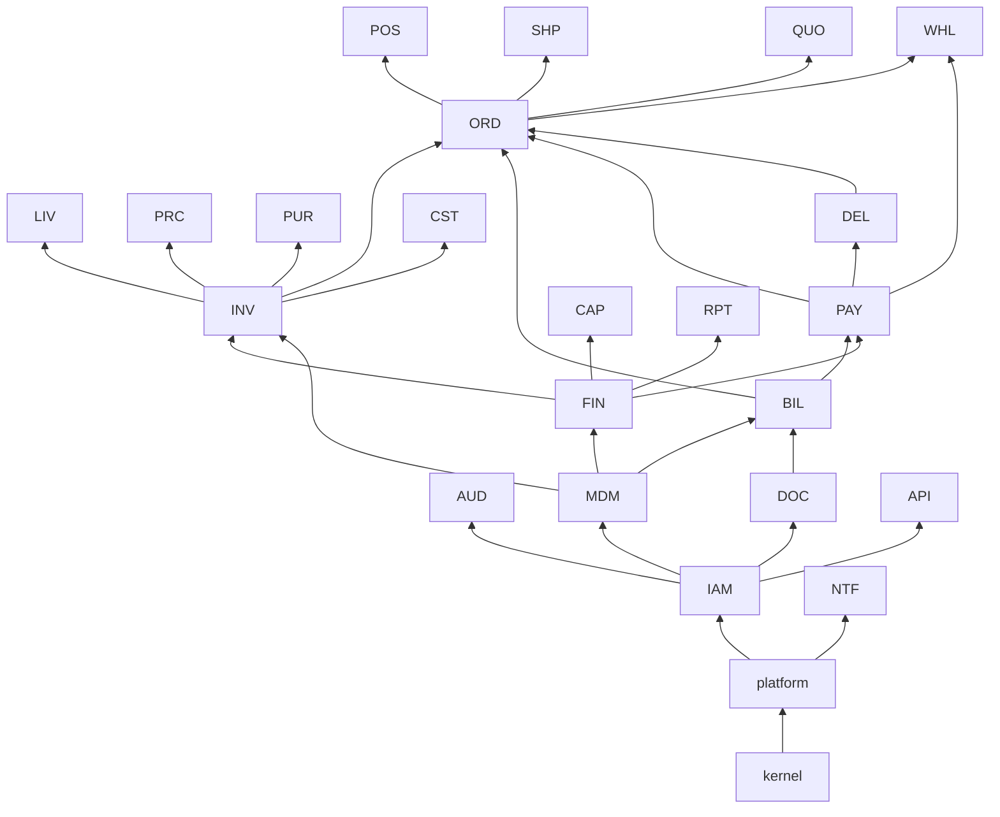

# HaKorem Farms Platform: Module Boundaries

What each of the twenty-two modules owns, its public interface, what it may import, and the rule that enforces it. If code and this document disagree, the code is wrong.

Decisions behind this document: ADR-0008 (structure and lint), ADR-0009 (platform versus modules), ADR-0010 (commands down, events up), ADR-0011 (cross-module keys).

## 1. The rules

1. **One owner.** Every table, aggregate and business rule belongs to exactly one module. A module's code reads and writes only its own PostgreSQL schema.
2. **One door.** Other modules import a module only through its `index.ts`. Everything else in the module folder is private.
3. **Downward only.** A module may import the `index.ts` of modules in a lower layer of the table in section 2. Never the same layer, never a higher one.
4. **Events are public language.** Any module may import any module's `events.ts`, as types only, to subscribe to its events.
5. **Commands down, events up.** A module calls down to get something done as part of its own operation. It learns what happened below or beside it by subscribing (ADR-0010).
6. **Ports invert the few upward needs.** Where a lower module needs an answer only a higher module has, the lower module defines a port in its `index.ts` and the higher module registers an implementation. Section 6 lists every port.
7. **No cross-schema SQL.** Application queries never join across schemas. Cross-schema foreign keys exist only to the published keys in section 5.
8. **Inside a module**, `domain/` depends on nothing but the kernel; `application/` on `domain/`; `infrastructure/` and `interface/` on both.

## 2. Layers

| Layer | Members | Built in |
| --- | --- | --- |
| 0 | `kernel` | B2 |
| 1 | `platform` | B2, B3 |
| 2 | IAM | B3 |
| 3 | AUD, MDM, DOC | B3 (AUD administration), B4 (MDM), B8 (DOC), B13 (AUD retention and data requests) |
| 4 | FIN | B8 |
| 5 | INV | B5 |
| 6 | LIV, PRC, BIL | B6, B6, B8 |
| 7 | PAY, PUR | B9a, B7 |
| 8 | DEL | B11 |
| 9 | ORD | B9a (core), B11 (fulfilment) |
| 10 | POS, SHP, QUO, WHL | B9b, B7 and B9a, B10, B10 |
| 11 | CAP, CST, RPT, NTF, API | B12, B12, B12, B11, B12 |

A layer is permission to import, not build order. FIN is in layer 4 so that higher modules can read the ledger, but it is built in B8 and receives postings by subscribing to events, so modules built earlier never import it (ADR-0003).

The arrows show the principal runtime imports, pointing from the imported module to the importer. Every module also imports `kernel`, `platform` and IAM; those arrows are omitted above layer 3 for legibility. Event subscriptions are not shown; they are listed per module in section 3.

## 3. The modules

Each card gives: what the module owns, its public interface (the services exported from `index.ts`), what it may import, the events it subscribes to (**T** in the caller's transaction, **A** asynchronously through the outbox), and where its events are listed. Events published by each module are listed in `docs/DOMAIN_MODEL.md` section 5.

### kernel (layer 0)

- **Owns:** `Money`, `Weight`, `Quantity`, `Percentage`, `allocate`, `Id` (UUIDv7), `Clock`, `BusinessDate`, `Result`, `DateRange`, `PhoneNumber`.
- **Imports:** nothing.

### platform (layer 1)

- **Owns:** schema `platform`. Unit of work, actor context, audit trail, domain event bus and outbox, idempotency store, numbering, business document registry, settings store, file store, ports and adapters (payment provider, notification channel, PDF renderer, queue), observability and health.
- **Public interface:** `UnitOfWork`, `ActorContext`, `AuditTrail`, `DomainEvents`, `Idempotency`, `Numbering`, `DocumentRegistry`, `Settings`, `FileStore`, `PaymentProviderPort`, `NotificationChannelPort`, `PdfRendererPort`, `Jobs`, `Health`.
- **Imports:** kernel only. Never a module.

### IAM: identity, access and roles (layer 2)

- **Owns:** schema `iam`. Principals, user accounts, credentials, TOTP, sessions, refresh tokens, API credentials, roles, permissions, grants, approval policies and requests.
- **Public interface:** `Authoriser` (the policy check every handler calls), `Approvals` (request, decide, register a handler for a kind), `Identity` (principal lookup, display names), `Authentication` (guards that set the actor context), `ApiCredentials`.
- **Imports:** platform.
- **Subscribes:** nothing.

### AUD: audit, compliance and administration (layer 3)

- **Owns:** schema `aud`. Retention policies, data-subject requests. Audited administration of settings, feature flags, number series and the business profile.
- **Public interface:** `AuditLog` (authorised query of the platform audit trail), `Administration`, `DataSubjectRequests`, `Retention`.
- **Imports:** platform, IAM.
- **Subscribes:** nothing.

### MDM: master data, pricing and tax (layer 3)

- **Owns:** schema `mdm`. Products, categories, units, species, grades, weight bands, customers, suppliers, branches, locations, price lists, promotions and coupons, tax levies and scheme versions, payment methods, delivery zones, reason codes, import jobs.
- **Public interface:** `Catalogue`, `Parties`, `Locations`, `PricingEngine`, `Promotions`, `TaxCalculator`, `ReferenceData`, `Imports`. Port: `ProductUsageCheck`.
- **Imports:** platform, IAM.
- **Subscribes:** nothing.

### DOC: documents and media (layer 3)

- **Owns:** schema `doc`. Document templates and versions, the immutable archive of rendered documents, render jobs.
- **Public interface:** `Documents` (render, archive, fetch, reprint), `Templates`.
- **Imports:** platform, IAM.
- **Subscribes:** nothing. Product photographs and supplier and investor files use the platform file store directly; DOC is not involved.

### FIN: general ledger and accounting (layer 4)

- **Owns:** schema `fin`. Chart of accounts, bank accounts, subledger parties, periods, journal entries and lines, posting event types, posting rules, account determination, manual journals, fixed assets, depreciation, period balances.
- **Public interface:** `Ledger` (balances, profit for a period, account activity), `Periods` (status, lock, close), `FinancialStatements` (trial balance, profit and loss, balance sheet, cash flow), `ManualJournals`, `FixedAssets`.
- **Imports:** platform, IAM, MDM.
- **Subscribes (T):** every event marked ◆ in `docs/DOMAIN_MODEL.md`, from INV, PRC, PUR, BIL, PAY, POS, DEL, WHL and CAP. No module calls FIN to post.

### INV: inventory and stock control (layer 5)

- **Owns:** schema `inv`. Movement types, stock units, lineage, movements, balances, cost pools, reservations, holds, exceptions, goods receipts, transfers, adjustments, stock takes, reorder rules, temperature readings, balance snapshots.
- **Public interface:** `Stock` (post movements for a document), `StockUnits`, `Reservations`, `Holds`, `Availability`, `Valuation` (capitalise cost, read pool value), `Lineage`, `GoodsReceipts`, `Transfers`, `Adjustments`, `StockTakes`. Implements MDM's `ProductUsageCheck`. Published views: `inv.pub_stock_on_hand`, `inv.pub_stock_value`, `inv.pub_movement`.
- **Imports:** platform, IAM, MDM.
- **Subscribes:** nothing.

### LIV: livestock management (layer 6)

- **Owns:** schema `liv`. Animals, batches, weight records, health events, breeding records, mortality records, rations, feed consumption and its allocation.
- **Public interface:** `Animals`, `Batches`, `Health`, `Breeding`, `Mortality`, `Feeding`.
- **Imports:** platform, IAM, MDM, INV.
- **Subscribes (T):** `inv.StockIssuedForSale`, `inv.StockConsumedInProcessing`, `inv.StockWrittenOff`, `inv.SaleReturnReceived`, to keep an animal's status in step with its stock unit.

### PRC: processing and production (layer 6)

- **Owns:** schema `prc`. Processing orders with inputs, outputs and direct costs, packs and labels, yield standards.
- **Public interface:** `Processing`, `Packs`.
- **Imports:** platform, IAM, MDM, INV. Not LIV: it consumes stock units through inventory.
- **Subscribes:** nothing.

### BIL: invoicing, receipts and credit notes (layer 6)

- **Owns:** schema `bil`. Billing documents, lines, levy rows, reprint log, and a read-only settlement summary per document.
- **Public interface:** `Billing` (issue, credit, debit, fetch, reprint). Published view: `bil.pub_document`.
- **Imports:** platform, IAM, MDM, DOC.
- **Subscribes (A):** `pay.PaymentCleared`, `pay.DepositAllocated`, `pay.PaymentReversed`, `pay.RefundPaid`, to keep the settlement summary on its documents (`bil.document_settlement`). The figure of record stays in PAY.

### PAY: payments and reconciliation (layer 7)

- **Owns:** schema `pay`. Payments, allocations, provider transactions, webhook events, refunds, store credit, settlement reports, bank statements, reconciliation breaks, invoice settlement projection.
- **Public interface:** `Payments` (initiate, record, allocate, reverse), `Refunds`, `StoreCredit`, `Settlement` (what is outstanding on a document), `Reconciliation`. Published view: `pay.pub_open_item`.
- **Imports:** platform, IAM, MDM, FIN (read only, for reconciliation against the ledger), BIL.
- **Subscribes (T):** `bil.CreditNoteIssued`, `bil.DebitNoteIssued`, to keep settlement exact.

### PUR: procurement and suppliers (layer 7)

- **Owns:** schema `pur`. Supplier profiles, requisitions, purchase orders, supplier invoices and credit notes with levy rows, match results, supplier payments and allocations, supplier scores.
- **Public interface:** `Suppliers`, `Purchasing`, `SupplierInvoices`, `SupplierPayments`.
- **Imports:** platform, IAM, MDM, INV.
- **Subscribes (A):** `inv.GoodsReceived`, for supplier performance scores.

### DEL: delivery and logistics (layer 8)

- **Owns:** schema `del`. Delivery slots, deliveries, attempts, proof of delivery, routes, driver cash reconciliations.
- **Public interface:** `Slots`, `Deliveries` (schedule from a snapshot the caller supplies, assign, dispatch, complete, fail), `DriverCash`.
- **Imports:** platform, IAM, MDM, PAY.
- **Subscribes:** nothing. It does not know orders; the caller passes the address, contents summary and amount due.

### ORD: order management and fulfilment (layer 9)

- **Owns:** schema `ord`. Sales orders, lines, adjustments, status history, fulfilments, returns.
- **Public interface:** `Orders` (place, confirm, complete a counter sale, create from a quote, cancel, void), `Fulfilments`, `Returns`. Port: `OrderConfirmationPolicy`.
- **Imports:** platform, IAM, MDM, INV, BIL, PAY, DEL.
- **Subscribes (T):** `pay.PaymentCleared` and `pay.PaymentFailed` (confirm or cancel an online order), `del.DeliveryCompleted`, `del.DeliveryFailed`, `del.DeliveryReturned` (advance the order and move stock).
- **Subscribes (A):** `inv.ReservationExpired`.

### POS: retail point of sale (layer 10)

- **Owns:** schema `pos`. Registers, device enrolments, shifts, cash movements, tender counts, held sales, the sale sync log, shift reports.
- **Public interface:** none used by other modules. HTTP and sync endpoints only.
- **Imports:** platform, IAM, MDM, INV (availability), PAY, ORD.
- **Subscribes (T):** `pay.PaymentCleared`, to add a tender to the shift's expected totals.

### SHP: online store (layer 10)

- **Owns:** schema `shp`. Carts, cart lines, checkout sessions, product listing read model, abandoned-cart notices.
- **Public interface:** none used by other modules.
- **Imports:** platform, IAM, MDM, INV, PAY, DEL (slots), ORD.
- **Subscribes (A):** `mdm.ProductChanged`, `mdm.PriceListVersionActivated`, `inv.StockMovementPosted` (listing read model); `inv.ReservationExpired` (expire a checkout).

### QUO: quotations and requests for quote (layer 10)

- **Owns:** schema `quo`. Requests for quote, quotes, versions, lines, acceptances.
- **Public interface:** none used by other modules.
- **Imports:** platform, IAM, MDM, DOC, INV (reserve an animal), ORD (convert).
- **Subscribes (A):** `ord.OrderCompleted`, `ord.OrderCancelled`, for pipeline status.

### WHL: wholesale and business accounts (layer 10)

- **Owns:** schema `whl`. Business accounts, credit overrides, standing orders, statements, dunning policies and notices, ageing snapshots.
- **Public interface:** none used by other modules. Implements ORD's `OrderConfirmationPolicy` (credit limit and account hold).
- **Imports:** platform, IAM, MDM, DOC, BIL, PAY, ORD.
- **Subscribes (A):** `bil.InvoiceIssued`, `pay.PaymentCleared`, `pay.DepositAllocated`, `bil.CreditNoteIssued`, to maintain credit exposure and ageing.

### CAP: capital, investors and profit sharing (layer 11)

- **Owns:** schema `cap`. Investors and documents, capital transactions and units, unit holdings, distribution runs, lines and payments, financing, schedules and repayments.
- **Public interface:** none used by other modules.
- **Imports:** platform, IAM, DOC, FIN.
- **Subscribes:** nothing.

### CST: costing and profitability (layer 11)

- **Owns:** schema `cst`. Overhead allocation runs, cost object summaries, margin and loss facts.
- **Public interface:** none used by other modules.
- **Imports:** platform, IAM, MDM, FIN (read), INV (to post value-only movements).
- **Reads:** published views of INV, BIL and PAY.
- **Subscribes (A):** `inv.StockMovementPosted`, `bil.InvoiceIssued`, `bil.CreditNoteIssued`, `prc.ProcessingOrderCompleted`.

### RPT: reporting and dashboards (layer 11)

- **Owns:** schema `rpt`. Report definitions, schedules, runs, fact tables, exception items, projection checkpoints.
- **Public interface:** none used by other modules.
- **Imports:** platform, IAM, FIN (financial statements).
- **Reads:** every module's published views.
- **Subscribes (A):** events from every module, to maintain facts and the daily exception report.

### NTF: notifications (layer 11)

- **Owns:** schema `ntf`. Templates, preferences, opt-outs, messages, attempts, in-app notifications.
- **Public interface:** none used by other modules. Nothing calls NTF.
- **Imports:** platform (notification channel port), IAM.
- **Subscribes (A):** `bil.InvoiceIssued`, `bil.DocumentReprinted`, `quo.QuoteIssued`, `ord.*` status events, `del.*` delivery events, `pay.PaymentCleared`, `pay.RefundPaid`, `whl.DunningNoticeDue`, `whl.StatementIssued`, `inv.LowStockDetected`, `inv.LotExpiring`, `inv.StockExceptionRaised`, `shp.CartAbandoned`, `iam.ApprovalRequested`.

### API: integrations (layer 11)

- **Owns:** schema `api`. Integrations, webhook endpoints, webhook deliveries, accounting exports.
- **Public interface:** none used by other modules.
- **Imports:** platform, IAM, FIN (accounting export).
- **Subscribes (A):** every event an endpoint has registered for.

## 4. Who owns what when two modules could

| Thing | Owner | Why |
| --- | --- | --- |
| Pricing engine and promotions | MDM | The engine must sit below every selling channel; promotion definitions cannot live in SHP or pricing would import a channel |
| Tax configuration and calculator | MDM | Quotes, carts, orders, billing and purchasing all calculate tax |
| Tax amounts on a legal document | BIL (sales), PUR (purchases) | Only they persist levy rows |
| Maker-checker approvals | IAM | One mechanism, one database constraint (ADR-0017) |
| Stock reservations and holds | INV | The movement trigger enforces them (ADR-0019) |
| Value of stock and cost accumulation | INV | One source for the ledger; CST only analyses (ADR-0018) |
| Goods receipt | INV | It is a stock document; PUR requests it against an order line |
| Supplier identity; supplier terms and payout details | MDM; PUR | Identity is shared reference data, commercial terms are procurement's |
| Customer identity; credit terms | MDM; WHL | As above |
| Customer's assigned price list | MDM | The engine reads it; WHL sets it through MDM |
| The record of a sale on any channel | ORD | "A single order record across every channel" |
| Posting a sale | ORD | One code path for counter, online, wholesale and quote |
| Counter cash, shifts, offline sync | POS | Channel-specific |
| Outgoing supplier payments | PUR | Built in B7, before PAY; bank reconciliation in PAY works from the ledger |
| Account codes | FIN | No other module holds one |
| Audit trail tables | platform | So IAM can write audit rows without a cycle (ADR-0009) |
| File storage, signed URLs, image variants | platform | Needed from B4, before DOC exists |
| Sending a message | NTF, by subscription | Except IAM's security codes, sent through the platform port |

## 5. Published keys: the cross-schema foreign key allow-list

A foreign key may cross schemas only if it points at one of these primary keys, from a higher layer to a lower one, with `ON DELETE RESTRICT` (ADR-0011). The CI check in section 7 fails on anything else.

| Schema | Tables whose primary key is published |
| --- | --- |
| `platform` | `business_document`, `document_type`, `stored_file`, `number_series` |
| `iam` | `principal`, `approval_request` |
| `mdm` | `branch`, `location`, `category`, `product`, `uom`, `species`, `grade`, `weight_band`, `customer`, `customer_address`, `customer_tier`, `supplier`, `price_list`, `price_list_entry`, `promotion`, `coupon`, `tax_levy`, `tax_category`, `tax_scheme_version`, `payment_method`, `delivery_zone`, `reason_code` |
| `doc` | `archived_document`, `template_version` |
| `fin` | `bank_account`, `accounting_period` |
| `inv` | `stock_unit`, `stock_movement`, `stock_reservation`, `stock_hold`, `stock_exception`, `goods_receipt`, `goods_receipt_line` |
| `bil` | `billing_document`, `billing_document_line` |
| `pay` | `payment`, `refund` |
| `del` | `delivery`, `delivery_slot` |
| `ord` | `sales_order`, `sales_order_line` |

Three keys are universal and may be referenced from any schema, including a lower layer: `iam.principal`, `mdm.branch` and `mdm.location`. Who did something and where appear on almost every row, including platform tables. They are constraints only and permit no code import. B3 creates all three tables.

Any other reference upward, from a lower layer to a document in a higher one, uses `source_document_id` to `platform.business_document`.

## 6. Ports: the complete list of inverted dependencies

| Port | Defined by | Implemented by | Purpose |
| --- | --- | --- | --- |
| `ProductUsageCheck` | MDM | INV | MDM asks whether a product has stock history before allowing its stock-keeping policy to change |
| `OrderConfirmationPolicy` | ORD | WHL | ORD asks registered policies whether an order may be confirmed; WHL answers for credit limit and account hold |
| Approval handlers | IAM | Every module with an approval kind | IAM calls the owning module's handler when a request is approved, in the same transaction |
| Health contributors | platform | Any module | A module reports its own health item, such as last successful reconciliation |

Adding a port needs an ADR. Ports are the exception, not a way round the layer rule.

## 7. The lint rule and the data checks

### Code: `eslint-plugin-boundaries`

Delivered in B2. The specification:

**Element types**

| Type | Pattern |
| --- | --- |
| `kernel` | `packages/kernel/**` |
| `platform` | `src/platform/**` |
| `module-public` | `src/modules/*/index.ts` |
| `module-events` | `src/modules/*/events.ts` |
| `module-domain` | `src/modules/*/domain/**` |
| `module-application` | `src/modules/*/application/**` |
| `module-infrastructure` | `src/modules/*/infrastructure/**` |
| `module-interface` | `src/modules/*/interface/**` |

**Rules, default deny**

| From | May import |
| --- | --- |
| `kernel` | Nothing |
| `platform` | `kernel` |
| `module-domain` | `kernel`; its own `domain/` |
| `module-application` | `kernel`; `platform`; its own `domain/` and `application/`; `module-public` of modules in lower layers; `module-events` of any module, type-only |
| `module-infrastructure` | As `module-application`, plus its own `infrastructure/` |
| `module-interface` | As `module-application`, plus its own `interface/` |
| `module-public`, `module-events` | Its own module's files, for re-export; `kernel` |

The layer of each module is a constant in the lint configuration, copied from section 2. "Lower layer" is computed from it, so adding a module means adding one line.

Additional restrictions:

- `module-domain` may not import `@nestjs/*`, `drizzle-orm` or any other framework package.
- Imports of `events.ts` from another module must be `import type`.
- Any import path that resolves outside `backend/` is an error.
- `import/no-cycle` is an error.

The rule runs in `pnpm lint`. CI runs `pnpm lint` on every pull request and a failure blocks the merge. A fixture containing one illegal import of each kind is checked in B2 to prove the rule fires.

### Data: two CI checks

1. **Foreign keys.** A query over `pg_constraint` and `pg_namespace` lists every foreign key whose referencing and referenced tables are in different schemas. Each must match the allow-list in section 5 and point from a higher layer to a lower one. Anything else fails the build.
2. **Schema names in code.** A scan of each module's `infrastructure/` folder and migrations fails if it names a schema other than its own, the published `pub_` views it is allowed to read (CST and RPT only), or a published key in a foreign key clause.

### Review

The `hakorem-module` skill, generated in B1, carries these rules as its checklist with a correct and an incorrect example.

## 8. Cycles that were designed out

| Would-be cycle | How it is broken |
| --- | --- |
| IAM and the audit trail | The audit trail is platform; AUD sits above IAM (ADR-0009) |
| FIN and every module that posts | Modules publish events; FIN subscribes. Modules that read the ledger are above it |
| MDM and INV (policy change needs stock history) | `ProductUsageCheck` port |
| Pricing and the selling channels | Promotions live in MDM; a quoted price is passed in by the caller, the engine never imports QUO |
| INV and LIV | Shared stock unit identity; LIV calls INV for holds and subscribes to INV's events |
| PRC and LIV | PRC consumes stock units through INV; LIV reacts to INV's events |
| BIL and PAY (paid status) | PAY imports BIL; "paid" is PAY's projection; invoices stay immutable |
| ORD and WHL (credit check) | `OrderConfirmationPolicy` port |
| ORD and DEL | ORD imports DEL and passes a snapshot; ORD subscribes to DEL's events |
| ORD and QUO | QUO imports ORD to convert; ORD refers to the quote through the document registry |
| NTF and everything | NTF only subscribes; events carry recipient and rendering data |
