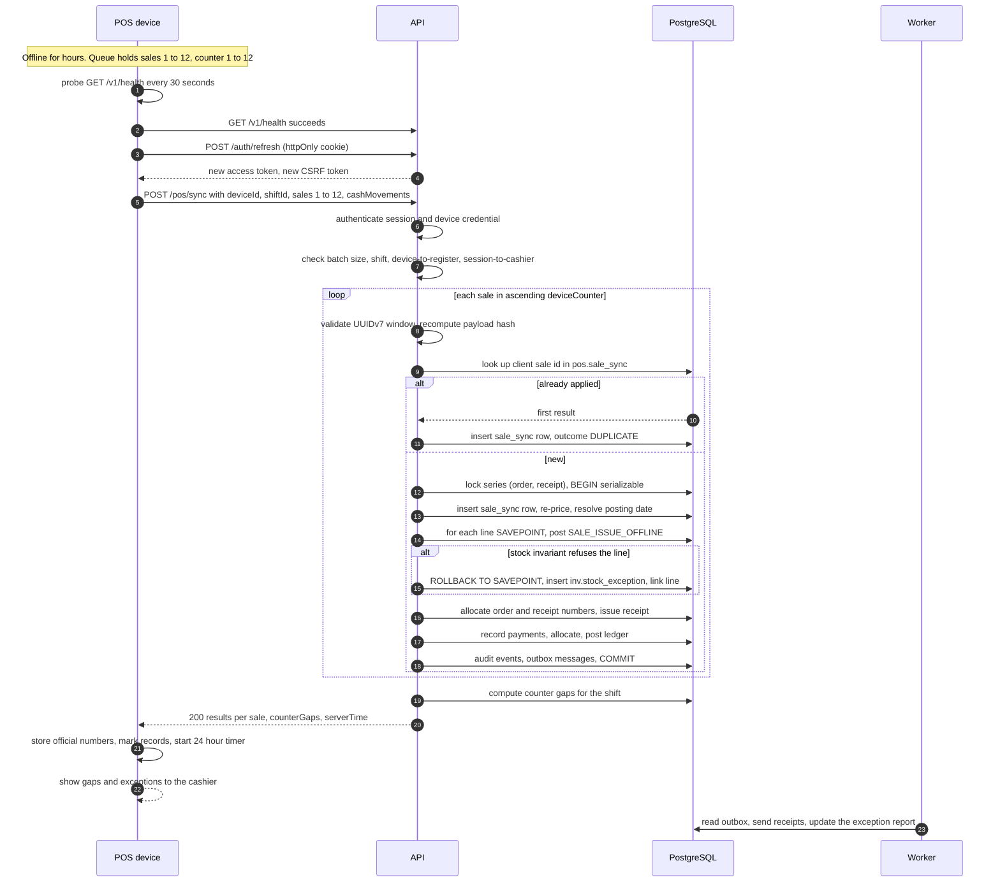

# HaKorem Farms Platform: Offline Data Model and Sync Rules

The counter keeps working when the network does not. This document is the specification for everything that happens on a point-of-sale tablet or a driver's phone while it has no connection, and for everything the server does when the queued records arrive. It was written before any offline code, as the shared brief requires. Where this document and the code disagree, the code is wrong.

Decisions it rests on: ADR-0027 (offline sync principles), ADR-0013 (UUIDv7 identifiers), ADR-0015 (gap-free numbers and provisional references), ADR-0014 (idempotency), ADR-0016 (device credential and offline unlock). The operations are in `contract/openapi.yaml` (1.0.0): `getOfflinePack`, `openShift`, `completeCounterSale`, `syncOfflineSales`, `recordCashMovement`, `syncDriverEvents`, `recordProofOfDelivery`, `recordFailedDelivery`. The tables are in `docs/data-model/pos.md`, `ord.md`, `inv.md`, `pay.md`, `del.md` and `rpt.md`.

All money in this document is in integer pesewas (GHS 1.00 = 100). All times are UTC; Africa/Accra is UTC+0 all year, so the clock on the wall at the farm and the UTC time are the same. Identifiers in the worked examples are abbreviated.

## 1. The rules in one page

These are the ten principles of ADR-0027, with the section that implements each.

| # | Principle | Implemented in |
| --- | --- | --- |
| 1 | The server is authoritative. The device holds a queue of things that happened, plus a cache with an age | 3, 8 |
| 2 | A synced sale is always recorded: order, receipt and payment post for every sale that passes authentication and integrity checks | 8, 9 |
| 3 | A stock conflict becomes an exception, not a failure: the line posts with no movement and an `inv.stock_exception` row | 9.1, 9.2 |
| 4 | Countable stock may go negative on sync; a serialised animal never moves twice | 9.3, 9.1 |
| 5 | Sync is exactly once by identity: the client UUIDv7 of the sale | 4, 9.7 |
| 6 | Business time (`occurred_at`) and record time (`recorded_at`) are both kept; a sale in a locked period or after a forced close posts on the first open date, flagged | 9.4 |
| 7 | Official numbers come only from the server; the device counter is checked for gaps | 4, 9.5 |
| 8 | Offline tenders are cash only unless a setting allows a manager-approved unverified mobile money tender; those go to the unmatched payment queue | 5, 9.9 |
| 9 | Price overrides offline are bounded by the cached role limit and re-checked at sync; an excess is posted and raised for approval after the fact | 9.6 |
| 10 | Nothing is resolved silently: every exception reaches the daily exception report with the cashier, register, shift and the two conflicting facts | 9, 12 |

Two consequences are worth stating plainly, because they are what an auditor and a cashier will both ask about:

- **A real sale is never lost.** If the animal has already gone, if the stock is negative, if the period is locked, the money and the receipt are still recorded. The cost of that is an exception that a person must resolve.
- **A sale can disappear only by leaving a hole.** The device counter is gap-free per shift. A cashier who deletes a queued sale leaves a missing number, and the server reports it.

## 2. What is possible offline

| Action | Offline? | Why |
| --- | --- | --- |
| Open a shift with an opening float | Yes | `openShift` carries a client-generated id |
| Sell from the cached catalogue and prices; weigh; split between cash tenders; print a provisional receipt | Yes | The offline pack |
| Record a cash drop, pay-out or pay-in | Yes | `recordCashMovement` carries a client id |
| Hold and recall a sale | Yes, locally only | A held sale offline lives in the device's own store. It is not visible on other devices |
| Take mobile money, card, store credit, cheque or an account (credit) sale | No by default. Unverified mobile money only if the setting in section 5 allows it | A payment is recorded only from a verified provider callback or lookup (threat model abuse case 4) |
| Void a sale, return, exchange or refund | No | Each needs approval by a second person, which needs the server |
| Apply a price override beyond the cached role limit | No | The device refuses it. Within the limit it is recorded and re-checked at sync |
| Close the shift | No | The blind count and its sign-off are online actions. The device refuses to start a close while its queue is not empty |
| Enrol or revoke a device, change prices, change settings | No | Administration is online only |

## 3. What the device stores

The console is a PWA. Offline data lives in IndexedDB, in these stores. Nothing else is cached for offline use, and the service worker caches only the application shell (security architecture, section 9).

| Store | Contents | Written when | Removed when |
| --- | --- | --- | --- |
| `device` | Device id, register id, device label, the device credential (shown once at enrolment), the server time offset | At enrolment | The device is revoked or reset |
| `pack` | The offline pack as downloaded by `getOfflinePack`: register, `generatedAt`, `validUntil`, price list version ids, tax scheme version id, tax cells, products with price bands and barcodes, sellable stock units, payment methods, reason codes, and the policy (`maxOfflineHours`, `maxQueuedSales`, `offlineTenderMethodIds`, price override limits) | Each download, replaced as a whole in one transaction | Replaced by the next pack |
| `shift` | The open shift: id, shift sequence, cashier, opening float, opened at, the last device counter issued | At shift open | After the server confirms the close |
| `queue` | Every sale, cash movement and shift-open record not yet confirmed by the server (section 6) | At the moment the sale completes, in the same transaction as the counter increment | 24 hours after the server confirmed it, so a reprint is possible |
| `receipts` | The rendered content of each provisional receipt, for reprint | With the queue record | With the queue record |
| `local_auth` | A salted, slow hash of the cashier's PIN and of each supervisor's PIN who has logged in on this device online, created at online login | At online login on this device | At shift close, or at logout |
| `sync_log` | Each sync attempt: time, batch size, HTTP status, per-sale outcome | Each attempt | After 7 days |

**Never stored on the device:** cost prices (the pack carries selling price bands only), customer records beyond the phone number typed for a receipt, passwords, the refresh token (it is an httpOnly cookie the script cannot read), other cashiers' data, and any ledger or audit data.

**Device credential.** The credential is a high-entropy string shown once at enrolment (`enrolDevice`) and stored hashed on the server (`pos.device_enrolment.credential_hash`). It is sent as `X-Device-Credential` together with the cashier's session. A browser has no hardware-backed store, so the controls around it are: it is revocable by a manager at any moment (`revokeDevice`), a revoked device is refused at the next sync with `DEVICE_REVOKED`, it authorises nothing on its own (a staff session is always also required), and the device locks with the cashier's PIN.

**Offline unlock.** When the session has expired and the network is absent, the cashier unlocks the device with the PIN. The PIN is checked against the verifier in `local_auth`, which was created when the cashier logged in online on this device. The PIN never leaves the device. It unlocks the open shift and the pack; it does not create a session. A supervisor approval offline (section 5) is the same check against that supervisor's verifier.

## 4. Identifiers, counters, references and the payload hash

### 4.1 UUIDv7 identity

Every record created offline carries a client-generated UUIDv7 (ADR-0013): the sale (which becomes the order id), the shift when it is opened offline, each cash movement, each proof of delivery and each delivery failure. That id is the record's idempotency identity: a second submission with the same id returns the first result. For the single-record endpoints (`completeCounterSale`, `openShift`, `recordCashMovement`, `recordProofOfDelivery`, `recordFailedDelivery`) the `Idempotency-Key` header carries the same value as the record id. The `sale_sync` unique index on the client sale id does not expire; the 72-hour retention of `platform.idempotency_key` rows does not limit it.

The server validates every client id:

1. It parses as a UUID of version 7.
2. Its embedded timestamp is not later than the server's receive time plus the clock tolerance (`sync.clock_tolerance_seconds`, default 300).
3. Its embedded timestamp is not earlier than the shift's `opened_at` minus the clock tolerance.

The embedded timestamp is never business time. `occurredAt` is.

### 4.2 The device counter

- Each shift on a device has a counter that starts at 1 and increases by 1 for every completed sale.
- The counter is incremented in the same IndexedDB transaction that writes the sale to `queue` and the receipt to `receipts`. A sale that fails to save does not consume a value. A value is never reused and never decremented.
- A sale consumes a counter when the sale is completed (tender accepted, receipt printed). A sale abandoned before completion, or a held sale, consumes none.
- One device runs one shift. To move a shift to another device the shift is closed (online) or force-closed by a manager, and a new shift is opened. This keeps the counter unambiguous: the server keeps `UNIQUE (shift_id, device_counter)` among applied sales.
- The server stores the highest counter synced on the shift (`pos.shift.last_device_counter`) and, for each sync, the list of missing values below that highest value. The sync response returns them as `counterGaps`.

### 4.3 The provisional reference

The receipt printed offline carries `P-<REGISTER>-<SHIFT SEQ>-<COUNTER>`:

- `REGISTER` is the register code (`pos.register.code`, one to four characters, for example `T2`).
- `SHIFT SEQ` is `pos.shift.shift_seq`, the shift's number on that register, without padding.
- `COUNTER` is the device counter, zero-padded to four digits.

Example: `P-T2-311-0042`. The receipt layout states that the official receipt number follows, and prints the sale's UUIDv7 as a QR code. The provisional reference is stored in the billing document beside the official number, and either one finds the sale. It is never used as a document number in the ledger.

### 4.4 The payload hash

The device computes `payloadHash` when the sale completes, and stores it with the sale.

- **Input:** the sale object exactly as it will be sent (`id`, `deviceCounter`, `provisionalRef`, `occurredAt`, `customerPhone` if any, `lines`, `tenders`), without the `payloadHash` field itself.
- **Canonical form:** JSON Canonicalization Scheme (RFC 8785): keys sorted, no insignificant whitespace, numbers as in JSON (all money is already an integer, all weights and quantities are strings).
- **Hash:** SHA-256 of the UTF-8 bytes, written as 64 lowercase hex characters.

The server recomputes the hash from the received sale and compares. Equal: the sale is as it was when the receipt was printed. Different: `REJECTED_INTEGRITY` (section 9.8). The hash is also stored in `pos.sale_sync.payload_hash`, so the same id arriving later with different content is detected against the first.

What the hash does and does not prove: it shows that the queued record was not changed after the receipt was printed, by a fault or by a casual edit of the browser's store. It does not authenticate the device, because anyone holding the page's code can recompute it. The controls that catch a determined actor are the ones that do not depend on the device being honest: the server re-prices every sale, the counter reveals removed sales, the customer's printed receipt carries the sale id and total, and the cash count at close is blind.

## 5. The offline session

### 5.1 Before going offline: the pack

`GET /registers/{id}/offline-pack` is called when a shift opens and whenever the device is online and the pack is older than one hour. It returns a cache with an age. The server logs each issue (device, time, versions) in the audit log, so it can tell which price list versions and tax scheme version the device was working from.

- `generatedAt` and `validUntil` bound the cache. The device refuses new offline sales after `validUntil`, and after more than `policy.maxOfflineHours` (default 8) since it last reached the server.
- `policy.maxQueuedSales` (default 500) is the most sales the device will hold. At the limit the device refuses further sales and tells the cashier to restore the connection. The server accepts 500 per batch; larger queues are sent in several batches.
- `policy.offlineTenderMethodIds` lists the payment methods the device may offer offline. The default is cash only.
- `policy.priceOverrideLimitPerLinePesewas` and `priceOverrideLimitPerShiftPesewas` are the cashier's role limits, read from the approval policy for `PRICE_OVERRIDE`.
- Products carry `priceBand` (list, floor, ceiling) and the sale unit; stock units list the animals and lots that were sellable at the register's location when the pack was generated. Stock quantities of countable products are not authoritative: the device does not stop a sale of countable stock because its cached quantity reached zero, but it warns.

### 5.2 Settings

These keys are in `platform.setting` (editable without a deployment, audited, effective-dated). They are defined here; B9b adds them to the seed.

| Key | Type | Default | Meaning |
| --- | --- | --- | --- |
| `pos.offline.max_hours` | INTEGER | 8 | Becomes `policy.maxOfflineHours` |
| `pos.offline.max_queued_sales` | INTEGER | 500 | Becomes `policy.maxQueuedSales` |
| `pos.offline.allow_unverified_mobile_money` | BOOLEAN | false | A branch-level switch. `policy.offlineTenderMethodIds` is every enabled payment method with `mdm.payment_method.allowed_offline` true (cash only in the seed) plus, when this setting is true for the branch, the mobile money method, with the manager approval in 5.3. Setting the method's `allowed_offline` flag alone does not allow an unverified tender: both must be on |
| `sync.clock_tolerance_seconds` | INTEGER | 300 | Tolerance for client timestamps against server time (4.1) |
| `pay.unverified_window_days` | INTEGER | 3 | Days an unverified mobile money payment may stay unmatched before it is raised as urgent (9.9) |

### 5.3 Unverified mobile money, when the setting allows it

With the setting off, the device never offers mobile money offline. With it on:

1. The cashier chooses mobile money. The device asks for the customer's phone number and the mobile money transaction reference shown in the customer's confirmation message.
2. A supervisor (manager or shop supervisor holding the approval permission for the branch) enters their PIN on the device. The device checks it against their verifier in `local_auth` (3). A supervisor who has not logged in on this device online cannot approve.
3. The receipt prints with the line "Mobile money, not yet verified" and the reference.
4. At sync the payment is recorded with `verification = UNVERIFIED` and enters the unmatched payment queue as a reconciliation break of kind `UNVERIFIED_PAYMENT` (9.9).

The cashier's word is never enough on its own, and the payment does not count as verified until a settlement report line or bank statement line matches it.

## 6. The queue

### 6.1 Shape

Each queue entry is one JSON document with the API payload and local bookkeeping:

```json
{
  "kind": "SALE",
  "localStatus": "QUEUED",
  "attempts": 0,
  "createdLocalAt": "2026-11-13T09:40:12Z",
  "lastAttemptAt": null,
  "serverResult": null,
  "payload": {
    "id": "019a7b3e-4c10-7a2b-9d41-6c0f2e8b17aa",
    "deviceCounter": 5,
    "provisionalRef": "P-T2-311-0005",
    "occurredAt": "2026-11-13T09:40:12Z",
    "lines": [
      {
        "productId": "019a7a8e-a5a0-754c-8a85-5d9ed05dd67c",
        "stockUnitId": "019a7a9c-0b3e-7d54-a1f8-2c7a4e9d6b10",
        "quantity": "1.000",
        "weightKg": "38.400",
        "weightSource": "SCALE",
        "agreedUnitPricePesewas": 125000,
        "varianceReasonCode": "REGULAR_CUSTOMER"
      }
    ],
    "tenders": [
      {
        "paymentMethodId": "019a7a91-e8d5-704a-b582-0d78a6088656",
        "amountPesewas": 125000,
        "tenderedPesewas": 130000
      }
    ],
    "payloadHash": "9f1c2a7e4b0d83f65c2e1a9d7b3f0c4e8a6d2b1f5e9c7a3d0b4f8e2c6a1d5b9f"
  }
}
```

`kind` is `SHIFT_OPEN`, `SALE` or `CASH_MOVEMENT`. `localStatus` is one of:

| Status | Meaning |
| --- | --- |
| `QUEUED` | Not yet sent |
| `SENDING` | In a request that has not returned. After a crash or timeout it reverts to `QUEUED` |
| `APPLIED` | The server applied it, with no exception |
| `APPLIED_WITH_EXCEPTION` | The server recorded it and raised an exception. The official numbers are stored in `serverResult` |
| `DUPLICATE` | The server had it already. The first result is stored |
| `REJECTED_INTEGRITY` | The server refused it (9.8). It stays in the queue, marked red, and is never retried automatically |
| `FAILED_PERMANENT` | The server refused it for a reason that retrying cannot change (a revoked device, a shift that does not exist). It stays visible to a manager |

A record is never deleted by the device because the server refused it. Only a confirmed `APPLIED`, `APPLIED_WITH_EXCEPTION` or `DUPLICATE` starts the 24-hour removal timer.

### 6.2 Ordering

The queue is ordered by creation. Records are sent in dependency order:

1. `SHIFT_OPEN` for a shift opened offline (`POST /shifts`), sent alone.
2. `SALE` and `CASH_MOVEMENT` records of that shift, in one batch per shift (`POST /pos/sync`), sales in ascending `deviceCounter`.
3. When the device holds more than one shift, shifts are sent in ascending shift sequence, each completely before the next.

The server processes the sales of a batch strictly in ascending `deviceCounter`, one transaction per sale, whatever order they arrive in. Official numbers are therefore allocated in counter order, and a receipt printed second never carries a lower official number than one printed first.

### 6.3 Batching

- Up to 500 sales per request. The contract states the limit in the operation description; the schema does not enforce it, so the server enforces it and answers an oversized batch with 400 `SYNC_BATCH_TOO_LARGE`.
- A batch belongs to one shift and one device (`shiftId`, `deviceId` in the body, `X-Device-Credential` in the header).
- Request size limit for the sync endpoints is 5 MiB, enough for 500 sales with their lines and tenders.
- A batch is not atomic. Each sale commits or not on its own, and the response reports each. Re-sending a whole batch after a failure is always safe.

### 6.4 Retries

- **Detecting connectivity.** The device probes `GET /v1/health` with a 3-second timeout every 30 seconds while it has queued records and no connection, and sends as soon as a probe succeeds. It does not poll while the queue is empty.
- **No response (timeout, connection reset).** The device assumes nothing. It resends the same batch after a delay of 5 seconds, doubling each time to a ceiling of 5 minutes, with 20 percent random jitter. Because identity is by sale id, the resend returns `DUPLICATE` for whatever the first attempt committed.
- **401.** The access token expired. The device calls `POST /auth/refresh` once and retries. If the refresh fails, it asks the cashier (or a supervisor) to log in, and retries after login. Nothing is discarded.
- **403 `DEVICE_REVOKED` or `DEVICE_CREDENTIAL_INVALID`.** The batch stops. The queue is kept. A manager must resolve it (see 11).
- **429.** The device waits for `Retry-After`.
- **5xx.** Backoff as for no response.
- **Other 4xx (400, 404, 409, 422).** The batch is not retried automatically. The records are marked `FAILED_PERMANENT` and shown to a manager.

### 6.5 Which session may sync

The sync request carries a staff session and the device credential. The session must belong to the cashier of the shift, or to a user holding `pos.shift.force_close` at the register's branch (the manager recovering a device). Each sale is attributed to the shift's cashier, never to the session that happened to sync it. Both identities are recorded in the audit event (`actor` is the session's principal; the order's `salesperson` and the shift's cashier are the cashier).

### 6.6 Sequence of a sync



## 7. What the server checks, in order

For each batch, then for each sale. A failure at a numbered step has the outcome shown.

| # | Check | On failure |
| --- | --- | --- |
| 1 | The session is a valid staff session; the device credential is valid and not revoked | 401 `UNAUTHENTICATED`, 401 `DEVICE_CREDENTIAL_INVALID`, 403 `DEVICE_REVOKED` for the whole batch |
| 2 | The device is enrolled on the register of the shift; the session is the shift's cashier or holds `pos.shift.force_close` at that branch | 403 `FORBIDDEN` for the whole batch |
| 3 | The batch has at most 500 sales and matches the schema | 400 `SYNC_BATCH_TOO_LARGE` or `VALIDATION_FAILED` for the whole batch |
| 4 | The shift exists and belongs to this register and device | 404 `NOT_FOUND` for the whole batch |
| 5 | The sale id is a UUIDv7 within the time window (4.1) | That sale: `REJECTED_INTEGRITY` |
| 6 | The sale id is not already applied. If it is, and the payload hash equals the stored one | `DUPLICATE`, with the first result |
| 7 | If it is already applied and the hash differs; or the same shift and counter belong to another applied sale | `REJECTED_INTEGRITY` |
| 8 | The recomputed payload hash equals `payloadHash` | `REJECTED_INTEGRITY` |
| 9 | The cashier holds `pos.sale.create` at the register's branch and location now | The sale is recorded (principle 2) and an `AUTHORISATION_FAILURE` item is raised, severity URGENT, because the grant was revoked while the device was offline |
| 10 | `occurredAt` is within the shift and the pack window (`validUntil` plus tolerance), and within tolerance of the id's timestamp | Recorded, with a flag `OFFLINE_WINDOW_EXCEEDED` (REVIEW) |
| 11 | The shift status | `OPEN`: normal. `CLOSING`, `CLOSED` or force-closed: recorded, posted on the first open date, flagged (9.4) |

Steps 1 to 8 decide whether the sale is accepted at all. From step 9 on, the sale is recorded and the finding becomes an exception. Only authentication and integrity failures refuse a sale.

### 7.1 What happens inside the sale's transaction

One transaction per sale, at serializable isolation (ADR-0005), after the receipt and order series locks have been taken (ADR-0015, A-060). On a serialization failure the sale is retried from the start, up to five times; the response is not sent until every sale has an outcome.

1. Insert `pos.sale_sync` with the outcome pending (the row is updated once, from `PENDING` to its final outcome, before commit; a rolled-back transaction leaves no row, and the retry writes it again).
2. **Re-price** each line as of `occurredAt` against the price list versions then effective (pricing resolution order, ADR-0004). The agreed unit price always stands as the amount charged. The difference to the resolved price is the variance (9.6).
3. **Levies** are recalculated from the tax scheme version effective at `occurredAt`. For tax-inclusive price lists the gross charged does not change; only its split between net and levies is recomputed (A-023). The receipt the customer holds shows the gross.
4. **Posting date.** The business date of `recorded_at` in Africa/Accra, unless its period is not `OPEN` or the shift was closed: then the start date of the earliest `OPEN` period, or the business date of `recorded_at` if that is later (9.4). The fiscal year of the official numbers follows this date (ADR-0015).
5. **Stock.** For each line, a savepoint, then a `SALE_ISSUE_OFFLINE` movement. The database refuses it, or accepts it with an exception, according to the stock invariants (ADR-0002). A refusal rolls back to the savepoint and inserts an `inv.stock_exception` row; the line gets `stock_exception_id` instead of `stock_movement_id`.
6. **Numbers.** The order number and the official receipt number are allocated.
7. **Billing and payment.** The receipt is issued on the agreed prices; each tender is recorded as a payment and allocated to it.
8. **Ledger.** The events post their journals in the same transaction (ADR-0003).
9. **Audit and outbox.** Audit events for the sale, any exception, and any approval request; outbox messages for the receipt message and the exception report.
10. Commit.

The order's `placed_at` is `occurredAt`, its `recorded_at` is the server's time, and `is_offline` is true.

## 8. Exceptions and where they appear

| Condition | Record raised | `rpt.exception_item` kind | Severity |
| --- | --- | --- | --- |
| A serialised animal is no longer where the sale says | `inv.stock_exception` `SERIAL_CONFLICT` | `STOCK_EXCEPTION` | URGENT |
| An animal or lot is under a hold | `inv.stock_exception` `HOLD_CONFLICT` | `STOCK_EXCEPTION` | URGENT for a withdrawal hold, REVIEW otherwise |
| An animal or lot is reserved for another order | `inv.stock_exception` `RESERVATION_CONFLICT` | `STOCK_EXCEPTION` | REVIEW |
| Countable stock went negative | `inv.stock_exception` `NEGATIVE_STOCK` | `STOCK_EXCEPTION` | REVIEW |
| Discount beyond the server's limit | `iam.approval_request` `PRICE_OVERRIDE`, pending | `PRICE_OVERRIDE` | REVIEW |
| A device counter value is missing | None (the gap is computed) | `DEVICE_COUNTER_GAP` | URGENT |
| Unverified or not-permitted tender | `pay.reconciliation_break` `UNVERIFIED_PAYMENT` | `UNMATCHED_PAYMENT` | REVIEW; URGENT if the method was not permitted offline |
| Payload hash or identity mismatch | The refused submission is kept in the audit event | `SYNC_REJECTED` (added, see 13) | URGENT |
| Sale posted on a later date because of a locked period or a closed shift | Flag on the order (added, see 13) | `OFFLINE_LATE_POSTING` (added, see 13) | REVIEW; URGENT if the sale is dated after a force close |
| Shift over or short after a force close | None | `SHIFT_OVER_SHORT` | REVIEW |
| Grant revoked while offline | None | `AUTHORISATION_FAILURE` | URGENT |

Each item carries the actor (the cashier), the register, the shift, the sale, the amount and the two conflicting facts in `details`. `inv.stock_exception.details` always has the shape `{"claim": {...}, "fact": {...}}`: what the device said was true when the sale was made, and what the server holds.

## 9. Conflict rules with worked examples

The scenario is one trading day at the Dodowa branch (`DDW`). Register `T2` is the shop-floor till, cashier on shift 311 is Kwabena Owusu, the connection to the shop fails at 08:05 and returns at 13:40. All figures are illustrative. Live animals and eggs are zero-rated in the seed (A-010), so the examples carry no levy.

Official numbers continue the shop's series: orders `SO-2026-DDW-0043xx`, receipts `RCP-2026-DDW-T2-0062xx`.

### 9.1 An animal sold elsewhere

**Rule.** A serialised animal never moves twice. If the stock unit is no longer where the sale says, the sale is posted without a stock movement and a `SERIAL_CONFLICT` exception names both facts.

**Setup.** Goat G-0163 (stock unit `…a4c1`) is on the shop floor in the pack generated at 06:55. List price GHS 1,275.00 (127,500 pesewas), no discount agreed except GHS 25.00 off.

- 09:12:40, online order SO-2026-DDW-004296 on the storefront for G-0163 completes at the farm gate (the farm hand issued it at 09:12). The animal is `SOLD`.
- 09:40:12, the T2 till is offline. The cashier sells G-0163, agreed price 125,000, cash tendered 130,000, change 5,000. Counter 5, provisional reference `P-T2-311-0005`, reason code `REGULAR_CUSTOMER`.

**Sync at 13:42.** In the sale's transaction, the `SALE_ISSUE_OFFLINE` movement for G-0163 is refused by the database: a serialised unit cannot be issued twice. The server rolls back to the savepoint and inserts the exception.

**Result.**

| Record | Value |
| --- | --- |
| Response entry | `outcome: APPLIED_WITH_EXCEPTION`, `orderNo: SO-2026-DDW-004301`, `receiptNo: RCP-2026-DDW-T2-006201`, `exceptions: [{kind: SERIAL_CONFLICT, summary: "G-0163 was already sold on SO-2026-DDW-004296 at 09:12:40"}]` |
| Order | SO-2026-DDW-004301, channel `POS`, `is_offline` true, `placed_at` 09:40:12, `recorded_at` 13:42:07, status `COMPLETED`, total 125,000, shift 311 |
| Line | Product goat, `stock_unit_id` G-0163, `stock_movement_id` NULL, `stock_exception_id` set. Resolved 127,500, agreed 125,000 |
| Receipt | RCP-2026-DDW-T2-006201, 125,000, with provisional reference `P-T2-311-0005` |
| Payment | Cash 125,000, cleared, allocated in full |
| Stock exception | Kind `SERIAL_CONFLICT`, status `OPEN`, `details`: claim `{source: "POS_OFFLINE", shift: 311, deviceCounter: 5, occurredAt: "2026-11-13T09:40:12Z", stockUnit: "G-0163"}`, fact `{orderNo: "SO-2026-DDW-004296", channel: "ONLINE", movementAt: "2026-11-13T09:12:40Z", status: "SOLD"}` |
| Exception item | `STOCK_EXCEPTION`, URGENT, actor Kwabena Owusu, amount 125,000, subject the order |
| Ledger, invoice | Dr 1200 Trade receivables 125,000; Dr 4210 Price variance 2,500; Cr 4000 Sales, live animals 127,500 |
| Ledger, payment | Dr 1000 Cash on hand, tills 125,000; Cr 1200 Trade receivables 125,000 |
| Ledger, cost of sales | None for this line. It is settled when the exception is resolved |

**Follow-up.** A manager finds out which customer has the animal.

- If the first buyer has it, the cashier's customer is called back and refunded through a return and a credit note of 125,000 (approval by a different user). The exception is resolved with that credit note as its resolution document.
- If the T2 customer physically took the animal, the online order is reversed through the stock reversal (a pending approval) and the online customer is refunded or offered another animal. The cost of sales for the T2 sale posts when the exception is resolved.

The sale is recorded in both cases; the cash count at close reconciles.

### 9.2 An animal put on hold

**Rule.** A synced sale of an animal under a hold is recorded with no stock movement and a `HOLD_CONFLICT` exception. A veterinary withdrawal hold is URGENT, because the animal may be unfit for sale as meat and the customer has already left with it.

**Setup.** Goat G-0171 is on the shop floor at 06:55. At 08:50 the vet records a treatment, which creates a withdrawal hold on G-0171 until 28 November (`createStockHold` is not used; a withdrawal hold arises only from recording a treatment). At 09:20 the till, offline, sells G-0171: agreed 98,000 (equal to the resolved price), cash tendered 100,000, change 2,000. Counter 6, `P-T2-311-0006`.

**Sync.** The movement is refused: `SALE_ISSUE_OFFLINE` is blocked by hold.

**Result.**

| Record | Value |
| --- | --- |
| Response entry | `APPLIED_WITH_EXCEPTION`, `SO-2026-DDW-004302`, `RCP-2026-DDW-T2-006202`, exception kind `HOLD_CONFLICT`, summary "G-0171 is under a veterinary withdrawal hold until 28 November" |
| Line | `stock_movement_id` NULL, `stock_exception_id` set |
| Payment | Cash 98,000 cleared |
| Stock exception | `HOLD_CONFLICT`, OPEN. Claim: till T2 sold at 09:20:03 from shift 311. Fact: withdrawal hold from 08:50:11 to 2026-11-28, source the treatment record |
| Exception item | `STOCK_EXCEPTION`, URGENT, amount 98,000 |
| Ledger | Dr 1200 98,000, Cr 4000 98,000; Dr 1000 98,000, Cr 1200 98,000. No cost of sales |

**Follow-up.** The manager contacts the customer the same day: the animal must not be slaughtered for food before 28 November. Options are to take it back against a refund (return and credit note 98,000, different approver) or to keep it alive until the hold ends. A withdrawal hold cannot be released early by anyone (`WITHDRAWAL_CANNOT_BE_RELEASED`). The exception is resolved with the return or with a note recording that the customer agreed to keep the animal alive.

### 9.3 Countable stock gone negative

**Rule.** Untracked and lot stock may go negative on sync. The movement posts; a `NEGATIVE_STOCK` exception is raised each time. Quantity not covered by the cost pool carries zero value (ADR-0018), and the exception says cost of sales is understated.

**Setup.** Eggs by the crate, shop-floor location. Average cost GHS 48.00 a crate (4,800), price GHS 62.00 a crate (6,200). On hand when the pack was generated: 10.000 crates. At 09:00 the farm hand issued 5.000 crates to a wholesale delivery (online), leaving 5.000 with a pool value of 24,000. At 10:30 the till sells 8.000 crates for cash: 8 x 6,200 = 49,600, tendered 50,000, change 400. Counter 8, `P-T2-311-0008`.

**Sync.** The `SALE_ISSUE_OFFLINE` movement of 8.000 posts and the balance becomes -3.000. The pool covers 5.000 crates (24,000); the uncovered 3.000 carry zero value.

**Result.**

| Record | Value |
| --- | --- |
| Response entry | `APPLIED_WITH_EXCEPTION`, `SO-2026-DDW-004304`, `RCP-2026-DDW-T2-006204`, exception `NEGATIVE_STOCK`, summary "Eggs on the shop floor went to -3.000 crates after this sale" |
| Line | `stock_movement_id` set (the movement exists), `stock_exception_id` set |
| Stock movement | Type `SALE_ISSUE_OFFLINE`, quantity -8.000, value 24,000. Balance after: -3.000. Pool value after: 0 |
| Stock exception | `NEGATIVE_STOCK`, `qty` 3.000, details: claim "8.000 crates sold at T2 at 10:30:41, device stock showed 10.000"; fact "balance before 5.000, after -3.000; cost covered 5.000 of 8.000" |
| Exception item | `STOCK_EXCEPTION`, REVIEW, amount 49,600 |
| Ledger, invoice | Dr 1200 49,600; Cr 4020 Sales, produce and eggs 49,600 |
| Ledger, payment | Dr 1000 49,600; Cr 1200 49,600 |
| Ledger, cost of sales | Dr 5020 Cost of sales, produce and eggs 24,000; Cr 1330 Inventory, produce and eggs 24,000 |

**Follow-up.** The storekeeper counts the shop floor. If 3.000 crates arrived from the farm and were never booked, a goods receipt or a stock adjustment gain posts them; the correction of cost of sales (3.000 x 4,800 = 14,400) posts through the adjustment, and the exception resolves with it. If the crates were genuinely missing, the adjustment is a loss with a reason code, above the approval threshold if applicable.

### 9.4 A sale dated in a locked period, or after a forced close

**Rule.** If `occurred_at` falls in a period that is not `OPEN`, or the shift was closed before the sync, the sale posts on the first open date, is flagged, and keeps its original `occurred_at`. The database never lets a journal land in a locked period (`fin.assert_period_open`), so the posting date is chosen before the entry is written.

**Posting date rule.** `posting_date` is the later of the business date of `recorded_at` and the start date of the earliest `OPEN` period. The official numbers use the fiscal year of the posting date, so a sale made on 31 December and synced on 2 January takes a number in the new year's series.

#### 9.4.1 Locked period

Shift 305 on T2 was opened on 31 October and the tablet was left in the shop over a long weekend without syncing. Sale on 31 October 17:25:10: two crates of eggs, 2 x 6,200 = 12,400, tendered 15,000, change 2,600. Counter 31, `P-T2-305-0031`. On 2 November at 10:00 the accountant locks period 10 (October). The tablet is switched on and syncs on 3 November at 07:40.

| Record | Value |
| --- | --- |
| Response entry | `APPLIED`, `SO-2026-DDW-004150`, `RCP-2026-DDW-T2-006005`. The flag does not make it an exception for the cashier; it is on the order and the report |
| Order | `placed_at` 2026-10-31T17:25:10Z (kept), `recorded_at` 2026-11-03T07:40:21Z, flag `posted_late` with reason `PERIOD_LOCKED` and the original period |
| Journals | Posting date 2026-11-03, period 11. Invoice Dr 1200 12,400, Cr 4020 12,400. Payment Dr 1000 12,400, Cr 1200 12,400. Cost of sales Dr 5020 / Cr 1330 at the pool cost |
| Numbers | Series year 2026 (the posting date's year) |
| Exception item | `OFFLINE_LATE_POSTING`, REVIEW, summary "Sale of 31 Oct posted 3 Nov because October is locked", amount 12,400 |

October's revenue is understated by 12,400 and November's overstated by the same. The accountant sees the item on the exception report and decides whether to reopen October (owner approval with step-up, `PERIOD_REOPEN`) or to accept the timing difference.

#### 9.4.2 After a forced close

Shift 312 on register T1 opened at 06:00 on 12 November with a float of 20,000. At 11:00 the tablet stopped working. At 18:00 a manager force-closed the shift (`forceCloseShift`, reason "tablet will not power on, cashier gone home") after counting the drawer.

- Synced before the failure: cash sales totalling 184,500, one cash drop of 100,000. Expected cash from the server's records: 20,000 + 184,500 - 100,000 = 104,500.
- Sales still on the tablet: counter 17 at 15:10, cash 9,000; counter 18 at 16:45, cash 12,200; counter 19 at 18:35 (after the force close), cash 4,500.
- The manager's count at 18:00 included the cash of sales 17 and 18 and not that of sale 19: 104,500 + 9,000 + 12,200 = 125,700. The close posted an OVER of 21,200 (Dr 1000 Cash on hand 21,200; Cr 6900 Cash over and short 21,200).

On 13 November at 07:30 the tablet works and syncs sales 17, 18 and 19. Period 11 is open. All three post with posting date 2026-11-13.

| Sale | `occurred_at` | Cash | Flag | Severity |
| --- | --- | --- | --- | --- |
| 17 | 12 Nov 15:10 | 9,000 | Shift force-closed before sync | REVIEW |
| 18 | 12 Nov 16:45 | 12,200 | Shift force-closed before sync | REVIEW |
| 19 | 12 Nov 18:35 | 4,500 | Dated after the force close | URGENT |

The sale made after the shift was closed is the suspicious one: someone kept selling on a closed shift. It is recorded, because the money exists, and it goes to the top of the report with the cashier and the device.

The shift's over of 21,200 is explained by sales 17 and 18 (9,000 + 12,200 = 21,200). The sync raises a `SHIFT_OVER_SHORT` item for shift 312 stating that. Ledger cash is now overstated by 21,200: the close posted 21,200 to cash as an over, and sales 17 and 18 each posted their cash again. The accountant clears it with an approved manual journal (maker accountant, checker owner, step-up): Dr 6900 Cash over and short 21,200; Cr 1000 Cash on hand 21,200. The system does not post this correction by itself (reconciliation reports and never corrects).

### 9.5 A missing device counter

**Rule.** The server checks the counters of each shift. A missing value means a sale was made and not synced, or was removed from the device. It becomes a `DEVICE_COUNTER_GAP` item on the daily exception report, and the missing values are returned in `counterGaps` on every sync of that shift until the sale arrives.

**Setup.** This example uses a different shift: shift 313 on register T1, cashier Adwoa Frimpong. The device issued counters 1 to 8. The batch the server receives contains counters 1, 2, 3, 4, 5, 7 and 8. Counter 6 is missing. At 10:20 the cashier had sold 3 crates of eggs for cash, 18,600 (3 x 6,200), and that cash went into the drawer.

| Record | Value |
| --- | --- |
| Response | `results` for the seven sales, `counterGaps: [6]` |
| Shift | `last_device_counter` = 8 |
| Exception item | `DEVICE_COUNTER_GAP`, URGENT, actor Adwoa Frimpong, summary "Shift 313 on T1: device counter 6 never arrived; counters up to 8 have", `details` `{shiftId, registerId, missing: [6], highestSynced: 8}`. It carries abuse case 10 |
| Cash at close | The blind count is OVER by 18,600 relative to expected, or the cash was removed. The over or short for the shift shows it |

**Follow-up.** Sale 6 may arrive later (the device had it queued behind a failed write); the next sync then returns `counterGaps: []` and the item is resolved by the arrival. If it never arrives, a manager closes the item with a note after speaking to the cashier and, where relevant, the customer, whose paper receipt carries `P-T1-313-0006` and the sale id. The note is audited; the gap itself is not erased. A gap after the last synced counter cannot be seen by the server alone, so the device refuses to start a close until the queue is empty, and the close request is to carry the last counter issued (13).

### 9.6 An offline price override beyond the server limit

**Rule.** The device refuses a discount beyond the cached role limit. At sync the server re-checks against its current limit. A discount the cached limit allowed and the server's limit does not is posted, flagged, and sent for approval after the fact. The variance posts to account 4210 either way.

**Setup.** Goat G-0188, resolved price 127,500 (floor 115,000, ceiling 140,000). The cashier's cached limit is 5,000 per line and 15,000 per shift. At 08:00, while the till was offline, the manager lowered the cashier role's limit to 2,500 per line. At 11:15 the cashier agrees 123,500 (a discount of 4,000, 3.14 percent), reason `REGULAR_CUSTOMER`, cash. Counter 9, `P-T2-311-0009`. The device accepted it: 4,000 is within 5,000.

**Sync.**

| Record | Value |
| --- | --- |
| Check | Variance 4,000 against the server limit 2,500 per line: exceeds it. The agreed price 123,500 is above the floor 115,000 |
| Response | `APPLIED_WITH_EXCEPTION`, `SO-2026-DDW-004305`, `RCP-2026-DDW-T2-006205`, exception `PRICE_OVERRIDE`: "Discount of GHS 40.00 exceeds the current limit of GHS 25.00 for the cashier role" |
| Order and line | `variance_requires_approval` true, `variance_approval_request_id` set |
| Approval request | Kind `PRICE_OVERRIDE`, requested by Kwabena Owusu, status `PENDING`, decidable by a manager, never by the cashier |
| Stock | The animal was available: the movement posts normally |
| Ledger | Invoice: Dr 1200 123,500; Dr 4210 Price variance 4,000; Cr 4000 127,500. Payment: Dr 1000 123,500, Cr 1200 123,500. Cost of sales: Dr 5000 / Cr 1310 at the animal's accumulated cost |
| Exception item | `PRICE_OVERRIDE`, REVIEW, actor the cashier, amount 4,000 |

**Follow-up.** The manager approves (the exception closes) or rejects (the sale stands, because the animal has gone and the money was taken; the rejection stays on the cashier's override report for the owner). The per-shift limit is checked the same way over the whole batch: variances are added in counter order and the sale that crosses the shift limit is the one flagged.

### 9.7 Duplicate submission

**Rule.** Sync is exactly once by identity. Re-sending a sale is a no-op that returns the first result and consumes no number.

**Setup.** At 13:40 the connection returns. The device sends a batch of sales 14, 15 and 16. The server commits all three (receipts `RCP-2026-DDW-T2-006210` to `006212`) and the response is lost: the device sees a timeout and marks the three `QUEUED`. After 5 seconds it sends the same batch again.

| Record | Value |
| --- | --- |
| Second response | Three entries with `outcome: DUPLICATE`, the original `orderId`, `orderNo`, `receiptNo` (`RCP-2026-DDW-T2-006210`, `006211`, `006212`) and `exceptions: []` |
| `pos.sale_sync` | Three new rows with outcome `DUPLICATE`, `exception_count` 0. The first three rows are unchanged |
| Number series | `next_value` still 6213. No number was consumed and nothing was voided |
| Orders, payments, ledger | Unchanged. One order, one receipt and one payment per sale |

Two simultaneous requests carrying the same sale (two tabs, a double tap on a retry) are handled by the unique index on the client sale id: the second waits for the first transaction, then returns `DUPLICATE`. If the first attempt had applied with an exception, the duplicate result repeats the exception list.

### 9.8 A tampered payload

**Rule.** A sale whose payload does not match its hash, or whose id has been used before with different content, is refused, kept as evidence, and escalated. It is the one case where a sale that "happened" is not posted, because the server cannot tell what happened.

**Setup.** The cashier sold 6 crates of eggs for cash at 12:10: 6 x 6,200 = 37,200, tendered 40,000. Counter 10, `P-T2-311-0010`. The printed receipt shows 37,200 and the QR code with the sale id. The device computed `payloadHash` over the original sale. Later, before the connection returned, the record in the browser's store was edited: quantity `"6.000"` changed to `"1.000"` and the cash tender to 6,200, but the hash was left unchanged.

**Sync.**

| Record | Value |
| --- | --- |
| Check | The server recomputes SHA-256 over the canonical received sale: it differs from `payloadHash` |
| Response | `outcome: REJECTED_INTEGRITY`, `orderId: null`, `orderNo: null`, `receiptNo: null`, `exceptions: [{kind: SYNC_REJECTED, summary: "Payload hash does not match. The sale was not recorded."}]` |
| `pos.sale_sync` | A row with outcome `REJECTED_INTEGRITY`, the received hash, the device, the shift and the counter. The partial unique indexes ignore it, so a corrected resubmission with the same counter is still possible |
| Audit event | The full submitted JSON, the received and the recomputed hash, the session and the device |
| Counter | 10 was received, so it is not in `counterGaps` |
| Exception item | `SYNC_REJECTED`, URGENT, actor the cashier, amount 6,200 as submitted, details with both hashes |
| Order, receipt, payment, ledger | None |

**Follow-up.** The manager compares the audit copy with the customer's paper receipt (37,200) and the drawer. If the paper receipt shows 37,200 and the drawer holds it, the sale is re-entered by the manager online as a new sale with the true content and a note naming `P-T2-311-0010` (the re-entry procedure: `completeCounterSale` with a new id, by a user holding `pos.sale.create`, with the original provisional reference in the note). If the amounts disagree, it is an incident (`docs/runbooks/incident-response.md`) and the cashier's other sales on the shift are reviewed. The same outcome follows an id sent twice with different content, a counter value used for two different sale ids, and an id that is not a UUIDv7 or whose timestamp is outside the window.

### 9.9 Unverified mobile money, when the setting allows it

**Rule.** With `pos.offline.allow_unverified_mobile_money` on, a manager-approved mobile money tender is recorded as an `UNVERIFIED` payment and goes to the unmatched payment queue until a settlement or statement line matches it.

**Setup.** The setting is on for DDW. At 11:50 the till sells 5 crates of eggs: 5 x 6,200 = 31,000. Tenders: mobile money 20,000 (reference `MP261113.1149.C41872`, payer phone +233 24 555 0142, approved by the shop supervisor's PIN) and cash 11,000 tendered 15,000, change 4,000. Counter 11, `P-T2-311-0011`. At sync the stock is sufficient.

| Record | Value |
| --- | --- |
| Response | `APPLIED`, `SO-2026-DDW-004306`, `RCP-2026-DDW-T2-006206`. A separate exception is raised on the queue, not on the sale |
| Order | Total 31,000, `payment_status` `PAID` (the tender is recorded) |
| Payments | Cash 11,000: `NOT_REQUIRED`, cleared. Mobile money 20,000: `verification = UNVERIFIED`, `external_reference` `MP261113.1149.C41872`, cleared and allocated |
| Reconciliation break | Kind `UNVERIFIED_PAYMENT`, OPEN, amount 20,000, details: reference, payer phone, approver, register, shift, sale |
| Exception item | `UNMATCHED_PAYMENT`, REVIEW, amount 20,000, actor the cashier |
| Ledger, invoice | Dr 1200 31,000; Cr 4020 31,000 |
| Ledger, payments | Cash: Dr 1000 11,000, Cr 1200 11,000. Mobile money: Dr 1110 Mobile money wallets 20,000, Cr 1200 20,000 |
| Ledger, cost of sales | 5 crates at 4,800 = 24,000: Dr 5020 / Cr 1330 |

**Verification.** When the next provider settlement report or mobile money statement is imported, matching by reference and amount resolves the break (`resolveReconciliationBreak`, with the matched line as the resolution). The payment row itself stays `UNVERIFIED`: a cleared payment is immutable, and the break is the verification record. If no line matches within `pay.unverified_window_days` (default 3 days), the break is raised to URGENT. If the money never arrived, the manager requests a payment reversal (a pending approval, `PAYMENT_REVERSAL`); the reversal restores the receivable and the loss is dealt with as bad debt under the owner's decision. A tender method the pack did not permit but that arrives anyway (a modified client) is treated the same way, with severity URGENT and a note that the method was not permitted.

## 10. Cash movements and shift open

- **Shift open offline** (`POST /shifts`): carries the client shift id, the register, the opening float and `openedAt`. The server applies it once; the shift sequence number (`shift_seq`) and `shift_no` are allocated on arrival. The device used a provisional `shiftSeq` in references: it takes the next sequence for the register from the last pack and the server confirms it. If two devices opened shifts on the same register offline, the partial unique index (one open shift per register) refuses the second at sync with 409; the manager resolves it by closing one shift.
- **Cash movement** (`recordCashMovement`, or in the `cashMovements` array of a sync batch): `CASH_DROP`, `PAY_OUT` or `PAY_IN`, with `occurredAt`, a reason code for pay-outs and pay-ins, and a witness for drops. Applied once by id. The contract returns no per-movement result in the batch response in 1.0.0; the device confirms by reading `GET /shifts/{id}/cash-movements` and matching ids (13). A pay-out is recorded and posts to the expense account chosen by its reason; a drop needs the witness's acknowledgement on the device (a supervisor PIN) and is checked at close against the safe.
- **Limits:** a movement dated after a forced close follows 9.4.2 (recorded, posted on the first open date, flagged).

## 11. Recovery by a manager

| Situation | What the manager does |
| --- | --- |
| Device lost, stolen or broken with a queue on it | `revokeDevice` at once. If the device is recovered later, its sync is refused with `DEVICE_REVOKED`. Force-close the shift (`forceCloseShift` with a reason). Recount the drawer. Anything on the device is lost unless the device is recovered; the counter gap and the over or short show the size of it. To recover the queue from a recovered revoked device, the manager enrols it again as a new device and sends the queue under the manager's own session, which section 6.5 allows for `pos.shift.force_close` holders |
| A sync is refused with `FAILED_PERMANENT` | Read the reason on the queue screen. For a revoked device, see above. For a shift that no longer exists, check the shift list |
| `REJECTED_INTEGRITY` | Section 9.8 |
| Device clock wrong | Set the clock from the network, then continue. A sale whose id was created under a clock that was ahead of the server by more than the tolerance is refused as `REJECTED_INTEGRITY` and re-entered by the manager (9.8) |
| Queue near the limit | Restore connectivity; if none is possible, close the shift (online) and continue under a new shift on another device |

## 12. The driver device

The driver's phone follows the same principles for proof of delivery and cash on delivery (ADR-0027, last paragraph). It runs the driver view of the console PWA.

**What the phone stores.** The driver's route for the day (`GET /driver/route`) and each assigned delivery (`GET /driver/deliveries/{id}`): recipient, address, items, the cash due fixed at dispatch, slot. Nothing about other drivers' deliveries. The driver has no pack and no prices.

**What the phone can record offline.** `markOnTheWay`, `recordProofOfDelivery`, `recordFailedDelivery`. Each carries a client UUIDv7 as its id: the `proof.id`, the `failure.id`, and the `Idempotency-Key` of the single-record calls. A delivery proof is unique per delivery (`del.proof_of_delivery` has `UNIQUE (delivery_id)`), and an attempt is unique per delivery and attempt number.

**Evidence files.** A proof needs a signature or a photograph (`signatureFileId` or `photoFileId`), which are files uploaded through `POST /files`. The phone uploads the files first, as soon as it has a connection, then sends the proof that references them. The queue order is: files, then proofs and failures. A proof whose files have not uploaded is not sent. A file is not served until its malware scan is `CLEAN`, but a proof may reference a file whose scan is pending.

**Queue and sync.** The driver's queue has the same statuses as 6.1. `POST /driver/sync` carries `proofs` and `failures` and returns per-record `APPLIED`, `DUPLICATE` or `REJECTED` with a `reason`. Retries, backoff and the 401 handling follow 6.4. There is no counter for the driver's records: the control is the route. A delivery on a route that has no proof, failure or cancellation by the end of the day appears on the driver's reconciliation.

**Server rules.**

| Case | Outcome |
| --- | --- |
| The delivery is not assigned to the caller | `REJECTED`, reason "Delivery is not assigned to this driver" |
| No signature and no photograph | `REJECTED`, reason from validation |
| The proof id was applied before | `DUPLICATE`, first result |
| A proof already exists for the delivery under a different id | `REJECTED`, reason "A proof of delivery already exists". Raised to the manager as a driver exception |
| The delivery was cancelled or rescheduled while the driver was offline, or the order was cancelled | The goods were handed over and cash may have been collected, so the record is not refused. The proof is applied to the delivery, the cash collected is recorded as a payment held by the driver and as a customer deposit with no invoice to settle, and a `DRIVER_VARIANCE` item is raised. Outcome `APPLIED`, with the reason text naming the conflict (the contract has no `APPLIED_WITH_EXCEPTION` for drivers, see 13) |
| Cash collected differs from the amount due | The proof is applied. The collected figure is recorded against the driver. The difference is on the driver variance report (`DRIVER_VARIANCE`) |
| The proof was captured before a period lock | Posts on the first open date, flagged, like a sale (9.4) |

**Worked example.** Delivery D-0412 to a customer in Kasoa, goat G-0142 (agreed 98,000) plus two crates of eggs (2 x 6,200 = 12,400); amount due on delivery 110,400, fixed at dispatch. The driver is out of coverage from 10:30. At 11:05 the customer receives the order and signs on the screen; the driver collects 110,400 cash. The phone queues, in order: the signature file upload, then the proof `{id: "…c9d1", deliveryId, recipientName, signatureFileId, latitude, longitude, positionAccuracyM: 18, codCollectedPesewas: 110400, capturedAt: 11:05:09Z}`. Coverage returns at 14:20, the file uploads, and `POST /driver/sync` returns `APPLIED` for `…c9d1`. The delivery is `DELIVERED`, the order completes, the cash payment of 110,400 is recorded against the driver (Dr 1020 Cash held by drivers 110,400; Cr 1200 Trade receivables 110,400) and the customer is notified. At 17:30 the driver hands in 110,400 and the reconciliation shows no variance. Had the driver handed in 100,000, the reconciliation would post a shortage of 10,400 (Dr 6900), the proof's collected figure would stand, and the variance would be on the driver report.

If the phone loses the response and resends: the same proof id returns `DUPLICATE` and the payment is not recorded twice.

## 13. Additions this document requires

These are not in the committed contract or data model. They are the smallest changes that make the rules above implementable, and they are written here so the build does not have to rediscover them. Contract changes are a minor version (1.1.0) and are recorded in `docs/CONTRACT_CHANGELOG.md`; the code generated in B2 and B9b must carry them.

| Change | Where | Why |
| --- | --- | --- |
| Error codes `SYNC_BATCH_TOO_LARGE`, `DEVICE_CREDENTIAL_INVALID`, `DEVICE_REVOKED` | `docs/API.md` catalogue, contract | Sync refusals |
| Optional tender fields `externalReference`, `payerPhone`, `approvedByPrincipalId` on a sale tender, and `maxItems: 500` on `sales` | `OfflineSyncBatch`, `completeCounterSale` | The 1.0.0 tender cannot carry an unverified mobile money tender (9.9), and the limit of 500 is only in prose |
| Required `lastDeviceCounter` on `closeShift` when the shift was opened on a device | `closeShift` | A counter gap after the last synced sale cannot otherwise be detected |
| `cashMovementResults` in `OfflineSyncResult` | Contract | The 1.0.0 response has no per-movement outcome |
| An `APPLIED_WITH_EXCEPTION` outcome for driver records | `syncDriverEvents` | A driver record with a state conflict is applied with an exception, not simply applied |
| Exception item kinds `SYNC_REJECTED` and `OFFLINE_LATE_POSTING` | `rpt.exception_item.kind` check | The existing kinds do not name these two detections. The same migration must add `abuse_cases` entries (10 for both) |
| A flag on `ord.sales_order` for a sale posted on a later date: `posted_late` (boolean) and `posted_late_reason` (`PERIOD_LOCKED`, `SHIFT_CLOSED`, `AFTER_FORCE_CLOSE`) | `docs/data-model/ord.md` | Principle 6 says the sale is flagged, and the table has no column for it |
| Settings keys in 5.2 | Seed | Defined here |

## 14. Verification

| Claim | Proved by | Session |
| --- | --- | --- |
| 500 queued sales sync exactly once, each with one official number | Integration test with the network disabled | B9b gate |
| A sale submitted twice with the same id is stored once | Integration test, including two concurrent requests | B9b |
| A client id outside the window is refused | Integration test | B9b |
| Animal sold elsewhere, animal on hold, countable stock negative, sale in a locked period, missing device counter each produce the records in section 9 | One integration test each, with exact figures | B9b |
| An override beyond the server limit posts and raises an approval request | Integration test | B9b |
| A tampered payload is refused and logged | Integration test | B9b |
| An unverified mobile money tender lands in the unmatched queue and posts as in 9.9 | Integration test | B9b |
| A driver proof applies once and a conflict is raised | Integration test | B11 (delivery) and B9b (the sync mechanism) |
| Every offline abuse case lands on the exception report | A test per case that reads `GET /exceptions/daily-report` | B13 |

Metrics and alerts that watch offline sync are in `docs/OPERATIONS.md` (section 6). The runbook for the conflicts is `docs/runbooks/offline-sync-conflicts.md`.
