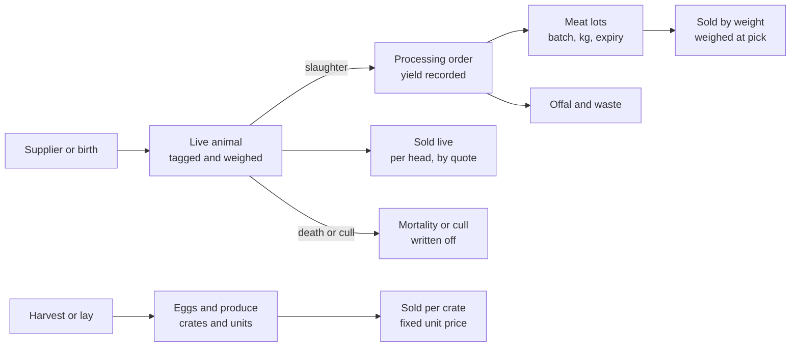

# HaKorem Farms Platform: Shared Brief

Binding for both the backend and frontend build tracks. Read this first in every session.

## How to use these prompts

This document has three tabs. The shared brief you are reading now is the common ground for both tracks: business, domain, requirements, security and standards. It is never pasted on its own. The backend and frontend tabs are the two prompts you actually hand to Claude Code, in two separate sessions running at the same time.

Two repositories, one folder on your Desktop. `backend/` pushes to `hakorem_farms_backend`, `frontend/` pushes to `hakorem_farms_frontend`, and both live inside `~/Desktop/hakorem-farms/` so either session can read the other's documents and contract without either one writing into the other's tree.

1. Create `~/Desktop/hakorem-farms/` and clone both repositories into it as `backend/` and `frontend/`.
2. Export this document as Markdown. Put the shared brief at `backend/docs/SHARED_BRIEF.md` and a copy at `frontend/docs/SHARED_BRIEF.md`. Put the backend prompt at `backend/docs/BUILD_PROMPT.md` and the frontend prompt at `frontend/docs/BUILD_PROMPT.md`. Commit and push both.
3. Run backend session **B0** first, on Fable in plan mode. It produces the architecture, the data model, the threat model and the API contract, and writes no application code.
4. Start frontend session **F0** at the same time. It builds the design system and needs no API at all. From B1 onward both tracks run in parallel, session by session, on the schedule under Sessions and context discipline.
5. One phase per session, always. Every session ends by writing its handoff report; every session starts by reading the previous one.

One rule holds the whole thing together: the documents are the source of truth, and code that contradicts them is a bug in the code, not a new decision.

## Mission brief

You are the lead engineer and architect on the HaKorem Farms Platform, a production system that a real livestock and produce business in Ghana will run its trading, stock, money and investor reporting on from day one. Build it as if an auditor, a hostile customer and a new developer will all arrive in month three.

The measure of success is simple. A farm manager with no technical training can run a full trading day on it: receive stock, quote a buyer, sell live animals by weight, take a mobile money payment, print a receipt, fulfil an online order, and close the day with a cash count that reconciles to the ledger without anyone touching the database.

### Operating rules

1. **Read before you write.** At the start of every session, read `CLAUDE.md`, `docs/ARCHITECTURE.md` and `docs/SRS.md`. If what you are about to build contradicts them, stop and say so instead of coding around it.
2. **Decide, then record.** Every architectural choice becomes an ADR in `docs/adr/`. Never leave an open question in the code. If you lack information, pick the option that is cheapest to reverse, state the assumption in the ADR, and continue.
3. **No placeholder work.** No `TODO`, no stubbed function that returns a hard-coded value, no mock data in committed code, no endpoint that returns 200 without doing the thing. If a module is not built, it is not merged.
4. **Money paths are never approximate.** Any code that touches price, quantity, weight, tax, payment, ledger or investor share is written test-first, with the test asserting an exact decimal value.
5. **Ghana first, not Ghana later.** Currency is GHS. Phone numbers, mobile money, VAT and levies, address formats, offline tolerance and low-bandwidth pages are requirements, not localisation chores.
6. **Small, honest commits.** Conventional Commits, one concern per commit, the test in the same commit as the code it covers. Never commit a failing or skipped test without an issue referenced in the message.
7. **Ask at most three questions, once.** Gather any genuine blockers into a single batch at the start of a phase. After that, proceed on documented assumptions and flag them in `docs/ASSUMPTIONS.md`.

## Business context

HaKorem Farms is a livestock, poultry, meat and fresh produce business in Ghana selling to walk-in retail buyers, bulk and wholesale buyers, and online customers who get delivery. The name is a Hebrew title of God meaning the vinedresser or farmer, and the brand voice is farm to table.

The business sells three physically different kinds of stock through four channels, and that combination is what makes the system non-trivial. Live animals are individual, priced in a band by size and weight. Meat is sold by weight in packs. Produce is sold by crate, bunch or tuber.

### Reference catalogue

The table below is the opening catalogue shape with indicative price bands in GHS. Treat the bands as data to be configured by the owner, never as constants in code.

| Line | Item | Sold as | Indicative band (GHS) |
| --- | --- | --- | --- |
| Live | Broiler chicken | per head | 120 to 220 |
| Live | Local chicken | per head | 100 to 180 |
| Live | Eggs, local / small / big | per crate | 35 / 45 / 60 |
| Live | Baby pigs | per head | 150 to 2,200 |
| Live | Goats | per head | 120 to 1,950 |
| Live | Sheep | per head | 150 to 3,000 |
| Live | Ducks | per head | 80 to 300 |
| Live | Rabbits | per head | 80 to 350 |
| Meat | Full chicken | 15 kg pack | 220 to 350 |
| Meat | Chicken wings | 15 kg pack | 110 to 250 |
| Meat | Chicken drumsticks and thighs | 15 kg pack | 180 to 370 |
| Meat | Chicken backs | 15 kg pack | 160 to 240 |
| Meat | Beef | 15 kg pack | 330 to 650 |
| Meat | Pork | 15 kg pack | 170 to 340 |
| Meat | Goat meat | 15 kg pack | 210 to 470 |
| Produce | Tomatoes, lettuce, cabbage, pepper, carrot, yam | per unit or crate | set per season |

### Channels

- **Retail counter.** Walk-in sale, cash or mobile money, receipt printed or sent by SMS and WhatsApp.
- **Wholesale and bulk.** Negotiated price list per customer, quote then invoice then delivery, credit terms and ageing.
- **Online store with delivery.** Public catalogue, cart, checkout, delivery scheduling and tracking.
- **Request for quote.** A buyer describes what they want, for example twenty goats of a given size for a funeral, and the farm answers with a priced quote that converts to an invoice.

## Hard constraints

These are not open for redesign. If you believe one is wrong, write an ADR arguing the case and wait for a human answer rather than quietly doing something else.

1. **Modular monolith on the backend.** One deployable API, one primary database, hard module boundaries enforced in code. Modules talk through published interfaces and domain events inside the process, never by reaching into each other's tables. A future extraction into services should cost a refactor, not a rewrite. No microservices, no service mesh, no mandatory broker in version one.
2. **Two repositories, one workspace.** `hakorem_farms_backend` and `hakorem_farms_frontend` are separate repositories with separate histories, pipelines and deploys. They are cloned side by side under one Desktop folder so both sessions can read shared documents. Neither session ever edits files in the other's folder, and neither repository imports source code from the other.
3. **The OpenAPI contract is the only interface between them.** The backend owns it, publishes it, and never breaks it silently. The frontend consumes a generated client and a mock server built from it. No shared runtime package, no cross-repository imports, no hand-written API types on the frontend.
4. **Everything written down lives in `docs/`** in whichever repository owns it. System-wide documents live in the backend repository; frontend-specific documents live in the frontend repository. A decision that exists only in chat history did not happen.
5. **Claude Code skills live in `.claude/skills/`** in each repository, generated as part of the build rather than bolted on afterwards.
6. **One phase per Claude session.** Never run two phases in one session, and never carry an exhausted context into new work. Every session ends with a handoff report and begins by reading the last one.
7. **Tests at four layers, always.** Unit, integration against real Postgres, end to end, and smoke against a deployed environment. A module without all four that apply to it is not finished.
8. **Correctness over features.** Where shipping another module competes with making stock, money and audit provably correct, correctness wins every time.
9. **The counter keeps working when the network does not.** Ghanaian retail cannot stall on a dropped connection. Point of sale is offline tolerant with a queued, idempotent sync.
10. **No destructive operations.** Financial and stock records are never updated in place and never hard deleted. Corrections are reversing entries. Soft deletion with an actor and a reason everywhere else.
11. **No secrets in either repository**, no live credentials in any example file, no production data in any seed or fixture.
12. **Stay in scope.** Build what these documents specify. New ideas go to `docs/BACKLOG.md`, not into the current session.

## Technology stack

Use TypeScript end to end on NestJS and PostgreSQL. One language across the API, the storefront, the back office and the point of sale means one test runner, one toolchain and one mental model for a small team. NestJS is chosen specifically because its module system gives the modular monolith a boundary the compiler can enforce. The two repositories share a language but not a package: types cross the boundary as a client generated from the OpenAPI contract, which is what lets each side be built, tested and deployed on its own.

| Layer | Choice | Why this one |
| --- | --- | --- |
| Language and runtime | TypeScript 5.x on Node 22 LTS | One language from database row to POS screen, shared domain types |
| API framework | NestJS 11 | Modules, dependency injection and interceptors map directly onto module boundaries and cross-cutting audit |
| Database | PostgreSQL 17 | Exact numeric types, strong constraints, partial and exclusion constraints, partitioning for the ledger |
| Data access | Drizzle ORM with plain SQL migrations | SQL stays visible and reviewable, no hidden query generation on money paths |
| Cache and jobs | Redis 7 with BullMQ | Document generation, notifications, delivery updates, nightly rollups and reconciliation |
| Storefront | Next.js 15 App Router | Server rendering for SEO and for slow connections, image optimisation for a photo-heavy catalogue |
| Back office and POS | React 19 and Vite as one installable PWA | Offline-tolerant counter, no SEO need, fast interactions |
| UI | Tailwind CSS with shadcn/ui and Radix primitives | Accessible components without a design system build |
| Auth | Self-hosted, Argon2id, short-lived access token plus rotating refresh in httpOnly cookies, TOTP for privileged roles | No vendor lock on identity, full control of the audit trail |
| Payments | A provider-agnostic port with Paystack as the first adapter and a second aggregator behind the same interface | Mobile money and card without welding the domain to one processor |
| Messaging | A notification port with SMS, WhatsApp Business and email adapters | Receipts, quotes and delivery updates reach customers where they actually are |
| Files | S3-compatible object storage with signed URLs | Product photos, signed delivery notes, document archive |
| Documents | Server-side HTML to PDF for invoices, quotes and statements, ESC/POS for thermal receipts | Deterministic, archivable, reprintable |
| Observability | OpenTelemetry traces, Pino JSON logs with correlation ids, Sentry, Prometheus metrics | Debugging a disputed sale needs the whole request path |
| Testing | Vitest, Supertest with Testcontainers Postgres, Playwright | Integration tests run against real Postgres, never a mock |
| CI/CD | GitHub Actions with a Docker build, migrations gated behind a manual approval | Nothing reaches production without a green pipeline |
| Runtime | Docker Compose on a Hostinger KVM VPS, UK or Netherlands region, with off-box backups | Lowest latency to Ghana at a cost the business can carry in year one |

### Non-negotiable technical rules

- **Money is never a float.** Store amounts as integer pesewas in `BIGINT` columns, or as `NUMERIC(14,2)`, and pick one and keep it everywhere. Do arithmetic with a decimal library, never with JavaScript numbers. Rounding is half-up and happens once, at the line total.
- **Weight is `NUMERIC(10,3)` in kilograms**, with the capture source recorded (scale reading, manual entry, estimate).
- **Every timestamp is `TIMESTAMPTZ` stored in UTC** and rendered in Africa/Accra.
- **Every external call is idempotent** and carries an idempotency key the database enforces as unique.
- If the team would rather work in Python, the only component that swaps is the API framework: FastAPI with SQLAlchemy 2.0 and Alembic. Everything else in this table stands. Do not mix the two.

## Domain model: the parts a generic inventory system gets wrong

A farm is not a shop with animals in it, and modelling it as a product table with a quantity column will fail in the first month. Read this section before designing a single table. Every point below is a requirement, not a suggestion.

### 1. Three stock archetypes under one catalogue

One `Product` abstraction carries a stock-keeping policy that decides how its stock behaves.

- **Serialised live animal.** Each goat, sheep or pig is an individual record with a tag number, species, breed, sex, date of birth or acquisition, weight history, health and vaccination events, pen or location, and its own accumulated cost. Quantity on hand is a count of individuals, not a number you decrement.
- **Catch-weight lot.** Meat is held in lots with a batch number, production date, expiry, storage temperature requirement and a weight in kilograms. The lot is the unit of traceability, the kilogram is the unit of sale.
- **Countable unit.** Crates of eggs, tubers of yam, heads of cabbage. Plain quantity with a unit of measure and an optional expiry.

### 2. Processing converts one archetype into another

When a goat is slaughtered it stops being a live animal and becomes several meat lots plus offal plus waste. Model this as a processing order with consumed inputs, produced outputs, a recorded yield, and cost allocated from the input animal plus direct processing cost across the outputs by relative sales value. Skip this and both stock and cost of goods sold are wrong from day one. The diagram below shows the full path.



Feed, veterinary, labour and overhead accumulate against the pen, batch and animal. That cost flows through processing into the cost of every meat lot and every sale.

Only the countable line runs straight from intake to sale. The other two change form on the way, and both stock and cost have to follow them across that change.

### 3. Price bands, not prices

A goat sells anywhere between 120 and 3,000 cedis depending on size, so price is a function, not a column. Build a pricing engine that resolves a price from product, grade or weight band, channel (retail, wholesale, online), customer tier and any active promotion. Every sale line records the resolved price, the rule that produced it, the actual agreed price, and if those differ, who approved the variance and why. Anything the engine cannot resolve becomes a quote.

### 4. The final price is only known at the scale

Meat ordered online is picked and weighed before it ships, and the weighed amount will not match the ordered amount exactly. Every such order carries an acceptable tolerance, a re-pricing rule, and either a payment pre-authorisation with later capture or a documented adjustment with customer notification. The invoice is raised against weighed quantity, never ordered quantity.

### 5. Stock moves when nobody sold anything

Animals die, are born, gain weight and eat feed. Mortality, birth, weight gain, feed consumption, veterinary treatment, transfer between pens and shrinkage are all stock or cost events with a reason code and an actor. Feed and medication accumulate as cost against a pen, batch or individual animal, which is the only way to know whether a line is actually profitable.

### 6. Stock is an append-only ledger, like money

Never update a quantity column. Write immutable stock movements with a type, quantity, location, source document and actor, and derive on-hand from them, with a periodically materialised balance for speed. Corrections are reversing movements. This is what makes a stock dispute answerable six months later.

### 7. Capital and investor shares are accounting, not a spreadsheet tab

Investor reporting rides on a real double-entry general ledger covering assets, liabilities, equity, income and expenses. Capital contributions credit an equity account per investor. Shareholding is held as units with effective dates, because a new injection changes everyone's percentage from that date forward. Profit share is computed at a period close from the ledger, not from a sales total.

### 8. Locations are first class

The farm, the pens, the cold room, the shop floor, the delivery vehicle and a customer-return holding area are all stock locations. Every movement names a source and a destination, and in-transit stock is still the farm's stock.

## Functional requirements

Twenty-two modules make up version one. Expand every bullet below into numbered, testable requirements in the SRS using the module code as the prefix, for example `FR-POS-014`. Each requirement needs an actor, a trigger, a rule and an observable outcome. If a bullet is ambiguous, write the clarifying assumption into the SRS rather than guessing silently.

### IAM: identity, access and roles

- Staff accounts with email or phone login, Argon2id hashing, forced password change on first login, and TOTP for owner, accountant and manager roles.
- Role-based access with granular permissions, seeded roles for Owner, Manager, Accountant, Storekeeper, Cashier, Sales, Vet or Farm Hand, Driver, Investor (read only) and Customer.
- Branch and location scoping, so a cashier at the shop cannot post movements at the farm.
- Session management with device list, forced logout, lockout after repeated failures, and full authentication audit.
- Investor portal access that exposes only that investor's own capital, share and distribution data.

### MDM: master data

- Product catalogue with categories, stock-keeping policy per product, units of measure with conversions, images, descriptions and online visibility.
- Grades and weight bands per species, used by both pricing and quoting.
- Locations and pens, suppliers, customers, tax and levy configuration, payment methods, delivery zones and fees.
- Price lists per channel and customer tier with effective dates, and an approval step before a price list goes live.
- Import and export of master data by spreadsheet with validation and a dry-run preview.

### LIV: livestock management

- Individual animal register with tag, species, breed, sex, source, acquisition cost, current pen and status.
- Weight capture over time, with growth tracking and average daily gain per pen and per batch.
- Health events: vaccination, treatment, withdrawal periods that block sale until they expire, and veterinary cost capture.
- Breeding records: mating, expected and actual birth, litter or clutch size, offspring linked to dam.
- Mortality and culling with reason code, approval for high-value animals, and automatic write-off to the correct expense account.
- Feed management: feed stock, rations, consumption per pen, and feed cost allocated to batches.

### INV: inventory and stock control

- Append-only stock movement ledger with movement type, quantity, weight, lot, location, source document, actor and timestamp.
- Lot and batch tracking with production date, expiry, and forward and backward traceability from a sale back to an animal or supplier.
- Cold chain fields on meat lots with temperature excursion logging and automatic quarantine.
- Goods receipt, transfer between locations, in-transit stock, and receipt confirmation at destination.
- Stock adjustments with mandatory reason and approval threshold, and a full cycle-count and stock-take workflow with variance report and posting.
- Reorder points, minimum and maximum levels, and low-stock and expiring-stock alerts.
- Valuation using weighted average cost, with specific identification for serialised animals.

### PRC: processing and production

- Processing orders that consume live animals or raw carcasses and produce meat lots, offal and by-products.
- Yield recording per order with expected against actual yield and a variance investigation flag.
- Cost allocation from inputs plus direct processing cost across outputs by relative sales value.
- Packing into standard pack sizes, label and barcode generation carrying lot and weight.

### PUR: procurement and suppliers

- Supplier register with contact, payment terms, bank or mobile money details, categories supplied and documents.
- Purchase requisition, purchase order with approval limits, partial receipt, and three-way match between order, receipt and supplier invoice.
- Supplier invoice capture, credit notes, payment scheduling and remittance advice.
- Supplier performance scoring on price, lead time, quality and rejection rate.

### POS: retail point of sale

- Fast counter sale by barcode, search or category tile, with per-item weight capture from a scale or manual entry.
- Split tender across cash, mobile money, card and store credit, with change calculation.
- Price override within role limits, requiring a reason and recorded as a variance.
- Hold and recall sales, returns and exchanges against an original receipt, and void with supervisor approval.
- Offline mode that queues sales locally and syncs idempotently, with conflict rules defined for stock that went negative while offline.
- Shift management: opening float, cash drops, X and Z reports, blind close and over or short posting.
- Thermal receipt printing plus SMS or WhatsApp receipt delivery.

### WHL: wholesale and business accounts

- Business customer accounts with credit limit, payment terms, assigned price list and an assigned account manager.
- Bulk order entry, standing and recurring orders, and backorder handling.
- Credit limit enforcement with override approval, and automatic account hold past a defined overdue threshold.
- Customer statements, ageing by 30, 60 and 90 days, and dunning reminders by SMS and email.

### QUO: quotations and requests for quote

- Public request-for-quote form on the storefront and internal quote creation for phone or WhatsApp enquiries.
- Quote builder with line items, free-text requirements for live animals, validity period, terms and delivery estimate.
- Internal approval for quotes below margin floor, versioning with full revision history, and customer acceptance by signed link.
- Conversion of an accepted quote into a sales order, then an invoice, with every link preserved.
- Quote pipeline reporting: issued, accepted, declined, expired, and win rate by salesperson and by product line.

### SHP: online store

- Public catalogue with categories, search, filters, availability, photography and SEO metadata.
- Cart and guest or registered checkout, delivery zone and fee calculation, and a delivery slot picker.
- Customer accounts with order history, saved addresses, reorder, and downloadable invoices and receipts.
- Catch-weight handling on checkout with a clearly displayed estimated total, tolerance and final-charge rule.
- Stock reservation at checkout with a timed release, so the shop cannot oversell a single goat.
- Promotions, coupons and bundle offers with stacking rules, plus abandoned-cart recovery messaging.

### ORD: order management and fulfilment

- A single order record across every channel, with a documented state machine from placed through to delivered or cancelled.
- Pick list generation, picking with weight capture, packing and dispatch confirmation.
- Partial fulfilment, substitution with customer consent, and cancellation with stock release and refund.

### DEL: delivery and logistics

- Delivery zones, fees and cut-off times, with scheduling into slots and capacity limits per slot.
- Driver assignment, route list for the day, and a mobile driver view that works on a weak connection.
- Proof of delivery: recipient name, signature, photo and geolocation, with cash on delivery collection recorded against the driver.
- Driver cash reconciliation at end of day and a failed-delivery workflow with reattempt or return to stock.
- Customer delivery notifications at dispatch, on the way and delivered.

### BIL: invoicing, receipts and credit notes

- Sequential, gap-free, tamper-evident numbering per document type, generated inside the database transaction.
- Tax and levy calculation configurable by product category, with the full breakdown shown on the document.
- Proforma invoices, final invoices, receipts, credit notes and debit notes, all PDF and all archived immutably.
- Reissue and reprint that produce an identical document with a reprint marker, never a new document.
- Branded templates per document type, editable by an administrator without a deployment.

### PAY: payments and reconciliation

- Payment capture for cash, mobile money, card, bank transfer and cheque, each with its own clearing behaviour.
- Online payment through the provider port, with webhook verification, signature checking and replay protection.
- Partial payments, overpayments, allocation against specific invoices, and unallocated receipts held in a suspense account.
- Refunds and reversals with approval, and a documented link back to the original payment.
- Daily reconciliation of provider settlement reports and bank statements against the ledger, with an exception queue for breaks.

### FIN: general ledger and accounting

- Chart of accounts with assets, liabilities, equity, income and expenses, seeded for a Ghanaian agribusiness.
- Double-entry journal where every business event posts balanced entries, enforced by a database constraint that no journal may post unbalanced.
- Automated postings from sales, purchases, stock movements, processing, payroll if present, and depreciation.
- Manual journals with approval, accounting periods with lock and close, and a hard block on posting into a closed period.
- Trial balance, profit and loss, balance sheet and cash flow, each runnable for any date range.
- Fixed asset register with depreciation schedules for vehicles, cold rooms, housing and equipment.

### CAP: capital, investors and profit sharing

- Investor register with the investment agreement, contact details, bank or mobile money payout details and documents.
- Capital contributions and withdrawals posted to a per-investor equity account, each with a value date.
- Shareholding held as units with effective dates, so percentages recompute correctly after any new injection.
- Profit distribution run for a period: compute distributable profit from the ledger, apply retention policy, allocate by weighted average shareholding, produce a distribution schedule for approval, then post and pay.
- Per-investor statement showing contributions, current share, allocated profit, amounts paid and amounts outstanding.
- Return metrics per investor and overall: return on investment, payback period and internal rate of return.
- Loan and grant tracking where capital is debt rather than equity, with repayment schedules and interest.

### CST: costing and profitability

- Cost accumulation per animal, pen, batch and processing order, covering purchase, feed, veterinary, labour and overhead.
- Margin reporting by product, product line, channel, customer, salesperson and branch.
- Break-even analysis per line and a contribution margin view the owner can read without an accountant.
- Shrinkage, mortality and wastage cost as its own reported figure, not buried in cost of goods sold.

### RPT: reporting and dashboards

- Owner dashboard: today's sales, cash position, stock value, outstanding receivables, top movers and alerts.
- Operational reports for stock on hand, ageing stock, expiring lots, mortality rate, feed conversion and delivery performance.
- Financial reports as listed under FIN, plus daily sales by channel, by payment method and by cashier.
- Scheduled reports delivered by email, and export to spreadsheet and PDF for every report in the system.
- A read model or reporting schema separate from the transactional tables, so a heavy report cannot slow the counter.

### NTF: notifications

- Templated SMS, WhatsApp, email and in-app notifications for receipts, quotes, order status, delivery, payment reminders and low stock.
- Per-user and per-customer channel preferences, opt-out handling and quiet hours.
- Delivery tracking per message with retry, and a log that shows what was sent to whom and when.

### DOC: documents and media

- Immutable document archive for every quote, invoice, receipt, credit note, delivery note, statement and distribution schedule.
- Product photography with variants and compression, plus supplier and investor document storage.
- Signed, expiring URLs for every private document, with access logged.

### AUD: audit, compliance and administration

- Immutable audit log of every create, update, delete, login, permission change, price override, approval and export, recording actor, timestamp, IP, before and after values.
- Audit log is append-only at the database level and readable by owner and accountant only.
- System settings, feature flags, numbering sequences, tax configuration and business profile, all editable without a deployment and all audited.
- Data retention policy, customer data export and deletion request handling, and a documented backup and restore procedure with a tested restore.

### API: integrations

- Versioned REST API with OpenAPI specification generated from the code, not written by hand.
- Outbound webhooks with signed payloads, retries with exponential backoff and a dead letter queue.
- API keys per integration with scoped permissions, rotation and per-key rate limits.
- Adapter ports for payments, SMS, WhatsApp, email and accounting export, each swappable without touching domain code.

## Non-functional requirements

Every non-functional requirement carries a number and a way to verify it, because an unverifiable target is decoration. Put these in the SRS with the prefix `NFR-` and wire the verification into CI where the column says so.

| Attribute | Target | Verified by |
| --- | --- | --- |
| API read latency | p95 under 300 ms at 50 concurrent users | k6 load test in CI |
| API write latency | p95 under 600 ms at 50 concurrent users | k6 load test in CI |
| POS interaction | Item added to sale in under 100 ms locally, no network round trip required | Playwright timing assertion |
| Storefront load | Largest contentful paint under 2.5 s on a simulated 3G connection | Lighthouse CI budget |
| Catalogue page weight | Under 300 KB compressed for a listing page | Lighthouse CI budget |
| Availability | 99.5 percent monthly, maintenance outside 06:00 to 20:00 Accra time | Uptime monitor |
| Recovery point objective | 15 minutes | Continuous WAL archiving, restore drill |
| Recovery time objective | 4 hours | Quarterly restore drill, timed and recorded |
| Backups | Nightly full plus continuous archive, 30 days retained, monthly restore test | Automated job plus drill log |
| Offline tolerance | POS operates 8 hours offline and queues at least 500 transactions | Integration test with the network disabled |
| Capacity year one | 10,000 products, 150,000 orders, 2 million stock movements, 5 years of ledger retained online | Seeded performance dataset |
| Concurrency | 50 back-office users and 500 storefront sessions without degradation | Load test |
| Accessibility | WCAG 2.2 level AA on storefront and back office | axe-core in CI plus manual keyboard pass |
| Browser and device | Last two versions of Chrome, Safari and Firefox, Android 9 and above, usable at 360 px width | Playwright matrix |
| Test coverage | 80 percent overall, 100 percent branch coverage on pricing, ledger, stock valuation and distribution | Coverage gate in CI |
| Build and deploy | Full pipeline under 12 minutes, zero-downtime rolling deploy, migrations backward compatible for one release | Pipeline timing, deploy without maintenance window |
| Local setup | A new developer runs the whole stack with one command | Fresh-clone CI job that runs the setup script |

### Also required, stated as rules

- **Maintainability.** No module imports another module's internals. Enforce it with an import-boundary lint rule that fails the build, not with a code-review convention.
- **Observability.** Every request carries a correlation id that appears in logs, traces and any error shown to a user, so a support call starts with a reference instead of a guess.
- **Operability.** Every failure mode named in the threat model and the architecture has a runbook in `docs/runbooks/` with symptoms, diagnosis and the fix.
- **Portability.** Nothing ties the application to a single cloud vendor. Object storage is S3-compatible, nothing depends on a proprietary managed service.
- **Localisation readiness.** All user-facing strings go through a translation layer from day one. English ships first, but no string is hard-coded in a component.
- **Low-bandwidth discipline.** Images are served responsively and lazily, lists are paginated, and no screen requires more than one round trip to become useful.
- **Cost.** Keep year-one infrastructure under 150 US dollars a month at the capacity targets above, and record the running estimate in `docs/OPERATIONS.md`.

## Security architecture

The realistic threat to this business is insider fraud, not a foreign attacker. Someone with a valid login voiding a cash sale, writing off a living goat as dead, or adjusting stock to cover a theft will cost far more than a breached endpoint. Design the controls around that first, then harden the perimeter.

### Threat model scope

Produce `docs/security/THREAT_MODEL.md` using STRIDE per trust boundary, plus attack trees for the money paths. Name the trust boundaries explicitly: public storefront, authenticated back office, POS device on shop wifi, driver mobile device, payment provider webhooks, investor portal, system administration and the database itself.

These abuse cases are mandatory, each with its control and its detection:

| Abuse case | Primary control | Detection |
| --- | --- | --- |
| Cashier completes a sale, takes the cash, voids the sale | Voids require supervisor approval and leave an immutable record | Void rate by cashier, daily exception report |
| Storekeeper records a healthy animal as dead and sells it privately | Mortality above a value threshold needs a second approver and a photo | Mortality rate by handler against the pen average |
| Repeated small price overrides at the counter | Override limits per role, mandatory reason, variance posted to the ledger | Override value by user per shift |
| Customer shows a forged mobile money confirmation | Payment is only recorded from a verified provider callback or a confirmed account lookup | Unmatched payment queue |
| Forged webhook marks an order paid | Signature verification, timestamp window, replay cache, and re-verification of amount against the provider API | Webhook rejection log |
| Driver collects cash on delivery and under-declares | Proof of delivery with amount, driver cash reconciliation at end of day | Driver variance report |
| Stock adjustment used to hide a shortage | Adjustments above a threshold need approval, reason codes are a fixed list | Adjustment value by user, variance trend |
| Investor read-only account reaches finance data | Deny-by-default authorisation checked in the domain layer, object-level ownership checks | Authorisation failure alerts |
| Insider exports the customer list | Exports are a permission, every export is audited with row counts | Export volume alerts |

### Required controls

**Identity and authorisation**

- Deny by default. Authorisation is checked in the domain layer, not only in the controller, and includes object-level ownership checks on every record a user can reach.
- Separation of duties enforced in code: maker and checker cannot be the same user on stock write-offs, refunds, price list activation, manual journals, supplier payments and investor distributions.
- TOTP multi-factor for Owner, Accountant and Manager. Step-up authentication for distributions and for any bulk export.
- Argon2id password hashing, breached-password check at set time, account lockout with exponential backoff, and no account enumeration in any error message.

**Application**

- Schema validation on every inbound payload at the boundary, with the parsed type carried inward so unvalidated data never reaches a service.
- Parameterised queries only. Any dynamic SQL is a review blocker.
- Content Security Policy without `unsafe-inline`, HSTS with preload, `SameSite=Strict` httpOnly secure cookies, CSRF tokens on cookie-authenticated state changes, and a CORS allowlist rather than a wildcard.
- Rate limiting per IP, per account and per API key, with stricter limits on login, quote submission, checkout and password reset.
- File uploads validated by content sniffing not extension, size capped, scanned, stored outside the web root and served from a separate origin with signed expiring URLs.

**Data**

- A data classification table in `docs/security/DATA_CLASSIFICATION.md` covering public, internal, confidential and restricted, with the handling rule for each.
- TLS 1.3 in transit, encryption at rest, and column-level encryption for bank and mobile money details, identity numbers and investor payout details.
- No card data is ever stored or transits the server. Use the provider's hosted or tokenised flow and stay in the lowest-burden PCI self-assessment category.
- Logs and traces are scrubbed of secrets, tokens, full phone numbers and payment identifiers before they leave the process.

**Integrity and forensics**

- The audit log is append-only at the database level, with revoked update and delete privileges for the application role, and each row carrying a hash of the previous row so tampering is detectable.
- Log retention long enough to investigate a dispute, with time synchronisation and a documented evidence preservation procedure in `docs/runbooks/incident-response.md`.
- An incident response plan covering detection, containment, evidence capture, notification and recovery, with the evidence capture step written so it does not destroy what it is capturing.

**Supply chain and pipeline**

- Dependency scanning, static analysis, secret scanning and container image scanning on every pull request, with a failing high-severity finding blocking merge.
- Lockfiles committed, dependency updates reviewed, and a software bill of materials generated per release.
- Least-privilege database roles, with the application role holding no DDL rights in production.

### Compliance

Ghana's Data Protection Act and the Data Protection Commission's registration requirement apply to a business holding customer records at this scale, and Ghana Revenue Authority invoicing rules may require electronic invoice certification. Both change. Verify the current obligations against the official sources before go-live, record what you find with its date in `docs/security/COMPLIANCE.md`, and build the invoice and consent flows so a certification requirement can be added without reworking the document pipeline.

## Integrity and reliability

Put the rules in the database, not only in the application. Application code gets bypassed by a script, a migration or a future developer, and a constraint does not. This section is where the system earns the owner's trust, so treat every item as a blocking requirement.

### Invariants enforced by the database

- A journal entry cannot be saved unless its debits equal its credits. Enforce with a deferred constraint or a constraint trigger, and prove it with a test that tries to post an unbalanced entry and expects a failure.
- Document numbers are generated inside the transaction from a sequence table with a row lock, producing a gap-free series per document type and per year.
- Stock cannot go negative except through movement types explicitly allowed to, and those raise an exception record.
- A serialised animal cannot be sold twice, cannot be sold while under a veterinary withdrawal period, and cannot be in two locations at once.
- Idempotency keys, external payment references and webhook event ids are all unique keys, so a replay collides rather than duplicating.
- Amounts, weights and quantities carry check constraints for sign and precision. Foreign keys are declared everywhere, with no orphan rows permitted.

### Transactions and concurrency

- One business operation is one database transaction. A sale that writes stock movements, a ledger entry, an invoice and a payment either lands whole or not at all.
- Stock reservation and ledger posting run at serializable isolation, with retry on serialization failure. Everything else runs at read committed.
- Aggregates carry a version column and use optimistic locking. Serialised animal sale takes a row lock explicitly.
- Offline POS transactions carry client-generated UUIDv7 identifiers so a sync retry is naturally idempotent. Conflict rules are written down in `docs/OFFLINE_SYNC.md` before any offline code is written, and the server is always authoritative.

### Nothing silently diverges

- Use the transactional outbox pattern for every side effect: notifications, webhooks and search indexing are written to an outbox in the same transaction as the business change, then dispatched by a worker. A sale and its receipt cannot disagree.
- Nightly reconciliation jobs recompute stock balances from the movement ledger, assert that the trial balance sums to zero, and match payment provider settlement reports against recorded payments. Any drift raises an alert with the offending records attached, and never auto-corrects.
- A health endpoint reports database, Redis, queue depth, outbox backlog and last successful reconciliation, and the deployment pipeline reads it.

### Failure handling

- Every external call has a timeout, a bounded retry with jitter, a circuit breaker and a defined behaviour when it stays down.
- Write the payment edge cases as tests before the happy path: provider times out after the customer was charged, webhook arrives before the API response, webhook arrives twice, webhook arrives for an order that no longer exists, refund fails after the stock was already released.
- No empty catch blocks. Every caught error is either handled meaningfully or rethrown with context added. Errors returned to users carry a correlation id and no internal detail.
- Migrations follow expand then contract, so one release can run against the previous schema. Every migration has a tested rollback or a documented forward fix.
- Restore from backup is drilled quarterly against a real snapshot and the timing is recorded. An untested backup is not a backup.

## Documentation to produce

Write every file below into `docs/` in the backend repository, each one complete rather than an outline with headings. The phase column holds backend session ids, and the frontend repository keeps its own smaller set listed in the frontend prompt. A document that says *to be defined* has not been written. Keep `docs/README.md` as the index so a new developer has one place to start.

| Path | What it holds | Phase |
| --- | --- | --- |
| `docs/README.md` | Index of every document with one line each, plus the reading order for a new developer | 1 |
| `docs/SRS.md` | Full software requirements specification: scope, actors, use cases, every numbered functional and non-functional requirement, traceability matrix | 1 |
| `docs/ARCHITECTURE.md` | System and container views, module map, dependency rules, request flow, event flow, deployment topology | 0 |
| `docs/DOMAIN_MODEL.md` | Aggregates, entities, value objects, domain events, invariants, ubiquitous language | 0 |
| `docs/DATA_MODEL.md` | Entity relationship diagram and a table dictionary with every column, type, constraint and reason | 0 |
| `docs/MODULE_BOUNDARIES.md` | What each module owns, its public interface, what it may import, and the lint rule enforcing it | 0 |
| `docs/adr/0000-template.md` and numbered ADRs | One decision per file: context, options considered, decision, consequences, status | 0 onward |
| `docs/security/SECURITY_ARCHITECTURE.md` | Trust boundaries, authentication and authorisation design, key management, encryption, secure defaults | 0 |
| `docs/security/THREAT_MODEL.md` | STRIDE per boundary, attack trees on money paths, the abuse case table, residual risk register | 0 |
| `docs/security/DATA_CLASSIFICATION.md` | Classification levels and the handling rule for every data category the system holds | 1 |
| `docs/security/SECURE_CODING_STANDARDS.md` | The rules a pull request is checked against, with a correct and incorrect example each | 1 |
| `docs/security/COMPLIANCE.md` | Obligations checked against official sources, each with the date checked and the source link | 1 |
| `docs/ENGINEERING_STANDARDS.md` | Naming, error handling, logging, validation, commit and branch conventions, review checklist | 1 |
| `docs/TEST_STRATEGY.md` | Test pyramid, what is unit against integration against end to end, coverage gates, test data policy | 1 |
| `docs/API.md` plus generated `openapi.yaml` | API conventions, versioning, pagination, errors, idempotency, with the spec generated from code | 1 |
| `docs/OFFLINE_SYNC.md` | The offline data model, the queue, conflict rules and the worked examples | 1 |
| `docs/OPERATIONS.md` | Environments, configuration reference, secrets handling, monitoring, alert thresholds, cost estimate | 1 |
| `docs/DEPLOYMENT.md` | Pipeline, environments, migration procedure, rollback, release checklist | 1 |
| `docs/runbooks/*.md` | One per failure mode: payment provider down, database failover, restore from backup, incident response, reconciliation break | 1 |
| `docs/DATA_MIGRATION.md` | How the farm's existing records and opening balances come in, with validation and a dry run | 1 |
| `docs/GLOSSARY.md` | Livestock, processing and accounting terms used in the code, so naming stays consistent | 1 |
| `docs/UAT.md` | Scripted acceptance scenarios the owner can run without a developer present | 1 |
| `docs/ONBOARDING.md` | Clone to running in under thirty minutes, with the one-command setup | 1 |
| `docs/ASSUMPTIONS.md` | Every assumption made in place of an answer, dated, with who needs to confirm it | 0 onward |
| `docs/BACKLOG.md` | Everything deliberately out of scope for version one, so good ideas are parked rather than smuggled in | 0 onward |
| `docs/prompts/*.md` | The build prompts themselves: this document, the per-phase prompts, and a reusable module build prompt | 1 |

### Diagrams

Write every diagram as Mermaid inside the Markdown so it versions with the code and renders in the repository. At minimum: a C4 context and container diagram, the module dependency graph, the stock and processing lifecycle, the order state machine, the sale posting sequence including payment callback, the data flow diagram with trust boundaries marked, and the deployment topology.

## Claude Code skills to generate

Generate these as folders under `.claude/skills/` in the backend repository, each containing a `SKILL.md` with YAML frontmatter holding a `name` and a `description` that states exactly when it fires. The description is what decides whether the skill is used, so write it as a trigger, not as a summary. Keep each body under roughly 400 lines, carry a correct and an incorrect example in every one, and point to the relevant `docs/` file rather than restating it.

| Skill | Fires when | What it enforces |
| --- | --- | --- |
| `hakorem-module` | Creating or restructuring a module under `src/modules/` | Folder layout, public interface file, allowed imports, domain event registration, boundary lint |
| `hakorem-money` | Any code touching price, amount, tax, discount, total or currency | Integer pesewas, decimal library only, rounding once at line total, no floats, required test shape |
| `hakorem-ledger` | Any code writing a journal entry or touching the chart of accounts | Balanced posting, correct account selection, period lock check, reversal rather than edit |
| `hakorem-stock` | Any code changing stock, lots, weights or locations | Append-only movements, reason codes, lot traceability, no quantity updates in place |
| `hakorem-pricing` | Any work on the pricing engine, price lists, grades or quotes | Resolution order, effective dating, variance capture, approval thresholds |
| `hakorem-endpoint` | Adding or changing an API endpoint | Schema validation, authorisation at domain level, idempotency key, error envelope, OpenAPI annotation, rate limit |
| `hakorem-migration` | Writing a database migration | Expand then contract, backward compatibility for one release, constraint placement, rollback or forward fix |
| `hakorem-tests` | Writing or fixing tests | Naming, Testcontainers setup, factories over fixtures, coverage gates, no mocked database |
| `hakorem-security-review` | Changing auth, payments, exports, uploads, webhooks or permissions | The secure coding checklist run item by item, with the finding written into the pull request |
| `hakorem-offline` | Any POS or driver feature that must survive a dropped connection | Client id generation, queue shape, conflict rules, sync idempotency, test with the network disabled |
| `hakorem-documents` | Changing invoice, receipt, quote, statement or delivery note output | Numbering rules, template structure, archival, reprint marker, tax breakdown |
| `hakorem-frontend` | Building any storefront, back office or POS screen | Design tokens, accessibility pass, loading and error states, low-bandwidth budget, 360 px layout |
| `hakorem-adr` | A decision is made that changes structure, a dependency or a contract | House ADR format, numbering, status lifecycle, linking from the architecture document |
| `hakorem-runbook` | A new failure mode is identified or an incident is resolved | Symptoms, diagnosis steps, fix, verification, escalation |
| `hakorem-seed` | Generating demo or test data | Realistic Ghanaian names, products, prices and weights, never production data, clearly marked as seed |
| `hakorem-release` | Preparing a release | Migration review, changelog, smoke tests, rollback plan, sign-off checklist |

Also write `CLAUDE.md` at the repository root. It stays short: what the project is, the hard constraints, where the documents live, which skill covers what, the commands for build, test and migrate, and the three things that most often go wrong. A long `CLAUDE.md` gets skimmed, which defeats the point.

After generating the skills, verify them. Open a fresh session, describe a task that should trigger each skill, and confirm the right one fires. Fix any description that does not trigger, and record the result in `docs/prompts/SKILLS_VERIFICATION.md`.

## Repositories, workspace and the contract

Two repositories sit side by side in one Desktop folder. The folder itself is not a repository and is never committed anywhere. Each Claude session is opened at the workspace root so it can read across, and writes only inside its own repository.

```text
~/Desktop/hakorem-farms/           working folder, not a repository
├── backend/                       → officialjwise/hakorem_farms_backend
│   ├── .claude/skills/            backend skills
│   ├── contract/openapi.yaml      the interface, owned and published here
│   ├── docs/                      system of record: SRS, architecture, security, ADRs
│   ├── infra/                     Dockerfiles, compose, Caddy, deploy and backup scripts
│   ├── src/                       the modular monolith
│   └── test/                      integration, e2e, smoke, load
└── frontend/                      → officialjwise/hakorem_farms_frontend
    ├── .claude/skills/            frontend skills
    ├── contract/openapi.yaml      synced copy, never hand-edited
    ├── docs/                      frontend standards, component inventory, UX notes
    ├── apps/storefront/           Next.js public shop
    ├── apps/console/              React PWA: back office and POS
    ├── packages/ui/               design system, tokens, components
    ├── packages/api-client/       generated from the contract, never hand-written
    ├── scripts/sync-contract.sh   pulls the contract across, regenerates the client
    └── e2e/                       Playwright specs
```

Set it up once, and check both remotes before the first push so nothing lands in the wrong repository:

```bash
mkdir -p ~/Desktop/hakorem-farms && cd ~/Desktop/hakorem-farms
git clone https://github.com/officialjwise/hakorem_farms_backend.git  backend
git clone https://github.com/officialjwise/hakorem_farms_frontend.git frontend

git -C backend  remote -v    # must show hakorem_farms_backend
git -C frontend remote -v    # must show hakorem_farms_frontend
```

The contract is what makes parallel work possible. Backend session B1 hand-writes the complete OpenAPI specification before implementing anything, covering every endpoint the frontend will need with realistic example responses. The frontend then runs a mock server from that file and builds entire screens against it while the backend is still empty. From B2 onward the backend generates the specification from its own code and CI fails if the generated file differs from the committed one, so the contract cannot drift. A breaking change needs a version bump, an entry in `backend/docs/CONTRACT_CHANGELOG.md`, and a note in the session report so the frontend track picks it up.

```bash
# frontend: at the start of every session, and after any contract change
./scripts/sync-contract.sh
# copies ../backend/contract/openapi.yaml, regenerates packages/api-client,
# fails loudly if the client no longer compiles against the app

# the API, before the API exists
npx @stoplight/prism-cli mock contract/openapi.yaml --port 4010
```

Three rules keep the two tracks from colliding. A session writes only inside its own repository, never `git add` across folders. A frontend session that needs something the contract does not offer writes the request to `frontend/docs/CONTRACT_REQUESTS.md` and carries on against a mock rather than inventing an endpoint. The backend session picks those up at the start of its next session and either implements them or explains in its report why not.

## Sessions and context discipline

The single biggest cause of a failed Claude Code build at this size is one session trying to hold the whole system in context. Work in numbered sessions, one phase each, and treat the handoff report as the real deliverable of every session. Fourteen slots run down both tracks in parallel. A slot is not a day, it is however long that phase takes, and neither track waits for the other except at the point marked in the gate column.

| Slot | Backend session | Frontend session | Gate before the next slot |
| --- | --- | --- | --- |
| 1 | **B0** Architecture, domain model, data model, threat model, ADRs. No code | **F0** Design system, tokens, component library, Storybook, accessibility harness | You read and approve the architecture and data model |
| 2 | **B1** SRS, all documents, skills, `CLAUDE.md`, hand-written OpenAPI contract | **F1** App shells, routing, layout, navigation, auth screens against a stub | The contract covers every screen the frontend has planned. This is the one hard dependency between the tracks |
| 3 | **B2** Foundation: workspace, Docker, CI, migrations, kernel, config, test harness | **F2** Mock server wired up, generated client, data layer, loading and error patterns | One-command setup works on a clean machine, CI green in both repositories |
| 4 | **B3** Platform: auth, audit, outbox, observability, storage, one vertical slice | **F3** Authentication, users, roles and permission screens | The slice has unit, integration and end-to-end tests, and the frontend logs into the real API |
| 5 | **B4** Master data and the pricing engine | **F4** Catalogue admin, price lists, grades and weight bands | Price resolution tested against every band in the catalogue |
| 6 | **B5** Inventory and the stock movement ledger | **F5** Stock screens, goods receipt, transfers, stock take | On-hand derived from movements matches a hand count |
| 7 | **B6** Livestock and processing | **F6** Animal register, health, breeding, processing screens | A sold meat lot traces back to its animal in three clicks |
| 8 | **B7** Procurement and suppliers | **F7** Storefront catalogue, cart, checkout | Three-way match works, and checkout reserves stock and releases it on timeout |
| 9 | **B8** General ledger, billing and document generation | **F8** Invoices, receipts, statements, document views | Trial balance sums to zero on seeded trading data |
| 10 | **B9** Payments, POS, shifts, offline sync | **F9** POS surface, offline queue, shift open and close | POS runs eight hours offline and syncs exactly once |
| 11 | **B10** Quotations, wholesale, credit control | **F10** Quote builder, public request-for-quote form, wholesale accounts | A quote converts to an invoice with every link preserved |
| 12 | **B11** Orders, fulfilment, delivery, notifications | **F11** Order tracking, driver view, proof of delivery | An online order completes end to end on a real phone |
| 13 | **B12** Capital and investors, costing, reporting, public API | **F12** Dashboards, reports, investor portal | A distribution run ties exactly to the ledger |
| 14 | **B13** Load test, security review, smoke suite, runbooks, VPS deploy | **F13** Lighthouse, axe, Playwright against staging, PWA, deploy | Every non-functional target met and evidenced on the live VPS |

### Session protocol

- **Open at the workspace root**, then read the prompt for your track. Backend sessions read `backend/docs/BUILD_PROMPT.md`, frontend sessions read `frontend/docs/BUILD_PROMPT.md`, and both read `SHARED_BRIEF.md`.
- **Start a new session** the moment any of these is true: the phase is finished, context passes roughly sixty percent, Claude re-reads a file it already read this session, or it starts summarising its own work instead of building. Do not wait for a context warning, because output quality drops well before the limit does.
- **Read narrowly.** Never load the whole SRS in a working session. Read the requirement block for the module in hand and nothing else.
- **Close every session** by writing `docs/sessions/<ID>-<slug>.md` with what was built, what was decided, what was assumed, what was deferred, any contract change, the gate result, and the exact opening message for the next session.
- **Commit and push before closing.** A session that ends with unpushed work has thrown away its own handoff.
- **If context runs out mid-phase**, stop at the nearest green commit, write the report, and resume in a fresh session labelled `B5 continued` or similar. Splitting a phase is normal. Dragging an exhausted context forward is not.

Open every session with the same block, changing only the identifier:

```text
Read CLAUDE.md, docs/SHARED_BRIEF.md, and the <ID> section of docs/BUILD_PROMPT.md.
List docs/sessions/ and read only the most recent report.
Do not read any other document unless this phase needs it.

Confirm in three lines: the phase, its scope, and its gate.
Then execute <ID> only. Stop at the gate and write the session report.
```

## Definition of done

A piece of work is done when all of the following are true, not when the feature appears to work.

- The functional requirement it implements is referenced by id in the commit or pull request.
- Every test layer that applies to it passes: unit, integration against a real Postgres, contract, end to end, and the smoke path if it is a critical flow.
- Authorisation is checked at the domain layer and there is a test proving the wrong role is refused.
- The error paths are implemented, not just the happy path, and failure responses carry a correlation id.
- Any money, stock or weight calculation has a test asserting an exact value, including a rounding edge case.
- The audit trail records the action with actor, timestamp and before and after values.
- The OpenAPI contract is regenerated and matches the committed file, or the change is versioned and logged in the contract changelog.
- Documentation is updated in the same change: the API specification, the relevant `docs/` file, and an ADR if a decision was made.
- The import boundary rule, lint, type check, full test suite and security scan all pass in CI.
- No `TODO`, no commented-out code, no skipped test, no hard-coded secret, no magic number without a named constant.
- The work is committed and pushed to its own repository, and the session report names it.

### The test layers

Every module carries whichever of these apply to it. The naming, the location and the command that runs each one belong in `docs/TEST_STRATEGY.md` in both repositories.

| Layer | Scope | Runs against | When |
| --- | --- | --- | --- |
| Unit | One domain rule, pure, no input or output | Nothing external | Every commit |
| Integration | A module through its public interface | Real Postgres and Redis in Testcontainers, never a mock | Every pull request |
| Contract | Every response shape against `contract/openapi.yaml` | The running API | Every pull request, failing the build on any drift |
| End to end | A whole business flow across modules or screens | The full stack in Docker Compose | Every pull request to main, and in full nightly |
| Smoke | A short list of critical paths, read-only plus one safe write | The deployed environment | Straight after every deploy, under 60 seconds, exit code drives rollback |

On top of those, a k6 load run against the non-functional targets before each release, and a nightly OWASP ZAP baseline scan against staging.

- Tests are written in the same commit as the code they cover.
- No mocked database, ever. Integration means the real engine in a container.
- Money, stock and permission logic is written test-first.
- Seed data comes from a factory, is clearly marked as seed, and never comes from production.
- A flaky test is a failing test. Quarantine it with an issue, never paper over it with a retry loop.
- The smoke suite is the deployment gate. If it fails, the deploy rolls back without waiting for a human.

### System acceptance scenarios

These go into `docs/UAT.md` and are run end to end before launch. If one of them cannot be completed by a non-developer, the system is not finished.

1. **A full trading day.** Open a shift with a float, receive twenty broilers from a supplier, sell three goats at the counter by weight with a split cash and mobile money tender, process one goat into meat lots, fulfil an online order, deliver it against cash on delivery, and close the shift blind. Afterwards: physical stock matches the system, the trial balance sums to zero, declared cash matches the ledger, and every document is archived and reprintable.
2. **Quote to cash.** A buyer requests twenty goats for a funeral, receives a quote, negotiates a revision, accepts it, takes partial delivery, is invoiced, pays part of the invoice, and appears correctly on the ageing report at 30 days.
3. **Traceability.** Pick any sold meat lot and trace it back to the individual animal, its supplier, its feed and veterinary costs, in three clicks or fewer.
4. **Investor distribution.** Two investors who contributed capital on different dates receive a quarterly distribution. The allocation matches a hand calculation using weighted average shareholding, and the posting ties exactly to the ledger.
5. **Fraud attempts.** Attempt every abuse case in the threat model. Each is either blocked outright or lands on the daily exception report with enough detail to act on.
6. **Offline counter.** Disconnect the POS for an hour, run fifty transactions, reconnect. Everything syncs exactly once, no duplicates appear, and any stock conflict is flagged rather than silently resolved.
7. **Disaster recovery.** Restore last night's backup into a clean environment, verify the trial balance matches, and record how long it took.

## Deployment to the Hostinger VPS

Both repositories deploy to one VPS through two GitHub Actions workflows that build images, push them to the GitHub Container Registry, and then call the same deploy script over SSH. The compose file and the deploy scripts live in `backend/infra/`, because the backend repository is the system of record for how the system runs.

### Sizing

This stack is Postgres, Redis, the API, a worker, the Next.js storefront, the static console and a reverse proxy. [KVM 2 gives 2 vCPU, 8 GB RAM and 100 GB NVMe; KVM 4 gives 4 vCPU, 16 GB RAM and 200 GB NVMe](https://au.hostadvice.com/blog/web-hosting/vps/hostinger-vps-hosting/). Take KVM 4 for production and a KVM 1 or KVM 2 box for staging. [Reviewers report heavy CPU throttling on the larger plans, so the advertised core count behaves as a ceiling rather than a floor](https://learnwithhasan.com/vps-providers/hostinger-vps/), which is one more reason builds run in CI and never on the server. [Hostinger has no African data centre, but does have the United Kingdom, France and the Netherlands](https://www.vpsbenchmarks.com/hosters/hostinger), so choose the United Kingdom or the Netherlands for the shortest path to Ghana.

### The box

- Ubuntu 24.04 LTS with Docker Engine and Compose, and nothing else installed by hand. Everything that runs, runs in a container.
- Caddy as the reverse proxy, for automatic TLS renewal with no cron job to forget.
- `ufw` allowing only 22, 80 and 443. SSH by key only with password login disabled, plus fail2ban and unattended security upgrades.
- A dedicated deploy user, and a separate SSH key for GitHub Actions that is rotated if anyone leaves the project.
- Staging and production as separate compose projects with separate databases and secrets. No migration reaches production before it has run on staging.

### The pipeline

1. Push to `main` runs lint, type check, unit, integration, contract and end-to-end tests.
2. Green build produces an image tagged with the commit SHA and pushes it to the registry.
3. The deploy job connects over SSH, pulls the image, and runs migrations in a one-shot container.
4. New containers start alongside the old ones and the smoke suite runs against them.
5. Smoke passes, traffic switches, old containers stop. Smoke fails, the new containers are discarded, traffic never moved, and the job exits non-zero.
6. Migrations stay backward compatible for one release, so step 5 never needs a database rollback.

### Data and secrets

- Nightly `pg_dump` plus continuous WAL archiving to object storage off the VPS. Hostinger's own weekly snapshot is a floor, not a backup strategy, and it will not meet the 15-minute recovery point target on its own.
- A restore drill into the staging box every quarter, timed and written into `docs/OPERATIONS.md`.
- Secrets live in a file on the box readable only by the deploy user and are injected as environment variables. Never baked into an image, never in either repository, never in a workflow file.
- Point the domain at the VPS with the storefront on the apex, the console on one subdomain and the API on another, so cookies and CORS stay simple.

## Decisions made for you

I closed the open architectural questions rather than leaving them for the build to discover. Each one below is a decision you can overrule, but the build should not reopen it on its own.

- **TypeScript on NestJS, not FastAPI.** One language across API, shop, back office and POS. You know both stacks, and a single toolchain is worth more here than Python's data tooling.
- **Modular monolith with compiler-enforced boundaries**, not a plain monolith and not services. It keeps the option of extraction without paying distributed-systems cost in year one.
- **Two repositories joined only by the OpenAPI contract.** You asked for separate repositories, and the contract is what makes that work rather than hurt: it gives the frontend a mock to build against from slot 2, so neither track ever waits for the other.
- **No shared package between the repositories.** A shared types package would couple two independent deploy pipelines and is the usual reason a two-repo split turns painful. The generated client gives the same type safety with none of the coupling.
- **Drizzle with plain SQL migrations**, not Prisma. On a system whose core value is a correct ledger, the SQL should be readable in review.
- **Storefront and console as separate apps in one frontend repository.** The shop needs server rendering and SEO, the counter needs to work offline. Those pull in opposite directions and should not share a build, but they do share a design system.
- **Money as integer pesewas.** Simplest rule to hold to under pressure, and it makes float bugs impossible rather than unlikely.
- **Self-hosted authentication.** An identity vendor would own your audit trail, which is the one thing this system cannot outsource.
- **Full double-entry ledger from slot 9.** A sales-and-expenses table cannot produce a defensible investor distribution, and retrofitting accounting is the most expensive rework available.
- **Hostinger KVM 4 for production, KVM 1 or 2 for staging.** The stack does not fit comfortably on 2 vCPU once Postgres, Redis and two Node processes are running, and a staging box that exists is what keeps untested migrations out of production.
- **Fourteen gated slots, one phase per session.** A single long build run produces a convincing shell. The session boundaries and the handoff reports are what stop that.

### What only you can answer

Put these in your Phase 0 kickoff message. If you leave one blank, the build proceeds on the recommendation in the right-hand column and records it in `docs/ASSUMPTIONS.md`.

| Question | Default if you say nothing |
| --- | --- |
| One location at launch, or multiple branches | Build multi-location from day one, run a single location. Retrofitting it is painful |
| VAT registration status, and which levies apply to which categories | Configurable tax engine, seeded with zero-rated agricultural produce and standard rate on processed meat, flagged for your accountant to confirm |
| Number of investors, equity or loan, and the profit retention rate | Equity, units-based, with a 40 percent retention rate configurable by the owner |
| Are live animals ever sold online, or only by quote | Online request-to-buy only, converting to a quote, because a photographed individual goat needs confirmation before it is reserved |
| Which mobile money and bank accounts the business holds, and whether cash on delivery is live at launch | One mobile money account and one bank account, cash on delivery enabled with driver reconciliation |
| Existing records to migrate, and opening balances as at a date | Fresh start with an opening balance journal entered by the accountant on day one |
| The domain name, and which subdomains the console and API sit on | `hakoremfarms.com` on the apex for the shop, `app.` for the console, `api.` for the API |
| Whether you want a staging VPS from the start | Yes, the smallest plan. It costs a few dollars a month and is what stops a bad migration reaching the farm |

Two kickoff messages, sent in two sessions on the same day. Backend, on Fable in plan mode: *Read docs/SHARED\_BRIEF.md and the B0 section of docs/BUILD\_PROMPT.md end to end. Execute B0 only, no application code. Answers to the open questions: ... Ask me at most three blocking questions, then proceed.* Frontend, in its own session: *Read docs/SHARED\_BRIEF.md and the F0 section of docs/BUILD\_PROMPT.md end to end. Execute F0 only. You have no API yet and do not need one.*
