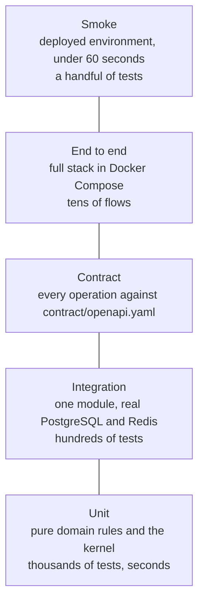

# HaKorem Farms Platform: Test Strategy

What is tested, at which layer, where the files live, what commands run them, which gates fail the build, and which tests the ADRs and the threat model already require by name. The practice rules for writing a test (naming, factories, Testcontainers setup) are also the content of the `hakorem-tests` skill. The frontend repository carries its own `docs/TEST_STRATEGY.md` for its layers; this one covers the backend.

## 1. Principles

1. **Tests at five layers, always** (shared brief): unit, integration, contract, end to end and smoke. A module is not finished until every layer that applies to it passes.
2. **No mocked database, ever.** Integration means the real engine in a container: PostgreSQL 17 and Redis 7 in Testcontainers. The rules that live in the database (constraints, triggers, grants, isolation) can only be proved there.
3. **Money, stock, weight and permission logic is written test-first**, and the test asserts an exact value.
4. **The test is in the same commit as the code it covers.** A fix starts with a failing test that reproduces the bug.
5. **A flaky test is a failing test** (section 9).
6. **A test proves a behaviour, not an implementation.** It enters through the public interface (an endpoint, a command handler, a module's `index.ts`) and asserts an outcome.
7. **Test data is built, not copied.** Factories, never production data (section 8).
8. **Failure paths are tested as hard as the happy path.** The payment edge cases, the refusals, the wrong role and the replay are written before the happy path where the brief says so.

## 2. The pyramid



Many fast tests at the bottom, few slow ones at the top. A rule is tested at the lowest layer that can prove it. A rule that depends on the database (a trigger, a constraint, serialization behaviour) is an integration test, not a unit test with a fake.

| Layer | Scope | Runs against | When | Budget | Command |
| --- | --- | --- | --- | --- | --- |
| **Unit** | One domain rule, pure, no input or output | Nothing external | Every commit and every pull request | Whole suite under 60 seconds; one test under 100 ms | `pnpm test:unit` |
| **Integration** | A module through its public interface, or an endpoint through HTTP, with the database | PostgreSQL 17 and Redis 7 in Testcontainers and Versity Gateway for object storage, started once per run | Every pull request | Whole suite under 6 minutes on CI | `pnpm test:integration` |
| **Contract** | Every response shape and status against `contract/openapi.yaml`; the generated contract against the committed one | The running API (Testcontainers) | Every pull request, failing the build on any drift | Under 3 minutes | `pnpm test:contract` |
| **End to end** | A whole business flow across modules and the worker | The full stack in Docker Compose with a provider stub | Every pull request to `main`; in full nightly | Under 8 minutes for the pull request set | `pnpm test:e2e` |
| **Smoke** | A short list of critical paths, read-only plus one safe write | A deployed environment (staging, production) | Straight after every deploy; the exit code drives rollback | Under 60 seconds | `pnpm test:smoke -- --base-url=https://api.hakoremfarms.com` |

On top of those: a k6 load run against the non-functional targets before each release; a Lighthouse budget on the storefront (run from the frontend repository); and a nightly OWASP ZAP baseline against staging (section 13). The whole pipeline stays under 12 minutes (non-functional target); suites are parallelised and the slow set is reserved for pull requests to `main`.

## 3. What belongs in each layer

### 3.1 Unit

- **In:** the kernel (`Money`, `Weight`, `Quantity`, `allocate`, ids, `Clock`, `Result`); aggregates, value objects and domain services in each module's `domain/`; the pricing resolution order; the tax calculator; stock valuation arithmetic; distribution allocation; state machines; policy decisions that take plain data.
- **Out:** anything that opens a socket, reads a file, uses the real clock or the real random generator, imports NestJS or Drizzle, or needs a database to be meaningful.
- **Style:** inputs and exact expected outputs; the `Clock` and the id generator are passed in; no shared mutable state; one assertion topic per test; names state the rule (`refuses to allocate when all weights are zero`).

### 3.2 Integration

- **In:** a command handler or query through the module's public interface, with the real database; every constraint, trigger, grant and isolation behaviour; repositories; the unit of work and its retry; the outbox, inbox and dispatcher; the idempotency outcomes; authentication flows; authorisation (the wrong role is refused, the right role at the wrong branch is refused); audit append-only and chain verification; reservations and holds; numbering under concurrency; webhook verification and every payment edge case; reconciliation jobs; offline sync with the network disabled; uploads against the object store.
- **How:**
  - One PostgreSQL container and one Redis container per test worker. Migrations are applied **once** into a template database; each test file gets its own database cloned from the template (`CREATE DATABASE … TEMPLATE …`). This is the isolation mechanism: `LEDGER` tables reject `TRUNCATE` for every role, so tests do not clean up by truncating.
  - The behaviour under test connects as `hk_app` (so grants and triggers apply as in production). Tamper and recovery tests connect as a superuser to prove what the database does when its triggers are bypassed.
  - Time is controlled through the `Clock`; the transaction isolation and the advisory-lock behaviour are the real PostgreSQL 17 ones.
  - Data comes from factories (section 8).
- **Out:** a mock of the database or of a repository; the payment provider's real network (a stub server stands in, because the provider is not ours).

### 3.3 Contract

- **In:** for every operation in `contract/openapi.yaml`, a request built from the contract's own example and the seeded factories, with the response status, headers (`X-Correlation-Id`) and body validated against the declared schema; the error envelope on every 4xx; the 202 `ApprovalPending` shape; money fields are integers named `...Pesewas`; decimals are strings; enumerations upper case; customer and investor shapes carry no cost, floor, ceiling or variance. A separate check runs `pnpm contract:generate` and fails on any diff from the committed file, and the Redocly lint passes (`npx @redocly/cli lint contract/openapi.yaml`, no errors and no warnings).
- **Also:** every staff operation has `x-permission`, and the permission exists in `iam.permission` (the same walk the handler-walk test uses).
- **Out:** business rules. A contract test proves the shape, not the arithmetic.
- **Why it matters:** the frontend generates its client from this file. A silent change breaks it.

### 3.4 End to end

- **In:** whole flows through the real HTTP API with the worker, Redis, PostgreSQL, the object store (Versity Gateway) and a provider stub in Docker Compose, asserting outcomes across modules: counter sale with split tender to receipt, archive and ledger; online order to payment webhook to invoice; request for quote to order; goods receipt to purchase invoice match to supplier payment with approval; processing a goat into meat lots; period close; distribution run to ledger; delivery with cash on delivery to driver reconciliation; offline sale sync; data-subject export and deletion; the abuse cases (section 12). These are the backend half of the seven acceptance scenarios in `docs/UAT.md`.
- **Out:** browser behaviour. The Playwright suites for the storefront and console live in the frontend repository and run against staging.
- **Rule:** an end-to-end test reads results through the API and the exception report, never by querying the database directly.

### 3.5 Smoke

The deployment gate. It must be fast and safe to run against production repeatedly. It runs after the new containers start and before traffic switches; if it fails, the new containers are discarded and the deploy exits non-zero without waiting for a human.

| Step | What it does |
| --- | --- |
| 1 | `GET /health`: database, Redis, queue depth, outbox backlog and the last reconciliation all healthy |
| 2 | Log in as the two smoke users (a cashier and a supervisor, because the maker cannot be the checker) and receive their sessions |
| 3 | Read the catalogue |
| 4 | In the dedicated smoke branch (`mdm.branch.is_test = true`, assumption A-049), create a sale and void it through the approval flow; the statutory sales report excludes the branch (ADR-0007) |
| 5 | Post a payment webhook with a bad signature and assert it is rejected and recorded |
| 6 | Generate one document |
| 7 | Read the trial balance and assert it answers and balances |

It never touches non-test branches, never creates customer-visible data, and cleans up nothing it cannot reverse (the voided sale is itself the clean-up). It takes `--base-url`; it refuses to run without both smoke users configured.

## 4. File naming and location

Unit tests sit **beside the code**; every other layer lives under `test/`. This is the rule, stated once.

| Layer | Location | File name | Example |
| --- | --- | --- | --- |
| Unit | Next to the file under test | `<subject>.spec.ts` | `packages/kernel/src/money.spec.ts`; `src/modules/mdm/domain/pricing/price-resolver.spec.ts` |
| Integration | `test/integration/<module>/` | `<subject>.integration.spec.ts` | `test/integration/inv/stock-movement.integration.spec.ts` |
| Contract | `test/contract/<module>/` | `<subject>.contract.spec.ts` | `test/contract/ord/sales-order.contract.spec.ts` |
| End to end | `test/e2e/<area>/` | `<subject>.e2e.spec.ts` | `test/e2e/security/abuse-case-01-void-after-cash.e2e.spec.ts` |
| Smoke | `test/smoke/` | `<subject>.smoke.spec.ts` | `test/smoke/health.smoke.spec.ts` |
| Load | `test/load/` | `<scenario>.k6.js` | `test/load/counter-sale.k6.js` |
| Factories | `test/factories/` | `<aggregate>.factory.ts` | `test/factories/stock-unit.factory.ts` |
| Shared harness | `test/support/` | any | `test/support/postgres.ts` |

- `<module>` is the lower-case module code (`inv`, `ord`, `pay`, `platform` for `src/platform`).
- `<subject>` is the unit, aggregate or endpoint group under test in kebab-case.
- Vitest projects select by pattern: `unit` runs `**/*.spec.ts` outside `test/`; `integration` runs `test/integration/**/*.integration.spec.ts`; and so on. A file in the wrong place does not run, and a lint check fails the build if a `*.spec.ts` under `test/` lacks its layer suffix.
- A `describe` names the subject; an `it` states the behaviour as a sentence: `it('rejects a second active reservation of one serial unit')`. Named tests required by ADRs use the exact wording in sections 10 and 12 so they can be searched for.
- No `.only`, no `.skip`, no `.todo` in a merged change (lint). A test that must be disabled is quarantined (section 9).

## 5. Commands

Each script does exactly what its name says, with no hidden steps (`docs/BUILD_PROMPT.md`).

```bash
pnpm test:unit                                        # fast, no containers
pnpm test:integration                                 # Testcontainers PostgreSQL 17 and Redis 7
pnpm test:contract                                    # responses against contract/openapi.yaml, and the generated-contract diff
pnpm test:e2e                                         # full stack in Docker Compose
pnpm test:smoke -- --base-url=https://api.hakoremfarms.com
pnpm contract:generate                                # writes contract/openapi.yaml from code; CI fails on any diff
npx @redocly/cli lint contract/openapi.yaml           # no errors, no warnings
k6 run test/load/counter-sale.k6.js                   # load, one script per scenario
```

CI order on every pull request: lint (with the boundary rule), type check, unit, integration, contract, build, end to end, then the security scans. On `main`: the same, then image build, deploy to staging and smoke. Production deploy is a manual approval on the same workflow.

## 6. Coverage gates

Coverage is measured with V8 coverage in Vitest, with unit and integration results merged, and enforced in CI.

| Gate | Threshold | Applies to |
| --- | --- | --- |
| Overall | **80 percent** lines, statements, functions and branches | The whole backend source, excluding generated code, `main.ts`, the migration runner and test files |
| Pricing | **100 percent branch** | `src/modules/mdm/domain/pricing/**` (the resolution order and every `QuoteRequired` reason, ADR-0004) |
| Ledger | **100 percent branch** | `src/modules/fin/domain/**` (posting rules, journals, periods, ADR-0003) |
| Stock valuation | **100 percent branch** | `src/modules/inv/domain/valuation/**` (cost pool, average cost issue, ADR-0018) |
| Distribution | **100 percent branch** | `src/modules/cap/domain/distribution/**` (unit-days, allocation, ADR-0028) |
| Kernel | **100 percent branch** | `packages/kernel/**`: `Money`, `Weight`, `Quantity`, `allocate` (ADR-0001, `docs/BUILD_PROMPT.md` B2) |
| Tax calculator | **100 percent branch** | `src/modules/mdm/domain/tax/**` (ADR-0020). Not named in the shared brief; added here because tax arithmetic is on the money path |

- The paths are globs in the Vitest configuration, each written through `fullCoverage` in `vitest.config.mts`. The module session that creates the folder keeps the glob true; `fullCoverage` refuses to load the configuration when a glob matches no source file (Vitest itself would pass it), so a rename cannot silently drop a gate.
- A gate whose folder does not exist yet sits in `vitest.config.mts` as a commented placeholder. Each session that creates one of those folders adds its own 100 percent path, uncommented, before its gate passes: B4 continued the tax calculator, B5 stock valuation, B8 the ledger, B12 distribution. The kernel and pricing (B4) are live.
- A line is excluded from coverage only with a comment stating why, in review. Excluding to meet a gate is a review blocker.
- Coverage is a floor, not a goal. A test that executes a branch without asserting its outcome does not count in review.
- The session report records the figures (`docs/BUILD_PROMPT.md`, "The session report").

## 7. Which tests a change needs

| Change | Unit | Integration | Contract | End to end | Smoke |
| --- | --- | --- | --- | --- | --- |
| Domain rule (price, tax, valuation, allocation, state machine) | Yes, exact values and edge cases | If the rule is also a constraint or trigger | | | |
| New or changed endpoint | If it has a domain rule | Success, validation failure, wrong role, wrong branch, replay of the idempotency key, wrong owner | The operation's schema and example | If it is part of a cross-module flow | If it is a critical path |
| New table, constraint, trigger or grant | | The rule proved by an attempt to break it as `hk_app`; the class and grant test | | | |
| Migration | | Upgrade from the previous release's schema, then run the new code | | | |
| Event or subscriber | | Redelivery is a no-op; failure retries and ends `DEAD`; rollback together with the publisher | | | |
| Money, stock or ledger path | Exact values | Rollback leaves nothing; concurrent execution | | The flow, ending in a balanced trial balance | |
| Payment or webhook | | Every edge case in section 10, signature and timestamp and replay and amount | | Order to payment to invoice | Bad-signature webhook |
| Authentication, authorisation, export, upload | | The abuse of it, and the refusal | | The abuse case with its exception-report assertion | |
| Offline sync | | Network disabled; replay; conflict | | 500 queued transactions | |

## 8. Test data policy

1. **Factories, not fixtures.** Every aggregate has a factory in `test/factories/` that builds a valid object with overridable fields and sensible Ghanaian content (names, phone numbers in E.164 with a `+233` prefix, Accra and Dodowa addresses, products such as goat, broiler, tomato and eggs). A test overrides only what it asserts on. Factories take the `Clock` and the id generator.
2. **Seed data is clearly marked as seed.** `pnpm db:seed` loads the seeded farm used for development, the performance dataset and the UAT run. Every seed record sits in a branch or carries a marker that says so, display names include "Seed" or "Test" where a person could see them, and the seed script **refuses to run against production**. Each session extends the seed so later sessions inherit a realistic farm (`docs/BUILD_PROMPT.md`).
3. **Never production data.** Production data does not enter staging, seeds, fixtures, screenshots, bug reports or a developer machine. A restore drill uses the staging server and the production backup under the incident-log rules, and the restored data stays on staging only for the drill.
4. **Real-looking is allowed; real is not.** Phone numbers use unassigned ranges or a documented test prefix; TINs and Ghana Card numbers are generated and fail the real checksum; bank and wallet details are obviously synthetic. No real key, token or secret is in a test; secrets are generated per run.
5. **Each test owns its data.** A test creates what it needs through factories in its own database (section 3.2) and does not depend on another test's rows or on order.
6. **Deterministic.** Time from the `Clock`, ids from the injected generator, randomness seeded. Where a test needs UUIDv7 ordering it uses the kernel generator.
7. **The smoke branch** is the one place a test writes to a deployed environment: the branch flagged `is_test`, in every environment including production (A-049). It is excluded from statutory reports.

## 9. Flaky tests

A flaky test is a failing test. The rules:

1. **No retry loop papers over a flake.** The test runner is configured with zero retries in CI.
2. **Find the cause.** The usual causes are real-time sleeps, test order dependence, shared state between tests, unseeded randomness, clock use, an unawaited promise, a race in the code under test, or two tests competing for one database. A race in the code under test is a product bug: it is fixed in the product.
3. **Wait on conditions, not time.** Use polling on an observable condition with a timeout (the outbox drained, the job `DEAD`), never `sleep(2000)`.
4. **Quarantine, with an issue.** If a test cannot be fixed in the day, it is moved to the `quarantine` project (it still runs, nightly, and reports) with a comment naming an open issue and an owner; the main suites do not include it. A quarantined test older than 14 days is escalated to the owner of the module. A skipped test is never merged without an issue referenced in the commit message (shared brief, operating rule 6).
5. **Track it.** The nightly run reports tests that failed once and passed on rerun, using the Vitest report. Any such test is treated as a flake and enters section 9 rule 4.

## 10. Tests the ADRs already require, by name

These tests are specified in ADR verification sections. Each session that owns one writes it under the name below (the `it` text, searchable by `grep`) and in the layer shown. A test with a stated session that is missing at that session's gate is a failing gate.

### 10.1 ADR-0028: the five distribution tests (B2 for 1, 2 and 4 against `allocate`; B12 for 1 to 5 against the run)

All values are given in ADR-0028 and are asserted exactly.

| # | Name | Layer | Key assertions |
| --- | --- | --- | --- |
| 1 | `allocates an awkward amount across three investors without creating or losing a pesewa` | Unit (`allocate`, B2); integration (the run, B12) | Distributable 1,000,001 pesewas, unit-days 90,000, 22,500 and 30,250; allocated exactly 630,474, 157,618 and 211,909; sum 1,000,001; rounding each share half-up gives 1,000,000 and the implementation must not |
| 2 | `breaks a tie between equal remainders by investor number` | Unit | Three equal weights, 100 pesewas: 34, 33, 33 in investor-number order |
| 3 | `counts the contribution day and not the withdrawal day` | Integration (B12) | 100 units from 10 April to 20 April in a 30-day period: unit-days 1,000 |
| 4 | `refuses to allocate when all weights are zero` | Unit | A typed error and no allocation rows |
| 5 | `the posted distribution ties to the ledger` | Integration (B12) | After posting test 1: account 3300 debited 1,000,001; account 2300 credited 630,474, 157,618 and 211,909 against three investor subledgers; trial balance sums to zero |

### 10.2 ADR-0005: transactions and isolation (B2 and B8)

| Name | Layer | Assertion |
| --- | --- | --- |
| `a session-level advisory lock taken before BEGIN makes the second serializable transaction wait and then succeed` | Integration, two sessions (B2) | Proves assumption A-060 |
| `pg_advisory_xact_lock as the first statement inside the transaction does not, because the snapshot is taken before it blocks` | Integration, two sessions (B2) | The second transaction fails with 40001. This is the other half of A-060 |
| `the unit of work retries 40001 and 40P01 and gives up after five attempts with a typed error` | Integration (B2) | Five attempts, then the typed error |
| `numbering stays gap-free under concurrent load` | Integration (B8 gate) | See 10.3 |

### 10.3 ADR-0015: numbering and offline references (B8, B9b)

| Name | Layer | Assertion |
| --- | --- | --- |
| `50 concurrent issuers on one series produce a dense sequence with no gap and no duplicate` | Integration (B8 gate) | Allocated values 1 to 50 exactly once; `count = next_value - 1`; every allocation has its document |
| `a transaction that rolls back after allocation leaves no gap` | Integration (B8) | The number is returned with the rollback |
| `500 queued offline transactions sync exactly once, each with one official number` | Integration with the network disabled, then e2e (B9b gate) | 500 orders, 500 official numbers, no duplicate; resend is a no-op |
| `a missing device counter value produces an exception record` | Integration (B9b) | `DEVICE_COUNTER_GAP` raised and on the daily exception report |

### 10.4 ADR-0027: the five offline conflict tests (B9b)

| Name | Layer | Assertion |
| --- | --- | --- |
| `posts an offline sale of an animal that was sold elsewhere as an exception without a movement` | Integration | Order, document and payment recorded; `inv.stock_exception` row; line has no movement |
| `posts an offline sale of an animal placed on hold as an exception without a movement` | Integration | As above, kind names the hold |
| `lets an offline sale of countable stock take the balance negative and raises an exception` | Integration | Balance negative at the sellable location; exception row |
| `posts an offline sale dated in a locked period on the first open date, flagged, with its original occurred_at` | Integration | `occurred_at` kept; posting date is the first open date |
| `flags a missing device counter` | Integration | `DEVICE_COUNTER_GAP` |

### 10.5 Money and kernel (ADR-0001, B2)

| Name | Layer | Assertion |
| --- | --- | --- |
| `Money, Weight, Quantity and allocate at 100 percent branch coverage` | Unit | Coverage gate; each rounding edge case a named test: exact half, one below, one above, zero, maximum (section 11) |
| `the allocation test specified in ADR-0028 asserts no pesewa is created or lost` | Unit | See 10.1 test 1 |
| `a lint rule fails the build on number arithmetic in files that import Money` | Lint fixture | The fixture file fails `pnpm lint` |
| `the platform.pesewas domain rejects negative and oversize values` | Integration | An insert of -1 and of 9,007,199,254,740,992 both fail |

### 10.6 The rest of the ADR verification list

| ADR | Session | Test |
| --- | --- | --- |
| 0002 stock ledger | B5 | Each rejection path as its own integration test: negative stock, double sale of a serial unit, sale under hold, serial unit moved from the wrong location, update and delete attempts. On-hand derived from movements matches a hand count of the seeded farm (gate). The nightly recompute detects a deliberately corrupted balance row and does not repair it |
| 0003 chart of accounts | B8 | Trial balance sums to zero on a seeded trading day; an unbalanced journal is rejected by the database; a posting into a closed period is rejected by trigger; the boot assertion fails when a `posts_to_ledger` event has no handler; each row of the posting matrix has a test with exact debit and credit amounts |
| 0004 pricing | B4 | A price resolves correctly for every band, channel and customer tier in the reference catalogue (gate); a test per row of the resolution order and per `QuoteRequired` reason; two overlapping active versions and two entries for the same product, grade and band are rejected by the database |
| 0006 audit | B3, B13 | The application role cannot update, delete or truncate `platform.audit_event` or `platform.audit_chain`; altering one stored event through a superuser connection makes the verifier report the exact `seq`; a business change and its audit row commit or roll back together; 20 parallel audited writes show no serialization failures attributable to auditing; the anchor is written off-box and verified from a clean environment (B13) |
| 0007 locations | B3, B5, B13 | A user granted a role at branch A is refused the same action at branch B; a storekeeper scoped to one location cannot post a movement from another; the smoke suite creates and voids a sale in the test branch and the statutory sales report excludes it |
| 0008 modules | B2, B3 | A deliberately illegal import in a fixture fails `lint`; both data checks (cross-schema foreign keys, schema names in code) run in CI; the Product vertical slice passes all rules |
| 0009 platform | B3 | `src/platform` cannot import any module; no file under `src/platform` contains a permission code, an account code or a threshold |
| 0010 outbox | B3, B8 | A business change and its outbox row commit or roll back together; a redelivered message produces no second effect; a failing asynchronous subscriber is retried with backoff and ends `DEAD` after the configured attempts, with the health endpoint reporting it; a ledger posting failure rolls back the originating stock movement (B8) |
| 0011 foreign keys | B2, B3 | The `pg_constraint` check fails on a cross-schema foreign key not on the allow-list; a document row cannot be inserted without its registry row, and a registry row cannot be deleted while referenced |
| 0012 table classes | B2 onward | The schema test reads the class of every table and asserts the application role's privileges match it; per `LEDGER` table, update and delete are rejected; per `DOCUMENT` table, a posted row cannot be altered outside its allowed columns |
| 0013 ids | B2, B9b | UUIDv7 generation, monotonic ordering within a millisecond, parsing and version check; a sale submitted twice with the same client id is stored once; a client id with a timestamp outside the allowed window is rejected |
| 0014 idempotency | B3, B9a | Each of the four outcomes (proceed, stored response, mismatch conflict, concurrent duplicate waits), including two concurrent identical requests producing one effect; the five payment edge cases in 10.7 |
| 0016 authentication | B3 | Refresh rotation; reuse detection revoking the session; forced logout; lockout backoff; identical responses and timing class for known and unknown accounts; TOTP enrolment and step-up expiry; CSRF rejection. Gate: the frontend logs in against the real API |
| 0017 authorisation | B3, every module | The handler-walk test (every registered handler and route declares a permission); a test per seeded role that a forbidden action is refused; an approval by the requester is rejected by the database. Every module session's definition of done includes a test that the wrong role is refused |
| 0018 valuation | B5, B6, B8 | Exact-value tests for average cost issue, including the issue that empties a pool and a rounding edge case; a processing order produces lots whose costs sum exactly to input cost plus direct processing cost (B6 gate); a feed allocation across a pen sums exactly to the feed value issued; nightly reconciliation of pool values against inventory accounts (B8) |
| 0019 reservations | B5, B6, B7 | A second active reservation of one serial unit is rejected; a reservation above on-hand is rejected; expiry releases stock; an animal treated with a withdrawal-day product cannot be sold or processed until the hold ends, including through a direct SQL insert; checkout reserves stock and releases it on timeout (B7 gate) |
| 0020 tax | B4, B8 | Calculator tests with exact values for exclusive and inclusive prices, a compounding levy, a zero-rated and an exempt category, and a rounding edge case; an incomplete scheme version cannot be activated; a fourth levy added as data only produces an invoice with four levy lines and four subledger postings with no code change; inclusive-price lines always satisfy net plus levies equals gross |
| 0021 catch weight | B9a, B11 | Exact values for a final total below, equal to, above-within-tolerance and above-beyond-tolerance of the estimate; a catch-weight order re-prices at pick, the invoice shows weighed quantity, and the outbox carries the customer notification |
| 0022 encryption | B3, B13 | Round-trip tests; destroying a subject key leaves the audit chain verifying and the payload unreadable; secret fields never appear in an audit payload; the log-scrubbing test feeds a phone number, a token and a payment reference through the logger and asserts none appears; the restore drill restores the key-encryption key from its separate backup and decrypts a sample value (B13) |
| 0023 reporting | B12, B13 | The `hk_report` role cannot select from a transactional table; dropping a fact table and replaying events reproduces totals; the k6 run includes a heavy report during counter sales and the POS latency target still holds |
| 0024 roles | B2, B3, B12 | The grants test; `hk_app` cannot run DDL; `hk_app` cannot update or delete audit rows; `hk_sealer` cannot read or write business tables; `hk_report` cannot read transactional tables |
| 0025 deployment | B2, B13 | The same compose topology runs locally from one command; a deploy with a deliberately failing smoke test leaves the old version serving and exits non-zero; the restore drill meets the recovery time objective and the time is written down |
| 0029 contract | B1 onward | Every example validated against its schema; the Redocly lint passes; CI fails if the generated contract differs from the committed one |

### 10.7 Payment edge cases (ADR-0014 and the shared brief, B9a)

Written before the happy path. Each is an integration test against the provider stub, asserting the ledger, the order status and the exception queue.

| Name |
| --- |
| `a provider timeout after the customer was charged leaves the payment pending and reconciles from the lookup` |
| `a webhook that arrives before the API response clears the payment once` |
| `a webhook delivered twice has no second effect` |
| `a webhook for an order that no longer exists is recorded and ignored` |
| `a refund that fails after the stock was released is queued and appears in the break queue` |
| `a webhook with an invalid signature, a stale timestamp or a wrong amount is rejected and recorded with its outcome` |

## 11. Money tests: exact values and rounding edge cases

Rules for any test that touches price, quantity, weight, tax, payment, ledger or investor share (shared brief operating rule 4; ADR-0001):

1. Assert **exact integers** (pesewas) or exact decimal strings. Never a tolerance, never `toBeCloseTo`.
2. Inputs are written in pesewas and decimal strings. No test builds money from a JavaScript `number` with a fraction.
3. A rounding test names the rule it proves, and the expected value is worked out by hand in a comment.
4. A split asserts that the parts sum to the whole.
5. A document test asserts the line, the sum of lines, and the invariant `net + tax = gross`.
6. Every calculation has at least the edge cases in the table.

| Edge case | Example (half-up, `half_up(n / d) = (2n + d) div 2d`) | Expected |
| --- | --- | --- |
| Exact half | `half_up(5 / 2)` | 3 |
| One below the half | `half_up(499 / 1000)`, as 0.499 pesewas | 0 |
| One above the half | `half_up(501 / 1000)` | 1 |
| Zero | `half_up(0 / 7)`, and a line of quantity 0 | 0 |
| Maximum | The largest `platform.pesewas`, 9,007,199,254,740,991, through add, multiply and allocate | Exact; one more is a typed error, not a silently wrong number |
| Many parts | `allocate(100, [1,1,1])` | 34, 33, 33 (ties by stable key) |
| Zero weights | `allocate(100, [0,0])` | A typed error, never an equal split |
| Rounded once | A line of 2.500 kg at 1,001 pesewas per kg (exact product 2,502.5) | 2,503, rounded once at the line anchor, never per kilogram |

**A tax split to name and assert (ADR-0020, B4).** For a tax-inclusive line of GHS 10,000.00 (1,000,000 pesewas), with VAT 15, NHIL 2.5 and GETFund 2.5 on one base, the exact parts are net 833,333.33, VAT 125,000.00, NHIL 20,833.33 and GETFund 20,833.33 pesewas. The floors sum to 999,999, so one pesewa is left. The test is named `splits a tax-inclusive line into net and three levies that sum exactly to the gross`, and asserts the sum equals 1,000,000 and VAT is exactly 125,000. The Ghana Revenue Authority's guideline on tax fractions derives VAT 1/8, NHIL 1/48 and GETFund 1/48 of the inclusive amount, giving GHS 1,250.00, 208.33 and 208.33 (`docs/security/COMPLIANCE.md` section 6); the levy amounts here are the same. Because three parts share an equal fractional remainder (net, NHIL and GETFund), the extra pesewa goes by the tie-break key. This document fixes the key as net first, then levies by `calc_order`, so the expected result is net 833,334, VAT 125,000, NHIL 20,833, GETFund 20,833, total tax 166,666 (GHS 1,666.66). The B4 session records that tie-break in the tax calculator's documentation and any change needs an ADR. The GRA guideline's own worked example prints a total of 1,666.67, one pesewa above the sum of its three printed parts; this is why certified totals (`certified_tax_pesewas`) exist beside line sums.

Named tests per rounding family (examples; the module sessions list the full set):

- `rounds an exact half up to the next pesewa` / `one below the half rounds down` / `one above the half rounds up` / `zero stays zero` / `the maximum amount is exact` (kernel).
- `issuing the last unit from a cost pool takes the whole remaining value` and `average cost issue rounds half up once` (valuation).
- `a header discount allocated across lines sums exactly to the discount` (pricing and billing).
- `net plus levies equals gross for every inclusive line` (billing).
- `distribution allocations sum to distributable` (distribution).

## 12. Abuse-case tests (B13)

Every abuse case in `docs/security/THREAT_MODEL.md` section 4 becomes **two tests** (the second added to B13 by the owner on 2026-11-13):

1. **The control test.** The attempt is made through the real API as the malicious actor. The test asserts the primary control blocks it, or, where the control only makes it visible, that the record exists with its evidence.
2. **The exception-report test.** After the attempt, blocked or not, the test advances the worker until the outbox is drained, then calls `GET /exceptions/daily-report?date=<business date>&branchId=<branch>` as the Owner and asserts the `items` array contains an item with: the case's `kind`, an `abuseCases` array containing the case number, the `actor.id` of the attacker, the `amountPesewas` where the case has an amount, and the `subjectDocument.id` of the sale, adjustment or payment involved. `counts` for that kind is at least 1. A case that is blocked but leaves no trace on the report is a failing test.

A third, global test, `every abuse case appears on at least one exception kind`, builds the set of case numbers from every `abuseCases` array in the report across the 18 attempts and asserts it equals {1 to 18}.

The report is read by the owner, not by the approvers (THREAT_MODEL R1), so the test authenticates as the Owner and also asserts that an approver's session is refused `rpt.exceptions.read` where the roles differ.

Files are `test/e2e/security/abuse-case-NN-<slug>.e2e.spec.ts`, each with `describe('abuse case NN: <name>')` containing the two tests as `it('is blocked or made visible by its control')` and `it('appears on the daily exception report as <KIND>')`.

| # | Abuse case | The attempt | Control asserted | Exception kind on the report |
| --- | --- | --- | --- | --- |
| 1 | Cashier completes a sale, takes the cash, voids it | Cashier completes a cash sale, then requests a void | The void returns 202 `ApprovalPending`; the cashier cannot approve it (database check); a supervisor's approval leaves the order, a credit note and reversing entries as an immutable record | `SALE_VOID` |
| 2 | Storekeeper records a healthy animal as dead | Posts mortality above the value threshold without a photograph, then with one | Refused without photograph and second approver; stock unchanged until a different user approves | `MORTALITY` |
| 3 | Repeated small price overrides | Several overrides each within a line limit but above the shift limit | Override beyond the role limit per line and per shift needs approval; reason mandatory; variance posted to account 4210 | `PRICE_OVERRIDE` |
| 4 | Forged mobile money confirmation | Cashier tries to record a mobile money tender as paid without a provider confirmation; an offline mobile money tender | No screen or endpoint accepts "paid" on the cashier's word; offline tenders are cash only (ADR-0027); the payment is `UNVERIFIED` and in the unmatched queue | `UNMATCHED_PAYMENT` |
| 5 | Forged webhook marks an order paid | A webhook with a bad signature; a replay of a genuine event; a genuine event with an altered amount | Rejected at the signature, replay or amount step with the outcome recorded; the order stays unpaid | `WEBHOOK_REJECTED` |
| 6 | Driver under-declares cash on delivery | Driver records a collected amount below the amount due fixed at dispatch | The variance is recorded against the driver; reconciliation needs someone other than the driver | `DRIVER_VARIANCE` |
| 7 | Stock adjustment hides a shortage | An adjustment above threshold, shortly before a stock take | Needs approval by a different user; reason codes are a fixed list; the adjustment is immutable | `STOCK_ADJUSTMENT` |
| 8 | Investor reaches finance data | An investor session calls a general finance endpoint and another investor's record | Deny by default; ownership rule returns not found; the investor realm has no path to finance endpoints | `AUTHORISATION_FAILURE` |
| 9 | Insider exports the customer list | A staff user without step-up requests a bulk export; one with step-up exports | Bulk export needs step-up; the export is audited with its row count | `BULK_EXPORT` |
| 10 | Offline sale deleted from the device before sync | A sync batch with a gap in the device counter | The gap is detected at sync; no sale is invented or lost | `DEVICE_COUNTER_GAP` |
| 11 | Animal sold while reserved, on hold or sold | Sell an animal under reservation, under a withdrawal hold and already sold | The stock movement is refused by the database; the sale and the money are still recorded | `STOCK_EXCEPTION` |
| 12 | False return to obtain a refund | A return for more than was sold, with no original order, or to a different destination | A return must reference the original order and cannot exceed it; the refund is tied to the original payment and approved | `REFUND` |
| 13 | Supplier payout details changed to divert a payment | Change payout details and pay in the same session | The change needs a different approver; the payment needs a different approver; details are encrypted and a decryption is audited | `PAYOUT_DETAIL_CHANGE` |
| 14 | Credit sale beyond the limit | Confirm an order that exceeds the credit limit | Refused at confirmation; an override needs approval and is audited | `CREDIT_OVERRIDE` |
| 15 | Audit log or ledger altered directly in the database | As a superuser, update an audit event and a ledger row, disabling the trigger first | The application role is refused; the verifier reports the exact `seq`; the reconciliation job reports the drift and does not repair it | `AUDIT_INTEGRITY` and `RECONCILIATION_BREAK` (one item of each kind, each carrying 15) |
| 16 | Manager grants themselves a higher role | A grant change without step-up; with step-up | Needs step-up; audited | `PERMISSION_CHANGE` |
| 17 | Shift closed short | Close a shift with a declared count below the ledger | Blind close, supervisor sign-off; over and short posted to the ledger | `SHIFT_OVER_SHORT` |
| 18 | Under-recorded processing yield | Record a yield below the standard | The yield variance is flagged against the standard | `YIELD_VARIANCE` |

The 19 exception kinds in the contract's `ExceptionKind` enumeration are all covered by these cases.

## 13. Load, front-end budgets and the security scans

### 13.1 k6 load (B13, and before each release)

Scripts under `test/load/`, run against staging with the seeded performance dataset (10,000 products, 150,000 orders, 2 million stock movements, A-068).

| Target | Threshold (fails the run) | Scenario |
| --- | --- | --- |
| API read latency | p95 under 300 ms at 50 concurrent users | `reads.k6.js`: catalogue, stock on hand, order lists |
| API write latency | p95 under 600 ms at 50 concurrent users | `counter-sale.k6.js`: complete a sale with stock, invoice, payment and ledger posting; the retry rate from serialization failures is recorded in `docs/OPERATIONS.md` (ADR-0005) |
| Concurrency | 50 back-office users and 500 storefront sessions without degradation | `mixed.k6.js` |
| Heavy report during counter sales | The POS write target still holds (ADR-0023) | `report-during-sales.k6.js` |
| Offline backlog | 500 queued transactions sync exactly once | Covered by 10.3, run at volume here |

Actual numbers are recorded in `docs/OPERATIONS.md`. A missed target is fixed or renegotiated in writing; it is never quietly skipped (`docs/BUILD_PROMPT.md`, B13).

### 13.2 Lighthouse (storefront; frontend repository)

Run from the frontend pipeline against staging, with the backend supplying the seeded catalogue: largest contentful paint under 2.5 s on a simulated 3G connection; a catalogue listing page under 300 KB compressed. The backend's part is that public catalogue responses stay small and cacheable and that images come as re-encoded variants.

### 13.3 OWASP ZAP and the pipeline scans

- A **nightly ZAP baseline scan** against staging, covering the storefront, the console and the API (the OpenAPI definition is imported for the API target). High-severity findings fail the nightly job and open an issue; they must be cleared before a release. Medium findings are triaged within the sprint.
- **Per pull request:** dependency audit, static analysis, secret scanning and container image scanning; a high or critical finding blocks the merge (SC-20, SC-21).
- **B13:** run the baseline against staging, clear every high-severity dependency and image finding, and record the result in the session report.

## 14. Schedule

| When | What runs |
| --- | --- |
| Every commit (local) | `pnpm test:unit`, lint, type check |
| Every pull request | Lint with the boundary rule, type check, unit, integration, contract, build, end to end, security scans |
| Every merge to `main` | The pull request set, image build, deploy to staging, smoke; manual approval then production deploy and smoke |
| Nightly | Full end to end, the quarantine project, the ZAP baseline against staging, the reconciliation and audit chain verification jobs against staging data |
| Before each release | k6 load run, the restore drill each quarter (timed and recorded) |
