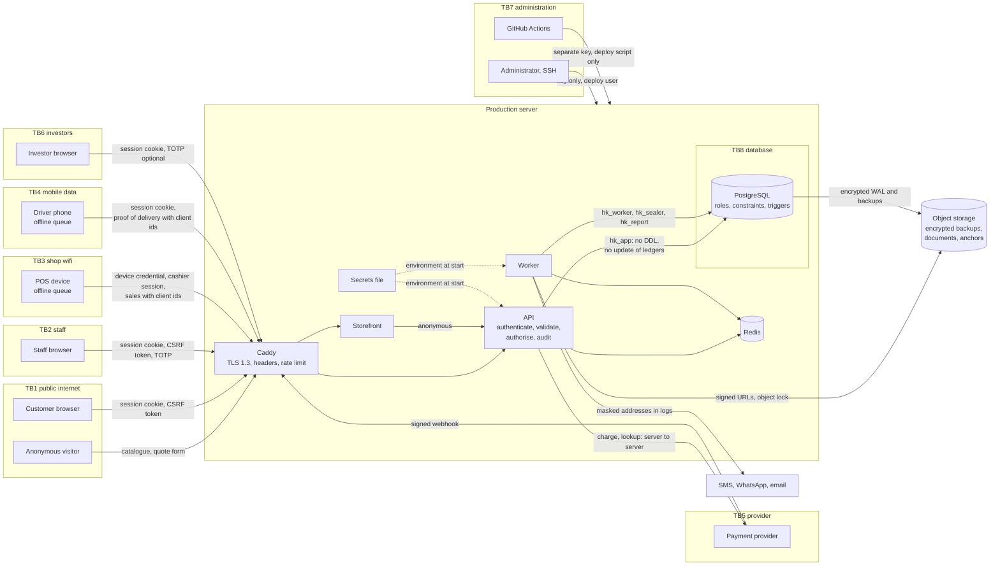

# HaKorem Farms Platform: Security Architecture

Trust boundaries, authentication and authorisation design, key management, encryption and secure defaults. The threats these controls answer are in `docs/security/THREAT_MODEL.md`. Data classification, secure coding standards and compliance are written in B1.

## 1. Principles

1. **Design for the insider first.** The likeliest loss is someone with a valid login voiding a cash sale, writing off a living goat or adjusting stock to cover a theft. Controls are built around that, then the perimeter is hardened.
2. **Put the rule in the database.** A constraint cannot be bypassed by a script, a migration or a later developer. Application checks are in addition, never instead.
3. **Deny by default.** No permission, no action. No rule, no price. No verified callback, no payment.
4. **Two people for anything that moves value quietly.** The maker cannot be the checker, and the database enforces it.
5. **Nothing is silently changed and nothing silently diverges.** History is append-only, reconciliation reports and never corrects, and every exception reaches a person.
6. **Evidence survives.** Every action has an actor, a time, an address and before and after values, in a log that shows tampering.
7. **Least privilege everywhere.** Database roles, API keys, deploy credentials and staff roles each get only what they need.

## 2. Trust boundaries

Eight boundaries, as the shared brief names them. Data crossing a boundary is authenticated, validated and authorised on the inside of it, whatever the outside claims.

| # | Boundary | Outside | Inside | What crosses |
| --- | --- | --- | --- | --- |
| TB1 | Public storefront | Anonymous internet users, crawlers, bots | Caddy, storefront, public API endpoints | Catalogue reads, carts, checkout, quote requests, customer login |
| TB2 | Authenticated back office | Staff browsers on any network | Console API endpoints | Every business command |
| TB3 | POS device on shop wifi | A shared tablet or computer on an untrusted local network, sometimes offline | Sync and POS endpoints | Sales made offline, shift data, cached prices |
| TB4 | Driver mobile device | A personal phone on mobile data, sometimes offline | Delivery endpoints | Proof of delivery, cash collected, position |
| TB5 | Payment provider webhooks | The internet, claiming to be the provider | Webhook endpoint, PAY module | Payment and refund events |
| TB6 | Investor portal | Investors' browsers | Investor endpoints | Read-only capital, share and distribution data |
| TB7 | System administration | Administrators over SSH; the CI pipeline | The server, containers, secrets, migrations | Deployments, migrations, configuration, backups |
| TB8 | The database itself | Every process and person with a database connection | Tables, constraints, triggers, roles | SQL |

### Data flow with trust boundaries

## 3. Authentication

The design is recorded in ADR-0016. In summary:

| Element | Design |
| --- | --- |
| Identity store | Self-hosted. `iam.principal` with a user account in one realm: `STAFF`, `CUSTOMER` or `INVESTOR` |
| Password hashing | Argon2id, per-password salt, parameters tuned to about 250 ms |
| Password rules | Minimum length, breached-password check at set time, forced change on first staff login |
| Second factor | TOTP mandatory for Owner, Accountant, Manager; optional for others |
| Access token | Signed JWT, 10 minutes, cookie `__Host-hk_s_at`, `__Host-hk_c_at` or `__Host-hk_i_at` by realm |
| Refresh token | Opaque, rotating, hashed at rest, cookie `__Host-hk_s_rt`, `__Host-hk_c_rt` or `__Host-hk_i_rt`; reuse revokes the session |
| Cookie attributes | `HttpOnly`, `Secure`, `SameSite=Strict`, host-bound to the API host by the `__Host-` prefix |
| CSRF | Session-bound token in `X-CSRF-Token` on every state-changing request, plus an origin check. The token is derived from the session id with a server key and stored hashed, so a reload gets the same one (ADR-0034) |
| Sessions | Listed per user as devices; revocable by the user or a manager; revocation is immediate: the session row and the grants are read on every request, with no cache (ADR-0034) |
| Lockout | Exponential backoff per account, rate limit per address |
| Enumeration | Identical response and timing for known and unknown accounts on login and reset |
| Step-up | Fresh TOTP within five minutes for distributions, bulk exports, role, grant and posting rule changes |
| API keys | Shown once, stored hashed, scoped by role grants, rate-limited per key, rotatable |
| POS device | Enrolled by a manager, holds a device credential; cashier unlocks with a PIN against a cached shift when offline |
| Authentication audit | Every login, failure, logout, lockout, password change and token reuse is an audit event |

Token signing keys are held in the secrets file, have a key id, and are rotated by publishing the new public key before signing with it.

## 4. Authorisation

Recorded in ADR-0017.

- **Model.** Permission codes grouped into roles; roles granted to a principal at a branch and optionally one location.
- **Where it is checked.** In every command and query handler, by the IAM policy engine. Controllers also declare the permission, and a test fails if any route or handler lacks one.
- **Object-level ownership.** Declared per resource and checked on every read and write of a record a user can reach. A customer sees only their own orders; an investor only their own capital and distributions; a driver only their assigned deliveries; a cashier only their own shift.
- **Scope.** A cashier at the shop cannot post movements at the farm, because the grant names the branch and location and the handler checks both.

### Separation of duties

Enforced by `CHECK (decided_by <> requested_by)` on `iam.approval_request`, and by each document requiring an approval id to reach its posted status.

| Action | Maker | Checker |
| --- | --- | --- |
| Stock write-off: mortality, cull, adjustment, stock-take variance above threshold | Storekeeper, farm hand | Manager |
| Sale void | Cashier | Supervisor or manager |
| Price override beyond role limit | Cashier, sales | Manager |
| Quote below margin floor | Sales | Manager |
| Credit limit override | Sales | Manager or accountant |
| Refund above the automatic limit | Cashier, sales | Manager or accountant |
| Price list or promotion activation | Whoever drafted it | Manager or owner |
| Tax scheme activation, posting rule change | Accountant | Owner |
| Purchase order above limit | Requester | Manager |
| Supplier payment | Accountant | Owner or manager |
| Supplier payout detail change | Whoever edited it | Accountant or owner |
| Manual journal | Accountant | Owner |
| Capital withdrawal | Accountant | Owner |
| Investor distribution | Accountant | Owner, with step-up |
| Customer data deletion | Whoever logged the request | Manager or owner |
| Shift close count | Cashier | Supervisor |
| Driver cash reconciliation | Driver | Anyone but the driver |

Thresholds are data in `iam.approval_policy` and are themselves audited settings.

## 5. Application controls

| Control | Design |
| --- | --- |
| Input validation | A schema on every inbound payload at the boundary. The parsed, typed command is what travels inward. Unknown fields are rejected |
| SQL | Parameterised queries only, through Drizzle. Dynamic SQL is a review blocker. The application role cannot run DDL |
| Output | The API returns JSON only. Document templates are rendered in a sandboxed engine with no script execution and no remote includes |
| Content Security Policy | Set by Caddy for the console and by the storefront: no `unsafe-inline`, no `unsafe-eval`, explicit sources, `frame-ancestors 'none'` |
| Transport headers | HSTS with `includeSubDomains` and `preload`; `X-Content-Type-Options: nosniff`; `Referrer-Policy: strict-origin-when-cross-origin`; a restrictive `Permissions-Policy` |
| CORS | An allow-list of the storefront and console origins, with credentials. Never a wildcard |
| Errors | A standard envelope with a correlation id and a stable code. No stack trace, query or internal name leaves the process |
| Server-side requests | Outbound URLs supplied by users (webhook endpoints) must be HTTPS and are refused if they resolve to private, loopback or link-local addresses, at save and at send |

### Rate limits

Per address, per account and per API key, counted in Redis. Stricter on the endpoints the brief names.

| Endpoint group | Limit by | Behaviour when Redis is unavailable |
| --- | --- | --- |
| Login, TOTP, password reset, verification codes | Address and account | Fail closed |
| Public quote request form | Address and phone number | Fail closed |
| Checkout and payment initiation | Address, cart and customer | Fail closed |
| Webhook endpoint | Provider address ranges and volume | Fail open; signature still required |
| Authenticated console | Account | Fail open |
| Public catalogue reads | Address | Fail open |
| Integrations | API key, with the key's own limit | Fail closed |

Numeric limits are settings, set in B3 and recorded in `docs/OPERATIONS.md`.

### File uploads

1. Size is capped per upload type before the body is read in full.
2. Type is determined by content sniffing, not by extension or the declared content type, against an allow-list per use (images for products and proof of delivery; PDF and images for supplier and investor documents; spreadsheets for imports).
3. The file is stored under a random key in a bucket that is not the web root, with scan status `PENDING`.
4. It is scanned for malware by the worker. It is not served until `CLEAN`.
5. Images are re-encoded into variants; the original is not served to the public.
6. Public media is served from a separate origin. Private files are served only by signed, expiring URLs, and each issue is logged in `platform.file_access_log`.

## 6. Data protection

### Classification in brief

The full table, with a handling rule per category, is `docs/security/DATA_CLASSIFICATION.md` in B1. The levels used in this design:

| Level | Examples | Handling built into the design |
| --- | --- | --- |
| Public | Catalogue, prices shown online, product images | Served from the public origin |
| Internal | Stock levels, cost, margins, internal reports | Authenticated and authorised; never in the storefront's responses |
| Confidential | Customer names, phone numbers, addresses, order history, staff accounts, the audit log | As internal, plus masked in logs, encrypted per subject inside the audit log, export audited |
| Restricted | Bank and mobile money payout details, identity numbers, TOTP secrets, signing and encryption keys, investor payout details | Column-encrypted or held outside the database; decrypted only for a specific permission; every decryption audited |

### Encryption

| Where | Mechanism |
| --- | --- |
| In transit, external | TLS 1.3 at Caddy, certificates renewed automatically |
| In transit, internal | A private Docker network on one host; PostgreSQL and Redis are not published |
| At rest, restricted columns | AES-256-GCM envelope encryption in the application (ADR-0022) |
| At rest, personal data in the audit log | The same, under a per-subject key that a deletion request destroys |
| At rest, backups and WAL archives | Encrypted on the server before upload, with a key separate from the application's |
| At rest, object storage | Server-side encryption by the provider, in addition |
| At rest, disk | Full-disk encryption where the hosting plan offers it; recorded in `docs/OPERATIONS.md` in B13 |

### Keys and secrets

| Secret | Held in | Rotation |
| --- | --- | --- |
| Key-encryption key | Secrets file on the server; a sealed offline copy held by the owner | Yearly, and on staff departure; re-wraps data keys without touching rows |
| Data-encryption keys, per-subject keys | Database, wrapped by the key-encryption key | On re-encryption jobs |
| Lookup hashing key (HMAC) | Secrets file | Only with a re-hash job |
| Token signing key | Secrets file | Quarterly, with key ids overlapping |
| Audit anchor signing key | Secrets file of the worker only; public key published in `docs/` | Yearly |
| Database role passwords | Secrets file; each role has its own | On staff departure |
| Provider API keys and webhook secrets | Secrets file | On the provider's schedule, and on suspicion |
| Backup encryption key | Secrets file; a sealed offline copy held by the owner | Yearly |
| Deploy SSH key for CI | GitHub Actions secret | When anyone leaves the project |

No secret is in either repository, in an image, in a workflow file or in `platform.setting`. Example environment files hold key names only. Secret scanning runs on every pull request.

### Card data

No card number, expiry date or security code is ever stored, logged or passed through the server. Card and mobile money payments use the provider's hosted page or tokenised flow, which keeps the business in the lowest-burden PCI self-assessment category. The server sees a reference, an amount and a status.

### Logs and traces

Before any log line or span leaves the process, a scrubber removes or masks: passwords, tokens, cookies, one-time codes, key material, payment identifiers, and all but the last three digits of phone numbers. Request and response bodies are not logged. A test feeds each of these through the logger and asserts none appears.

## 7. Integrity and forensics

| Control | Design |
| --- | --- |
| Audit log | Every create, update, delete, login, permission change, price override, approval, export and decryption, with actor, time, address and before and after values (`platform.audit_event`) |
| Append-only | The application role has insert and select only; triggers reject update, delete and truncate for every role |
| Tamper evidence | Each event is sealed into a hash chain; the chain head is signed and stored off the server with object lock; a nightly job verifies it (ADR-0006) |
| Who can read it | Owner and Accountant, through the AUD module |
| Ledger immutability | Stock movements, journals and allocations are insert-only; corrections are reversing entries |
| Document immutability | Issued documents are frozen; the archive stores the bytes and their hash; a reprint is the same bytes with a marker |
| Time | The server synchronises with NTP; `occurred_at` from a device is kept beside the server's `recorded_at`, never in place of it |
| Retention | Long enough to investigate a dispute; periods are set in `aud.retention_policy` and documented in B1 |
| Evidence preservation | `docs/runbooks/incident-response.md` (B1) starts with snapshotting the database and exporting the audit chain and anchors before any corrective action |

## 8. Payment webhooks

A webhook is untrusted input until all of these pass, in order:

1. The request is recorded in `pay.webhook_event` whatever happens next.
2. The signature is verified against the provider's secret, over the raw body, in constant time.
3. The event's timestamp is within the accepted window.
4. The event id has not been seen (`UNIQUE (provider, event_id)`).
5. The reference matches a payment this system initiated.
6. The amount and status are confirmed by a server-to-server lookup to the provider. The payload's own amount is never trusted.
7. Only then is the payment cleared, in a transaction with its ledger posting.

A failure at steps 2 to 4 is logged with its outcome and answered without detail. Repeated failures raise an alert. No endpoint anywhere accepts a "paid" status from a browser or a device.

## 9. Devices at the edge

| Device | Risks accepted | Controls |
| --- | --- | --- |
| POS device | Shared, on untrusted wifi, offline for hours, holds a queue of sales and cached prices | Enrolment by a manager; device credential revocable; local data limited to the open shift; no customer data cached beyond the sale; every synced sale re-authorised and re-priced on the server; device counter gap detection; cash-only tenders offline by default (ADR-0027) |
| Driver phone | Personal device, weak signal | Sees only assigned deliveries; proof of delivery carries a client id so a retry cannot duplicate; cash collected is recorded against the driver and reconciled daily by someone else |

The console is a PWA. Its service worker caches the application shell and the data the open shift needs, and nothing else.

## 10. Investor portal

- A separate realm with its own login and cookies.
- The Investor role holds read permissions only, and every one carries an ownership rule keyed on `cap.investor.principal_id`.
- Investor endpoints are a distinct set in the contract; there is no investor path to a general finance endpoint.
- Authorisation failures by an investor principal raise an alert, since a read-only account probing for finance data is a named abuse case.

## 11. System administration

| Area | Control |
| --- | --- |
| Server access | SSH by key only; password login disabled; fail2ban; unattended security upgrades; only ports 22, 80 and 443 open |
| Accounts | A dedicated deploy user; no application runs as root; no shared personal accounts |
| CI access | A separate SSH key that can run the deploy script and nothing else; rotated when anyone leaves |
| Database roles | Seven roles with least privilege (ADR-0024). The application cannot run DDL in any environment |
| Migrations | Run by a one-shot container as `hk_migrator`. Production migrations wait for manual approval, after running on staging |
| Superuser | Used only by the administrator over SSH, for recovery. Each use is an entry in the incident log |
| Environments | Staging and production have separate servers, databases, secrets and provider credentials. No production data is copied to staging, seeds or fixtures |
| Backups | Encrypted, off the server, restore-tested quarterly |

## 12. Supply chain and pipeline

- Dependency audit, static analysis, secret scanning and container image scanning on every pull request. A high-severity finding blocks the merge.
- Lockfile committed; dependency updates arrive as reviewed pull requests.
- Images are built in CI from a pinned base, run as a non-root user, and are tagged by commit SHA.
- A software bill of materials is generated per release and kept with it.
- A nightly OWASP ZAP baseline scan runs against staging.

## 13. Secure defaults

| Default | Value |
| --- | --- |
| A new permission | Granted to no role until someone adds it |
| A new endpoint | Requires authentication, a permission, a schema, an idempotency key if it changes state, and a rate limit; the `hakorem-endpoint` skill checks each |
| A new table | Must declare its class; privileges follow from it |
| A product with no price | Cannot be sold |
| A payment not confirmed by the provider | Not recorded as paid |
| An upload not yet scanned | Not served |
| A private file | Reachable only by a signed, expiring URL |
| An approval | Cannot be given by its requester |
| A reconciliation difference | Reported, never corrected |
| An offline tender | Cash only |

## 14. Where each control is proved

| Control | Test | Session |
| --- | --- | --- |
| Lint boundary, no DDL for the application role, grants match table class | Schema and lint tests | B2 |
| Authentication flows, lockout, enumeration, CSRF, token reuse | Integration and end-to-end | B3 |
| Deny by default, every handler declares a permission, branch scoping | Handler-walk test and per-role refusals | B3, then every module |
| Audit append-only, chain verification, subject key destruction | Integration, including a superuser tamper test | B3 |
| Log scrubbing | Unit | B3 |
| Maker cannot be checker | Database constraint test | B3 |
| Stock and ledger invariants | Integration against real PostgreSQL | B5, B8 |
| Webhook verification and every payment edge case | Integration | B9a |
| Offline sync, counter gaps, conflicts | Integration with the network disabled | B9b |
| Every abuse case in the threat model | A test each | B13 |
| ZAP baseline, dependency and image findings cleared | Pipeline | B13 |
