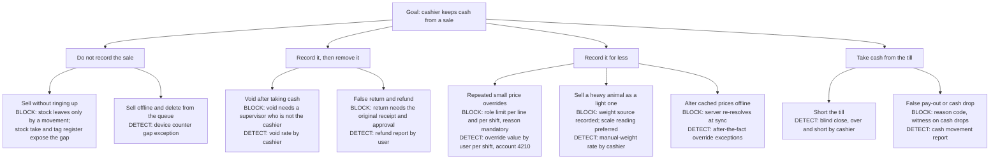
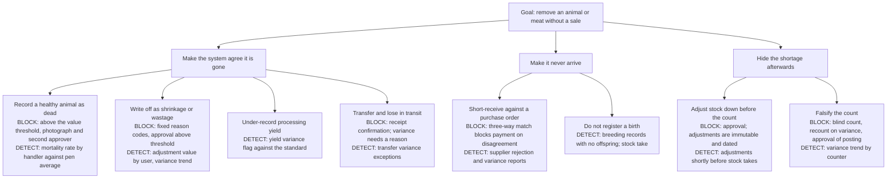
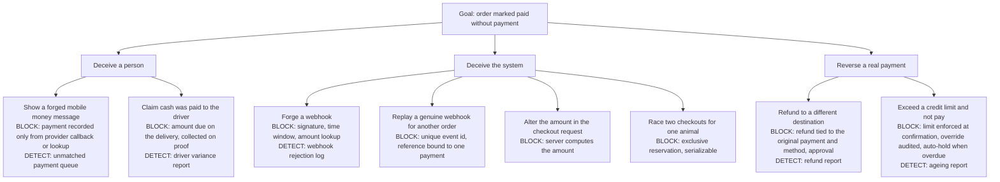
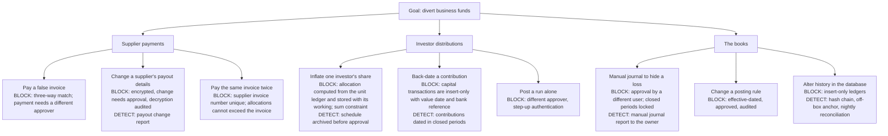

# HaKorem Farms Platform: Threat Model

STRIDE per trust boundary, attack trees on the money paths, the abuse case table and the residual risk register. The controls referred to here are designed in `docs/security/SECURITY_ARCHITECTURE.md` and the ADRs.

## 1. Scope and assumptions

**In scope:** the API, the worker, the database, the deployment on the production and staging servers, the points where the storefront, console, POS devices, driver devices, payment provider and integrations meet the API, and the people who use them.

**Out of scope for this document:** the frontend's own code and build (its repository carries its own notes), the physical security of the farm and shop, and the internals of the payment and messaging providers.

**What is being protected**

| Asset | Why it matters |
| --- | --- |
| Cash, mobile money and bank balances | Direct loss |
| Stock: live animals, meat, produce, feed | Loss by theft, by false write-off or by sale off the books |
| The ledger and investor capital records | Investors are paid from them; an auditor will read them |
| Prices and price lists | A changed price is a discount nobody approved |
| Customer, supplier and investor personal and payout data | Legal duty, and payout details are a route to diverted payments |
| The audit log | Everything else depends on being able to prove what happened |
| Availability of the counter | A stalled till loses the day's trade |

**Adversaries, most likely first**

| Adversary | Capability | Motive |
| --- | --- | --- |
| Dishonest insider with a valid login | Uses the system as designed, within or just beyond their role | Cash, stock, a favour to a friend |
| Colluding insiders | Two logins, one of them an approver | The same, defeating maker-checker |
| Dishonest customer | Forged payment confirmations, disputed deliveries, abuse of returns and promotions | Goods without paying |
| Opportunistic external attacker | Credential stuffing, scanning, forged webhooks, spam through public forms | Account takeover, free goods, disruption |
| Insider with infrastructure access | SSH or database credentials | Covering tracks by altering records |
| Curious investor | A valid read-only login | Seeing more than their own position |

**Assumptions:** the hosting provider and operating system are patched and not themselves hostile; the owner is trusted; at least two people hold approving roles at a branch.

## 2. STRIDE per trust boundary

Each row gives the threat, the control and how it is detected. S spoofing, T tampering, R repudiation, I information disclosure, D denial of service, E elevation of privilege.

### TB1: public storefront

| | Threat | Control | Detection |
| --- | --- | --- | --- |
| S | Credential stuffing against customer accounts | Argon2id, lockout with backoff, rate limits per address and account, breached-password check | Failed-login rate alerts |
| S | Guest places an order in someone else's name or phone number | Order confirmation and tracking links carry a signed token; phone verification before account features | Complaints matched to order audit trail |
| T | Price, total or delivery fee altered in the request | The server re-resolves every price and recomputes every total; client-sent amounts are ignored | Validation failures logged with correlation id |
| T | Coupon reuse beyond its limit by concurrent requests | Redemption counted under a row lock in the database | Redemption ledger against limits |
| R | Customer denies placing an order or accepting a quote | Audit event with address and agent; quote acceptance by signed single-use link | The acceptance record |
| I | Enumerating customers by login or reset responses | Identical response and timing for known and unknown accounts | None needed |
| I | Stock levels or costs exposed through the catalogue | The listing read model holds availability bands only, never quantities or cost | Contract tests on public responses |
| I | One customer reading another's order by guessing an id | Object-level ownership check on every read | Authorisation failure alerts |
| D | Bots holding stock by starting checkouts | Reservations expire; limits per address and cart; one live checkout per cart | Reservation expiry rate |
| D | Spam through the quote request form | Rate limit by address and phone; requests are marked spam, not deleted | Request volume alerts |
| E | Customer session used against staff endpoints | Separate realms, cookies and permission sets; deny by default | Authorisation failure alerts |

### TB2: authenticated back office

| | Threat | Control | Detection |
| --- | --- | --- | --- |
| S | Stolen or shared staff password | TOTP for privileged roles, session and device list, forced logout, lockout | New-device login notice; concurrent session report |
| S | Session cookie theft | `HttpOnly`, `Secure`, `SameSite=Strict`, host-bound cookies; short access token; refresh rotation with reuse detection | Refresh reuse alert |
| T | Editing a posted sale, movement or journal | Ledgers are insert-only; posted documents are frozen by trigger | Rejected attempts in database logs |
| T | Cross-site request forgery against a logged-in manager | CSRF token and origin check; strict same-site cookies | Rejected requests logged |
| R | "It was not me" after a void, override or write-off | Audit event with actor, session, address, before and after; approvals name both people | Daily exception report |
| I | Insider exports the customer list | Export is a permission; bulk export needs step-up; every export audited with row count | Export volume alerts |
| I | Staff member reads investor or payout data out of curiosity | Separate permissions; decryption of payout details audited | Decryption audit review |
| D | A heavy report slows the counter | Reports run in the worker under a restricted role with a timeout, against the reporting schema | Latency and lock monitoring |
| E | Cashier acts at another branch or location | Grants are scoped; the handler checks branch and location | Authorisation failure alerts |
| E | Self-approval | Database check that checker differs from maker | Constraint violations logged |
| E | A manager grants themselves a role | Role and grant changes need step-up, are audited, and appear on the exception report | Permission-change report to the owner |

### TB3: POS device on shop wifi

| | Threat | Control | Detection |
| --- | --- | --- | --- |
| S | An unenrolled device submits sales | Device enrolment and credential; revocable | Sync rejections |
| S | Cashier sells under a colleague's login | One open shift per cashier and per register; PIN unlock; shift ownership rule | Shift overlap report |
| T | Cached prices altered on the device to undercharge | The server re-resolves and compares at sync; a difference beyond the role limit is an override needing approval | Override value by user per shift |
| T | Offline sales deleted from the queue before sync | Device counter is gap-free per shift; the server flags a missing value | Device counter gap exception |
| T | A queued sale edited and resent | The client id and payload hash are recorded; the same id with different content is rejected | `REJECTED_INTEGRITY` sync outcomes |
| R | Cashier denies a sale or a cash drop | Shift ledger of cash movements; blind close; supervisor sign-off | Over and short by cashier |
| I | Device lost with data on it | Only the open shift's data is cached; no customer history; credential revoked on report | Enrolment audit |
| D | Wifi or server unavailable | Offline mode for a shift, 500 queued transactions | Sync lag in health and on the device |
| E | Traffic intercepted on the shop network | TLS 1.3 end to end; HSTS preload | Certificate errors |

### TB4: driver mobile device

| | Threat | Control | Detection |
| --- | --- | --- | --- |
| S | Someone else completes a delivery in the driver's name | Session on the driver's own login; deliveries are assigned | Position and time against the route |
| T | Driver under-declares cash collected | Amount due is set by the server at dispatch; collected amount recorded on proof of delivery; reconciled daily by another person | Driver variance report |
| T | Delivery marked complete without delivering | Proof needs a recipient name and a signature or photograph, with position when available | Customer delivered-notification; complaints matched to proof |
| R | Customer denies receipt | Signed delivery note archived; photograph and position | The proof record |
| I | Driver sees customers or orders beyond their route | Ownership rule: assigned deliveries only | Authorisation failure alerts |
| D | No signal at the customer's door | Proof of delivery is captured offline with a client id and synced later | Sync lag |
| E | Driver account used for back-office actions | The Driver role holds delivery permissions only | Authorisation failure alerts |

### TB5: payment provider webhooks

| | Threat | Control | Detection |
| --- | --- | --- | --- |
| S | Forged webhook marks an order paid | Signature over the raw body; timestamp window; amount confirmed by server-to-server lookup | Webhook rejection log; alert on repeats |
| T | Genuine webhook with an altered amount | The payload's amount is never trusted; the lookup result is used | `REJECTED_AMOUNT` outcomes |
| R | Dispute over whether the provider confirmed | Every webhook stored with hash and outcome; provider reference unique | The webhook ledger |
| I | Card or personal data in webhook payloads ends up in logs | Payload scrubbed before storage; bodies not logged | Log scrubbing test |
| D | Webhook flood | Rate limit; verification is cheap and done before any business work | Volume alert |
| D | Replay of a genuine webhook | Unique event id; second delivery is a no-op | Duplicate count |
| E | Webhook used to clear a payment this system never initiated | Reference must match a payment we created; otherwise ignored and logged | `IGNORED_UNKNOWN_REFERENCE` outcomes |

### TB6: investor portal

| | Threat | Control | Detection |
| --- | --- | --- | --- |
| S | Investor account takeover | Separate realm; TOTP available; lockout; new-device notice | Failed-login alerts |
| T | Investor attempts any write | The role has read permissions only; deny by default | Authorisation failure alerts |
| R | Dispute over what an investor was shown | Statements and distribution schedules are archived documents with a hash | The archive |
| I | Investor reaches another investor's position or general finance data | Ownership rule on every investor permission; a distinct set of endpoints; no path to general finance queries | Authorisation failure alerts for investor principals |
| D | Low relevance | Rate limits | None specific |
| E | Investor principal also granted a staff role by mistake | Realm is fixed on the account; grants to an investor-realm account are restricted to the Investor role by a domain rule | Permission-change report |

### TB7: system administration

| | Threat | Control | Detection |
| --- | --- | --- | --- |
| S | Stolen SSH or CI deploy key | Keys only, no passwords; a separate, limited CI key; rotation on departure; fail2ban | SSH login alerts |
| T | Malicious or mistaken migration | Reviewed SQL; run on staging first; production gated by manual approval; expand then contract | Migration history; pipeline record |
| T | A compromised dependency or image | Lockfile, audit, image scan, pinned base, bill of materials | Pipeline findings |
| R | Administrator action on the server denied | Shell history and authentication logs shipped off the server; superuser use recorded in the incident log | Log review |
| I | Secrets leaked through the repository, an image or a log | Secrets only in the server's file; secret scanning; log scrubbing | Secret scan findings |
| I | Backups read by a third party | Encrypted before leaving the server, key held separately | Storage access logs |
| D | Server loss | Off-box WAL and backups; restore runbook drilled quarterly; offline counter | Uptime monitor |
| E | Application container escape or lateral movement | Non-root containers; data network not published; the application role cannot run DDL | Host monitoring |

### TB8: the database itself

| | Threat | Control | Detection |
| --- | --- | --- | --- |
| S | A process connects with another role's credentials | One credential per role, in the secrets file; roles have distinct, minimal privileges | Connection logs by role and source |
| T | Direct SQL alters a sale, a balance or a journal | Insert-only ledgers enforced by trigger for every role; balances writable only by trigger functions | Nightly recompute and reconciliation |
| T | Direct SQL alters or deletes audit events | Triggers reject it; the hash chain and the off-box signed anchor expose it even if triggers are disabled by a superuser | Nightly chain verification |
| R | Changes made outside the application leave no actor | They cannot touch ledgers or the audit log without breaking a check that is verified nightly | Drift alerts |
| I | A database dump exposes payout details or personal data in the audit log | Column encryption; per-subject keys; keys held outside the database | None needed for the data; access logs for the dump |
| D | Long transaction or lock holds up the counter | Statement and lock timeouts; reports on a separate role; no external calls in transactions | Health endpoint: sealing lag, long transactions |
| E | The application role creates or alters objects | No DDL privilege; objects owned by a role nobody logs in as | Schema drift check in CI |

## 3. Attack trees on the money paths

Each tree shows the attacker's goal, the routes to it and, in the leaves, the control that blocks the route or the report that exposes it.

### 3.1 Take cash at the counter

### 3.2 Divert stock

### 3.3 Get goods without paying

### 3.4 Move money out through the back office

## 4. Abuse cases

The first nine are mandatory in the shared brief. The rest were identified in B0. B13 turns each into two tests: that the primary control blocks it or makes it visible, and that the attempt, blocked or not, appears on the daily exception report (`GET /exceptions/daily-report`) under the exception kind in the last column, with enough detail to act on. The second test was added to B13's scope by the owner on 2026-11-13. Each exception item carries the numbers of the abuse cases it detects, so B13 can assert that every case below appears on at least one kind.

| # | Abuse case | Primary control | Detection | Exception kind |
| --- | --- | --- | --- | --- |
| 1 | Cashier completes a sale, takes the cash, voids the sale | A void needs approval by a supervisor who is not the cashier, and leaves the order, a credit note and reversing entries as an immutable record | Void rate by cashier; every void on the daily exception report | `SALE_VOID` |
| 2 | Storekeeper records a healthy animal as dead and sells it privately | Mortality above a value threshold needs a second approver and a photograph before stock is written off | Mortality rate by handler against the pen average | `MORTALITY` |
| 3 | Repeated small price overrides at the counter | Override limits per role, per line and per shift; mandatory reason; every variance posted to account 4210 | Override value by user per shift | `PRICE_OVERRIDE` |
| 4 | Customer shows a forged mobile money confirmation | A payment is recorded only from a verified provider callback or a confirmed lookup; no screen accepts "paid" on the cashier's word; offline tenders are cash only | Unmatched and unverified payment queue | `UNMATCHED_PAYMENT` |
| 5 | Forged webhook marks an order paid | Signature verification, timestamp window, replay cache by unique event id, and re-verification of the amount against the provider API | Webhook rejection log | `WEBHOOK_REJECTED` |
| 6 | Driver collects cash on delivery and under-declares | Amount due fixed at dispatch; proof of delivery records the amount collected; reconciliation at end of day by someone other than the driver | Driver variance report | `DRIVER_VARIANCE` |
| 7 | Stock adjustment used to hide a shortage | Adjustments above a threshold need approval; reason codes are a fixed list changed only by migration; adjustments are immutable | Adjustment value by user; variance trend; adjustments shortly before a stock take | `STOCK_ADJUSTMENT` |
| 8 | Investor read-only account reaches finance data | Deny-by-default authorisation checked in the application layer; object-level ownership on every investor permission | Authorisation failure alerts | `AUTHORISATION_FAILURE` |
| 9 | Insider exports the customer list | Export is a permission; bulk export needs step-up; every export audited with row counts | Export volume alerts | `BULK_EXPORT` |
| 10 | Offline sale made and deleted from the device before sync | Gap-free device counter per shift, checked at sync | Counter gap exception | `DEVICE_COUNTER_GAP` |
| 11 | Animal sold at the counter while reserved, on hold or already sold | The stock movement is refused by the database; the sale and money are still recorded; the conflict becomes a stock exception | Stock exception queue | `STOCK_EXCEPTION` |
| 12 | False return to obtain a refund | A return references the original order and cannot exceed what was sold; refund tied to the original payment and approved | Refund report by user | `REFUND` |
| 13 | Supplier payout details changed to divert a payment | Details encrypted; a change needs a different approver; payment needs a different approver | Payout change report | `PAYOUT_DETAIL_CHANGE` |
| 14 | Credit sale beyond the limit to a favoured customer | Limit enforced at order confirmation; override needs approval and is audited | Credit override report; ageing | `CREDIT_OVERRIDE` |
| 15 | Audit log or ledger altered directly in the database | Insert-only by trigger; hash chain; off-box signed anchor; nightly reconciliation | Chain verification; drift alerts | `AUDIT_INTEGRITY`, `RECONCILIATION_BREAK` |
| 16 | Manager grants themselves or a friend a higher role | Role and grant changes need step-up and are audited | Permission-change report to the owner | `PERMISSION_CHANGE` |
| 17 | Shift closed short | Blind close; supervisor sign-off; over and short posted to the ledger | Over and short by cashier | `SHIFT_OVER_SHORT` |
| 18 | Under-recorded processing yield, with the difference taken | Yield recorded against a standard, with a variance flag | Yield variance report | `YIELD_VARIANCE` |

## 5. Residual risk register

Risks that remain after the controls above. Likelihood and impact are low, medium or high. Each has an owner who accepts or treats it.

| ID | Risk | Likelihood | Impact | Treatment | Owner |
| --- | --- | --- | --- | --- | --- |
| R1 | Two insiders collude, one as maker and one as checker | Medium | High | Not preventable in software. Exception reports go to the owner, not to the approvers; approval pairs are reported by frequency | Owner |
| R2 | A sale is never entered at all | Medium | Medium | Detected only by stock takes and the tag register. Cycle counts are scheduled; live animals are individually tagged | Manager |
| R3 | Single production server fails | Low | High | Offline counter for a shift; restore to a new server within the 4-hour objective; quarterly drill | Owner |
| R4 | Audit events are unsealed for a few seconds after writing | Low | Low | Protected by privileges and triggers in that window; verifier alerts on events left unsealed | Backend lead |
| R5 | A database superuser disables triggers and rewrites history | Low | High | Exposed by the off-box anchor and nightly verification, not prevented. Superuser access is limited to the administrator and logged | Owner |
| R6 | Branch and ownership scoping depends on application code, with no row-level security | Low | Medium | Repositories require the scope as a parameter; a test per module proves refusal. Revisit if a second branch opens with separate staff | Backend lead |
| R7 | Loss of the key-encryption key makes encrypted data unreadable | Low | High | Sealed offline copy held by the owner; restore drill includes decrypting a sample | Owner |
| R8 | Offline device holds unsynced sales and is lost or wiped | Low | Medium | Cash count at shift close still exposes the shortfall; the counter gap shows what is missing; devices sync whenever online | Manager |
| R9 | Offline price overrides are approved after the fact | Medium | Low | Bounded by the cached role limit; anything beyond is an exception for a manager the same day | Manager |
| R10 | Cash on delivery relies on the driver's honesty until reconciliation | Medium | Low | Amount due is fixed by the server; daily reconciliation by another person; variance posted and reported | Manager |
| R11 | Provider outage stops mobile money and card | Medium | Medium | Cash and cash on delivery continue; a second provider adapter is parked in the backlog behind the existing port | Owner |
| R12 | Manual weight entry understates a sale by weight | Medium | Low | Weight source recorded; manual-weight rate by user reported; scale integration preferred | Manager |
| R13 | Tax treatment or invoicing rules differ from the seeded assumption | Medium | Medium | Tax is data in effective-dated versions; accountant confirms before B8; compliance verified in B1 | Accountant |
| R14 | Personal data kept in statutory documents after a deletion request | Low | Low | Stated to the data subject; retention periods documented in B1 | Owner |
| R15 | A small team means the same two people approve everything | High | Medium | Approval-pair frequency report to the owner; owner reviews a sample monthly | Owner |

## 6. Keeping this document true

- A change to authentication, payments, exports, uploads, webhooks or permissions triggers the `hakorem-security-review` skill, which checks the change against this document and updates it in the same pull request.
- Each abuse case above is a named test in B13. A case with no test is not covered.
- A new failure mode found here or in an incident gets a runbook in `docs/runbooks/`.
- The register is reviewed at each release.
