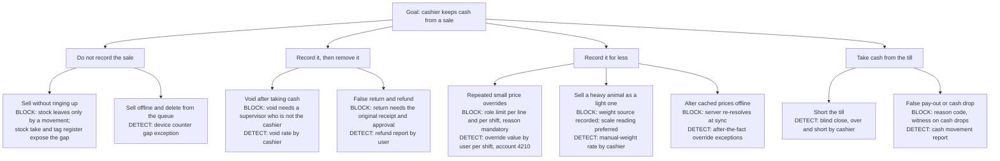
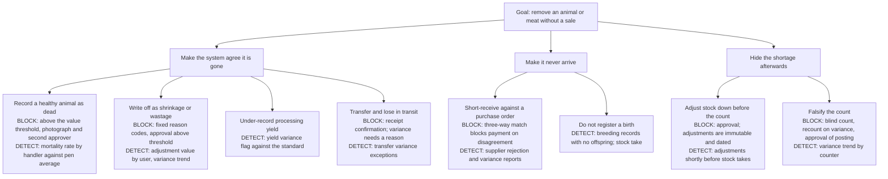
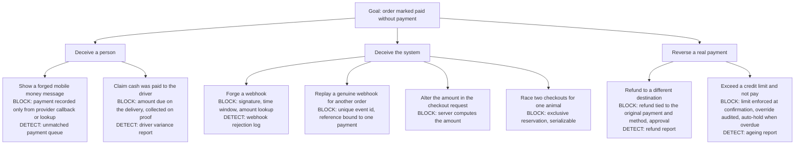
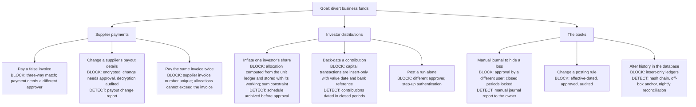

# HaKorem Farms Platform: Threat Model

STRIDE per trust boundary, attack trees on the money paths, the abuse case table and the residual risk register. The controls referred to here are designed in `docs/security/SECURITY_ARCHITECTURE.md` and the ADRs.

## 1. Scope and assumptions

**In scope:** the API, the worker, the database, the deployment on the production and staging servers, the points where the storefront, console, POS devices, driver devices, payment provider and integrations meet the API, and the people who use them.

**Out of scope for this document:** the frontend's own code and build (its repository carries its own notes), the physical security of the farm and shop, and the internals of the payment and messaging providers.

**What is being protected**

| Asset | Why it matters |
| --- | --- |
| Cash, mobile money and bank balances | Direct loss |
| Stock: live animals, meat, produce, feed | Loss by theft, by false write-off or by sale off the books |
| The ledger and investor capital records | Investors are paid from them; an auditor will read them |
| Prices and price lists | A changed price is a discount nobody approved |
| Customer, supplier and investor personal and payout data | Legal duty, and payout details are a route to diverted payments |
| The audit log | Everything else depends on being able to prove what happened |
| Availability of the counter | A stalled till loses the day's trade |

**Adversaries, most likely first**

| Adversary | Capability | Motive |
| --- | --- | --- |
| Dishonest insider with a valid login | Uses the system as designed, within or just beyond their role | Cash, stock, a favour to a friend |
| Colluding insiders | Two logins, one of them an approver | The same, defeating maker-checker |
| Dishonest customer | Forged payment confirmations, disputed deliveries, abuse of returns and promotions | Goods without paying |
| Opportunistic external attacker | Credential stuffing, scanning, forged webhooks, spam through public forms | Account takeover, free goods, disruption |
| Insider with infrastructure access | SSH or database credentials | Covering tracks by altering records |
| Curious investor | A valid read-only login | Seeing more than their own position |

**Assumptions:** the hosting provider and operating system are patched and not themselves hostile; the owner is trusted; at least two people hold approving roles at a branch.

## 2. STRIDE per trust boundary

Each row gives the threat, the control and how it is detected. S spoofing, T tampering, R repudiation, I information disclosure, D denial of service, E elevation of privilege.

### TB1: public storefront

| | Threat | Control | Detection |
| --- | --- | --- | --- |
| S | Credential stuffing against customer accounts | Argon2id, lockout with backoff, rate limits per address and account, breached-password check | Failed-login rate alerts |
| S | Guest places an order in someone else's name or phone number | Order confirmation and tracking links carry their own random token (`trk_` and 256 bits from the secure source, never derived from the order id, stored only as its hash in `ord.order_tracking_token`, read for thirty days; the tracking view shows no name, phone or address; B09q continued, ADR-0074, superseding B09a continued 2f's signed id). Every link sent to a customer follows `platform/crypto/link-tokens` (B9b's receipt, B11's SMS); phone verification before account features | Complaints matched to order audit trail |
| T | Price, total or delivery fee altered in the request | The server re-resolves every price and recomputes every total; client-sent amounts are ignored | Validation failures logged with correlation id |
| T | Coupon reuse beyond its limit by concurrent requests | Redemption counted under a row lock in the database | Redemption ledger against limits |
| T | An online order confirmed by money that is not its own: paid after the order stopped waiting, or less than its estimate (B09a continued 2f, ADR-0070) | Confirmation only in the transaction that clears a payment naming the order, never for money held as unmatched, and only when cleared money covers the estimate; an order whose hold ended or whose charge failed is cancelled and its charge released | `UNMATCHED_PAYMENT` break on the late money (A-210); tests in `ord/online-orders` |
| R | Customer denies placing an order or accepting a quote | Audit event with address and agent; quote acceptance by signed single-use link | The acceptance record |
| I | Enumerating customers by login or reset responses | Identical response and timing for known and unknown accounts | None needed |
| I | Stock levels or costs exposed through the catalogue | The listing read model holds availability bands only, never quantities or cost | Contract tests on public responses |
| I | One customer reading another's order by guessing an id | Object-level ownership check on every read; no identifier is a key (owner, 2026-11-17, ADR-0074): every operation that takes a UUID, a public ID or a SKU refuses an anonymous caller, another customer, a role without the permission and a staff member outside the record's branch, the same for a real and a made-up identifier, walked from the contract (`test/integration/iam/no-id-is-a-key`); another guest's cart or checkout and another customer's order are 404 | Authorisation failure alerts |
| D | Bots holding stock by starting checkouts | Reservations expire; limits per address and cart; one live checkout per cart | Reservation expiry rate |
| D | Spam through the quote request form | Rate limit by address and phone; requests are marked spam, not deleted | Request volume alerts |
| E | Customer session used against staff endpoints | Separate realms, cookies and permission sets; deny by default | Authorisation failure alerts |

### TB2: authenticated back office

| | Threat | Control | Detection |
| --- | --- | --- | --- |
| S | Stolen or shared staff password | TOTP for privileged roles, session and device list, forced logout, lockout | New-device login notice; concurrent session report |
| S | Session cookie theft | `HttpOnly`, `Secure`, `SameSite=Strict`, host-bound cookies; short access token; refresh rotation with reuse detection | Refresh reuse alert |
| T | Editing a posted sale, movement or journal | Ledgers are insert-only; posted documents are frozen by trigger | Rejected attempts in database logs |
| T | Cross-site request forgery against a logged-in manager | CSRF token and origin check; strict same-site cookies | Rejected requests logged |
| R | "It was not me" after a void, override or write-off | Audit event with actor, session, address, before and after; approvals name both people | Daily exception report |
| I | Insider exports the customer list | Export is a permission; bulk export needs step-up; every export audited with row count | Export volume alerts |
| I | Staff member reads investor or payout data out of curiosity | Separate permissions; decryption of payout details audited | Decryption audit review |
| D | A heavy report slows the counter | Reports run in the worker under a restricted role with a timeout, against the reporting schema | Latency and lock monitoring |
| E | Cashier acts at another branch or location | Grants are scoped; the handler checks branch and location | Authorisation failure alerts |
| E | Self-approval | Database check that checker differs from maker | Constraint violations logged |
| E | A manager grants themselves a role | Role and grant changes need step-up, are audited, and appear on the exception report | Permission-change report to the owner |

### TB3: POS device on shop wifi

| | Threat | Control | Detection |
| --- | --- | --- | --- |
| S | An unenrolled device submits sales | Device enrolment and credential; revocable | Sync rejections |
| S | Cashier sells under a colleague's login | One open shift per cashier and per register; PIN unlock; shift ownership rule | Shift overlap report |
| T | Cached prices altered on the device to undercharge | The server re-resolves and compares at sync; a difference beyond the role limit is an override needing approval | Override value by user per shift |
| T | Offline sales deleted from the queue before sync | Device counter is gap-free per shift; the server flags a missing value | Device counter gap exception |
| T | A queued sale edited and resent | The client id and payload hash are recorded; the same id with different content is rejected | `REJECTED_INTEGRITY` sync outcomes |
| R | Cashier denies a sale or a cash drop | Shift ledger of cash movements; blind close; supervisor sign-off | Over and short by cashier |
| I | Device lost with data on it | Only the open shift's data is cached; no customer history; credential revoked on report | Enrolment audit |
| D | Wifi or server unavailable | Offline mode for a shift, 500 queued transactions | Sync lag in health and on the device |
| E | Traffic intercepted on the shop network | TLS 1.3 end to end; HSTS preload | Certificate errors |

### TB4: driver mobile device

| | Threat | Control | Detection |
| --- | --- | --- | --- |
| S | Someone else completes a delivery in the driver's name | Session on the driver's own login; deliveries are assigned | Position and time against the route |
| T | Driver under-declares cash collected | Amount due is set by the server at dispatch; collected amount recorded on proof of delivery; reconciled daily by another person | Driver variance report |
| T | Delivery marked complete without delivering | Proof needs a recipient name and a signature or photograph, with position when available | Customer delivered-notification; complaints matched to proof |
| R | Customer denies receipt | Signed delivery note archived; photograph and position | The proof record |
| I | Driver sees customers or orders beyond their route | Ownership rule: assigned deliveries only | Authorisation failure alerts |
| D | No signal at the customer's door | Proof of delivery is captured offline with a client id and synced later | Sync lag |
| E | Driver account used for back-office actions | The Driver role holds delivery permissions only | Authorisation failure alerts |

### TB5: payment provider webhooks

| | Threat | Control | Detection |
| --- | --- | --- | --- |
| S | Forged webhook marks an order paid | Signature over the raw body; timestamp window; amount confirmed by server-to-server lookup | Webhook rejection log; alert on repeats |
| T | Genuine webhook with an altered amount | The payload's amount is never trusted; the lookup result is used | `REJECTED_AMOUNT` outcomes |
| R | Dispute over whether the provider confirmed | Every webhook stored with hash and outcome; provider reference unique | The webhook ledger |
| I | Card or personal data in webhook payloads ends up in logs | Payload scrubbed before storage; bodies not logged | Log scrubbing test |
| D | Webhook flood | Rate limit; verification is cheap and done before any business work | Volume alert |
| D | Replay of a genuine webhook | Unique event id; second delivery is a no-op | Duplicate count |
| E | Webhook used to clear a payment this system never initiated | Reference must match a payment we created; otherwise ignored and logged | `IGNORED_UNKNOWN_REFERENCE` outcomes |

### TB6: investor portal

| | Threat | Control | Detection |
| --- | --- | --- | --- |
| S | Investor account takeover | Separate realm; TOTP available; lockout; new-device notice | Failed-login alerts |
| T | Investor attempts any write | The role has read permissions only; deny by default | Authorisation failure alerts |
| R | Dispute over what an investor was shown | Statements and distribution schedules are archived documents with a hash | The archive |
| I | Investor reaches another investor's position or general finance data | Ownership rule on every investor permission; a distinct set of endpoints; no path to general finance queries | Authorisation failure alerts for investor principals |
| D | Low relevance | Rate limits | None specific |
| E | Investor principal also granted a staff role by mistake | Realm is fixed on the account; grants to an investor-realm account are restricted to the Investor role by a domain rule | Permission-change report |

### TB7: system administration

| | Threat | Control | Detection |
| --- | --- | --- | --- |
| S | Stolen SSH or CI deploy key | Keys only, no passwords; a separate, limited CI key; rotation on departure; fail2ban | SSH login alerts |
| T | Malicious or mistaken migration | Reviewed SQL; run on staging first; production gated by manual approval; expand then contract | Migration history; pipeline record |
| T | A compromised dependency or image | Lockfile, audit, image scan, pinned base, bill of materials | Pipeline findings |
| R | Administrator action on the server denied | Shell history and authentication logs shipped off the server; superuser use recorded in the incident log | Log review |
| I | Secrets leaked through the repository, an image or a log | Secrets only in the server's file; secret scanning; log scrubbing | Secret scan findings |
| I | Backups read by a third party | Encrypted before leaving the server, key held separately | Storage access logs |
| D | Server loss | Off-box WAL and backups; restore runbook drilled quarterly; offline counter | Uptime monitor |
| E | Application container escape or lateral movement | Non-root containers; data network not published; the application role cannot run DDL | Host monitoring |

### TB8: the database itself

| | Threat | Control | Detection |
| --- | --- | --- | --- |
| S | A process connects with another role's credentials | One credential per role, in the secrets file; roles have distinct, minimal privileges | Connection logs by role and source |
| T | Direct SQL alters a sale, a balance or a journal | Insert-only ledgers enforced by trigger for every role; balances writable only by trigger functions | Nightly recompute and reconciliation |
| T | Direct SQL alters or deletes audit events | Triggers reject it; the hash chain and the off-box signed anchor expose it even if triggers are disabled by a superuser | Nightly chain verification |
| R | Changes made outside the application leave no actor | They cannot touch ledgers or the audit log without breaking a check that is verified nightly | Drift alerts |
| I | A database dump exposes payout details or personal data in the audit log | Column encryption; per-subject keys; keys held outside the database | None needed for the data; access logs for the dump |
| D | Long transaction or lock holds up the counter | Statement and lock timeouts; reports on a separate role; no external calls in transactions | Health endpoint: sealing lag, long transactions |
| E | The application role creates or alters objects | No DDL privilege; objects owned by a role nobody logs in as | Schema drift check in CI |

## 3. Attack trees on the money paths

Each tree shows the attacker's goal, the routes to it and, in the leaves, the control that blocks the route or the report that exposes it.

### 3.1 Take cash at the counter

### 3.2 Divert stock

### 3.3 Get goods without paying

### 3.4 Move money out through the back office

## 4. Abuse cases

The first nine are mandatory in the shared brief. The rest were identified in B0. B13 turns each into two tests: that the primary control blocks it or makes it visible, and that the attempt, blocked or not, appears on the daily exception report (`GET /exceptions/daily-report`) under the exception kind in the last column, with enough detail to act on. The second test was added to B13's scope by the owner on 2026-11-13. Each exception item carries the numbers of the abuse cases it detects, so B13 can assert that every case below appears on at least one kind.

| # | Abuse case | Primary control | Detection | Exception kind |
| --- | --- | --- | --- | --- |
| 1 | Cashier completes a sale, takes the cash, voids the sale | A void needs approval by a supervisor who is not the cashier, and leaves the order, a credit note and reversing entries as an immutable record (built in B09a continued 2c, A-226: `SALE_VOID` always waits, threshold 0, step-up; the approver is neither the asker nor the sale's poster or salesperson, held in the application and by `ck_sales_order_void_checker`; only a cash or store credit sale on its own business day is voided) | Void rate by cashier; every void on the daily exception report (`ord.SaleVoidRequested` and `ord.OrderVoided` carry abuse case 1, the asker, the cashier and the approver, for B12's report) | `SALE_VOID` |
| 2 | Storekeeper records a healthy animal as dead and sells it privately | Mortality above a value threshold needs a second approver and a photograph before stock is written off | Mortality rate by handler against the pen average. Built in B06 continued (A-158): every submission publishes `liv.MortalityReported` with the reporter, the pen, the value, the threshold, whether it waits for approval and `abuseCases: [2]`, and `liv.MortalityApproved` names the approver; B12 projects both into this kind. The control is tested in `test/integration/liv/livestock.integration.spec.ts` (no photograph refused, approval pending with the stock on hand, maker refused as checker, database check). **B06r (owner, 2026-11-15; ADR-0053, A-175):** the Farm hand never writes stock off alone (below the threshold a Manager or the Owner confirms, `MORTALITY_CONFIRMATION`; at or above it the approver with step-up), uploads `EVIDENCE` and nothing else, and its photograph is approved only once the scan passed; a rejected scan returns the record (`liv.MortalityReturned`); a photograph whose exact bytes are already on another death record publishes `liv.MortalityPhotoReused` (`abuseCases: [2]`), which B12 lists under this kind. A re-saved or cropped copy is not caught (R17). Tested in `test/integration/liv/farm-hand-death-reports.integration.spec.ts` | `MORTALITY` |
| 3 | Repeated small price overrides at the counter | Override limits per role, per line and per shift; mandatory reason; every variance posted to account 4210 (per line built in B09a continued 2e, A-230, ADR-0069: a price outside the band, or below list beyond `PRICE_OVERRIDE_PER_LINE` of the seller's roles at the branch, none seeded, waits for `PRICE_OVERRIDE`, approved with step-up by someone who neither asked, sold nor wrote the order, held in ORD and by `ck_sales_order_settled_lines`; the pricing record is then fixed, `ck_sales_order_line_priced`; nothing is reserved, issued or paid before; per shift built in B09b continued, A-274 (h): a counter sale's price below list, past what the shift has left of `PRICE_OVERRIDE_PER_SHIFT`, waits as `BEYOND_SHIFT_LIMIT`; a held sale holds no price, so a recalled one is priced again and its override judged again when it is sold, B09b continued 1c, A-276) | Override value by user per shift (`ord.PriceOverrideRequested` and `ord.PriceOverrideApproved` carry abuse case 3, the asker, the salesperson, the approver and the value, for B12's report) | `PRICE_OVERRIDE` |
| 4 | Customer shows a forged mobile money confirmation | A payment is recorded only from a verified provider callback or a confirmed lookup; no screen accepts "paid" on the cashier's word (the counter sale refuses a mobile money or card tender, `PAYMENT_METHOD_REQUIRES_VERIFICATION`, B09b continued, unless it names a payment the provider already cleared at the cashier's own shift: B09b continued 1c, ADR-0079, taken whole and linked once, never another customer's, another shift's or another branch's, never one not yet cleared, held by `pay.payment_order_link_guard` too); offline tenders are cash only (the offline pack offers only the methods allowed offline, and mobile money only while the branch's `pos.offline.allow_unverified_mobile_money` is on, B09b continued 2, A-277 (h); the sync re-checks it, B09b continued 2b) | Unmatched and unverified payment queue (`listUnmatchedPayments`, built in B09a continued: provider payments still pending and money held unmatched; `pay.ReconciliationBreakRaised` for each break; the database refuses a provider payment cleared without the provider's confirmation of its exact amount, `trg_payment_provider_confirmed`) | `UNMATCHED_PAYMENT` |
| 5 | Forged webhook marks an order paid | Signature verification, timestamp window, replay cache by unique event id, and re-verification of the amount against the provider API | Webhook rejection log (`pay.webhook_event`, built in B09a continued: every request logged; each rejection published as `pay.WebhookRejected` carrying abuse case 5, audited and logged with `alert: WEBHOOK_REJECTED`; the provider sweep clears a genuine payment whose webhook was lost or rejected) | `WEBHOOK_REJECTED` |
| 6 | Driver collects cash on delivery and under-declares | Amount due fixed at dispatch; proof of delivery records the amount collected; reconciliation at end of day by someone other than the driver | Driver variance report | `DRIVER_VARIANCE` |
| 7 | Stock adjustment used to hide a shortage | Adjustments at or above a threshold (seed 50,000 pesewas, `STOCK_WRITE_OFF`) need approval by a different person with a fresh step-up, bound to the lines and their pool values; reason codes are a fixed list changed only by migration; values come from the cost pool, never the request; animals are never adjusted; adjustments are immutable, and the database refuses one posted at or above its threshold without an approval (`ck_stock_adjustment_approved`) (built in B05 continued 2, A-139) | Adjustment value by user (`listStockAdjustments?createdBy=`); variance trend; adjustments shortly before a stock take | `STOCK_ADJUSTMENT` |
| 8 | Investor read-only account reaches finance data | Deny-by-default authorisation checked in the application layer; object-level ownership on every investor permission | Authorisation failure alerts | `AUTHORISATION_FAILURE` |
| 9 | Insider exports the customer list | Export is a permission; every MDM export needs step-up (bulk exports above all); every export audited with row counts; the file is private and linked for five minutes, each link logged | Export volume alerts. Every MDM export is an `EXPORT` audit event with `rowCount` and `bulk` (more than 100 rows, A-128), which B12 projects as the `BULK_EXPORT` item | `BULK_EXPORT` |
| 10 | Offline sale made and deleted from the device before sync | Gap-free device counter per shift, checked at sync | Counter gap exception | `DEVICE_COUNTER_GAP` |
| 11 | Animal sold at the counter while reserved, on hold or already sold | The stock movement is refused by the database; the sale and money are still recorded; the conflict becomes a stock exception | Stock exception queue | `STOCK_EXCEPTION` |
| 12 | False return to obtain a refund | A return references the original order and cannot exceed what was sold; refund tied to the original payment and approved | Refund report by user (`listRefunds` by `createdBy`; every refund request published as `pay.RefundRequested` carrying abuse case 12, built in B09a continued: every refund a person asks for waits for a different approver with step-up, and a payout by hand is never recorded by its maker, held by the database. B09a continued 1d (ADR-0066): a refund against a credit note never exceeds the credit note's amount less what was already refunded against it, held under the credit note's lock (two at once leave one), and is approved by neither its maker nor the credit note's maker (`ck_refund_credit_note_checker`); `pay.RefundRequested` names the credit note and its maker. B09a continued 2d (ADR-0068): a return never takes back more of a sold line than was sold less what returns not rejected hold, held by `ck_order_return_line_cap` under the sold line's lock (two at once leave one); every return waits for a supervisor who did not make it; its credit note and its refund are the maker's, so neither the maker nor the credit note's maker approves the refund; the stock comes back at its share of the issue's cost, set by the database; `ord.ReturnSubmitted` and `ord.ReturnCompleted` carry abuse case 12) | `REFUND` |
| 13 | Supplier payout details changed to divert a payment | Details encrypted; a change needs a different approver; payment needs a different approver. Built in B07 continued (A-166): details sealed with the supplier's own key, only masked in clear; every change, the first set included, waits as a `SUPPLIER_PAYOUT_CHANGE` for a different person with `pur.supplier.payout_approve` and a fresh step-up, refused for the maker by IAM and by `ck_supplier_payout_change_checker`; the details in force are always an approved change (database guard); a payment pays the details in force when it was prepared, fixed on the payment; reading the details in full needs its own permission with step-up and is audited as `DECRYPT` | Payout change report; `pur.SupplierPayoutChangeRequested` and `pur.SupplierPayoutChanged` carry case 13, the supplier, the maker, the approver and the masked old and new details for the report (B12), and SA-17's payment within 24 hours of a change | `PAYOUT_DETAIL_CHANGE` |
| 14 | Credit sale beyond the limit to a favoured customer | Limit enforced at order confirmation; override needs approval and is audited. Built in B10 continued (ADR-0088): the limit, the terms and the hold judged live at confirmation; the override asked with a written reason and approved by a holder of `whl.credit.override` who did not ask; every credit limit change and every release from hold decided by a second Owner or Manager; each held by the database; `test/integration/whl/credit-control.integration.spec.ts` | Credit override report (`listCreditOverrides`); `whl.CreditOverrideApproved` for the daily report (B12); ageing | `CREDIT_OVERRIDE` |
| 15 | Audit log or ledger altered directly in the database | Insert-only by trigger; hash chain; off-box signed anchor; nightly reconciliation | Chain verification; drift alerts | `AUDIT_INTEGRITY`, `RECONCILIATION_BREAK` |
| 16 | Manager grants themselves or a friend a higher role | Role and grant changes need step-up and are audited | Permission-change report to the owner | `PERMISSION_CHANGE` |
| 17 | Shift closed short | Blind close; supervisor sign-off; over and short posted to the ledger (built in B9b, A-273: expected cash is null for every reader until the count is declared, and the declared count never changes; the supervisor is never the cashier, held by `ck_shift_close_checker`; the sign-off asks for a step-up and posts Dr 6900 short or Cr 6900 over against the till's 1000; a drop's witness is a supervisor who is neither the cashier nor its recorder; cash moves only on an OPEN shift, `pos.cash_movement_guard`, and a cash tender into a till names its shift, `ck_payment_cash_shift`; from B09b continued, ADR-0077, no cash moves into or out of a till through any PAY path, a refund, a reversal or a void included, but through an OPEN shift of that till that is the actor's own or recoverable by them, checked by POS under the shift's lock, and a till cash refund names the shift it was paid out of, `ck_refund_till_shift`; a drop with no supervisor signed in at the branch is taken unwitnessed and marked, the owner on A-273 (d); from B09b continued 1b, ADR-0078, a force close is by a manager who is not the cashier, posts nothing and hides the expected cash, and its drawer is counted once by a supervisor who is neither the cashier nor the force-closer, held by `ck_shift_close_checker` and `pos.shift_late_count_guard`; each sign-off and each later count is anchored off the server) | Over and short by cashier (`pos.ShiftClosed` carries abuse case 17, the cashier, the supervisor and the over or short, for B12's report; an unwitnessed drop's `pos.CashDropped` carries abuse case 17 too, B09b continued; `pos.ShiftForceClosed` carries it with the cashier, the manager, the reason and the cash it was closed at, and the later count's `pos.ShiftClosed` names the counter and the force-closer, B09b continued 1b) | `SHIFT_OVER_SHORT` |
| 18 | Under-recorded processing yield, with the difference taken | Yield recorded against a standard, with a variance flag | Yield variance report | `YIELD_VARIANCE` |
| 19 | Storekeeper posts a goods receipt for stock that never arrived, or at an inflated value, to cover a later shortage or a supplier overpayment | Receipt writes are scoped to the receiving location and audited with before and after; the receipt value is a liability awaiting invoice (account 2010) that only becomes payable through three-way match against the purchase order and the supplier invoice (B7); a purchase receipt naming no order is visible as such (B05 continued, A-136). Built in B7 (A-164): a receipt against an order line is refused past ordered plus tolerance, in the handler and by `ck_purchase_order_line_tolerance`; an invoice line is payable only when its quantity is within what was received less what other invoices hold and its price within 1 percent, and the database refuses a payment allocation to an invoice that is not MATCHED or NOT_REQUIRED and approved; every payment is approved by a different person. A line bought in another unit converts by MDM's immutable, audited factor, so a wrong factor shows on the order before anything is received | Receipts without a purchase order, and receipt value by user (B12); `pur.SupplierInvoiceMismatched` carries each failed match for the report (B12) | `GOODS_RECEIPT_UNMATCHED` |
| 20 | Storekeeper at the destination records a false shortfall on a transfer and keeps the difference | Receiving is scoped to the destination location; a shortfall needs a reason from the fixed list and is never a loss at receipt: it stays held in transit at its value with an open `TRANSFER_VARIANCE` exception, and the database refuses any sale, processing, dispatch or other movement of it until a manager resolves it (`ck_stock_in_transit`, `ck_stock_held`). Writing it off goes through the adjustment path: at or above the threshold (seed 50,000 pesewas, copied onto the adjustment) it waits for a different person with step-up; found returns it to stock; it is resolved once (ADR-0048, B05 continued 3b, A-144) | Open `TRANSFER_VARIANCE` exceptions and their age; write-offs by resolver and by receiver (B12) | `STOCK_EXCEPTION` |
| 21 | A movement is reversed to undo a sale, a write-off or a receipt quietly | A reversal is its own `STOCK_REVERSAL` document with a reason from the stock adjustment list and a note; at or above the threshold (seed 50,000 pesewas) it waits for a different person; a movement is reversed once, a transfer's movements never by hand, and the database refuses a reversal posted at or above its threshold without an approval (`ck_stock_reversal_approved`) (B05 continued 2, A-139) | Reversals by user and value (B12) | `STOCK_ADJUSTMENT` |
| 22 | A count is fudged to hide a shortage: the counter copies the book figure, or a large loss is posted by one person | The expected figure is frozen at start and hidden from every reader until counting closes; every difference is recounted before it can be posted; variances are valued from the cost pool, never the request; a variance value at or above the threshold (seed 50,000 pesewas, `STOCK_WRITE_OFF`) waits for a different person with a fresh step-up, and the database refuses a take posted at or above its threshold without an approval (`ck_stock_take_approved`); overlapping counts of one location are refused by the database (`ck_stock_take_overlap`); only the Owner and Manager post (B05 continued 3, A-141) | Variance value by location and counter; repeated recounts that match the book exactly; takes cancelled after review (B12) | `STOCK_ADJUSTMENT` |
| 23 | A hold is lifted to sell a treated animal or a suspect lot | A withdrawal hold is never released, by anyone, through the API or the database; a quarantine or investigation hold is released once, with a reason from the fixed list and a note, by someone other than the person who placed it (`ck_stock_hold_releaser`); the movement trigger refuses sale, processing and dispatch while a hold is in force (B05 continued 3, A-142) | Holds released, by releaser and by time from placing (B12) | `STOCK_EXCEPTION` |
| 24 | Stock is promised away to block a sale, or a promise is lifted to sell a reserved animal to someone else | Reserving is in process only, by the module holding a checkout, order or quote, never over HTTP; the database refuses a reservation above what is available, a second active one of an animal, one of stock in transit or of a unit under a hold, and any other outbound movement below what is reserved; a checkout reservation lapses by the scheduled job; a release by hand needs `inv.reservation.release` (Owner, Manager) and a reason, is audited and publishes `inv.ReservationReleased` to the holder (B05 continued 3b, A-144) | Reservations released by hand, by releaser (B12) | `STOCK_EXCEPTION` |
| 25 | A cold room failure is hidden, or quarantined meat is sold: no reading is recorded, a reading is typed in range, or the quarantine is lifted by the person who caused it | A reading outside the range copied from master data quarantines every lot and animal in the room in its own transaction, from the reading's time, so a later-synced sale for a time after it is refused too; the database refuses a reading whose excursion flag disagrees with the range it was judged by (`ck_temperature_reading_excursion`); readings are append-only; each hold is released once, with a reason, by someone other than the person who recorded the excursion (`ck_stock_hold_releaser`); recording is `inv.cold_chain.record` (Owner, Manager, Storekeeper), scoped to the location (B05 continued 4, A-147). A cold room with no reading at all is not detected here | Excursions and the holds released after them, by releaser and time; cold rooms with no reading in a day (B12) | `STOCK_EXCEPTION` |
| 26 | Stock value is created from nothing through opening stock: a second load, a backdated load, or inflated values | Opening stock enters only through the `OPENING_STOCK` import (dry run, `mdm.import.apply`, and `inv.opening_stock.load`, held by the Owner alone, checked at each location the file writes); a product that has any stock history at the branch is refused, so it loads once and before trading; it is received now, never backdated; a goods receipt of kind `OPENING` is refused over HTTP; every row is a goods receipt line, audited, and publishes `inv.OpeningStockLoaded` for the ledger (B05 continued 4, A-148, ADR-0050). The values themselves are the Owner's to state and the accountant's to agree with the opening balance journal (B8) | Opening stock loaded, by user, rows and value (B12) | `STOCK_ADJUSTMENT` |
| 27 | Purchase order splitting: one maker raises several orders to one supplier, each just under the approval limit, within a few days, so none reaches a second person (owner, 2026-11-15) | The approval limit is a setting changed only through `updateSetting` with a fresh step-up, audited before and after (A-168); every order keeps the limit it was judged by | PUR's `PurchaseOrders.splitSuspectsIn` flags at least two orders by one maker to one supplier within 7 days, each at or below its limit and no more than 20 percent under it, together above it (A-168; tested with three of 190,000 in three days flagged and three ten days apart not); B12 reports each run | `ORDER_SPLITTING` |
| 28 | An inflated supplier price, or a fake credit note, waved through: an insider keys an invoice above the order price and approves its variance, or credits an invoice to send goods back that were never returned (B07 continued 1b, A-172) | An invoice is approved for payment by someone other than whoever entered it (B09u, CR-043: the domain and `ck_supplier_invoice_approver`); a variance and a credit note each wait for a different person with a fresh step-up, never the person who asked nor the one who entered the document (IAM's check, the domain, and `ck_supplier_invoice_variance` / `ck_supplier_invoice_credit_approved` on the row); a variance covers price and levy differences only, never goods not received (`pur.supplier_invoice_variance_cover`); a credit never exceeds what its invoice has left (`ck_supplier_credit_note_cap`), and goods sent back move only through INV, which refuses what is not on hand (tested) | `pur.SupplierInvoiceMatched` carries `varianceApprovalRequestId` for every invoice paid on a variance, and `pur.SupplierCreditNoteApproved` names each credit and its returned movements; B12 reports each with its maker and approver | `SUPPLIER_VARIANCE`, `SUPPLIER_CREDIT_NOTE` |
| 29 | A processing reversal used to put a carcass back after its meat has left: an insider reverses a completed order to turn meat sold or taken off the books back into a live animal, or to move value between the lots and the animal (B06r, A-176, replacing A-162) | Refused outright once any output lot is not whole in the cold room or any pack has been picked, sold or written off, in the domain and in the database (`ck_processing_reversal_unsold`; INV's negative-stock check for a lot that left). At or above the stock adjustment threshold (copied onto the reversal) it waits for a different holder of `prc.order.reverse` with step-up, the maker refused as checker, and the approval is voided if a lot or pack moves meanwhile; below it the maker's reason is required | Every posted reversal publishes `prc.ProcessingOrderReversed` with its value, threshold, approval, reason and `abuseCases: [29]`; B12 lists each one with the actor and the order. Tested in `test/integration/prc/processing-reversal.integration.spec.ts` | `PROCESSING_REVERSAL` |
| 30 | A fixed asset sold below its worth and the proceeds kept, or the books moved through the register: an insider disposes of a vehicle or a freezer for a token price, scraps one that was sold, registers an asset whose cost never reached the ledger, or posts depreciation of their own making (B08 continued 1c2, A-199) | Only the Owner and the Accountant hold `fin.fixed_asset.manage`, at the asset's branch; a disposal names the bank account or wallet the proceeds went into (else the safe, which the cash count checks) and posts its exact loss to 4920 on its own date; depreciation is computed with `allocate`, never typed, once per period (`uq_depreciation_run_period`) and posted only by someone other than its maker (`ck_depreciation_run_maker_checker`); cost, category, branch and acquisition date never change (`ck_fixed_asset_change`); the nightly reconciliation compares the register with 1510 to 1540 and 1590 | Every disposal publishes `fin.FixedAssetDisposed` with the actor, cost, accumulated depreciation, proceeds, the gain or loss, the account and `abuseCases: [30]`, and is audited with its net book value; B12 lists each disposal at a loss with the actor and the asset; a register apart from the ledger is `fin.TrialBalanceDriftDetected` (`RECONCILIATION_BREAK`). Tested in `test/integration/fin/fixed-assets.integration.spec.ts` and `depreciation-runs.integration.spec.ts` | `ASSET_DISPOSAL` |
| 31 | A customer credit note used to take money or hide a shortage: an insider credits a friend's invoice for goods never returned, or credits a walk-in receipt to cover cash taken from the till (B08 continued 2, A-200) | Every credit note raised on its own waits for `CREDIT_NOTE` approval by a holder of `bil.credit_note.approve` (Owner, Manager) other than its maker, with a fresh step-up (IAM's check, tested); a reason from the fixed `REFUND` or `RETURN` list, with its note where the reason needs one; a credit never exceeds what a line or the original has left, in the handler and in the database (`ck_billing_document_credit_cap`, tested); an issued document never changes (`ck_billing_document_frozen`) | `bil.CreditNoteIssued` names the original, the reason, the amounts and the approval request; B12 reports each credit note with its maker and approver, and credit value by maker | `CREDIT_NOTE` |
| 32 | A payment reversed to hide money taken or to make value: an insider reverses a cheque, a transfer or a store credit tender "recorded in error" after the goods left, or reverses a redemption to put store credit back for a friend (B09a continued 1b, A-212) | Every reversal waits for a different holder of `pay.reversal.approve` (Owner, Manager) with a fresh step-up, bound to the payment's status and amounts; a reason from the fixed `PAYMENT_REVERSAL` list and a note; the reversal reopens every allocation and posts the exact mirror of each entry, so the document is owed again; the database refuses a reversed payment with money still allocated and a second reversing payment | Every request published as `pay.PaymentReversalRequested` carrying abuse case 32 with its maker, amount, method and reason | `PAYMENT_REVERSAL` |
| 33 | A reconciliation break made to disappear: an insider resolves a break or matches a statement line by hand to hide money that never arrived, or to clear a friend's transfer from another payer's line (B09a continued 1c, A-214) | Lines match automatically only by reference and exact amount, never on amount alone or a tie; a line is matched once and a transfer clears only from a line of its own account for its amount (database); every break's resolution waits for a different holder of `pay.reconciliation.approve` with step-up, bound to the break; the database refuses a break resolved without an approved resolution by someone other than its maker | Every break published as `pay.ReconciliationBreakRaised` and on `pay.pub_reconciliation_break`; every resolution asked for as `pay.BreakResolutionRequested` with its maker, kind, amount and posting | `RECONCILIATION_BREAK` |
| 34 | Rejections inflated at the door to take money from a supplier, or to cover goods kept: a storekeeper records good eggs as cracked so the farm claims a credit it is not owed (and keeps the eggs), or a claim is raised and its credit note approved by the same hands (B09e continued 3, ADR-0076, A-272) | A claim's value is never keyed: it is the receipt's rejected base quantity at the order line's price, split with `allocate` (database: `ck_supplier_claim_line_split`, the composite key holding the credit line to the claim line); the rejection carries a reason from the fixed `GOODS_RECEIPT_REJECTION` list (A-269); the Storekeeper who receives cannot raise, settle or read a claim; the claim's credit note waits for `SUPPLIER_CREDIT_NOTE` approval by someone who neither entered nor submitted it, nor raised the claim, nor posted the receipt (handler and `pur.supplier_claim_guard`); a claim is settled once and the same goods are never credited twice (`CLAIM_INVOICED`, `CLAIM_NOT_INVOICED`) | Every claim published as `pur.SupplierClaimRaised` with the receiver, the claim's maker, each line's reason and accepted and rejected quantities, the claimed value and `abuseCases: [34]`; B12 reports rejection share and claimed value by receiver and by supplier. Tested in `test/integration/pur/receipt-claims.integration.spec.ts` | `RECEIPT_CLAIM` |

## 5. Residual risk register

Risks that remain after the controls above. Likelihood and impact are low, medium or high. Each has an owner who accepts or treats it.

| ID | Risk | Likelihood | Impact | Treatment | Owner |
| --- | --- | --- | --- | --- | --- |
| R1 | Two insiders collude, one as maker and one as checker | Medium | High | Not preventable in software. Exception reports go to the owner, not to the approvers; approval pairs are reported by frequency | Owner |
| R2 | A sale is never entered at all | Medium | Medium | Detected only by stock takes and the tag register. Cycle counts are scheduled; live animals are individually tagged | Manager |
| R3 | Single production server fails | Low | High | Offline counter for a shift; restore to a new server within the 4-hour objective; quarterly drill | Owner |
| R4 | Audit events are unsealed for a few seconds after writing | Low | Low | Protected by privileges and triggers in that window; verifier alerts on events left unsealed | Backend lead |
| R5 | A database superuser disables triggers and rewrites history | Low | High | Exposed by the off-box anchor and nightly verification, not prevented. Superuser access is limited to the administrator and logged | Owner |
| R6 | Branch and ownership scoping depends on application code, with no row-level security | Low | Medium | Repositories require the scope as a parameter; a test per module proves refusal. Revisit if a second branch opens with separate staff | Backend lead |
| R7 | Loss of the key-encryption key makes encrypted data unreadable | Low | High | Sealed offline copy held by the owner; restore drill includes decrypting a sample | Owner |
| R8 | Offline device holds unsynced sales and is lost or wiped | Low | Medium | Cash count at shift close still exposes the shortfall; the counter gap shows what is missing; devices sync whenever online | Manager |
| R9 | Offline price overrides are approved after the fact | Medium | Low | Bounded by the cached role limit; anything beyond is an exception for a manager the same day | Manager |
| R10 | Cash on delivery relies on the driver's honesty until reconciliation | Medium | Low | Amount due is fixed by the server; daily reconciliation by another person; variance posted and reported | Manager |
| R11 | Provider outage stops mobile money and card | Medium | Medium | Cash and cash on delivery continue; a second provider adapter is parked in the backlog behind the existing port | Owner |
| R12 | Manual weight entry understates a sale by weight | Medium | Low | Weight source recorded; manual-weight rate by user reported; scale integration preferred | Manager |
| R13 | Tax treatment or invoicing rules differ from the seeded assumption | Medium | Medium | Tax is data in effective-dated versions; accountant confirms before B8; compliance verified in B1 | Accountant |
| R14 | Personal data kept in statutory documents after a deletion request | Low | Low | Stated to the data subject; retention periods documented in B1 | Owner |
| R15 | A small team means the same two people approve everything | High | Medium | Approval-pair frequency report to the owner; owner reviews a sample monthly | Owner |
| R16 | Price lookup (`resolvePrices`) checks the permission but not branch or location scope (ADR-0036, decision 6), so anyone with a counter login can read every list a request can reach, including wholesale, reseller-tier and customer contract prices, and so leak the farm's wholesale pricing. Nothing can be sold at the wrong price: every selling operation checks its own scope and re-resolves on the server | Medium | Medium | Logged by the owner on 2026-11-14 to treat later, not fixed in B4. Reviewed in B13's security review: either scope lookups by channel and tier to what the caller's role may sell, or audit and report bulk price reads. Until then, `mdm.price.resolve` is granted only to roles that sell (A-089) | Owner |
| R17 | A death photograph re-saved, resized, cropped or photographed from a screen is attached to a second report | Medium | Medium | The server matches a reused photograph by exact bytes (SHA-256) only and cannot tell a camera photograph from a gallery one; the client opens the camera directly as a deterrent; the confirmer sees the photograph; mortality rate by handler against the pen average is the backstop. Perceptual matching is parked (BL-061) | Owner |
| R18 | A script on many addresses starts guest checkouts to hold the farm's online stock for 15 minutes at a time, so real buyers see it reserved (inventory denial, TB1) | Medium | Low | The checkout rate-limit group (30 per address per 10 minutes, fails closed), whole-unit lines capped at 999 and 50 lines a cart, the 15-minute expiry releasing exactly what was reserved (B07 continued 2, ADR-0055). No money moves. Checkouts started and expired per address are counted for the daily exception report when it is built (B12); a per-cart and per-phone limit arrives with registered checkout (B09a, FR-SHP-010) | Owner |
| R19 | A storekeeper records good eggs as rejected at the door and keeps them, or a supplier pays a receiver to record a rejection so a claim it later disputes looks like the farm's error (B09e continued 3, abuse case 34) | Medium | Low | The claim's value is never keyed and its credit note is approved by someone who neither raised the claim nor received the goods; a false claim costs the supplier, who disputes it, rather than the farm. Kept eggs are not prevented: they show only as a rejection share by receiver and by supplier on the daily exception report (`RECEIPT_CLAIM`, B12) and in supplier scoring's rejection rate. A photograph of the rejected goods is not required (not asked for by the owner) | Owner |

## 6. Keeping this document true

- A change to authentication, payments, exports, uploads, webhooks or permissions triggers the `hakorem-security-review` skill, which checks the change against this document and updates it in the same pull request.
- Each abuse case above is a named test in B13. A case with no test is not covered.
- A new failure mode found here or in an incident gets a runbook in `docs/runbooks/`.
- The register is reviewed at each release.
